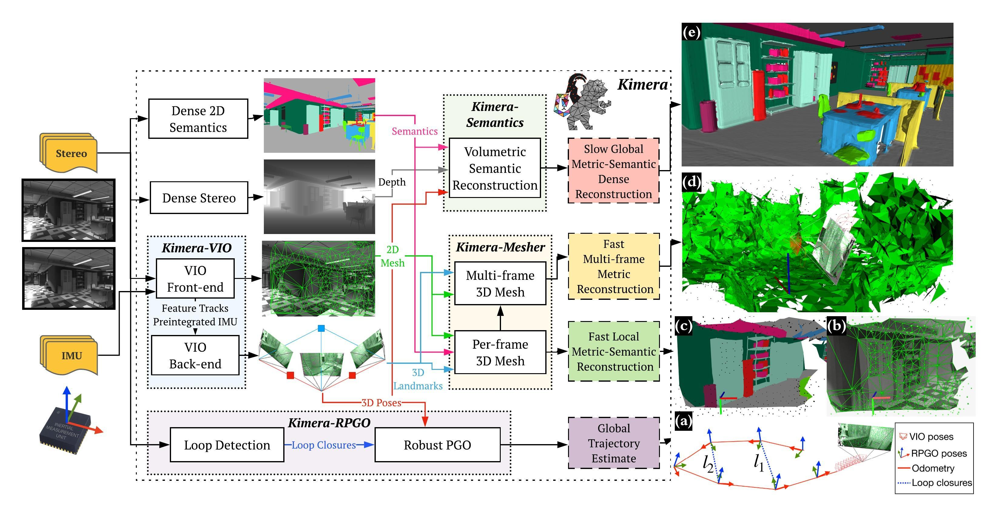
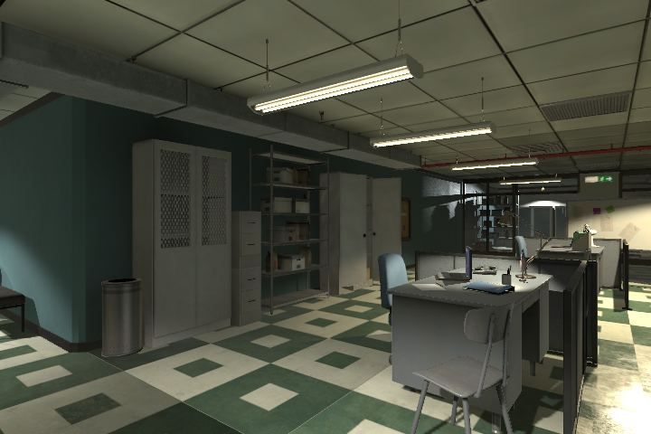
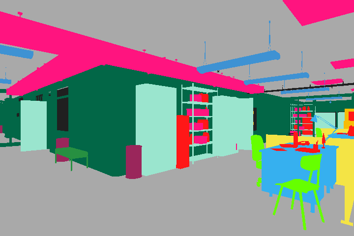
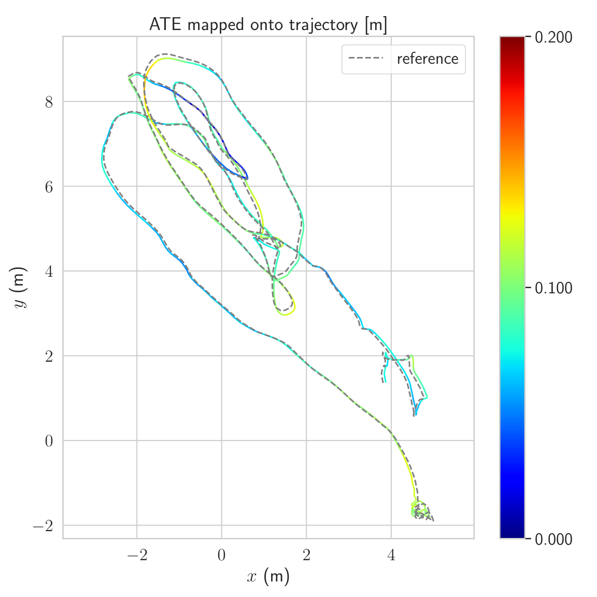
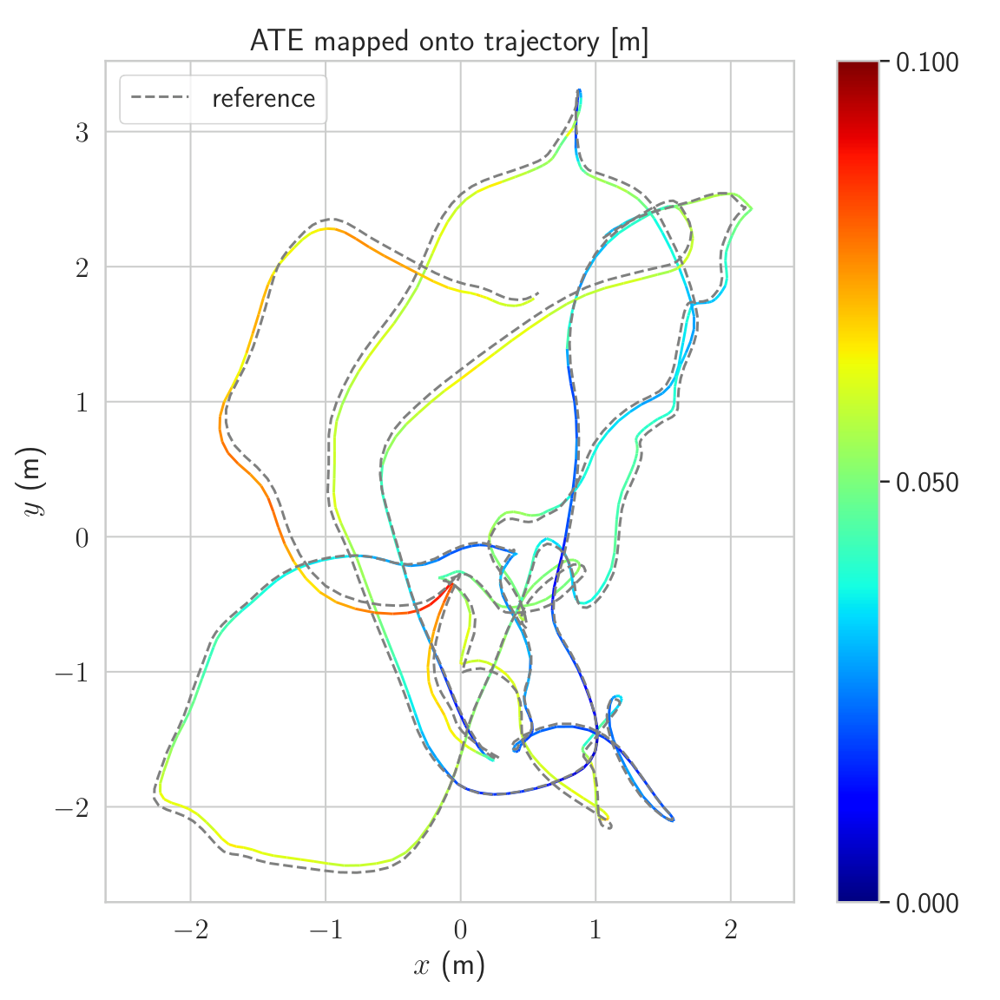
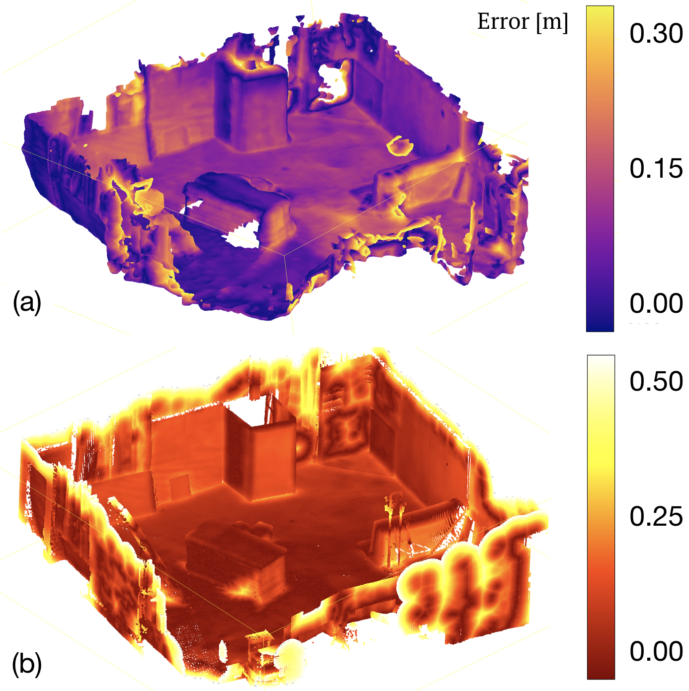
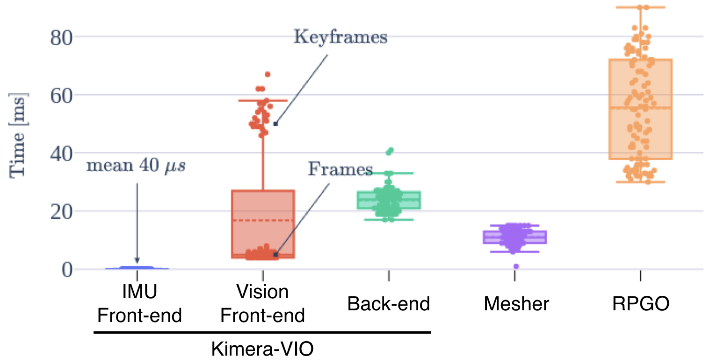

# Kimera SLAM (ICRA 2020)

<!-- paper-source: https://chengwei920412.github.io/paper_reading/1910.02490_Kimera_an_Open-Source_Library_for_Real-Time_Metric-Semantic_Localization_and_Mapping/1910.02490_%E9%98%85%E8%AF%BB%E6%8A%A5%E5%91%8A.html -->

## 0. 基本信息 {#0}

- 论文标题：Kimera: an Open-Source Library for Real-Time Metric-Semantic Localization and Mapping
- 作者：Antoni Rosinol, Marcus Abate, Yun Chang, Luca Carlone
- 机构：Laboratory for Information & Decision Systems, Massachusetts Institute of Technology
- 来源（会议 / arXiv / 期刊）：ICRA 2020；arXiv:1910.02490
- 年份：2020（arXiv v3 发布于 2020-03-04；初稿为 2019-10-06）
- 原始输入链接：https://arxiv.org/abs/1910.02490
- 最终使用的 arXiv 版本化 ID：1910.02490v3
- 原论文 arXiv 链接：https://arxiv.org/abs/1910.02490v3
- 幻觉翻译链接（hjfy）：https://hjfy.top/arxiv/1910.02490v3
- Cool Papers 链接：https://papers.cool/arxiv/1910.02490v3
- 论文研究方向：机器人视觉、视觉惯性 SLAM、metric-semantic SLAM、实时三维重建、语义建图
- 本文一句话概括：Kimera 是一个将 VIO、鲁棒位姿图优化、轻量 mesh 重建和 TSDF 语义融合整合到 CPU 实时开源系统中的 metric-semantic SLAM 库，其主要贡献是系统集成、实时性与可复现实验基础，而不是提出全新的单一估计算法。

## 1. 论文核心观点与主张的系统梳理 {#1}

### 1.1 研究背景与动机 {#11}

作者从“metric-semantic understanding”出发：机器人需要同时估计场景三维几何，并为物体或结构附加语义标签。几何用于安全导航、避障和操作，语义用于理解人类指令和生成可解释环境模型。论文明确指出，当时几何 SLAM / SfM / MVS 与深度语义分割各自发展很快，但二者长期相对割裂；已有 metric-semantic 工作多数依赖 RGB-D、GPU、离线或 alternating tracking/mapping 流程，难以直接服务轻量、视觉惯性、在线机器人系统。

论文的动机不是证明某个新理论，而是补齐工程研究基础设施：一个开源、模块化、CPU 实时、可替换组件的 metric-semantic SLAM 系统。作者希望研究者可以在 VIO、SLAM、3D reconstruction、segmentation 等模块上复用 Kimera，而不用从零搭系统。

### 1.2 问题设定 {#12}

Kimera 的输入是 stereo/mono 图像与高频 IMU，语义模块还可接收每个关键帧的 2D semantic labels。系统输出包括 IMU-rate 局部状态估计、全局一致轨迹、低延迟局部 mesh、多帧 mesh，以及全局 metric-semantic mesh。

这张图对应论文 Fig. 2，展示了四个模块的串联与并行关系：Kimera-VIO 负责局部状态估计，Kimera-RPGO 负责 loop closure 与全局轨迹，Kimera-Mesher 负责低延迟局部/多帧 mesh，Kimera-Semantics 用 dense stereo、TSDF 和语义 raycasting 生成更慢但更准确的全局语义 mesh。问题设定的关键约束是“实时线程”和“慢速全局线程”分离：控制和避障依赖低延迟估计，全局语义建图可在较低频率运行。

一个可形式化的系统接口是：

\[\{I_t^L, I_t^R, u_{t:t+1}^{\mathrm{imu}}, S_t\}_{t=1}^T \mapsto \{\hat{x}_t, \hat{X}_{1:T}^{\mathrm{global}}, M_t^{\mathrm{local}}, M^{\mathrm{semantic}}\}\]

这条公式不是论文单独编号公式，而是对作者系统输入输出的形式化。\(I_t^L, I_t^R\) 是 stereo 图像，\(u_{t:t+1}^{\mathrm{imu}}\) 是相邻关键帧间 IMU 测量，\(S_t\) 是 2D 语义分割，\(\hat{x}_t\) 是局部状态，\(\hat{X}_{1:T}^{\mathrm{global}}\) 是全局轨迹，\(M_t^{\mathrm{local}}\) 是低延迟 mesh，\(M^{\mathrm{semantic}}\) 是全局语义 mesh。工程上分别对应 ROS 输入 topic、VIO backend state、pose graph 结果、mesher output 和 TSDF/semantic mesh。

### 1.3 核心观点（Claims）的逐条梳理 {#13-claims}

1. Kimera 将 visual-inertial SLAM、mesh reconstruction 和 semantic understanding 整合为一个开源 C++ 库。该主张对应摘要、Introduction contribution 和 Section II 架构说明。
2. Kimera-VIO 能达到与当时开源 VIO 系统相当或更好的 EuRoC ATE 表现。该主张由 Section III-A 和 Table II 支撑。
3. Kimera-RPGO 通过 PCM outlier rejection 降低 loop closure threshold \(\alpha\) 调参敏感性。该主张由 Section II-B 的 PCM 描述和 Table III 支撑。
4. Kimera-Mesher 能在低延迟下生成局部/多帧 mesh，服务避障等快速任务；Kimera-Semantics 使用 TSDF 和 bundled raycasting 得到更准确但更慢的全局 metric-semantic mesh。该主张由 Section II-C、II-D、III-B 和 Timing 支撑。
5. 在 CPU 上，VIO、RPGO、Mesher 能以不同线程满足实时需求，Kimera-Semantics 运行在较慢线程。该主张由 Section III-D 支撑。
6. 该系统的贡献边界是“系统级集成与开源基准”，而非发明 VIO、TSDF、semantic segmentation 或 marching cubes 本身。论文大量模块继承 Forster 等人的 IMU preintegration、GTSAM/iSAM2、Voxblox、PCM、Delaunay triangulation 与 marching cubes。

### 1.4 创新性与贡献边界 {#14}

实质性机制改变主要体现在系统组合与在线化适配：作者将 PCM 从多机器人场景裁剪到单机器人在线 RPGO，并加入 odometry consistency check；将低延迟 mesh 与 VIO fixed-lag smoother 结合；将 semantic raycasting 放入完整 visual-inertial metric-semantic pipeline。

但许多技术组件是已有方法的复用或工程化重组。VIO 依赖 GTSAM、iSAM2、IMU preintegration 和 structureless vision factors；语义 3D 融合继承 SemanticFusion/Voxblox 式概率融合思想；dense stereo 使用半全局匹配；mesh 提取使用 marching cubes。因此论文创新更接近“可复用系统架构 + 实时工程实现 + 跨模块基准”，不是新的估计理论。

## 2. 关键论据、理论基础与数学方法的深度解析 {#2}

### 2.1 理论基础与学术渊源 {#21}

Kimera 建立在五类成熟技术上。

第一，视觉惯性最大后验估计。Kimera-VIO 使用 keyframe-based MAP visual-inertial estimator，核心来自 Forster et al. 的 on-manifold IMU preintegration 和 structureless vision factors。第二，因子图与增量非线性优化。后端由 GTSAM/iSAM2 求解，fixed-lag smoothing 用来限制计算时间。第三，鲁棒 pose graph optimization。Kimera-RPGO 使用 DBoW2 检测候选 loop closure，并用 PCM 最大一致测量集剔除感知混淆产生的错误闭环。第四，几何重建。局部 mesh 使用 2D Delaunay triangulation 再反投影到 3D，多帧 mesh 在 VIO horizon 内融合；全局 mesh 使用 TSDF 与 marching cubes。第五，语义融合。Kimera-Semantics 将 2D 语义标签通过 bundled raycasting 传播到体素概率，并对体素取最大后验标签。

### 2.2 问题形式化与建模选择 {#22}

Kimera-VIO 的后端可概括为 fixed-lag MAP 因子图优化。式 (1) 是对论文“preintegrated IMU and visual measurements are added to a fixed-lag smoother”的标准形式化：

\[\hat{\mathcal{X}} = \arg\min_{\mathcal{X}} \|r_0(\mathcal{X})\|_{\Sigma_0}^{2} + \sum_{(i,j)\in\mathcal{I}}\|r_{ij}^{\mathrm{imu}}(x_i,x_j,b_i)\|_{\Sigma_{ij}^{\mathrm{imu}}}^{2} + \sum_{(i,k)\in\mathcal{C}}\|r_{ik}^{\mathrm{cam}}(x_i,\ell_k)\|_{\Sigma_{ik}^{\mathrm{cam}}}^{2}\]

这条公式负责解释 Kimera-VIO 的估计目标。\(\mathcal{X}\) 是窗口内状态，通常包含 pose、velocity 和 IMU biases；\(r_0\) 是先验残差；\(r_{ij}^{\mathrm{imu}}\) 是 IMU preintegration 残差；\(r_{ik}^{\mathrm{cam}}\) 是视觉重投影残差；\(\ell_k\) 是 landmark。论文强调 structureless vision model 会估计并解析消去 3D feature positions，因此工程实现中 landmark 不一定作为长期变量保留，而是通过 smart factor / structureless factor 在 GTSAM 中被边缘化或消元。

一句话直译：Kimera-VIO 在固定时间窗内寻找最能同时解释 IMU 和视觉观测的状态序列。训练/推理映射到代码中就是不断向 factor graph 添加 IMU factor、vision factor、prior factor，再调用 iSAM2 增量更新。若删去 IMU 项，尺度和快速运动约束会变弱；若删去视觉项，IMU 积分漂移会迅速累积；若不做 fixed-lag，精度可能提升但实时性和内存开销会恶化。强假设包括相机/IMU 时间同步、标定可靠、噪声模型近似高斯、场景中有足够可跟踪特征。

极简数值例子：假设某一窗口中只有一个 IMU 残差和一个视觉残差，且归一化后分别为 \(r^{\mathrm{imu}}=0.2\)、\(r^{\mathrm{cam}}=1.0\)，则代价为 \(0.2^2+1.0^2=1.04\)。如果某个候选状态把视觉残差降到 \(0.4\) 但 IMU 残差升到 \(0.5\)，总代价变成 \(0.5^2+0.4^2=0.41\)，优化器会偏好后者。这说明 MAP 不是单独拟合某一传感器，而是在噪声权重下折中。

### 2.3 核心推导与算法构造 {#23}

Kimera-RPGO 的核心是先对 loop closure 做一致性筛选，再在 pose graph 上优化。标准 pose graph 目标可写为式 (2)：

\[\hat{X} = \arg\min_{X_1,\ldots,X_N} \sum_{(i,j)\in E_{\mathrm{odom}}\cup E_{\mathrm{lc}}^{\mathrm{inlier}}} \|\operatorname{Log}(Z_{ij}^{-1} X_i^{-1}X_j)\|_{\Omega_{ij}}^2\]

\(X_i\in SE(3)\) 是关键帧位姿，\(Z_{ij}\) 是 odometry 或 loop closure 相对位姿测量，\(\Omega_{ij}\) 是信息矩阵，\(E_{\mathrm{lc}}^{\mathrm{inlier}}\) 是 PCM 选出的闭环内点集合。自然语言翻译：系统只把通过一致性检查的闭环边加入全局优化，避免错误闭环把整张图拉坏。代码对应是 DBoW2 生成候选闭环、几何验证、PCM 更新一致性图、最大 clique 求内点集、GTSAM Gauss-Newton 求解。

该图对应论文 Fig. 3，图中红色 odometry 边和蓝色 loop closure 边形成约束。PCM 的关键思想不是让优化器“自己忍受”坏边，而是在优化前构造 pairwise consistency graph，选择最大一致闭环集合。

式 (3) 是论文文字描述的 odometry cycle consistency 与 \(\chi^2\) 检验的形式化：

\[e_l = \operatorname{Log}\left(Z_l^{-1}\prod_{(i,j)\in\mathrm{cycle}(l)} Z_{ij}^{\mathrm{odom}}\right), \quad e_l^\top \Sigma_l^{-1} e_l \le \chi^2_{d,\,1-\beta}\]

\(l\) 是候选闭环，\(Z_l\) 是闭环测量，cycle 是该闭环与 odometry 边组成的回路，\(d\) 是残差自由度，\(\beta\) 对应显著性水平。直译：若沿 odometry 绕一圈后与闭环测量不一致，且误差超出噪声可解释范围，就把闭环标为外点。工程上对应 `checkLoopClosureConsistency` 类逻辑，输入是闭环边、odometry 路径和协方差，输出是是否把该 loop closure 加入一致性图。强假设是 odometry 噪声协方差能合理刻画误差；若协方差过乐观，会误删真闭环，过保守则放进坏闭环。

极简数值例子：如果 \(d=1\)、阈值约为 \(3.84\)，候选闭环的归一化误差为 \(e_l^\top\Sigma_l^{-1}e_l=2.0\)，则通过；若为 \(12.0\)，则被拒绝。Table III 的结果说明，没有 PCM 时小 \(\alpha\) 带来更多但更脏的闭环，ATE 可升到 \(1.74\)m；有 PCM 时 ATE 保持在约 \(0.045\) 到 \(0.05\)m。

Kimera-Mesher 的局部 mesh 不是从 dense depth 直接重建，而是对 VIO 成功跟踪的 2D features 做 Delaunay triangulation，再反投影为三角面。式 (4) 是该步骤的几何表达：

\[v_k = \pi^{-1}(u_k, d_k; K, T_{WC}), \quad f_m = (v_a,v_b,v_c), \ (u_a,u_b,u_c)\in \operatorname{Delaunay}(\{u_k\})\]

\(u_k\) 是图像特征，\(d_k\) 是由 VIO/triangulation 得到的深度或 3D 点信息，\(K\) 是相机内参，\(T_{WC}\) 是相机到世界坐标的位姿，\(f_m\) 是 mesh 三角面。直译：先在图像平面连接稳定特征点，再把这些三角形抬到三维空间。工程上对应前端 feature tracks、后端 landmark estimates 和 mesh vertex/triangle list。删去这一模块不影响定位主链路，但失去低延迟几何输出；把它替换成 TSDF 可提升表面完整度，但延迟会增加。

Kimera-Semantics 的语义更新可用式 (5) 描述：

\[p_t(c\mid v) = \eta\, p(z_t=c\mid v)\, p_{t-1}(c\mid v)\]

\(v\) 是体素或接近表面的 raycasting 单元，\(c\) 是语义类别，\(z_t\) 是当前关键帧传播来的 2D 语义观测，\(\eta\) 是归一化常数。论文说法是 bundled raycasting 时根据 bundle 中观察标签频率构造 label probability vector，并只在 TSDF truncation distance 附近传播。直译：每次新关键帧到来，就把当前看到的语义证据乘到体素旧概率上，最后取最大概率标签。代码上对应每个 voxel 维护一组类别概率或计数，并在 mesh extraction 后给顶点/面赋语义。若 2D segmentation 或 dense stereo 失败，语义融合无法自行恢复，Table V 中 dense stereo 导致 mIoU 从约 \(80\%\) 降到 \(57.23\%\) 正是这个弱点。

极简数值例子：某体素旧概率为 \(p_{t-1}(\mathrm{wall})=0.6\)、\(p_{t-1}(\mathrm{floor})=0.4\)，新观测似然为 \(0.8\) 和 \(0.2\)，未归一化后得到 \(0.48\) 和 \(0.08\)，归一化后 wall 概率约为 \(0.86\)。如果 dense stereo 把墙面点投到地面附近，则新观测会持续污染概率，最终造成 Wall/Floor 混淆。

### 2.4 理论结论的适用范围 {#24}

Kimera 没有给出新的收敛定理或误差界。其理论可靠性来自组件级成熟方法：因子图 MAP 在高斯噪声和良好初始化附近可用非线性最小二乘求解；PCM 在给定一致性检验和最大 clique 求解下筛选闭环；TSDF 融合在多视角深度足够可靠时能平滑噪声。

式 (6) 是实验指标 mIoU 的定义，论文在语义重建评估中使用它：

\[\operatorname{mIoU} = \frac{1}{C}\sum_{c=1}^{C}\frac{\operatorname{TP}_c}{\operatorname{TP}_c+\operatorname{FP}_c+\operatorname{FN}_c}\]

该指标衡量每个类别预测区域与真值区域的交并比后取平均。它适合语义分割评估，但对几何误差不敏感，所以论文同时报告 ATE 和 mesh RMSE。若只看 mIoU，系统可能语义标签正确但三维位置偏移；若只看 RMSE，系统可能几何准确但语义不可用。

几何 RMSE 可概括为式 (7)：

\[\operatorname{RMSE}(P,Q)=\sqrt{\frac{1}{|P|}\sum_{p\in P}\min_{q\in Q}\|p-q\|_2^2}\]

\(P\) 是从估计 mesh 采样的点云，\(Q\) 是 ground-truth 点云。论文还用 accuracy/completeness 的双向最近邻度量。强假设是 ICP registration 足够可靠，并且 ground-truth 点云覆盖范围与估计 mesh 可比；若场景遮挡或真值不完整，RMSE 会混入评估协议误差。

## 3. 实验设计与实验结果的充分性分析 {#3}

### 3.1 实验目标与论文主张的对应关系 {#31}

实验分四组。Pose estimation 用 EuRoC 验证 Kimera-VIO/RPGO 是否达到 state-of-the-art ATE，并验证 PCM 是否降低 \(\alpha\) 调参敏感性。Geometric reconstruction 用 EuRoC V1/V2 有真值点云的序列评估 multi-frame mesh 与 global TSDF mesh。Semantic reconstruction 用 Unity photo-realistic simulator 提供 geometry/semantics ground truth，分离 GT depth/GT pose、GT depth/Kimera-VIO、Dense stereo/Kimera-VIO 三种设置，检查误差来源。Timing 实验验证 CPU 实时性与各模块线程延迟。

这两张图对应论文 simulator figure 的左右输入：RGB 图像与 2D semantic segmentation。论文为了避免把评估变成某个 2D 分割器的比较，语义实验使用 ground-truth 2D semantics；这能隔离 3D 融合误差，但也让真实部署中的 2D 分割噪声被低估。

### 3.2 实验设置合理性 {#32}

EuRoC 是 VIO 常用基准，适合定位评估，但不是专门的复杂语义建图数据集。论文用 EuRoC 的真值点云评估几何 mesh 是合理的，但只覆盖 V1/V2 子集，不能证明户外、动态物体、多楼层大规模环境下的稳健性。

语义实验使用 Unity simulator 的优势是有完整 3D 语义真值，可做 mIoU、Acc、RMSE 分解。缺点是仿真图像、材质、墙面纹理与真实环境差异明显；论文自己指出 dense stereo 在 texture-less walls 上失败，这说明仿真并未完全避免传感器/几何偏差。

对比方法方面，Table II 中 VIO 数字来自 Delmerico & Scaramuzza 以及 VINS-Mono 自报结果，且作者说明其他算法使用 monocular camera，而 Kimera 使用 stereo camera，并采用 \(SE(3)\) alignment。这一设置有合理性，因为 Kimera 的目标是 visual-inertial/stereo pipeline；但若把它当作“公平比较所有 VIO 方法”，传感器配置差异会削弱结论强度。

### 3.3 实验结果的解释力度 {#33}

Table II 是定位主结果。为便于阅读，下表直接转写论文结果。

<table>
<thead>
<tr>
<th>Seq.</th>
<th>OKVIS</th>
<th>MSCKF</th>
<th>ROVIO</th>
<th>VINS-Mono</th>
<th>Kimera-VIO fixed-lag</th>
<th>SVO-GTSAM</th>
<th>Kimera-VIO full</th>
<th>VINS-LC</th>
<th>Kimera-RPGO</th>
</tr>
</thead>
<tbody>
<tr>
<td>MH_1</td>
<td>0.16</td>
<td>0.42</td>
<td>0.21</td>
<td>0.15</td>
<td>0.11</td>
<td>0.05</td>
<td>0.04</td>
<td>0.12</td>
<td>0.08</td>
</tr>
<tr>
<td>MH_2</td>
<td>0.22</td>
<td>0.45</td>
<td>0.25</td>
<td>0.15</td>
<td>0.10</td>
<td>0.03</td>
<td>0.07</td>
<td>0.12</td>
<td>0.09</td>
</tr>
<tr>
<td>MH_3</td>
<td>0.24</td>
<td>0.23</td>
<td>0.25</td>
<td>0.22</td>
<td>0.16</td>
<td>0.12</td>
<td>0.12</td>
<td>0.13</td>
<td>0.11</td>
</tr>
<tr>
<td>MH_4</td>
<td>0.34</td>
<td>0.37</td>
<td>0.49</td>
<td>0.32</td>
<td>0.24</td>
<td>0.13</td>
<td>0.27</td>
<td>0.18</td>
<td>0.15</td>
</tr>
<tr>
<td>MH_5</td>
<td>0.47</td>
<td>0.48</td>
<td>0.52</td>
<td>0.30</td>
<td>0.35</td>
<td>0.16</td>
<td>0.20</td>
<td>0.21</td>
<td>0.24</td>
</tr>
<tr>
<td>V1_1</td>
<td>0.09</td>
<td>0.34</td>
<td>0.10</td>
<td>0.08</td>
<td>0.05</td>
<td>0.07</td>
<td>0.06</td>
<td>0.06</td>
<td>0.05</td>
</tr>
<tr>
<td>V1_2</td>
<td>0.20</td>
<td>0.20</td>
<td>0.10</td>
<td>0.11</td>
<td>0.08</td>
<td>0.11</td>
<td>0.07</td>
<td>0.08</td>
<td>0.11</td>
</tr>
<tr>
<td>V1_3</td>
<td>0.24</td>
<td>0.67</td>
<td>0.14</td>
<td>0.18</td>
<td>0.07</td>
<td>failure</td>
<td>0.09</td>
<td>0.19</td>
<td>0.12</td>
</tr>
<tr>
<td>V2_1</td>
<td>0.13</td>
<td>0.10</td>
<td>0.12</td>
<td>0.08</td>
<td>0.08</td>
<td>0.07</td>
<td>0.07</td>
<td>0.08</td>
<td>0.07</td>
</tr>
<tr>
<td>V2_2</td>
<td>0.16</td>
<td>0.16</td>
<td>0.14</td>
<td>0.16</td>
<td>0.10</td>
<td>failure</td>
<td>0.09</td>
<td>0.16</td>
<td>0.10</td>
</tr>
<tr>
<td>V2_3</td>
<td>0.29</td>
<td>1.13</td>
<td>0.14</td>
<td>0.27</td>
<td>0.21</td>
<td>failure</td>
<td>0.19</td>
<td>1.39</td>
<td>0.19</td>
</tr>
</tbody>
</table>

该表支撑“Kimera-VIO/RPGO 在 EuRoC 上有竞争力”，但不是每一行都绝对最优。比如 MH_5 中 VINS-Mono fixed-lag 数值优于 Kimera-VIO fixed-lag，MH_2/MH_4/MH_5 中 SVO-GTSAM full smoothing 优于 Kimera-VIO full smoothing。论文的“top performance across the spectrum”更准确地应理解为“在三类设置中整体有竞争力且多序列表现靠前”，而非全表逐项 SOTA。

这两张图对应论文 Fig. 4，用颜色展示估计轨迹相对真值的 ATE。它们支持定位误差空间分布的定性判断，但论文没有提供误差随时间、不同随机种子或统计显著性分析。

Table III 是 RPGO 鲁棒性实验，也是论文机制验证最直接的表。

<table>
<thead>
<tr>
<th>方法</th>
<th>\(\alpha=10\)</th>
<th>\(\alpha=1\)</th>
<th>\(\alpha=0.1\)</th>
<th>\(\alpha=0.01\)</th>
<th>\(\alpha=0.001\)</th>
</tr>
</thead>
<tbody>
<tr>
<td>PGO w/o PCM</td>
<td>0.05</td>
<td>0.45</td>
<td>1.74</td>
<td>1.59</td>
<td>1.59</td>
</tr>
<tr>
<td>Kimera-RPGO</td>
<td>0.05</td>
<td>0.05</td>
<td>0.05</td>
<td>0.045</td>
<td>0.049</td>
</tr>
</tbody>
</table>

该表清楚验证了 Claim 3：PCM 让结果几乎不受 DBoW2 loop closure threshold \(\alpha\) 影响。需要注意的是，该实验只在 V1_01 上报告，不能单独证明所有环境中的闭环鲁棒性。

几何重建结果如下。

<table>
<thead>
<tr>
<th>Seq.</th>
<th>Multi-Frame RMSE [m]</th>
<th>Global RMSE [m]</th>
<th>Relative Improvement [%]</th>
</tr>
</thead>
<tbody>
<tr>
<td>V1_01</td>
<td>0.482</td>
<td>0.364</td>
<td>24.00</td>
</tr>
<tr>
<td>V1_02</td>
<td>0.374</td>
<td>0.384</td>
<td>-2.00</td>
</tr>
<tr>
<td>V1_03</td>
<td>0.451</td>
<td>0.353</td>
<td>21.00</td>
</tr>
<tr>
<td>V2_01</td>
<td>0.465</td>
<td>0.480</td>
<td>-3.00</td>
</tr>
<tr>
<td>V2_02</td>
<td>0.491</td>
<td>0.432</td>
<td>12.00</td>
</tr>
<tr>
<td>V2_03</td>
<td>0.530</td>
<td>0.411</td>
<td>22.00</td>
</tr>
</tbody>
</table>

论文将 Global TSDF mesh 描述为更准确，但表中 V1_02 和 V2_01 的 Global RMSE 略差于 Multi-Frame。更严谨的解释是：global mesh 在多数序列有更低 RMSE，但优势并非逐序列稳定；其主要代价是计算慢两个数量级左右。

语义重建实验如下。

<table>
<thead>
<tr>
<th>指标类别</th>
<th>指标</th>
<th>GT Depth + GT Poses</th>
<th>GT Depth + Kimera-VIO</th>
<th>Dense-Stereo + Kimera-VIO</th>
</tr>
</thead>
<tbody>
<tr>
<td>Semantic</td>
<td>mIoU [%]</td>
<td>80.10</td>
<td>80.03</td>
<td>57.23</td>
</tr>
<tr>
<td>Semantic</td>
<td>Acc [%]</td>
<td>94.68</td>
<td>94.50</td>
<td>80.74</td>
</tr>
<tr>
<td>Geometric</td>
<td>ATE [m]</td>
<td>0.0</td>
<td>0.04</td>
<td>0.04</td>
</tr>
<tr>
<td>Geometric</td>
<td>RMSE [m]</td>
<td>0.079</td>
<td>0.131</td>
<td>0.215</td>
</tr>
</tbody>
</table>

这张表验证了两个结论：VIO pose drift 在该仿真轨迹上影响很小；dense stereo 是语义和几何性能下降的主要来源。该结果也暴露了核心弱点：Kimera-Semantics 的上限强依赖深度质量，即使 2D 语义是 ground truth，dense stereo 仍会把 mIoU 从 80.03% 拉低到 57.23%。

Timing 结果由论文文字和 Fig. 6 给出。

<table>
<thead>
<tr>
<th>模块 / 操作</th>
<th>论文报告时间</th>
<th>作用</th>
</tr>
</thead>
<tbody>
<tr>
<td>IMU preintegration</td>
<td>约 \(40\mu s\)</td>
<td>支持 IMU-rate 状态传播，论文称 \(&gt;200\)Hz</td>
</tr>
<tr>
<td>feature tracking</td>
<td>平均 \(4.5\)ms</td>
<td>每帧视觉前端</td>
</tr>
<tr>
<td>keyframe feature detection + stereo matching + geometric verification</td>
<td>平均 \(45\)ms</td>
<td>关键帧视觉处理</td>
</tr>
<tr>
<td>per-frame mesh</td>
<td>小于 \(5\)ms</td>
<td>低延迟局部避障 mesh</td>
</tr>
<tr>
<td>multi-frame mesh</td>
<td>平均 \(15\)ms</td>
<td>fixed-lag horizon 内 mesh</td>
</tr>
<tr>
<td>VIO backend factor graph</td>
<td>小于 \(40\)ms</td>
<td>局部优化</td>
</tr>
<tr>
<td>Kimera-RPGO</td>
<td>平均 \(55\)ms on EuRoC</td>
<td>慢线程全局轨迹</td>
</tr>
<tr>
<td>Kimera-Semantics</td>
<td>平均 \(0.1\)s / keyframe</td>
<td>全局 metric-semantic mesh，未在图中显示</td>
</tr>
</tbody>
</table>

### 3.4 潜在未讨论因素 {#34}

论文没有报告统计显著性、随机初始化敏感性、不同硬件配置下的 runtime 方差，也没有系统测试动态物体、强光照变化、低纹理大平面、IMU 时间同步误差、相机外参误差对整体系统的影响。

关键消融实验集中在 Table III 和 Table V，而不是完整模块消融。比如没有报告“去掉 regularity factors”“不用 stereo 几何验证”“换不同 semantic segmentation 网络”“不同 TSDF truncation distance”“不同 fixed-lag horizon”的系统消融。因此论文能证明 Kimera 的系统可行性，但对每个组件贡献的归因仍不完整。

<table>
<thead>
<tr>
<th>消融项</th>
<th>变化设置</th>
<th>数据集 / 设置</th>
<th>指标</th>
<th>原始数值</th>
<th>变化后数值</th>
<th>结论</th>
</tr>
</thead>
<tbody>
<tr>
<td>RPGO outlier rejection</td>
<td>Kimera-RPGO vs PGO w/o PCM</td>
<td>EuRoC V1_01, \(\alpha=0.001\)</td>
<td>RMSE ATE [m]</td>
<td>0.049</td>
<td>1.59</td>
<td>PCM 是闭环鲁棒性的关键</td>
</tr>
<tr>
<td>loop closure threshold</td>
<td>\(\alpha=10\) 到 \(0.001\)</td>
<td>EuRoC V1_01</td>
<td>Kimera-RPGO ATE [m]</td>
<td>0.05</td>
<td>0.049</td>
<td>有 PCM 时阈值不敏感</td>
</tr>
<tr>
<td>pose source</td>
<td>GT poses -&gt; Kimera-VIO</td>
<td>simulator, GT depth</td>
<td>mIoU [%]</td>
<td>80.10</td>
<td>80.03</td>
<td>该轨迹上 VIO drift 对语义影响很小</td>
</tr>
<tr>
<td>depth source</td>
<td>GT depth -&gt; dense stereo</td>
<td>simulator, Kimera-VIO</td>
<td>mIoU [%]</td>
<td>80.03</td>
<td>57.23</td>
<td>dense stereo 是主要误差来源</td>
</tr>
<tr>
<td>mesh backend</td>
<td>Multi-frame -&gt; Global TSDF</td>
<td>EuRoC V1_01</td>
<td>RMSE [m]</td>
<td>0.482</td>
<td>0.364</td>
<td>Global TSDF 在多数序列更准但更慢</td>
</tr>
</tbody>
</table>

## 4. 与当前领域主流共识及反对观点的关系 {#4}

### 4.1 与主流观点的一致性 {#41}

Kimera 延续了 SLAM 领域“因子图优化 + 鲁棒闭环 + 多传感器融合”的主流路线。ORB-SLAM 代表视觉 SLAM 中 tracking/mapping/loop closing 的工程范式；VINS-Mono 代表 tightly-coupled visual-inertial optimization；Forster et al. 的 IMU preintegration 与 GTSAM/iSAM2 构成 Kimera-VIO 的直接技术基础。

在 metric-semantic mapping 方向，SemanticFusion 已证明 2D CNN 语义预测可通过 dense SLAM 融合进 3D 地图，Voxblox 证明 CPU 上增量 TSDF/ESDF 对 MAV planning 可行，Voxblox++ 和 PanopticFusion 代表在线体素语义/实例建图。Kimera 与这些工作的关系是把语义 3D 融合放进 visual-inertial SLAM 系统，并提供低延迟 mesh 与全局语义 mesh 的双速率输出。

### 4.2 与反对或竞争观点的分歧 {#42}

当前未检索到针对 Kimera 1910.02490 本身的明确反驳论文，但存在几类竞争观点。第一，RGB-D / LiDAR 系统认为主动深度或 LiDAR 在几何可靠性上优于 stereo，Kimera 的 Table V 也支持这一点：dense stereo 是性能瓶颈。第二，后续 Kimera2 将 Kimera-VIO 扩展到更多模态，并把 RPGO/PGMO 更新为包含 Graduated-Non-Convexity 的鲁棒后端，这间接说明原 Kimera 在真实机器人、多模态、鲁棒后端方面仍有工程改进空间。第三，PanopticFusion 等工作强调 panoptic stuff/things 与 instance consistency，而 Kimera 原文主要输出语义 mesh，对实例级和动态图建模不足。

### 4.3 论文在学术版图中的定位 {#43}

Kimera 更像主流方法的系统级集成和开源基准，而不是挑战主流范式。其定位是把 VIO、鲁棒 PGO、mesh、TSDF、semantic raycasting 组织成一个可运行、可替换、可复现实验平台。它对后续 Kimera-Multi、Kimera DSG / Dynamic Scene Graph、Kimera2 等工作具有基础设施意义。

### 4.4 文献检索说明 {#44}

- 检索范围：原论文 arXiv v3、ar5iv HTML、论文源码参考文献、papers.cool 页面，以及 arXiv 可核验页面中与 ORB-SLAM、VINS-Mono、SemanticFusion、Voxblox、Voxblox++、PanopticFusion、Kimera2 相关的条目。
- 检索结论可信度：论文内部技术与实验结论可信度较高；外部对比主要基于原论文引用和 arXiv/会议论文条目。当前未检索到直接针对 Kimera 原论文结论的独立反驳论文。

### 4.5 相关论文补充表 {#45}

<table>
<thead>
<tr>
<th>序号</th>
<th>论文标题</th>
<th>作者 / 年份</th>
<th>来源</th>
<th>与原论文关系</th>
<th>一句话概述</th>
</tr>
</thead>
<tbody>
<tr>
<td>1</td>
<td>Past, Present, and Future of SLAM: Toward the Robust-Perception Age</td>
<td>Cadena et al., 2016</td>
<td>IEEE T-RO</td>
<td>背景综述</td>
<td>将 SLAM 发展定位到鲁棒感知阶段，是 Kimera metric-semantic 动机的上位背景</td>
</tr>
<tr>
<td>2</td>
<td>ORB-SLAM: A Versatile and Accurate Monocular SLAM System</td>
<td>Mur-Artal et al., 2015</td>
<td>IEEE T-RO / arXiv</td>
<td>视觉 SLAM 基线</td>
<td>实时 monocular SLAM 系统，Kimera 在 Table I 中将其列为无语义、点地图基线</td>
</tr>
<tr>
<td>3</td>
<td>VINS-Mono: A Robust and Versatile Monocular Visual-Inertial State Estimator</td>
<td>Qin et al., 2018</td>
<td>IEEE T-RO / arXiv</td>
<td>VIO 基线</td>
<td>优化式 monocular VIO，与 Kimera-VIO 在 EuRoC ATE 中对比</td>
</tr>
<tr>
<td>4</td>
<td>On-Manifold Preintegration Theory for Fast and Accurate Visual-Inertial Navigation</td>
<td>Forster et al., 2017</td>
<td>IEEE T-RO / arXiv</td>
<td>直接理论基础</td>
<td>Kimera-VIO 使用 IMU preintegration 和 structureless vision factors</td>
</tr>
<tr>
<td>5</td>
<td>SemanticFusion: Dense 3D Semantic Mapping with CNNs</td>
<td>McCormac et al., 2017</td>
<td>ICRA / arXiv</td>
<td>语义融合先驱</td>
<td>将 CNN 语义预测融合进 dense RGB-D SLAM map，是 Kimera-Semantics 的重要先例</td>
</tr>
<tr>
<td>6</td>
<td>Voxblox: Incremental 3D ESDFs for On-Board MAV Planning</td>
<td>Oleynikova et al., 2017</td>
<td>IROS / arXiv</td>
<td>TSDF/ESDF 基础</td>
<td>Kimera-Semantics 的全局 TSDF mesh 和 bundled raycasting 建立在 Voxblox 思路上</td>
</tr>
<tr>
<td>7</td>
<td>Pairwise Consistent Measurement Set Maximization for Robust Multi-Robot Map Merging</td>
<td>Mangelson et al., 2018</td>
<td>ICRA</td>
<td>RPGO 鲁棒性基础</td>
<td>Kimera-RPGO 将 PCM 适配到单机器人在线 loop closure outlier rejection</td>
</tr>
<tr>
<td>8</td>
<td>Volumetric Instance-Aware Semantic Mapping and 3D Object Discovery</td>
<td>Grinvald et al., 2019</td>
<td>RA-L / arXiv</td>
<td>竞争/相关</td>
<td>RGB-D 在线体素实例语义建图，Kimera 在 Table I 中将 Voxblox++ 列为接近方法</td>
</tr>
<tr>
<td>9</td>
<td>PanopticFusion: Online Volumetric Semantic Mapping at the Level of Stuff and Things</td>
<td>Narita et al., 2019</td>
<td>arXiv</td>
<td>竞争/相关</td>
<td>强调 stuff/things panoptic map 和实例一致性，语义表达层次比 Kimera 原文更细</td>
</tr>
<tr>
<td>10</td>
<td>Kimera2: Robust and Accurate Metric-Semantic SLAM in the Real World</td>
<td>Abate et al., 2024</td>
<td>arXiv</td>
<td>后续扩展</td>
<td>扩展输入模态、改进 VIO/RPGO/PGMO，并讨论真实平台中的优缺点</td>
</tr>
</tbody>
</table>

## 5. 对论文理论体系的严肃反驳与系统性质疑 {#5}

### 5.1 核心假设层面的质疑 {#51}

Kimera 的核心假设包括：视觉前端能持续跟踪足够特征；IMU 和相机标定/同步可靠；stereo 或 dense stereo 能提供可用几何；2D semantic labels 可由外部方法提供；环境大体静态。论文并未系统讨论动态物体、强反光、弱纹理、滚动快门、时间同步误差对全系统的级联影响。

最重要的问题是语义性能被“ground-truth 2D semantics”保护。真实机器人部署中，2D segmentation 错误会与深度错误、位姿误差一起进入 3D 融合，Bayesian update 还可能把系统性错误累积为高置信错误标签。论文的语义实验因此更像评估 3D 融合链路，而非完整 semantic SLAM 感知链路。

### 5.2 数学推导与理论主张的边界 {#52}

论文没有提出新的全局最优性、鲁棒性上界或实时性理论界限。PCM 的最大 clique 选择在理论上可剔除不一致闭环，但依赖 pairwise consistency 的判别质量；pairwise 一致不必然推出全局一致，且最大 clique 求解本身有组合复杂度。论文报告 EuRoC 上 Kimera-RPGO 平均 \(55\)ms，但也承认 runtime 依赖 pose graph size。

VIO 的 MAP 目标依赖高斯噪声和局部非线性优化；若初始化差、feature outlier 多、IMU bias 剧烈变化，iSAM2/Gauss-Newton 的局部收敛性质不足以保证全局正确。论文通过 RANSAC、structureless factor、fixed-lag 和 PCM 增强鲁棒性，但没有把这些工程层面的保护转化为严格理论保证。

### 5.3 工程实现与实际适用性 {#53}

Kimera 的工程价值很强，但“CPU 实时”需要限定模块。论文的实时性主要适用于 VIO、RPGO 和 Mesher 的多线程流水线；Kimera-Semantics 是较慢线程，约 \(0.1\)s/keyframe，而且实验使用 \(720\times480\) dense depth。更高分辨率、更大地图、更复杂语义类别或实例级融合会显著增加负载。

此外，系统模块多意味着调参与依赖链长。相机/IMU 标定、DBoW2 词袋、RANSAC 阈值、fixed-lag horizon、TSDF truncation distance、semantic raycasting 参数都会影响最终输出。论文展示了 \(\alpha\) 在 PCM 下不敏感，但没有证明其他关键参数同样稳健。

### 5.4 整体理论体系的稳健性 {#54}

Kimera 的整体稳健性是“多成熟模块叠加后的工程稳健性”，不是单一理论闭环。其优势可能在真实系统中被三个因素破坏：一是感知前端输入质量下降，尤其低纹理 dense stereo；二是长时间运行导致地图规模、闭环数量和 TSDF 内存增长；三是动态物体和语义分割错误造成三维语义污染。

更简单的替代解释是：Kimera 表现好很大程度来自 stereo + IMU + GTSAM/iSAM2 + 已有 robust PGO 的强组合，而非新架构本身带来不可替代的理论优势。论文作为系统论文可以接受这一点，但在阅读时不应把它误解为某个新算法单独击败所有基线。

## 6. 最终结论 {#6}

### 6.1 论文价值总结 {#61}

Kimera 的价值在于把当时分散的 VIO、鲁棒 PGO、低延迟 mesh、TSDF 语义融合和评估工具统一为一个开源系统，并用 EuRoC 与仿真语义真值展示其可行性。它为后续 metric-semantic SLAM、multi-robot semantic mapping 和 dynamic scene graph 系统提供了工程底座。

### 6.2 一句话总评 {#62}

这是一篇强工程系统论文：贡献的核心不是新理论，而是把多个可靠模块组合成可复用、可评估、实时运行的 metric-semantic SLAM 平台。

### 6.3 综合评分（10 分制） {#63-10}

- 创新性：7.0
- 技术严谨性：7.5
- 实验说服力：7.0
- 工程价值：9.0
- 总体评分：7.8

### 6.4 最关键的三条优点 {#64}

1. 系统集成完整：从 VIO 到 RPGO、局部 mesh、全局 semantic mesh，形成端到端开源库。
2. 实验覆盖多个关键主张：定位、闭环鲁棒性、几何重建、语义重建、runtime 均有对应结果。
3. 工程可复用性高：模块化设计、ROS 支持、GTSAM/Open3D/evo/Jupyter/CI 等工具链降低后续研究门槛。

### 6.5 最关键的三条问题 {#65}

1. 语义实验使用 ground-truth 2D semantics，低估真实部署中 segmentation 错误的级联影响。
2. 消融不充分，除 PCM 和 depth/pose 来源外，缺少对 fixed-lag horizon、regularity factors、TSDF 参数、语义融合参数的系统分析。
3. “实时”和“鲁棒”结论依赖具体场景、硬件和图规模，论文没有给出大规模长期运行或动态环境的充分证据。

## 附录 A：关键实验表与消融实验表 {#a}

### A.1 主 benchmark 对比表 {#a1-benchmark}

<table>
<thead>
<tr>
<th>Seq.</th>
<th>OKVIS</th>
<th>MSCKF</th>
<th>ROVIO</th>
<th>VINS-Mono</th>
<th>Kimera-VIO fixed-lag</th>
<th>SVO-GTSAM</th>
<th>Kimera-VIO full</th>
<th>VINS-LC</th>
<th>Kimera-RPGO</th>
</tr>
</thead>
<tbody>
<tr>
<td>MH_1</td>
<td>0.16</td>
<td>0.42</td>
<td>0.21</td>
<td>0.15</td>
<td>0.11</td>
<td>0.05</td>
<td>0.04</td>
<td>0.12</td>
<td>0.08</td>
</tr>
<tr>
<td>MH_2</td>
<td>0.22</td>
<td>0.45</td>
<td>0.25</td>
<td>0.15</td>
<td>0.10</td>
<td>0.03</td>
<td>0.07</td>
<td>0.12</td>
<td>0.09</td>
</tr>
<tr>
<td>MH_3</td>
<td>0.24</td>
<td>0.23</td>
<td>0.25</td>
<td>0.22</td>
<td>0.16</td>
<td>0.12</td>
<td>0.12</td>
<td>0.13</td>
<td>0.11</td>
</tr>
<tr>
<td>MH_4</td>
<td>0.34</td>
<td>0.37</td>
<td>0.49</td>
<td>0.32</td>
<td>0.24</td>
<td>0.13</td>
<td>0.27</td>
<td>0.18</td>
<td>0.15</td>
</tr>
<tr>
<td>MH_5</td>
<td>0.47</td>
<td>0.48</td>
<td>0.52</td>
<td>0.30</td>
<td>0.35</td>
<td>0.16</td>
<td>0.20</td>
<td>0.21</td>
<td>0.24</td>
</tr>
<tr>
<td>V1_1</td>
<td>0.09</td>
<td>0.34</td>
<td>0.10</td>
<td>0.08</td>
<td>0.05</td>
<td>0.07</td>
<td>0.06</td>
<td>0.06</td>
<td>0.05</td>
</tr>
<tr>
<td>V1_2</td>
<td>0.20</td>
<td>0.20</td>
<td>0.10</td>
<td>0.11</td>
<td>0.08</td>
<td>0.11</td>
<td>0.07</td>
<td>0.08</td>
<td>0.11</td>
</tr>
<tr>
<td>V1_3</td>
<td>0.24</td>
<td>0.67</td>
<td>0.14</td>
<td>0.18</td>
<td>0.07</td>
<td>failure</td>
<td>0.09</td>
<td>0.19</td>
<td>0.12</td>
</tr>
<tr>
<td>V2_1</td>
<td>0.13</td>
<td>0.10</td>
<td>0.12</td>
<td>0.08</td>
<td>0.08</td>
<td>0.07</td>
<td>0.07</td>
<td>0.08</td>
<td>0.07</td>
</tr>
<tr>
<td>V2_2</td>
<td>0.16</td>
<td>0.16</td>
<td>0.14</td>
<td>0.16</td>
<td>0.10</td>
<td>failure</td>
<td>0.09</td>
<td>0.16</td>
<td>0.10</td>
</tr>
<tr>
<td>V2_3</td>
<td>0.29</td>
<td>1.13</td>
<td>0.14</td>
<td>0.27</td>
<td>0.21</td>
<td>failure</td>
<td>0.19</td>
<td>1.39</td>
<td>0.19</td>
</tr>
</tbody>
</table>

### A.2 扩展指标 / 扩展 benchmark 表 {#a2-benchmark}

<table>
<thead>
<tr>
<th>Seq.</th>
<th>Multi-Frame RMSE [m]</th>
<th>Global RMSE [m]</th>
<th>Relative Improvement [%]</th>
</tr>
</thead>
<tbody>
<tr>
<td>V1_01</td>
<td>0.482</td>
<td>0.364</td>
<td>24.00</td>
</tr>
<tr>
<td>V1_02</td>
<td>0.374</td>
<td>0.384</td>
<td>-2.00</td>
</tr>
<tr>
<td>V1_03</td>
<td>0.451</td>
<td>0.353</td>
<td>21.00</td>
</tr>
<tr>
<td>V2_01</td>
<td>0.465</td>
<td>0.480</td>
<td>-3.00</td>
</tr>
<tr>
<td>V2_02</td>
<td>0.491</td>
<td>0.432</td>
<td>12.00</td>
</tr>
<tr>
<td>V2_03</td>
<td>0.530</td>
<td>0.411</td>
<td>22.00</td>
</tr>
</tbody>
</table>

### A.3 数据规模 / scaling law / 泛化表 {#a3-scaling-law}

原论文没有报告 scaling law 或跨数据规模实验。它只报告 EuRoC 若干序列、一个 Unity 仿真场景和 runtime breakdown。因此不能从原文推出随地图规模、语义类别数或长期运行时间增长的性能曲线。

### A.4 关键消融实验表 {#a4}

<table>
<thead>
<tr>
<th>消融项</th>
<th>变化设置</th>
<th>指标</th>
<th>原始数值</th>
<th>变化后数值</th>
<th>结论</th>
</tr>
</thead>
<tbody>
<tr>
<td>PCM</td>
<td>Kimera-RPGO vs PGO w/o PCM at \(\alpha=0.001\)</td>
<td>RMSE ATE [m]</td>
<td>0.049</td>
<td>1.59</td>
<td>PCM 显著降低错误闭环影响</td>
</tr>
<tr>
<td>\(\alpha\) threshold</td>
<td>\(\alpha=10\) 到 \(0.001\)</td>
<td>Kimera-RPGO RMSE ATE [m]</td>
<td>0.05</td>
<td>0.049</td>
<td>Kimera-RPGO 对该阈值基本不敏感</td>
</tr>
<tr>
<td>VIO pose</td>
<td>GT pose -&gt; Kimera-VIO pose</td>
<td>mIoU [%]</td>
<td>80.10</td>
<td>80.03</td>
<td>该实验中 pose drift 影响很小</td>
</tr>
<tr>
<td>Dense depth</td>
<td>GT depth -&gt; dense stereo</td>
<td>mIoU [%]</td>
<td>80.03</td>
<td>57.23</td>
<td>dense stereo 是主要语义性能瓶颈</td>
</tr>
<tr>
<td>Dense depth</td>
<td>GT depth -&gt; dense stereo</td>
<td>RMSE [m]</td>
<td>0.131</td>
<td>0.215</td>
<td>dense stereo 同时降低几何精度</td>
</tr>
</tbody>
</table>

### A.5 其他支撑正文结论的关键表 {#a5}

<table>
<thead>
<tr>
<th>模块 / 操作</th>
<th>论文报告时间</th>
<th>核心结论</th>
</tr>
</thead>
<tbody>
<tr>
<td>IMU preintegration</td>
<td>约 \(40\mu s\)</td>
<td>可支持高频状态传播</td>
</tr>
<tr>
<td>feature tracking</td>
<td>平均 \(4.5\)ms</td>
<td>每帧前端可实时运行</td>
</tr>
<tr>
<td>keyframe full vision frontend</td>
<td>平均 \(45\)ms</td>
<td>关键帧处理开销明显高于普通帧</td>
</tr>
<tr>
<td>per-frame mesh</td>
<td>小于 \(5\)ms</td>
<td>低延迟 mesh 可用于快速避障</td>
</tr>
<tr>
<td>multi-frame mesh</td>
<td>平均 \(15\)ms</td>
<td>fixed-lag mesh 仍在实时范围</td>
</tr>
<tr>
<td>VIO backend</td>
<td>小于 \(40\)ms</td>
<td>局部优化可在线运行</td>
</tr>
<tr>
<td>RPGO</td>
<td>平均 \(55\)ms</td>
<td>适合较慢全局线程</td>
</tr>
<tr>
<td>Kimera-Semantics</td>
<td>平均 \(0.1\)s/keyframe</td>
<td>可在线运行，但不是控制级高频模块</td>
</tr>
</tbody>
</table>

## 附录 B：本报告引用的关键外部文献 {#b}

1. Cadena, C. et al. “Past, Present, and Future of Simultaneous Localization and Mapping: Toward the Robust-Perception Age.” IEEE Transactions on Robotics, 2016.
2. Mur-Artal, R., Montiel, J. M. M., and Tardos, J. D. “ORB-SLAM: A Versatile and Accurate Monocular SLAM System.” IEEE Transactions on Robotics, 2015. arXiv:1502.00956.
3. Qin, T., Li, P., and Shen, S. “VINS-Mono: A Robust and Versatile Monocular Visual-Inertial State Estimator.” IEEE Transactions on Robotics, 2018. arXiv:1708.03852.
4. Forster, C., Carlone, L., Dellaert, F., and Scaramuzza, D. “On-Manifold Preintegration Theory for Fast and Accurate Visual-Inertial Navigation.” IEEE Transactions on Robotics, 2017.
5. McCormac, J., Handa, A., Davison, A. J., and Leutenegger, S. “SemanticFusion: Dense 3D Semantic Mapping with Convolutional Neural Networks.” ICRA, 2017. arXiv:1609.05130.
6. Oleynikova, H. et al. “Voxblox: Incremental 3D Euclidean Signed Distance Fields for On-Board MAV Planning.” IROS, 2017. arXiv:1611.03631.
7. Mangelson, J. G. et al. “Pairwise Consistent Measurement Set Maximization for Robust Multi-Robot Map Merging.” ICRA, 2018.
8. Grinvald, M. et al. “Volumetric Instance-Aware Semantic Mapping and 3D Object Discovery.” IEEE Robotics and Automation Letters, 2019. arXiv:1903.00268.
9. Narita, G. et al. “PanopticFusion: Online Volumetric Semantic Mapping at the Level of Stuff and Things.” arXiv:1903.01177, 2019.
10. Abate, M., Chang, Y., Hughes, N., and Carlone, L. “Kimera2: Robust and Accurate Metric-Semantic SLAM in the Real World.” arXiv:2401.06323, 2024.
