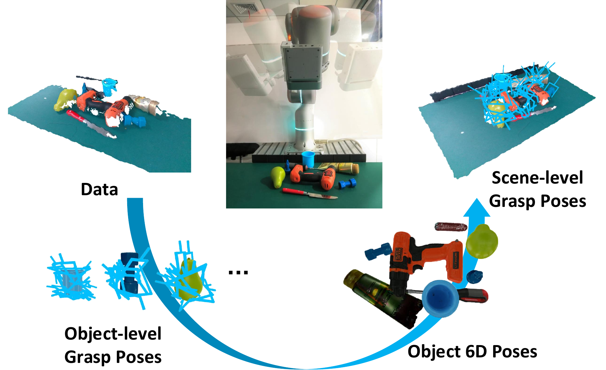
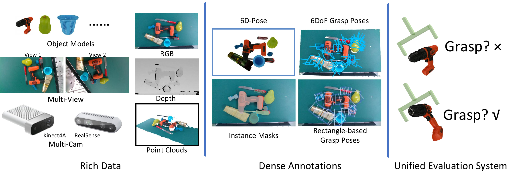

# GraspNet (CVPR 2020)

<!-- paper-source: https://chengwei920412.github.io/paper_reading/1912.13470_GraspNet_A_Large_Scale_Clustered_and_Densely_Annotated_Dataset_for_Object_Grasping/technical_report.html -->

> **arXiv ID**: 1912.13470  
> **原文标题**: GraspNet: A Large-Scale Clustered and Densely Annotated Dataset for Object Grasping  
> **翻译日期**: 2026-08-21

---

## 📋 论文概览 {#_1}

### 基本信息 {#_2}

- **作者**: Hao-Shu Fang, Chenxi Wang, Minghao Gou, Cewu Lu
- **机构**: 上海交通大学
- **发表时间**: 2019年12月提交至arXiv
- **领域**: 机器人抓取、3D计算机视觉、数据集与基准

### 核心贡献 {#_3}

1. 构建包含87,040幅RGB-D图像、170个杂乱堆叠场景和88个物体的大规模抓取数据集。
2. 通过“真实图像采集+仿真解析标注”生成超过3.7亿个6-DoF抓取位姿，同时避免纯仿真图像的视觉域差异。
3. 提供不依赖抓取位姿表示的在线评价方法，通过力闭合计算判定预测抓取是否可行。
4. 通过真实机械臂实验证明解析分数与实际抓取成功率具有明显一致性。

---

## 🎯 研究背景与动机 {#_4}

### 问题定义 {#_5}

目标是根据RGB-D图像或点云，在多物体杂乱堆叠场景中预测可执行的夹爪6-DoF抓取位姿。这不仅是检测问题，还需要回答预测位姿在物理上是否稳定、是否发生碰撞，以及如何在不同表示的方法之间公平比较。

### 现有方法的局限性 {#_6}

- 矩形抓取、物体6D位姿投影和点云上的自由6-DoF抓取使用不同表示与评价指标，很难横向比较。
- 人工标注的抓取数据集规模小且标注稀疏；真实机器人采集成本高。
- 仿真可快速生成大量标签，但合成视觉与真实传感器之间存在域差异。
- 预先枚举的真值抓取集无法覆盖连续位姿空间中的所有可行解，容易把未标注的可行抓取误判为错误。

### 本文的创新点 {#_7}

关键创新是将“感知数据的真实性”与“抓取标注的可扩展性”拆开处理：图像由真实传感器采集，抓取标签则基于精确网格模型和物理规则解析生成。物体6D位姿是连接两者的桥梁。

图：GraspNet的数据采集、单物体抓取标注和场景投影流程。

---

## 🔬 方法论 {#_8}

### 整体架构 {#_9}

图：数据集同时提供RGB-D图像、物体6D位姿、6-DoF抓取位姿、矩形抓取、实例掩码和统一评价系统。

整体流程包含四个环节：真实多视角RGB-D采集、首帧物体6D位姿标注与跨帧传播、单物体抓取候选的解析生成，以及抓取向场景的投影与碰撞检查。

### 关键技术 {#_10}

**1. 多视角双相机采集。** 每个场景从约10个物体构成，机械臂带动Intel RealSense 435和Kinect 4 Azure覆盖四分之一球面上的256个视点。两台相机同步采集，每个场景共得到512幅RGB-D图像。

**2. 6D位姿传播。** 只人工标注每个场景的首帧，其余帧利用已知相机位姿进行变换，再用ICP细化和人工检查。

\[\mathbf{P}_i^j=\mathbf{cam}_i^{-1}\mathbf{cam}_0\mathbf{P}_0^j.\]

**3. 单物体抓取采样。** 先在体素空间均匀采样抓取点，对每个点采样\(V\)个接近视角，并在\(D\times A\)网格上枚举夹爪深度与平面内旋转角。根据接触几何决定夹爪宽度并排除空抓与碰撞。

**4. 力闭合质量分数。** 将摩擦系数\(\mu\)从0.1逐步增至1.0，间隔为0.1，找到抓取首次满足对跖条件时的\(\mu\)，并定义：

\[s=1.1-\mu.\]

因此，越小的所需摩擦系数对应越高的抓取分数。这一分数不是经验分类器输出，而是基于几何和摩擦假设的物理可行性代理量。

**5. 场景投影与碰撞检查。** 将物体坐标系中的抓取集合变换到世界坐标系，再检查夹爪与背景和其他物体的碰撞。

\[\begin{aligned}
\mathbf{P}^i &amp;= \mathbf{cam}_0\mathbf{P}_0^i,\\
\mathbb{G}^i_{(w)} &amp;= \mathbf{P}^i\mathbb{G}^i_{(o)}.
\end{aligned}\]

图：抓取点、视角、平面内旋转角和夹爪深度的分层采样与场景投影。

### 算法流程 {#_11}

1. 对全部88个物体构建精确3D网格。
2. 对单物体网格生成密集抓取候选并计算力闭合分数。
3. 采集杂乱堆叠场景的多视角RGB-D图像及相机位姿。
4. 标注首帧物体6D位姿，向其余视角传播并细化。
5. 将单物体抓取投影到场景，执行碰撞检测，生成场景级密集抓取标注。
6. 评价预测时，先执行Pose-NMS，再使用在线力闭合判定计算Precision@k和AP。

---

## 📊 实验与结果 {#_12}

### 实验设置 {#_13}

- **数据集**: 170个场景，其中100个训练场景、70个测试场景。测试集分为30个已见物体场景、30个未见但相似物体场景和10个全新物体场景。
- **评估指标**: Precision@k（\(k=1,\ldots,50\)）及其平均值AP；在\(\mu=0.1,0.2,\ldots,0.5\)下汇总。
- **对比方法**: 本文主要对比公开抓取数据集的规模、模态、抓取表示、数据来源和标注密度，并非模型性能榜单。

### 主要结果 {#_14}

<table>
<thead>
<tr>
<th>数据集</th>
<th>每场景抓取数</th>
<th>物体总数</th>
<th>抓取总数</th>
<th>图像总数</th>
<th>抓取表示</th>
<th>数据来源</th>
</tr>
</thead>
<tbody>
<tr>
<td>Cornell</td>
<td>~8</td>
<td>240</td>
<td>8,019</td>
<td>1,035</td>
<td>矩形</td>
<td>单相机</td>
</tr>
<tr>
<td>Dex-Net 2.0</td>
<td>1</td>
<td>1,500</td>
<td>6.7M</td>
<td>6.7M</td>
<td>矩形</td>
<td>仿真</td>
</tr>
<tr>
<td>Jacquard</td>
<td>~20</td>
<td>11K</td>
<td>1.1M</td>
<td>54K</td>
<td>矩形</td>
<td>仿真</td>
</tr>
<tr>
<td>VR-Grasping-101</td>
<td>100</td>
<td>101</td>
<td>4.8M</td>
<td>10K</td>
<td>6-DOF</td>
<td>仿真</td>
</tr>
<tr>
<td><strong>GraspNet</strong></td>
<td><strong>~2.2M</strong></td>
<td><strong>88</strong></td>
<td><strong>370M</strong></td>
<td><strong>87K</strong></td>
<td><strong>6-DOF</strong></td>
<td><strong>双相机真实数据</strong></td>
</tr>
</tbody>
</table>

数据集的突出特征不是物体类别数最多，而是在真实多物体场景中同时提供极高密度的6-DoF抓取标注。

真实机器人实验从10个物体中针对每个分数档随机执行100次抓取。结果如下：

<table>
<thead>
<tr>
<th>抓取分数</th>
<th>10个物体成功率范围</th>
<th>大致平均水平</th>
</tr>
</thead>
<tbody>
<tr>
<td>\(s=1.0\)</td>
<td>89%–98%</td>
<td>约96%</td>
</tr>
<tr>
<td>\(s=0.5\)</td>
<td>59%–68%</td>
<td>约63%</td>
</tr>
<tr>
<td>\(s=0.1\)</td>
<td>5%–23%</td>
<td>约14%</td>
</tr>
</tbody>
</table>

高分与低分抓取的实际成功率差距很大，说明基于摩擦系数的解析分数对真实可抓取性具有较强的排序能力。

### 消融实验 {#_15}

该arXiv版本没有报告学习模型的标准消融实验。对数据和评价系统的支持主要来自三个抓取分数档与真实成功率的对照。这验证了分数的单调性，但没有单独分析摩擦模型、网格误差、位姿误差和碰撞阈值的影响。

---

## 💡 关键见解 {#_16}

### 理论分析 {#_17}

该工作将抓取评价从“预测位姿是否靠近一个已标注位姿”转化为“预测位姿自身是否满足物理条件”。这一变化非常重要：在连续解空间中，穷举真值几乎不可能，而可计算的可行性判定器可以对任意预测进行在线评价。

但力闭合仍是简化代理指标。它主要描述准静态接触下的抗扰动能力，不直接建模接近轨迹、夹爪顺应性、物体表面形变、动力学和执行控制误差。因此，“解析可行”并不等价于“真实执行必然成功”。

### 实践启示 {#_18}

- 数据集构建不必在“全真实、成本高”和“全仿真、域差异大”之间二选一，可以分离感知数据和标注的来源。
- 对连续输出空间，在线判定器往往比有限真值集更合理。
- 已见、相似未见和全新物体的测试划分，能区分记忆、类内泛化和跨类泛化。
- 使用两种深度相机采集同一场景，为研究传感器质量与域转移提供了基础。

---

## 🔍 局限性与未来工作 {#_19}

### 当前局限 {#_20}

1. **物理模型简化**：力闭合与离散摩擦系数不能完整表达真实抓取动力学。
2. **依赖准确几何与位姿**：网格偏差、手眼标定误差和6D位姿误差会通过投影直接污染抓取标签。
3. **夹爪类型受限**：工作聚焦二指平行夹爪，结论不能直接推广到多指手、吸盘和柔性夹爪。
4. **真实实验覆盖有限**：真实验仅覆盖10个物体和三个分数档，未提供置信区间、失败类型或更复杂场景分析。
5. **论文版本的算法实证较少**：该版本主要证明数据与评价系统的可行性，没有大规模基线算法比较。

### 未来方向 {#_21}

- 扩展至多指夹爪、真空吸盘和可变形物体，并为不同末端执行器建立可比较的评价接口。
- 将解析指标与大规模真实执行数据结合，学习从解析分数到真实成功概率的校准模型。
- 在评价中纳入接近轨迹、操作空间可达性、抓取后任务和闭环控制鲁棒性。
- 量化网格、位姿、深度噪声和摩擦假设对标签可靠性的敏感度。
- 继续完善跨传感器、跨物体和跨场景的泛化评价。

---

## 📚 相关工作对比 {#_22}

<table>
<thead>
<tr>
<th>方法</th>
<th>核心思想</th>
<th>优势</th>
<th>劣势</th>
</tr>
</thead>
<tbody>
<tr>
<td>Cornell矩形抓取</td>
<td>在2D图像上标注可抓取矩形</td>
<td>表示简单，便于直接回归</td>
<td>自由度受限，数据稀疏</td>
</tr>
<tr>
<td>Dex-Net 2.0</td>
<td>仿真点云+解析抓取质量</td>
<td>可快速生成百万级抓取</td>
<td>存在仿真到真实的视觉域差异</td>
</tr>
<tr>
<td>Jacquard</td>
<td>大规模合成图像与矩形抓取</td>
<td>图像和标注量较大</td>
<td>仍是仿真视觉，主要面向2D矩形</td>
</tr>
<tr>
<td>真实机器人自监督采集</td>
<td>用真实执行成败作为标签</td>
<td>标签直接对应真实成功</td>
<td>采集时间和硬件成本高</td>
</tr>
<tr>
<td><strong>GraspNet</strong></td>
<td>真实多视角感知+解析密集6-DoF标注+在线评价</td>
<td>视觉真实、标注极密、评价不依赖表示</td>
<td>依赖网格和位姿准确性，物理模型仍经简化</td>
</tr>
</tbody>
</table>

---

## 🎓 个人评价 {#_23}

### 优点 {#_24}

- 数据集设计抓住了抓取研究的真正瓶颈：高自由度标注难以在真实场景中密集获取。
- 在线物理判定器比“与有限标注集比距离”更适合连续抓取空间。
- 数据集不只提供抓取，还提供多视角相机位姿、物体6D位姿、掩码和网格，适合多任务研究。
- 使用真实机器人验证解析分数的有效性，避免完全停留在仿真闭环内。

### 可改进之处 {#_25}

最需加强的是标签可靠性的不确定性分析。论文给出了高分、中分和低分抓取的成功率，但没有将失败分解为网格误差、摩擦假设、位姿误差、夹爪定位误差和控制误差。如果能报告每个误差源对最终成功率的影响，用户就能更准确地理解基准分数的物理含义。

### 推荐阅读对象 {#_26}

- 构建机器人抓取数据集或评价基准的研究者。
- 研究3D点云抓取检测、物体6D位姿和多视角感知的学生与工程师。
- 需要理解力闭合指标、真实与仿真混合标注和在线评价设计的读者。

---

## 📎 附录 {#_27}

### 重要公式 {#_28}

1. **跨视角物体6D位姿传播**

\[\mathbf{P}_i^j=\mathbf{cam}_i^{-1}\mathbf{cam}_0\mathbf{P}_0^j.\]

1. **力闭合分数**

\[s=1.1-\mu.\]

1. **抓取位姿的平移与旋转距离**

\[\begin{aligned}
d_t(\mathbf{G}_1,\mathbf{G}_2)&amp;=\lVert\mathbf{t}_1-\mathbf{t}_2\rVert,\\
d_{\alpha}(\mathbf{G}_1,\mathbf{G}_2)&amp;=\arccos\frac{1}{2}\left(\mathrm{tr}(R_1R_2^\mathrm{T})-1\right).
\end{aligned}\]

### 术语表 {#_29}

<table>
<thead>
<tr>
<th>英文</th>
<th>中文</th>
<th>含义</th>
</tr>
</thead>
<tbody>
<tr>
<td>Grasp Pose</td>
<td>抓取位姿</td>
<td>夹爪相对物体或场景的位置与姿态</td>
</tr>
<tr>
<td>6-DoF</td>
<td>6自由度</td>
<td>三维平移加三维旋转</td>
</tr>
<tr>
<td>Force Closure</td>
<td>力闭合</td>
<td>接触力能够抵抗任意方向小扰动的抓取条件</td>
</tr>
<tr>
<td>Antipodal Grasp</td>
<td>对跖抓取</td>
<td>接触力与摩擦锥满足对跖几何条件的抓取</td>
</tr>
<tr>
<td>Pose-NMS</td>
<td>位姿非极大值抑制</td>
<td>同时基于平移和旋转距离去除重复抓取</td>
</tr>
<tr>
<td>Precision@k</td>
<td>前\(k\)个精确率</td>
<td>排名前\(k\)个抓取中可行抓取的比例</td>
</tr>
<tr>
<td>Domain Gap</td>
<td>域差异</td>
<td>仿真感知与真实传感器数据分布之间的偏差</td>
</tr>
</tbody>
</table>

### 参考资源 {#_30}

- **论文原文**: [arXiv链接](https://arxiv.org/abs/1912.13470)
- **中文翻译 PDF**: [paper_cn.pdf](https://chengwei920412.github.io/paper_reading/1912.13470_GraspNet_A_Large_Scale_Clustered_and_Densely_Annotated_Dataset_for_Object_Grasping/paper_cn.pdf)
- **中文 Markdown 译文**: [paper_cn.md](https://chengwei920412.github.io/paper_reading/1912.13470_GraspNet_A_Large_Scale_Clustered_and_Densely_Annotated_Dataset_for_Object_Grasping/paper_cn.html)
- **代码实现**: [GraspNet baseline](https://github.com/graspnet/graspnet-baseline)
- **数据与评价 API**: [graspnetAPI](https://github.com/graspnet/graspnetAPI)
- **项目主页**: [GraspNet](https://graspnet.net/)
