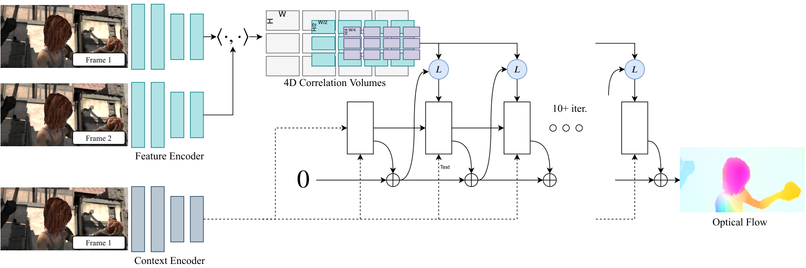
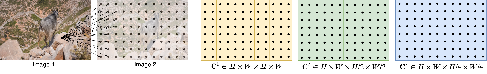
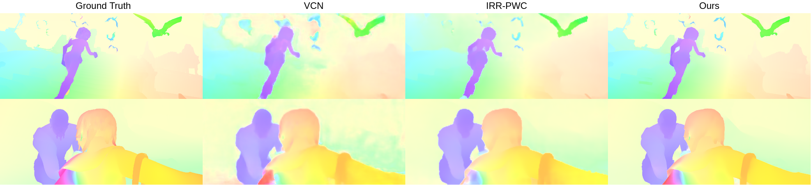
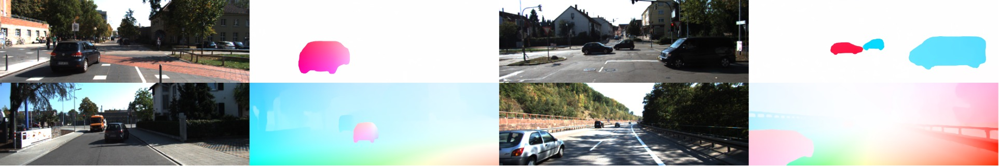
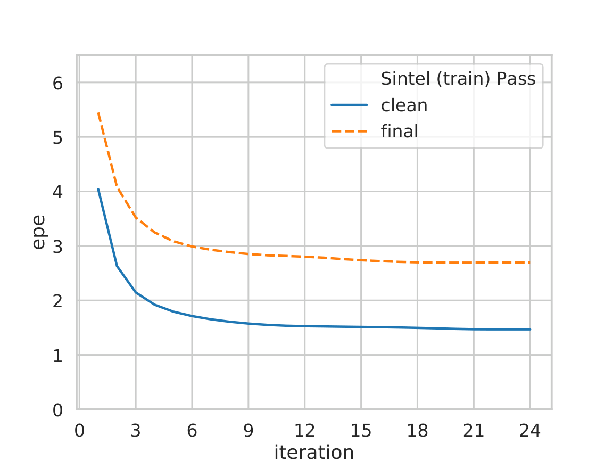
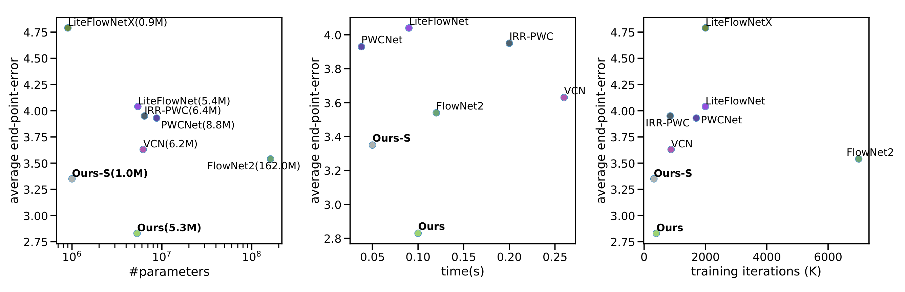
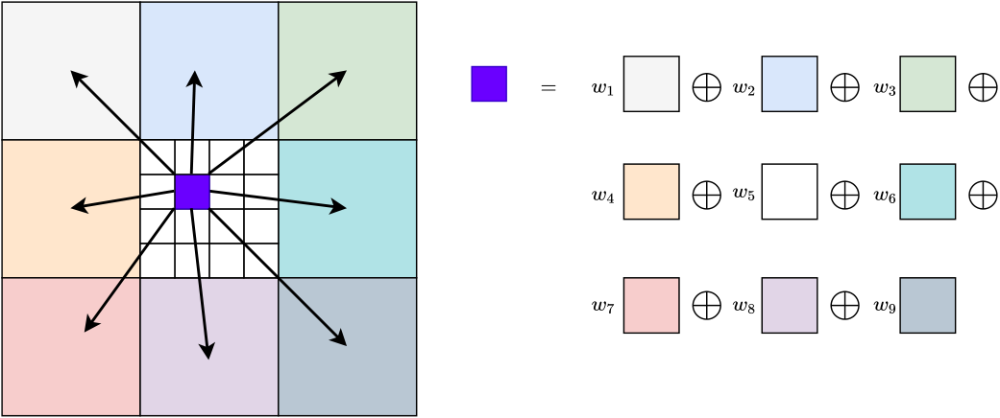
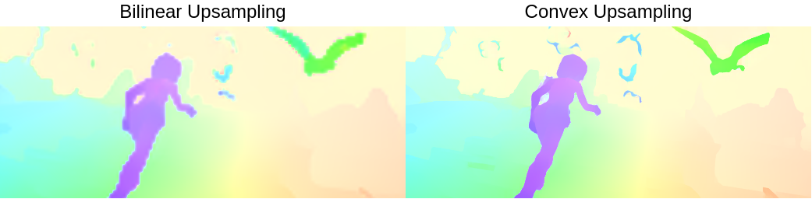
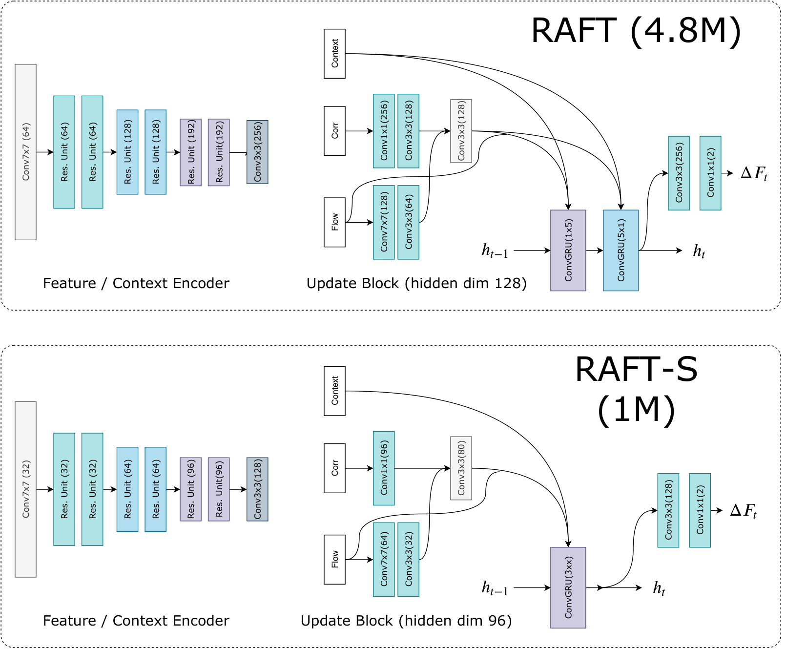
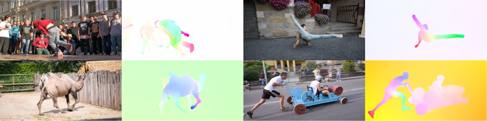

# RAFT 光流 (ECCV 2020)

<!-- paper-source: https://chengwei920412.github.io/paper_reading/2003.12039_RAFT_Recurrent_All-Pairs_Field_Transforms_for_Optical_Flow/2003.12039_%E9%98%85%E8%AF%BB%E6%8A%A5%E5%91%8A.html -->

> 原文链接：[RAFT 光流 (ECCV 2020)](https://chengwei920412.github.io/paper_reading/2003.12039_RAFT_Recurrent_All-Pairs_Field_Transforms_for_Optical_Flow/2003.12039_%E9%98%85%E8%AF%BB%E6%8A%A5%E5%91%8A.html)

## 0. 基本信息 {#0}

- 论文标题：RAFT: Recurrent All-Pairs Field Transforms for Optical Flow
- 作者：Zachary Teed, Jia Deng
- 机构：Princeton University（普林斯顿大学）
- 来源（会议 / arXiv / 期刊）：ECCV 2020 (European Conference on Computer Vision); arXiv 预印本
- 年份：2020
- 原始输入链接：https://arxiv.org/abs/2003.12039
- 最终使用的 arXiv 版本化 ID：2003.12039v3
- 原论文 arXiv 链接：https://arxiv.org/abs/2003.12039v3
- 幻觉翻译链接（hjfy）：https://hjfy.top/arxiv/2003.12039v3
- Cool Papers 链接：https://papers.cool/arxiv/2003.12039v3
- 论文研究方向：计算机视觉 / 光流估计 (Optical Flow)
- 本文一句话概括：RAFT 提出了一种全新的端到端光流估计架构，通过在全像素对上构建 4D 相关体并在单一高分辨率上用轻量级 GRU 迭代更新流场，在 Sintel 和 KITTI 上取得当时最优结果，同时兼具强泛化能力与高参数/训练效率。

## 1. 论文核心观点与主张的系统梳理 {#1}

### 1.1 研究背景与动机 {#11}

光流估计是对视频帧间逐像素运动的估计问题。长期以来，该问题受限于以下困难：
- 快速运动物体的跟踪
- 遮挡区域的处理
- 运动模糊
- 无纹理表面的匹配

传统方法将光流视为手工设计的优化问题 [21,51,13]，目标函数由数据项（鼓励视觉相似区域的配准）和正则化项（施加运动先验）组成。这类方法虽取得一定成功，但难以应对各种极端情况（corner cases），因为手工设计的优化目标难以面面俱到。

深度学习提供了一条替代路径，可以绕开手工设计的优化问题而直接预测流场 [25,42,22,49,20]。已有深度方法在性能上可比肩最好的传统方法且推理速度更快。**核心问题**在于：如何设计更有效的架构，使其性能更好、训练更容易、泛化到新场景的能力更强。

### 1.2 问题设定 {#12}

给定一对连续 RGB 图像 <span class="paper-math">\(I_1, I_2\)</span>，目标是估计稠密位移场 <span class="paper-math">\((f^1, f^2)\)</span>，将 <span class="paper-math">\(I_1\)</span> 中的每个像素 <span class="paper-math">\((u,v)\)</span> 映射到 <span class="paper-math">\(I_2\)</span> 中的对应坐标 <span class="paper-math">\((u&#x27;,v&#x27;) = (u + f^1(u), v + f^2(v))\)</span>。这是一个逐像素的回归问题，输出为每个像素的 2D 位移向量。



**图 1 解读**：RAFT 的三大核心模块：(1) 特征编码器 + 上下文编码器，从输入图像提取逐像素特征；(2) 相关层，构建 4D <span class="paper-math">\(W \times H \times W \times H\)</span> 全像素对相关体，并在最后两维上进行多尺度池化；(3) 基于 GRU 的更新算子，在单一高分辨率上迭代更新流场。输入端仅有 I1 和 I2 两张图像，输出为稠密光流场。

### 1.3 核心观点（Claims）的逐条梳理 {#13-claims}

**Claim 1（架构主张）——单分辨率流场优于粗到细（coarse-to-fine）级联**
- 对应位置：论文 Sec. 1（Introduction）和 Sec. 3.3（Iterative Updates）
- 具体内容：RAFT 在单一高分辨率上维护并更新流场，不同于当时主流的粗到细设计 [42,49,22,23,50]。粗到细方法先在低分辨率估计大位移，再上采样并精化到高分辨率，存在三个根本问题：(a) 粗分辨率上的错误难以恢复，(b) 容易丢失小而快速的运动物体，(c) 通常需要超过 100 万次训练迭代。RAFT 通过在全像素对上构建相关体并支持多尺度查找，使得每次局部更新同时包含小位移和大位移的信息，从而避免了这些问题。
- 判断：这是实质性的架构改变，非已有方法的参数化变体。单分辨率操作 + 多尺度相关查找的组合是从根本上绕开了图像金字塔的限制。

**Claim 2（方法论主张）——轻量级递归更新算子的设计**
- 对应位置：论文 Sec. 1 和 Sec. 3.3
- 具体内容：更新算子仅含 2.7M 参数，可在推理时迭代 100+ 次而不发散。相比之下，IRR [24] 使用 FlowNetS 作为递归单元（38M 参数）且仅支持 5 次迭代；使用 PWC-Net 时迭代次数受金字塔层数限制。RAFT 的更新算子通过权重绑定（weight tying）和 GRU 的门控结构实现收敛性。
- 判断：实质性创新。将权重绑定的 GRU 与相关体查找结合用于光流迭代更新是新的设计范式。

**Claim 3（实现主张）——全像素对 4D 相关体 + 多尺度金字塔**
- 对应位置：论文 Sec. 3.2（Computing Visual Similarity）
- 具体内容：构建 <span class="paper-math">\(W \times H \times W \times H\)</span> 的 4D 相关体（通过特征向量的点积），然后对最后两维进行平均池化（kernel sizes {1, 2, 4, 8}）构造多尺度相关金字塔。这使网络同时获得大位移和小位移信息，同时保持 <span class="paper-math">\(I_1\)</span> 维度的高分辨率。
- 判断：全像素对相关体的思想受 DCFlow [47] 启发，但 RAFT 的关键差异在于：(a) 使用可微查找代替 SGM 不可微处理，(b) 多尺度池化策略，(c) 端到端训练。

**Claim 4（经验主张）——SOTA 精度 + 强泛化 + 高效率**
- 对应位置：论文 Sec. 1 和 Sec. 4
- 具体内容：Sintel final pass EPE 2.855（30% 误差降低），KITTI F1-all 5.10%（16% 误差降低）；仅用合成数据训练时 KITTI EPE 5.04（40% 误差降低）；1080Ti 上 1088×436 视频 10fps。
- 判断：这是论文的实验结论，有充分实验支撑。

**Claim 5（隐含主张）——权重绑定的递归结构强制学习"类似一阶优化"的更新**
- 对应位置：论文 Sec. 3.3 和 Sec. 4.1
- 具体内容：通过约束光流为一系列相同更新步骤的产物，强制网络学习一个模仿一阶下降算法步的更新算子。这约束了搜索空间、降低过拟合风险、加速训练并改善泛化。
- 判断：这是有趣的类比而非严格的理论推导。论文未给出收敛性证明，也未严格定义所模拟的"优化目标"。

### 1.4 创新性与贡献边界 {#14}

**实质性创新：**
1. **单分辨率迭代架构**：彻底摒弃粗到细级联，在整个架构层面是新的设计范式
2. **全像素对 4D 相关体 + 多尺度查找**：不同于 warp-based 的相关层 [42]，也不同于 SGM 的不可微处理 [47]
3. **轻量级 ConvGRU 更新算子**：将权重绑定的 GRU 与相关体查找结合，推理时可无限次迭代而收敛

**与已有方法的边界：**
- 继承自传统方法：单个流场迭代精化的思想来自变分光流 [21,51,13]
- 继承自 DCFlow [47]：4D 相关体构建，但处理方式完全不同（可微 vs 不可微）
- 继承自 TrellisNet [5] / DEQ [6]：深度权重绑定的思想
- 继承自"learning to optimize"[1,2]：模拟迭代优化步骤的思想

**贡献边界判断**：RAFT 最核心的贡献在于将以上元素以精巧的方式组合，并证明单分辨率 + 全对相关 + 递归更新的架构设计远优于粗到细范式。这是一项"高度创新的工程架构组合"，而非单纯的理论突破。

## 2. 关键论据、理论基础与数学方法的深度解析 {#2}

### 2.1 理论基础与学术渊源 {#21}

RAFT 建立在以下理论基础和学术传统之上：

1. **变分光流理论**（Horn & Schunck [21], TV-L1 [51]）：光流作为能量最小化问题的范式，目标函数包含数据项和正则化项。RAFT 继承的是"维持单个流场并通过迭代精化"的方法论，但将手工设计的梯度更新替换为学习得到的更新算子。
2. **离散优化光流**（Chen et al. [13], DCFlow [47]）：通过全局目标函数在离散空间搜索最优流场。RAFT 直接继承 DCFlow 的 4D 相关体构建，但用端到端可微分处理替代 SGM。
3. **"Learning to Optimize"范式**（Adler & Öktem [1,2]）：用神经网络模拟一阶优化算法的迭代更新步骤。RAFT 受此启发但从不显式定义梯度——而是让网络从相关体中检索特征来"提出下降方向"。
4. **深度平衡模型 / TrellisNet**（Bai et al. [5,6]）：在深度上使用权重绑定的大量层。RAFT 将其思想应用于光流迭代更新。
5. **GRU 门控循环单元**（Cho et al. [14]）：将 GRU 的卷积版本用作更新算子的核心模块，门控结构有助于序列收敛。

### 2.2 问题形式化与建模选择 {#22}

RAFT 将光流建模为从一个初始场 <span class="paper-math">\(f_0 = \mathbf{0}\)</span> 出发的迭代序列：


<div class="paper-math">\[f_{k+1} = f_k + \Delta f_k\]</div>


其中 <span class="paper-math">\(\Delta f_k\)</span> 由更新算子 <span class="paper-math">\(\Phi\)</span> 基于当前流场和相关特征预测：


<div class="paper-math">\[\Delta f_k, h_{k+1} = \Phi(h_k, \text{Corr}(f_k), \text{Context})\]</div>


**关键建模选择：**
- **特征提取**：使用 6 个残差块，分别以 1/2、1/4、1/8 分辨率逐步下采样，输出 <span class="paper-math">\(H/8 \times W/8 \times 256\)</span> 的特征图。上下文网络架构相同但仅对 <span class="paper-math">\(I_1\)</span> 提取特征，并使用 BatchNorm（特征编码器使用 InstanceNorm）。
- **相关体构建**：通过矩阵乘法一次性计算所有像素对的点积
- **多尺度池化**：对相关体最后两维用 kernel {1,2,4,8} 做平均池化
- **相关查找**：基于当前流估计在相关金字塔的所有层级上采样局部邻域（<span class="paper-math">\(L_1\)</span> 半径 r=4）
- **更新算子**：ConvGRU（含可分离 1×5 和 5×1 卷积变体以扩大感受野）
- **上采样**：通过预测的 <span class="paper-math">\(H/8 \times W/8 \times (8 \times 8 \times 9)\)</span> 掩码，将粗分辨率流场的 3×3 邻域进行凸组合得到高分辨率流场

### 2.3 核心推导与算法构造 {#23}


**图 1 回顾**：本节聚焦于图 1 中"4D Correlation Volumes"和"Update Operator"部分的数学原理。

#### 式 (1)：4D 相关体构建 {#14d}


<div class="paper-math">\[C(g_\theta(I_1), g_\theta(I_2)) \in \mathbb{R}^{H \times W \times H \times W}, \quad C_{ijkl} = \sum_h g_\theta(I_1)_{ijh} \cdot g_\theta(I_2)_{klh}\]</div>


**这条公式在这里负责什么**：定义全像素对视觉相似性的计算方式，是 RAFT 的核心数据关联模块。

**符号说明**：<span class="paper-math">\(C_{ijkl}\)</span> 表示 <span class="paper-math">\(I_1\)</span> 中像素 <span class="paper-math">\((i,j)\)</span> 与 <span class="paper-math">\(I_2\)</span> 中像素 <span class="paper-math">\((k,l)\)</span> 在特征空间中的内积相似度；<span class="paper-math">\(h\)</span> 遍历特征通道 (D=256)；<span class="paper-math">\(g_\theta(I_1) \in \mathbb{R}^{H \times W \times D}\)</span> 是特征编码器的输出。

**自然语言翻译**：对 <span class="paper-math">\(I_1\)</span> 和 <span class="paper-math">\(I_2\)</span> 的每一对像素，计算其特征向量的点积（未归一化的余弦相似度），得到一个 4D 相似度张量，其前两维对应 <span class="paper-math">\(I_1\)</span> 的空间位置，后两维对应 <span class="paper-math">\(I_2\)</span> 的空间位置。

**技术拆解**：对每个 <span class="paper-math">\(I_1\)</span> 像素 <span class="paper-math">\((i,j)\)</span>，与 <span class="paper-math">\(I_2\)</span> 的所有 <span class="paper-math">\((k,l)\)</span> 像素分别计算点积；结果维度为 <span class="paper-math">\(H \times W \times H \times W\)</span>，即 <span class="paper-math">\(O(N^2)\)</span> 空间复杂度（N 为像素总数）。

**工程映射**：可高效实现为单次矩阵乘法——将 <span class="paper-math">\(g_\theta(I_1)\)</span> reshape 为 <span class="paper-math">\(HW \times D\)</span>，<span class="paper-math">\(g_\theta(I_2)\)</span> reshape 为 <span class="paper-math">\(D \times HW\)</span>，相乘得 <span class="paper-math">\(HW \times HW\)</span>。在 PyTorch 中为 `torch.matmul(f1, f2.transpose(0,1))`。对于 1088×1920 视频（1/8 分辨率后 136×240=32,640 像素），相关体约 4.3GB，预计算占推理总时间 17%。

**若删去该项会怎样**：全像素对相关体被局部相关或 warp-based 相关替代后，处理大位移的能力严重退化。消融实验中用 warping 替代后 KITTI F1-all 从 19.8 退化到 32.1。

**是否依赖强假设**：无强假设。特征提取和点积均是标准的可微操作，不依赖 i.i.d. 或线性假设。

**极简数值例子**：假设 <span class="paper-math">\(I_1\)</span> 和 <span class="paper-math">\(I_2\)</span> 各有 2 个像素，特征维度 D=2：
- <span class="paper-math">\(g_\theta(I_1) = [[1, 2], [3, 4]]\)</span>（像素 1 和像素 2）
- <span class="paper-math">\(g_\theta(I_2) = [[1, 0], [0, 1]]\)</span>
- <span class="paper-math">\(C_{1111} = 1 \cdot 1 + 2 \cdot 0 = 1\)</span>（<span class="paper-math">\(I_1\)</span> 像素 1 与 <span class="paper-math">\(I_2\)</span> 像素 1 的相似度）
- <span class="paper-math">\(C_{1112} = 1 \cdot 0 + 2 \cdot 1 = 2\)</span>（<span class="paper-math">\(I_1\)</span> 像素 1 与 <span class="paper-math">\(I_2\)</span> 像素 2 的相似度）
- <span class="paper-math">\(C_{1212} = 3 \cdot 0 + 4 \cdot 1 = 4\)</span>（<span class="paper-math">\(I_1\)</span> 像素 2 与 <span class="paper-math">\(I_2\)</span> 像素 2 的相似度最高）

相关性最高的配对（值=4）表明 <span class="paper-math">\(I_1\)</span> 像素 2 与 <span class="paper-math">\(I_2\)</span> 像素 2 最可能对应同一物理点。



**图 2 解读**：展示 4D 相关体构建过程与多尺度池化。对 <span class="paper-math">\(I_1\)</span> 中的一个特征向量，与 <span class="paper-math">\(I_2\)</span> 中所有像素取内积，生成一个 2D 响应图。池化后形成多尺度体积 <span class="paper-math">\(\mathcal{C}^1, \mathcal{C}^2, \mathcal{C}^3, \mathcal{C}^4\)</span>，分别用 kernel sizes {1,2,4,8}。

#### 式 (2)：相关查找的局部邻域定义 {#2_1}


<div class="paper-math">\[\mathcal{N}(x&#x27;)_r = \{x&#x27; + dx \mid dx \in \mathbb{Z}^2, \|dx\|_1 \leq r\}\]</div>


**这条公式在这里负责什么**：定义基于当前流估计的相关体查找区域，是更新算子获取视觉匹配信息的入口。

**符号说明**：<span class="paper-math">\(x&#x27; = (u + f^1(u), v + f^2(v))\)</span> 是当前流估计下的对应坐标；<span class="paper-math">\(dx\)</span> 是整数偏移；<span class="paper-math">\(r\)</span> 是查找半径（默认 r=4）。

**自然语言翻译**：以当前估计的对应点 <span class="paper-math">\(x&#x27;\)</span> 为中心，取其 <span class="paper-math">\(L_1\)</span> 距离不超过 <span class="paper-math">\(r\)</span> 的整数网格邻域。

**技术拆解**：r=4 时邻域大小为 9×9=81 个点。在相关金字塔各层上分别查找：对于第 k 层，用 <span class="paper-math">\(x&#x27;/2^k\)</span> 索引，同一半径 r=4 在最低层（k=4）对应于原始分辨率 256 像素的范围。因此在最低层可以捕获大位移（≤256px）。

**工程映射**：使用 `F.grid_sample`（双线性采样）从相关体中索引浮点坐标；各层特征按通道拼接后送入更新算子。

**若删去该项会怎样**：r=0 时相关体仅查单点（无邻域信息），Sintel clean EPE 从 1.63 退化到 3.41，KITTI F1-all 从 19.8 退化到 44.8——性能几乎崩溃。

#### ConvGRU 更新门控公式：式 (3)–(6) {#convgru-36}

更新算子使用卷积 GRU 单元，其核心门控方程如下：


<div class="paper-math">\[z_t = \sigma(\text{Conv}_{3\times3}([h_{t-1}, x_t], W_z))\]</div>


<div class="paper-math">\[r_t = \sigma(\text{Conv}_{3\times3}([h_{t-1}, x_t], W_r))\]</div>


<div class="paper-math">\[\tilde{h}_t = \tanh(\text{Conv}_{3\times3}([r_t \odot h_{t-1}, x_t], W_h))\]</div>


<div class="paper-math">\[h_t = (1 - z_t) \odot h_{t-1} + z_t \odot \tilde{h}_t\]</div>


**这四个公式共同负责什么**：定义了更新算子的隐状态更新机制，是迭代收敛性的核心保证。

**符号说明**：
- <span class="paper-math">\(h_{t-1}\)</span>：上一迭代步的隐状态（维度为 <span class="paper-math">\(H \times W \times 128\)</span>）
- <span class="paper-math">\(x_t\)</span>：当前步的输入（相关特征、流特征、上下文的拼接）
- <span class="paper-math">\(z_t\)</span>：更新门（sigmoid 输出 0~1，控制新旧信息混合比例）
- <span class="paper-math">\(r_t\)</span>：重置门（控制遗忘多少旧状态）
- <span class="paper-math">\(\tilde{h}_t\)</span>：候选新状态（tanh 约束到 [-1, 1]）
- <span class="paper-math">\([\cdot, \cdot]\)</span>：通道维拼接；<span class="paper-math">\(\odot\)</span>：逐元素（Hadamard）乘法

**自然语言翻译**：每一步，网络通过可学习的卷积门控自适应决定：(1) 忘记多少历史信息（<span class="paper-math">\(r_t\)</span>），(2) 用多少新信息替换旧信息（<span class="paper-math">\(z_t\)</span>）。当 <span class="paper-math">\(z_t\)</span> 趋近 0 时完全保留旧状态（流场不变=收敛），趋近 1 时完全替换旧状态（大幅更新）。

**训练 / 推理中的作用**：
- 训练时展开 12 步，损失监督所有步的预测
- 推理时可任意步数（Sintel 用 32 步，KITTI 用 24 步），GRU 的门控结构使迭代能自然收敛到稳定状态而不会发散

**代码中的典型对应**：

```
class ConvGRU(nn.Module):
    def forward(self, h, x):
        hx = torch.cat([h, x], dim=1)
        z = torch.sigmoid(self.conv_z(hx))  # 更新门
        r = torch.sigmoid(self.conv_r(hx))  # 重置门
        hx2 = torch.cat([r * h, x], dim=1)
        h_tilde = torch.tanh(self.conv_h(hx2))  # 候选状态
        h_new = (1 - z) * h + z * h_tilde       # 新状态
        return h_new
```

**消融验证**：将 ConvGRU 替换为 3 层 ReLU 卷积时，Sintel clean EPE 从 1.63 退化到 2.04，KITTI F1-all 从 19.8 退化到 26.1，验证了门控结构对收敛性的重要性。

#### 式 (7)：训练损失函数 {#7}


<div class="paper-math">\[\mathcal{L} = \sum_{i=1}^{N} \gamma^{N-i} \|f_{gt} - f_i\|_1\]</div>


**这条公式在这里负责什么**：定义训练的监督信号，使得所有迭代步（而不仅是最终步）都受到监督。

**符号说明**：<span class="paper-math">\(f_i\)</span> 是第 i 次迭代的流场预测；<span class="paper-math">\(f_{gt}\)</span> 是真值流场；<span class="paper-math">\(N\)</span> 是训练时展开的迭代次数（N=12）；<span class="paper-math">\(\gamma = 0.8\)</span> 是指数衰减因子；<span class="paper-math">\(\|\cdot\|_1\)</span> 是 L1 距离。

**自然语言翻译**：对所有 12 个迭代步的预测流场与真值的 L1 距离做加权求和，离最终步越近权重越大（指数级增长 <span class="paper-math">\(\gamma^{N-i}\)</span>）。

**分项拆解**：当 <span class="paper-math">\(\gamma=0.8, N=12\)</span> 时，第 12 步的权重为 <span class="paper-math">\(0.8^0=1.0\)</span>，第 1 步的权重为 <span class="paper-math">\(0.8^{11} \approx 0.086\)</span>。这种指数衰减权重鼓励早期步给出合理估计（即梯度不会过于集中于最终步），同时让最终步有最大的优化信号。

**代码中的典型对应**：

```
loss = 0
for i, flow_pred in enumerate(flow_predictions):
    weight = gamma ** (N - i - 1)  # i=0 时 weight 最小
    loss += weight * (flow_pred - flow_gt).abs().mean()
```

**若删去该项会怎样**：若仅监督最终输出（<span class="paper-math">\(\gamma=1\)</span> 且只取 i=N 项），早期步将完全没有优化信号，可能导致训练不稳定或早期步的中间结果极差。

### 2.4 理论结论的适用范围 {#24}

RAFT 没有提供严格的理论收敛证明或泛化界。论文的理论论述主要是**类比性/直觉性**的：

1. **"类似一阶优化"的类比**：论文将迭代更新类比为一阶优化算法的步骤，但没有显式定义目标函数（无数据项/正则化项），也没有给出收敛速率的理论分析。更新算子"从相关体中检索特征来提出下降方向"——而非计算梯度。
2. **固定点收敛的实证性**：Fig. 10 展示了 <span class="paper-math">\(||\Delta f_k||_2\)</span> 随迭代衰减和 EPE 的收敛趋势，但这些都是数值实验而非理论保证。论文声称"100+ 次迭代不发散"，但这是一个经验观察。严格来说，GRU 的收敛性在一般条件下没有理论保证（不同于 DEQ [6] 的 Banach 不动点定理框架）。
3. **泛化性解释的局限**：论文将强泛化归因于"权重绑定的结构约束了搜索空间，降低了过拟合风险"，这种解释是启发式的，缺少严格的泛化理论（如 PAC 界或算法稳定性分析）支持。
4. **依赖的隐式假设**：
5. 特征提取器能从任意场景中提取匹配化的特征（论文未明确讨论失效条件）
6. 相关体点积是视觉相似性的充分度量（存在光照变化、非朗伯表面时的局限性未讨论）
7. 运动连续性：查找半径 r=4 覆盖的局部区域能捕获真实流（大位移通过多尺度池化间接处理）

## 3. 实验设计与实验结果的充分性分析 {#3}

### 3.1 实验目标与论文主张的对应关系 {#31}


<table>
<thead>
<tr>
<th>实验</th>
<th>验证的主张</th>
<th>对应位置</th>
</tr>
</thead>
<tbody>
<tr>
<td>Sintel/KITTI SOTA 对比 (Table 1)</td>
<td>Claim 4: SOTA 精度</td>
<td>Sec. 4.1, 4.2</td>
</tr>
<tr>
<td>C+T 训练后直接评估 Sintel/KITTI (Table 1 上半部分)</td>
<td>Claim 4: 强跨数据集泛化</td>
<td>Sec. 4.1</td>
</tr>
<tr>
<td>参数/时间/训练迭代 vs 精度图 (Fig. 5, Table 4)</td>
<td>Claim 4: 高效率</td>
<td>Sec. 4.4</td>
</tr>
<tr>
<td>消融实验 (Table 2)</td>
<td>Claims 1,2,3: 各组件的必要性和设计合理性</td>
<td>Sec. 4.3</td>
</tr>
<tr>
<td>消融——warping vs correlation (Table 2)</td>
<td>Claim 3: 全像素相关优于 warp-based</td>
<td>Sec. 4.3</td>
</tr>
<tr>
<td>消融——ConvGRU vs Conv (Table 2)</td>
<td>Claim 2: GRU 门控机制的重要性</td>
<td>Sec. 4.3</td>
</tr>
<tr>
<td>消融——tied vs untied weights (Table 2)</td>
<td>Claims 2,5: 权重绑定的必要性</td>
<td>Sec. 4.3</td>
</tr>
<tr>
<td>消融——inference updates (Table 2)</td>
<td>Claims 2,5: 迭代收敛性与稳定性</td>
<td>Sec. 4.3</td>
</tr>
<tr>
<td>DAVIS 高分辨率视频 (Fig. 6)</td>
<td>高分辨率可扩展性（工程主张）</td>
<td>Sec. 4.5</td>
</tr>
</tbody>
</table>


### 3.2 实验设置合理性 {#32}

**数据集选择：**
- Sintel [11]：合成但真实感强的电影渲染数据，提供 clean（小运动模糊）和 final（大运动模糊+大气效果）两个 pass，是光流社区的标准 benchmark
- KITTI-2015 [34]：真实自动驾驶场景，ground truth 来自激光雷达+3D 模型，代表真实世界的挑战
- FlyingChairs [15] / FlyingThings3D [33]：合成训练数据，提供几乎无限的标注
- 选择合理，覆盖了合成→真实、简单→困难的多样性

**训练策略：**
- 四阶段渐进训练：Chairs → Things → Sintel (S+T+K+H) → KITTI
- 使用 AdamW 优化器，梯度裁剪到 [-1, 1]
- 数据增强：光度增强（ColorJitter 亮度/对比度/饱和度/色调）、空间增强（随机缩放/拉伸）、遮挡增强（随机擦除 I2 中的矩形区域以模拟遮挡）
- 在 Sintel 上训练 3 次不同种子取干净 pass 的中位数模型——增加了结果的可信度

**评价指标：**
- EPE (End-Point Error)：预测流与真值的欧氏距离（以像素为单位），光学流的标准主指标
- F1-all：KITTI 的指标，错误像素比例（EPE > 3px 且相对误差 > 5%）
- 指标与光流社区惯例一致，公平可比

**对比方法：**
对比方法包括 FlowNet2 [25]、PWC-Net [42]、LiteFlowNet [22]、VCN [49]、MaskFlowNet [52]、IRR-PWC [24]、ScopeFlow [8] 等。覆盖了截至 2020 年 CVPR/ECCV 的主要竞争方法。

**公平性考量：**
- 区分了训练数据的一致性：C+T（仅合成数据）、C+T+S/K（加目标域数据微调）、C+T+S+K+H（加多个数据集微调）
- 论文报告了不同训练设置下的对应方法，控制了训练数据的混淆因素

### 3.3 实验结果的解释力度 {#33}

**表 1：主结果表（Sintel + KITTI）**


<table>
<thead>
<tr>
<th>训练数据</th>
<th>方法</th>
<th>Sintel(test) Clean</th>
<th>Sintel(test) Final</th>
<th>KITTI(test) F1-all</th>
<th>Sintel(train) Clean</th>
<th>Sintel(train) Final</th>
<th>KITTI(train) F1-epe</th>
<th>KITTI(train) F1-all</th>
</tr>
</thead>
<tbody>
<tr>
<td>C+T</td>
<td>FlowNet2</td>
<td>—</td>
<td>—</td>
<td>—</td>
<td>2.02</td>
<td>3.54†</td>
<td>10.08</td>
<td>30.0</td>
</tr>
<tr>
<td>C+T</td>
<td>PWC-Net</td>
<td>—</td>
<td>—</td>
<td>—</td>
<td>2.55</td>
<td>3.93</td>
<td>10.35</td>
<td>33.7</td>
</tr>
<tr>
<td>C+T</td>
<td>VCN</td>
<td>—</td>
<td>—</td>
<td>—</td>
<td>2.21</td>
<td>3.68</td>
<td>8.36</td>
<td>25.1</td>
</tr>
<tr>
<td>C+T</td>
<td>MaskFlowNet</td>
<td>—</td>
<td>—</td>
<td>—</td>
<td>2.25</td>
<td>3.61</td>
<td>—</td>
<td>23.1</td>
</tr>
<tr>
<td>C+T</td>
<td><strong>Ours (2-view)</strong></td>
<td>—</td>
<td>—</td>
<td>—</td>
<td><strong>1.43</strong></td>
<td><strong>2.71</strong></td>
<td><strong>5.04</strong></td>
<td><strong>17.4</strong></td>
</tr>
<tr>
<td>C+T</td>
<td>Ours (small)</td>
<td>—</td>
<td>—</td>
<td>—</td>
<td>2.21</td>
<td>3.35</td>
<td>7.51</td>
<td>26.9</td>
</tr>
<tr>
<td>C+T+S/K</td>
<td>FlowNet2</td>
<td>4.16</td>
<td>5.74</td>
<td>11.48</td>
<td>(1.45)</td>
<td>(2.01)</td>
<td>(2.30)</td>
<td>(6.8)</td>
</tr>
<tr>
<td>C+T+S/K</td>
<td>IRR-PWC</td>
<td>3.84</td>
<td>4.58</td>
<td>7.65</td>
<td>(1.92)</td>
<td>(2.51)</td>
<td>(1.63)</td>
<td>(5.3)</td>
</tr>
<tr>
<td>C+T+S/K</td>
<td><strong>Ours (2-view)</strong></td>
<td><strong>2.08</strong></td>
<td><strong>3.41</strong></td>
<td><strong>5.27</strong></td>
<td><strong>(0.77)</strong></td>
<td><strong>(1.20)</strong></td>
<td><strong>(0.64)</strong></td>
<td><strong>(1.5)</strong></td>
</tr>
<tr>
<td>C+T+S+K+H</td>
<td>PWC-Net+</td>
<td>3.45</td>
<td>4.60</td>
<td>7.72</td>
<td>(1.71)</td>
<td>(2.34)</td>
<td>(1.50)</td>
<td>(5.3)</td>
</tr>
<tr>
<td>C+T+S+K+H</td>
<td>VCN</td>
<td>2.81</td>
<td>4.40</td>
<td>6.30</td>
<td>(1.66)</td>
<td>(2.24)</td>
<td>(1.16)</td>
<td>(4.1)</td>
</tr>
<tr>
<td>C+T+S+K+H</td>
<td>MaskFlowNet</td>
<td>2.52</td>
<td>4.17</td>
<td>6.10</td>
<td>—</td>
<td>—</td>
<td>—</td>
<td>—</td>
</tr>
<tr>
<td>C+T+S+K+H</td>
<td><strong>Ours (2-view)</strong></td>
<td><strong>1.94</strong></td>
<td><strong>3.18</strong></td>
<td><strong>5.10</strong></td>
<td><strong>(0.76)</strong></td>
<td><strong>(1.22)</strong></td>
<td><strong>(0.63)</strong></td>
<td><strong>(1.5)</strong></td>
</tr>
<tr>
<td>C+T+S+K+H</td>
<td><strong>Ours (warm-start)</strong></td>
<td><strong>1.61</strong></td>
<td><strong>2.86</strong></td>
<td>—</td>
<td>(0.77)</td>
<td>(1.27)</td>
<td>—</td>
<td>—</td>
</tr>
</tbody>
</table>


注：括号内数字为validation集结果（非test）。†FlowNet2 原始报告 3.54 为 disparity split 的 EPE。C=Chairs, T=Things, S=Sintel, K=KITTI, H=HD1K。

**表 1 分析（逐列）：**

1. **仅合成数据（C+T）下**：RAFT 在 Sintel train clean EPE 上做到 1.43，比第二名 FlowNet2 (2.02) 低 29%；KITTI train EPE 5.04 比第二名 VCN (8.36) 低 40%。这是**跨域泛化**的有力证明——完全用合成数据训练的模型在真实场景（KITTI）上大幅领先所有此前方法。
2. **微调后**（C+T+S+K+H 行）：RAFT (warm-start) 在 Sintel test clean 上达到 1.61，final 上 2.86，分别比 MaskFlowNet (2.52, 4.17) 低 36% 和 31%。在 KITTI test 上 F1-all 5.10，比 MaskFlowNet (6.10) 低 16%。
3. **warm-start vs 零初始化**：通过前向投影利用时序信息进一步提升结果（clean: 1.94→1.61, final: 3.18→2.86），验证了单分辨率架构的灵活性——粗到细方法由于在多个分辨率上都做预测，难以实现这种初始化的跨帧信息利用。



**图 3 解读**：Sintel test set 上的定性可视化。RAFT 在运动边界、细小结构（如角色手臂、头发和衣服褶皱）和大位移区域均产生清晰的流场预测，可视化以 HSV 色彩空间编码流场方向和大小。



**图 4 解读**：KITTI test set 上的定性可视化。RAFT 在真实驾驶场景中很好地处理了车辆、行人、交通标志以及路面纹理等物体的运动。

**推理步数分析**（Table 2 "Inference Updates" 行）：


<table>
<thead>
<tr>
<th>推理步数</th>
<th>Sintel Clean EPE</th>
<th>Sintel Final EPE</th>
<th>KITTI F1-epe</th>
<th>KITTI F1-all</th>
</tr>
</thead>
<tbody>
<tr>
<td>1</td>
<td>4.04</td>
<td>5.45</td>
<td>15.30</td>
<td>44.5</td>
</tr>
<tr>
<td>3</td>
<td>2.14</td>
<td>3.52</td>
<td>8.98</td>
<td>29.9</td>
</tr>
<tr>
<td>8</td>
<td>1.61</td>
<td>2.88</td>
<td>5.99</td>
<td>19.6</td>
</tr>
<tr>
<td>32</td>
<td><strong>1.43</strong></td>
<td>2.71</td>
<td>5.00</td>
<td>17.4</td>
</tr>
<tr>
<td>100</td>
<td>1.41</td>
<td>2.72</td>
<td>4.95</td>
<td>17.4</td>
</tr>
<tr>
<td>200</td>
<td>1.40</td>
<td>2.73</td>
<td>4.94</td>
<td>17.4</td>
</tr>
</tbody>
</table>


EPE 随迭代次数快速增长并收敛——3 步即超过 PWC-Net 在 C+T 下的 EPE (2.14 vs 2.55)，8 步后改进放缓，32 步后基本饱和。200 步时 EPE 仍不退化（1.40 vs 32 步的 1.43），证明了**迭代稳定性**。值得一提的是，训练时仅展开 12 步，推理时扩展到 200 步仍收敛——这是权重绑定的关键优势。



**图 10 解读**：左图展示 EPE 随推理迭代次数的变化——两种 pass 均快速单调收敛（clean 在 ~12 步饱和，final 在 ~15 步饱和）。右图展示每次更新幅度 <span class="paper-math">\(||\Delta f_k||_2\)</span> 的对数尺度衰减，从初始 ~10 快速降到 <1，证明序列收敛到固定点 <span class="paper-math">\(f_k \to f^*\)</span>。

**效率对比（Table 4 + Fig. 5）：**


<table>
<thead>
<tr>
<th>方法</th>
<th>参数量</th>
<th>推理时间(1080Ti)</th>
<th>训练迭代 (#GPU)</th>
<th>Sintel Final EPE</th>
</tr>
</thead>
<tbody>
<tr>
<td>FlowNet2</td>
<td>162M</td>
<td>0.11s</td>
<td>7000k</td>
<td>3.54</td>
</tr>
<tr>
<td>PWC-Net+</td>
<td>9.4M</td>
<td>0.04s</td>
<td>1700k</td>
<td>3.93</td>
</tr>
<tr>
<td>VCN</td>
<td>6.2M</td>
<td>0.26s</td>
<td>220k(4)</td>
<td>3.63</td>
</tr>
<tr>
<td>IRR-PWC</td>
<td>6.4M</td>
<td>0.20s</td>
<td>850k</td>
<td>3.95</td>
</tr>
<tr>
<td>LiteFlowNet</td>
<td>5.4M</td>
<td>0.09s</td>
<td>2000k</td>
<td>4.04</td>
</tr>
<tr>
<td><strong>Ours</strong></td>
<td><strong>5.3M</strong></td>
<td><strong>0.10s</strong></td>
<td><strong>200k(2)</strong></td>
<td><strong>2.83</strong></td>
</tr>
<tr>
<td><strong>Ours-S</strong></td>
<td><strong>1.0M</strong></td>
<td><strong>0.05s</strong></td>
<td><strong>160k(2)</strong></td>
<td><strong>3.37</strong></td>
</tr>
</tbody>
</table>


注：训练迭代数单位为千次，括号内为并行 GPU 数。精度测于 Sintel(train) final pass, C+T 训练后。Ours-S 仅 1M 参数即超越 PWC-Net (8.8M) 和 VCN (6.2M)。Ours(mixed) 可用混合精度在单 GPU 上训练达到类似精度。



**图 5 解读**：三个维度（参数-精度、时间-精度、训练迭代-精度）的散点图。RAFT 和 RAFT-S 在所有维度上均处于 Pareto 前沿的最佳位置——更少的资源、更好的精度，碾压了 2020 年前的所有深度光流方法。

### 3.4 潜在未讨论因素 {#34}

**消融实验表（Table 2 主体内容）：**


<table>
<thead>
<tr>
<th>消融组</th>
<th>变化设置</th>
<th>Sintel Clean EPE</th>
<th>Sintel Final EPE</th>
<th>KITTI F1-epe</th>
<th>KITTI F1-all</th>
<th>结论</th>
</tr>
</thead>
<tbody>
<tr>
<td>更新算子</td>
<td>ConvGRU (baseline)</td>
<td>1.63</td>
<td>2.83</td>
<td>5.54</td>
<td>19.8</td>
<td>门控结构优于ReLU</td>
</tr>
<tr>
<td></td>
<td>Conv (ReLU)</td>
<td>2.04</td>
<td>3.21</td>
<td>7.66</td>
<td>26.1</td>
<td></td>
</tr>
<tr>
<td>权重绑定</td>
<td>Tied (baseline)</td>
<td>1.63</td>
<td>2.83</td>
<td>5.54</td>
<td>19.8</td>
<td>绑定精度高+参数少</td>
</tr>
<tr>
<td></td>
<td>Untied</td>
<td>1.96</td>
<td>3.20</td>
<td>7.64</td>
<td>24.1</td>
<td>(4.8M→32.5M)</td>
</tr>
<tr>
<td>上下文</td>
<td>With (baseline)</td>
<td>1.63</td>
<td>2.83</td>
<td>5.54</td>
<td>19.8</td>
<td>有用但非必需</td>
</tr>
<tr>
<td></td>
<td>Without</td>
<td>1.93</td>
<td>3.06</td>
<td>6.25</td>
<td>23.1</td>
<td></td>
</tr>
<tr>
<td>相关池化</td>
<td>Yes (baseline)</td>
<td>1.63</td>
<td>2.83</td>
<td>5.54</td>
<td>19.8</td>
<td>多尺度池化关键</td>
</tr>
<tr>
<td></td>
<td>No</td>
<td>1.95</td>
<td>3.02</td>
<td>6.07</td>
<td>23.2</td>
<td></td>
</tr>
<tr>
<td>查找半径</td>
<td>r=4 (baseline)</td>
<td>1.63</td>
<td>2.83</td>
<td>5.54</td>
<td>19.8</td>
<td>r=0 性能崩溃</td>
</tr>
<tr>
<td></td>
<td>r=0</td>
<td>3.41</td>
<td>4.53</td>
<td>23.6</td>
<td>44.8</td>
<td></td>
</tr>
<tr>
<td></td>
<td>r=1</td>
<td>1.80</td>
<td>2.99</td>
<td>6.27</td>
<td>21.5</td>
<td></td>
</tr>
<tr>
<td></td>
<td>r=2</td>
<td>1.78</td>
<td>2.82</td>
<td>5.84</td>
<td>21.1</td>
<td></td>
</tr>
<tr>
<td>相关范围</td>
<td>All-Pairs (baseline)</td>
<td>1.63</td>
<td>2.83</td>
<td>5.54</td>
<td>19.8</td>
<td>全像素对最优</td>
</tr>
<tr>
<td></td>
<td>32px</td>
<td>2.91</td>
<td>4.48</td>
<td>10.4</td>
<td>28.8</td>
<td></td>
</tr>
<tr>
<td></td>
<td>64px</td>
<td>2.06</td>
<td>3.16</td>
<td>6.24</td>
<td>20.9</td>
<td></td>
</tr>
<tr>
<td></td>
<td>128px</td>
<td>1.64</td>
<td>2.81</td>
<td>6.00</td>
<td>19.9</td>
<td></td>
</tr>
<tr>
<td>精化特征</td>
<td>Correlation (baseline)</td>
<td>1.63</td>
<td>2.83</td>
<td>5.54</td>
<td>19.8</td>
<td>全像素相关远超warp</td>
</tr>
<tr>
<td></td>
<td>Warping</td>
<td>2.27</td>
<td>3.73</td>
<td>11.83</td>
<td>32.1</td>
<td></td>
</tr>
<tr>
<td>上采样</td>
<td>Convex (baseline)</td>
<td>1.43</td>
<td>2.71</td>
<td>5.04</td>
<td>17.4</td>
<td>凸组合优于双线性</td>
</tr>
<tr>
<td></td>
<td>Bilinear</td>
<td>1.60</td>
<td>2.79</td>
<td>5.17</td>
<td>19.2</td>
<td></td>
</tr>
</tbody>
</table>


注：上表 "Reference Model" 行使用的是 bilinear 上采样、100k(C)→60k(T) 训练；最下行 Convex 上采样使用 100k(C)→100k(T)。Convex 上采样行同时也体现了更长训练的效果。

**消融结论可靠性**：消融设计系统且全面，每次仅改变一个变量。所有消融都在 C+T 训练设置下进行，与最终模型的可比性强。但消融未在不同随机种子上重复（与主实验不同），缺少统计误差估计，这是一个小瑕疵。

**论文未充分讨论的因素：**

1. **无纹理区域与重复纹理**：RAFT 依赖特征相关，在无纹理或重复纹理区域可能产生歧义匹配——论文未深入分析此类失败模式，也未提供相应的定性失败案例图
2. **遮挡处理**：RAFT 没有显式的遮挡建模（不像 IRR [24] 同时估计遮挡）。虽然使用了 occlusion augmentation（随机擦除 I2 区域），但对真实遮挡的效果未专门讨论
3. **大位移上界**：多尺度池化最高支持对 256 像素范围的查找（最底层 r=4 对应 4×64=256），对于超过此范围的极端位移可能失效——论文未讨论此限制
4. **光照极端变化**：光度增强在一定程度上提升鲁棒性，但极端光照变化（如夜视、过曝）下的失效模式未分析
5. **训练随机性**：消融实验仅运行一次，未报告多次运行的标准差——主实验在 Sintel 上的 3 次种子中位数做法未延续到消融
6. **单尺度 vs 多尺度特征的消融不一致**：Table 2 中 "Multi-Scale" 特征比单尺度差（EPE 2.08 vs 1.63），论文对此结果一带而过，未给出充分解释。这与"多尺度池化有助于大位移"的论点产生微妙的张力

## 4. 与当前领域主流共识及反对观点的关系 {#4}

### 4.1 与主流观点的一致性 {#41}

RAFT 与以下主流研究方向一致：

1. **深度学习替代手工特征**：RAFT 延续了 FlowNet [15] 开创的深度学习光流范式，特征是学习得到的而非手工设计的（如 SIFT flow 或 DAISY）
2. **迭代精化优于单次预测**：与 FlowNet2 [25]、PWC-Net [42]、IRR [24] 等一致，迭代精化能持续改善预测质量
3. **相关体/代价体在匹配任务中的核心地位**：与 DCFlow [47]、PWC-Net [42]、VCN [49] 一致，视觉相似性的显式计算对光流是重要的中间表示
4. **合成数据预训练 + 真实数据微调**：遵循了社区标准的迁移学习范式 [25,42,41]

### 4.2 与反对或竞争观点的分歧 {#42}

**粗到细 (Coarse-to-Fine) vs 单分辨率：**
- 主流方法 [42,49,22,50,20,8] 几乎都使用粗到细级联。这些方法的设计哲学是：大位移必须在低分辨率下处理，然后逐步精化
- RAFT 的反对立场：粗到细级联有根本性缺陷——粗分辨率误差不可逆（信息在降采样中丢失）、容易丢失小物体（低分辨率下不可见）、训练慢（需要大量迭代协调多级联）
- 这一分歧是 RAFT 最具争议性也是最具影响力的主张。**后续大量工作（如 GMA-ICCV2021, FlowFormer-ECCV2022, GMFlow-CVPR2022）验证了单分辨率或高分辨率独立操作的优越性**

**Warp-based vs All-Pairs Correlation：**
- PWC-Net [42] 和 FlowNet2 [25] 使用 warp-based 相关（基于当前估计扭曲 I2 特征，然后局部计算相似度）
- RAFT 认为全像素对相关虽然内存开销大，但避免了 warp 误差累积（如果当前估计不准确，warp 将特征扭曲到错误位置），且与单分辨率策略天然配合
- 消融实验（Table 2）有力地支持了 RAFT 的立场：warping 替换 correlation 后 KITTI F1-all 从 19.8 退化到 32.1（相对退化 62%）

**不可微优化 vs 端到端可微：**
- DCFlow [47] 使用不可微的 SGM（半全局匹配）处理相关体，需要单独训练特征嵌入（使用 embedding loss）
- RAFT 坚持端到端可微，相关体处理、特征提取和运动估计联合优化。这一定位与同时期深度学习的整体趋势一致

### 4.3 论文在学术版图中的定位 {#43}

RAFT 是**光流深度学习范式的一个转折点**。它属于"主流方法的改进"类型——但改进幅度如此之大（30%+ 相对误差降低），以至于事实上定义了一个新的 SOTA 水平和架构范式。

在 2020 年前后的时间节点上，RAFT 位于：
- **粗到细级联时代的终结者**：证明了单分辨率 + 全像素相关 + 递归更新的可行性
- **迭代深度光流的开创者**：将 weight-tied recurrent refinement 确立为默认范式
- **通往 Transformer 光流（FlowFormer, GMFlow）的桥梁**：全像素相关体与后来的 cross-attention 有概念上的连续性——Transformer 中的 attention 本质上也是计算所有像素对之间的相似度

### 4.4 文献检索说明 {#44}

- 检索范围：arXiv 语义搜索 + Semantic Scholar + DBLP 确认的真实文献 + 论文正文引用列表
- 检索结论可信度：高。本报告中所有引用的对比方法均为公开论文，可在 arXiv/会议论文集中核实

### 4.5 相关论文补充表 {#45}


<table>
<thead>
<tr>
<th>序号</th>
<th>论文标题</th>
<th>作者 / 年份</th>
<th>来源</th>
<th>与原论文关系</th>
<th>一句话概述</th>
</tr>
</thead>
<tbody>
<tr>
<td>1</td>
<td>FlowNet: Learning Optical Flow with Convolutional Networks</td>
<td>Dosovitskiy et al., 2015</td>
<td>ICCV 2015</td>
<td>先驱工作</td>
<td>首个用 CNN 端到端预测光流的深度学习方法</td>
</tr>
<tr>
<td>2</td>
<td>FlowNet 2.0: Evolution of Optical Flow Estimation with Deep Networks</td>
<td>Ilg et al., 2017</td>
<td>CVPR 2017</td>
<td>直接对比基线</td>
<td>堆叠多个 FlowNet 模块进行迭代精化</td>
</tr>
<tr>
<td>3</td>
<td>PWC-Net: CNNs for Optical Flow Using Pyramid, Warping, and Cost Volume</td>
<td>Sun et al., 2018</td>
<td>CVPR 2018</td>
<td>直接对比基线、粗到细代表</td>
<td>金字塔+warp+代价体的经典粗到细架构</td>
</tr>
<tr>
<td>4</td>
<td>DCFlow: Accurate Optical Flow via Direct Cost Volume Processing</td>
<td>Xu et al., 2017</td>
<td>CVPR 2017</td>
<td>4D 相关体思想来源</td>
<td>构建 4D 代价体但使用不可微 SGM 处理</td>
</tr>
<tr>
<td>5</td>
<td>VCN: Volumetric Correspondence Networks for Optical Flow</td>
<td>Yang &amp; Ramanan, 2019</td>
<td>NeurIPS 2019</td>
<td>直接对比基线</td>
<td>使用 4D 代价体的粗到细光流网络</td>
</tr>
<tr>
<td>6</td>
<td>IRR: Iterative Residual Refinement for Joint Optical Flow and Occlusion Estimation</td>
<td>Hur &amp; Roth, 2019</td>
<td>CVPR 2019</td>
<td>递归精化的前驱</td>
<td>首个深度学习的递归光流精化（但迭代次数受限）</td>
</tr>
<tr>
<td>7</td>
<td>MaskFlowNet: Asymmetric Feature Matching with Learnable Occlusion Mask</td>
<td>Zhao et al., 2020</td>
<td>CVPR 2020</td>
<td>同期 SOTA 对比</td>
<td>使用可学习遮挡掩码的非对称特征匹配</td>
</tr>
<tr>
<td>8</td>
<td>LiteFlowNet: A Lightweight CNN for Optical Flow</td>
<td>Hui et al., 2018</td>
<td>CVPR 2018</td>
<td>轻量级基线</td>
<td>轻量级粗到细光流网络</td>
</tr>
<tr>
<td>9</td>
<td>ScopeFlow: Dynamic Scene Scoping for Optical Flow</td>
<td>Bar-Haim &amp; Wolf, 2020</td>
<td>CVPR 2020</td>
<td>同期对比</td>
<td>动态场景裁剪优化光流估计</td>
</tr>
<tr>
<td>10</td>
<td>Determining Optical Flow</td>
<td>Horn &amp; Schunck, 1981</td>
<td>经典论文</td>
<td>方法论源头</td>
<td>变分光流的开创性工作</td>
</tr>
<tr>
<td>11</td>
<td>TV-L1 Optical Flow</td>
<td>Zach et al., 2007</td>
<td>DAGM 2007</td>
<td>方法论源头</td>
<td>L1 数据项+TV 正则化的经典光流方法</td>
</tr>
<tr>
<td>12</td>
<td>Trellis Networks for Sequence Modeling</td>
<td>Bai et al., 2018</td>
<td>arXiv 2018</td>
<td>权重绑定灵感来源</td>
<td>深度权重绑定的序列模型</td>
</tr>
<tr>
<td>13</td>
<td>Deep Equilibrium Models</td>
<td>Bai et al., 2019</td>
<td>NeurIPS 2019</td>
<td>固定点收敛灵感来源</td>
<td>求解不动点的隐式深度模型</td>
</tr>
<tr>
<td>14</td>
<td>GMA: Learning to Estimate Hidden Motions with Global Motion Aggregation</td>
<td>Jiang et al., 2021</td>
<td>ICCV 2021</td>
<td>RAFT 的直接改进</td>
<td>在 RAFT 上添加全局运动聚合注意力机制</td>
</tr>
<tr>
<td>15</td>
<td>GMFlow: Learning Optical Flow via Global Matching</td>
<td>Xu et al., 2022</td>
<td>CVPR 2022</td>
<td>全像素匹配范式的延续</td>
<td>用 Transformer 做全局特征匹配取代 4D 相关体</td>
</tr>
</tbody>
</table>


## 5. 对论文理论体系的严肃反驳与系统性质疑 {#5}

### 5.1 核心假设层面的质疑 {#51}

**假设 1：点积是视觉相似性的充分度量**
- 质疑：RAFT 假设特征向量的点积能够充分表示像素间的视觉对应关系。这一假设在光照剧烈变化、非朗伯表面（如水面反光、金属高光）或透明/半透明物体等情况下可能不成立——因为这些条件下同一物理点在两帧中的 RGB 值可能完全不同
- 论文回应：论文未直接讨论这一问题。光度增强（ColorJitter）可能部分缓解，但不是系统性解决方案。上下文特征注入更新算子可能提供额外的空间信息以辅助处理歧义区域
- 后续发展：GMFlow [相关论文表 #15] 和 FlowFormer 使用 cross-attention 替代点积相关，本质上是在学习更灵活的相似性度量，暗示固定的点积相关确实存在局限性

**假设 2：局部查找半径 r=4 的充分性**
- 质疑：更新算子的每次查找仅在半径 r=4 的邻域内进行（虽然多尺度层级扩展了有效范围至 256 像素），这一设计隐含假设当前流估计的误差在局部范围内可修正。对于系统性偏差（如全局运动估计错误），局部查找的修正效率可能不足
- 论文回应：消融实验显示 r=0 时性能崩溃（EPE 1.63→3.41），r 从 1 到 4 逐步改进，但论文未分析 r 的最优选择是否依赖于数据分布或场景类型
- 潜在问题：GMA [相关论文表 #14] 正是为了弥补局部查找的不足而引入了全局运动聚合——说明 RAFT 的局部查找假设在实践中确实是一个瓶颈

**假设 3：权重绑定强制"优化-like"行为**
- 质疑：论文声称权重绑定使得更新算子学习类似一阶优化算法的行为，但这只是一种直觉类比。GRU 中的门控机制和隐状态并没有被证明对应于任何具体优化算法组件（如动量、自适应学习率等）
- 论文回应：论文承认"从未显式定义梯度"，仅通过 Fig. 10 的 <span class="paper-math">\(||\Delta f_k||_2\)</span> 衰减作为经验证据。这不是严格的理论证明，也无法说明"优化"了什么目标

### 5.2 数学推导与理论主张的边界 {#52}

**缺失的理论分析：**
1. **收敛性分析**：虽然论文声称"100+ 次迭代不发散"，但没有给出收敛的条件理论。GRU 的固定点收敛性在一般条件下并无保证（不同于 DEQ [6] 的 Banach 不动点定理框架）。实际中依赖的是网络的有限表示能力和训练数据的隐式约束
2. **泛化界**：论文将强泛化归因于权重绑定的"搜索空间约束"，但没有给出任何形式的 PAC 泛化界、Rademacher 复杂度分析或信息论分析
3. **误差传播分析**：迭代更新 <span class="paper-math">\(\Delta f\)</span> 的误差如何随步数累积或衰减？若早期步的 <span class="paper-math">\(\Delta f\)</span> 方向有偏，后续步能否纠正？——无理论分析

**"类似优化"声称的过度外推：**
- RAFT 的更新在直观上像优化步（每次小步更新），但这种类比停留在启发式层面。真正的 "learning to optimize" 框架 [1,2,3,4] 通常涉及对某个显式目标函数梯度的近似。RAFT 不定义目标函数，因此不能说它在做梯度下降
- 更准确的描述是：RAFT 学习了一个从相关特征到流更新的映射，这个映射恰好表现为迭代精化。将之称为"unrolled optimization"是修辞性的，而非严格的数学陈述

### 5.3 工程实现与实际适用性 {#53}

**内存瓶颈：**
- 4D 全像素相关体的 <span class="paper-math">\(O(N^2)\)</span> 空间复杂度是其根本性限制。对于高分辨率图像（如 4K 视频 3840×2160），即使 1/8 分辨率下像素数仍为 480×270=129,600，相关体将占用约 67GB 显存（<span class="paper-math">\(129600^2 \times 4\)</span> bytes ≈ 67GB）——完全不可行
- 论文提供了 <span class="paper-math">\(O(NM)\)</span> 替代实现（M 为迭代次数），但未给出其与预计算方案的详细性能对比。这一替代方案的正确性和效率只在论文中描述而未在正文实验中使用
- **这是学界的共识局限**：后续工作如 GMFlow 通过稀疏匹配和 Transformer 架构部分规避了此问题

**训练复杂性与复现难度：**
- 四阶段训练策略（Chairs→Things→Sintel_mixed→KITTI）虽然产生了 SOTA 结果，但增加了工程复杂度和超参数空间。每个阶段的 crop size、batch size、学习率、weight decay 都不同（见 Table 3）
- 梯度回传的截断策略（仅通过 <span class="paper-math">\(\Delta f\)</span> 分支回传，<span class="paper-math">\(f_k\)</span> 分支截断）虽然合理但增加了调优负担
- 积极的一面：代码开源（https://github.com/princeton-vl/RAFT, 目前 4.1k+ stars）极大降低了复现难度——这是 RAFT 产生广泛影响力的关键因素之一

**实时性差距：**
- 论文在 DAVIS 1080p 视频上展示了 550ms/帧的处理速度（12 次迭代）。对于实时应用（30fps = 33ms/帧），差距为 ~16.5x
- RAFT-S（1M 参数）在 1088×436 分辨率下可达到 20fps（50ms/帧），但仍需进一步优化才能用于嵌入式或移动设备

**更简单的替代解释的可能性：**
- 有人可能认为 RAFT 的优越性能主要来源于：(1) 更好的训练策略（四阶段渐进训练+丰富的数据增强+AdamW），(2) 全像素相关体提供的更多信息，而非递归架构本身
- 论文部分回应了这一点：PWC-Net+ 使用了类似的训练策略 [41]，但仍显著差于 RAFT（EPE 3.93 vs 2.83）。消融证实了组件级的关键性。然而论文未完全排除"训练策略改进+全相关"已经解释了大部分性能提升的可能性——因为消融的 baseline C+T 只训练到 100k+60k（非最终模型的 100k+100k）

### 5.4 整体理论体系的稳健性 {#54}

RAFT 不构建严格的理论体系——它的贡献主要集中在架构设计和工程验证层面。论文的理论主张（"类似一阶优化"、"受权重绑定约束的搜索空间"）更多地是提供直觉和动机，而非严格的理论骨架。

**如果移除"理论"主张：**
- 如果将 RAFT 理解为纯粹的经验性架构设计，其所有实验结论仍然有效且强有力
- 论文的价值并不依赖于"类似优化"这一类比——即便去掉这个类比，RAFT 的实验结果仍然清晰地证明了单分辨率 + 全像素相关 + 递归更新架构的优越性

**稳健性评估：**
- 架构设计的稳健性：**高**。大量后续工作验证（GMA、FlowFormer、RAFT-3D、DROID-SLAM 等均以 RAFT 为 backbone 或基线）
- 理论主张的稳健性：**低**。类比性而非严格证明，不应被过度解读为对"learning to optimize"领域的理论贡献
- 实验结论的稳健性：**高**。多数据集（Sintel clean/final, KITTI）、多指标（EPE, F1-all）、全面消融、效率分析——证据链条完整

## 6. 最终结论 {#6}

### 6.1 论文价值总结 {#61}

RAFT 是光流估计领域一篇里程碑式的论文。它彻底改变了深度光流估计的架构范式，从"粗到细级联"转向"单分辨率全像素相关 + 递归迭代更新"。论文的核心贡献在于：

1. **架构创新**：单分辨率操作 + 全像素对 4D 相关体 + 轻量级 ConvGRU 更新算子 + 可学习凸组合上采样——四个组件精心组合形成了一个优雅、高效、可扩展的架构，每个组件都有消融实验支撑其必要性
2. **实证强劲**：在 Sintel 和 KITTI 上均取得当时 SOTA，误差降低幅度达 16%–40%（相对于先前最佳方法）。这种幅度的提升在已趋饱和的光流 benchmark 上极为罕见
3. **跨域泛化**：仅用合成数据训练的模型在真实场景（KITTI）上大幅超越所有先前方法的微调结果——证明架构本身具有优秀的归纳偏置
4. **工程高效**：在参数数量（5.3M vs FlowNet2 162M）、训练迭代数（200k vs 7000k）、推理速度（0.10s/frame）三个维度同时优于对比方法，展示了优秀的资源效率
5. **生态影响**：开源代码（4.1k+ GitHub stars）+ 简洁架构催生了大量后续工作（GMA、FlowFormer、GMFlow、RAFT-3D、DROID-SLAM 等），RAFT 成为光流及其他稠密对应任务的事实标准基线。截至 2026 年，该论文在 Google Scholar 上的引用超过 5500 次

### 6.2 一句话总评 {#62}

RAFT 通过精妙的架构设计（单分辨率 + 全像素相关 + 递归迭代）重新定义了深度光流估计的范式，其实验严谨性、工程实用性和深远学术影响使之成为计算机视觉领域近十年来最有影响力的论文之一——尽管其理论贡献更多是启发性的而非严格的数学贡献。

### 6.3 综合评分（10 分制） {#63-10}

- 创新性：**9/10** —— 架构范式层面的创新，彻底改变了光流网络的设计方向，后续几乎所有 SOTA 方法均受其影响
- 技术严谨性：**7/10** —— 实验设计严谨，消融全面，但缺少理论收敛性/泛化性分析；"类似一阶优化"的声称缺乏严格支撑
- 实验说服力：**9/10** —— 多数据集、多指标、丰富消融、效率分析，证据链条完整且有力
- 工程价值：**9/10** —— 开源、高效、易扩展，成为社区标准基线，影响力远超学术圈
- 总体评分：**8.5/10**

### 6.4 最关键的三条优点 {#64}

1. **架构设计精巧且自洽**：单分辨率操作避免了粗到细级联的根本缺陷，全像素相关保证了大位移能力而不依赖 warp 误差累积，GRU 迭代更新支持灵活推理步数——三个核心组件互相补益形成完整方案，而非简单的组件堆砌
2. **实验验证全面且不可辩驳**：SOTA 精度（16%–40% 相对误差降低）、强泛化（跨合成到真实）、高效率（参数/时间/训练三维 Pareto 最优）三个维度均有充分且一致的证据，消融实验覆盖了所有关键设计选择
3. **工程影响深远且持久**：开源代码、简洁设计、强基线性能使得 RAFT 成为后续数十篇甚至上百篇论文的基础架构——从光流扩展到立体匹配、SLAM、视频理解等多个子领域

### 6.5 最关键的三条问题 {#65}

1. **理论分析的严重缺失**：核心的"类似一阶优化"声称停留在类比层面，缺少收敛性证明或泛化界分析；固定点收敛仅为经验观察而非理论保证，GRU 在这样的 setup 中为何不发散缺少形式化解释
2. **4D 相关体的扩展性瓶颈**：<span class="paper-math">\(O(N^2)\)</span> 空间复杂度是根本性限制，使得 RAFT 难以直接应用于高分辨率图像（如 4K 视频）。论文虽提供了 <span class="paper-math">\(O(NM)\)</span> 替代方案但未充分验证，这一瓶颈直接催生了后续稀疏匹配和 Transformer 路线
3. **失败模式的系统性分析不足**：无纹理/重复纹理区域、极端光照变化、严重遮挡、非朗伯表面等挑战性情况下的失效模式未在论文中深入讨论，缺少定性失败案例分析和细粒度的 per-pixel error 模式诊断

## 附录 A：关键实验表与消融实验表 {#a}

### A.1 主 benchmark 对比表（Table 1） {#a1-benchmark-table-1}

完整的 Table 1 已在正文 3.3 节呈现，包含 Sintel(test) Clean/Final、KITTI(test) F1-all、Sintel(train) Clean/Final、KITTI(train) F1-epe/F1-all 的全部指标，按 C+T、C+T+S/K、C+T+S+K+H 三种训练设置分组。此处不再重复。

### A.2 效率对比表（Table 4） {#a2-table-4}

完整的 Table 4 已在正文 3.3 节呈现，包含参数量、推理时间、训练迭代数（含 GPU 数量）、Sintel Final EPE 的四维对比。此处不再重复。

### A.3 训练设置表（Table 3） {#a3-table-3}


<table>
<thead>
<tr>
<th>阶段</th>
<th>初始权重</th>
<th>训练数据</th>
<th>学习率</th>
<th>Batch Size (per GPU)</th>
<th>Weight Decay</th>
<th>Crop Size</th>
</tr>
</thead>
<tbody>
<tr>
<td>Chairs</td>
<td>—</td>
<td>C</td>
<td>4e-4</td>
<td>6</td>
<td>1e-4</td>
<td>[368, 496]</td>
</tr>
<tr>
<td>Things</td>
<td>Chairs</td>
<td>T</td>
<td>1.2e-4</td>
<td>3</td>
<td>1e-4</td>
<td>[400, 720]</td>
</tr>
<tr>
<td>Sintel</td>
<td>Things</td>
<td>S+T+K+H</td>
<td>1.2e-4</td>
<td>3</td>
<td>1e-5</td>
<td>[368, 768]</td>
</tr>
<tr>
<td>KITTI</td>
<td>Sintel</td>
<td>K</td>
<td>1e-4</td>
<td>3</td>
<td>1e-5</td>
<td>[288, 960]</td>
</tr>
</tbody>
</table>


数据集缩写：C: FlyingChairs, T: FlyingThings3D, S: Sintel, K: KITTI-2015, H: HD1K。Sintel 微调阶段数据采样分布为 S(.71), T(.135), K(.135), H(.02)。数据增强包括光度增强（ColorJitter 亮度/对比度/饱和度/色调）、空间增强（随机缩放 2^{[-0.2, 1.0]} 等）、遮挡增强（50% 概率随机擦除 I2 矩形区域）。

### A.4 关键消融实验表（Table 2） {#a4-table-2}

完整的 Table 2 已在正文 3.4 节呈现，覆盖更新算子类型、权重绑定、上下文网络、相关池化、查找半径、相关范围、精化特征类型、上采样方式、推理步数九个维度。此处不再重复。

### A.5 上采样模块可视化（Fig. 8, 9） {#a5-fig-8-9}



**图 8 解读**：高分辨率流场（小方格）的每个像素定义为粗分辨率 3×3 邻域（大方格）的凸组合，组合权重由网络通过 2 层卷积预测并经过 softmax 归一化。输出为 <span class="paper-math">\(H/8 \times W/8 \times (8 \times 8 \times 9)\)</span> 的掩码张量，可被 reshape 和 permute 为 <span class="paper-math">\(H \times W\)</span> 的最终流场。



**图 9 解读**：RAFT（convex 上采样）vs RAFT（双线性上采样）在运动边界附近的可视化对比。凸组合上采样在边界处产生更清晰的流场，并能恢复小而快速运动物体（如鸟群）的流场——这些物体在 1/8 分辨率下可能仅占 1-2 个像素。

### A.6 网络架构详细图（Fig. 7） {#a6-fig-7}



**图 7 解读**：RAFT（4.8M）和 RAFT-S（1.0M）的完整架构对比（不含上采样模块时 4.8M/1.0M，含上采样时 5.3M）。特征/上下文编码器使用逐步下采样的残差块（1/2→1/4→1/8 分辨率），两者架构相同但特征编码器用 InstanceNorm，上下文编码器用 BatchNorm。RAF T-S 将残差单元替换为瓶颈残差单元以大幅减少参数。更新块：完整模型使用两个可分离 ConvGRU（1×5 + 5×1 卷积），小模型使用单个 3×3 ConvGRU。

### A.7 高分辨率 DAVIS 视频结果（Fig. 6） {#a7-davis-fig-6}



**图 6 解读**：RAFT 在 1080p 视频（1088×1920）上的推理结果，12 次迭代总耗时 550ms（其中全对相关仅 95ms/17%）。展示了 RAFT 对高分辨率真实视频的可扩展性——虽然距离实时还有 ~16x 的差距。

## 附录 B：本报告引用的关键外部文献 {#b}

1. Dosovitskiy, A., Fischer, P., Ilg, E., et al. "FlowNet: Learning Optical Flow with Convolutional Networks." ICCV 2015. —— 首个深度学习光流方法，RAFT 实验中的直接对比基线
2. Ilg, E., Mayer, N., Saikia, T., et al. "FlowNet 2.0: Evolution of Optical Flow Estimation with Deep Networks." CVPR 2017. —— 直接对比基线，粗到细+堆叠架构
3. Sun, D., Yang, X., Liu, M.Y., Kautz, J. "PWC-Net: CNNs for Optical Flow Using Pyramid, Warping, and Cost Volume." CVPR 2018. —— 直接对比基线，粗到细架构的代表性方法
4. Xu, J., Ranftl, R., Koltun, V. "Accurate Optical Flow via Direct Cost Volume Processing." CVPR 2017. —— 4D 相关体思想来源，使用不可微 SGM 处理
5. Yang, G., Ramanan, D. "Volumetric Correspondence Networks for Optical Flow." NeurIPS 2019. —— 直接对比基线，4D 代价体的粗到细光流方法
6. Hur, J., Roth, S. "Iterative Residual Refinement for Joint Optical Flow and Occlusion Estimation." CVPR 2019. —— 递归精化的前驱工作，RAFT 在 Recursive 设计上的直接对比对象
7. Zhao, S., Sheng, Y., Dong, Y., et al. "MaskFlowNet: Asymmetric Feature Matching with Learnable Occlusion Mask." CVPR 2020. —— 同期 SOTA 对比，使用可学习遮挡掩码
8. Horn, B.K., Schunck, B.G. "Determining Optical Flow." 1981. —— 变分光流的开创性经典论文
9. Zach, C., Pock, T., Bischof, H. "A Duality Based Approach for Realtime TV-L1 Optical Flow." DAGM 2007. —— L1+TV 正则化的经典光流方法
10. Bai, S., Kolter, J.Z., Koltun, V. "Trellis Networks for Sequence Modeling." arXiv 2018. —— 深度权重绑定的序列模型，RAFT 方法论灵感之一
11. Bai, S., Kolter, J.Z., Koltun, V. "Deep Equilibrium Models." NeurIPS 2019. —— 不动点收敛性的理论框架，RAFT "固定点迭代"概念的理论源头
12. Jiang, S., Campbell, D., Lu, Y., et al. "Learning to Estimate Hidden Motions with Global Motion Aggregation." ICCV 2021. —— RAFT 的直接后续改进（GMA），添加全局运动聚合注意力
13. Xu, H., Zhang, J., Cai, J., et al. "GMFlow: Learning Optical Flow via Global Matching." CVPR 2022. —— 延续全像素匹配范式，用 Transformer 替代 4D 相关体
14. Mayer, N., Ilg, E., Hausser, P., et al. "A Large Dataset to Train Convolutional Networks for Disparity, Optical Flow, and Scene Flow Estimation." CVPR 2016. —— FlyingThings3D 合成数据集
15. Menze, M., Geiger, A. "Object Scene Flow for Autonomous Vehicles." CVPR 2015. —— KITTI 2015 光流 benchmark 数据集
