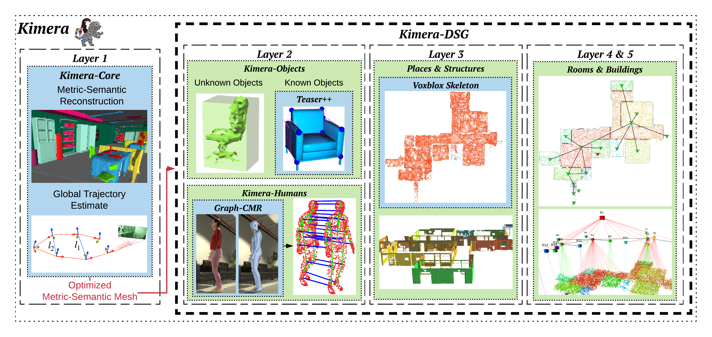
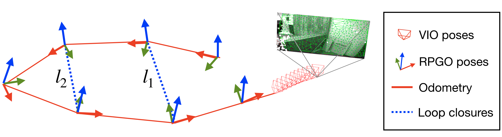
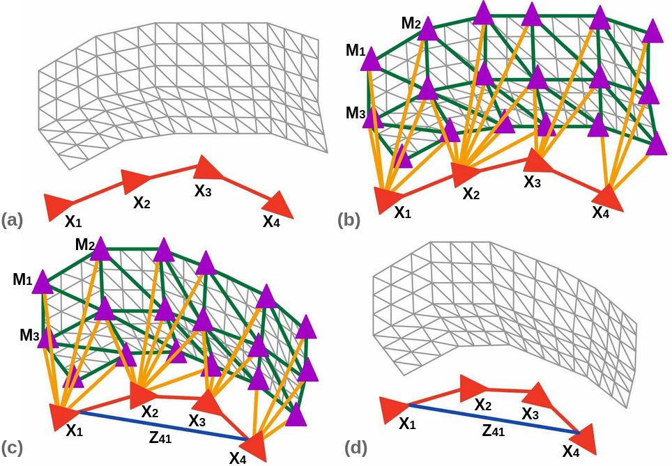
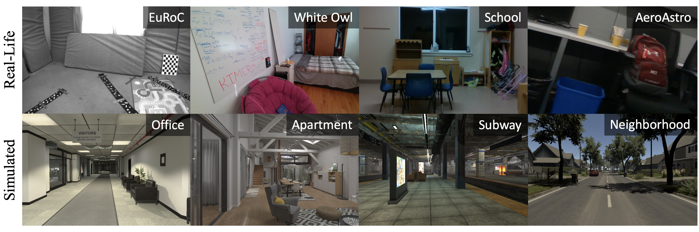
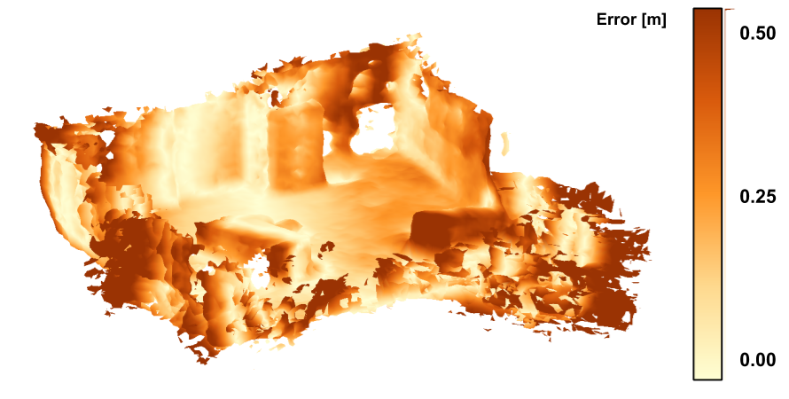
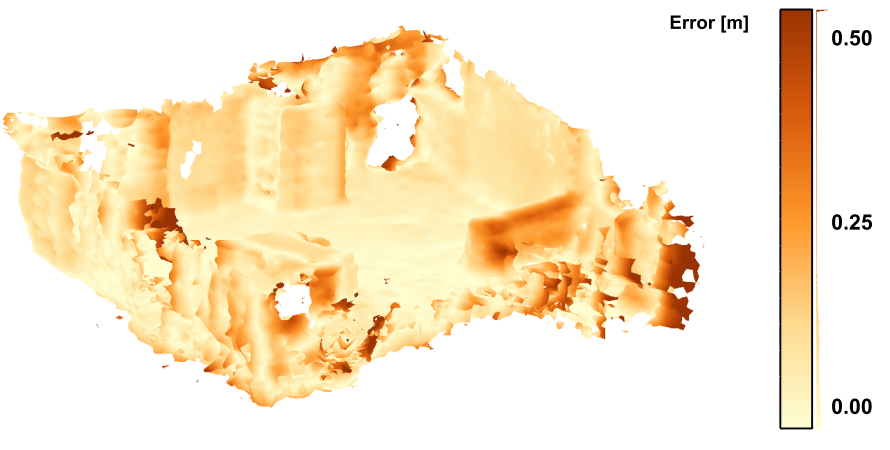
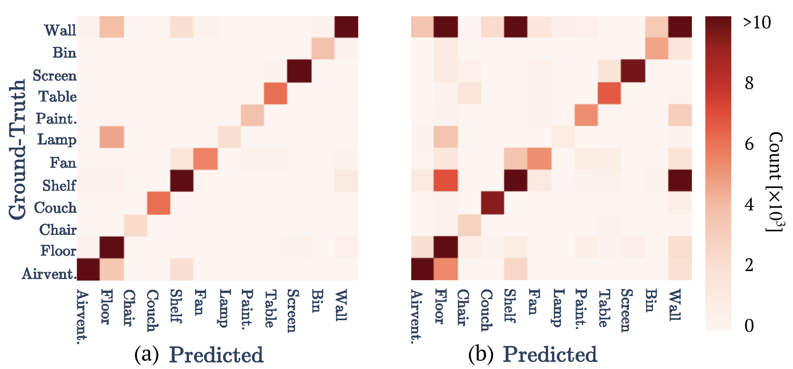
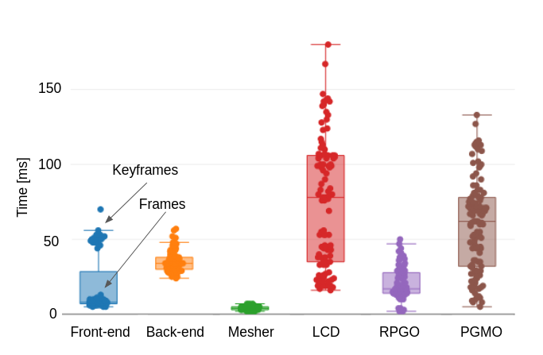

# Kimera 3D DSG (IJRR 2021)

<!-- paper-source: https://chengwei920412.github.io/paper_reading/2101.06894_Kimera_from_SLAM_to_Spatial_Perception_with_3D_Dynamic_Scene_Graphs/2101.06894_%E9%98%85%E8%AF%BB%E6%8A%A5%E5%91%8A.html -->

## 0. 基本信息 {#0}

- 论文标题：Kimera: from SLAM to Spatial Perception with 3D Dynamic Scene Graphs
- 作者：Antoni Rosinol, Andrew Violette, Marcus Abate, Nathan Hughes, Yun Chang, Jingnan Shi, Arjun Gupta, Luca Carlone
- 机构：Massachusetts Institute of Technology 等
- 来源（会议 / arXiv / 期刊）：The International Journal of Robotics Research；arXiv:2101.06894
- 年份：2021 arXiv 初稿；最终使用 arXiv v3
- 原始输入链接：https://arxiv.org/abs/2101.06894
- 最终使用的 arXiv 版本化 ID：2101.06894v3
- 原论文 arXiv 链接：https://arxiv.org/abs/2101.06894v3
- 幻觉翻译链接（hjfy）：https://hjfy.top/arxiv/2101.06894v3
- Cool Papers 链接：https://papers.cool/arxiv/2101.06894v3
- 论文研究方向：机器人空间感知、视觉惯性 SLAM、metric-semantic mapping、3D Dynamic Scene Graphs、层级语义规划
- 本文一句话概括：论文提出 3D Dynamic Scene Graph 作为分层、可行动的空间表示，并给出 Kimera 这一从视觉惯性数据自动构建 DSG 的系统，将 SLAM、语义三维重建、动态人类建模、物体定位、建筑解析和层级路径规划串成一个空间感知引擎。

## 1. 论文核心观点与主张的系统梳理 {#1}

### 1.1 研究背景与动机 {#11}

作者指出，长期自主机器人需要的不只是稀疏点云、体素地图或对象列表，而是能支持高层指令、长距离规划、动态实体理解和空间关系推理的内部世界模型。论文把高层 3D 动态场景理解拆成三个必要成分：metric-semantic grounding、多层抽象、静态/动态实体及其时空关系。

已有 SLAM 与 dense reconstruction 主要提供几何；语义分割主要提供像素级标签；metric-semantic mapping 通常是平面化的 object constellation、semantic mesh 或 volumetric model；早期层级地图多为 2D、静态且缺少现代语义。已有 3D scene graph 工作如 Armeni et al. 主要从已知 annotated mesh 构图，Kim et al. 更偏对象关系，二者都没有把 traversability、动态人类和在线机器人感知完整纳入。本文因此把 SLAM 提升为 Spatial Perception Engine 的一个模块。

### 1.2 问题设定 {#12}

论文任务是：给定机器人采集的 stereo/RGB-D 图像与 IMU 流，自动构建一个 3D Dynamic Scene Graph。输入不是离线标注好的三维模型，而是传感器数据；输出不仅是 metric-semantic mesh，还包括 objects、agents、places、rooms、buildings 等多层节点和跨层边。

图中 Kimera-Core 先生成全局一致 metric-semantic mesh，Kimera-DSG 再从该 mesh 构建对象、动态人类、places、structures、rooms 和 building 层。这个架构体现了论文的核心设定：低层几何和定位需要实时增量运行，高层 DSG 层可以在运行结束或较低频率批处理生成。

可将 DSG 形式化为式 (1)：

\[\mathcal{G}_{\mathrm{DSG}} = (\mathcal{V}_1,\mathcal{V}_2,\ldots,\mathcal{V}_L,\mathcal{E}_{\mathrm{intra}},\mathcal{E}_{\mathrm{inter}},\mathcal{A})\]

式 (1) 负责表达 DSG 的基本对象。\(\mathcal{V}_l\) 是第 \(l\) 层节点，例如 mesh vertices、objects/agents、places/structures、rooms、building；\(\mathcal{E}_{\mathrm{intra}}\) 是同层关系，如 places traversability；\(\mathcal{E}_{\mathrm{inter}}\) 是跨层包含或近邻关系，如 object 属于某个 place、place 属于 room；\(\mathcal{A}\) 是节点属性，如 3D pose、bounding box、semantic class、mesh、trajectory pose graph。工程上它对应一个多层图数据结构，底层由 Kimera-Core 产生，上层由 Kimera-Objects、Kimera-Humans 和 Kimera-BuildingParser 填充。

### 1.3 核心观点（Claims）的逐条梳理 {#13-claims}

1. 3D DSG 是一种 actionable spatial representation。对应 Section 2，作者定义了 mesh、objects/agents、places/structures、rooms、building 五层，并强调 places 的连通性使 DSG 泛化 topological maps。
2. Kimera 是首个从视觉惯性数据全自动构建 DSG 的 Spatial Perception Engine。对应 Section 3，系统由 Kimera-Core 和 Kimera-DSG 两组模块组成。
3. Kimera-PGMO 能通过同一个优化问题同时修正轨迹和 mesh，从而把 loop closure 作用到 metric-semantic reconstruction 上。对应 Section 3.4 和公式 (PGMO)。
4. Dynamic masking 与 DVIO 能提升动态人群场景中的重建和定位鲁棒性。对应 Section 4 的 uHumans/uHumans2 实验和 Table mapAccuracy / robustVIO。
5. DSG 的层级结构能让语义路径规划比直接在 ESDF 上 A\* 快数个数量级。对应 Section 5 / experiments-semanticPathPlanning。
6. 论文贡献还包括 uHumans2 数据集、真实数据定性评估、TX2 嵌入式运行分析。对应 Introduction contributions 和 Section 4。

### 1.4 创新性与贡献边界 {#14}

实质性创新在三个位置。第一，DSG 表示把 mesh、对象/动态 agent、places、rooms 和 building 组织为可查询的层级图，并加入动态实体。第二，Kimera-PGMO 把 trajectory pose graph 和 mesh deformation graph 统一成一个可由 GTSAM 求解的增强 pose graph。第三，系统层面把 VIO、语义重建、人类 SMPL 跟踪、TEASER++ 物体配准、topological places、room parsing 和 semantic path planning 串接起来。

贡献边界也很清楚：Kimera-VIO 继承 IMU preintegration、fixed-lag smoothing、GTSAM/iSAM2；Kimera-Semantics 继承 Voxblox/TSDF 和 Bayesian semantic fusion；人类 mesh 检测依赖 Graph-CNN/SMPL；已知物体配准依赖 TEASER++；room parsing 依赖 ESDF 和 topological map。论文不是提出一个端到端学习模型，而是一个大型模块化空间感知系统。

## 2. 关键论据、理论基础与数学方法的深度解析 {#2}

### 2.1 理论基础与学术渊源 {#21}

论文建立在五条技术线上：优化式 VIO 与 pose graph SLAM、TSDF/ESDF metric-semantic mapping、embedded deformation graph、3D scene graphs/topological maps、以及视觉人体/物体建模。外部基础包括 Forster et al. 的 IMU preintegration、GTSAM/iSAM2、Voxblox、PCM、TEASER++、SMPL 和 3D Scene Graph。

与上一篇 Kimera ICRA 2020 相比，本论文最重要的理论扩展是 PGMO：原 Kimera-RPGO 只优化机器人 pose graph，PGMO 同时优化 pose vertices 与 mesh vertices，让 loop closure 不只是修正轨迹，也能变形已经融合出的 mesh。

### 2.2 问题形式化与建模选择 {#22}

DSG 的层级构造可进一步写成式 (2)：

\[\mathcal{V}_{\mathrm{DSG}} = \mathcal{V}_{\mathrm{mesh}} \cup \mathcal{V}_{\mathrm{obj}} \cup \mathcal{V}_{\mathrm{agent}} \cup \mathcal{V}_{\mathrm{place}} \cup \mathcal{V}_{\mathrm{struct}} \cup \mathcal{V}_{\mathrm{room}} \cup \mathcal{V}_{\mathrm{building}}\]

这条公式负责说明论文的“节点选择”。\(\mathcal{V}_{\mathrm{mesh}}\) 是 semantically annotated 3D mesh vertices；\(\mathcal{V}_{\mathrm{obj}}\) 是静态非结构物体；\(\mathcal{V}_{\mathrm{agent}}\) 是动态人类和机器人；\(\mathcal{V}_{\mathrm{place}}\) 是自由空间中的可通行位置；\(\mathcal{V}_{\mathrm{struct}}\) 是 walls/floor/ceiling 等结构；\(\mathcal{V}_{\mathrm{room}}\) 和 \(\mathcal{V}_{\mathrm{building}}\) 是更高抽象。自然语言翻译：DSG 不是单层语义地图，而是把同一个环境按任务所需的抽象粒度分层。

工程映射上，mesh 层来自 Kimera-Semantics/PGMO；objects 来自语义 mesh 上的实例分割和 bounding box/CAD fitting；agents 来自 human detector、SMPL mesh 和 pose graph tracking；places 来自 ESDF/topological map；rooms 来自 place graph segmentation；building 在单建筑场景中通常只有一个节点。若删去 place 层，DSG 仍可存物体和 rooms，但失去直接支持 path planning 的 traversability graph。

### 2.3 核心推导与算法构造 {#23}

Kimera-PGMO 的核心目标函数是式 (3)。这里将原论文的三项优化改写为兼容 Markdown 的单行显示公式：

\[\min_{\{X_i\},\{M_k\}} \sum_{Z_{ij}}\|X_i^{-1}X_j-Z_{ij}\|_{\Omega_{ij}}^2 + \sum_{k}\sum_{l\in\mathcal{N}^M(k)}\|R_k^M(g_l-g_k)+t_k^M-t_l^M\|_{\Omega_{kl}}^2 + \sum_i\sum_{l\in\mathcal{N}^M(i)}\|R_i^X\tilde{g}_{il}+t_i^X-t_l^M\|_{\Omega_{il}}^2\]

第一项是标准 pose graph odometry/loop closure 约束；第二项保持 mesh 邻接顶点的局部刚性，避免 loop closure 把局部表面拉坏；第三项把 pose vertex 和 camera 可见 mesh vertex 绑定起来，使轨迹修正能传播到 mesh。\(X_i=[R_i^X,t_i^X]\) 是机器人位姿节点变换，\(M_k=[R_k^M,t_k^M]\) 是简化 mesh 顶点的局部变形，\(Z_{ij}\) 是 odometry/loop closure 测量，\(g_k\) 是原始未变形顶点位置，\(\tilde{g}_{il}\) 是在 pose \(i\) 坐标系下的 mesh 顶点位置。

图 2 显示 RPGO 只优化 pose graph；图 3 显示 PGMO 把红色 pose vertices、紫色 mesh vertices、绿色 mesh edges、黄色 visibility edges 和蓝色 loop closure edge 放入一个 deformation graph。式 (3) 正是图 3 的数学版本。

极简数值例子：假设一个闭环要求 pose 4 回到 pose 1 附近，标准 RPGO 只改变 \(X_1,\ldots,X_4\)。如果之前 mesh 顶点 \(g_k\) 是由旧轨迹融合得到的，轨迹变了但 mesh 不变，就会出现轨迹和地图不一致。PGMO 通过第二、三项让可见 mesh 顶点跟随附近 pose 变形，同时保持邻近 mesh 边长度近似不变。

式 (4) 定义了论文使用的加权 Frobenius 范数：

\[\|A\|_{\Omega}^{2}=\operatorname{tr}(A\Omega A^\top), \quad \Omega=\begin{bmatrix}\omega_R I_3 &amp; 0 \\ 0^\top &amp; \omega_t\end{bmatrix}\]

它负责给旋转和位移误差不同权重。工程上通常对应 residual block 的 information matrix 或 noise model。作者说明 mesh-mesh 和 pose-mesh 边只优化 translation，因此这些项的 rotation weight \(\omega_R\) 设为 0。若权重不合理，可能导致局部刚性过强而无法闭环，或过弱导致 mesh 被过度拉伸。

式 (5) 是作者将 PGMO 重写为增强 pose graph optimization 的形式：

\[\min_{T_1,\ldots,T_{n+m}\in SE(3)} \sum_{E_{ij}}\|T_i^{-1}T_j-E_{ij}\|_{\Omega_{ij}}^2\]

这里 \(T_i\) 可代表 pose vertex 或 mesh vertex 的变换，\(E_{ij}\) 可能是 odometry/loop closure 边 \(Z_{ij}\)、mesh edge \(G_{ij}\) 或 pose-mesh edge \(\bar{G}_{ij}\)。一句话直译：只要把 mesh deformation edges 也写成相对变换约束，PGMO 就能被当作更大的 pose graph 来求解。代码对应 GTSAM 中更多节点与 factor；代价是图规模变大。论文给出例子：EuRoC V1_01 上 RPGO 只优化 728 个 pose nodes，而 PGMO 优化 728 个 pose nodes 加 1031 个 mesh nodes。

式 (6) 是完整 mesh 顶点更新：

\[\tilde{v}_i=\sum_{j=1}^{m}w_j(v_i)\left[R_j^M(v_i-g_j)+t_j^M\right]\]

式 (7) 是权重定义：

\[w_j(v_i)=\left(1-\frac{\|v_i-g_j\|}{d_{\max}}\right)^2\]

这些公式负责把简化 deformation graph 的优化结果传播回完整高分辨率 mesh。\(v_i\) 是完整 mesh 原始顶点，\(\tilde{v}_i\) 是变形后顶点，\(g_j\) 是附近 deformation graph node，\(d_{\max}\) 是到第 \(k+1\) 近节点的距离，论文设置 \(k=4\)，权重再归一化。工程上这类似 embedded deformation 的 skinning/blending。若只移动简化 mesh 而不传播到完整 mesh，最终地图无法被实际更新；若只用最近一个 node 而非加权邻域，局部变形会不连续。

### 2.4 理论结论的适用范围 {#24}

PGMO 的数学形式说明它能用 pose graph 工具求解，但不等于给出全局最优保证。目标函数非凸，依赖良好初值、闭环内点筛选、mesh 简化分辨率、visibility edge 构造和权重调节。PCM 能减少坏闭环，但 pairwise consistency 不是所有场景的充分条件。Kimera-DSG 的上层节点也不是由统一概率模型联合估计，而是多个模块顺序生成，因此误差会层层传播。

语义和几何评估用到的 mIoU 与 RMSE 可写为式 (8)：

\[\operatorname{mIoU}=\frac{1}{C}\sum_{c=1}^{C}\frac{TP_c}{TP_c+FP_c+FN_c}, \quad \operatorname{RMSE}(P,Q)=\sqrt{\frac{1}{|P|}\sum_{p\in P}\min_{q\in Q}\|p-q\|_2^2}\]

mIoU 衡量语义标签，RMSE 衡量几何最近邻误差。二者只能覆盖部分主张，不能充分衡量 DSG 关系是否正确、路径规划是否安全、对象关系是否满足任务语义。

## 3. 实验设计与实验结果的充分性分析 {#3}

### 3.1 实验目标与论文主张的对应关系 {#31}

实验覆盖多个层次：EuRoC 验证 VIO/RPGO/PGMO 轨迹精度；EuRoC 和 uHumans/uHumans2 验证 mesh 几何与动态遮挡；仿真数据验证语义重建；uHumans/uHumans2 验证人类和物体节点定位；房间/places 实验验证 BuildingParser；路径规划实验验证 DSG 层级结构带来的加速；timing 与 TX2 实验验证实时性和嵌入式可行性；真实 WhiteOwl/School/Bldg31 做定性展示。

这张图显示论文覆盖 real-life 与 simulated、indoor 与 outdoor、小规模与大规模场景。它支持“广泛实验”的主张，但不同实验的真值完备性不同：EuRoC 有定位真值和部分点云，仿真有几何/语义真值，真实数据主要是定性。

### 3.2 实验设置合理性 {#32}

EuRoC 是 VIO 标准基准，适合定位；uHumans/uHumans2 是作者释放的仿真数据，适合评估动态人类、语义和对象节点；真实 RGB-D/IMU 数据用于检查系统能否在实际传感器噪声下构建 DSG。论文为了避免 2D segmentation 方法影响语义评估，在仿真语义实验中使用 ground-truth 2D semantic segmentation，这有利于隔离 3D 融合误差，但会高估真实部署性能。

对比设置有两个限制。第一，VIO 表中不同方法传感器配置不同，OKVIS/MSCKF/ROVIO/VINS-Mono 多为 monocular，Kimera/Basalt/ORB-SLAM3 使用 stereo/IMU 或 loop closure，不能简单解读为单一算法公平比较。第二，许多 DSG 上层评估缺少强外部 baseline，例如 humans/objects/rooms 主要是模块内部 ablation 或数值报告。

### 3.3 实验结果的解释力度 {#33}

EuRoC 主定位结果如下，数值为 RMSE ATE [m]：

<table>
<thead>
<tr>
<th>Seq.</th>
<th>OKVIS</th>
<th>MSCKF</th>
<th>ROVIO</th>
<th>VINS-Mono</th>
<th>Kimera-VIO</th>
<th>Basalt</th>
<th>ORB-SLAM3</th>
<th>VINS-LC</th>
<th>Kimera-RPGO</th>
<th>Kimera-PGMO</th>
</tr>
</thead>
<tbody>
<tr>
<td>MH_1</td>
<td>0.16</td>
<td>0.42</td>
<td>0.21</td>
<td>0.15</td>
<td>0.11</td>
<td>0.08</td>
<td>0.04</td>
<td>0.12</td>
<td>0.13</td>
<td>0.09</td>
</tr>
<tr>
<td>MH_2</td>
<td>0.22</td>
<td>0.45</td>
<td>0.25</td>
<td>0.15</td>
<td>0.10</td>
<td>0.06</td>
<td>0.03</td>
<td>0.12</td>
<td>0.21</td>
<td>0.11</td>
</tr>
<tr>
<td>MH_3</td>
<td>0.24</td>
<td>0.23</td>
<td>0.25</td>
<td>0.22</td>
<td>0.16</td>
<td>0.05</td>
<td>0.04</td>
<td>0.13</td>
<td>0.12</td>
<td>0.12</td>
</tr>
<tr>
<td>MH_4</td>
<td>0.34</td>
<td>0.37</td>
<td>0.49</td>
<td>0.32</td>
<td>0.16</td>
<td>0.10</td>
<td>0.05</td>
<td>0.18</td>
<td>0.12</td>
<td>0.16</td>
</tr>
<tr>
<td>MH_5</td>
<td>0.47</td>
<td>0.48</td>
<td>0.52</td>
<td>0.30</td>
<td>0.15</td>
<td>0.08</td>
<td>0.08</td>
<td>0.21</td>
<td>0.15</td>
<td>0.18</td>
</tr>
<tr>
<td>V1_1</td>
<td>0.09</td>
<td>0.34</td>
<td>0.10</td>
<td>0.08</td>
<td>0.05</td>
<td>0.04</td>
<td>0.04</td>
<td>0.06</td>
<td>0.06</td>
<td>0.05</td>
</tr>
<tr>
<td>V1_2</td>
<td>0.20</td>
<td>0.20</td>
<td>0.10</td>
<td>0.11</td>
<td>0.08</td>
<td>0.02</td>
<td>0.01</td>
<td>0.08</td>
<td>0.05</td>
<td>0.06</td>
</tr>
<tr>
<td>V1_3</td>
<td>0.24</td>
<td>0.67</td>
<td>0.14</td>
<td>0.18</td>
<td>0.13</td>
<td>0.03</td>
<td>0.02</td>
<td>0.19</td>
<td>0.11</td>
<td>0.13</td>
</tr>
<tr>
<td>V2_1</td>
<td>0.13</td>
<td>0.10</td>
<td>0.12</td>
<td>0.08</td>
<td>0.06</td>
<td>0.03</td>
<td>0.03</td>
<td>0.08</td>
<td>0.06</td>
<td>0.05</td>
</tr>
<tr>
<td>V2_2</td>
<td>0.16</td>
<td>0.16</td>
<td>0.14</td>
<td>0.16</td>
<td>0.07</td>
<td>0.02</td>
<td>0.01</td>
<td>0.16</td>
<td>0.06</td>
<td>0.07</td>
</tr>
<tr>
<td>V2_3</td>
<td>0.29</td>
<td>1.13</td>
<td>0.14</td>
<td>0.27</td>
<td>0.21</td>
<td>-</td>
<td>0.02</td>
<td>1.39</td>
<td>0.24</td>
<td>0.23</td>
</tr>
</tbody>
</table>

该表支撑“competitive performance”，但不支撑“全面 state-of-the-art”。ORB-SLAM3 在很多 loop closure 行更低；Kimera 的优势更多在系统集成和 mesh/DSG 输出，而不是单纯 ATE 最低。

PCM 阈值敏感性实验直接支持 RPGO 鲁棒性：

<table>
<thead>
<tr>
<th>方法</th>
<th>\(\alpha=10^1\)</th>
<th>\(\alpha=10^0\)</th>
<th>\(\alpha=10^{-1}\)</th>
<th>\(\alpha=10^{-2}\)</th>
<th>\(\alpha=10^{-3}\)</th>
</tr>
</thead>
<tbody>
<tr>
<td>PGO w/o PCM</td>
<td>0.05</td>
<td>0.45</td>
<td>1.74</td>
<td>1.59</td>
<td>1.59</td>
</tr>
<tr>
<td>Kimera-RPGO</td>
<td>0.05</td>
<td>0.05</td>
<td>0.05</td>
<td>0.05</td>
<td>0.05</td>
</tr>
</tbody>
</table>

动态遮挡对 mesh RMSE 的影响如下，表中摘取代表性拥挤场景：

<table>
<thead>
<tr>
<th>Dataset / Scene</th>
<th># Humans</th>
<th>GT pose w/o DM</th>
<th>GT pose with DM</th>
<th>DVIO w/o DM</th>
<th>DVIO with DM</th>
</tr>
</thead>
<tbody>
<tr>
<td>uH1 Office</td>
<td>12</td>
<td>0.09</td>
<td>0.06</td>
<td>0.23</td>
<td>0.23</td>
</tr>
<tr>
<td>uH1 Office</td>
<td>60</td>
<td>0.19</td>
<td>0.06</td>
<td>0.35</td>
<td>0.33</td>
</tr>
<tr>
<td>uH2 Neighborhood</td>
<td>24</td>
<td>0.08</td>
<td>0.06</td>
<td>0.66</td>
<td>0.61</td>
</tr>
<tr>
<td>uH2 Subway</td>
<td>36</td>
<td>0.19</td>
<td>0.06</td>
<td>0.49</td>
<td>0.43</td>
</tr>
<tr>
<td>uH2 Apartment</td>
<td>2</td>
<td>0.05</td>
<td>0.05</td>
<td>0.07</td>
<td>0.07</td>
</tr>
</tbody>
</table>

动态 masking 在 crowded scenes 中减少人类留下的“拖尾”伪影，但在 DVIO pose 下改善幅度有时不大，说明定位漂移和 ICP 对齐也影响 RMSE 解释。

PGMO 对 geometric/semantic reconstruction 的影响如下，摘取代表性行：

<table>
<thead>
<tr>
<th>Dataset / Scene</th>
<th># Humans</th>
<th>KimeraSemantics RMSE</th>
<th>KimeraPGMO RMSE</th>
<th>KimeraSemantics Sem [%]</th>
<th>KimeraPGMO Sem [%]</th>
</tr>
</thead>
<tbody>
<tr>
<td>EuRoC V1_01</td>
<td>0</td>
<td>0.15</td>
<td>0.13</td>
<td>-</td>
<td>-</td>
</tr>
<tr>
<td>EuRoC V2_03</td>
<td>0</td>
<td>0.25</td>
<td>0.24</td>
<td>-</td>
<td>-</td>
</tr>
<tr>
<td>uH1 Office</td>
<td>24</td>
<td>0.30</td>
<td>0.17</td>
<td>73.2</td>
<td>81.6</td>
</tr>
<tr>
<td>uH2 Neighborhood</td>
<td>24</td>
<td>0.61</td>
<td>0.11</td>
<td>51.2</td>
<td>93.7</td>
</tr>
<tr>
<td>uH2 Subway</td>
<td>24</td>
<td>0.53</td>
<td>0.31</td>
<td>73.5</td>
<td>86.3</td>
</tr>
<tr>
<td>uH2 Apartment</td>
<td>2</td>
<td>0.08</td>
<td>0.08</td>
<td>61.1</td>
<td>65.3</td>
</tr>
</tbody>
</table>

PGMO 在大规模、有明显漂移的 Neighborhood/Subway 上提升很大；在 EuRoC 和 Apartment 上提升有限。该结果与论文判断一致：PGMO 的价值主要在闭环和 mesh deformation 对大场景的作用。

语义重建分解实验：

<table>
<thead>
<tr>
<th>指标</th>
<th>GT depth + GT pose</th>
<th>GT depth + DVIO</th>
<th>Stereo + DVIO</th>
</tr>
</thead>
<tbody>
<tr>
<td>mIoU [%]</td>
<td>80.10</td>
<td>80.03</td>
<td>57.23</td>
</tr>
<tr>
<td>Acc [%]</td>
<td>94.68</td>
<td>94.50</td>
<td>80.74</td>
</tr>
<tr>
<td>RMSE [m]</td>
<td>0.079</td>
<td>0.131</td>
<td>0.215</td>
</tr>
<tr>
<td>ATE [m]</td>
<td>0.00</td>
<td>0.04</td>
<td>0.04</td>
</tr>
<tr>
<td>Drift [%]</td>
<td>0.0</td>
<td>0.2</td>
<td>0.2</td>
</tr>
</tbody>
</table>

该表说明 pose drift 在该仿真里影响小，dense stereo 是主要瓶颈。作者指出错误集中在 Wall/Shelf 和 Floor/Wall，与 textureless regions 难以估深一致。

人类和物体定位结果表很宽，正文保留关键趋势：多数 uH2 Office/Neighborhood/Subway 场景中，Single Image -> Filtered -> Pose Graph Tracking -> Mesh Check -> Beta Check 逐步降低 human localization error。例如 uH2 Neighborhood 36 humans 从 14.0m 降到 0.55m，uH2 Subway 24 humans 从 8.34m 降到 1.92m。但 Apartment 场景反例明显：1 human 时 Single Image 为 4.32m，Beta Check 变为 6.43m，作者归因于反光导致的 false detections。物体方面，known objects 的 CAD fitting 多在 0.17m 到 0.38m 范围，unknown object centroid 误差更大，部分 outdoor car 约 3m 以上。

房间解析与路径规划结果：

<table>
<thead>
<tr>
<th>场景</th>
<th>Room/Place Precision</th>
<th>Recall</th>
<th>备注</th>
</tr>
</thead>
<tbody>
<tr>
<td>uH2 Office</td>
<td>99%</td>
<td>99%</td>
<td>rooms 正确检测</td>
</tr>
<tr>
<td>uH2 Subway</td>
<td>87%</td>
<td>92%</td>
<td>room/place 大体正确</td>
</tr>
<tr>
<td>WhiteOwl</td>
<td>93%</td>
<td>94%</td>
<td>真实 apartment</td>
</tr>
<tr>
<td>School</td>
<td>91%</td>
<td>90%</td>
<td>真实 school</td>
</tr>
<tr>
<td>uH2 Apartment</td>
<td>68%</td>
<td>61%</td>
<td>ceiling beams 导致 living room 过分割</td>
</tr>
<tr>
<td>Bldg31</td>
<td>71%</td>
<td>67%</td>
<td>corridor 观测不完整导致过分割</td>
</tr>
</tbody>
</table>

<table>
<thead>
<tr>
<th># Buildings</th>
<th>ESDF A* [s]</th>
<th>Hierarchical total [s]</th>
<th>ESDF path [m]</th>
<th>Hierarchical path [m]</th>
</tr>
</thead>
<tbody>
<tr>
<td>1</td>
<td>420.4</td>
<td>0.340</td>
<td>54.2</td>
<td>56.3</td>
</tr>
<tr>
<td>2</td>
<td>944.8</td>
<td>0.775</td>
<td>101.2</td>
<td>109.8</td>
</tr>
<tr>
<td>6</td>
<td>21389.2</td>
<td>1.244</td>
<td>311.5</td>
<td>329.2</td>
</tr>
</tbody>
</table>

该结果最强地支撑“DSG 是 actionable representation”。层级路径规划比 ESDF 上直接规划快数个数量级，但路径略长，且实验通过复制 office scene 构造 grid-like large scale，真实性有限。

核心 timing：IMU preintegration 约 \(40\mu s\)；tracking 平均 7.5ms；keyframe vision frontend 平均 51ms；per-frame mesh 小于 7ms；multi-frame mesh 15ms；backend 小于 60ms；LCD 最多 180ms；RPGO 最多 50ms；PGMO 最多 140ms；KimeraSemantics 平均约 0.1s/keyframe。Kimera-DSG 上层不是实时全链路：Subway 这样的大场景可能约 30min，瓶颈是 ESDF、topological map 和 object instance segmentation。

### 3.4 潜在未讨论因素 {#34}

论文实验覆盖广，但仍有缺口。第一，上层 DSG 的整体图结构没有统一指标，如跨层边准确率、关系预测准确率、graph edit distance 或任务成功率。第二，真实数据主要定性，缺少真实动态环境的严格真值。第三，语义重建使用 ground-truth 2D semantics 的实验不能反映 Mask-RCNN/Graph-CNN 在 domain shift 下的误差级联。第四，Kimera-DSG 上层模块运行可达分钟级，论文标题中的 Spatial Perception 易让读者误以为全系统实时，但实时性主要属于 Kimera-Core。

<table>
<thead>
<tr>
<th>消融 / 边界因素</th>
<th>论文证据</th>
<th>结论</th>
</tr>
</thead>
<tbody>
<tr>
<td>PCM</td>
<td>\(\alpha=10^{-3}\) 时 PGO w/o PCM 为 1.59m，Kimera-RPGO 为 0.05m</td>
<td>错误闭环鲁棒性强依赖 PCM</td>
</tr>
<tr>
<td>Dynamic Masking</td>
<td>uH1 60 humans GT pose RMSE 0.19 -&gt; 0.06</td>
<td>动态人类 masking 对 clean mesh 很关键</td>
</tr>
<tr>
<td>Dense stereo</td>
<td>mIoU 80.03 -&gt; 57.23</td>
<td>depth quality 是语义 mesh 主要瓶颈</td>
</tr>
<tr>
<td>PGMO</td>
<td>uH2 Neighborhood 24 humans RMSE 0.61 -&gt; 0.11</td>
<td>大场景闭环后 mesh deformation 很关键</td>
</tr>
<tr>
<td>Room parsing</td>
<td>Apartment precision/recall 68/61</td>
<td>建筑几何复杂或观测不完整时容易过分割</td>
</tr>
<tr>
<td>上层 DSG runtime</td>
<td>Subway 约 30min</td>
<td>不是全系统实时</td>
</tr>
</tbody>
</table>

## 4. 与当前领域主流共识及反对观点的关系 {#4}

### 4.1 与主流观点的一致性 {#41}

Kimera 延续并整合了多个主流方向：SLAM 中的因子图优化和 loop closure、metric-semantic mapping 中的 TSDF/ESDF、robot planning 中的 topological map、计算机视觉中的 3D scene graph、人类建模中的 SMPL、鲁棒 registration 中的 TEASER++。论文与 Armeni et al. 3D Scene Graph 的关系是从离线/半自动 annotated mesh 走向机器人在线数据；与 Rosinol et al. RSS 2020 的关系是将 DSG 概念扩展成熟并加入 PGMO、uHumans2、真实数据和 path planning 实验。

### 4.2 与反对或竞争观点的分歧 {#42}

当前未检索到直接反驳 Kimera IJRR 结论的论文，但后续 Hydra 明确指出实时构建 rich 3D scene graph 仍是未充分解决的问题，并提出增量构建和 DSG 优化，这说明 Kimera 中部分上层 DSG 处理仍偏 batch/sequential。近期 open-vocabulary / Gaussian scene graph 工作则挑战 Kimera 的 closed-set segmentation 和 fixed ontology 假设：现代系统更强调开放词汇、持续更新和语言查询。

### 4.3 论文在学术版图中的定位 {#43}

该论文是 3D scene graph 机器人化的重要系统论文：它把场景图从视觉/图形学的静态组织结构推进到可由机器人传感器自动构建、包含动态 agents、可服务规划的空间表示。它不是单点算法 SOTA 论文，而是定义问题、给出系统原型、释放数据集和工具链的基础设施型工作。

### 4.4 文献检索说明 {#44}

- 检索范围：原论文 arXiv v3、论文源码参考文献、papers.cool 页面、arXiv 上的 3D Scene Graph、3D Dynamic Scene Graphs RSS 2020、Hydra、Voxblox、TEASER++、PCM/GkCM 等相关论文。
- 检索结论可信度：原论文内容和实验表来自 PDF/LaTeX 源码；外部定位来自 arXiv/论文原文。当前未检索到对 Kimera 结论的直接实证反驳，但后续工作显示实时性、开放词汇、动态更新和端到端图优化仍在继续发展。

### 4.5 相关论文补充表 {#45}

<table>
<thead>
<tr>
<th>序号</th>
<th>论文标题</th>
<th>作者 / 年份</th>
<th>来源</th>
<th>与原论文关系</th>
<th>一句话概述</th>
</tr>
</thead>
<tbody>
<tr>
<td>1</td>
<td>3D Scene Graph: A Structure for Unified Semantics, 3D Space, and Camera</td>
<td>Armeni et al., 2019</td>
<td>arXiv / ICCV line</td>
<td>直接前驱</td>
<td>从 annotated 3D mesh 构建建筑级 scene graph，但非机器人在线构建</td>
</tr>
<tr>
<td>2</td>
<td>3D Dynamic Scene Graphs: Actionable Spatial Perception with Places, Objects, and Humans</td>
<td>Rosinol et al., 2020</td>
<td>arXiv / RSS</td>
<td>直接前身</td>
<td>首次提出 DSG/SPIN 概念，本文扩展为成熟 Kimera 系统</td>
</tr>
<tr>
<td>3</td>
<td>Kimera: an Open-Source Library for Real-Time Metric-Semantic Localization and Mapping</td>
<td>Rosinol et al., 2020</td>
<td>ICRA</td>
<td>系统基础</td>
<td>提供 Kimera-Core 的 VIO/RPGO/Mesher/Semantics 基础</td>
</tr>
<tr>
<td>4</td>
<td>Voxblox: Incremental 3D ESDFs for On-Board MAV Planning</td>
<td>Oleynikova et al., 2017</td>
<td>IROS / arXiv</td>
<td>TSDF/ESDF 基础</td>
<td>Kimera-Semantics 与 BuildingParser 依赖 TSDF/ESDF 思路</td>
</tr>
<tr>
<td>5</td>
<td>Pairwise Consistent Measurement Set Maximization</td>
<td>Mangelson et al., 2018</td>
<td>ICRA</td>
<td>RPGO/PGMO 鲁棒性基础</td>
<td>用最大一致测量集过滤错误闭环</td>
</tr>
<tr>
<td>6</td>
<td>TEASER: Fast and Certifiable Point Cloud Registration</td>
<td>Yang et al., 2020</td>
<td>arXiv / T-RO</td>
<td>Kimera-Objects 基础</td>
<td>用于已知 CAD object 的鲁棒注册</td>
</tr>
<tr>
<td>7</td>
<td>Hydra: A Real-time Spatial Perception System for 3D Scene Graph Construction and Optimization</td>
<td>Hughes et al., 2022</td>
<td>arXiv</td>
<td>后续竞争/扩展</td>
<td>面向实时增量 DSG 构建与图优化，延续并改进 Kimera 思路</td>
</tr>
<tr>
<td>8</td>
<td>Dynamic Open-Vocabulary 3D Scene Graphs for Long-term Language-Guided Mobile Manipulation</td>
<td>Yan et al., 2024</td>
<td>arXiv</td>
<td>后续方向</td>
<td>引入 open-vocabulary 和长期动态更新，挑战 Kimera 的 closed-set 假设</td>
</tr>
</tbody>
</table>

## 5. 对论文理论体系的严肃反驳与系统性质疑 {#5}

### 5.1 核心假设层面的质疑 {#51}

Kimera 假设感知模块的输入标签足够可靠：2D semantics、human detections、SMPL body parameters、depth maps、loop closures、room/structure segmentation 都会影响 DSG。论文展示了错误案例，如 Apartment 和 Bldg31 的 room over-segmentation、真实数据中的 spurious object detections，但整体系统没有统一的不确定性传播机制。上层 DSG 边和节点一旦由错误 lower-layer perception 生成，后续 planning query 可能产生错误行为。

### 5.2 数学推导与理论主张的边界 {#52}

PGMO 将 mesh deformation 写成 pose graph 形式是很有价值的建模，但目标函数非凸，权重和 mesh simplification 分辨率需要调节。作者说明 voxel size 在测试中为 1 到 4m，这会影响 deformation graph 的表达能力。理论上，局部刚性约束可以保持形状，但在大闭环误差、非刚性动态物体、错误语义 mask 或错误闭环情况下，mesh deformation 可能把错误分散到整张地图。

### 5.3 工程实现与实际适用性 {#53}

Kimera-Core 具有实时性，但 Kimera-DSG 并非完整实时。对象实例分割、ESDF、topological map、room detection 在大场景可能需要数分钟到约 30min。对于真正在线人机交互或长期自治，系统需要增量上层更新、图结构不确定性、对象状态变化检测和开放词汇语义；这些不是本文的主要实现。

### 5.4 整体理论体系的稳健性 {#54}

论文最强的地方是系统整合，最弱的地方也是系统整合：每个模块可以局部有效，但全链路错误可能级联。例如 dense stereo 错误降低语义 mesh，semantic mask 错误影响 dynamic masking，room over-segmentation 影响 path planning，spurious object detections 影响 high-level query。若移除 ground-truth semantics 或换成开放真实场景类别，论文多数语义精度结论不能直接外推。

## 6. 最终结论 {#6}

### 6.1 论文价值总结 {#61}

Kimera / 3D DSG 是机器人空间感知领域的重要系统化工作。它把 SLAM 从“估计轨迹和地图”扩展为“构建可查询、可规划、含动态实体的层级场景图”，并用 PGMO 给出 trajectory + mesh joint correction 的关键机制。论文的价值主要在表示定义、系统架构、数据集和工程验证，而不是单个模块的理论最优性。

### 6.2 一句话总评 {#62}

这是一篇高影响力系统论文：它定义了机器人 3D Dynamic Scene Graph 的可行工程路线，但真实动态、开放词汇、增量高层图优化和全链路不确定性仍是明显未完成部分。

### 6.3 综合评分（10 分制） {#63-10}

- 创新性：8.5
- 技术严谨性：7.5
- 实验说服力：8.0
- 工程价值：9.0
- 总体评分：8.3

### 6.4 最关键的三条优点 {#64}

1. 把 metric-semantic SLAM、动态 agents、对象、places、rooms 和 building 统一为可行动层级图。
2. PGMO 将 loop closure 修正从 pose graph 扩展到 mesh deformation，解决轨迹和地图一致性问题。
3. 实验覆盖定位、mesh、语义、人/物、房间、路径规划、timing、TX2 和真实数据，系统完整度高。

### 6.5 最关键的三条问题 {#65}

1. 上层 DSG 构建很多步骤仍是顺序批处理，完整系统不是实时。
2. 语义与关系层缺少统一不确定性建模和端到端图结构评估。
3. 真实数据多为定性展示，许多强数值结论依赖仿真真值和 ground-truth 2D semantics。

## 附录 A：关键实验表与消融实验表 {#a}

### A.1 主 benchmark 对比表 {#a1-benchmark}

见正文 3.3 的 EuRoC VIO/RPGO/PGMO 表。该表完整转写主定位 benchmark 的关键列。

### A.2 扩展指标 / 扩展 benchmark 表 {#a2-benchmark}

<table>
<thead>
<tr>
<th>主题</th>
<th>关键结论</th>
</tr>
</thead>
<tbody>
<tr>
<td>Semantic reconstruction</td>
<td>Dense stereo + DVIO 将 mIoU 从 80.03% 降到 57.23%，depth 是主要瓶颈</td>
</tr>
<tr>
<td>Mesh deformation</td>
<td>uH2 Neighborhood 24 humans 中 PGMO 将 RMSE 从 0.61 降到 0.11，semantic correct 从 51.2% 提到 93.7%</td>
</tr>
<tr>
<td>Room parsing</td>
<td>Office/WhiteOwl/School 较好，Apartment 和 Bldg31 因结构或观测问题明显过分割</td>
</tr>
<tr>
<td>Path planning</td>
<td>6 buildings 时 ESDF A* 21389.2s，层级规划 1.244s</td>
</tr>
</tbody>
</table>

### A.3 数据规模 / scaling law / 泛化表 {#a3-scaling-law}

<table>
<thead>
<tr>
<th>设置</th>
<th>数据规模 / 迁移设置</th>
<th>指标</th>
<th>观察</th>
</tr>
</thead>
<tbody>
<tr>
<td>Hierarchical planning</td>
<td>Office 复制为 1/2/6 buildings</td>
<td>timing</td>
<td>层级规划从 0.340s 到 1.244s，ESDF 从 420.4s 到 21389.2s</td>
</tr>
<tr>
<td>Kimera-DSG Subway</td>
<td>约 3000平方米</td>
<td>runtime</td>
<td>DSG 上层构建约 30min</td>
</tr>
<tr>
<td>TX2 fast/faster</td>
<td>max features 300/250/200, horizon 6/5/4.5s</td>
<td>runtime vs ATE</td>
<td>降低计算时间但困难 EuRoC 段 ATE 增加</td>
</tr>
</tbody>
</table>

### A.4 关键消融实验表 {#a4}

<table>
<thead>
<tr>
<th>消融项</th>
<th>变化设置</th>
<th>指标</th>
<th>原始数值</th>
<th>变化后数值</th>
<th>结论</th>
</tr>
</thead>
<tbody>
<tr>
<td>PCM</td>
<td>PGO w/o PCM -&gt; Kimera-RPGO, \(\alpha=10^{-3}\)</td>
<td>ATE [m]</td>
<td>1.59</td>
<td>0.05</td>
<td>PCM 是闭环鲁棒性关键</td>
</tr>
<tr>
<td>Dynamic Masking</td>
<td>w/o DM -&gt; with DM, uH1 Office 60, GT pose</td>
<td>mesh RMSE [m]</td>
<td>0.19</td>
<td>0.06</td>
<td>动态人类伪影被显著抑制</td>
</tr>
<tr>
<td>Dense stereo</td>
<td>GT depth -&gt; Stereo, DVIO pose</td>
<td>mIoU [%]</td>
<td>80.03</td>
<td>57.23</td>
<td>depth quality 主导语义下降</td>
</tr>
<tr>
<td>PGMO</td>
<td>KimeraSemantics -&gt; KimeraPGMO, uH2 Subway 24</td>
<td>RMSE [m]</td>
<td>0.53</td>
<td>0.31</td>
<td>loop closure mesh deformation 改善地图</td>
</tr>
<tr>
<td>Human tracking</td>
<td>Single image -&gt; Beta check, uH2 Neighborhood 36</td>
<td>localization [m]</td>
<td>14.0</td>
<td>0.55</td>
<td>pose graph + association checks 有效</td>
</tr>
</tbody>
</table>

### A.5 其他支撑正文结论的关键表 {#a5}

<table>
<thead>
<tr>
<th>模块 / 操作</th>
<th>论文报告时间</th>
<th>备注</th>
</tr>
</thead>
<tbody>
<tr>
<td>IMU preintegration</td>
<td>约 \(40\mu s\)</td>
<td>IMU-rate state propagation</td>
</tr>
<tr>
<td>Feature tracking</td>
<td>平均 7.5ms</td>
<td>普通帧视觉前端</td>
</tr>
<tr>
<td>Keyframe vision frontend</td>
<td>平均 51ms</td>
<td>detection + stereo + RANSAC</td>
</tr>
<tr>
<td>Per-frame mesh</td>
<td>小于 7ms</td>
<td>低延迟局部 mesh</td>
</tr>
<tr>
<td>Multi-frame mesh</td>
<td>平均 15ms</td>
<td>fixed-lag mesh</td>
</tr>
<tr>
<td>VIO backend</td>
<td>小于 60ms</td>
<td>factor graph optimization</td>
</tr>
<tr>
<td>LCD</td>
<td>最多 180ms</td>
<td>loop candidate + verification</td>
</tr>
<tr>
<td>Kimera-RPGO</td>
<td>最多 50ms</td>
<td>728 nodes, 734 edges</td>
</tr>
<tr>
<td>Kimera-PGMO</td>
<td>最多 140ms</td>
<td>728 pose nodes + 1031 mesh nodes</td>
</tr>
<tr>
<td>Kimera-DSG Subway</td>
<td>约 30min</td>
<td>ESDF/topological map/object segmentation 是瓶颈</td>
</tr>
</tbody>
</table>

## 附录 B：本报告引用的关键外部文献 {#b}

1. Armeni, I. et al. “3D Scene Graph: A Structure for Unified Semantics, 3D Space, and Camera.” ICCV / arXiv, 2019.
2. Rosinol, A. et al. “3D Dynamic Scene Graphs: Actionable Spatial Perception with Places, Objects, and Humans.” RSS / arXiv, 2020.
3. Rosinol, A. et al. “Kimera: an Open-Source Library for Real-Time Metric-Semantic Localization and Mapping.” ICRA, 2020.
4. Oleynikova, H. et al. “Voxblox: Incremental 3D Euclidean Signed Distance Fields for On-Board MAV Planning.” IROS / arXiv, 2017.
5. Mangelson, J. G. et al. “Pairwise Consistent Measurement Set Maximization for Robust Multi-Robot Map Merging.” ICRA, 2018.
6. Yang, H., Shi, J., and Carlone, L. “TEASER: Fast and Certifiable Point Cloud Registration.” T-RO / arXiv, 2020.
7. Hughes, N., Chang, Y., and Carlone, L. “Hydra: A Real-time Spatial Perception System for 3D Scene Graph Construction and Optimization.” arXiv, 2022.
8. Yan, Z. et al. “Dynamic Open-Vocabulary 3D Scene Graphs for Long-term Language-Guided Mobile Manipulation.” arXiv, 2024.
