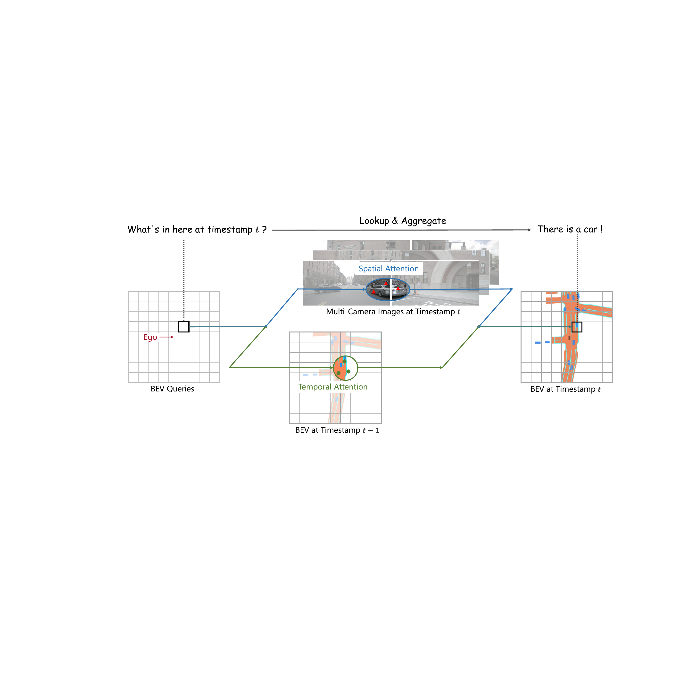
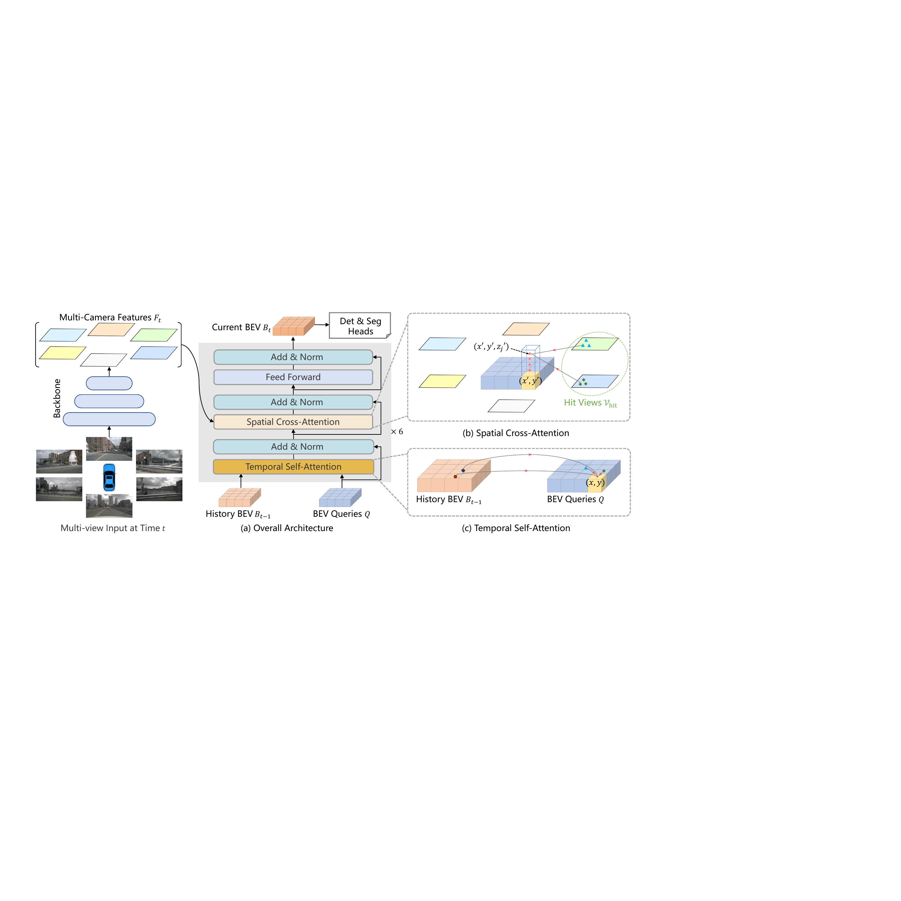
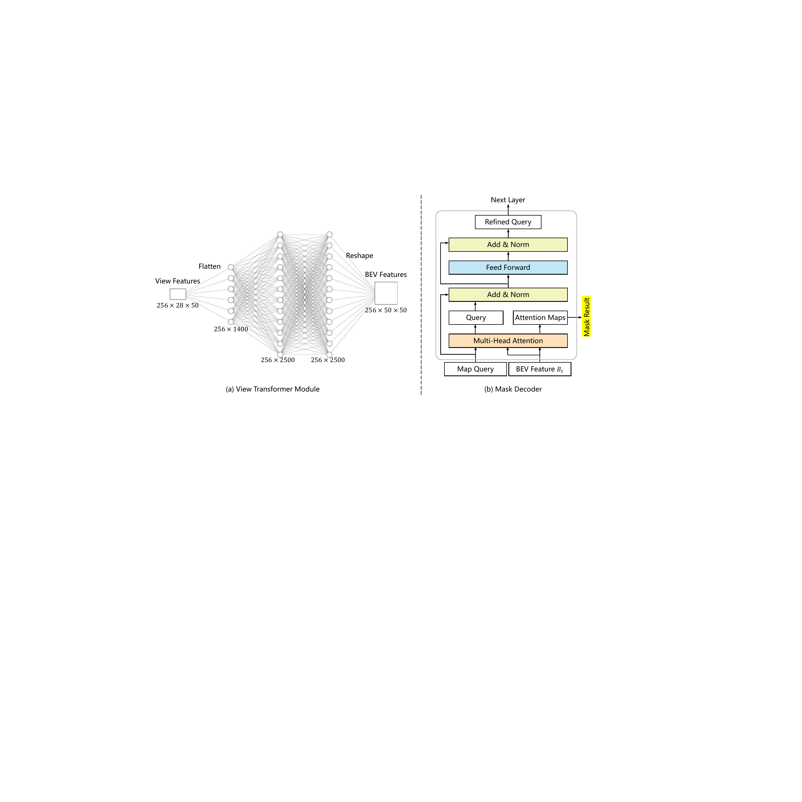
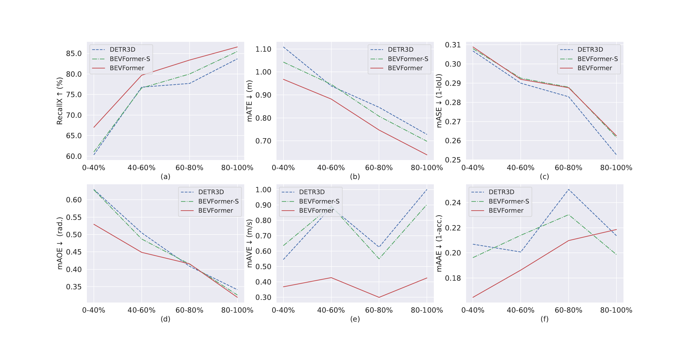
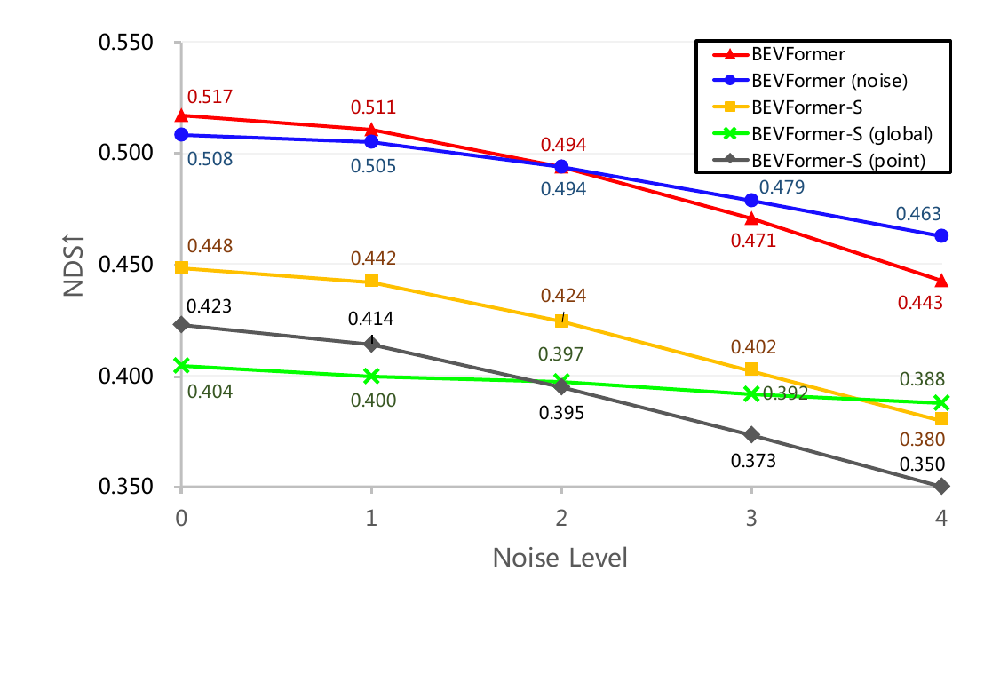
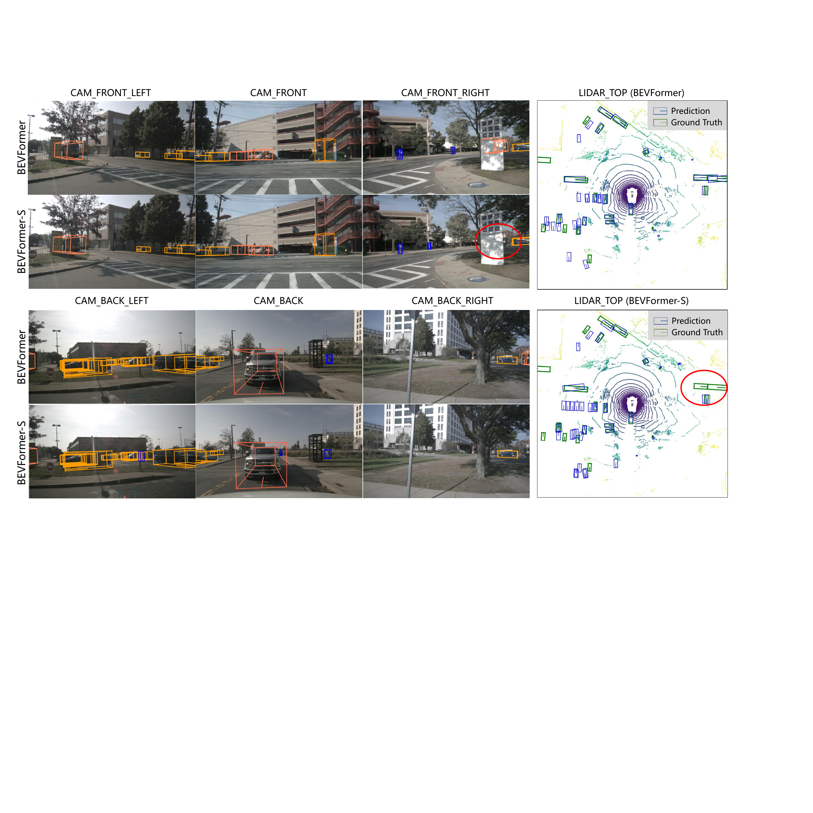
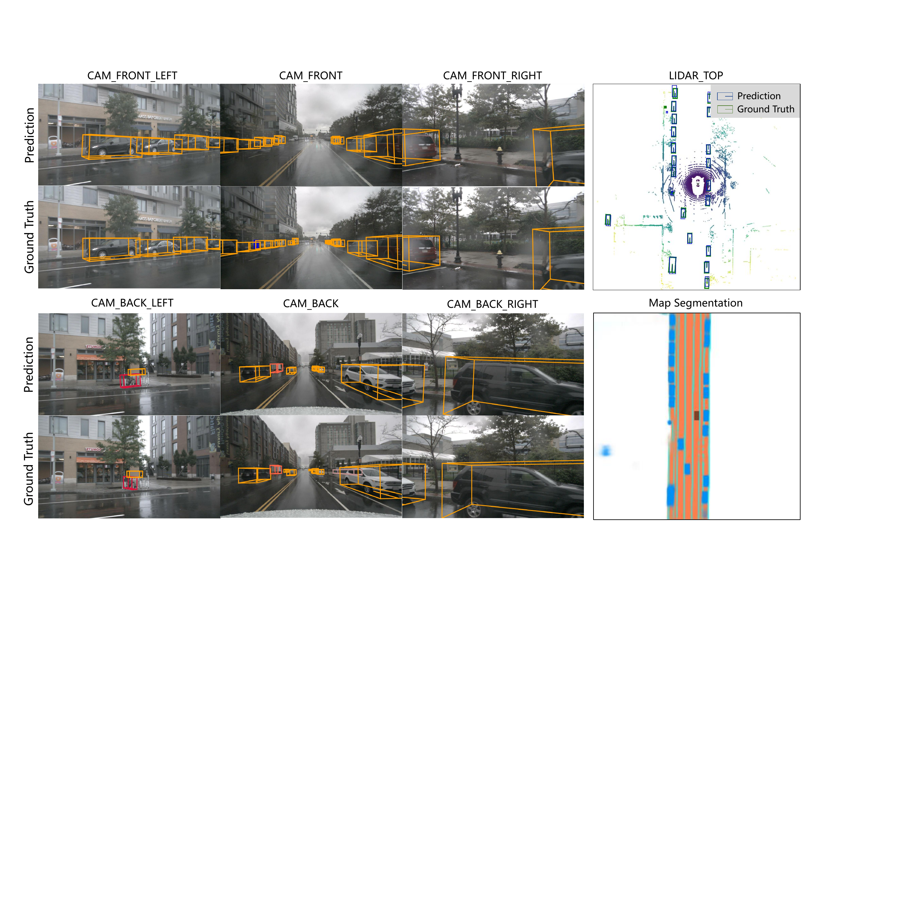
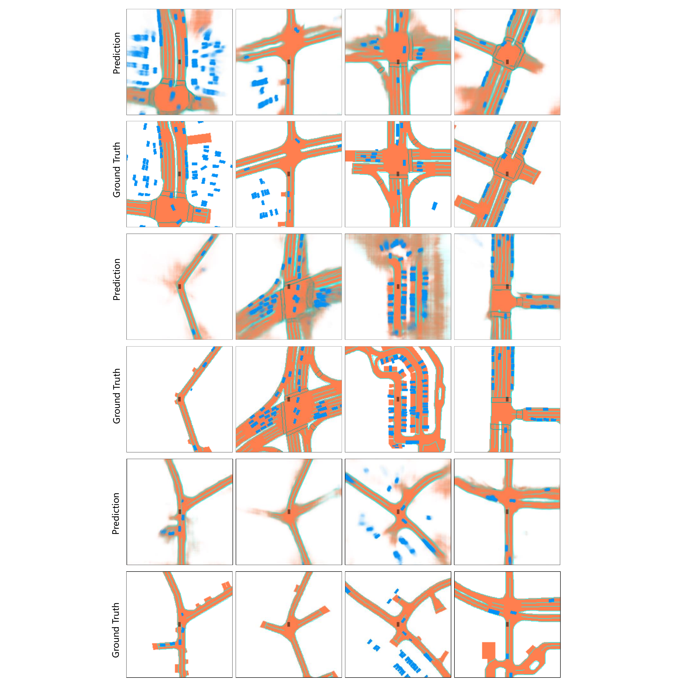

# BEVFormer (ECCV 2022)

<!-- paper-source: https://chengwei920412.github.io/paper_reading/2203.17270_BEVFormer_Learning_Bird_s_Eye_View_Representation_from_Multi_Camera_Images_via_Spatiotemporal_Transformers/technical_report.html -->

> 原文链接：[BEVFormer (ECCV 2022)](https://chengwei920412.github.io/paper_reading/2203.17270_BEVFormer_Learning_Bird_s_Eye_View_Representation_from_Multi_Camera_Images_via_Spatiotemporal_Transformers/technical_report.html)

> **arXiv ID**: 2203.17270
> **原文标题**: BEVFormer: Learning Bird's-Eye-View Representation from Multi-Camera Images via Spatiotemporal Transformers
> **翻译日期**: 2026-08-26

---

## 📋 论文概览 {#_1}

### 基本信息 {#_2}

- **作者**: Zhiqi Li, Wenhai Wang, Hongyang Li, Enze Xie, Chonghao Sima, Tong Lu, Yu Qiao, Jifeng Dai（前三位同等贡献，Jifeng Dai 为通讯作者）
- **机构**: 南京大学、上海人工智能实验室、香港大学
- **发表时间**: 2022 年 3 月（arXiv v1），ECCV 2022 收录
- **领域**: 自动驾驶 3D 视觉感知、多相机 BEV 表征学习、Transformer 架构

### 核心贡献 {#_3}

1. **提出 BEVFormer 时空 Transformer 编码器**：把多相机图像与历史时间戳输入统一投影到 BEV 表征，用一套 BEV 特征同时支撑 3D 目标检测与地图分割两类任务。
2. **设计网格状 BEV 查询 + 两类注意力层**：空间交叉注意力（SCA）从跨相机视角检索空间特征，时序自注意力（TSA）从历史 BEV 检索时序特征，两者聚合为统一 BEV 特征。
3. **摆脱对深度估计的依赖**：不同于 Lift-Splat 等依赖深度分布的"深度前向投影"范式，BEVFormer 用可变形注意力自适应采样，避免深度误差沿流程累积。
4. **以 RNN 式循环传递时序信息**：只保留上一帧 BEV 特征而非堆叠多帧，计算开销近似可忽略，却能显式建模长时序依赖。
5. **实测新最优**：nuScenes `test` 集 56.9% NDS，比 DETR3D 高 9.0 个点，与基于 LiDAR 的 SSN（56.9% NDS）持平。

---

## 🎯 研究背景与动机 {#_4}

### 问题定义 {#_5}

自动驾驶的视觉感知需要从多个环视相机给出的 2D 图像，推断出 3D 边界框与语义地图。核心难点在于：**如何把若干张透视视角（Perspective View）图像，转换成一个统一、几何一致的俯视表征（BEV）**，并在此表征上完成检测与分割。

### 现有方法的局限性 {#_6}

<table>
<thead>
<tr>
<th>范式</th>
<th>代表方法</th>
<th>局限</th>
</tr>
</thead>
<tbody>
<tr>
<td>单目 + 跨相机后处理</td>
<td>FCOS3D、PGD</td>
<td>各视角独立处理，无法捕获跨相机信息，性能与效率双低</td>
</tr>
<tr>
<td>深度前向投影生成 BEV</td>
<td>Lift-Splat、CaDNN、Pseudo-LiDAR</td>
<td>强依赖深度值/深度分布精度，误差累积（Compounding Errors）会严重损害最终性能</td>
</tr>
<tr>
<td>MLP 学习视角变换</td>
<td>VPN、PYVA</td>
<td>MLP 参数量随分辨率暴涨，难以生成高分辨率 BEV（VPN 实测只能做到 \(50\times50\)）</td>
</tr>
<tr>
<td>稀疏 3D 查询直接投影</td>
<td>DETR3D</td>
<td>无稠密 BEV 表征，难以直接支撑分割任务；速度估计几乎失效（mAVE 0.842）</td>
</tr>
<tr>
<td>堆叠多帧 BEV</td>
<td>FIERY 等</td>
<td>可用时序信息被限制在固定时长内，且带来额外计算开销与干扰信息</td>
</tr>
</tbody>
</table>

### 本文的创新点 {#_7}

论文的两条动机线索非常清晰：

1. **"不要依赖深度"**：既然从 2D 平面生成 BEV 是病态（Ill-posed）问题，就不要用硬几何前向投影，而应让模型**自适应地学**该去哪里取特征。Transformer 的注意力机制在概念上正好契合——它动态聚合有价值的特征，而不是按固定深度分布 splat。
2. **"BEV 是连接时空的理想桥梁"**：BEV 网格天然对应真实世界坐标，因此只要按自车运动（Ego-motion）做一次对齐，前后帧的同一网格就代表同一物理位置，时序融合可以退化成一次简单的注意力——这就使 RNN 式的循环传递成为可能。

图 1：BEVFormer 的核心思路——BEV 查询同时向"空间"（当前帧多相机图像）与"时序"（上一帧 BEV）两个方向检索并聚合信息。

---

## 🔬 方法论 {#_8}

### 整体架构 {#_9}

图 2：BEVFormer 整体架构。（a）编码器层含网格状 BEV 查询、时序自注意力与空间交叉注意力；（b）空间交叉注意力中每个 BEV 查询只与感兴趣区域内的图像特征交互；（c）时序自注意力中每个 BEV 查询与当前帧 BEV 查询、上一帧 BEV 特征交互。

BEVFormer 由 **6 个编码器层**堆叠而成，每层沿用标准 Transformer 结构，但把两个注意力子层替换为定制设计。单帧推理的数据流为：

1. 多相机图像 → 骨干网络（ResNet101-DCN 或 VoVNet-99）+ FPN → 多尺度视角特征 \(F_t=\{F_t^i\}_{i=1}^{N_{\rm view}}\)；
2. 取出缓存的上一帧 BEV 特征 \(B_{t-1}\)，按自车运动对齐为 \(B&#x27;_{t-1}\)；
3. 每个编码器层内：BEV 查询 \(Q\) **先**过时序自注意力（融合 \(B&#x27;_{t-1}\)），**再**过空间交叉注意力（融合 \(F_t\)），最后过前馈网络；
4. 6 层后输出统一 BEV 特征 \(B_t \in \mathbb{R}^{H\times W\times C}\)（默认 \(200\times200\times256\)）；
5. \(B_t\) 分别送入检测头（基于 Deformable DETR）与分割头（基于 Panoptic SegFormer 掩码解码器）。

关键工程点：**\(B_t\) 同时被缓存下来供 \(t+1\) 帧使用**，形成 RNN 式的隐状态传递。

### 关键技术 {#_10}

#### 1. BEV 查询（BEV Queries） {#1-bev-bev-queries}

预定义一组网格状可学习参数 \(Q\in \mathbb{R}^{H\times W\times C}\)。位于 \(p=(x,y)\) 的查询 \(Q_p\) 负责 BEV 平面上对应网格单元，每格对应真实世界 \(s\) 米（nuScenes 默认 \(s=0.512\)m，\(200\times200\) 格覆盖 \(\pm51.2\)m）。BEV 特征中心默认对齐自车位置，并加可学习位置编码。

#### 2. 空间交叉注意力（SCA） {#2-sca}

这是把 2D 可变形注意力扩展到 3D 的核心。基础的可变形注意力为：

\[\text{DeformAttn}(q, p, x) = \sum_{i=1}^{N_\text{head}} \mathcal{W}_i\sum_{j=1}^{N_\text{key}} \mathcal{A}_{ij} \cdot \mathcal{W}&#x27;_i x(p+ \Delta p_{ij})\]

其中 \(\mathcal{A}_{ij}\in[0,1]\) 为预测的注意力权重（按 \(\sum_j A_{ij}=1\) 归一化），\(\Delta p_{ij}\in\mathbb{R}^2\) 为相对参考点 \(p\) 的预测偏移，特征值用双线性插值取得。**关键在于采样位置 \(\Delta p_{ij}\) 是学出来的，而不是几何算出来的**。

SCA 的三步流程为：

**第一步：柱状抬升（Pillar Lifting）。** 把 BEV 平面上的 2D 查询点抬升成一根 3D 柱体，在柱上采 \(N_\text{ref}=4\) 个不同高度的参考点。先算真实世界坐标：

\[x&#x27; = \left(x-\frac{W}{2}\right)\times s; \quad y&#x27; = \left(y-\frac{H}{2}\right)\times s\]

再配上预定义的锚点高度集合 \(\{z&#x27;_j\}_{j=1}^{N_\text{ref}}\)（在 \(-5\)m 到 \(3\)m 之间均匀采样），得到一柱 3D 点 \(\{(x&#x27;,y&#x27;,z&#x27;_j)\}\)。

> **为什么要多个高度？** BEV 网格只有 \((x,y)\)，丢掉了高度维。同一个 \((x,y)\) 在图像上可能对应地面、车身中部、车顶等不同像素。采 4 个高度就是为了"沿着 z 轴扫一遍"，确保能命中目标实际所在的高度。

**第二步：投影到 2D 视角。** 用已知相机投影矩阵 \(T_i\in\mathbb{R}^{3\times4}\) 把 3D 点投到第 \(i\) 个视角：

\[z_{ij}\cdot\begin{bmatrix} x_{ij} &amp; y_{ij} &amp; 1 \end{bmatrix}^T = T_i \cdot \begin{bmatrix} x&#x27; &amp; y&#x27; &amp; z&#x27;_j &amp; 1 \end{bmatrix}^T\]

一个 BEV 查询的投影点通常只落在 1～2 个视角上，命中的视角集合记为 \(\mathcal{V}_\text{hit}\)。

**第三步：仅在命中视角上做可变形注意力并平均：**

\[\text{SCA}(Q_p, F_t) = \frac{1}{|\mathcal{V}_\text{hit}|} \sum_{i\in \mathcal{V}_\text{hit}} \sum_{j=1}^{N_\text{ref}} \text{DeformAttn}(Q_p, \mathcal{P}(p,i,j), F_t^i)\]

> **符号速查**：\(Q_p\)—位于 \(p\) 的 BEV 查询；\(\mathcal{P}(p,i,j)\)—第 \(j\) 个 3D 点投到第 \(i\) 视角的 2D 参考点；\(F_t^i\)—第 \(i\) 视角特征；\(\mathcal{V}_\text{hit}\)—命中视角集合；\(1/|\mathcal{V}_\text{hit}|\)—按命中视角数归一化，避免重叠区域（被 2 个相机同时看到）的特征幅值翻倍。

**极简数值例子**：设 BEV 为 \(200\times200\)，\(s=0.512\)m。查询 \(p=(150,100)\) → \(x&#x27;=(150-100)\times0.512=25.6\)m，\(y&#x27;=(100-100)\times0.512=0\)m。即自车正前方（或正右方，取决于坐标约定）25.6m 处。配上 4 个高度 \(z&#x27;\in\{-5,-2.33,0.33,3\}\)，得到 4 个 3D 点；用 6 个相机的 \(T_i\) 逐一投影，假设只有前视相机的投影落在图像内 → \(|\mathcal{V}_\text{hit}|=1\)，于是只对前视特征做 4 次（每个高度一次）可变形注意力后取平均。

#### 3. 时序自注意力（TSA） {#3-tsa}

\[\text{TSA}(Q_p, \{Q, B&#x27;_{t-1}\}) = \sum_{V\in \{Q, B&#x27;_{t-1}\}} \text{DeformAttn}(Q_p, p, V)\]

设计上有三个细节值得注意：

- **对齐先行**：\(B_{t-1}\) 先按自车运动对齐成 \(B&#x27;_{t-1}\)，使同网格对应同一真实位置。这一步是纯几何变换，不含学习参数，但消融实验证明它值 0.7 NDS。
- **偏移量由拼接预测**：与原始可变形注意力不同，\(\Delta p\) 由 \(Q\) 与 \(B&#x27;_{t-1}\) 的**拼接**结果预测。直觉是——自车运动可以精确补偿，但**其他车辆自身的运动不能**，所以模型需要同时看到"现在想查什么"和"过去有什么"，才能学出恰当的偏移去追踪移动目标。消融实验中这一项值 0.4 NDS。
- **首帧退化**：序列首帧没有历史，把 \(\{Q, B&#x27;_{t-1}\}\) 替换为 \(\{Q, Q\}\)，TSA 自然退化为普通自注意力。

#### 4. 任务头 {#4}

图 5：分割头（掩码解码器）结构。

- **检测头**（改自 Deformable DETR）：每个 3D 框预测 10 个参数——尺度 \((l,w,h)\)、中心 \((x_o,y_o,z_o)\)、偏航角 \((\cos\theta,\sin\theta)\)、速度 \((v_x,v_y)\)。仅用 \(L_1\) 损失与 \(L_1\) 匹配代价，900 个目标查询，推理保留 top-300 框，**无需 NMS**。
- **分割头**（改自 Panoptic SegFormer）：每个语义类别用一个类别固定的可学习查询表示，基于原始多头注意力的注意力图生成掩码。

### 算法流程 {#_11}

**训练阶段**（关键在于"三帧无梯度 + 一帧有梯度"）：

1. 对时间戳 \(t\) 的样本，从过去 2 秒的连续序列中**随机**再采 3 个样本，记为 \(t-3, t-2, t-1, t\)（随机采样本身是一种自车运动数据增强，值 0.4 NDS）；
2. 前三帧仅用于循环生成 \(\{B_{t-3}, B_{t-2}, B_{t-1}\}\)，**此阶段不回传梯度**；
3. 在 \(t\) 帧基于 \(F_t\) 与 \(B_{t-1}\) 生成 \(B_t\)，此时 \(B_t\) 已隐含跨 4 帧的时空线索；
4. \(B_t\) 送入检测头与分割头，计算损失并回传。

> 这一设计是全文最重要的工程折中：**它让时序建模的显存开销与单帧训练几乎相同**，代价是历史 BEV 的生成过程不接受梯度监督。

**推理阶段**：按时间顺序逐帧评估，\(B_{t-1}\) 缓存复用。这是\*\*在线（Online）\*\*策略，与实际车端部署一致，而非离线滑窗。

---

## 📊 实验与结果 {#_12}

### 实验设置 {#_13}

- **数据集**：
- nuScenes——1000 个场景（约 20s/场景），关键帧 2Hz 标注，6 相机 360° FOV，10 类共 140 万个 3D 框；
- Waymo Open Dataset——798 训练 / 202 验证序列，5 相机仅约 252° FOV（但标注覆盖 360°，故剔除任何图像上都不可见的框），每 5 帧采样一帧，仅检测车辆类。
- **评估指标**：
- nuScenes：NDS、mAP（基于地平面中心距离而非 3D IoU 匹配），以及 5 类 TP 指标 mATE/mASE/mAOE/mAVE/mAAE。NDS 定义为
  $\({\rm NDS}=\frac{1}{10}\left[5{\rm mAP}+\sum_{{\rm mTP}\in \mathbb{TP}} (1-{\rm min}(1,{\rm mTP}))\right]\)$
- Waymo：APH（带朝向信息的平均精度），IoU 阈值 0.5 / 0.7，LEVEL_1 / LEVEL_2 难度。
- **对比方法**：FCOS3D、PGD、DETR3D、DD3D、CaDNN（相机）；SSN、CenterPoint、PointPillars、PointPainting（LiDAR / 融合）；VPN、Lift-Splat（BEV 编码器替换基线，任务头保持一致）。
- **关键配置**：BEV \(200\times200\)，\(s=0.512\)m，感知范围 \(\pm51.2\)m，\(C=256\)，6 编码器层，\(N_\text{ref}=4\)，24 epoch，lr \(2\times10^{-4}\)，AdamW + 余弦退火，骨干 lr 乘子 0.1。
- **消融变体定义**：**BEVFormer-S** = 把 TSA 换成不用历史 BEV 的普通自注意力（即"静态"单帧版本）。这是全文最重要的对照组。

### 主要结果 {#_14}

**表 1：nuScenes `test` 集 3D 检测结果**

<table>
<thead>
<tr>
<th>方法</th>
<th>模态</th>
<th>骨干网络</th>
<th>NDS↑</th>
<th>mAP↑</th>
<th>mATE↓</th>
<th>mASE↓</th>
<th>mAOE↓</th>
<th>mAVE↓</th>
<th>mAAE↓</th>
</tr>
</thead>
<tbody>
<tr>
<td>SSN</td>
<td>L</td>
<td>-</td>
<td>0.569</td>
<td>0.463</td>
<td>-</td>
<td>-</td>
<td>-</td>
<td>-</td>
<td>-</td>
</tr>
<tr>
<td>CenterPoint-Voxel</td>
<td>L</td>
<td>-</td>
<td>0.655</td>
<td>0.580</td>
<td>-</td>
<td>-</td>
<td>-</td>
<td>-</td>
<td>-</td>
</tr>
<tr>
<td>PointPainting</td>
<td>L&amp;C</td>
<td>-</td>
<td>0.581</td>
<td>0.464</td>
<td>0.388</td>
<td>0.271</td>
<td>0.496</td>
<td>0.247</td>
<td>0.111</td>
</tr>
<tr>
<td>FCOS3D</td>
<td>C</td>
<td>R101</td>
<td>0.428</td>
<td>0.358</td>
<td>0.690</td>
<td>0.249</td>
<td>0.452</td>
<td>1.434</td>
<td><strong>0.124</strong></td>
</tr>
<tr>
<td>PGD</td>
<td>C</td>
<td>R101</td>
<td>0.448</td>
<td>0.386</td>
<td><strong>0.626</strong></td>
<td><strong>0.245</strong></td>
<td>0.451</td>
<td>1.509</td>
<td>0.127</td>
</tr>
<tr>
<td>BEVFormer-S</td>
<td>C</td>
<td>R101</td>
<td>0.462</td>
<td>0.409</td>
<td>0.650</td>
<td>0.261</td>
<td>0.439</td>
<td>0.925</td>
<td>0.147</td>
</tr>
<tr>
<td>BEVFormer</td>
<td>C</td>
<td>R101</td>
<td><strong>0.535</strong></td>
<td><strong>0.445</strong></td>
<td>0.631</td>
<td>0.257</td>
<td><strong>0.405</strong></td>
<td><strong>0.435</strong></td>
<td>0.143</td>
</tr>
<tr>
<td>DD3D</td>
<td>C</td>
<td>V2-99*</td>
<td>0.477</td>
<td>0.418</td>
<td><strong>0.572</strong></td>
<td><strong>0.249</strong></td>
<td><strong>0.368</strong></td>
<td>1.014</td>
<td><strong>0.124</strong></td>
</tr>
<tr>
<td>DETR3D</td>
<td>C</td>
<td>V2-99*</td>
<td>0.479</td>
<td>0.412</td>
<td>0.641</td>
<td>0.255</td>
<td>0.394</td>
<td>0.845</td>
<td>0.133</td>
</tr>
<tr>
<td>BEVFormer-S</td>
<td>C</td>
<td>V2-99*</td>
<td>0.495</td>
<td>0.435</td>
<td>0.589</td>
<td>0.254</td>
<td>0.402</td>
<td>0.842</td>
<td>0.131</td>
</tr>
<tr>
<td>BEVFormer</td>
<td>C</td>
<td>V2-99*</td>
<td><strong>0.569</strong></td>
<td><strong>0.481</strong></td>
<td>0.582</td>
<td>0.256</td>
<td>0.375</td>
<td><strong>0.378</strong></td>
<td>0.126</td>
</tr>
</tbody>
</table>

**读表要点**：56.9% NDS 比 DETR3D 的 47.9% 高 9.0 点，且**与纯 LiDAR 的 SSN（56.9%）完全持平**——这是本文最有冲击力的数字。但拆开看，增益来源极不均匀：**mAVE 从 0.845 骤降到 0.378（降 55%）**，而 mASE（尺度误差）几乎没动（0.255 → 0.256）。这说明时序信息主要贡献在**运动学量**（速度、位置、朝向）上，对**几何尺度**无帮助——与图 3(c)(f) 的结论完全一致。

**表 2：nuScenes `val` 集 3D 检测结果**

<table>
<thead>
<tr>
<th>方法</th>
<th>模态</th>
<th>骨干网络</th>
<th>NDS↑</th>
<th>mAP↑</th>
<th>mATE↓</th>
<th>mASE↓</th>
<th>mAOE↓</th>
<th>mAVE↓</th>
<th>mAAE↓</th>
</tr>
</thead>
<tbody>
<tr>
<td>FCOS3D</td>
<td>C</td>
<td>R101</td>
<td>0.415</td>
<td>0.343</td>
<td>0.725</td>
<td>0.263</td>
<td>0.422</td>
<td>1.292</td>
<td><strong>0.153</strong></td>
</tr>
<tr>
<td>PGD</td>
<td>C</td>
<td>R101</td>
<td>0.428</td>
<td>0.369</td>
<td>0.683</td>
<td><strong>0.260</strong></td>
<td>0.439</td>
<td>1.268</td>
<td>0.185</td>
</tr>
<tr>
<td>DETR3D</td>
<td>C</td>
<td>R101</td>
<td>0.425</td>
<td>0.346</td>
<td>0.773</td>
<td>0.268</td>
<td>0.383</td>
<td>0.842</td>
<td>0.216</td>
</tr>
<tr>
<td>BEVFormer-S</td>
<td>C</td>
<td>R101</td>
<td>0.448</td>
<td>0.375</td>
<td>0.725</td>
<td>0.272</td>
<td>0.391</td>
<td>0.802</td>
<td>0.200</td>
</tr>
<tr>
<td>BEVFormer</td>
<td>C</td>
<td>R101</td>
<td><strong>0.517</strong></td>
<td><strong>0.416</strong></td>
<td><strong>0.673</strong></td>
<td>0.274</td>
<td><strong>0.372</strong></td>
<td><strong>0.394</strong></td>
<td>0.198</td>
</tr>
</tbody>
</table>

**关键对照**：BEVFormer-S（44.8%）vs DETR3D（42.5%）= **+2.3 点，这是"BEV 编码器 + SCA"本身的贡献**；BEVFormer（51.7%）vs BEVFormer-S（44.8%）= **+6.9 点，这是时序信息（TSA）的贡献**。**时序的贡献约为空间设计的 3 倍**，这个拆分对理解论文的真实价值至关重要。

**表 3：Waymo `val` 集结果**（验证跨数据集泛化）

<table>
<thead>
<tr>
<th>方法</th>
<th>模态</th>
<th>IoU=0.5 L1/APH</th>
<th>IoU=0.5 L2/APH</th>
<th>IoU=0.7 L1/APH</th>
<th>IoU=0.7 L2/APH</th>
<th>NDS†↑</th>
<th>AP↑</th>
<th>ATE↓</th>
<th>ASE↓</th>
<th>AOE↓</th>
</tr>
</thead>
<tbody>
<tr>
<td>PointPillars</td>
<td>L</td>
<td>0.866</td>
<td>0.801</td>
<td>0.638</td>
<td>0.557</td>
<td>0.685</td>
<td>0.838</td>
<td>0.143</td>
<td>0.132</td>
<td>0.070</td>
</tr>
<tr>
<td>DETR3D</td>
<td>C</td>
<td>0.220</td>
<td>0.216</td>
<td>0.055</td>
<td>0.051</td>
<td>0.394</td>
<td>0.388</td>
<td>0.741</td>
<td><strong>0.156</strong></td>
<td>0.108</td>
</tr>
<tr>
<td>BEVFormer</td>
<td>C</td>
<td><strong>0.280</strong></td>
<td><strong>0.241</strong></td>
<td><strong>0.061</strong></td>
<td><strong>0.052</strong></td>
<td><strong>0.426</strong></td>
<td><strong>0.440</strong></td>
<td><strong>0.679</strong></td>
<td>0.157</td>
<td><strong>0.101</strong></td>
</tr>
<tr>
<td>CaDNN*</td>
<td>C</td>
<td>0.175</td>
<td>0.165</td>
<td>0.050</td>
<td>0.045</td>
<td>-</td>
<td>-</td>
<td>-</td>
<td>-</td>
<td>-</td>
</tr>
<tr>
<td>BEVFormer*</td>
<td>C</td>
<td>0.308</td>
<td>0.277</td>
<td>0.077</td>
<td>0.069</td>
<td>-</td>
<td>-</td>
<td>-</td>
<td>-</td>
<td>-</td>
</tr>
</tbody>
</table>

**读表要点**：IoU=0.5 时 BEVFormer 领先 DETR3D 6.0/2.5 点（L1/L2），但 **IoU=0.7 时所有相机方法都崩到 0.05～0.08**，而 LiDAR 的 PointPillars 仍有 0.638。这个对比比 nuScenes 上的"持平 LiDAR"更诚实地暴露了相机方法的天花板：**在严格 IoU 判据下，纯视觉的 3D 定位精度与 LiDAR 差一个数量级**。作者也承认"基于 IoU 的指标对相机方法过于严苛"，因此补充了 nuScenes 指标——这是合理的，但读者应记住两套指标讲的是不同的故事。

**表 4：多任务感知结果（检测 + 分割联合训练）**

<table>
<thead>
<tr>
<th>方法</th>
<th>检测头</th>
<th>分割头</th>
<th>NDS↑</th>
<th>mAP↑</th>
<th>IoU 汽车</th>
<th>IoU 车辆</th>
<th>IoU 道路</th>
<th>IoU 车道线</th>
</tr>
</thead>
<tbody>
<tr>
<td>Lift-Splat†</td>
<td>✗</td>
<td>✓</td>
<td>-</td>
<td>-</td>
<td>32.1</td>
<td>32.1</td>
<td>72.9</td>
<td>20.0</td>
</tr>
<tr>
<td>FIERY†</td>
<td>✗</td>
<td>✓</td>
<td>-</td>
<td>-</td>
<td>-</td>
<td>38.2</td>
<td>-</td>
<td>-</td>
</tr>
<tr>
<td>VPN*</td>
<td>✓</td>
<td>✗</td>
<td>0.333</td>
<td>0.253</td>
<td>-</td>
<td>-</td>
<td>-</td>
<td>-</td>
</tr>
<tr>
<td>VPN*</td>
<td>✗</td>
<td>✓</td>
<td>-</td>
<td>-</td>
<td>31.0</td>
<td>31.8</td>
<td>76.9</td>
<td>19.4</td>
</tr>
<tr>
<td>VPN*</td>
<td>✓</td>
<td>✓</td>
<td>0.334</td>
<td>0.257</td>
<td>36.6</td>
<td>37.3</td>
<td>76.0</td>
<td>18.0</td>
</tr>
<tr>
<td>Lift-Splat*</td>
<td>✓</td>
<td>✗</td>
<td>0.397</td>
<td>0.348</td>
<td>-</td>
<td>-</td>
<td>-</td>
<td>-</td>
</tr>
<tr>
<td>Lift-Splat*</td>
<td>✗</td>
<td>✓</td>
<td>-</td>
<td>-</td>
<td>42.1</td>
<td>41.7</td>
<td>77.7</td>
<td>20.0</td>
</tr>
<tr>
<td>Lift-Splat*</td>
<td>✓</td>
<td>✓</td>
<td>0.410</td>
<td>0.344</td>
<td>43.0</td>
<td>42.8</td>
<td>73.9</td>
<td>18.3</td>
</tr>
<tr>
<td>BEVFormer-S</td>
<td>✓</td>
<td>✗</td>
<td>0.448</td>
<td>0.375</td>
<td>-</td>
<td>-</td>
<td>-</td>
<td>-</td>
</tr>
<tr>
<td>BEVFormer-S</td>
<td>✗</td>
<td>✓</td>
<td>-</td>
<td>-</td>
<td>43.1</td>
<td>43.2</td>
<td><strong>80.7</strong></td>
<td>21.3</td>
</tr>
<tr>
<td>BEVFormer-S</td>
<td>✓</td>
<td>✓</td>
<td>0.453</td>
<td>0.380</td>
<td>44.3</td>
<td>44.4</td>
<td>77.6</td>
<td>19.8</td>
</tr>
<tr>
<td>BEVFormer</td>
<td>✓</td>
<td>✗</td>
<td>0.517</td>
<td><strong>0.416</strong></td>
<td>-</td>
<td>-</td>
<td>-</td>
<td>-</td>
</tr>
<tr>
<td>BEVFormer</td>
<td>✗</td>
<td>✓</td>
<td>-</td>
<td>-</td>
<td>44.8</td>
<td>44.8</td>
<td>80.1</td>
<td><strong>25.7</strong></td>
</tr>
<tr>
<td>BEVFormer</td>
<td>✓</td>
<td>✓</td>
<td><strong>0.520</strong></td>
<td>0.412</td>
<td><strong>46.8</strong></td>
<td><strong>46.7</strong></td>
<td>77.5</td>
<td>23.9</td>
</tr>
</tbody>
</table>

**读表要点**：联合训练时检测与车辆分割**双双提升**（NDS 0.517→0.520，汽车 IoU 44.8→46.8），但道路（80.1→77.5）与车道线（25.7→23.9）**明显下降**——作者诚实地把它命名为**负迁移（Negative Transfer）**。合理的解读是：车辆分割与 3D 检测共享"动态物体"这一语义，互相促进；而道路/车道线是静态背景语义，与检测任务竞争同一份 BEV 容量。

图 3：按可见度分层的检测结果。(a) 召回率——BEVFormer 在所有子集上更高，0-40% 可见度子集上领先超过 6.0%；(b)(d)(e) 平移、朝向、速度精度均获益于时序信息；(c)(f) 尺度与属性误差几无差别。

图 3 是全文论证最扎实的一张图：它把"时序信息帮在哪里"逐指标拆开，并且**主动展示了两个不起作用的指标（尺度、属性）**，而非只报喜。

### 消融实验 {#_15}

**表 5：不同 BEV 编码器 / 注意力机制对比**

<table>
<thead>
<tr>
<th>方法</th>
<th>注意力</th>
<th>NDS↑</th>
<th>mAP↑</th>
<th>mATE↓</th>
<th>mAOE↓</th>
<th>#Param.</th>
<th>FLOPs</th>
<th>显存</th>
</tr>
</thead>
<tbody>
<tr>
<td>VPN*</td>
<td>-</td>
<td>0.334</td>
<td>0.252</td>
<td>0.926</td>
<td>0.598</td>
<td>111.2M</td>
<td>924.5G</td>
<td>~20G</td>
</tr>
<tr>
<td>Lift-Splat*</td>
<td>-</td>
<td>0.397</td>
<td>0.348</td>
<td>0.784</td>
<td>0.537</td>
<td>74.0M</td>
<td>1087.7G</td>
<td>~20G</td>
</tr>
<tr>
<td>BEVFormer-S†</td>
<td>全局</td>
<td>0.404</td>
<td>0.325</td>
<td>0.837</td>
<td>0.442</td>
<td>62.1M</td>
<td>1245.1G</td>
<td>~36G</td>
</tr>
<tr>
<td>BEVFormer-S‡</td>
<td>点</td>
<td>0.423</td>
<td>0.351</td>
<td>0.753</td>
<td>0.442</td>
<td>68.1M</td>
<td>1264.3G</td>
<td>~20G</td>
</tr>
<tr>
<td>BEVFormer-S</td>
<td>局部</td>
<td><strong>0.448</strong></td>
<td><strong>0.375</strong></td>
<td><strong>0.725</strong></td>
<td><strong>0.391</strong></td>
<td>68.7M</td>
<td>1303.5G</td>
<td>~20G</td>
</tr>
</tbody>
</table>

**读表要点**：三种注意力的排序为 **局部（可变形）0.448 > 点 0.423 > 全局 0.404**，且局部方案参数量最小（68.7M vs VPN 的 111.2M）、显存最省（~20G vs 全局的 ~36G）。这印证了论文的核心论点：**稀疏局部注意力在感受野与显存之间取得最优平衡**——全局注意力显存爆炸（且为此不得不降到 \(100\times100\) BEV + fp16 + 单尺度，所以 0.404 这个数字并非同配置对比），纯点交互则感受野不足。

**表 6：模型规模与延迟权衡**

<table>
<thead>
<tr>
<th>配置</th>
<th>MS</th>
<th>BEV</th>
<th>#Layer</th>
<th>骨干 (ms)</th>
<th>BEVFormer (ms)</th>
<th>头 (ms)</th>
<th>FPS</th>
<th>NDS↑</th>
<th>mAP↑</th>
</tr>
</thead>
<tbody>
<tr>
<td>BEVFormer</td>
<td>✓</td>
<td>\(200\times200\)</td>
<td>6</td>
<td>391</td>
<td>130</td>
<td>19</td>
<td>1.7</td>
<td><strong>0.517</strong></td>
<td><strong>0.416</strong></td>
</tr>
<tr>
<td>A</td>
<td>✗</td>
<td>\(200\times200\)</td>
<td>6</td>
<td>387</td>
<td>87</td>
<td>19</td>
<td>1.9</td>
<td>0.511</td>
<td>0.406</td>
</tr>
<tr>
<td>B</td>
<td>✓</td>
<td>\(100\times100\)</td>
<td>6</td>
<td>391</td>
<td>53</td>
<td>18</td>
<td>2.0</td>
<td>0.504</td>
<td>0.402</td>
</tr>
<tr>
<td>C</td>
<td>✓</td>
<td>\(200\times200\)</td>
<td>1</td>
<td>391</td>
<td>25</td>
<td>19</td>
<td>2.1</td>
<td>0.501</td>
<td>0.396</td>
</tr>
<tr>
<td>D</td>
<td>✗</td>
<td>\(100\times100\)</td>
<td>1</td>
<td>387</td>
<td><strong>7</strong></td>
<td>18</td>
<td><strong>2.3</strong></td>
<td>0.478</td>
<td>0.374</td>
</tr>
</tbody>
</table>

**读表要点**：这是最有实践价值的一张表。配置 C 把 BEVFormer 模块从 130ms 压到 **25ms（5.2×）而只损失 1.6 NDS**；配置 D 更压到 7ms（18.6×），损失 3.9 NDS。但真正的洞察在最后一列 FPS：**从 1.7 提到 2.3 而已**——因为骨干网络吃掉了 387～391ms，占总延迟的 **70%～93%**。作者据此明确指出"限制效率的瓶颈在骨干网络"。**换句话说，优化 BEV 编码器对端到端帧率几乎无意义，除非先解决 6 路图像的骨干开销。**

**表 7：训练帧数的影响**

<table>
<thead>
<tr>
<th>#Frame</th>
<th>NDS↑</th>
<th>mAP↑</th>
<th>mAVE↓</th>
</tr>
</thead>
<tbody>
<tr>
<td>1</td>
<td>0.448</td>
<td>0.375</td>
<td>0.802</td>
</tr>
<tr>
<td>2</td>
<td>0.490</td>
<td>0.388</td>
<td>0.467</td>
</tr>
<tr>
<td>3</td>
<td>0.510</td>
<td>0.410</td>
<td>0.423</td>
</tr>
<tr>
<td>4</td>
<td><strong>0.517</strong></td>
<td><strong>0.416</strong></td>
<td>0.394</td>
</tr>
<tr>
<td>5</td>
<td><strong>0.517</strong></td>
<td>0.412</td>
<td><strong>0.387</strong></td>
</tr>
</tbody>
</table>

**读表要点**：1→2 帧就带来 +4.2 NDS 和 mAVE 腰斩（0.802→0.467），说明**大部分时序收益来自"有没有历史"，而非"历史有多长"**。4 帧后饱和（4→5 帧 NDS 持平，mAP 甚至微降），故默认设为 4。

**表 8：关键设计消融**

<table>
<thead>
<tr>
<th>#</th>
<th>A.（自车运动对齐）</th>
<th>R.（随机采样）</th>
<th>B.（拼接预测偏移）</th>
<th>NDS↑</th>
<th>mAP↑</th>
</tr>
</thead>
<tbody>
<tr>
<td>1</td>
<td>✗</td>
<td>✓</td>
<td>✓</td>
<td>0.510</td>
<td>0.410</td>
</tr>
<tr>
<td>2</td>
<td>✓</td>
<td>✗</td>
<td>✓</td>
<td>0.513</td>
<td>0.410</td>
</tr>
<tr>
<td>3</td>
<td>✓</td>
<td>✓</td>
<td>✗</td>
<td>0.513</td>
<td>0.404</td>
</tr>
<tr>
<td>4</td>
<td>✓</td>
<td>✓</td>
<td>✓</td>
<td><strong>0.517</strong></td>
<td><strong>0.416</strong></td>
</tr>
</tbody>
</table>

**读表要点**：三项设计各值 0.4～0.7 NDS，其中**自车运动对齐最关键（+0.7）**。三项加总约 1.5 NDS——相比 TSA 整体带来的 6.9 NDS，这些是锦上添花的细节，核心增益来自"引入历史 BEV"这一动作本身。

**相机外参鲁棒性**（附录 B）

图 6：不同水平相机外参噪声下的 NDS。第 \(i\) 级噪声的旋转噪声服从均值 0、方差 \(i\) 的正态分布（单位：度），平移噪声服从均值 0、方差 \(5i\) 的正态分布（单位：厘米）。

噪声水平 4 下的 NDS 相对跌幅：BEVFormer-S (point) **−17.3%** > BEVFormer-S **−15.2%** > BEVFormer **−14.3%** > BEVFormer (noise，带噪训练) **−8.9%** > BEVFormer-S (global) **−4.0%**。

这里有一个反直觉但很有价值的发现：**全局注意力虽然干净数据上最弱（0.404），却在重噪下最鲁棒，甚至反超默认的 BEVFormer-S（38.8% vs 38.0%）**。原因是它不用外参去选择 RoI，因此不继承外参误差。这提示部署时存在**精度—鲁棒性权衡**：标定可靠时用可变形注意力，标定不可靠时全局注意力反而更安全。

**可视化结果**

图 7：BEVFormer 与 BEVFormer-S 对比。借助时序信息，BEVFormer 成功检测出两辆被广告牌遮挡的公交车（红圈处为 BEVFormer-S 的漏检）。

图 8：检测与地图分割联合结果，蓝/橙/绿分别为车辆、道路、车道线。

图 9：地图分割结果，蓝/橙/青/绿分别为车辆、道路、人行横道、车道线。

---

## 💡 关键见解 {#_16}

### 理论分析 {#_17}

**1. 为什么"反向查询"优于"前向投影"？**

这是 BEVFormer 与 Lift-Splat 系方法最本质的分歧。

- **前向投影（Lift-Splat）**：对每个图像像素预测深度分布 → 把特征 splat 到 3D → pool 成 BEV。信息流是 **2D → 3D**。若深度预测错了，特征就被放到错误的 BEV 位置，**错误不可恢复**，且沿流程累积。
- **反向查询（BEVFormer）**：对每个 BEV 网格，主动去图像上"取"特征。信息流是 **3D → 2D**。BEV 网格位置是**已知且固定**的（由 \(s\) 和网格索引精确确定），不需要预测深度；唯一的不确定性是"取哪个像素"，而这个不确定性被 4 个高度锚点 + 可学习偏移 \(\Delta p\) 吸收了。

关键在于：**投影方向 3D→2D 是良定义的**（给定 \(T_i\)，任意 3D 点唯一对应一个 2D 像素），而 **2D→3D 是病态的**（一个像素对应一条射线）。BEVFormer 通过反转查询方向，把病态问题转化为了良定义问题 + 有界的采样不确定性。这是全文最深刻的设计洞察。

**2. BEV 网格为何使时序融合变得廉价？**

BEV 网格与真实世界坐标是**仿射对应**的：网格 \((x,y)\) ↔ 真实位置 \(((x-W/2)s, (y-H/2)s)\)。因此自车运动（一个刚体变换）在 BEV 上就是一次**特征图的仿射warp**——这是 O(HW) 的廉价操作，且无需学习。

对比在图像空间做时序融合：自车运动在透视图像上引起的是**依赖深度的非刚性形变**，无法用单个 warp 补偿。这正是"BEV 是连接时空的桥梁"这一说法的技术含义，也解释了为什么 TSA 只需一层可变形注意力就能奏效，而无需光流或显式关联。

对齐之后剩下的**残余不匹配只来自其他物体自身的运动**，其量级远小于自车运动（自车 20m/s 时，0.5s 内位移 10m；而相对速度通常小得多）。这个"用几何解决大头、用注意力解决小头"的分工是 TSA 高效的根源。

**3. 时序增益的结构性分布**

综合表 1、表 2、图 3，时序信息的增益呈现清晰的结构：

<table>
<thead>
<tr>
<th>受益程度</th>
<th>指标</th>
<th>机理</th>
</tr>
</thead>
<tbody>
<tr>
<td><strong>极大</strong></td>
<td>mAVE（速度，−55%）</td>
<td>速度本质是位移的时间导数，单帧原则上无法观测——这是从"不可观测"到"可观测"的质变</td>
</tr>
<tr>
<td><strong>显著</strong></td>
<td>召回率（低可见度 +6%）</td>
<td>历史帧中目标未被遮挡，信息可传递到当前帧</td>
</tr>
<tr>
<td><strong>中等</strong></td>
<td>mATE（平移）、mAOE（朝向）</td>
<td>多帧观测起到时序滤波/平均作用，降低单帧噪声</td>
</tr>
<tr>
<td><strong>无</strong></td>
<td>mASE（尺度）、mAAE（属性）</td>
<td>尺度是物体的静态几何属性，多看几帧不提供新信息</td>
</tr>
</tbody>
</table>

这个分布不是偶然，而是**可从第一性原理预测的**：时序信息只对"随时间变化的量"或"被时变遮挡的量"有帮助。论文用图 3 实证了这一点，且诚实地展示了无效的部分。

### 实践启示 {#_18}

1. **BEV 编码器优化的边际收益很低。** 表 6 揭示骨干占 70%～93% 延迟。工程上应优先攻骨干（更小的输入分辨率、共享/轻量骨干、多视角批处理），而不是压 BEV 层数。配置 C（1 层，25ms，50.1 NDS）已是相当好的部署起点。
2. **训练 4 帧、无梯度历史，是一个可直接复用的低成本时序方案。** 显存与单帧训练相当，却拿到 +6.9 NDS。任何有序列数据的感知任务都值得先试这个配方。
3. **标定质量决定注意力选型。** 标定可靠 → 可变形注意力（精度最优）；标定漂移风险高 → 考虑全局注意力（重噪下反超）或用带噪外参训练（跌幅从 15.2% 降到 8.9%，这是最省事的鲁棒性提升手段）。
4. **多任务联合训练需谨慎评估负迁移。** 动态类（车辆）与检测互利，静态类（道路、车道线）受损。若下游更看重可行驶区域，宁可分头训练。
5. **注意评测指标的选择性。** 同一模型在 nuScenes 中心距离指标下"追平 LiDAR"，在 Waymo IoU=0.7 下却相差一个数量级。做技术选型时应以目标场景真正需要的定位精度为准。

---

## 🔍 局限性与未来工作 {#_19}

### 当前局限 {#_20}

**论文自述的局限**：相机方法在效果与效率上仍与 LiDAR 有差距；从 2D 准确推断 3D 位置仍是长期挑战。

**从实验数据可读出的、论文未充分强调的局限**：

1. **严格 IoU 下的定位精度仍很弱。** Waymo IoU=0.7 时 APH 仅 0.061（L1），而 PointPillars 为 0.638。nuScenes 的中心距离指标掩盖了这一点。所谓"与 LiDAR 持平"仅在特定指标下成立。
2. **端到端帧率不可用于实时部署。** 最快配置也只有 2.3 FPS（V100，\(900\times1600\) 输入）。骨干是瓶颈，而这不在本文的优化范围内。
3. **依赖精确标定。** 尽管做了鲁棒性分析，默认配置在噪声水平 4 下仍跌 14.3% NDS。
4. **历史 BEV 不接受梯度。** 训练时前三帧无梯度，意味着"如何生成一个有利于未来帧的 BEV"这一目标从未被直接优化，存在训练-推理目标错配。
5. **误差可能沿循环累积。** 推理时 \(B_t\) 依赖 \(B_{t-1}\) 依赖 \(B_{t-2}\)……论文未报告长序列（如整段 20s 场景）上的漂移分析，也未讨论首帧或场景切换时的冷启动行为。
6. **零样本跨域迁移失败。** 论文源码中有一节零样本迁移实验（nuScenes 训练 → Waymo 评测）被 `\iffalse` 注释掉，未出现在正式版本中；其数据显示仅 7.6% NDS（对比域内训练的 42.6%），产生大量假正例且召回极低。这说明学到的 BEV 表征对相机配置、内外参、感知范围高度敏感。
7. **高度锚点是手工设定的。** \(-5\)m 到 \(3\)m 均匀取 4 个点，是针对 nuScenes 车载视角的经验值，未做敏感性分析，跨平台（如更高的卡车视角）可能需要重调。

### 未来方向 {#_21}

1. **高效多视角骨干**——论文自己点出的最大瓶颈，也是收益最直接的方向。
2. **让历史 BEV 可微 / 端到端时序优化**——解决训练-推理目标错配，或引入 BEV 特征的自监督一致性约束。
3. **长序列稳定性与不确定性传播**——显式建模 \(B_{t-1}\) 的置信度，抑制循环误差累积。
4. **深度/几何监督与注意力的结合**——BEVFormer 主动避开深度，但深度作为**辅助监督**（而非硬投影）或许仍能提升定位精度，正面攻克 IoU=0.7 这一短板。
5. **跨域泛化与标定自适应**——把外参当作可学习/可校正的量，或设计对标定不变的表征。
6. **扩展 BEV 表征承载更多任务**——运动预测、占据栅格（Occupancy）、规划，朝端到端自动驾驶推进。（这一方向后来确实由 BEVFormer 的作者群在 UniAD 等工作中延续。）

---

## 📚 相关工作对比 {#_22}

<table>
<thead>
<tr>
<th>方法</th>
<th>核心思想</th>
<th>优势</th>
<th>劣势</th>
</tr>
</thead>
<tbody>
<tr>
<td><strong>FCOS3D / PGD</strong></td>
<td>单目逐视角直接回归 3D 框 + 跨相机后处理</td>
<td>结构简单，可直接复用 2D 检测器</td>
<td>无跨相机信息共享；速度估计几乎失效（mAVE 1.29～1.51）；无统一表征</td>
</tr>
<tr>
<td><strong>DETR3D</strong></td>
<td>稀疏 3D 查询投影到 2D 图像采样特征，端到端无 NMS</td>
<td>稀疏高效；已实现 3D→2D 反向查询思想</td>
<td>无稠密 BEV，难支撑分割；不用时序，mAVE 0.842</td>
</tr>
<tr>
<td><strong>Lift-Splat / CaDNN</strong></td>
<td>预测像素深度分布，把特征前向 splat 成 BEV</td>
<td>几何可解释；BEV 稠密可用于分割</td>
<td>深度误差不可恢复且累积；检测性能受限（Lift-Splat* 仅 0.397 NDS）</td>
</tr>
<tr>
<td><strong>VPN / PYVA</strong></td>
<td>用 MLP / 跨视角 Transformer 学习 PV→BEV 映射</td>
<td>无需深度与标定</td>
<td>MLP 参数随分辨率暴涨（111.2M 却只能出 \(50\times50\) BEV）；全局注意力不适合多相机融合</td>
</tr>
<tr>
<td><strong>FIERY</strong></td>
<td>堆叠多帧 BEV 特征做时序建模</td>
<td>显式利用时序，可做未来预测</td>
<td>时序窗口固定；堆叠带来额外显存与干扰信息</td>
</tr>
<tr>
<td><strong>本文（BEVFormer）</strong></td>
<td>网格状 BEV 查询 + 空间交叉注意力（3D→2D 反向查询、可变形采样）+ 时序自注意力（RNN 式循环传递历史 BEV）</td>
<td>不依赖深度；稠密 BEV 一份多用（检测 + 分割）；时序开销近似可忽略；速度估计与低可见度召回大幅提升；规模可弹性伸缩（130ms→7ms）</td>
<td>严格 IoU 下定位精度仍远逊 LiDAR；端到端仅 ~2 FPS（骨干瓶颈）；依赖标定；历史 BEV 无梯度；跨域迁移弱</td>
</tr>
</tbody>
</table>

**谱系定位**：BEVFormer 可以理解为 **DETR3D 的"稠密化 + 时序化"**——它继承了 DETR3D 的 3D→2D 反向查询思想（这是关键的共同点，也是二者共同区别于 Lift-Splat 系的地方），但把稀疏目标查询换成稠密 BEV 网格查询（获得可复用的中间表征，支撑多任务），并加上 RNN 式时序融合（拿到最大的单项增益）。

---

## 🎓 个人评价 {#_23}

### 优点 {#_24}

1. **设计动机与方法严格对应。** 引言明确提出两条动机（不依赖深度、BEV 作为时空桥梁），方法的两个模块（SCA、TSA）逐一回应，没有多余组件。这种紧凑性在同期工作中不常见。
2. **消融实验拆分干净。** BEVFormer-S 这一对照组的设置，使"空间设计贡献 +2.3、时序贡献 +6.9"这一拆分成为可能，读者能准确知道增益从哪来。表 5 进一步把三种注意力放在可比规模下对照。
3. **诚实报告负面结果。** 图 3(c)(f) 主动展示时序对尺度、属性无效；表 4 明确命名并讨论负迁移；表 6 直言"瓶颈在骨干而非本文模块"。这种自我批评在 SOTA 导向的论文中相当难得，也显著提高了结论的可信度。
4. **实用性强、可复现。** 附录给出完整超参、基线改造细节（VPN 降到 \(50\times50\)、Lift-Splat 加两层卷积以对齐参数量）、外参鲁棒性分析，且代码开源。表 6 直接给出部署可用的规模-延迟折中点。
5. **影响力得到验证。** BEVFormer 事实上定义了后续两年 BEV 感知的主流范式（BEVFormer v2、BEVDet 系、UniAD 等均在此基础上展开）。

### 可改进之处 {#_25}

1. **"追平 LiDAR"的表述有指标依赖性。** 摘要与引言强调 56.9% NDS 与 SSN 持平，但 Waymo IoU=0.7 的结果（0.061 vs 0.638）表明这只在中心距离这类宽松判据下成立。若在摘要中并置两套指标，结论会更平衡。
2. **零样本迁移实验被隐藏。** 源码中该节被 `\iffalse` 注释（7.6% vs 42.6% NDS）。这是重要的负面结果，本应保留在附录中——它对读者判断方法的适用边界很有价值。
3. **缺少长序列稳定性分析。** 推理是循环的，但没有任何关于误差随序列长度漂移的实验，也没讨论场景切换/首帧冷启动。这是循环架构最需要回答的问题之一。
4. **历史 BEV 无梯度这一折中未被充分讨论。** 论文把它作为实现细节陈述，但它引入了训练-推理目标错配，值得单独消融（例如对比"末两帧回传梯度"的显存-性能代价）。
5. **高度锚点缺乏敏感性分析。** \(N_\text{ref}=4\)、\([-5, 3]\)m 是核心超参（直接决定 SCA 能否命中目标），却没有消融。\(N_\text{ref}\) 从 1 到 8 的曲线会很有信息量。
6. **表 5 中全局注意力的对比并不同配置。** 全局注意力一行使用了 \(100\times100\) BEV + fp16 + 单尺度特征（因显存限制），故 0.404 与其他行的 0.448 不是严格同条件对比。论文用 † 脚注说明了，但正文"可变形注意力显著优于其他机制"的表述应更谨慎。
7. **BEVFormer-S 与 DETR3D 的对比可再强化。** 二者都用 3D→2D 反向查询，差别在稠密 vs 稀疏。+2.3 NDS 的增益究竟来自稠密表征本身，还是来自 BEV 编码器的 6 层精化，未被分离。

### 推荐阅读对象 {#_26}

- **自动驾驶感知工程师**：必读。表 6 的规模-延迟表与附录的鲁棒性分析可直接指导部署选型。
- **研究 3D 检测 / BEV 表征的研究者**：必读。这是 BEV 范式的奠基工作之一，理解它才能理解后续大量文献的出发点。
- **Transformer 架构研究者**：推荐。SCA 是把 2D 可变形注意力扩展到 3D 几何约束下的一个范例，"用几何确定粗位置、用学习吸收细偏移"的思路可迁移到其他模态。
- **多任务学习研究者**：可参考表 4 的负迁移现象——一个真实、干净的动态/静态语义竞争案例。
- **初学者**：建议先读 DETR、Deformable DETR、DETR3D 与 Lift-Splat，再读本文，否则 SCA 的设计动机难以体会。

---

## 📎 附录 {#_27}

### 重要公式 {#_28}

**1. 可变形注意力（基础算子）**

\[\text{DeformAttn}(q, p, x) = \sum_{i=1}^{N_\text{head}} \mathcal{W}_i\sum_{j=1}^{N_\text{key}} \mathcal{A}_{ij} \cdot \mathcal{W}&#x27;_i x(p+ \Delta p_{ij})\]

自然语言翻译：对查询 \(q\)，在参考点 \(p\) 附近采 \(N_\text{key}\) 个学出来的偏移位置，按学出来的权重 \(\mathcal{A}_{ij}\) 加权求和，多头结果拼接投影。**要点：采样位置与权重都是预测的，不是几何算的。**

**2. BEV 网格 → 真实世界坐标**

\[x&#x27; = \left(x-\frac{W}{2}\right)\times s; \quad y&#x27; = \left(y-\frac{H}{2}\right)\times s\]

自然语言翻译：把网格索引平移到以自车为原点，再乘上每格的物理尺寸。nuScenes 默认 \(H=W=200\)、\(s=0.512\)m，故覆盖 \(\pm51.2\)m。

**3. 3D 参考点 → 2D 图像坐标（投影函数 \(\mathcal{P}\)）**

\[z_{ij}\cdot\begin{bmatrix} x_{ij} &amp; y_{ij} &amp; 1 \end{bmatrix}^T = T_i \cdot \begin{bmatrix} x&#x27; &amp; y&#x27; &amp; z&#x27;_j &amp; 1 \end{bmatrix}^T\]

自然语言翻译：标准针孔相机投影。齐次 3D 点左乘 \(3\times4\) 投影矩阵 \(T_i\)（含内参与外参），除以深度 \(z_{ij}\) 得到像素坐标。**这个方向是良定义的**——这是 SCA 能绕开深度预测的根本原因。

**4. 空间交叉注意力（SCA）**

\[\text{SCA}(Q_p, F_t) = \frac{1}{|\mathcal{V}_\text{hit}|} \sum_{i\in \mathcal{V}_\text{hit}} \sum_{j=1}^{N_\text{ref}} \text{DeformAttn}(Q_p, \mathcal{P}(p,i,j), F_t^i)\]

自然语言翻译：只在被命中的相机视角上、在各高度锚点投影得到的参考点处做可变形注意力，再按命中视角数归一化（避免相机重叠区特征幅值偏大）。

**5. 时序自注意力（TSA）**

\[\text{TSA}(Q_p, \{Q, B&#x27;_{t-1}\}) = \sum_{V\in \{Q, B&#x27;_{t-1}\}} \text{DeformAttn}(Q_p, p, V)\]

自然语言翻译：BEV 查询同时对"自己"和"对齐后的历史 BEV"各做一次可变形注意力后相加。偏移量 \(\Delta p\) 由 \(Q\) 与 \(B&#x27;_{t-1}\) 拼接后预测——这样模型才能同时利用"当前想查什么"与"过去有什么"来追踪移动目标。首帧时把 \(B&#x27;_{t-1}\) 换成 \(Q\)，退化为普通自注意力。

**6. nuScenes 检测分数（NDS）**

\[{\rm NDS}=\frac{1}{10}\left[5{\rm mAP}+\sum_{{\rm mTP}\in \mathbb{TP}} (1-{\rm min}(1,{\rm mTP}))\right]\]

自然语言翻译：mAP 占权重 5/10，五项 TP 误差指标（ATE/ASE/AOE/AVE/AAE）各占 1/10，每项以 \(1-\min(1,\cdot)\) 转成"越大越好"并截断到 \([0,1]\)。**注意 mAVE 在 NDS 中占 10% 权重**，这解释了时序增益的来源结构：`val` 集（R101）上 mAVE 从 0.802（BEVFormer-S）降到 0.394（BEVFormer），单这一项就贡献 \(0.408/10 = 4.08\) 个 NDS 点，占时序总增益（+6.84 点）的约 **60%**；mAP 提升（0.375→0.416）贡献 2.05 点，其余四项 TP 指标合计仅约 0.7 点。

**数值验证**：BEVFormer（V2-99，test）mAP=0.481，五项 TP 为 0.582/0.256/0.375/0.378/0.126。
\(\text{NDS} = \frac{1}{10}[5(0.481) + (1-0.582)+(1-0.256)+(1-0.375)+(1-0.378)+(1-0.126)]\)
\(= \frac{1}{10}[2.405 + 0.418+0.744+0.625+0.622+0.874] = \frac{5.688}{10} = 0.569\) ✓ 与表 1 报告的 0.569 一致。

### 术语表 {#_29}

<table>
<thead>
<tr>
<th>英文</th>
<th>中文</th>
<th>说明</th>
</tr>
</thead>
<tbody>
<tr>
<td>Bird's-Eye-View (BEV)</td>
<td>鸟瞰图</td>
<td>俯视的统一场景表征，本文为 \(200\times200\times256\) 特征图</td>
</tr>
<tr>
<td>BEV Queries</td>
<td>BEV 查询</td>
<td>网格状可学习参数 \(Q\in\mathbb{R}^{H\times W\times C}\)</td>
</tr>
<tr>
<td>Spatial Cross-Attention (SCA)</td>
<td>空间交叉注意力</td>
<td>从多相机图像特征聚合空间信息</td>
</tr>
<tr>
<td>Temporal Self-Attention (TSA)</td>
<td>时序自注意力</td>
<td>从历史 BEV 特征聚合时序信息</td>
</tr>
<tr>
<td>Deformable Attention</td>
<td>可变形注意力</td>
<td>仅在参考点附近采样 \(K\) 点的稀疏注意力</td>
</tr>
<tr>
<td>Reference Point</td>
<td>参考点</td>
<td>注意力采样的基准位置</td>
</tr>
<tr>
<td>Pillar-like Query</td>
<td>柱状查询</td>
<td>把 BEV 上的 2D 查询抬升为含多个高度的 3D 柱体</td>
</tr>
<tr>
<td>Anchor Height</td>
<td>锚点高度</td>
<td>预定义的采样高度，本文取 \([-5, 3]\)m 均匀 4 个</td>
</tr>
<tr>
<td>Hit Views (\(\mathcal{V}_\text{hit}\))</td>
<td>命中视角</td>
<td>3D 参考点投影后落在图像内的相机视角集合</td>
</tr>
<tr>
<td>Ego-motion</td>
<td>自车运动</td>
<td>用于对齐历史 BEV 的刚体变换</td>
</tr>
<tr>
<td>Inverse Perspective Mapping (IPM)</td>
<td>逆透视映射</td>
<td>传统的透视图→BEV 几何变换</td>
</tr>
<tr>
<td>Negative Transfer</td>
<td>负迁移</td>
<td>多任务联合训练导致部分任务性能下降</td>
</tr>
<tr>
<td>Ill-posed</td>
<td>病态</td>
<td>此处指 2D→3D 提升无唯一解</td>
</tr>
<tr>
<td>Compounding Errors</td>
<td>累积误差</td>
<td>深度误差沿处理流程放大</td>
</tr>
<tr>
<td>NDS</td>
<td>nuScenes 检测分数</td>
<td>mAP 与五项 TP 指标的加权综合</td>
</tr>
<tr>
<td>mAVE</td>
<td>平均速度误差均值</td>
<td>时序信息受益最大的指标</td>
</tr>
<tr>
<td>APH</td>
<td>带朝向信息的平均精度</td>
<td>Waymo 的主指标</td>
</tr>
<tr>
<td>BEVFormer-S</td>
<td>BEVFormer 静态版</td>
<td>TSA 退化为普通自注意力的单帧对照组</td>
</tr>
</tbody>
</table>

### 参考资源 {#_30}

- **论文原文**: [arXiv:2203.17270](https://arxiv.org/abs/2203.17270)
- **中文翻译 PDF**: [paper_cn.pdf](https://chengwei920412.github.io/paper_reading/2203.17270_BEVFormer_Learning_Bird_s_Eye_View_Representation_from_Multi_Camera_Images_via_Spatiotemporal_Transformers/paper_cn.pdf)
- **中文 Markdown 译文**: [paper_cn.md](https://chengwei920412.github.io/paper_reading/2203.17270_BEVFormer_Learning_Bird_s_Eye_View_Representation_from_Multi_Camera_Images_via_Spatiotemporal_Transformers/paper_cn.html)
- **代码实现**: <https://github.com/zhiqi-li/BEVFormer>
- **相关基线代码**: VPN <https://github.com/pbw-Berwin/View-Parsing-Network>；Lift-Splat <https://github.com/nv-tlabs/lift-splat-shoot>
- **数据集**: nuScenes <https://www.nuscenes.org>；Waymo Open Dataset <https://waymo.com/open>
