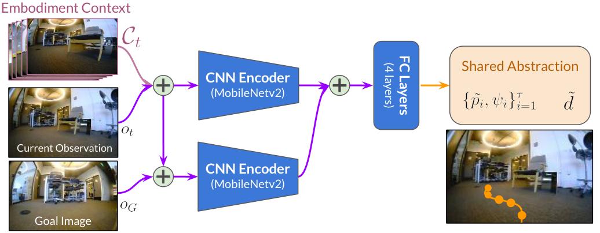
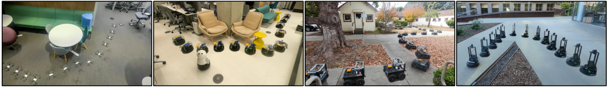
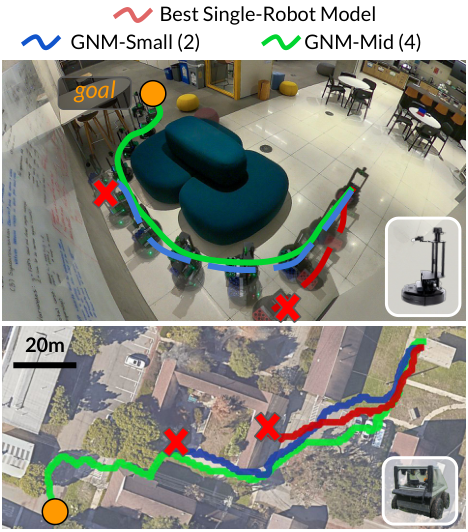
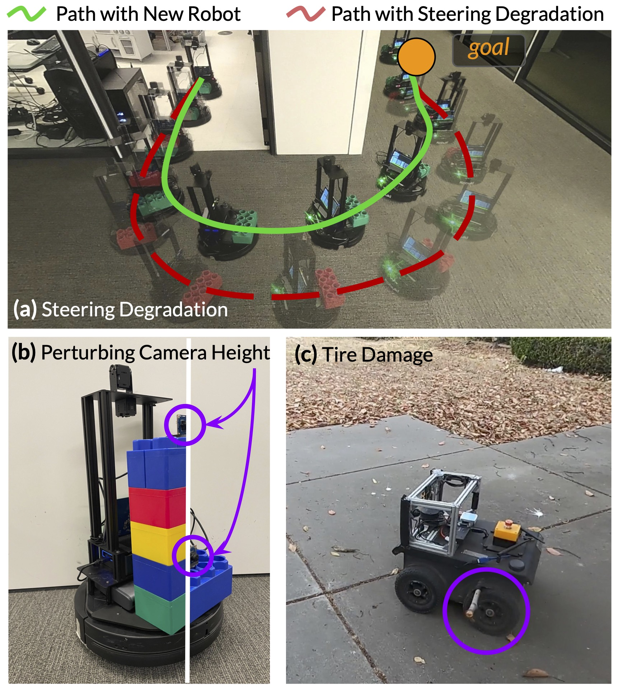

# GNM (ICRA 2023)

<!-- paper-source: https://chengwei920412.github.io/paper_reading/2210.03370_GNM_A_General_Navigation_Model_to_Drive_Any_Robot/2210.03370_%E9%98%85%E8%AF%BB%E6%8A%A5%E5%91%8A.html -->

## 0. 基本信息 {#0}

- 论文标题：GNM: A General Navigation Model to Drive Any Robot
- 作者：Dhruv Shah, Ajay Sridhar, Arjun Bhorkar, Noriaki Hirose, Sergey Levine
- 机构：UC Berkeley；Toyota Motor North America
- 来源（会议 / arXiv / 期刊）：arXiv；论文页面注明 Presented at ICRA 2023
- 年份：2022 arXiv 初稿；2023 v2 与 ICRA 展示版本
- 原始输入链接：https://arxiv.org/abs/2210.03370
- 最终使用的 arXiv 版本化 ID：2210.03370v2
- 原论文 arXiv 链接：https://arxiv.org/abs/2210.03370v2
- 幻觉翻译链接（hjfy）：https://hjfy.top/arxiv/2210.03370v2
- Cool Papers 链接：https://papers.cool/arxiv/2210.03370v2
- 论文研究方向：视觉目标导航、跨机器人迁移、机器人基础模型、拓扑导航、离线监督学习
- 本文一句话概括：GNM 通过把多机器人导航轨迹统一到归一化 waypoint 动作空间，并用历史视觉帧作为 embodiment context，让一个目标条件视觉导航策略在未见机器人和未见环境上零样本部署。

## 1. 论文核心观点与主张的系统梳理 {#1}

### 1.1 研究背景与动机 {#11}

论文的出发点是机器人学习中的数据碎片化问题：自然语言、视觉和代码模型能够从大规模、跨来源数据中学习通用表示，而机器人策略通常被每个实验室、每个平台、每套传感器和控制接口切成独立数据集。作者认为，这种碎片化使端到端控制策略难以积累到足够大的数据规模。

作者选择视觉导航作为切入点，因为不同机器人虽然在动力学、相机位置、速度、转向半径和底层控制接口上差异很大，但导航抽象目标相近：探索环境、朝目标移动、规划路径并避免碰撞。论文明确声称，如果能在一个共享任务定义下聚合异构机器人数据，就可能得到类似视觉或语言预训练模型的“导航 omnipolicy”。

这里的动机不是提出新的规划算法，而是检验一个经验问题：多机器人真实轨迹能否直接训练一个可复用的目标条件导航策略。论文的创新重心因此落在数据共享接口设计和跨 embodiment 泛化实证，而非新的损失函数或新的理论定理。

### 1.2 问题设定 {#12}

论文研究 image-goal navigation。目标位置 \(G\) 不用坐标、GPS 或语义标签描述，而由在目标处采集的图像 \(o_G\) 表示。策略只接收自我中心视觉观测，目标是学习一个 goal-reaching policy：

\[\pi(o_t, o_G)\]

这条公式负责定义最基础的任务接口。\(o_t\) 是当前时刻 RGB 观测，\(o_G\) 是目标图像，\(\pi\) 输出机器人下一步应采取的导航动作。自然语言直译是：给定“现在看到什么”和“想去的地方看起来像什么”，策略预测如何移动。工程上它对应一个前向推理函数，例如 `policy(obs, goal)`，但论文随后指出，仅用这个接口还不足以跨机器人泛化，因为不同机器人对同一个视觉目标需要不同速度、转向和可行轨迹。

论文把该局部策略接入拓扑图导航系统。拓扑图 \(\mathcal{M}\) 的节点是历史观察图像，边权由策略预测的 temporal distance \(d\) 给出，部署时用 Dijkstra 算法选择子目标 \(s_1\)，再由策略输出短时 waypoint 序列。这个设定降低了长距离导航难度：学习模型只需解决局部视觉目标到达和可达性估计，高层路径搜索由图算法处理。

图中紫色部分是常规 goal-conditioned policy，粉色部分是目标机器人历史观测形成的 embodiment context，黄色部分是共享归一化动作空间。它直接对应论文问题设定中的两个关键障碍：机器人身份不可直接给定，以及不同平台动作尺度不可直接混合。

### 1.3 核心观点（Claims）的逐条梳理 {#13-claims}

**Claim 1：异构多机器人数据可以训练一个通用视觉导航策略。** 对应论文 Introduction、Multi-Robot Training Dataset 和 Zero-Shot Deployment。作者聚合来自 6 种机器人、9 个数据源、约 70 小时表格统计规模的真实导航数据，并在 4 个机器人上部署同一个模型。实验表明 GNM-Mid 在 LoCoBot、Tello、Vizbot、Jackal 上的平均成功率分别为 0.96、0.99、0.93、0.94，高于 GS 或 RECON 单机器人策略。

**Claim 2：跨机器人共享动作空间比直接预测原始速度或非归一化 waypoint 更适合泛化。** 对应 Sec. IV-A 和 Table V。作者将局部相对 waypoint \(p(x,y)\) 按机器人速度尺度 \(\alpha\) 归一化为 \(\tilde{p}\)，并保留 yaw change \(\psi\)。在 LoCoBot 消融中，normalized waypoint 在 Easy/Moderate 场景达到 1.0/0.95，优于 velocities 的 0.73/0.54 和 waypoints 的 0.42/0.26。

**Claim 3：历史视觉上下文能够替代手工机器人参数，提供 embodiment 条件信息。** 对应 Sec. IV-B 和 Table V。作者不用机器人尺寸、转弯半径等人工特征，而用过去 \(k=5\) 帧观测构造 \(\mathcal{C}_t\)。消融显示，在 Hard LoCoBot 场景，None/Static/Temporal context 成功率为 0.36/0.50/0.70。

**Claim 4：多数据集训练比单数据集训练更鲁棒。** 对应 Sec. V-D 和 Fig. 5。方向盘转向限制、相机视角扰动、物理损伤三类退化下，GNM Policy 成功率为 0.89/0.81/1.0，单域策略为 0.30/0.17/0.81。

**Claim 5：GNM 更像一个可复用的导航预训练基础策略。** 对应 Discussion。作者把 GNM 类比为视觉/语言领域的预训练 backbone，但论文证据仍主要来自同类视觉导航任务，尚未覆盖语义导航、语言指令、复杂交互或多传感器导航。

### 1.4 创新性与贡献边界 {#14}

实质创新主要是系统层面的：把多机器人导航轨迹统一成一个 supervised image-goal policy 训练问题，并证明只用简单设计选择也能得到可部署的跨机器人策略。论文没有提出全新的深度网络基本单元，也没有提出新的规划理论；MobileNetv2 编码器、goal-conditioned policy、topological graph、Dijkstra、Adam 和 \(\ell_2\) 回归都来自成熟组件。

贡献边界也很明确。第一，GNM 不是“任何机器人”意义上的完整通用控制器，实际假设所有平台都能提供前向 RGB 图像和局部里程计标签，并且底层控制器能跟踪 waypoint。第二，四个平台测试虽然包括未见 LoCoBot、Vizbot 和 Tello，但 Tello 被限制在离地约 1m 的水平面上，实际验证更接近“类地面二维导航控制”而非完整无人机三维飞行。第三，论文的核心证据是成功率和少量退化实验，没有统计置信区间、失败模式分解或跨数据源因果诊断。

## 2. 关键论据、理论基础与数学方法的深度解析 {#2}

### 2.1 理论基础与学术渊源 {#21}

GNM 站在四条已有路线之上。

第一是 image-goal navigation，例如 Zhu et al. 的 Target-driven Visual Navigation，用目标图像而非坐标或类别定义任务。这个设定降低了对语义标注和定位系统的依赖，使不同机器人数据可以共享同一种训练输入形式。

第二是拓扑图视觉导航，如 SPTM、ViNG、Deep Visual MPC-Policy Learning 和 Scaling Local Control to Large-Scale Topological Navigation。这类方法把长距离导航拆为图搜索和局部控制，GNM 沿用该框架：模型预测 temporal distance 建图，策略预测局部 waypoint。

第三是跨机器人迁移和 embodiment transfer，包括 modular neural policies、共享模块策略、HIM、ExAug、RMA、GenLoco 等。GNM 与这些工作的区别是：它不显式设计机器人参数或几何增强，而是让历史视觉上下文间接编码 embodiment。

第四是大规模异构数据训练思想。论文用 ImageNet、Ego4D、RoboNet、BDD100K、R3M、masked visual pre-training 等工作作为背景，强调任务相关真实机器人数据可以作为导航领域的规模化预训练来源。

### 2.2 问题形式化与建模选择 {#22}

GNM 的动作抽象是方法的核心。原始机器人动作可能是差速速度、Ackermann 油门转向、无人机速度命令等，不能直接拼在一个监督学习标签空间。论文改用相对 waypoint 和 yaw change：

\[a_t = \{p_i(x,y), \psi_i\}_{i=1}^{\tau}\]

式中 \(p_i(x,y)\) 表示未来第 \(i\) 个局部坐标系 waypoint，\(\psi_i\) 表示 yaw 变化，\(\tau=5\)。这条公式的作用是把底层控制接口提升到中层几何动作。直译是：策略不直接告诉机器人电机怎么转，而是告诉它接下来几个局部目标点在哪里，以及朝向如何变化。训练中这些标签来自局部 odometry；推理中再由 PID、MPPI 或平台专用控制器把 waypoint 转成低层命令。

更关键的是归一化：

\[\tilde{p} = \frac{1}{\alpha}p\]

\(\alpha\) 是机器人特定的速度尺度，论文将其对应到 top speed。自然语言翻译是：把快车和慢车在同一时间尺度下能走出的位移压到可比较范围。技术上，这相当于把回归标签的尺度差异从学习问题中剥离，让神经网络学习“向目标前进、转弯、避障”的共性，而不是同时拟合 0.5m/s TurtleBot 和 10m/s ATV 的绝对位移范围。toy example：若 TurtleBot 的 \(\alpha=0.5\)，ATV 的 \(\alpha=10\)，两者在各自正常控制尺度下的 1 秒前进 waypoint 分别是 \(p=0.5\) 米和 \(p=10\) 米，则 \(\tilde{p}=1\)。模型看到的是相同的抽象动作，部署时再乘回对应尺度。若删去归一化，训练集标签方差会被高速平台主导，Table V 中非归一 waypoint 在 Moderate 场景仅 0.26，说明这种替代方案在论文实验里明显失败。

作者还让模型预测 temporal distance：

\[\tilde{d}_t = f_{\theta}^{d}(o_t, \mathcal{C}_t, o_G)\]

这不是普通欧氏距离，而是归一化时间尺度下从当前观测到目标观测的可达性估计。它在代码中通常对应 distance head 的回归输出，用于给拓扑图边赋权。若该估计不准，局部控制器即使能跟踪 waypoint，高层图搜索也会选错子目标或判断错误连通性。

### 2.3 核心推导与算法构造 {#23}

GNM 的策略网络可以概括为：

\[\left(\tilde{d}_t, \{\tilde{p}_i,\psi_i\}_{i=1}^{\tau}\right) = f_{\theta}(o_t,\mathcal{C}_t,o_G)\]

这条公式同时定义了输入、上下文和两个输出头。\(o_t\) 是当前图像，\(\mathcal{C}_t\) 是过去 \(k=5\) 帧历史观测堆叠，\(o_G\) 是目标图像；输出包括 temporal distance 和未来 \(\tau=5\) 个归一化 waypoint/yaw。工程映射上，论文用两个 MobileNetv2 encoder 分别编码当前观测加上下文、目标观测，拼接后经三层全连接层进入两个 head。若删去 \(\mathcal{C}_t\)，模型退化为普通 image-goal policy；Table V 的 Hard 场景从 Temporal context 的 0.70 降到 None 的 0.36。

这张图展示同一个 GNM omnipolicy 被部署在 Vizbot、Tello、Jackal、LoCoBot 等不同平台和室内外场景。它支撑的不是网络结构创新，而是“同一策略参数可跨 embodiment 运行”的系统性主张。

训练数据构造继承 ViNG 的正负样本思想：

\[(o_t,o_G) \sim \begin{cases} \text{positive}, &amp; o_t,o_G \text{ 来自同一轨迹} \\ \text{negative}, &amp; o_t,o_G \text{ 来自不同轨迹} \end{cases}\]

positive pair 有可监督的 waypoint 和 temporal distance；negative pair 只训练 distance head，用来告诉模型这些图像间不可直接局部到达或不应连接。直译是：同一路径上的两个图像提供“如何走过去”的监督，不同路径图像提供“不要把它们当作相邻可达”的监督。代码中通常对应数据加载器采样正负 goal pair，并对 action loss 做 mask：positive 才计算 waypoint 回归，positive 和 negative 都计算 distance 回归。

论文没有给出完整损失公式，但根据原文“two heads jointly with supervised learning using an \(\ell_2\) regression loss”，可写成与原文一致的抽象形式：

\[\mathcal{L}(\theta)=\lambda_d\lVert \hat{d}-d^\star\rVert_2^2+\mathbb{1}_{\text{pos}}\lambda_a\sum_{i=1}^{\tau}\left(\lVert \hat{\tilde{p}}_i-\tilde{p}_i^\star\rVert_2^2+\lVert \hat{\psi}_i-\psi_i^\star\rVert_2^2\right)\]

这里 \(\hat{d}\)、\(\hat{\tilde{p}}_i\)、\(\hat{\psi}_i\) 是模型预测，带星号的是由轨迹和里程计得到的监督标签，\(\mathbb{1}_{\text{pos}}\) 表示 action head 只在正样本上训练。自然语言直译是：distance head 学会判断图像间的时间可达性，action head 只在同一轨迹可达样本上学局部动作。toy example：若一个 positive pair 的真实归一化 waypoint 是 \((1.0,0.0)\)，模型预测 \((0.7,0.2)\)，则该 waypoint 的位置误差项是 \((0.7-1.0)^2+(0.2-0.0)^2=0.13\)；negative pair 没有合理 waypoint，所以只更新 distance 分支。

部署阶段可概括为：

\[s_{1:m} = \operatorname{Dijkstra}(\mathcal{M}, \hat{d}),\quad \{\tilde{p}_i,\psi_i\}_{i=1}^{\tau}=f_{\theta}^{a}(o_t,\mathcal{C}_t,s_1)\]

含义是：先用 temporal distance 在拓扑图上选出从当前位置到目标的子目标序列，再用第一个子目标 \(s_1\) 做局部控制。代码中会对应两层循环：低频更新图匹配和 Dijkstra， 高频调用策略网络并交给低层 waypoint tracker。该构造的优势是可扩展到长距离；限制是必须有目标环境的拓扑图或可用图节点，论文并没有让 GNM 单独解决未知环境的全局探索。

### 2.4 理论结论的适用范围 {#24}

论文基本没有形式化定理，也没有证明归一化动作空间或 embodiment context 在分布外泛化上的充分性。它的理论基础更接近工程归纳偏置：把跨机器人差异拆成可由尺度归一化消除的动作差异、可由历史视觉推断的 embodiment 差异，以及可由拓扑图处理的长程规划差异。

这些选择依赖几个强假设。第一，各机器人共享前向单目 RGB 观测，并且局部里程计能产生 waypoint 标签。第二，机器人之间的主要动作差异可以被 top speed 归一化和低层控制器吸收。第三，过去 \(k=5\) 帧足以反映平台动态、视角和可操作性。第四，训练数据覆盖的视觉和行为多样性足以让模型在新平台上插值或有限外推。

论文在 Discussion 中承认其系统没有显式建模能力差异，主要假设是 ground robots 加 forward-facing RGB camera，虽然测试了被限制在水平面的 quadrotor。这意味着 GNM 的“general”应理解为在相似导航抽象下跨平台泛化，而不是跨任意传感器、任意自由度和任意任务的通用机器人控制。

## 3. 实验设计与实验结果的充分性分析 {#3}

### 3.1 实验目标与论文主张的对应关系 {#31}

论文设置四个实验问题：Q1 验证多机器人训练能否泛化到新机器人和新环境；Q2 验证 GNM 是否优于单域策略；Q3 验证共享动作空间、embodiment context 和条件架构是否必要；Q4 验证异构训练是否带来对传感/执行退化的鲁棒性。

实验覆盖 LoCoBot、Tello、Vizbot、Jackal 四个平台，其中 LoCoBot、Tello、Vizbot 没有对应训练数据，Jackal 与训练数据中的 RECON、Berkeley、SCAND-J 平台相似但相机和安装高度不同。指标是 success rate，论文说明为 mean progress made towards the goal。该指标适合衡量目标到达任务的实用表现，但论文没有给出置信区间、轨迹数量分布、每种失败原因或碰撞/安全指标，因此只能支持“平均进展更好”，不能充分支持“安全性更高”或“稳定可靠部署”。

### 3.2 实验设置合理性 {#32}

训练数据表明 GNM 使用的数据具有平台和环境多样性：

<table>
<thead>
<tr>
<th>序号</th>
<th>Dataset</th>
<th>Platform</th>
<th>Speed</th>
<th>Hrs.</th>
<th>Environment</th>
</tr>
</thead>
<tbody>
<tr>
<td>1</td>
<td>GoStanford</td>
<td>TurtleBot2</td>
<td>0.5m/s</td>
<td>14h</td>
<td>office</td>
</tr>
<tr>
<td>2</td>
<td>RECON</td>
<td>Jackal</td>
<td>1m/s</td>
<td>25h</td>
<td>off-road</td>
</tr>
<tr>
<td>3</td>
<td>CoryHall</td>
<td>RC Car</td>
<td>1.2m/s</td>
<td>2h</td>
<td>hallways</td>
</tr>
<tr>
<td>4</td>
<td>Berkeley</td>
<td>Jackal</td>
<td>2m/s</td>
<td>4h</td>
<td>suburban</td>
</tr>
<tr>
<td>5</td>
<td>SCAND-S</td>
<td>Spot</td>
<td>1.5m/s</td>
<td>8h</td>
<td>sidewalks</td>
</tr>
<tr>
<td>6</td>
<td>SCAND-J</td>
<td>Jackal</td>
<td>2m/s</td>
<td>1h</td>
<td>sidewalks</td>
</tr>
<tr>
<td>7</td>
<td>Seattle</td>
<td>Warthog</td>
<td>5m/s</td>
<td>1h</td>
<td>off-road</td>
</tr>
<tr>
<td>8</td>
<td>TartanDrive</td>
<td>ATV</td>
<td>10m/s</td>
<td>5h</td>
<td>off-road</td>
</tr>
<tr>
<td>9</td>
<td>NeBula</td>
<td>ATV</td>
<td>10m/s</td>
<td>10h</td>
<td>off-road</td>
</tr>
<tr>
<td>汇总</td>
<td>Ours</td>
<td>6 种机器人</td>
<td>0.5-10m/s 表中范围</td>
<td>70h</td>
<td>室内、校园、人行道、越野</td>
</tr>
</tbody>
</table>

表中有一个文本层面的不一致：摘要说 curated 60 hours from 6 robots，Table I 汇总为 70h，正文又说 over 60 hours。报告应以论文表格原值记录为 70h，同时指出论文表述存在“60/70 小时”不一致。这个问题不影响方法逻辑，但会影响数据规模陈述的精确性。

实验设置的优点是使用真实机器人、真实室内外环境，而不是仿真；对比包含单域策略、ImageNet 预训练变体和多数据规模 GNM-Small/Mid/Large。主要不足是：没有说明全部测试路线数量、随机种子、统计方差；没有与专门的 domain adaptation 方法如 ExAug 做直接定量对比；没有比较同等数据量但同域多样性不同的数据组合，因此“异构性”与“数据量增加”的贡献没有完全解耦。

### 3.3 实验结果的解释力度 {#33}

主结果支持 Claim 1 和 Claim 2：同一个 GNM-Mid 策略跨四个平台优于两个单域策略。

<table>
<thead>
<tr>
<th>Dataset(s)</th>
<th>LoCoBot</th>
<th>Tello</th>
<th>Vizbot</th>
<th>Jackal</th>
</tr>
</thead>
<tbody>
<tr>
<td>GS</td>
<td>0.26</td>
<td>0.21</td>
<td>0.51</td>
<td>0.31</td>
</tr>
<tr>
<td>RECON</td>
<td>0.62</td>
<td>0.79</td>
<td>0.26</td>
<td>0.68</td>
</tr>
<tr>
<td>Ours / GNM-Mid</td>
<td>0.96</td>
<td>0.99</td>
<td>0.93</td>
<td>0.94</td>
</tr>
</tbody>
</table>

这个表格验证的是“任务相关多机器人数据优于单机器人数据”。最强单域策略在各机器人上不同：LoCoBot 上 RECON 为 0.62，Tello 上 RECON 为 0.79，Vizbot 上 GS 为 0.51，Jackal 上 RECON 为 0.68；GNM-Mid 分别提升到 0.96、0.99、0.93、0.94。该结果有较强工程说服力，尤其 Tello 没有训练数据且 embodiment 不同。但由于 Tello 被限制为水平平面导航，不能外推为 GNM 学会了无人机 3D 导航。

定性图显示，训练数据更丰富时，LoCoBot 和 Jackal 的路径更接近可达目标，失败更少。它支撑“数据多样性改善泛化”的直观解释，但不能替代表格统计。

LoCoBot 细分实验更清楚地展示了随数据集增加的趋势：

<table>
<thead>
<tr>
<th>Dataset(s)</th>
<th>数据集数</th>
<th>Indoor Easy</th>
<th>Indoor Moderate</th>
<th>Outdoor</th>
</tr>
</thead>
<tbody>
<tr>
<td>CoryHall</td>
<td>1</td>
<td>0.22</td>
<td>0.13</td>
<td>0.29</td>
</tr>
<tr>
<td>GS</td>
<td>1</td>
<td>0.25</td>
<td>0.16</td>
<td>0.44</td>
</tr>
<tr>
<td>GS + ImageNet</td>
<td>1</td>
<td>0.35</td>
<td>0.35</td>
<td>0.57</td>
</tr>
<tr>
<td>GNM-Small</td>
<td>2</td>
<td>0.82</td>
<td>0.59</td>
<td>1.00</td>
</tr>
<tr>
<td>GNM-Mid</td>
<td>4</td>
<td>1.00</td>
<td>0.97</td>
<td>0.83</td>
</tr>
<tr>
<td>GNM-Large</td>
<td>6</td>
<td>1.00</td>
<td>1.00</td>
<td>0.83</td>
</tr>
</tbody>
</table>

这里最有价值的观察是 ImageNet 预训练只能小幅改善，仍显著落后于任务相关机器人数据共享。GNM-Large 在 outdoor 上没有超过 GNM-Small，而是 0.83 vs 1.00，这提醒我们“更多数据”并非单调提升所有设置；论文没有深入解释这种非单调性，可能与 outdoor 测试集、训练数据分布或模型容量有关，但原文没有提供足够证据。

Jackal 细分实验验证同一个结论：

<table>
<thead>
<tr>
<th>Dataset(s)</th>
<th>数据集数</th>
<th>Outdoor Easy</th>
<th>Outdoor Hard</th>
<th>Indoor</th>
</tr>
</thead>
<tbody>
<tr>
<td>GS</td>
<td>1</td>
<td>0.25</td>
<td>0.05</td>
<td>0.40</td>
</tr>
<tr>
<td>RECON</td>
<td>1</td>
<td>0.67</td>
<td>0.48</td>
<td>0.36</td>
</tr>
<tr>
<td>RECON + ImageNet</td>
<td>1</td>
<td>0.72</td>
<td>0.52</td>
<td>0.31</td>
</tr>
<tr>
<td>GNM-Small</td>
<td>2</td>
<td>0.75</td>
<td>0.52</td>
<td>0.42</td>
</tr>
<tr>
<td>GNM-Mid</td>
<td>4</td>
<td>1.00</td>
<td>1.00</td>
<td>0.82</td>
</tr>
<tr>
<td>GNM-Large</td>
<td>6</td>
<td>1.00</td>
<td>1.00</td>
<td>0.88</td>
</tr>
</tbody>
</table>

这个表尤其支持“单域策略泛化范围窄”：RECON 在 outdoor 相对好，但 indoor 只有 0.36；GS 在 indoor 稍好但 outdoor hard 只有 0.05。GNM-Mid/Large 同时覆盖 outdoor hard 和 indoor，说明多源数据确实改善了环境泛化。

### 3.4 潜在未讨论因素 {#34}

关键设计消融如下：

<table>
<thead>
<tr>
<th>消融类别</th>
<th>设置</th>
<th>Easy</th>
<th>Moderate</th>
<th>Hard</th>
<th>结论</th>
</tr>
</thead>
<tbody>
<tr>
<td>Action Space</td>
<td>Velocities</td>
<td>0.73</td>
<td>0.54</td>
<td>未报告</td>
<td>easy 可用，复杂场景泛化弱</td>
</tr>
<tr>
<td>Action Space</td>
<td>Waypoints</td>
<td>0.42</td>
<td>0.26</td>
<td>未报告</td>
<td>非归一 waypoint 明显失败</td>
</tr>
<tr>
<td>Action Space</td>
<td>Norm. Waypt.</td>
<td>1.00</td>
<td>0.95</td>
<td>未报告</td>
<td>最支持共享动作抽象</td>
</tr>
<tr>
<td>Architecture</td>
<td>Stacked</td>
<td>0.52</td>
<td>0.72</td>
<td>未报告</td>
<td>性能不稳定</td>
</tr>
<tr>
<td>Architecture</td>
<td>Siamese</td>
<td>0.73</td>
<td>0.26</td>
<td>未报告</td>
<td>moderate 场景明显弱</td>
</tr>
<tr>
<td>Architecture</td>
<td>Conditioned</td>
<td>1.00</td>
<td>0.95</td>
<td>未报告</td>
<td>最强架构</td>
</tr>
<tr>
<td>Context</td>
<td>None</td>
<td>1.00</td>
<td>0.79</td>
<td>0.36</td>
<td>easy 不需要上下文，hard 明显不足</td>
</tr>
<tr>
<td>Context</td>
<td>Static</td>
<td>1.00</td>
<td>0.86</td>
<td>0.50</td>
<td>有帮助但不足</td>
</tr>
<tr>
<td>Context</td>
<td>Temporal</td>
<td>1.00</td>
<td>0.92</td>
<td>0.70</td>
<td>hard 场景最强</td>
</tr>
</tbody>
</table>

该消融较好支撑了两个机制主张：动作归一化是性能跃迁的核心，temporal context 对复杂环境尤其重要。不过表格没有报告 Hard 场景下 action space 和 architecture 的结果，也没有展示方差，因此仍不能判断这些结论在更困难场景中是否稳定。

退化鲁棒性结果如下：

<table>
<thead>
<tr>
<th>Policy</th>
<th>Steering</th>
<th>Viewpoint</th>
<th>Physical</th>
</tr>
</thead>
<tbody>
<tr>
<td>Single-Domain Policy</td>
<td>0.30</td>
<td>0.17</td>
<td>0.81</td>
</tr>
<tr>
<td>GNM Policy</td>
<td>0.89</td>
<td>0.81</td>
<td>1.00</td>
</tr>
</tbody>
</table>

这个结果支持“多样性训练带来一定鲁棒性”，尤其是 steering 和 viewpoint 退化。但它仍是少量场景验证：论文没有定义退化强度网格、没有测噪声连续曲线，也没有分离“训练机器人多样性”和“训练环境多样性”的贡献。

潜在未讨论因素包括：低层 controller 的质量对最终表现影响很大；topological map 的构建质量会影响成功率；失败是否来自感知、图匹配、distance 估计还是 waypoint tracking 没有分解；不同机器人相机 FOV、安装高度和图像预处理对性能的影响没有单独控制；成功率定义为 mean progress made towards the goal，和标准 navigation success / SPL 不是完全同一类指标。

## 4. 与当前领域主流共识及反对观点的关系 {#4}

### 4.1 与主流观点的一致性 {#41}

GNM 与视觉导航主流共识一致：长距离导航通常需要把局部学习控制和全局或拓扑规划结合。ViNG、SPTM、Neural Topological SLAM、Scaling Local Control 等工作都采用不同形式的视觉记忆或拓扑图；GNM 沿用这一框架，只把低层局部策略训练扩展到多机器人数据。

GNM 也与机器人学习中“共享数据和预训练表示有利于泛化”的趋势一致。RoboNet 证明多机器人数据对 manipulation 视觉模型有帮助，R3M 和 masked visual pre-training 探索从大量视觉数据学习机器人可用表示。GNM 的区别是直接训练导航行为策略，而不只是训练视觉 backbone。

### 4.2 与反对或竞争观点的分歧 {#42}

直接竞争路线之一是显式 domain adaptation 或 robot-conditioned policy，例如 ExAug 通过几何经验增强处理机器人条件导航。GNM 对此采取更简单的经验主义路线：不手工定义机器人参数，而用过去观测自动推断 embodiment。分歧点在于是否需要显式建模机器人几何和动力学。GNM 的结果显示简单上下文在其测试范围内有效，但没有证明它比专门 adaptation 方法更优。

另一类竞争路线是使用互联网被动视频或大规模视觉预训练，再在目标域适配，如 Semantic Visual Navigation by Watching YouTube Videos、No RL, No Simulation、R3M、masked visual pre-training、OVRL。GNM 与这些方法的分歧点是数据来源：作者认为导航轨迹本身足够丰富且带有动作/里程计监督，能直接训练策略；ImageNet 预训练在论文实验中仅带来有限提升。

当前未检索到论文原文之外对 GNM 关键假设的直接反驳证据。基于论文引用内的真实文献，只能说已有路线提供了替代建模选择，而不是明确否定 GNM。

### 4.3 论文在学术版图中的定位 {#43}

GNM 更像主流视觉目标导航和拓扑导航框架的跨机器人数据扩展，而不是对主流方法的理论挑战。它的学术定位可以概括为：用简单、可复现的 supervised policy 学习方案证明多机器人真实导航数据可共享，并把“导航基础策略”作为机器人领域预训练模型的早期范例。

从后续研究价值看，它提出的问题比具体架构更重要：如何定义跨机器人共享动作空间、如何表示 embodiment、如何评价未见平台泛化、如何让导航策略像视觉 backbone 一样被复用。这些问题在机器人基础模型和大规模机器人数据集方向仍然重要。

### 4.4 文献检索说明 {#44}

- 检索范围：本报告使用 arXiv v2 原文、arXiv 源码、论文引用列表、papers.cool 页面访问结果，以及论文原文中可追溯的相关工作线索。
- 检索结论可信度：对论文自身方法和实验的结论可信度较高，因为来自原文和表格；对“是否已有明确反驳 GNM 的工作”的结论保守处理，当前未检索到可靠直接反驳证据，因此不做外推。

### 4.5 相关论文补充表 {#45}

<table>
<thead>
<tr>
<th>序号</th>
<th>论文标题</th>
<th>作者 / 年份</th>
<th>来源</th>
<th>与原论文关系</th>
<th>一句话概述</th>
</tr>
</thead>
<tbody>
<tr>
<td>1</td>
<td>ViNG: Learning Open-World Navigation with Visual Goals</td>
<td>Shah et al., 2021</td>
<td>ICRA</td>
<td>直接方法前身</td>
<td>使用视觉目标和拓扑图实现开放世界导航，GNM 继承其正负样本和拓扑图部署思想。</td>
</tr>
<tr>
<td>2</td>
<td>Deep Visual MPC-Policy Learning for Navigation</td>
<td>Hirose et al., 2019</td>
<td>RA-L</td>
<td>图/视觉导航基础</td>
<td>目标条件视觉导航与局部控制的重要前作。</td>
</tr>
<tr>
<td>3</td>
<td>Scaling Local Control to Large-Scale Topological Navigation</td>
<td>Meng et al., 2020</td>
<td>ICRA</td>
<td>拓扑导航框架</td>
<td>支持用局部控制器加拓扑搜索扩展到长程导航。</td>
</tr>
<tr>
<td>4</td>
<td>Semi-Parametric Topological Memory for Navigation</td>
<td>Savinov et al., 2018</td>
<td>ICLR</td>
<td>视觉拓扑记忆</td>
<td>代表性视觉拓扑记忆路线。</td>
</tr>
<tr>
<td>5</td>
<td>Neural Topological SLAM for Visual Navigation</td>
<td>Chaplot et al., 2020</td>
<td>CVPR</td>
<td>视觉拓扑 / 地图记忆</td>
<td>与 GNM 的高层拓扑导航思想相关。</td>
</tr>
<tr>
<td>6</td>
<td>Rapid Exploration for Open-World Navigation with Latent Goal Models</td>
<td>Shah et al., 2021</td>
<td>CoRL</td>
<td>架构和训练线索</td>
<td>GNM 使用类似 goal-conditioned 表示和 positive/negative 训练流程。</td>
</tr>
<tr>
<td>7</td>
<td>ExAug: Robot-Conditioned Navigation Policies via Geometric Experience Augmentation</td>
<td>Hirose et al., 2023</td>
<td>ICRA</td>
<td>竞争/互补路线</td>
<td>通过机器人条件几何增强处理 embodiment transfer，和 GNM 的隐式上下文路线形成对比。</td>
</tr>
<tr>
<td>8</td>
<td>DroNet: Learning to Fly by Driving</td>
<td>Loquercio et al., 2018</td>
<td>RA-L</td>
<td>跨 embodiment 启发</td>
<td>从驾驶数据学习无人机控制，GNM 进一步做目标条件多机器人导航。</td>
</tr>
<tr>
<td>9</td>
<td>RoboNet: Large-Scale Multi-Robot Learning</td>
<td>Dasari et al., 2020</td>
<td>CoRL</td>
<td>大规模多机器人数据思想</td>
<td>在操作领域证明多机器人数据共享价值，GNM 将思想用于导航。</td>
</tr>
<tr>
<td>10</td>
<td>R3M: A Universal Visual Representation for Robot Manipulation</td>
<td>Nair et al., 2022</td>
<td>CoRL</td>
<td>预训练表示参照</td>
<td>强调机器人可复用视觉表示，GNM 更进一步训练导航策略输出。</td>
</tr>
<tr>
<td>11</td>
<td>Offline Visual Representation Learning for Embodied Navigation</td>
<td>Yadav et al., 2022</td>
<td>arXiv</td>
<td>视觉预训练竞争路线</td>
<td>代表 embodied navigation 的离线视觉表示学习方向。</td>
</tr>
<tr>
<td>12</td>
<td>Preparing for the Unknown: Learning a Universal Policy with Online System Identification</td>
<td>Yu et al., 2017</td>
<td>RSS</td>
<td>embodiment / dynamics transfer</td>
<td>说明用系统识别适应动力学差异的传统路线，与 GNM 的视觉上下文形成对比。</td>
</tr>
</tbody>
</table>

## 5. 对论文理论体系的严肃反驳与系统性质疑 {#5}

### 5.1 核心假设层面的质疑 {#51}

最强假设是“跨机器人导航可以被共同的二维局部 waypoint 空间表示”。这对差速车、Ackermann 车和被限制高度的 Tello 可以成立，但对机械臂移动平台、腿式机器人复杂地形、全 3D 飞行、带侧向移动能力的平台、多传感器融合系统并不显然成立。论文标题中的 “Drive Any Robot” 因此明显强于实验实际覆盖范围。

第二个假设是 embodiment context 可以从过去 \(k=5\) 帧视觉观测中推断。这个假设在工程上很轻便，但不可解释性强：模型到底学到相机高度、FOV、速度、转向半径、地面纹理还是数据集风格，论文没有分析。若新机器人有相同视觉流但不同动力学，或相同动力学但传感器噪声完全不同，\(\mathcal{C}_t\) 是否仍能区分，原文未给证据。

第三个假设是低层控制器可以可靠跟踪反归一化 waypoint。GNM 把最难的连续控制差异下放给 robot-specific controller。如果控制器调参困难或机器人不能实现预测 waypoint，GNM 的上层策略优势可能无法落地。

### 5.2 数学推导与理论主张的边界 {#52}

论文没有给出泛化误差界或 domain adaptation 理论，因此“异构数据产生更强泛化”是实验结论而非理论结论。归一化动作空间的数学形式 \(\tilde{p}=\frac{1}{\alpha}p\) 很直观，但它只处理速度尺度差异，不能处理非完整约束、加速度限制、延迟、打滑、地形通过性等更复杂动力学差异。

temporal distance \(d\) 被当作拓扑图连通性权重，但它是监督回归量，不一定满足度量性质，如对称性、三角不等式或跨环境一致性。Dijkstra 只要求非负边权，但如果 learned distance 对 OOD 图像估计错误，规划层会稳定地选择错误子目标。论文没有系统测试 distance calibration。

### 5.3 工程实现与实际适用性 {#53}

工程价值很高，因为输入输出简单：RGB、历史帧、目标图像、waypoint、yaw、低层跟踪器。但实际部署仍需要多项前提：相机外参和图像预处理合理；机器人能提供局部里程计训练标签；目标环境能建立拓扑图；控制器能跟踪 waypoint；任务目标能用图像表达。

此外，论文没有报告实时推理延迟、不同硬件上的计算开销、低层控制频率、失败恢复机制、安全边界、碰撞统计。对真实长期自主导航来说，这些变量可能比平均 success rate 更关键。

### 5.4 整体理论体系的稳健性 {#54}

GNM 的体系在“相似导航任务 + 前向单目相机 + 局部 waypoint 控制 + 拓扑图辅助”的边界内是稳健的，表格和真实机器人部署形成了较强证据。但它并没有证明通用导航模型已经形成通用空间语义、物理可供性或跨模态推理能力。更简单的替代解释是：多数据集训练提供了更丰富的视觉场景和 waypoint 标签分布，减少了过拟合；normalized waypoint 和 temporal context 只是让监督学习标签更可拟合。这个解释足以覆盖大部分结果，并不需要假设模型学到了完整机器人 embodiment 表征。

若移除关键组件，论文消融显示性能显著下降：无归一化动作、无 temporal context 或换成较弱架构都会损害泛化。因此 GNM 的成功不是单一“大数据”因素，而是数据多样性、动作尺度统一、历史上下文和拓扑部署共同作用的系统效果。

## 6. 最终结论 {#6}

### 6.1 论文价值总结 {#61}

GNM 的主要价值在于把“跨机器人导航策略预训练”从概念推进到真实机器人实证。论文用一个相对朴素的监督学习框架证明，异构真实导航数据并非不可混合；只要动作空间和 embodiment 条件设计得当，同一个策略可以在未见机器人和未见环境上取得明显优于单域策略的表现。

它的不足也清楚：理论分析较弱，泛化边界主要靠实验界定；“any robot”的表述偏强；实验统计细节不够充分；系统依赖拓扑图和低层控制器，不能被理解为端到端解决全部导航问题。

### 6.2 一句话总评 {#62}

这是一篇系统贡献强、理论证明弱但工程启发很大的跨机器人视觉导航论文，真正有价值的是它把多机器人数据共享、归一化动作空间和历史上下文组合成了可运行的导航预训练范式。

### 6.3 综合评分（10 分制） {#63-10}

- 创新性：7.5
- 技术严谨性：7.0
- 实验说服力：7.5
- 工程价值：8.5
- 总体评分：7.8

### 6.4 最关键的三条优点 {#64}

1. 使用真实多机器人、多环境数据，并在多个实体机器人上验证，而不是停留在仿真或单平台实验。
2. normalized waypoint 和 temporal embodiment context 是简单但有效的接口设计，消融结果直接支撑其必要性。
3. 将局部视觉目标策略与拓扑图导航结合，系统形态清晰，具有较强复用潜力。

### 6.5 最关键的三条问题 {#65}

1. 泛化理论不足，论文无法解释模型究竟学到了 embodiment、视觉场景还是数据集风格。
2. 实验缺少统计置信区间、失败模式拆解和与强 domain adaptation 方法的直接比较。
3. “Drive Any Robot” 的外延明显超过实际假设，系统仍依赖前向 RGB、局部里程计、二维 waypoint 和机器人专用低层控制器。

## 附录 A：关键实验表与消融实验表 {#a}

### A.1 主 benchmark 对比表 {#a1-benchmark}

<table>
<thead>
<tr>
<th>Dataset(s)</th>
<th>LoCoBot</th>
<th>Tello</th>
<th>Vizbot</th>
<th>Jackal</th>
<th>核心结论</th>
</tr>
</thead>
<tbody>
<tr>
<td>GS</td>
<td>0.26</td>
<td>0.21</td>
<td>0.51</td>
<td>0.31</td>
<td>单室内/近似平台数据泛化有限</td>
</tr>
<tr>
<td>RECON</td>
<td>0.62</td>
<td>0.79</td>
<td>0.26</td>
<td>0.68</td>
<td>越野 Jackal 数据对部分平台有帮助，但不稳定</td>
</tr>
<tr>
<td>GNM-Mid</td>
<td>0.96</td>
<td>0.99</td>
<td>0.93</td>
<td>0.94</td>
<td>多机器人任务相关数据在四个平台均最强</td>
</tr>
</tbody>
</table>

### A.2 扩展指标 / 扩展 benchmark 表 {#a2-benchmark}

<table>
<thead>
<tr>
<th>Platform</th>
<th>Dataset(s)</th>
<th>Easy / Outdoor Easy</th>
<th>Moderate / Outdoor Hard</th>
<th>Outdoor / Indoor</th>
<th>结论</th>
</tr>
</thead>
<tbody>
<tr>
<td>LoCoBot</td>
<td>CoryHall</td>
<td>0.22</td>
<td>0.13</td>
<td>0.29</td>
<td>单域 RC Car 数据迁移弱</td>
</tr>
<tr>
<td>LoCoBot</td>
<td>GS</td>
<td>0.25</td>
<td>0.16</td>
<td>0.44</td>
<td>类似底盘但相机/平台差异仍导致失败</td>
</tr>
<tr>
<td>LoCoBot</td>
<td>GS + ImageNet</td>
<td>0.35</td>
<td>0.35</td>
<td>0.57</td>
<td>通用视觉预训练有帮助但不足</td>
</tr>
<tr>
<td>LoCoBot</td>
<td>GNM-Small</td>
<td>0.82</td>
<td>0.59</td>
<td>1.00</td>
<td>两数据集已显著改善</td>
</tr>
<tr>
<td>LoCoBot</td>
<td>GNM-Mid</td>
<td>1.00</td>
<td>0.97</td>
<td>0.83</td>
<td>室内表现接近饱和</td>
</tr>
<tr>
<td>LoCoBot</td>
<td>GNM-Large</td>
<td>1.00</td>
<td>1.00</td>
<td>0.83</td>
<td>更多数据继续提升 moderate，outdoor 未单调提升</td>
</tr>
<tr>
<td>Jackal</td>
<td>GS</td>
<td>0.25</td>
<td>0.05</td>
<td>0.40</td>
<td>室内数据不适合 outdoor hard</td>
</tr>
<tr>
<td>Jackal</td>
<td>RECON</td>
<td>0.67</td>
<td>0.48</td>
<td>0.36</td>
<td>同类 Jackal 越野数据 indoor 泛化弱</td>
</tr>
<tr>
<td>Jackal</td>
<td>RECON + ImageNet</td>
<td>0.72</td>
<td>0.52</td>
<td>0.31</td>
<td>ImageNet 对 indoor 未改善</td>
</tr>
<tr>
<td>Jackal</td>
<td>GNM-Small</td>
<td>0.75</td>
<td>0.52</td>
<td>0.42</td>
<td>小规模异构数据已有小幅提升</td>
</tr>
<tr>
<td>Jackal</td>
<td>GNM-Mid</td>
<td>1.00</td>
<td>1.00</td>
<td>0.82</td>
<td>同时覆盖 outdoor hard 与 indoor</td>
</tr>
<tr>
<td>Jackal</td>
<td>GNM-Large</td>
<td>1.00</td>
<td>1.00</td>
<td>0.88</td>
<td>indoor 继续提升</td>
</tr>
</tbody>
</table>

### A.3 数据规模 / scaling law / 泛化表 {#a3-scaling-law}

<table>
<thead>
<tr>
<th>设置</th>
<th>数据规模 / 迁移设置</th>
<th>LoCoBot Indoor Easy</th>
<th>LoCoBot Indoor Moderate</th>
<th>Jackal Outdoor Hard</th>
<th>Jackal Indoor</th>
<th>关键观察</th>
</tr>
</thead>
<tbody>
<tr>
<td>单域</td>
<td>1 个数据集</td>
<td>0.22-0.25</td>
<td>0.13-0.16</td>
<td>0.05-0.48</td>
<td>0.36-0.40</td>
<td>单域迁移高度依赖测试环境是否相近</td>
</tr>
<tr>
<td>单域 + ImageNet</td>
<td>1 个数据集 + 视觉预训练</td>
<td>0.35</td>
<td>0.35</td>
<td>0.52</td>
<td>0.31</td>
<td>通用视觉特征不能替代导航行为数据</td>
</tr>
<tr>
<td>GNM-Small</td>
<td>前 2 个数据集</td>
<td>0.82</td>
<td>0.59</td>
<td>0.52</td>
<td>0.42</td>
<td>多源数据开始改善</td>
</tr>
<tr>
<td>GNM-Mid</td>
<td>前 4 个数据集</td>
<td>1.00</td>
<td>0.97</td>
<td>1.00</td>
<td>0.82</td>
<td>跨平台泛化大幅提升</td>
</tr>
<tr>
<td>GNM-Large</td>
<td>前 6 个数据集</td>
<td>1.00</td>
<td>1.00</td>
<td>1.00</td>
<td>0.88</td>
<td>多数指标继续提升，但并非所有场景单调</td>
</tr>
</tbody>
</table>

### A.4 关键消融实验表 {#a4}

<table>
<thead>
<tr>
<th>消融项</th>
<th>变化设置</th>
<th>指标</th>
<th>原始数值</th>
<th>变化后数值</th>
<th>结论</th>
</tr>
</thead>
<tbody>
<tr>
<td>Action Space</td>
<td>Velocities -&gt; Norm. Waypt.</td>
<td>Easy</td>
<td>0.73</td>
<td>1.00</td>
<td>归一化 waypoint 更适合跨机器人共享</td>
</tr>
<tr>
<td>Action Space</td>
<td>Velocities -&gt; Norm. Waypt.</td>
<td>Moderate</td>
<td>0.54</td>
<td>0.95</td>
<td>复杂转弯场景收益明显</td>
</tr>
<tr>
<td>Action Space</td>
<td>Waypoints -&gt; Norm. Waypt.</td>
<td>Moderate</td>
<td>0.26</td>
<td>0.95</td>
<td>归一化比普通 waypoint 关键</td>
</tr>
<tr>
<td>Architecture</td>
<td>Stacked -&gt; Conditioned</td>
<td>Easy</td>
<td>0.52</td>
<td>1.00</td>
<td>条件架构更强</td>
</tr>
<tr>
<td>Architecture</td>
<td>Siamese -&gt; Conditioned</td>
<td>Moderate</td>
<td>0.26</td>
<td>0.95</td>
<td>当前观测条件路径对泛化有帮助</td>
</tr>
<tr>
<td>Context</td>
<td>None -&gt; Temporal</td>
<td>Hard</td>
<td>0.36</td>
<td>0.70</td>
<td>历史上下文对复杂环境最重要</td>
</tr>
<tr>
<td>Context</td>
<td>Static -&gt; Temporal</td>
<td>Hard</td>
<td>0.50</td>
<td>0.70</td>
<td>时间连续信息优于静态历史样本</td>
</tr>
</tbody>
</table>

### A.5 其他支撑正文结论的关键表 {#a5}

<table>
<thead>
<tr>
<th>表格主题</th>
<th>关键列</th>
<th>结论</th>
</tr>
</thead>
<tbody>
<tr>
<td>退化鲁棒性</td>
<td>Steering: 0.30 vs 0.89；Viewpoint: 0.17 vs 0.81；Physical: 0.81 vs 1.00</td>
<td>多机器人训练策略比单域策略更能承受执行、视角和物理退化</td>
</tr>
<tr>
<td>训练数据组成</td>
<td>9 个数据源、6 种机器人、室内/人行道/越野、多速度范围</td>
<td>数据多样性是论文核心证据来源</td>
</tr>
<tr>
<td>跨机器人部署</td>
<td>LoCoBot、Tello、Vizbot、Jackal</td>
<td>零样本部署覆盖未见平台，但范围仍偏二维视觉导航</td>
</tr>
</tbody>
</table>

## 附录 B：本报告引用的关键外部文献 {#b}

1. Shah et al., ViNG: Learning Open-World Navigation with Visual Goals, ICRA 2021.
2. Hirose et al., Deep Visual MPC-Policy Learning for Navigation, IEEE RA-L 2019.
3. Meng et al., Scaling Local Control to Large-Scale Topological Navigation, ICRA 2020.
4. Savinov et al., Semi-Parametric Topological Memory for Navigation, ICLR 2018.
5. Chaplot et al., Neural Topological SLAM for Visual Navigation, CVPR 2020.
6. Shah et al., Rapid Exploration for Open-World Navigation with Latent Goal Models, CoRL 2021.
7. Hirose et al., ExAug: Robot-Conditioned Navigation Policies via Geometric Experience Augmentation, ICRA 2023.
8. Loquercio et al., DroNet: Learning to Fly by Driving, IEEE RA-L 2018.
9. Dasari et al., RoboNet: Large-Scale Multi-Robot Learning, CoRL 2020.
10. Nair et al., R3M: A Universal Visual Representation for Robot Manipulation, CoRL 2022.
11. Radosavovic et al., Real-World Robot Learning with Masked Visual Pre-training, CoRL 2022.
12. Yadav et al., Offline Visual Representation Learning for Embodied Navigation, 2022.
13. Yu et al., Preparing for the Unknown: Learning a Universal Policy with Online System Identification, RSS 2017.
14. Kingma and Ba, Adam: A Method for Stochastic Optimization, ICLR 2015.
