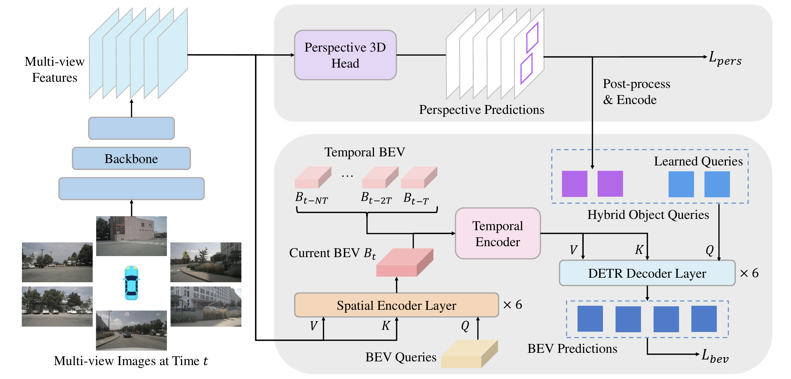
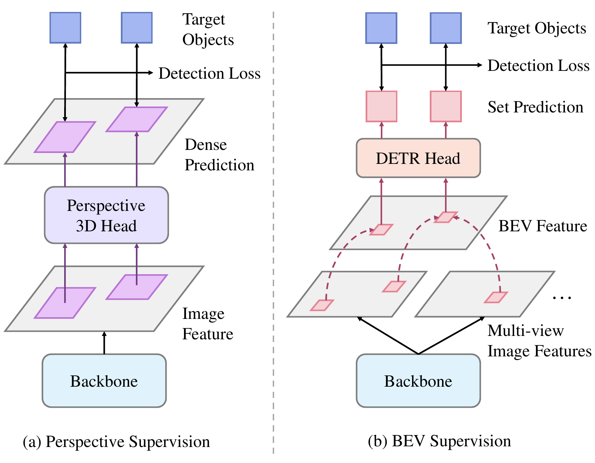
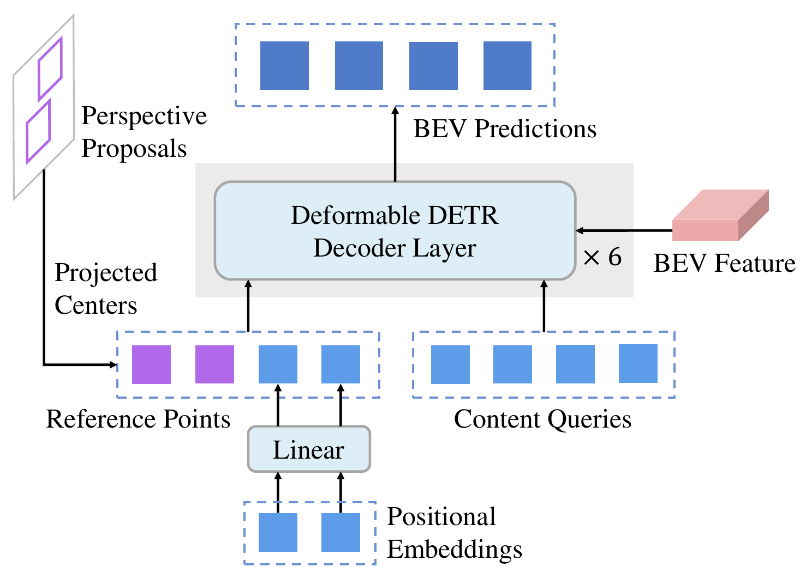
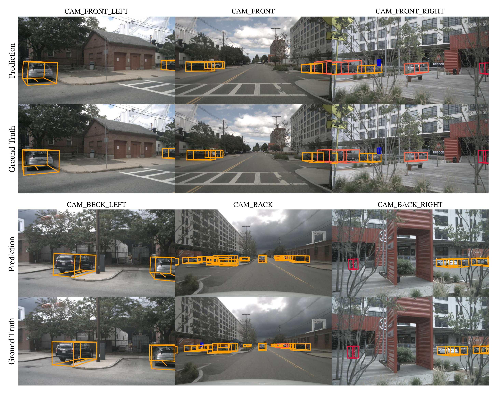

# BEVFormer v2 (CVPR 2023)

<!-- paper-source: https://chengwei920412.github.io/paper_reading/2211.10439_BEVFormer_v2_Adapting_Modern_Image_Backbones_to_Bird_s_Eye_View_Recognition_via_Perspective_Supervision/technical_report.html -->

> **arXiv ID**: 2211.10439
> **原文标题**: BEVFormer v2: Adapting Modern Image Backbones to Bird's-Eye-View Recognition via Perspective Supervision
> **翻译日期**: 2026-08-26

---

## 📋 论文概览 {#_1}

### 基本信息 {#_2}

- **作者**: Chenyu Yang\*, Yuntao Chen\*, Hao Tian\*, Chenxin Tao, Xizhou Zhu, Zhaoxiang Zhang, Gao Huang, Hongyang Li, Yu Qiao, Lewei Lu, Jie Zhou, Jifeng Dai（✉ 通讯）
- **机构**: 清华大学；中国科学院香港创新研究院人工智能与机器人创新中心（HKISI_CAS）；商汤科技研究院；中国科学院自动化研究所（CASIA）；上海人工智能实验室
- **发表时间**: 2022 年 11 月（arXiv 预印本），后收录于 CVPR 2023
- **领域**: 自动驾驶环视相机 3D 目标检测 / 鸟瞰图（BEV）感知

### 核心贡献 {#_3}

1. **指出透视监督是把通用 2D 图像骨干网络适配到 BEV 模型的关键**。BEV 检测损失对图像特征而言既「隐式」又「稀疏」，无法有效驱动大规模骨干网络学习 3D 几何；本文通过在骨干网络上直接挂一个透视 3D 检测头，把稠密、直接的监督信号加回图像特征。
2. **提出两阶段 BEV 检测器 BEVFormer v2**。透视头的第一阶段候选框经后处理后，其 BEV 投影中心作为「逐图像参考点」，与原有「逐数据集」可学习查询拼成混合目标查询，送入第二阶段 BEV 头。
3. **重新设计时序编码器**。用「形变 + 通道拼接 + 残差降维」替代 BEVFormer 的循环时序自注意力，可利用更长时序间隔，并在离线检测场景下支持双向（含未来帧）编码。
4. **摆脱深度预训练依赖，刷新 nuScenes SoTA**。骨干网络仅用 COCO 2D 检测权重初始化（无任何 3D/深度预训练），InternImage-XL 配置在 nuScenes test 集取得 **63.4% NDS / 55.6% mAP**，超过第二名 BEVStereo 2.4% NDS、3.1% mAP。

---

## 🎯 研究背景与动机 {#_4}

### 问题定义 {#_5}

BEV 感知模型的典型结构是「图像骨干网络 → 视图变换模块 → BEV 特征编码器 → 任务头」。社区对视图变换模块和下游任务做了大量探索，但**图像骨干网络这一环几乎被冻结在 VoVNet-99 上**——因为它有 DD3D 提供的 DDAD-15M 大规模深度预训练权重。问题是：能否直接把 ConvNeXt、InternImage 这类现代骨干网络换进来，享受 2D 视觉的进展红利？

答案在实践中是否定的。论文给出的关键反例：**ImageNet 预训练的 ConvNeXt-XL 在 3D 检测上仅与 DDAD-15M 深度预训练的 VoVNet-99 打平**——一个参数量大得多的现代骨干网络，抵不过一个小得多但做过深度预训练的旧骨干网络。缺的显然不是容量，而是 3D 几何先验。

> **原文疑似笔误**：论文写作 "the latter has 3.5\(\times\) parameters of the former"，即 VoVNet-99 参数量是 ConvNeXt-XL 的 3.5 倍。但按公开数据 ConvNeXt-XL 约 350M 参数、VoVNet-99（V2-99）约 70M 量级，方向应当相反（ConvNeXt-XL 更大）。只有「更大的现代骨干网络打不过更小的深度预训练骨干网络」这一方向才能支撑作者的论证。中文译文（`paper_cn.md` / `paper_cn.pdf`）按原文逐字翻译以保持忠实，此处按语义修正。

### 现有方法的局限性 {#_6}

论文把「换不动骨干网络」归因于两点：

<table>
<thead>
<tr>
<th>症结</th>
<th>具体表现</th>
</tr>
</thead>
<tbody>
<tr>
<td><strong>域差异（Domain Gap）</strong></td>
<td>在通用 2D 识别任务上预训练的骨干网络不擅长感知 3D 场景，尤其是深度估计。</td>
</tr>
<tr>
<td><strong>BEV 检测器结构过深</strong></td>
<td>以 BEVFormer 为例，3D 框与类别标签的监督信号被视图编码器 + 目标解码器（各含多层 Transformer）与骨干网络隔离，梯度流被逐层「扭曲」。</td>
</tr>
</tbody>
</table>

本文进一步把第二点拆解成两个可名状的缺陷——这是全文最核心的分析：

- **隐式（Implicit）**：损失直接作用于 BEV 特征；经过 3D→2D 投影与注意力采样后，对图像特征的作用变得间接。
- **稀疏（Sparse）**：只有被少量目标查询关注到的 BEV 网格才对损失有贡献，因此只有这些网格对应 2D 参考点附近的稀疏像素能拿到监督信号。

### 本文的创新点 {#_7}

既然 BEV 监督对图像特征「隐式 + 稀疏」，那就补一路「显式 + 稠密」的监督：在骨干网络之上直接挂一个逐像素预测的透视 3D 检测头。这一路监督不经过任何视图变换，直接落在图像特征上。

> 值得注意的是，此前 BEV 方法之所以没被这个问题严重困扰，是因为它们的骨干网络**要么规模小、要么已经用单目检测头在 3D 任务上预训练过**——后者恰恰是变相地做了透视监督。本文的贡献在于把这件事从「预训练阶段的隐性依赖」变成「训练阶段的显式设计」。

---

## 🔬 方法论 {#_8}

### 整体架构 {#_9}

图 1：BEVFormer v2 的整体架构。图像骨干网络生成多视角图像特征；透视 3D 头做出透视预测并编码为目标查询；BEV 头为编码器-解码器结构（空间编码器聚合多视角图像特征生成 BEV 特征，时序编码器收集历史 BEV 特征）；解码器以混合目标查询为输入，基于 BEV 特征给出最终预测。整个模型由 \(L_{pers}\) 与 \(L_{bev}\) 两项损失共同训练。

BEVFormer v2 由五部分组成，相较原版 BEVFormer **除空间编码器外全部有改动**：

<table>
<thead>
<tr>
<th>组件</th>
<th>相对 BEVFormer 的变化</th>
</tr>
</thead>
<tbody>
<tr>
<td>图像骨干网络</td>
<td>不做任何自动驾驶/深度数据集预训练，仅用 COCO 2D 检测权重</td>
</tr>
<tr>
<td>透视 3D 检测头</td>
<td><strong>新增</strong>，提供透视监督 + 第一阶段候选框</td>
</tr>
<tr>
<td>空间编码器</td>
<td>保持不变（空间交叉注意力）</td>
</tr>
<tr>
<td>时序编码器</td>
<td><strong>重新设计</strong>：形变-拼接替代循环自注意力</td>
</tr>
<tr>
<td>BEV 检测头</td>
<td>接受混合目标查询（第一阶段候选框 + 可学习查询）</td>
</tr>
</tbody>
</table>

### 关键技术 {#_10}

**（1）透视监督与透视损失**

图 2：透视监督（a）与 BEV 监督（b）的对比。透视检测器的监督信号对图像特征稠密且直接；BEV 检测器的监督信号稀疏且间接。

采用类 FCOS3D / DD3D 的单阶段无锚框检测头，预测 3D 框的中心位置、尺寸、朝向和投影中心度。总目标函数为：

\[\mathcal{L}_{total} = \lambda_{bev}\mathcal{L}_{bev}+\lambda_{pers}\mathcal{L}_{pers}\]

实验中取 \(\lambda_{bev}=\lambda_{pers}=1\)。透视损失本身由三项组成（附录）：

\[\mathcal{L}_{pers} = \mathcal{L}_{2D} + \mathcal{L}_{3D} + \mathcal{L}_{conf}\]

其中 \(\mathcal{L}_{2D}\) 源自 FCOS，\(\mathcal{L}_{3D}\) 为 MonoDIS 的解耦 L1 损失，\(\mathcal{L}_{conf}\) 为 3D 置信度的自监督损失。

**（2）重新设计的时序编码器**

原版 BEVFormer 用循环时序自注意力，但把循环步数从 4 提到 16 **没有任何额外收益**——这是一个很有信息量的负面观察。新设计改为：

1. 给定另一帧 \(k\) 的 BEV 特征 \(B_k\)，按帧间参考系变换矩阵 \(T_k^{t} = [\mathbf{R} | \mathbf{t}] \in \text{SE3}\) 双线性形变到当前帧得 \(B_k^t\)；
2. 沿通道维与当前帧 BEV 特征拼接；
3. 用残差块降维。

为保持计算量不变，帧数不增、**采样间隔增大**（0.5 秒 → 2 秒，主结果配置用 4 秒）。副产品是：离线检测场景下可以自然地把「未来帧」也拼进来，即**双向时序编码器**。

**（3）带混合目标查询的两阶段解码器**

图 3：BEVFormer v2 中 BEV 头的解码器。第一阶段候选框的投影中心作为逐图像参考点（紫色），与逐数据集的可学习内容查询和位置嵌入（蓝色）组合成混合目标查询。

原版 DETR 式解码器的参考点由可学习位置嵌入预测，**推理时对所有图像固定不变**，而目标的空间分布是随场景变化的。本文的做法是让参考点一半「随图而变」、一半「保留先验」：

- **逐图像（Per-Image）参考点**：第一阶段候选框在 BEV 平面的投影中心，直接指出目标可能位置；
- **逐数据集（Per-Dataset）参考点**：保留原有可学习位置嵌入，用于兜住那些因遮挡或位于相邻视图边界而被透视头漏检的目标。

### 算法流程 {#_11}

第一阶段候选框的后处理流程（附录 A.3），是本文一个容易被忽略但很关键的工程细节：

1. **逐视图 NMS**（2D IoU = 0.75）：\(C_i := \text{NMS}_{pers}\left(\{(\mathbf{B}_{i,j},s_{i,j})\}_j\right)\)
2. **逐视图 top-\(k_1\)**（\(k_1=100\)）：\(C := \bigcup_{i\in\mathcal{V}} \text{top-}k_1\left(C_i\right)\) —— 目的是**平衡各相机视图的候选框数量**，避免某个视图的高分框挤占全部配额；
3. 用相机外参把所有 3D 框投影到 BEV 坐标系；
4. **BEV 平面 NMS**（BEV IoU = 0.3）：\(C := \text{NMS}_{bev}(C)\) —— 消除同一目标在多个视图中重复出现造成的重叠候选框；
5. **全局 top-\(k_2\)**（\(k_2=100\)）：\(C := \text{top-}k_2(C)\)；
6. 取每个框的 BEV 投影中心 \((c_x(\mathbf{B}),c_y(\mathbf{B}))\) 作为 Deformable DETR 的参考点。

---

## 📊 实验与结果 {#_12}

### 实验设置 {#_13}

- **数据集**: nuScenes（1000 段约 20s 多模态视频，2Hz 关键帧标注，6 相机 360° 全视场；700/150/150 划分训练/验证/测试；10 类共 140 万个 3D 框）
- **评估指标**: NDS（主指标）、mAP，以及五项真正例指标 mATE / mASE / mAOE / mAVE / mAAE（平移、尺度、朝向、速度、属性误差，**越低越好**）
- **对比方法**: BEVFormer、PolarFormer、PETRv2、BEVDepth、BEVStereo
- **骨干网络**: ResNet-50/101、DLA-34、VoVNet-99、InternImage-B/XL，**全部以 COCO 2D 检测权重初始化**
- **优化**: AdamW，基础学习率 4e-4（XL 为 5e-4），权重衰减 0.01，梯度裁剪 35

### 主要结果 {#_14}

表 1：nuScenes **test** 集 3D 检测结果。\(^\dagger\) 表示 V2-99 用额外数据做过深度估计预训练；\(^\ddagger\) 表示使用 CBGS（会把 1 轮拉长为 4.5 轮）。

<table>
<thead>
<tr>
<th>方法</th>
<th>骨干网络</th>
<th>轮数</th>
<th>图像尺寸</th>
<th>NDS ↑</th>
<th>mAP ↑</th>
<th>mATE ↓</th>
<th>mASE ↓</th>
<th>mAOE ↓</th>
<th>mAVE ↓</th>
<th>mAAE ↓</th>
</tr>
</thead>
<tbody>
<tr>
<td>BEVFormer</td>
<td>V2-99\(^\dagger\)</td>
<td>24</td>
<td>900 × 1600</td>
<td>0.569</td>
<td>0.481</td>
<td>0.582</td>
<td>0.256</td>
<td>0.375</td>
<td>0.378</td>
<td>0.126</td>
</tr>
<tr>
<td>PolarFormer</td>
<td>V2-99\(^\dagger\)</td>
<td>24</td>
<td>900 × 1600</td>
<td>0.572</td>
<td>0.493</td>
<td>0.556</td>
<td>0.256</td>
<td>0.364</td>
<td>0.440</td>
<td>0.127</td>
</tr>
<tr>
<td>PETRv2</td>
<td>GLOM</td>
<td>24</td>
<td>640 × 1600</td>
<td>0.582</td>
<td>0.490</td>
<td>0.561</td>
<td>0.243</td>
<td>0.361</td>
<td>0.343</td>
<td>0.120</td>
</tr>
<tr>
<td>BEVDepth</td>
<td>V2-99\(^\dagger\)</td>
<td>90\(^\ddagger\)</td>
<td>640 × 1600</td>
<td>0.600</td>
<td>0.503</td>
<td>0.445</td>
<td>0.245</td>
<td>0.378</td>
<td>0.320</td>
<td>0.126</td>
</tr>
<tr>
<td>BEVStereo</td>
<td>V2-99\(^\dagger\)</td>
<td>90\(^\ddagger\)</td>
<td>640 × 1600</td>
<td>0.610</td>
<td>0.525</td>
<td>0.431</td>
<td>0.246</td>
<td>0.358</td>
<td>0.357</td>
<td>0.138</td>
</tr>
<tr>
<td><strong>BEVFormer v2</strong></td>
<td>InternImage-B</td>
<td>24</td>
<td>640 × 1600</td>
<td>0.620</td>
<td>0.540</td>
<td>0.488</td>
<td>0.251</td>
<td>0.335</td>
<td>0.302</td>
<td>0.122</td>
</tr>
<tr>
<td><strong>BEVFormer v2</strong></td>
<td>InternImage-XL</td>
<td>24</td>
<td>640 × 1600</td>
<td><strong>0.634</strong></td>
<td><strong>0.556</strong></td>
<td>0.456</td>
<td>0.248</td>
<td><strong>0.317</strong></td>
<td><strong>0.293</strong></td>
<td>0.123</td>
</tr>
</tbody>
</table>

两个值得注意的细节：

- **InternImage-B 参数量与 V2-99 相当**，但在无任何 3D 预训练的条件下就超过了所有对手（62.0% vs 61.0% NDS）——这是「深度预训练不再必要」这一论断最直接的证据。
- BEVFormer v2 **只训练 24 轮**，而 BEVDepth / BEVStereo 用了 90 轮 + CBGS（等效约 405 轮）。训练预算上本文是明显吃亏的一方。
- 唯一没拿到最优的指标是 mATE（0.456 vs BEVStereo 的 0.431），即平移误差；BEVDepth/BEVStereo 用 LiDAR 深度监督或时序立体，在绝对定位精度上仍有优势。

### 消融实验 {#_15}

**① 视图监督组合（核心消融）**

表 2：不同视图监督组合，nuScenes **val** 集，ResNet-101，48 轮，均不使用时序信息。

<table>
<thead>
<tr>
<th>视图监督</th>
<th>NDS ↑</th>
<th>mAP ↑</th>
<th>mATE ↓</th>
<th>mASE ↓</th>
<th>mAOE ↓</th>
<th>mAVE ↓</th>
<th>mAAE ↓</th>
</tr>
</thead>
<tbody>
<tr>
<td>仅透视</td>
<td>0.412</td>
<td>0.323</td>
<td>0.737</td>
<td>0.268</td>
<td>0.377</td>
<td>0.943</td>
<td>0.167</td>
</tr>
<tr>
<td>仅 BEV</td>
<td>0.426</td>
<td>0.355</td>
<td>0.751</td>
<td>0.275</td>
<td>0.429</td>
<td>0.847</td>
<td>0.215</td>
</tr>
<tr>
<td><strong>透视 &amp; BEV</strong></td>
<td><strong>0.451</strong></td>
<td><strong>0.374</strong></td>
<td><strong>0.730</strong></td>
<td>0.270</td>
<td>0.379</td>
<td><strong>0.773</strong></td>
<td>0.205</td>
</tr>
<tr>
<td>BEV &amp; BEV</td>
<td>0.428</td>
<td>0.350</td>
<td>0.750</td>
<td>0.279</td>
<td>0.388</td>
<td>0.842</td>
<td>0.210</td>
</tr>
</tbody>
</table>

这张表是全文最有说服力的一张，因为它同时排除了两个替代解释：

- **不是「多视角信息」的功劳**：仅 BEV（0.426）确实优于仅透视（0.412），但其 mATE 和 mAOE **反而更差**，正对应「BEV 监督隐式 + 稀疏」的预测。
- **不是「两阶段流程」的功劳**：BEV & BEV（0.428）与仅 BEV（0.426）基本持平，远不及透视 & BEV（0.451）。换言之，**第一阶段头必须在透视视图**才有意义。

透视 & BEV 相对仅 BEV 提升 2.5% NDS / 1.9% mAP，且改进主要落在 mATE、mAOE、mAVE 上——即深度、朝向、速度这些「需要 3D 几何知识」的属性，与理论分析吻合。

**② 骨干网络泛化性**

表 3：不同骨干网络，nuScenes **val** 集，48 轮，均不使用时序信息，COCO 权重初始化。

<table>
<thead>
<tr>
<th>骨干网络</th>
<th>仅 BEV (NDS/mAP)</th>
<th>透视 &amp; BEV (NDS/mAP)</th>
<th>ΔNDS</th>
<th>ΔmAP</th>
</tr>
</thead>
<tbody>
<tr>
<td>ResNet-50</td>
<td>0.400 / 0.327</td>
<td>0.428 / 0.349</td>
<td>+2.8</td>
<td>+2.2</td>
</tr>
<tr>
<td>DLA-34</td>
<td>0.403 / 0.338</td>
<td>0.435 / 0.358</td>
<td>+3.2</td>
<td>+2.0</td>
</tr>
<tr>
<td>ResNet-101</td>
<td>0.426 / 0.355</td>
<td>0.451 / 0.374</td>
<td>+2.5</td>
<td>+1.9</td>
</tr>
<tr>
<td>VoVNet-99</td>
<td>0.441 / 0.367</td>
<td>0.467 / 0.396</td>
<td>+2.6</td>
<td>+2.9</td>
</tr>
<tr>
<td>InternImage-B</td>
<td>0.455 / 0.398</td>
<td><strong>0.485 / 0.417</strong></td>
<td>+3.0</td>
<td>+1.9</td>
</tr>
</tbody>
</table>

增益在 CNN、可变形卷积、不同规模之间**几乎恒定（约 +3% NDS / +2% mAP）**，说明透视监督是一个与架构无关的通用训练方案，而非某个骨干网络的特殊适配技巧。

**③ 训练轮数——收敛性证据**

表 4：不同训练轮数，nuScenes **val** 集，ResNet-50，不使用时序信息。

<table>
<thead>
<tr>
<th>视图监督</th>
<th>24 轮</th>
<th>48 轮</th>
<th>72 轮</th>
</tr>
</thead>
<tbody>
<tr>
<td>仅 BEV (NDS)</td>
<td>0.379</td>
<td>0.400</td>
<td>0.410</td>
</tr>
<tr>
<td>透视 &amp; BEV (NDS)</td>
<td><strong>0.414</strong></td>
<td><strong>0.428</strong></td>
<td>0.428</td>
</tr>
</tbody>
</table>

**透视 & BEV 训练 24 轮（0.414）就已经超过仅 BEV 训练 72 轮（0.410）**。更关键的是，72 轮时两者仍有约 1.8% NDS 的差距且看不到收敛趋势——这支持了「差距不是收敛速度问题，而是 BEV 监督本身无法把骨干网络适配好」这一更强的论断。透视 & BEV 在 48 轮后饱和，因此其余实验固定 48 轮。

**④ 检测头选择**

表 5：透视头与 BEV 头组合对比，nuScenes **val** 集，ResNet-50，48 轮。

<table>
<thead>
<tr>
<th>透视视图</th>
<th>BEV 视图</th>
<th>NDS ↑</th>
<th>mAP ↑</th>
<th>mAOE ↓</th>
</tr>
</thead>
<tbody>
<tr>
<td>DD3D</td>
<td>Deformable DETR</td>
<td>0.428</td>
<td>0.349</td>
<td>0.424</td>
</tr>
<tr>
<td>DD3D</td>
<td>Group DETR</td>
<td><strong>0.445</strong></td>
<td><strong>0.353</strong></td>
<td><strong>0.366</strong></td>
</tr>
<tr>
<td>DETR3D</td>
<td>Deformable DETR</td>
<td>0.409</td>
<td>0.335</td>
<td>0.469</td>
</tr>
<tr>
<td>DETR3D</td>
<td>Group DETR</td>
<td>0.423</td>
<td>0.351</td>
<td>0.466</td>
</tr>
</tbody>
</table>

**DD3D（稠密逐像素）显著优于 DETR3D（稀疏集合预测）**。有意思的是，按本文定义 DETR3D 也算「透视监督」——它直接用图像特征做预测、不生成 BEV 特征——但它的监督是**稀疏**的，因此只能补上「隐式」这一半缺陷，补不上「稀疏」那一半。这是对第 3.2 节理论分析的一个精巧的交叉验证。

**⑤ 各项技巧消融**

表 6：nuScenes **val** 集，ResNet-50，24 轮，使用时序信息。

<table>
<thead>
<tr>
<th>方法</th>
<th>Pers</th>
<th>IDA</th>
<th>Long</th>
<th>Bi</th>
<th>NDS ↑</th>
<th>mAP ↑</th>
<th>mAOE ↓</th>
</tr>
</thead>
<tbody>
<tr>
<td>基线</td>
<td>✓</td>
<td></td>
<td></td>
<td></td>
<td>0.478</td>
<td>0.368</td>
<td>0.452</td>
</tr>
<tr>
<td>+ 图像级数据增强</td>
<td>✓</td>
<td>✓</td>
<td></td>
<td></td>
<td>0.489</td>
<td>0.386</td>
<td>0.482</td>
</tr>
<tr>
<td>+ 更长时序间隔</td>
<td>✓</td>
<td>✓</td>
<td>✓</td>
<td></td>
<td>0.498</td>
<td>0.388</td>
<td>0.417</td>
</tr>
<tr>
<td>+ 双向时序编码器</td>
<td>✓</td>
<td>✓</td>
<td>✓</td>
<td>✓</td>
<td><strong>0.529</strong></td>
<td><strong>0.423</strong></td>
<td>0.413</td>
</tr>
<tr>
<td>除透视监督外全部启用</td>
<td></td>
<td>✓</td>
<td>✓</td>
<td>✓</td>
<td>0.507</td>
<td>0.397</td>
<td>0.455</td>
</tr>
</tbody>
</table>

- 双向时序编码器贡献最大的单项增益（+3.1% NDS），但**仅适用于离线检测**——它要看未来帧，不能用于实时行车。
- 更长时序间隔主要压低 mAOE（0.482 → 0.417）：自车在更长时间跨度内位移更大，观测视角更丰富，有利于估计朝向。
- **在已启用全部技巧的强基线上，透视监督仍贡献 +2.2% NDS / +2.6% mAP**（0.529 vs 0.507），说明它与这些工程技巧是正交的、不可替代的。

**⑥ 定性结果**

图 4：BEVFormer v2 的 3D 目标检测预测结果可视化。模型对远距离、遮挡等困难样本仍能给出准确 3D 框，例如右前相机的远处行人、后向相机中与多辆汽车重叠的卡车、右后相机中被树木遮挡的自行车。

---

## 💡 关键见解 {#_16}

### 理论分析 {#_17}

本文最有价值的部分是把「BEV 检测器难训」这一模糊经验，还原为**两个可检验的性质**：

<table>
<thead>
<tr>
<th>性质</th>
<th>含义</th>
<th>对应的实验证据</th>
</tr>
</thead>
<tbody>
<tr>
<td><strong>隐式（Implicit）</strong></td>
<td>损失经 3D→2D 投影与注意力采样后才作用到图像特征</td>
<td>仅 BEV 的 mATE/mAOE 差于仅透视（表 2）</td>
</tr>
<tr>
<td><strong>稀疏（Sparse）</strong></td>
<td>只有目标查询关注的少数网格对应的稀疏像素拿到梯度</td>
<td>DETR3D（稀疏透视监督）显著弱于 DD3D（稠密）（表 5）</td>
</tr>
</tbody>
</table>

这个二分法的解释力体现在它能**预测**实验结果，而不只是事后描述：如果只是「监督不够」，那么加任何辅助头都该有效——但 BEV & BEV 无效；如果只是「不够直接」，那么 DETR3D 该和 DD3D 相当——但它明显更差。两个消融各否证一半的替代假设，逻辑闭环相当完整。

另一个隐含洞察：**此前 SoTA 对 VoVNet 深度预训练的依赖，本质上是把透视监督偷偷放进了预训练阶段。** 本文把它显式化并搬到训练阶段，于是骨干网络的选择就解耦了——这才是「解锁现代骨干网络」的真正机制。

### 实践启示 {#_18}

1. **多阶段/多模块深度网络中，给靠前的模块加短路径监督是低成本高回报的手段。** 这个思路不限于 BEV 检测，凡是「骨干网络 + 多层变换 + 稀疏查询头」结构（含各类 BEV 分割、占据栅格、端到端驾驶）都适用。
2. **辅助监督必须「稠密 + 直接」才有效**，两者缺一不可。这为设计辅助任务提供了明确判据。
3. **两阶段设计要跨表征空间才有信息增益**。SimMOD 式的「同一份透视特征用两次」没有收益（本文的 BEV & BEV 消融也印证），而「透视 + BEV」跨空间组合才有效。
4. **参考点可以「一半随图而变、一半保留先验」**。这一混合查询设计是通用可迁移的：既吸收实例级动态先验，又保留数据集级静态兜底。
5. **省算力的现实价值**：24 轮 + COCO 权重 vs 90 轮 + CBGS + DDAD-15M 深度预训练，训练成本差距巨大。

---

## 🔍 局限性与未来工作 {#_19}

### 当前局限 {#_20}

**作者自述：** 受计算与时间限制，尚未在更大规模图像骨干网络上验证；已完成一系列骨干网络的初步验证，未来将扩展模型规模。

**审读补充：**

1. **双向时序编码器不适用于在线场景。** 它贡献了消融中最大的单项增益（+3.1% NDS），但依赖未来帧，只能用于离线标注/挖掘流程。表 1 的主结果配置（时序间隔 4 秒、双向）因此**不是一个可部署的实时检测器**，与 BEVFormer/PETRv2 等在线方法直接比 NDS 有一定不对等——论文对此未作显式区分。
2. **推理开销未报告。** 全文没有给出 FPS、参数量、FLOPs 或显存数据。透视头在训练时提供监督，推理时还要跑一遍并做两轮 NMS 后处理，这部分成本对比只能靠推测。InternImage-XL 的实际部署可行性也无从判断。
3. **透视头的收益来源未完全解耦。** 透视头同时承担两个角色：提供监督（训练期）与提供候选框（推理期）。表 2 的 2.5% NDS 提升是二者之和，论文没有做「只留监督、推理时丢弃候选框」的消融来分离两项贡献。文中把改进归因于两方面，但比例未知。
4. **损失权重未做敏感性分析。** \(\lambda_{bev}=\lambda_{pers}=1\) 直接给定，无搜索过程或鲁棒性曲线。
5. **mATE 仍落后。** 相对使用 LiDAR 深度监督（BEVDepth）或时序立体（BEVStereo）的方法，绝对平移精度仍有差距，说明透视监督在深度绝对尺度上不如显式深度监督。
6. **未验证的泛化边界**：全部实验在 nuScenes 单一数据集上完成（无 Waymo / Argoverse 交叉验证）；骨干网络全为 CNN 系（无 ViT / Swin 等纯注意力骨干网络），而「适配现代骨干网络」的主张本应覆盖后者。

### 未来方向 {#_21}

1. **扩展到 ViT / Swin 等纯注意力骨干网络**，检验透视监督的结论是否跨架构族成立。
2. **分离监督与候选框两项收益**，据此可能得到「训练用透视头、推理时剪除」的轻量部署方案。
3. **扩展到 BEV 分割、占据栅格预测、端到端规划**等其他 BEV 任务，验证透视监督作为通用训练方案的适用范围。
4. **在线场景下的时序编码器设计**：如何在不看未来帧的前提下逼近双向编码器的收益。
5. **跨数据集验证与 sim-to-real**，以及与显式深度监督（BEVDepth 式）的组合是否能补上 mATE 短板。

---

## 📚 相关工作对比 {#_22}

<table>
<thead>
<tr>
<th>方法</th>
<th>核心思想</th>
<th>优势</th>
<th>劣势</th>
</tr>
</thead>
<tbody>
<tr>
<td><strong>BEVFormer</strong></td>
<td>空间交叉注意力做视图变换 + 循环时序自注意力</td>
<td>全 Transformer，BEV 特征通用性强，支持非规则采样网格</td>
<td>依赖 V2-99 深度预训练；监督对图像特征隐式且稀疏；长时序无增益</td>
</tr>
<tr>
<td><strong>BEVDepth</strong></td>
<td>用 LiDAR 点云监督中间深度网络</td>
<td>深度估计准确，mATE 显著更低</td>
<td><strong>需要 LiDAR 额外数据</strong>；依赖 V2-99 深度预训练；90 轮 + CBGS 训练昂贵</td>
</tr>
<tr>
<td><strong>BEVStereo</strong></td>
<td>时序立体（Temporal Stereo）改善深度</td>
<td>此前 nuScenes SoTA，mATE 最优</td>
<td>依赖 V2-99 深度预训练；训练开销大；仍受骨干网络锁定</td>
</tr>
<tr>
<td><strong>MV-FCOS3D++</strong></td>
<td>用透视监督预训练图像骨干网络</td>
<td>已触及透视监督的价值</td>
<td>只用于<strong>预训练</strong>，检测器本身仍仅由 BEV 损失监督，非端到端</td>
</tr>
<tr>
<td><strong>DETR3D</strong></td>
<td>3D→2D 查询采样图像特征做稀疏集合预测</td>
<td>无需显式 BEV 特征，结构简洁</td>
<td>监督直接但<strong>稀疏</strong>，作为透视头明显弱于 DD3D（表 5）</td>
</tr>
<tr>
<td><strong>SimMOD</strong></td>
<td>单目 3D 头出候选框 + DETR3D 头最终检测</td>
<td>首个相机两阶段 3D 检测尝试</td>
<td>两阶段共用同一份透视特征，<strong>无信息增益</strong></td>
</tr>
<tr>
<td><strong>本文（BEVFormer v2）</strong></td>
<td>端到端透视监督 + 跨空间两阶段（透视候选框 → BEV 查询）</td>
<td>无需深度/3D 预训练与 LiDAR 数据；24 轮达 SoTA；跨骨干网络稳定 +3% NDS；混合查询设计通用</td>
<td>主结果依赖离线双向时序编码器；未报告推理开销；监督与候选框收益未解耦；mATE 仍落后</td>
</tr>
</tbody>
</table>

---

## 🎓 个人评价 {#_23}

### 优点 {#_24}

1. **问题诊断精准，且做成了可检验的命题。** 「隐式 + 稀疏」这个二分法不是事后叙事——它预测了 BEV & BEV 无效、DETR3D 弱于 DD3D 这两个非平凡结果，而消融确实验证了。这是方法论层面的高质量工作。
2. **消融设计有对抗性。** 作者主动构造 BEV & BEV 这个「消除两阶段流程混淆变量」的对照组，而不是只报告有利结果。表 4 用「24 轮的透视 & BEV 超过 72 轮的仅 BEV」把「这只是收敛更快」的质疑挡了回去。
3. **结论有实际杠杆。** 解除对 VoVNet 深度预训练的依赖，意味着 BEV 感知可以直接吃 2D 视觉社区的进展红利，这对领域的影响超出单篇论文的 SoTA 数字。
4. **泛化性验证扎实。** 5 种骨干网络上增益稳定在 +3% NDS 附近，不是单点调优的偶然结果。
5. **附录工程细节完整。** 尤其是候选框后处理中「逐视图 top-\(k_1\) 平衡配额」和「BEV 平面二次 NMS 去跨视图重复」这两步，是复现的关键，作者给出了完整超参。

### 可改进之处 {#_25}

1. **主结果的可比性存疑。** 表 1 中 BEVFormer v2 使用 4 秒时序间隔 + 双向时序编码器（需未来帧），而对比方法多为在线设定。论文没有在主表中标注这一差异，也没有给出「仅在线配置」的 test 集数字。63.4% NDS 这个数字对在线部署场景是不可达的。
2. **透视头在推理期的必要性未消融。** 「只留监督、推理时丢弃透视头」这个实验成本很低且价值很高——它能直接回答「这是训练技巧还是架构改动」。缺失使得方法的定位有些模糊。
3. **效率数据完全缺失。** 一篇主张「适配大规模骨干网络」的论文，不报告 FPS / FLOPs / 显存，读者无法判断 InternImage-XL 配置的工程可行性。
4. **架构覆盖面与主张不完全匹配。** 「现代图像骨干网络」在 2022 年底已包含 ViT/Swin 系，但实验清单全是 CNN 系（ResNet/DLA/VoVNet/InternImage 的 DCNv3）。这削弱了「通用适配」的强度。
5. **原文存在若干笔误**：引言中 ConvNeXt-XL 与 VoVNet-99 的参数量比较方向疑似写反（见「研究背景与动机」一节的说明）；此外还有 `previous session` 应为 `previous section`、`Ravamped` 应为 `Revamped`、`BEV plain` 应为 `BEV plane`、图 2 标题中 `(B)` 应为 `(b)`、`BEVFromer` 拼写等。译文对排印类笔误按语义修正，对事实性表述保持原文并另行标注。

### 推荐阅读对象 {#_26}

- **自动驾驶 BEV 感知研究者与工程师**：本文是 BEV 检测器训练范式的关键转折点，「监督放在哪里」的分析框架应当纳入基本认知。
- **多阶段深度网络的优化研究者**：辅助监督「稠密 + 直接」的判据具有跨领域参考价值。
- **DETR 系检测器研究者**：混合目标查询（逐图像 + 逐数据集参考点）是一个通用可迁移的设计。
- **预训练策略研究者**：本文提供了一个「把预训练阶段的隐性依赖搬到训练阶段显式化」的范例。

---

## 📎 附录 {#_27}

### 重要公式 {#_28}

**总目标函数**（第 3.3 节）：

\[\mathcal{L}_{total} = \lambda_{bev}\mathcal{L}_{bev}+\lambda_{pers}\mathcal{L}_{pers}\]

实验中 \(\lambda_{bev}=\lambda_{pers}=1\)。

**透视损失分解**（附录 A.2）：

\[\mathcal{L}_{pers} = \mathcal{L}_{2D} + \mathcal{L}_{3D} + \mathcal{L}_{conf}\]

\(\mathcal{L}_{2D}\) 源自 FCOS，\(\mathcal{L}_{3D}\) 为 MonoDIS 的解耦 L1 损失，\(\mathcal{L}_{conf}\) 为 3D 置信度自监督损失。

**时序特征形变**（第 3.4 节）：以帧间参考系变换矩阵 \(T_k^{t} = [\mathbf{R} | \mathbf{t}] \in \text{SE3}\) 将 \(B_k\) 双线性形变为 \(B_k^t\)，再沿通道维拼接并用残差块降维。

**候选框后处理链**（附录 A.3）：

\[C_i := \text{NMS}_{pers}\left(\{(\mathbf{B}_{i,j},s_{i,j})\}_j\right) \quad (\text{2D IoU} = 0.75)\]

\[C := \bigcup_{i\in\mathcal{V}} \text{top-}k_1\left(C_i\right) \quad (k_1 = 100)\]

\[C := \text{NMS}_{bev}(C) \quad (\text{BEV IoU} = 0.3)\]

\[C := \text{top-}k_2(C) \quad (k_2 = 100)\]

最终取每个框的 BEV 投影中心 \((c_x(\mathbf{B}),c_y(\mathbf{B}))\) 作为 Deformable DETR 参考点。

### 术语表 {#_29}

<table>
<thead>
<tr>
<th>英文</th>
<th>中文</th>
</tr>
</thead>
<tbody>
<tr>
<td>Bird's-Eye-View (BEV)</td>
<td>鸟瞰图</td>
</tr>
<tr>
<td>Perspective Supervision</td>
<td>透视监督</td>
</tr>
<tr>
<td>BEV Supervision</td>
<td>BEV 监督</td>
</tr>
<tr>
<td>Perspective Loss</td>
<td>透视损失</td>
</tr>
<tr>
<td>Image Backbone</td>
<td>图像骨干网络</td>
</tr>
<tr>
<td>Depth Pre-training</td>
<td>深度预训练</td>
</tr>
<tr>
<td>Domain Gap</td>
<td>域差异</td>
</tr>
<tr>
<td>View Transformation</td>
<td>视图变换</td>
</tr>
<tr>
<td>Spatial Encoder</td>
<td>空间编码器</td>
</tr>
<tr>
<td>Temporal Encoder</td>
<td>时序编码器</td>
</tr>
<tr>
<td>Spatial Cross-Attention</td>
<td>空间交叉注意力</td>
</tr>
<tr>
<td>Temporal Self-Attention</td>
<td>时序自注意力</td>
</tr>
<tr>
<td>Deformable Attention</td>
<td>可变形注意力</td>
</tr>
<tr>
<td>Object Query</td>
<td>目标查询</td>
</tr>
<tr>
<td>Hybrid Object Query</td>
<td>混合目标查询</td>
</tr>
<tr>
<td>Content Query</td>
<td>内容查询</td>
</tr>
<tr>
<td>Reference Point</td>
<td>参考点</td>
</tr>
<tr>
<td>Value Feature</td>
<td>值特征</td>
</tr>
<tr>
<td>Positional Embedding</td>
<td>位置嵌入</td>
</tr>
<tr>
<td>Per-Image / Per-Dataset</td>
<td>逐图像 / 逐数据集</td>
</tr>
<tr>
<td>Proposal</td>
<td>候选框</td>
</tr>
<tr>
<td>Two-stage Detector</td>
<td>两阶段检测器</td>
</tr>
<tr>
<td>Anchor-Free</td>
<td>无锚框</td>
</tr>
<tr>
<td>Center-ness</td>
<td>中心度</td>
</tr>
<tr>
<td>Allocentric Orientation</td>
<td>非自我中心朝向</td>
</tr>
<tr>
<td>Non-Maximum Suppression (NMS)</td>
<td>非极大值抑制</td>
</tr>
<tr>
<td>Warp and Concatenate</td>
<td>形变-拼接</td>
</tr>
<tr>
<td>Bi-directional Temporal Encoder</td>
<td>双向时序编码器</td>
</tr>
<tr>
<td>Image-level Data Augmentation (IDA)</td>
<td>图像级数据增强</td>
</tr>
<tr>
<td>Pillar Feature</td>
<td>柱状特征</td>
</tr>
<tr>
<td>Disentangled L1 Loss</td>
<td>解耦 L1 损失</td>
</tr>
<tr>
<td>Layer-wise LR Decay</td>
<td>逐层学习率衰减</td>
</tr>
<tr>
<td>NDS (nuScenes Detection Score)</td>
<td>nuScenes 检测分数</td>
</tr>
<tr>
<td>mATE / mASE / mAOE / mAVE / mAAE</td>
<td>平移 / 尺度 / 朝向 / 速度 / 属性误差均值</td>
</tr>
</tbody>
</table>

### 参考资源 {#_30}

- **论文原文**: [arXiv:2211.10439](https://arxiv.org/abs/2211.10439)
- **中文翻译 PDF**: [paper_cn.pdf](https://chengwei920412.github.io/paper_reading/2211.10439_BEVFormer_v2_Adapting_Modern_Image_Backbones_to_Bird_s_Eye_View_Recognition_via_Perspective_Supervision/paper_cn.pdf)
- **中文 Markdown 译文**: [paper_cn.md](https://chengwei920412.github.io/paper_reading/2211.10439_BEVFormer_v2_Adapting_Modern_Image_Backbones_to_Bird_s_Eye_View_Recognition_via_Perspective_Supervision/paper_cn.html)
- **代码实现**: [github.com/fundamentalvision/BEVFormer](https://github.com/fundamentalvision/BEVFormer) —— BEVFormer v2 无独立仓库，配置位于该仓库 `projects/configs/bevformerv2/`（如 `bevformerv2-r50-t8-24ep.py`），权重与日志托管在 Google Drive / 百度网盘
- **项目主页**: 无
