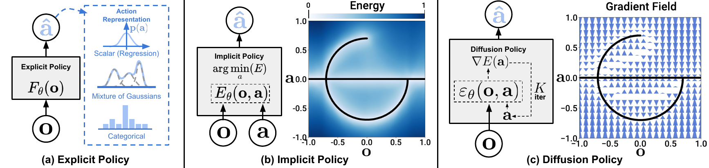
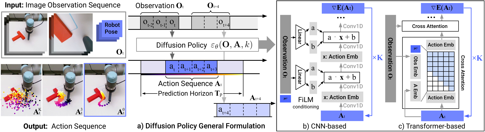
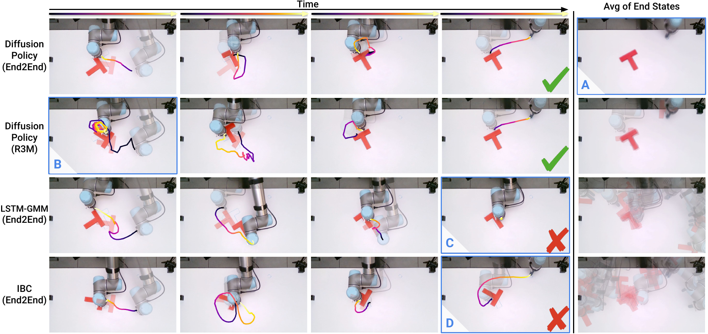
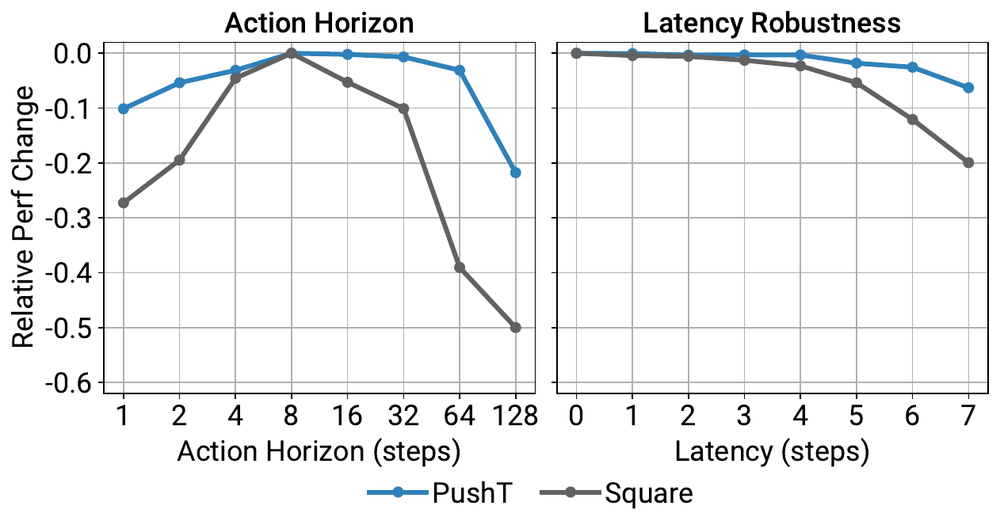

# Diffusion Policy (RSS 2023)

<!-- paper-source: https://chengwei920412.github.io/paper_reading/2303.04137_Diffusion_Policy_Visuomotor_Policy_Learning_via_Action_Diffusion/technical_report.html -->

> 原文链接：[Diffusion Policy (RSS 2023)](https://chengwei920412.github.io/paper_reading/2303.04137_Diffusion_Policy_Visuomotor_Policy_Learning_via_Action_Diffusion/technical_report.html)

> **arXiv ID**: 2303.04137  
> **原文标题**: Diffusion Policy: Visuomotor Policy Learning via Action Diffusion  
> **翻译日期**: 2026-07-30

## 论文概览 {#_2}

### 基本信息 {#_3}

- **作者**: Cheng Chi, Zhenjia Xu, Siyuan Feng, Eric Cousineau, Yilun Du, Benjamin Burchfiel, Russ Tedrake, Shuran Song
- **机构**: Columbia University, Toyota Research Institute, MIT, Stanford University
- **发表时间**: arXiv 2023
- **领域**: 机器人学习、模仿学习、视觉运动控制、扩散模型

### 核心贡献 {#_4}

本文提出扩散策略（Diffusion Policy），将机器人视觉运动策略表示为条件去噪扩散过程。策略不直接回归单步动作，而是在观测条件下迭代去噪一段动作序列，并结合滚动时域控制执行。论文在 4 个机器人操作基准的 15 个任务上评估该方法，报告平均成功率提升 46.9%，并展示其在多模态动作分布、高维动作空间和训练稳定性上的优势。

图：显式策略、隐式策略和扩散策略的动作分布建模方式对比。

## 研究背景与动机 {#_5}

### 问题定义 {#_6}

从示教中学习机器人策略通常被建模为行为克隆，即学习从观测到动作的映射。但机器人动作预测不同于普通监督回归：同一观测下可能存在多个合理动作，动作需要在时间上连续，真实机器人还要求高精度和低延迟。

### 现有方法的局限性 {#_7}

显式回归策略推理快，但容易平均多个动作模式，导致多模态任务失败。离散化或混合密度模型可以表达多模态，但高维连续动作空间中扩展性差，且对超参数敏感。隐式策略和基于能量的模型表达力强，但训练通常需要负采样，稳定性不足。

### 本文的创新点 {#_8}

扩散策略用分数函数梯度表示动作分布，通过去噪采样生成动作序列。它同时利用扩散模型的分布表达能力和滚动时域控制的闭环反馈能力，并提出适配机器人控制的视觉条件化、CNN/Transformer 动作扩散网络和加速推理方案。

## 方法论 {#_9}

### 整体架构 {#_10}

策略输入最近 \(T_o\) 步观测 \(\mathbf{O}_t\)，输出 \(T_p\) 步动作预测 \(\mathbf{A}_t\)，其中只执行前 \(T_a\) 步，然后在新观测下重新规划。训练时向真实动作序列加入噪声，并训练网络 \(\epsilon_\theta\) 预测噪声；推理时从高斯噪声出发，迭代去噪得到动作序列。

图：扩散策略的输入输出形式，以及 CNN 和 Transformer 两类噪声预测网络。

### 关键技术 {#_11}

1. **条件动作扩散**: 建模 \(p(\mathbf{A}_t|\mathbf{O}_t)\)，而不是联合建模观测和动作，降低视觉特征重复计算成本。
2. **滚动时域控制**: 每次只执行动作序列前段，兼顾动作平滑性和对新观测的响应能力。
3. **视觉条件化**: 视觉编码器只运行一次，特征通过 FiLM 或 Transformer cross-attention 注入动作去噪网络。
4. **时间序列扩散 Transformer**: 通过因果注意力建模动作序列，缓解 CNN 对高频动作变化的过平滑问题。
5. **DDIM 加速推理**: 真实机器人实验中减少推理去噪步数，使闭环控制延迟可接受。

### 算法流程 {#_12}

训练阶段：从数据集中采样动作序列，随机选择扩散步 \(k\)，加入对应噪声 \(\epsilon^k\)，训练网络预测噪声。推理阶段：采样初始高斯噪声动作序列，在观测条件下迭代去噪，执行前 \(T_a\) 步动作，再用最新观测重新推理。

## 实验与结果 {#_13}

### 实验设置 {#_14}

- **数据集/任务**: RoboMimic、Push-T、Block Push、Kitchen，以及多个真实世界单臂和双臂任务。
- **评估指标**: 成功率、目标区域覆盖率、完成子目标数、真实任务覆盖率等。
- **对比方法**: LSTM-GMM、IBC、BET 以及扩散策略的 CNN/Transformer 变体。

### 主要结果 {#_15}

扩散策略在状态输入和视觉输入任务中均表现稳定，尤其在多模态、长时域和高精度操作任务上优势明显。论文报告跨全部基准平均提升 46.9%，并在真实世界 Push-T、杯子翻转、酱料倾倒/涂抹以及双臂任务中展示了可部署性。

图：真实世界任务上的结果对比。

### 消融实验 {#_16}

消融实验表明，动作时域过短会损害时间一致性，过长会降低响应速度；位置控制通常比速度控制更适合扩散策略；视觉策略偏好较小但大于 1 的观测时域；训练稳定性显著优于 IBC。

图：动作时域、表示方式、架构和预训练策略的消融实验。

## 关键见解 {#_17}

### 理论分析 {#_18}

扩散策略可被理解为学习动作能量景观的梯度场，并在推理时沿该梯度场优化动作。在线性系统和线性反馈策略的简化情形下，论文说明扩散策略可恢复对应控制律；当预测多步未来动作时，模型需要隐式学习任务相关动力学。

### 实践启示 {#_19}

策略结构本身可能是行为克隆性能瓶颈。对于机器人操作任务，能否表示动作分布的多模态性、能否预测平滑动作序列、能否在真实控制频率下推理，往往和示教数据质量同样重要。

## 局限性与未来工作 {#_20}

### 当前局限 {#_21}

扩散策略仍继承行为克隆的限制，在示教不足或示教质量较差时会受影响。相比 LSTM-GMM 等简单策略，扩散模型推理成本更高；动作序列执行可以缓解延迟，但不一定适合高频控制任务。

### 未来方向 {#_22}

后续可以将扩散策略与强化学习或离线强化学习结合，利用次优和负样本数据；也可以探索更快的扩散采样器、噪声调度和一致性模型，以降低真实机器人推理延迟。

## 相关工作对比 {#_23}

<table>
<thead>
<tr>
<th>方法</th>
<th>核心思想</th>
<th>优势</th>
<th>劣势</th>
</tr>
</thead>
<tbody>
<tr>
<td>显式回归策略</td>
<td>直接从观测映射到动作</td>
<td>推理快，训练简单</td>
<td>容易平均多模态动作</td>
</tr>
<tr>
<td>IBC/EBM</td>
<td>用能量函数隐式表示动作分布</td>
<td>可表达复杂分布</td>
<td>训练依赖负采样且不稳定</td>
</tr>
<tr>
<td>BET/离散化方法</td>
<td>将动作空间离散化或分桶</td>
<td>可表达多个动作模式</td>
<td>高维连续动作空间扩展困难</td>
</tr>
<tr>
<td><strong>扩散策略</strong></td>
<td>条件去噪生成动作序列</td>
<td>多模态、高维、稳定训练、适合闭环执行</td>
<td>推理成本高于简单策略</td>
</tr>
</tbody>
</table>

## 个人评价 {#_24}

### 优点 {#_25}

论文把扩散模型的生成能力转化为机器人控制中的动作分布建模能力，技术路线清晰，实验覆盖面广，且包含真实机器人验证。滚动时域控制与动作序列扩散的组合是最有工程价值的部分。

### 可改进之处 {#_26}

论文主要仍在行为克隆框架下评估，未充分解决分布外状态恢复和少量数据下的鲁棒性问题。真实机器人任务数量丰富，但各任务的长期部署稳定性和失败恢复机制仍有进一步分析空间。

### 推荐阅读对象 {#_27}

适合研究机器人模仿学习、视觉运动控制、扩散模型用于控制、以及真实机器人策略部署的读者。

## 附录 {#_28}

### 重要公式 {#_29}

无条件 DDPM 去噪步骤：

\[\mathbf{x}^{k-1}=\alpha(\mathbf{x}^{k}-\gamma\epsilon_\theta(\mathbf{x}^k,k)+\mathcal{N}(0,\sigma^2I))\]

扩散策略条件动作去噪：

\[\mathbf{A}^{k-1}_t=\alpha(\mathbf{A}^{k}_t-\gamma\epsilon_\theta(\mathbf{O}_t,\mathbf{A}^{k}_t,k)+\mathcal{N}(0,\sigma^2I))\]

训练损失：

\[\mathcal{L}=MSE(\mathbf{\epsilon}^k,\epsilon_\theta(\mathbf{O}_t,\mathbf{A}^0_t+\mathbf{\epsilon}^k,k))\]

### 术语表 {#_30}

<table>
<thead>
<tr>
<th>英文</th>
<th>中文</th>
</tr>
</thead>
<tbody>
<tr>
<td>Diffusion Policy</td>
<td>扩散策略</td>
</tr>
<tr>
<td>Visuomotor Policy</td>
<td>视觉运动策略</td>
</tr>
<tr>
<td>Behavior Cloning</td>
<td>行为克隆</td>
</tr>
<tr>
<td>Denoising Diffusion Probabilistic Model</td>
<td>去噪扩散概率模型</td>
</tr>
<tr>
<td>Receding Horizon Control</td>
<td>滚动时域控制</td>
</tr>
<tr>
<td>Action Horizon</td>
<td>动作时域</td>
</tr>
<tr>
<td>Observation Horizon</td>
<td>观测时域</td>
</tr>
<tr>
<td>Multimodal Action Distribution</td>
<td>多模态动作分布</td>
</tr>
<tr>
<td>Energy-Based Model</td>
<td>基于能量的模型</td>
</tr>
</tbody>
</table>

### 参考资源 {#_31}

- **论文原文**: [arXiv 链接](https://arxiv.org/abs/2303.04137)
- **中文翻译 PDF**: [paper_cn.pdf](https://chengwei920412.github.io/paper_reading/2303.04137_Diffusion_Policy_Visuomotor_Policy_Learning_via_Action_Diffusion/paper_cn.pdf)
- **中文 Markdown 译文**: [paper_cn.md](https://chengwei920412.github.io/paper_reading/2303.04137_Diffusion_Policy_Visuomotor_Policy_Learning_via_Action_Diffusion/paper_cn.html)
- **代码和项目页**: [diffusion-policy.cs.columbia.edu](https://diffusion-policy.cs.columbia.edu)

---

本报告基于论文 LaTeX 源码、中文译文和编译后的 PDF 整理，旨在提供结构化技术解读。
