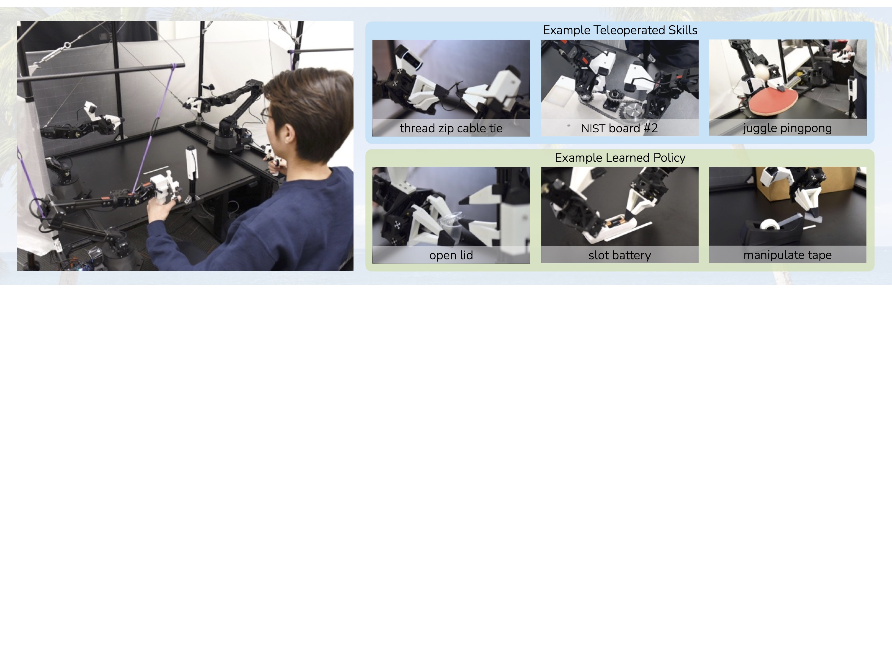
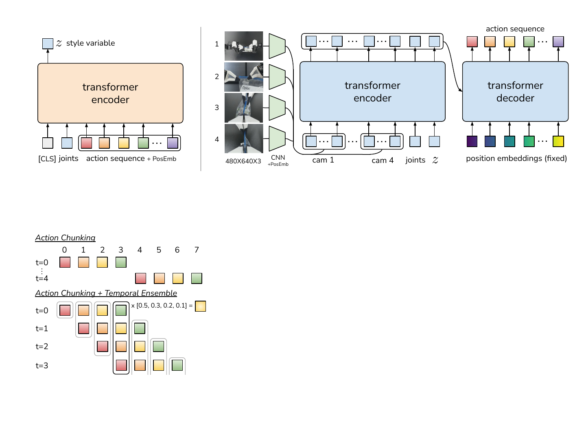
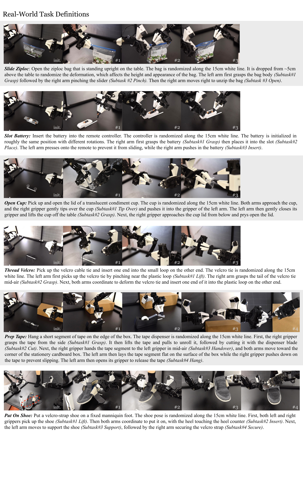
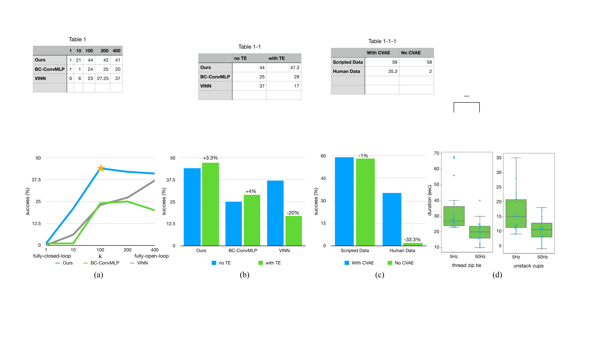

# ACT (RSS 2023)

<!-- paper-source: https://chengwei920412.github.io/paper_reading/2304.13705_Learning_Fine_Grained_Bimanual_Manipulation_with_Low_Cost_Hardware/technical_report.html -->

> 原文链接：[ACT (RSS 2023)](https://chengwei920412.github.io/paper_reading/2304.13705_Learning_Fine_Grained_Bimanual_Manipulation_with_Low_Cost_Hardware/technical_report.html)

> **arXiv ID**：2304.13705  
> **原文标题**：Learning Fine-Grained Bimanual Manipulation with Low-Cost Hardware  
> **翻译日期**：2026-08-21

---

## 📋 论文概览 {#_2}

### 基本信息 {#_3}

- **作者**：Tony Z. Zhao、Vikash Kumar、Sergey Levine、Chelsea Finn
- **机构**：斯坦福大学、加州大学伯克利分校、Meta
- **首次发布**：2023 年 4 月
- **领域**：机器人学习、模仿学习、双手遥操作、精细操作

### 核心贡献 {#_4}

论文把硬件与学习算法作为一个整体设计：一方面提出成本约 2 万美元、可由研究人员自行组装和维修的双手遥操作平台 ALOHA；另一方面提出动作分块 Transformer（Action Chunking with Transformers，ACT），以动作分块缩短长时域任务的有效决策链，并通过时间集成生成平滑的闭环动作。二者结合后，仅用每项任务约 10–20 分钟、50–100 条人类示范，就能学习 6 项真实精细双手操作任务。

图：ALOHA 系统及其遥操作和学习任务示例。

---

## 🎯 研究背景与动机 {#_5}

### 问题定义 {#_6}

穿扎带、装电池、揭开调料杯盖等任务要求毫米级精度、双臂协调、接触力控制和持续视觉反馈。传统方案通常依赖昂贵机械臂、精密传感器、专用灵巧手或精细标定。论文追问：低成本、定位精度有限的硬件能否借助端到端学习完成这类任务？

### 现有方法的局限性 {#_7}

行为克隆在长时域任务中存在累积误差：早期小误差使机器人偏离训练分布，后续误差随之放大。逐步动作策略还难以表示人类示范中的停顿、速度变化和多模态行为。DAgger 等在线纠正方法需要持续专家标注；在精细操作采集阶段主动注入噪声，又可能直接导致任务失败。与此同时，已有高性能遥操作平台往往价格高、硬件专用且装配复杂。

### 本文的创新点 {#_8}

1. ALOHA 使用两套不同尺度的现成机械臂，通过关节空间映射实现主从遥操作，并用 3D 打印的手柄、剪式夹爪控制和橡皮筋重力补偿降低操作负担。
2. ACT 一次预测未来 \(k\) 步动作，把有效任务时域缩短约 \(k\) 倍；每个时刻重新查询策略，并对同一时刻的重叠预测进行指数加权，兼顾反馈频率和平滑性。
3. 策略以条件变分自编码器（CVAE）训练，显式建模人类示范的随机性和多模态性；测试时令风格变量 \(z=0\)，得到确定性策略。

---

## 🔬 方法论 {#_9}

### ALOHA 硬件系统 {#aloha}

系统采用两台 ViperX 6-DoF 机械臂作为从端、两台较小的 WidowX 机械臂作为主端。操作者反向驱动主端，关节目标同步到从端。与任务空间映射相比，关节空间映射无需频繁求解逆运动学，在接近奇异位形时仍能保持高带宽控制。系统配备四个 \(480\times640\) RGB 摄像头，其中两个安装在腕部，遥操作与数据记录频率均为 50 Hz。完整系统约 2 万美元，采用现成机器人、铝型材和少量 3D 打印件，可在约两小时内组装。

### ACT 整体架构 {#act}

图：ACT 的 CVAE 编码器、策略解码器、动作分块与时间集成。

训练输入包含四路 RGB 图像、双臂当前关节位置和未来动作序列。CVAE 编码器用 BERT 风格 Transformer 将本体状态与长度为 \(k\) 的动作序列压缩为风格变量 \(z\)；策略端用 ResNet18 提取四路视觉特征，经 Transformer 编码器融合图像、关节状态与 \(z\)，再由 Transformer 解码器预测 \(k\times14\) 的双臂目标关节位置。模型约有 8000 万参数，每项任务在单张 RTX 2080 Ti 上从头训练约 5 小时，推理耗时约 0.01 秒。

### 动作分块与时间集成 {#_10}

传统单步策略建模 \(\pi_\theta(a_t\mid s_t)\)，ACT 改为：

\[\pi_\theta(a_{t:t+k}\mid s_t)\]

若仅每 \(k\) 步观察一次，动作块切换会造成突变。ACT 因而每一步都预测新的动作块，并把不同历史时刻针对当前时刻给出的动作预测放入同一缓冲区。最终动作是指数权重平均：

\[a_t=\frac{\sum_i w_i A_t[i]}{\sum_i w_i},\qquad w_i=\exp(-mi)\]

这里 \(A_t[i]\) 是第 \(i\) 个重叠动作块对时刻 \(t\) 的预测，\(m\) 控制新观测的融入速度。不同于跨时刻平滑，该方法平均的是“对同一执行时刻的多次预测”，因此不会直接混合相邻时刻的目标。

### CVAE 目标 {#cvae}

CVAE 通过重建项与 KL 正则项联合训练：

\[\mathcal{L}=\mathcal{L}_{\mathrm{reconst}}+\beta\mathcal{L}_{\mathrm{reg}}\]

其中重建损失在实际实现中采用 L1，正则项约束后验 \(q_\phi(z\mid a_{t:t+k},\bar{o}_t)\) 接近单位高斯先验。测试时丢弃 CVAE 编码器并令 \(z=0\)，策略只依据当前视觉和关节状态输出动作序列。

---

## 📊 实验与结果 {#_11}

### 实验设置 {#_12}

- **真实任务**：拉开密封袋、装入电池、打开调料杯、穿魔术贴扎带、准备胶带、穿鞋，共 6 项。
- **仿真任务**：方块交接、双手插接，共 2 项。
- **数据规模**：真实任务通常采集 50 条成功示范，穿扎带任务为 100 条；每条 8–14 秒、400–700 个控制步。仿真任务各采集 50 条脚本或人类示范。
- **基线**：BC-ConvMLP、BeT、RT-1、VINN。
- **指标**：各子阶段成功率和最终任务成功率。

图：六项真实世界任务的初始状态与阶段定义。

### 主要结果 {#_13}

ACT 在全部任务上显著优于基线。真实任务最终成功率分别达到：拉开密封袋 88%、装入电池 96%、打开调料杯 84%、穿魔术贴扎带 20%、准备胶带 64%、穿鞋 92%。在前两项真实任务中，其他方法均未通过第一阶段；在后三组对比任务中，表现最好的基线 BeT 最终成功率仍为 0%。仿真中，无论使用确定性脚本数据还是随机性更强的人类示范，ACT 均取得最高成功率。

### 消融实验 {#_14}

图：动作块长度、时间集成、CVAE 训练与遥操作频率的消融结果。

- 动作块长度从 \(k=1\) 增至 \(k=100\) 时，四种仿真设置的平均成功率从 1% 升至 44%；继续增大到接近开环时，性能略有回落。
- 将动作分块加入 BC-ConvMLP 和 VINN 后也能带来明显收益，说明它并非 ACT 架构独有的技巧。
- 时间集成为 ACT 带来 3.3 个百分点提升，为 BC-ConvMLP 带来 4 个百分点提升，但会损害直接检索真实动作的 VINN。
- 去掉 CVAE 后，确定性脚本数据上的影响很小，但人类数据上的成功率从 35.3% 降至 2%，说明生成式建模对随机示范至关重要。
- 用户研究中，把遥操作频率从 50 Hz 降至 5 Hz 会使任务完成时间增加 62%，差异达到 \(p&lt;0.001\)。

---

## 💡 关键见解 {#_15}

论文最重要的算法洞见是：高频长序列模仿学习的困难不只来自视觉或网络容量，还来自决策时域本身。一次预测动作块能减少策略反复作出相互矛盾的局部决定；重叠预测又把闭环反馈重新引入执行过程。动作分块因此位于单步闭环与整段开环之间，而时间集成为这两端提供连续过渡。

工程上，论文展示了“可学习性”可以补偿硬件精度不足，但前提是硬件、控制频率、示范接口和策略输出方式协同设计。主端关节位置被直接记录为动作目标，主从关节偏差则由底层 PID 隐式转化为作用力，这种数据定义与硬件控制结构紧密匹配。

---

## 🔍 局限性与未来工作 {#_16}

### 当前局限 {#_17}

- ALOHA 仅有平行夹爪，难以完成需要多指操作、指甲或较大力矩的任务。
- ACT 每项任务单独训练，数据量小且缺乏跨任务预训练，泛化到新物体、背景和任务的能力未被系统验证。
- 穿扎带仅有 20% 最终成功率；透明、低对比度或可变形物体仍是主要感知瓶颈。
- 糖果拆封和桌面密封袋开启等任务暴露出对细小接缝、变形状态和多步空中操作建模不足。
- 真实任务通常只训练一个随机种子并评估 25 次，统计置信度有限；基线比较也未统一采用动作分块，既说明该组件有效，也削弱了“整体架构优越性”的归因强度。

### 未来方向 {#_18}

可进一步研究视觉预训练与跨任务数据共享、触觉或力觉融合、更强的可变形物体表征、主动恢复策略及失败数据利用。动作块长度也可从固定超参数扩展为根据任务阶段或不确定性自适应变化。硬件方面，可在保留低成本和可维修性的前提下加入可替换多指末端、力矩估计和更高动态范围的视觉传感器。

---

## 📚 相关工作对比 {#_19}

<table>
<thead>
<tr>
<th>方法</th>
<th>核心思想</th>
<th>优势</th>
<th>劣势</th>
</tr>
</thead>
<tbody>
<tr>
<td>BC-ConvMLP</td>
<td>图像卷积特征与关节状态直接回归单步动作</td>
<td>简单、训练稳定</td>
<td>长时域累积误差严重，难建模非马尔可夫示范</td>
</tr>
<tr>
<td>BeT</td>
<td>Transformer 建模动作历史并离散化动作</td>
<td>能表示多模态动作</td>
<td>感知与控制未联合优化，单步输出仍受累积误差影响</td>
</tr>
<tr>
<td>RT-1</td>
<td>Transformer 基于固定历史预测离散动作</td>
<td>具备序列建模能力</td>
<td>高频精细连续控制效果有限</td>
</tr>
<tr>
<td>VINN</td>
<td>视觉近邻检索后加权返回示范动作</td>
<td>非参数、可直接复用真实动作</td>
<td>依赖特征质量和测试时示范库，时间集成可能破坏检索动作</td>
</tr>
<tr>
<td><strong>ACT</strong></td>
<td>CVAE + Transformer + 动作分块 + 时间集成</td>
<td>长时域误差小，动作平滑，适应随机人类示范</td>
<td>每任务单独训练，模型较大，仍受视觉瓶颈限制</td>
</tr>
</tbody>
</table>

---

## 🎓 评价 {#_20}

### 优点 {#_21}

论文问题选择具体且难度高，硬件、数据采集和算法形成闭环；实验覆盖 8 项任务、4 类基线和针对关键组件的消融。ACT 的核心机制简洁、可移植，并且作者通过把动作分块加入其他基线验证了其一般性。ALOHA 的开源、低成本和易搭建属性也显著提升了工作影响力。

### 可改进之处 {#_22}

论文可进一步报告真实实验的置信区间、多操作者示范差异和多随机种子结果，并在同等动作分块条件下比较不同策略架构。CVAE 在测试时固定 \(z=0\)，没有利用不确定性选择或多候选规划；时间集成的权重和动作块长度也依赖人工调参。对闭环误差恢复能力的专门测试，将比最终成功率更直接地验证方法动机。

### 推荐阅读对象 {#_23}

适合机器人模仿学习、视觉运动策略、双手操作、低成本机器人平台和真实世界数据采集方向的研究者与工程人员。尤其值得希望理解 Diffusion Policy 等后续动作序列策略思想来源的读者阅读。

---

## 📎 附录 {#_24}

### 术语表 {#_25}

<table>
<thead>
<tr>
<th>英文</th>
<th>中文</th>
</tr>
</thead>
<tbody>
<tr>
<td>Fine(-grained) Manipulation</td>
<td>精细操作</td>
</tr>
<tr>
<td>Bimanual Manipulation</td>
<td>双手操作</td>
</tr>
<tr>
<td>Teleoperation</td>
<td>遥操作</td>
</tr>
<tr>
<td>Action Chunking</td>
<td>动作分块</td>
</tr>
<tr>
<td>Temporal Ensembling</td>
<td>时间集成</td>
</tr>
<tr>
<td>Compounding Error</td>
<td>累积误差</td>
</tr>
<tr>
<td>Behavioral Cloning (BC)</td>
<td>行为克隆</td>
</tr>
<tr>
<td>Conditional Variational Autoencoder (CVAE)</td>
<td>条件变分自编码器</td>
</tr>
<tr>
<td>Leader / Follower Robot</td>
<td>主端 / 从端机器人</td>
</tr>
<tr>
<td>Joint-space Mapping</td>
<td>关节空间映射</td>
</tr>
</tbody>
</table>

### 参考资源 {#_26}

- **论文原文**：[arXiv 2304.13705](https://arxiv.org/abs/2304.13705)
- **中文翻译 PDF**：[paper_cn.pdf](https://chengwei920412.github.io/paper_reading/2304.13705_Learning_Fine_Grained_Bimanual_Manipulation_with_Low_Cost_Hardware/paper_cn.pdf)
- **中文 Markdown 译文**：[paper_cn.md](https://chengwei920412.github.io/paper_reading/2304.13705_Learning_Fine_Grained_Bimanual_Manipulation_with_Low_Cost_Hardware/paper_cn.html)
- **项目主页与代码**：[ALOHA 项目主页](https://tonyzhaozh.github.io/aloha/)
