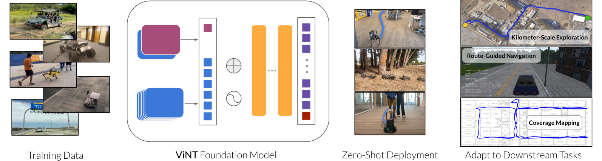
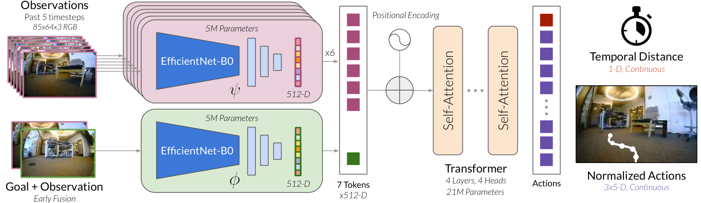
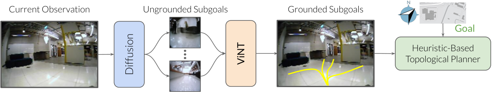
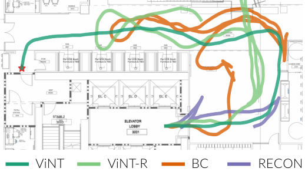
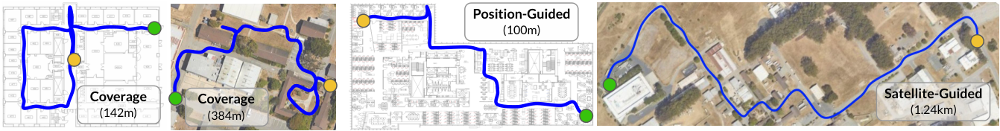
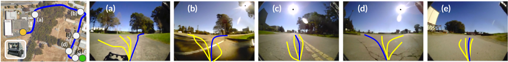
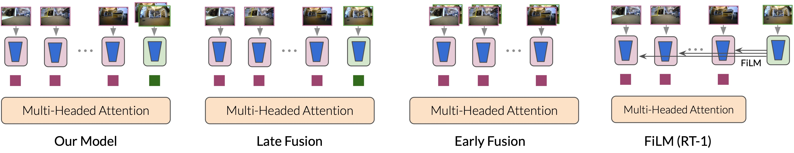
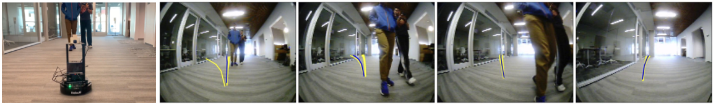

# ViNT (CoRL 2023)

<!-- paper-source: https://chengwei920412.github.io/paper_reading/2306.14846_ViNT_A_Foundation_Model_for_Visual_Navigation/2306.14846_%E9%98%85%E8%AF%BB%E6%8A%A5%E5%91%8A.html -->

> 原文链接：[ViNT (CoRL 2023)](https://chengwei920412.github.io/paper_reading/2306.14846_ViNT_A_Foundation_Model_for_Visual_Navigation/2306.14846_%E9%98%85%E8%AF%BB%E6%8A%A5%E5%91%8A.html)

## 0. 基本信息 {#0}

- 论文标题：ViNT: A Foundation Model for Visual Navigation
- 作者：Dhruv Shah, Ajay Sridhar, Nitish Dashora, Kyle Stachowicz, Kevin Black, Noriaki Hirose, Sergey Levine
- 机构：UC Berkeley
- 来源（会议 / arXiv / 期刊）：CoRL 2023 oral；arXiv:2306.14846
- 年份：2023
- 原始输入链接：https://arxiv.org/abs/2306.14846
- 最终使用的 arXiv 版本化 ID：2306.14846v2
- 原论文 arXiv 链接：https://arxiv.org/abs/2306.14846v2
- 幻觉翻译链接（hjfy）：https://hjfy.top/arxiv/2306.14846v2
- Cool Papers 链接：https://papers.cool/arxiv/2306.14846v2
- 论文研究方向：视觉导航、机器人基础模型、跨 embodiment 泛化、Transformer policy、扩散子目标生成、拓扑图搜索、低数据微调
- 本文一句话概括：ViNT 用大规模异构真实导航轨迹训练一个 31M 参数 Transformer 视觉导航策略，并通过扩散子目标、拓扑搜索和 goal-token 替换式适配，把 image-goal 预训练模型扩展到探索、公里级导航、CARLA 微调和 GPS/路线命令任务。

## 1. 论文核心观点与主张的系统梳理 {#1}

### 1.1 研究背景与动机 {#11}

论文的核心动机是把“foundation model”范式引入移动机器人视觉导航。作者指出，NLP、视觉和代码领域的通用预训练模型依赖大规模、多样、弱监督数据，之后可以零样本迁移、prompt-tuning 或少量数据微调；而机器人领域由于环境、平台、传感器和任务规格差异大，长期依赖单平台小数据集或仿真到现实迁移。

ViNT 试图回答的问题不是“如何为某个固定机器人训练最好导航器”，而是“一个移动机器人基础模型应具备什么能力”。作者在 Introduction 中给出明确定义：机器人 foundation model 应当能够在新传感器、新 embodiment、新环境中零样本部署，并能适配到新的下游任务规格、目标模态和行为。

这篇论文直接继承并扩展 GNM。GNM 证明了跨机器人 RGB 数据能训练 image-goal 导航策略，但主要面向零样本图像目标到达；ViNT 的主张更大：同一个模型既应具备零样本导航能力，也应支持扩散式探索、长程图搜索和小数据任务适配。

### 1.2 问题设定 {#12}

论文的预训练任务是 image-goal navigation。机器人接收当前及历史视觉观测 \(o_{t-P:t}\) 和目标图像 \(o_s\)，预测到达该子目标需要的 dynamical distance 以及未来 \(H\) 步动作：

\[(\hat{d}, \hat{a}_{t:t+H}) = \operatorname{ViNT}(o_{t-P:t}, o_s)\]

这条公式定义了 ViNT 的基本接口。\(P=5\) 表示使用 5 个历史时刻作为时间上下文，\(H=5\) 是未来动作预测长度，\(\hat{d}\) 是预测的时间距离，\(\hat{a}_{t:t+H}\) 是相对 waypoint 动作序列。自然语言直译是：给模型一段“机器人最近看到了什么”和“想去的地方长什么样”，模型同时回答“离目标多远”和“接下来怎么走”。工程上它对应 4Hz 运行的前向推理函数，输出由 PD 控制器按 receding-horizon 方式跟踪。

这张图概括了论文的任务边界：ViNT 首先是用多源训练数据得到的视觉导航基础模型；部署时可以零样本控制新机器人，也可以被用于覆盖探索、地图构建、路线引导导航和下游任务微调。它不是单独的全局规划器，而是可与图搜索、启发式和新目标模态组合的底层导航 backbone。

### 1.3 核心观点（Claims）的逐条梳理 {#13-claims}

**Claim 1：image-goal navigation 是适合多机器人预训练的通用监督目标。** 位置在 Sec. 3。作者强调，相比 PointGoal、GPS 或语义目标，图像目标不需要全局定位、语义标签或额外元数据，只要数据包含视频和动作，就能自监督构造未来图像子目标和动作标签。

**Claim 2：Transformer 结构和 goal fusion 使 ViNT 同时具备性能和适配性。** 位置在 Sec. 3 和 Appendix A。ViNT 使用 EfficientNet-B0 tokenizers 加 decoder-only Transformer。单独编码目标图像的 late fusion 容易忽略目标；纯 early fusion 性能好但不方便换目标模态；ViNT 使用“观测 token + 当前/目标 joint goal token”的折中结构。

**Claim 3：大规模异构导航数据带来 positive transfer，优于单机器人专家模型和小容量 GNM。** 位置在 Sec. 6.2。真实机器人覆盖探索中，ViNT 在 LoCoBot、Go 1、Vizbot、Jackal 上最大无干预位移分别为 120m、45m、110m、438m，整体优于 Single-Robot 和 GNM。

**Claim 4：扩散模型生成的短程视觉子目标可驱动未知环境探索。** 位置在 Sec. 4 和 Sec. 6.1。论文把图像到图像扩散模型用于采样未来可达 subgoal，再用 ViNT spatially ground 这些候选，配合拓扑图和 A\*式代价完成覆盖探索或目标引导搜索。

**Claim 5：ViNT 可以作为下游任务基础模型，用少量数据微调或替换 goal token 适配新目标模态。** 位置在 Sec. 5、Sec. 6.3、Sec. 6.4。CARLA 中，ViNT 在 image-goal、position 和 routing 任务上的 success 分别为 0.82、0.89、0.72，优于从零训练、ImageNet、SimCLR、VC-1 和 GNM。

**Claim 6：ViNT 展现出某些 emergent navigation behavior。** 位置在 Sec. 6.5。作者给出定性例子：随机或有缺陷的 subgoal 下仍能避免碰撞、偏好道路/走廊中心、可绕开动态行人。但这些主要是定性证据，强度弱于主表格。

### 1.4 创新性与贡献边界 {#14}

ViNT 的实质贡献是系统组合和尺度化，而不是单个数学理论突破。Transformer、EfficientNet、A\*、拓扑图、DDPM/DDIM、classifier-free guidance、prompt-tuning 都是已有技术；论文的新意在于把它们组织成一个可预训练、可零样本部署、可微调/适配的视觉导航 foundation model。

与 GNM 相比，ViNT 的增量包括：31M 参数 Transformer 架构；更大的训练数据集合；扩散模型生成图像子目标；面向 GPS/route commands 的 goal-token 替换式适配；CARLA 低数据微调实验；更完整的真实机器人长程探索评估。贡献边界也明显：ViNT 仍假设前向 RGB 相机、相对 waypoint 动作空间和低层速度/waypoint 跟踪器，不能处理任意传感器、任意动作空间或完整 3D 飞行控制。

## 2. 关键论据、理论基础与数学方法的深度解析 {#2}

### 2.1 理论基础与学术渊源 {#21}

ViNT 建立在五类成熟工作上。

第一是视觉目标导航和拓扑导航：Target-driven Visual Navigation、SPTM、Learning Deployable Navigation Policies、PRM-RL、Scaling Local Control、ViNG、Deep Visual MPC-Policy Learning、ViKiNG 等。ViNT 沿用“局部学习策略 + 高层图搜索”的路线。

第二是跨机器人和大规模机器人学习：Modular neural network policies、RoboNet、BDD100K、DroNet、ExAug、GNM、RT-1、I2O。ViNT 与 GNM 关系最紧密，但把“单一 image-goal omnipolicy”扩展为“可适配下游任务的导航 foundation model”。

第三是 Transformer 和 token-based multimodal adaptation：Attention is All You Need、prompt tuning、PaLM-E、VIMA。ViNT 使用 token 接口使 goal encoder 可以替换成 GPS/command encoder。

第四是扩散生成模型：DDPM、Palette、DDIM、Variational Diffusion Models、classifier-free guidance。ViNT 不把扩散用于直接生成动作，而是生成候选未来图像子目标。

第五是视觉预训练对照：ImageNet、SimCLR、VC-1、masked autoencoders、R3M/robot visual pretraining 相关线索。论文通过 CARLA 实验强调，通用视觉特征不等价于导航 affordance。

### 2.2 问题形式化与建模选择 {#22}

ViNT 的训练样本来自轨迹 \(\tau \in \mathcal{D}\)。训练时选取时间 \(t\)，取历史观测 \(o_{t-P:t}\)，再从未来区间 \([l_{\min}, l_{\max}]\) 均匀采样距离 \(d\)，令目标图像为：

\[o_s := o_{t+d}\]

这条公式把没有人工目标标注的导航视频转化成 image-goal 训练对。\(o_s\) 是同一轨迹未来某一步看到的图像，\(d\) 是从当前到该目标的时间步距离。自然语言直译是：把“未来会看到的画面”当作当前要到达的目标。工程上它对应 dataloader 中的 future-frame sampling。toy example：若轨迹频率为 4Hz，\(t=100\)，采样 \(d=8\)，则目标图像来自 \(t=108\)，约 2 秒之后；动作标签取 \(a_{100:105}\)，distance 标签为 8。

动作空间继承 GNM 的 embodiment-agnostic waypoint 设计：

\[\hat{a} := a_{t:t+H}\]

\(\hat{a}\) 是长度 \(H=5\) 的未来动作序列，论文使用相对 waypoints 并按机器人 top speed 归一化。它的作用是把不同平台底层控制接口抽象为统一中层动作标签。若直接用油门、转角、速度命令，不同机器人标签分布不可比；若只用视觉 representation 而不学 waypoint，模型无法直接成为可部署控制策略。

ViNT 的 architecture 形式可写为：

\[z = f(\psi(o)_{t:t-P}, \phi(o_t,o_s))\]

\(\psi\) 是观测编码器，独立编码当前和历史观测；\(\phi\) 是 goal fusion encoder，将当前图像 \(o_t\) 与目标图像 \(o_s\) 通道拼接后联合编码；\(f\) 是 Transformer backbone。自然语言直译是：先把历史视觉和“当前-目标差异”变成 token，再让 Transformer 用自注意力融合时序、目标和当前状态。代码中对应两个 EfficientNet-B0 分支、位置编码、4 层 4 头 decoder-only Transformer 和 MLP heads。

### 2.3 核心推导与算法构造 {#23}

图中 EfficientNet-B0 将 85 x 64 RGB 图像编码成 512 维 token；\(P+2\) 个 observation/goal tokens 加位置编码后进入 Transformer；最后用全连接网络预测 temporal distance 和 \(H=5\) 个未来动作。架构的关键不是“更深”，而是 token 化接口使目标模态可以被替换。

论文的主训练目标是式 (1)：

\[\mathcal{L}_{\text{ViNT}}(\phi,\psi,f)=\mathbb{E}_{\tau}\mathbb{E}_{t}\mathbb{E}_{d}\left[\log p(\hat{a}\mid f(\psi(o)_{t:t-P},\phi(o_t,o_s)))+\lambda\log p(d\mid f(\psi(o)_{t:t-P},\phi(o_t,o_s)))\right]\]

这条公式负责联合训练动作预测和 dynamical distance。\(\hat{a}\) 是未来动作序列，\(d\) 是当前到目标图像的时间距离，\(\lambda\) 平衡两项。自然语言直译是：模型既要最大化预测正确动作的概率，也要最大化预测正确到达时间距离的概率。工程上，若用高斯似然，动作项和距离项通常会落成 MSE 或负对数似然；论文没有展开概率分布细节，因此报告不补造具体方差形式。若删去 distance head，拓扑图无法可靠判断节点连通性；若删去 action head，模型只能做相似度/可达性估计而不能直接控制。

适配新目标模态时，论文用一个新编码器 \(\tilde{\phi}\) 替换图像 goal fusion encoder：

\[\mathcal{L}_{\text{adapt}}=\mathbb{E}_{\tau \in \mathcal{D}_F}\mathbb{E}_{t}\mathbb{E}_{d}\left[\log p(\hat{a}\mid f(\psi(o)_{t:t-P},\tilde{\phi}(\sigma)))+\lambda\log p(d\mid f(\psi(o)_{t:t-P},\tilde{\phi}(\sigma)))\right]\]

\(\sigma\) 可以是 2D/GPS goal，也可以是 left/right/straight routing command。直译是：保留观测编码器和 Transformer 的导航先验，只学习把新任务规格投影到 ViNT 原来的 goal token 空间。工程上 GPS adaptation 是将 ego-centric goal 坐标与可学习固定 tensor 拼接，经 2 层 MLP 输出 goal token；command adaptation 是为每个离散命令学习一个 latent，再经 MLP 输出 token。若完全从零训练，Table 3 显示 image-goal success 仅 0.45，而 ViNT 为 0.82，说明预训练先验在 CARLA 中有明显收益。

长程导航部分把 ViNT 作为局部可达性和动作模型。扩散模型从当前观测 \(o_t\) 生成候选目标图像集合 \(\mathcal{S}\)：

\[\mathcal{S}=\{s_1,\ldots,s_K\},\quad s_i \sim g(s_i\mid o_t)\]

这条公式表示 image-to-image diffusion subgoal proposal。它的作用不是生成最终路径，而是提供多样候选“下一步值得去看的视觉状态”。工程上对应一个去掉文本 cross-attention 的 U-Net 扩散模型，输入当前图像，输出多个 128 x 128 候选未来图像。训练 pair 来自同一轨迹中当前帧与未来 5 到 20 步之间的帧。

候选 subgoal 的 A\*式代价在附录中给出：

\[f(s)=d_{\mathcal{M}}(o_t,s^-)+d_{\text{pred}}(s^-,s)+h(s,G,C)\]

\(d_{\mathcal{M}}(o_t,s^-)\) 是当前状态到候选父节点的图上距离，\(d_{\text{pred}}(s^-,s)\) 是 ViNT 预测的从父节点到候选子目标的可达距离，\(h(s,G,C)\) 是目标引导启发式，可以是 0、欧氏距离或基于卫星图的 learned heuristic。自然语言直译是：候选点的分数等于“先走到它的父节点的代价 + 从父节点到候选点的局部代价 + 它离最终目标还有多有希望”。toy example：若图上到父节点代价为 20，ViNT 预测父节点到候选点距离为 5，GPS 启发式估计候选点到目标为 30，则 \(f(s)=55\)；另一个候选为 \(20+8+10=38\)，A\*式搜索会优先访问第二个。

这张图对应主结果表左侧的覆盖探索和右侧的室内轨迹对比。它显示 ViNT 不是单纯执行局部目标，而是通过图搜索和候选子目标在未知环境中扩展可达区域。

### 2.4 理论结论的适用范围 {#24}

ViNT 的理论主张主要是系统性归纳偏置，而不是可证明泛化定理。其适用范围依赖四个强假设：第一，训练和测试任务都能用前向 RGB 观测表示；第二，底层控制可以跟踪归一化 waypoint；第三，未来帧作为 subgoal 的自监督构造足以覆盖真实下游任务；第四，Transformer goal-token 接口足以把新目标模态映射到同一导航 token 空间。

论文明确承认限制：Transformer 推理成本高于简单 CNN，对四旋翼等功耗受限平台有压力；模型仍假设机器人之间存在结构相似性，不能控制四旋翼高度，也不能自然处理 LiDAR 等新传感器或不同动作表示。因此，“foundation model”在本文中应理解为“视觉导航领域的可复用预训练策略”，不是通用机器人智能。

## 3. 实验设计与实验结果的充分性分析 {#3}

### 3.1 实验目标与论文主张的对应关系 {#31}

实验围绕四个问题展开：Q1 验证 ViNT + 扩散子目标 + 图搜索能否探索未知环境并利用启发式；Q2 验证单个预训练策略能否跨新机器人、环境和障碍泛化；Q3 验证低数据微调是否有效；Q4 验证 goal-token 替换是否能适配新目标模态。

评价包括真实机器人和 CARLA。真实机器人覆盖 LoCoBot、Vizbot、Unitree Go 1、Jackal，以及论文正文称五个平台但附录列出四个主要平台；摘要和图示还强调 drone/quadcopters，但具体主表中的多机器人覆盖探索表列 LoCoBot、Go 1、Vizbot、Jackal。报告以表格中可核实的平台为准，并指出原文在平台表述上存在“正文五个平台 vs 表格四个平台”的粒度差异。

### 3.2 实验设置合理性 {#32}

训练数据来自已有数据集，无额外专为 ViNT 采集的数据。附录表给出总规模：

<table>
<thead>
<tr>
<th>序号</th>
<th>Dataset</th>
<th>Platform</th>
<th>Speed</th>
<th>Total Hrs.</th>
<th>Hrs. Used</th>
<th>Environment</th>
</tr>
</thead>
<tbody>
<tr>
<td>1</td>
<td>GoStanford</td>
<td>TurtleBot2</td>
<td>0.5m/s</td>
<td>17h</td>
<td>14h</td>
<td>office</td>
</tr>
<tr>
<td>2</td>
<td>RECON</td>
<td>Jackal</td>
<td>1m/s</td>
<td>25h</td>
<td>25h</td>
<td>off-road</td>
</tr>
<tr>
<td>3</td>
<td>CoryHall</td>
<td>RC Car</td>
<td>1.2m/s</td>
<td>2h</td>
<td>2h</td>
<td>hallways</td>
</tr>
<tr>
<td>4</td>
<td>Berkeley</td>
<td>Jackal</td>
<td>2m/s</td>
<td>4h</td>
<td>4h</td>
<td>suburban</td>
</tr>
<tr>
<td>5</td>
<td>SCAND-S</td>
<td>Spot</td>
<td>1.5m/s</td>
<td>8h</td>
<td>4h</td>
<td>sidewalks</td>
</tr>
<tr>
<td>6</td>
<td>SCAND-J</td>
<td>Jackal</td>
<td>2m/s</td>
<td>1h</td>
<td>1h</td>
<td>sidewalks</td>
</tr>
<tr>
<td>7</td>
<td>Seattle</td>
<td>Warthog</td>
<td>5m/s</td>
<td>1h</td>
<td>1h</td>
<td>off-road</td>
</tr>
<tr>
<td>8</td>
<td>TartanDrive</td>
<td>ATV</td>
<td>10m/s</td>
<td>7h</td>
<td>5h</td>
<td>off-road</td>
</tr>
<tr>
<td>9</td>
<td>NeBula</td>
<td>ATV</td>
<td>10m/s</td>
<td>10h</td>
<td>10h</td>
<td>off-road</td>
</tr>
<tr>
<td>10</td>
<td>SACSoN</td>
<td>TurtleBot2</td>
<td>0.5m/s</td>
<td>75h</td>
<td>10h</td>
<td>office</td>
</tr>
<tr>
<td>11</td>
<td>BDD</td>
<td>Car(s)</td>
<td>20m/s</td>
<td>10h</td>
<td>4h</td>
<td>on-road</td>
</tr>
<tr>
<td>汇总</td>
<td>Total</td>
<td>8 distinct robotic platforms</td>
<td>0.2-10m/s 正文描述，表中 BDD 为 20m/s</td>
<td>160h</td>
<td>80h</td>
<td>indoor/outdoor/off-road/on-road</td>
</tr>
</tbody>
</table>

这里存在一个值得记录的不一致：摘要说 “hundreds of hours”，Sec. 3 说 over 100 hours，附录正文说 over 100 hours，表 7 caption 说 over 150 hours，总计列为 160h total / 80h used。严格实验分析应以 “80h used from 160h total available” 表述训练使用规模，同时说明论文摘要的“hundreds”是宽泛说法。

实验设置的优点是真实平台、多环境、跨任务；不足是缺少标准误差/置信区间、失败类型分解、统一测试路线数量明细。CARLA 部分能控制数据规模，但仿真驾驶与真实导航的结论不能完全互推。

### 3.3 实验结果的解释力度 {#33}

覆盖探索主结果如下：

<table>
<thead>
<tr>
<th>Method</th>
<th>Indoor Success</th>
<th>Outdoor Success</th>
<th>解释</th>
</tr>
</thead>
<tbody>
<tr>
<td>End-to-End BC</td>
<td>0.72</td>
<td>0.44</td>
<td>模仿策略能避障但容易局部困住</td>
</tr>
<tr>
<td>End-to-End GCG</td>
<td>未评估</td>
<td>0.61</td>
<td>需要碰撞标签，仅 outdoor 对比</td>
</tr>
<tr>
<td>RECON</td>
<td>0.19</td>
<td>0.23</td>
<td>latent subgoal 方法在该设置下弱</td>
</tr>
<tr>
<td>ViNT-R Random Subgoals</td>
<td>0.81</td>
<td>未评估</td>
<td>随机训练图像也能触发一定默认避障</td>
</tr>
<tr>
<td>ViNT</td>
<td>0.94</td>
<td>1.00</td>
<td>扩散子目标 + 图搜索最强</td>
</tr>
</tbody>
</table>

这个表支持 Claim 4：扩散子目标和图搜索确实改善未知环境探索。最强可比 indoor baseline 是 ViNT-R 的 0.81，ViNT 达 0.94；outdoor 最强 baseline 是 GCG 的 0.61，ViNT 达 1.00。不过 ViNT-R 本身很强也暴露出一个替代解释：ViNT 的低层 policy 学到了强默认避障和探索偏好，扩散子目标并非唯一因素。

位置/GPS/卫星引导长程导航结果如下：

<table>
<thead>
<tr>
<th>Method</th>
<th>Indoor Position Success</th>
<th>Indoor Distance</th>
<th>Outdoor GPS Success</th>
<th>Outdoor GPS SPL</th>
<th>Outdoor GPS Distance</th>
<th>Outdoor Satellite Success</th>
<th>Outdoor Satellite SPL</th>
<th>Outdoor Satellite Distance</th>
</tr>
</thead>
<tbody>
<tr>
<td>ViKiNG</td>
<td>0.60</td>
<td>56m</td>
<td>0.64</td>
<td>0.42</td>
<td>720m</td>
<td>0.77</td>
<td>0.68</td>
<td>780m</td>
</tr>
<tr>
<td>ViNT</td>
<td>0.90</td>
<td>91m</td>
<td>0.95</td>
<td>0.84</td>
<td>1270m</td>
<td>1.00</td>
<td>0.94</td>
<td>1040m</td>
</tr>
</tbody>
</table>

该结果支持 Claim 1 和 Claim 4：ViNT 可以使用 2D position、GPS 或 satellite heuristic 完成长程导航，且在成功率、SPL 和无碰撞距离上超过 ViKiNG。尤其 outdoor GPS distance 1270m 和 satellite success 1.00 支撑“kilometer-scale”表述。但这里 ViNT 不是单模型独立解决长程导航，而是与拓扑图、启发式和扩散候选共同构成系统。

该图展示 indoor/outdoor 轨迹从起点到目标的覆盖和引导导航案例。它有助于理解表格中的 distance 与 success，但不能提供统计显著性。

跨机器人零样本结果如下：

<table>
<thead>
<tr>
<th>Model</th>
<th>LoCoBot</th>
<th>Go 1</th>
<th>Vizbot</th>
<th>Jackal</th>
<th>结论</th>
</tr>
</thead>
<tbody>
<tr>
<td>Single-Robot</td>
<td>40m</td>
<td>12m</td>
<td>40m</td>
<td>184m</td>
<td>专家模型跨平台泛化有限</td>
</tr>
<tr>
<td>GNM</td>
<td>60m</td>
<td>8m</td>
<td>20m</td>
<td>427m</td>
<td>Jackal 上强，但新 quadruped 和 Vizbot 弱</td>
</tr>
<tr>
<td>ViNT</td>
<td>120m</td>
<td>45m</td>
<td>110m</td>
<td>438m</td>
<td>四个平台均最强或并列最强</td>
</tr>
</tbody>
</table>

这个表直接支撑 positive transfer：ViNT 对未见 Go 1 达 45m，明显高于 Single-Robot 12m 和 GNM 8m；对 Jackal 与 GNM 接近但略高。需要注意，指标是 maximum displacement without intervention，不是标准 success rate 或 SPL，因此更像“安全/探索距离代理指标”。

CARLA 微调和适配结果如下：

<table>
<thead>
<tr>
<th>Method</th>
<th>Images Success</th>
<th>Images In Lane</th>
<th>Positions Success</th>
<th>Routing Success</th>
</tr>
</thead>
<tbody>
<tr>
<td>Scratch</td>
<td>0.45</td>
<td>0.74</td>
<td>0.79</td>
<td>0.43</td>
</tr>
<tr>
<td>ImageNet</td>
<td>0.22</td>
<td>0.71</td>
<td>0.59</td>
<td>0.45</td>
</tr>
<tr>
<td>SimCLR</td>
<td>0.21</td>
<td>0.63</td>
<td>0.70</td>
<td>0.64</td>
</tr>
<tr>
<td>VC-1</td>
<td>0.19</td>
<td>0.65</td>
<td>0.49</td>
<td>0.38</td>
</tr>
<tr>
<td>GNM</td>
<td>0.49</td>
<td>0.66</td>
<td>0.45</td>
<td>0.49</td>
</tr>
<tr>
<td>ViNT</td>
<td>0.82</td>
<td>0.82</td>
<td>0.89</td>
<td>0.72</td>
</tr>
</tbody>
</table>

这组结果支撑 Claim 5：ViNT 不是仅有视觉表征，而是带有导航任务先验。ImageNet、SimCLR、VC-1 在 image-goal success 上反而低于 Scratch，说明通用视觉预训练未必适合控制；GNM 有导航先验但容量/架构适配性不足；ViNT 同时在 image-goal、positions、routing 上领先。

图中 765m outdoor rollout 展示 satellite heuristic 如何与 ViNT grounding 和 A\*式规划结合。它对应表中 outdoor satellite 的高成功率和 SPL，说明 ViNT 的强项来自模型与外部启发式的组合。

### 3.4 潜在未讨论因素 {#34}

架构消融主要来自附录：

<table>
<thead>
<tr>
<th>Goal-conditioning 方法</th>
<th>Performance</th>
<th>Adaptation</th>
<th>论文结论</th>
</tr>
</thead>
<tbody>
<tr>
<td>Late Fusion</td>
<td>不好</td>
<td>好</td>
<td>目标单独编码后在 Transformer 中融合，适配性好但 image-goal 性能差</td>
</tr>
<tr>
<td>Early Fusion</td>
<td>好</td>
<td>不好</td>
<td>当前/目标早期拼接性能好，但换 GPS/command 模态不方便</td>
</tr>
<tr>
<td>FiLM (RT-1)</td>
<td>不好</td>
<td>好</td>
<td>对语言条件有效，但图像目标导航训练不稳定</td>
</tr>
<tr>
<td>ViNT</td>
<td>好</td>
<td>好</td>
<td>保留相对目标特征，同时可替换 goal token</td>
</tr>
</tbody>
</table>

该消融是方法设计的关键证据，但它是定性 check/cross 表，没有给具体数值。它支持“ViNT 架构折中合理”，但不足以精确评估每个设计的收益大小。

冻结特征对比如下：

<table>
<thead>
<tr>
<th>Method</th>
<th>Images</th>
<th>Positions</th>
<th>解释</th>
</tr>
</thead>
<tbody>
<tr>
<td>VC-1</td>
<td>0.19</td>
<td>0.49</td>
<td>通用视觉 frozen encoder 在导航迁移上弱</td>
</tr>
<tr>
<td>ViNT-FE</td>
<td>0.32</td>
<td>0.78</td>
<td>冻结 ViNT encoder 仍保留部分导航相关特征</td>
</tr>
<tr>
<td>ViNT</td>
<td>0.82</td>
<td>0.89</td>
<td>端到端微调明显更强</td>
</tr>
</tbody>
</table>

这个表支持“导航相关预训练特征比通用视觉特征更可迁移”，但也提示 ViNT 的强结果很大程度来自端到端微调，而不仅是 frozen representation。

超参数与计算规模如下：

<table>
<thead>
<tr>
<th>模块</th>
<th>关键设置</th>
</tr>
</thead>
<tbody>
<tr>
<td>ViNT 参数量</td>
<td>31M</td>
</tr>
<tr>
<td>RGB resolution</td>
<td>85 x 64</td>
</tr>
<tr>
<td>Encoder</td>
<td>EfficientNet-B0</td>
</tr>
<tr>
<td>Token dimension</td>
<td>512</td>
</tr>
<tr>
<td>Transformer</td>
<td>4 layers, 4 heads, FF hidden dim 2048</td>
</tr>
<tr>
<td>Temporal context / horizon</td>
<td>\(P=5\), \(H=5\)</td>
</tr>
<tr>
<td>ViNT training</td>
<td>30 epochs, batch size 300, learning rate \(5\times10^{-4}\), AdamW</td>
</tr>
<tr>
<td>Fine-tuning LR</td>
<td>\(1\times10^{-4}\)</td>
</tr>
<tr>
<td>Diffusion model</td>
<td>318M, 128 x 128, continuous-time diffusion, linear schedule</td>
</tr>
<tr>
<td>Diffusion training</td>
<td>batch 128, 250k steps, AdamW, CFG mask proportion 0.2</td>
</tr>
<tr>
<td>Diffusion sampling</td>
<td>DDIM, 200 steps, guidance weight 1.0</td>
</tr>
</tbody>
</table>

潜在未讨论因素包括：扩散模型本身 318M 参数且 200 DDIM steps，部署端是否实时生成候选图像、生成频率和算力需求没有在主实验表中充分量化；真实实验没有置信区间；“emergent behavior”主要为定性展示；CARLA 中 VC-1 frozen 与其他模型可微调设置不完全对称，论文虽在附录补 ViNT-FE 对比，但对 VC-1 的弱结果仍需谨慎解释。

这张图支持作者关于 dynamic pedestrians 的定性主张：ViNT 在有行人遮挡目标路径时选择绕行并恢复路径。但论文未给系统化的行人密度、速度、碰撞率统计，因此该结论更适合视作案例而非充分验证。

## 4. 与当前领域主流共识及反对观点的关系 {#4}

### 4.1 与主流观点的一致性 {#41}

ViNT 与视觉导航领域主流框架一致：长程任务通常需要拓扑记忆或图搜索，低层策略负责局部可达目标控制。SPTM、ViNG、Deep Visual MPC、Scaling Local Control、ViKiNG 都支持这种分层结构。ViNT 的创新是把低层策略换成更大的跨机器人预训练 Transformer，并加入扩散式候选生成。

ViNT 也与大规模机器人数据趋势一致。RoboNet、RT-1、GNM、R3M、VC-1、masked visual pretraining 都在不同程度上说明机器人模型可以从跨任务或跨平台数据中获益。ViNT 的实验进一步说明：对于导航，任务相关行为预训练比通用视觉表征更有效。

### 4.2 与反对或竞争观点的分歧 {#42}

竞争路线一是仿真到现实迁移，如 Habitat、I2O、Sim2Real Predictivity 等。ViNT 不反对仿真路线，但选择真实多机器人历史数据作为预训练来源。分歧点在于是否需要 paired robot/environment models 和仿真可预测性；ViNT 的证据表明，已有真实数据可以直接支撑跨平台导航，但没有证明它在数据稀缺或危险场景覆盖上优于仿真。

竞争路线二是通用视觉预训练，如 ImageNet、SimCLR、VC-1、MAE。ViNT 的 CARLA 表格显示这些视觉特征不能自动转化为导航 affordance。这个结论与 Parisi et al. 关于预训练视觉模型对控制有效但需任务适配的观点并非完全冲突；分歧在于 ViNT 强调“导航行为预训练”比“通用视觉表征”更直接。

竞争路线三是专用导航系统，如 ViKiNG、RECON、GCG 和 GNM。ViNT 的定位不是完全替代这些框架，而是吸收它们的拓扑图、物理搜索和跨机器人动作抽象，再用更大模型和更灵活 goal token 接口提升泛化与适配。

### 4.3 论文在学术版图中的定位 {#43}

ViNT 是 GNM 之后视觉导航 foundation model 方向的关键系统论文。它更像主流视觉导航/拓扑搜索路线的规模化和通用化，而不是完全平行替代路径。它的重要性在于把“预训练导航 backbone”从 image-goal zero-shot 推进到“可探索、可长程规划、可换目标模态、可低数据微调”的系统范式。

### 4.4 文献检索说明 {#44}

- 检索范围：本报告使用 arXiv v2 原文、arXiv 源码、PDF 文本、附录表格、论文引用列表和 papers.cool 页面访问流程输出。
- 检索结论可信度：论文内部数值和方法描述可信度高；“是否存在明确反对 ViNT 结论的论文”当前未检索到可靠直接证据，因此报告只基于论文引用中的竞争路线做技术分歧分析，不编造外部反驳。

### 4.5 相关论文补充表 {#45}

<table>
<thead>
<tr>
<th>序号</th>
<th>论文标题</th>
<th>作者 / 年份</th>
<th>来源</th>
<th>与原论文关系</th>
<th>一句话概述</th>
</tr>
</thead>
<tbody>
<tr>
<td>1</td>
<td>GNM: A General Navigation Model to Drive Any Robot</td>
<td>Shah et al., 2023</td>
<td>ICRA</td>
<td>直接前作</td>
<td>证明异构 RGB 导航数据可训练跨机器人 image-goal omnipolicy。</td>
</tr>
<tr>
<td>2</td>
<td>ViNG: Learning Open-World Navigation with Visual Goals</td>
<td>Shah et al., 2021</td>
<td>ICRA</td>
<td>训练/拓扑部署基础</td>
<td>使用视觉目标和拓扑图做开放世界导航。</td>
</tr>
<tr>
<td>3</td>
<td>ViKiNG: Vision-Based Kilometer-Scale Navigation with Geographic Hints</td>
<td>Shah and Levine, 2022</td>
<td>RSS</td>
<td>主要长程导航 baseline</td>
<td>使用地理提示做公里级视觉导航，ViNT 在 GPS/卫星引导表中对比。</td>
</tr>
<tr>
<td>4</td>
<td>Rapid Exploration for Open-World Navigation with Latent Goal Models</td>
<td>Shah et al., 2021</td>
<td>CoRL</td>
<td>RECON baseline</td>
<td>用 latent goal model 做探索，ViNT 改用图像扩散子目标。</td>
</tr>
<tr>
<td>5</td>
<td>Deep Visual MPC-Policy Learning for Navigation</td>
<td>Hirose et al., 2019</td>
<td>RA-L</td>
<td>视觉局部控制前作</td>
<td>目标条件视觉导航和 MPC/policy 学习路线。</td>
</tr>
<tr>
<td>6</td>
<td>Semi-Parametric Topological Memory for Navigation</td>
<td>Savinov et al., 2018</td>
<td>ICLR</td>
<td>拓扑记忆基础</td>
<td>代表性视觉拓扑记忆方法。</td>
</tr>
<tr>
<td>7</td>
<td>Scaling Local Control to Large-Scale Topological Navigation</td>
<td>Meng et al., 2020</td>
<td>ICRA</td>
<td>分层导航基础</td>
<td>支持局部控制器与大尺度拓扑导航组合。</td>
</tr>
<tr>
<td>8</td>
<td>RT-1: Robotics Transformer for Real-World Control at Scale</td>
<td>Brohan et al., 2023</td>
<td>arXiv</td>
<td>大规模机器人 Transformer 对照</td>
<td>展示真实机器人控制的 Transformer 泛化，任务重点不同。</td>
</tr>
<tr>
<td>9</td>
<td>Indoorsim-to-outdoorreal: Learning to Navigate Outdoors without Any Outdoor Experience</td>
<td>Truong et al., 2023</td>
<td>arXiv</td>
<td>竞争路线</td>
<td>仿真到真实导航迁移，与 ViNT 的真实多数据预训练形成对比。</td>
</tr>
<tr>
<td>10</td>
<td>ExAug: Robot-Conditioned Navigation Policies via Geometric Experience Augmentation</td>
<td>Hirose et al., 2023</td>
<td>ICRA</td>
<td>embodiment transfer 对照</td>
<td>用几何增强处理机器人条件导航。</td>
</tr>
<tr>
<td>11</td>
<td>Denoising Diffusion Probabilistic Models</td>
<td>Ho et al., 2020</td>
<td>NeurIPS</td>
<td>扩散模型基础</td>
<td>ViNT 的 subgoal image generator 借鉴扩散生成模型。</td>
</tr>
<tr>
<td>12</td>
<td>Palette: Image-to-Image Diffusion Models</td>
<td>Saharia et al., 2022</td>
<td>SIGGRAPH</td>
<td>图像到图像扩散基础</td>
<td>ViNT 使用条件图像生成未来 subgoal。</td>
</tr>
<tr>
<td>13</td>
<td>Attention Is All You Need</td>
<td>Vaswani et al., 2017</td>
<td>NeurIPS</td>
<td>Transformer 基础</td>
<td>ViNT backbone 的基本架构来源。</td>
</tr>
<tr>
<td>14</td>
<td>The Power of Scale for Parameter-Efficient Prompt Tuning</td>
<td>Lester et al., 2021</td>
<td>EMNLP</td>
<td>goal-token 适配启发</td>
<td>ViNT 的 GPS/command adaptation 受 soft prompt 思想启发。</td>
</tr>
<tr>
<td>15</td>
<td>VC-1 / Where are we in the search for an artificial visual cortex for embodied intelligence?</td>
<td>Majumdar et al., 2023</td>
<td>arXiv</td>
<td>视觉预训练 baseline</td>
<td>CARLA 中作为通用 embodied visual encoder 对比。</td>
</tr>
</tbody>
</table>

## 5. 对论文理论体系的严肃反驳与系统性质疑 {#5}

### 5.1 核心假设层面的质疑 {#51}

第一，ViNT 把视觉导航 foundation model 限定在结构相似的移动机器人上：前向 RGB、二维局部 waypoint、低层速度/waypoint tracker。这个假设使跨机器人泛化可行，但也限制了“foundation”外延。论文承认它不能控制 quadcopter altitude，也不能直接处理 LiDAR 或不同动作表示。

第二，image-goal 预训练目标虽然通用，但并不覆盖所有导航需求。真实任务常常由语言、地图、语义对象、安全规则、交通法规或人类偏好指定。ViNT 的 GPS/route adaptation 证明了 token 替换可行，但只在 CARLA 中验证，且 route command 只有 left/right/straight 三类。

第三，扩散生成的 subgoal 是视觉上 plausible 的未来图像，但不保证几何一致、物理可达或拓扑有效。论文用 ViNT grounding 过滤/评分候选，但如果生成器在 OOD 环境产生系统性幻觉，搜索可能被误导。

### 5.2 数学推导与理论主张的边界 {#52}

式 (1) 是最大似然训练目标，但论文没有给出概率分布参数化、噪声模型或泛化误差分析。因此“foundation model”结论来自实验，而非理论保证。\(\mathcal{L}_{\text{adapt}}\) 也只是把目标编码器替换为 \(\tilde{\phi}\)，并不证明新目标模态与图像 goal token 空间天然对齐。

A*式代价 \(f(s)\) 依赖 \(d_{\text{pred}}\) 和启发式 \(h\)。如果 ViNT 的 dynamical distance 不满足一致性或可采纳启发式条件，算法不具备传统 A* 最优性保证。论文称“akin to physical A\* search”是合理的工程类比，但不能被理解为有经典 A\* 完备性或最优性证明。

### 5.3 工程实现与实际适用性 {#53}

ViNT 的工程可用性强于许多纯仿真导航论文，因为它在真实机器人上验证并发布项目页、代码和模型。但系统复杂度也更高：31M ViNT、318M diffusion model、200-step DDIM 采样、拓扑图维护、heuristic scoring、低层控制器都需要集成。对于资源受限平台，推理频率、功耗和延迟可能成为关键瓶颈。

另一个实际问题是数据规模和数据许可。论文使用现有数据集，主表显示 160h total / 80h used，但摘要说 hundreds of hours。若后续系统希望继续扩展，跨数据集时间同步、动作归一化、相机差异和低层控制接口对齐会成为工程主成本。

### 5.4 整体理论体系的稳健性 {#54}

ViNT 的证据链总体强于 GNM：它不仅展示跨机器人零样本，还展示长程导航、扩散探索和低数据适配。但其“emergent behavior”部分证据相对弱，主要是可视化和案例；对动态行人、道路偏好、随机目标鲁棒性的系统统计仍不足。

更保守的解释是：ViNT 通过大量任务相关轨迹学到了强局部避障和前进先验；Transformer/goal fusion 让目标条件更稳定；扩散子目标和拓扑图给它补上长程探索能力。这个解释不需要假设模型已经形成了通用机器人空间理解，但足以解释大多数实验表现。

## 6. 最终结论 {#6}

### 6.1 论文价值总结 {#61}

ViNT 是视觉导航 foundation model 方向的一篇高价值系统论文。它将多机器人真实轨迹预训练、Transformer token 接口、图像扩散子目标、拓扑图物理搜索和低数据 goal-modality adaptation 组合成一个完整系统，并用真实机器人和 CARLA 任务验证了零样本泛化与适配能力。

其主要短板是理论保证弱、系统组件多、实验统计细节不足，以及 foundation model 这一表述仍受限于前向 RGB 和 waypoint 控制范式。尽管如此，相比只做单平台导航或纯视觉表征预训练的工作，ViNT 对“导航预训练策略如何被复用”给出了更完整的工程答案。

### 6.2 一句话总评 {#62}

ViNT 不是证明了通用机器人智能已经到来，而是扎实展示了任务相关大规模导航预训练可以成为移动机器人视觉导航的可复用基础层。

### 6.3 综合评分（10 分制） {#63-10}

- 创新性：8.0
- 技术严谨性：7.5
- 实验说服力：8.0
- 工程价值：8.5
- 总体评分：8.0

### 6.4 最关键的三条优点 {#64}

1. 真实多机器人、多环境、多任务验证充分，覆盖零样本、长程探索、启发式导航和 CARLA 适配。
2. Goal-token 设计把 image-goal 预训练与 GPS/route command 适配连接起来，系统扩展性强。
3. 实验清楚显示任务相关导航预训练优于通用视觉预训练和小容量 GNM。

### 6.5 最关键的三条问题 {#65}

1. “foundation model” 的理论定义和实验覆盖仍偏窄，主要适用于结构相似的前向 RGB 移动机器人。
2. 扩散子目标与图搜索系统复杂，生成候选的实时性、可靠性和失败模式没有充分量化。
3. 真实机器人实验缺少置信区间、失败类型统计和标准化路线规模细节，emergent behavior 更多是案例展示。

## 附录 A：关键实验表与消融实验表 {#a}

### A.1 主 benchmark 对比表 {#a1-benchmark}

<table>
<thead>
<tr>
<th>任务</th>
<th>方法</th>
<th>Success / 核心指标</th>
<th>其他指标</th>
<th>核心结论</th>
</tr>
</thead>
<tbody>
<tr>
<td>Indoor coverage</td>
<td>End-to-End BC</td>
<td>0.72</td>
<td>-</td>
<td>可避障但探索弱</td>
</tr>
<tr>
<td>Indoor coverage</td>
<td>RECON</td>
<td>0.19</td>
<td>-</td>
<td>latent subgoal 弱</td>
</tr>
<tr>
<td>Indoor coverage</td>
<td>ViNT-R</td>
<td>0.81</td>
<td>-</td>
<td>随机 subgoal 仍有默认避障</td>
</tr>
<tr>
<td>Indoor coverage</td>
<td>ViNT</td>
<td>0.94</td>
<td>-</td>
<td>最强</td>
</tr>
<tr>
<td>Outdoor coverage</td>
<td>End-to-End BC</td>
<td>0.44</td>
<td>-</td>
<td>outdoor 更弱</td>
</tr>
<tr>
<td>Outdoor coverage</td>
<td>End-to-End GCG</td>
<td>0.61</td>
<td>-</td>
<td>需碰撞标签</td>
</tr>
<tr>
<td>Outdoor coverage</td>
<td>RECON</td>
<td>0.23</td>
<td>-</td>
<td>明显弱于 ViNT</td>
</tr>
<tr>
<td>Outdoor coverage</td>
<td>ViNT</td>
<td>1.00</td>
<td>-</td>
<td>最强</td>
</tr>
</tbody>
</table>

### A.2 扩展指标 / 扩展 benchmark 表 {#a2-benchmark}

<table>
<thead>
<tr>
<th>Method</th>
<th>Indoor Position Success</th>
<th>Indoor Distance</th>
<th>Outdoor GPS Success</th>
<th>Outdoor GPS SPL</th>
<th>Outdoor GPS Distance</th>
<th>Outdoor Satellite Success</th>
<th>Outdoor Satellite SPL</th>
<th>Outdoor Satellite Distance</th>
</tr>
</thead>
<tbody>
<tr>
<td>ViKiNG</td>
<td>0.60</td>
<td>56m</td>
<td>0.64</td>
<td>0.42</td>
<td>720m</td>
<td>0.77</td>
<td>0.68</td>
<td>780m</td>
</tr>
<tr>
<td>ViNT</td>
<td>0.90</td>
<td>91m</td>
<td>0.95</td>
<td>0.84</td>
<td>1270m</td>
<td>1.00</td>
<td>0.94</td>
<td>1040m</td>
</tr>
</tbody>
</table>

### A.3 数据规模 / scaling law / 泛化表 {#a3-scaling-law}

<table>
<thead>
<tr>
<th>设置</th>
<th>数据规模 / 迁移设置</th>
<th>指标1</th>
<th>指标2</th>
<th>关键观察</th>
</tr>
</thead>
<tbody>
<tr>
<td>LoCoBot</td>
<td>Zero-shot real robot</td>
<td>Single-Robot 40m</td>
<td>ViNT 120m</td>
<td>ViNT 位移提升 3x</td>
</tr>
<tr>
<td>Go 1</td>
<td>未见 quadruped</td>
<td>Single-Robot 12m</td>
<td>ViNT 45m</td>
<td>新 embodiment 上 ViNT 明显更强</td>
</tr>
<tr>
<td>Vizbot</td>
<td>real robot</td>
<td>Single-Robot 40m</td>
<td>ViNT 110m</td>
<td>出现 positive transfer</td>
</tr>
<tr>
<td>Jackal</td>
<td>real robot</td>
<td>GNM 427m</td>
<td>ViNT 438m</td>
<td>强平台上 ViNT 与 GNM 接近且略优</td>
</tr>
<tr>
<td>CARLA data sweep</td>
<td>论文图示说明少于 1h 微调可达约 80% success</td>
<td>0-shot 约 40%</td>
<td>&lt;1h 约 80%</td>
<td>具体曲线数值未在文本表格逐点给出</td>
</tr>
</tbody>
</table>

### A.4 关键消融实验表 {#a4}

<table>
<thead>
<tr>
<th>消融项</th>
<th>变化设置</th>
<th>指标</th>
<th>原始数值</th>
<th>变化后数值</th>
<th>结论</th>
</tr>
</thead>
<tbody>
<tr>
<td>Goal conditioning</td>
<td>Late Fusion vs ViNT</td>
<td>Performance / Adaptation</td>
<td>差 / 好</td>
<td>好 / 好</td>
<td>ViNT 折中性能和适配性</td>
</tr>
<tr>
<td>Goal conditioning</td>
<td>Early Fusion vs ViNT</td>
<td>Performance / Adaptation</td>
<td>好 / 差</td>
<td>好 / 好</td>
<td>ViNT 保留 early relative features 同时支持换模态</td>
</tr>
<tr>
<td>Goal conditioning</td>
<td>FiLM vs ViNT</td>
<td>Performance / Adaptation</td>
<td>差 / 好</td>
<td>好 / 好</td>
<td>FiLM 在图像目标导航中训练不稳定</td>
</tr>
<tr>
<td>Visual feature</td>
<td>VC-1 vs ViNT-FE</td>
<td>Images</td>
<td>0.19</td>
<td>0.32</td>
<td>ViNT frozen 特征更导航相关</td>
</tr>
<tr>
<td>Visual feature</td>
<td>VC-1 vs ViNT-FE</td>
<td>Positions</td>
<td>0.49</td>
<td>0.78</td>
<td>导航预训练优于通用视觉 frozen encoder</td>
</tr>
<tr>
<td>Fine-tuning</td>
<td>ViNT-FE vs ViNT</td>
<td>Images</td>
<td>0.32</td>
<td>0.82</td>
<td>端到端微调非常关键</td>
</tr>
<tr>
<td>Fine-tuning</td>
<td>ViNT-FE vs ViNT</td>
<td>Positions</td>
<td>0.78</td>
<td>0.89</td>
<td>frozen 特征有用但不充分</td>
</tr>
</tbody>
</table>

### A.5 其他支撑正文结论的关键表 {#a5}

<table>
<thead>
<tr>
<th>表格主题</th>
<th>关键列</th>
<th>结论</th>
</tr>
</thead>
<tbody>
<tr>
<td>CARLA 任务适配</td>
<td>ViNT Images 0.82 / Positions 0.89 / Routing 0.72</td>
<td>ViNT 对新环境和新目标模态均优于 baseline</td>
</tr>
<tr>
<td>训练超参</td>
<td>31M ViNT、318M diffusion、30 epochs、250k diffusion steps</td>
<td>系统性能来自较大模型与较重生成模块</td>
</tr>
<tr>
<td>训练数据</td>
<td>160h total / 80h used / 8 platforms</td>
<td>数据表支撑异构多机器人预训练，但摘要表述与表格有粒度差异</td>
</tr>
</tbody>
</table>

## 附录 B：本报告引用的关键外部文献 {#b}

1. Shah et al., GNM: A General Navigation Model to Drive Any Robot, ICRA 2023.
2. Shah et al., ViNG: Learning Open-World Navigation with Visual Goals, ICRA 2021.
3. Shah and Levine, ViKiNG: Vision-Based Kilometer-Scale Navigation with Geographic Hints, RSS 2022.
4. Shah et al., Rapid Exploration for Open-World Navigation with Latent Goal Models, CoRL 2021.
5. Hirose et al., Deep Visual MPC-Policy Learning for Navigation, IEEE RA-L 2019.
6. Savinov et al., Semi-Parametric Topological Memory for Navigation, ICLR 2018.
7. Meng et al., Scaling Local Control to Large-Scale Topological Navigation, ICRA 2020.
8. Brohan et al., RT-1: Robotics Transformer for Real-World Control at Scale, 2023.
9. Truong et al., Indoorsim-to-outdoorreal: Learning to Navigate Outdoors without Any Outdoor Experience, 2023.
10. Hirose et al., ExAug: Robot-Conditioned Navigation Policies via Geometric Experience Augmentation, ICRA 2023.
11. Ho et al., Denoising Diffusion Probabilistic Models, NeurIPS 2020.
12. Saharia et al., Palette: Image-to-Image Diffusion Models, SIGGRAPH 2022.
13. Song et al., Denoising Diffusion Implicit Models, 2020.
14. Vaswani et al., Attention Is All You Need, NeurIPS 2017.
15. Lester et al., The Power of Scale for Parameter-Efficient Prompt Tuning, EMNLP 2021.
16. Majumdar et al., Where are we in the search for an artificial visual cortex for embodied intelligence?, 2023.
17. Parisi et al., The Unsurprising Effectiveness of Pre-Trained Vision Models for Control, 2022.
18. Codevilla et al., End-to-End Driving via Conditional Imitation Learning, ICRA 2018.
