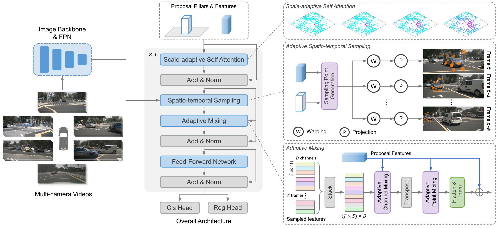
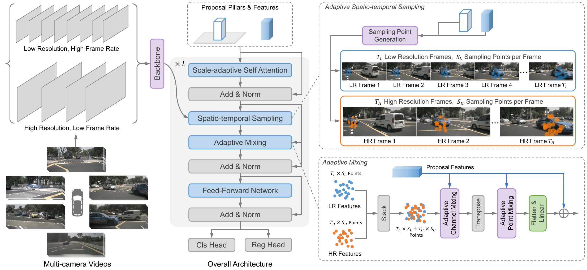
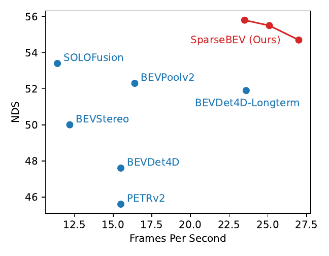
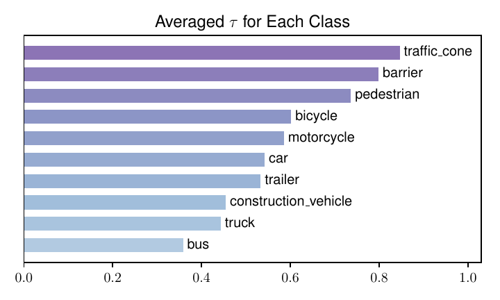

# SparseBEV (ICCV 2023)

<!-- paper-source: https://chengwei920412.github.io/paper_reading/2308.09244_SparseBEV_High_Performance_Sparse_3D_Object_Detection_from_Multi_Camera_Videos/technical_report.html -->

> **arXiv ID**: 2308.09244
> **原文标题**: SparseBEV: High-Performance Sparse 3D Object Detection from Multi-Camera Videos
> **翻译日期**: 2026-08-26

---

## 📋 论文概览 {#_1}

### 基本信息 {#_2}

- **作者**: Haisong Liu, Yao Teng, Tao Lu, Haiguang Wang, Limin Wang（通信作者）
- **机构**: 南京大学新型软件技术国家重点实验室；上海人工智能实验室
- **发表时间**: 2023年8月（arXiv v1，2023年9月更新），ICCV 2023
- **领域**: 自动驾驶感知、多视角相机3D目标检测、基于查询的检测器
- **代码**: <https://github.com/MCG-NJU/SparseBEV>

### 核心贡献 {#_3}

1. 提出**全稀疏**（Fully Sparse）多相机3D检测器SparseBEV：不构建任何显式稠密BEV特征，却首次在nuScenes上超过同期稠密BEV方法。
2. 论证性能差距的根因是**自适应能力**而非"是否有稠密BEV特征"，并给出三个自适应模块：
3. **尺度自适应自注意力（SASA）**：把查询距离作为注意力偏置，用查询预测的 <span class="paper-math">\(\tau\)</span> 控制BEV感受野，取代BEV编码器/FPN；
4. **自适应时空采样**：采样偏移由查询特征生成、由查询柱体（尺寸+朝向）变换，并按自车位姿与查询速度做时序对齐；
5. **自适应混合**：用查询生成的动态权重在通道维与点维两次混合采样特征（AdaMixer式动态卷积 + MLP-Mixer）。
6. 提出用**柱体（Pillar）** 而非3D参考点作为查询表示，引入更强空间先验（+0.5 NDS）。
7. 提出**双分支（SlowFast式）** 长时序建模：高分辨率低帧率"慢流" + 低分辨率高帧率"快流"，解耦外观与运动，性能更高且训练开销降低约1/3。
8. 结果：nuScenes `val` 55.8 NDS @ 23.5 FPS（ResNet50）；`test` 63.6 NDS（无未来帧），利用未来帧后 67.5 NDS，超越BEVFormerV2 2.7 NDS，而主干参数量仅约1/4。

---

## 🎯 研究背景与动机 {#_4}

### 问题定义 {#_5}

给定车载6路环视相机的**视频**输入，在BEV/3D空间中检测10类目标的位置、尺寸、朝向、速度与属性，评价指标为nuScenes NDS/mAP及ATE/ASE/AOE/AVE/AAE。

### 现有方法的局限性 {#_6}

- **稠密BEV范式**（BEVDet、BEVFormer、BEVDepth、SOLOFusion）：需要显式视图变换（LSS深度提升或可变形注意力采样）构建 <span class="paper-math">\(H \times W\)</span> 的BEV特征图，再接BEV编码器。精度高但计算量随BEV分辨率与帧数快速膨胀，且依赖复杂算子（易影响部署）。
- **稀疏查询范式**：DETR3D仅在参考点上做单点3D→2D投影采样，感受野固定且局部，采样特征由静态线性层处理；PETR系列改用稠密全局注意力，把稀疏范式的效率优势抹平，也难以扩展到长时序。

### 本文的创新点 {#_7}

论文的关键判断是：**稀疏方法落后不是因为缺少稠密BEV特征，而是因为缺少两处自适应性**——
- BEV空间缺少"多尺度聚合"（稠密方法靠BEV编码器+FPN实现）；
- 图像空间缺少"随目标尺寸/类别变化的采样与解码"（3D尺寸相近的物体在图像上尺度差异极大）。

因此本文不去补一个BEV特征图，而是把BEV编码器的功能"折叠"进查询间的自注意力，把图像特征交互替换为查询驱动的稀疏采样 + 动态权重解码。

---

## 🔬 方法论 {#_8}

### 整体架构 {#_9}



图：SparseBEV整体架构。查询初始化为BEV柱体 → SASA编码查询 → 自适应时空采样从多视角多时刻图像特征取点 → 自适应混合解码 → 重复 <span class="paper-math">\(L=6\)</span> 层输出预测。

流程：多相机视频逐帧经图像主干（ResNet50/101、V2-99）与FPN提取多尺度特征；BEV空间初始化 <span class="paper-math">\(N\)</span> 个柱体查询（900或400个）；解码器6层权重共享，每层依次执行 SASA → 时空采样 → 自适应混合 → 回归/分类头。

### 关键技术 {#_10}

**1）查询形式：BEV柱体**
每个查询由 <span class="paper-math">\([x,y,z]\)</span>、<span class="paper-math">\([w,l,h]\)</span>、朝向 <span class="paper-math">\(\theta\)</span>、速度 <span class="paper-math">\([v_x,v_y]\)</span> 及一个 <span class="paper-math">\(D\)</span> 维查询特征构成。初始化时 <span class="paper-math">\(z=0\)</span>、<span class="paper-math">\(h \approx 4\text{m}\)</span>、<span class="paper-math">\([v_x,v_y]=\mathbf{0}\)</span>，其余参数高斯随机。柱体在垂直方向覆盖整个可能高度，天然给出比"一个点"更合理的空间先验。

**2）尺度自适应自注意力（SASA）**
先算查询中心的两两 <span class="paper-math">\(L_2\)</span> 距离矩阵：


<div class="paper-math">\[D_{i, j} = \sqrt{(x_i - x_j)^2 + (y_i - y_j)^2}\]</div>


再把距离作为注意力的**惩罚偏置**：


<div class="paper-math">\[\text{Attn}(Q, K, V) = \text{Softmax}\left(\frac{QK^T}{\sqrt{d}} - \tau D\right) V\]</div>


<span class="paper-math">\(\tau=0\)</span> 时退化为全局MHSA；<span class="paper-math">\(\tau\)</span> 越大，远处查询被压制得越狠，感受野越小。<span class="paper-math">\(\tau\)</span> **不是超参**，而是逐查询、逐头由线性层生成：


<div class="paper-math">\[[\tau_1, \tau_2, ..., \tau_H] = \text{Linear}_{d \to H} (\mathbf{q}) \in \mathbb{R}^{H}\]</div>


这使一层自注意力同时具备多种感受野（等效于FPN的多尺度），且尺度由内容决定。

**3）自适应时空采样**
每帧从查询特征回归 <span class="paper-math">\(S\)</span> 组偏移 <span class="paper-math">\((\Delta x_i, \Delta y_i, \Delta z_i)\)</span>，按查询柱体的尺寸与朝向变换为3D点：


<div class="paper-math">\[\begin{bmatrix} x_i \\ y_i \\ z_i \end{bmatrix}
=
\begin{bmatrix}
\cos\theta &amp; -\sin\theta &amp; 0 \\
\sin\theta &amp; \cos\theta &amp; 0 \\
0 &amp; 0 &amp; 1
\end{bmatrix}
\begin{bmatrix} w \cdot \Delta x_i \\ l \cdot \Delta y_i \\ h \cdot \Delta z_i \end{bmatrix}
+
\begin{bmatrix} x \\ y \\ z \end{bmatrix}\]</div>


时序对齐分两步：先用查询速度做**物体运动**补偿（短时窗内以瞬时速度近似平均速度）


<div class="paper-math">\[x_{t, i} = x_i + v_x \cdot (T_t - T_0), \quad y_{t, i} = y_i + v_y \cdot (T_t - T_0)\]</div>


再用数据集自车位姿做**自车运动**补偿 <span class="paper-math">\([x&#x27;_{t,i}\ y&#x27;_{t,i}\ z&#x27;_{t,i}\ 1]^T = E_t E_0^{-1} [x_{t,i}\ y_{t,i}\ z_{t,i}\ 1]^T\)</span>。对齐后的点投影到命中的各视角，双线性插值采样并沿尺度轴加权求和：


<div class="paper-math">\[f_{t, i} = \frac{1}{|\mathcal{V}|} \sum_{k \in \mathcal{V}} \sum_{j=1}^{N_{\text{feat}}} w_{ij} \mathbf{B} (F_{k, j}, \mathbf{P}_k(x_{t, i}&#x27;, y_{t, i}&#x27;, z_{t, i}&#x27;))\]</div>


注意：这里**没有注意力权重的 softmax 交互**，多视角只做平均、多尺度用查询生成的权重 <span class="paper-math">\(w_{ij}\)</span>，因此完全避免了全局注意力的开销。

**4）自适应混合**
把 <span class="paper-math">\(T\)</span> 帧 × <span class="paper-math">\(S\)</span> 点堆叠为 <span class="paper-math">\(P=TS\)</span> 个点，特征 <span class="paper-math">\(f \in \mathbb{R}^{P \times C}\)</span>，再由查询生成两组动态权重：


<div class="paper-math">\[W_c = \text{Linear}(\mathbf{q}) \in \mathbb{R}^{C \times C}, \quad \text{M}_c(f) = \text{ReLU}(\text{LayerNorm}(f W_c))\]</div>


<div class="paper-math">\[W_p = \text{Linear}(\mathbf{q}) \in \mathbb{R}^{P \times P}, \quad \text{M}_p(f) = \text{ReLU}(\text{LayerNorm}(f^T W_p))\]</div>


先通道混合（增强语义）再点混合（在时空点之间交换信息），展平后线性聚合，最后两个MLP分别做回归与分类。

**5）双分支（SlowFast式）长时序建模**



图：双分支SparseBEV。慢流=低帧率高分辨率（外观细节），快流=高帧率低分辨率（长时运动/时序立体）；同一组采样点分别投影到两条流，特征在自适应混合前拼接。

### 算法流程 {#_11}

```
输入：多相机视频 {I_t}, 内外参, 自车位姿, 时间戳
1. 逐帧提取图像特征：F_t = FPN(Backbone(I_t))        # 多尺度 C2..C5
2. 初始化 N 个柱体查询 (box 参数 + 查询特征 q)
3. for layer = 1..L (=6, 权重共享):
     a. 距离矩阵 D ← 查询中心；τ ← Linear(q)
        Q ← Softmax(QK^T/√d − τD) V                  # SASA
     b. 偏移 Δ ← Linear(q)；按 (w,l,h,θ,x,y,z) 生成 3D 采样点
        物体运动补偿(速度) → 自车运动补偿(位姿) → 投影到各视角
        双线性采样 + 尺度加权 → f ∈ R^{P×C}          # 自适应时空采样
     c. W_c,W_p ← Linear(q)；通道混合 → 点混合 → 展平 → 线性聚合  # 自适应混合
     d. q ← q + 聚合特征；box ← box + MLP_reg(q)；cls ← MLP_cls(q)
4. 输出最后一层（或提前截断层）的 box/cls
```

训练：匈牙利匹配 + Focal Loss（分类）+ L1（回归），AdamW，全局 batch 8，lr <span class="paper-math">\(2\times10^{-4}\)</span> 余弦退火；后期版本对齐StreamPETR设置（<span class="paper-math">\(x,y\)</span> 回归权重2.0、查询去噪）。

---

## 📊 实验与结果 {#_12}

### 实验设置 {#_13}

- **数据集**: nuScenes（1000段约20s视频，700/150/150划分，6相机环视，关键帧0.5s一标，约140万个3D框，10类）
- **评估指标**: NDS、mAP，以及mATE/mASE/mAOE/mAVE/mAAE
- **对比方法**: DETR3D、PETR/PETRv2、BEVFormer/BEVFormerV2、BEVDet4D、BEVDepth、BEVStereo、BEVPoolv2、SOLOFusion、Sparse4D/v2、StreamPETR、PolarFormer、UVTR
- **默认配置**: 8帧（间隔约0.5s），6层解码器权重共享，900查询（实时配置400）

### 主要结果 {#_14}



图：nuScenes `val` 上的精度—速度权衡（ResNet50，704×256，RTX 3090，PyTorch fp32）。减少解码器层数即可换取速度，无需重训。

表：nuScenes `val` 划分主结果（节选）。† 透视视图预训练；‡ 使用CBGS（1 epoch ≈ 4.5 epoch）。


<table>
<thead>
<tr>
<th>方法</th>
<th>主干网络</th>
<th>输入尺寸</th>
<th>训练轮数</th>
<th>NDS</th>
<th>mAP</th>
<th>mAOE</th>
<th>mAVE</th>
</tr>
</thead>
<tbody>
<tr>
<td>SOLOFusion</td>
<td>ResNet50</td>
<td>704 × 256</td>
<td>90 ‡</td>
<td>53.4</td>
<td>42.7</td>
<td>0.511</td>
<td>0.252</td>
</tr>
<tr>
<td>Sparse4Dv2</td>
<td>ResNet50</td>
<td>704 × 256</td>
<td>100</td>
<td>53.9</td>
<td>43.9</td>
<td>0.475</td>
<td>0.282</td>
</tr>
<tr>
<td>StreamPETR †</td>
<td>ResNet50</td>
<td>704 × 256</td>
<td>60</td>
<td>55.0</td>
<td><strong>45.0</strong></td>
<td>0.413</td>
<td>0.265</td>
</tr>
<tr>
<td><strong>SparseBEV</strong></td>
<td>ResNet50</td>
<td>704 × 256</td>
<td>36</td>
<td>54.5</td>
<td>43.2</td>
<td>0.387</td>
<td>0.251</td>
</tr>
<tr>
<td><strong>SparseBEV</strong> †</td>
<td>ResNet50</td>
<td>704 × 256</td>
<td>36</td>
<td><strong>55.8</strong></td>
<td>44.8</td>
<td>0.373</td>
<td>0.247</td>
</tr>
<tr>
<td>SOLOFusion</td>
<td>ResNet101</td>
<td>1408 × 512</td>
<td>90 ‡</td>
<td>58.2</td>
<td>48.3</td>
<td>0.381</td>
<td>0.246</td>
</tr>
<tr>
<td><strong>SparseBEV</strong> †</td>
<td>ResNet101</td>
<td>1408 × 512</td>
<td>24</td>
<td><strong>59.2</strong></td>
<td><strong>50.1</strong></td>
<td>0.321</td>
<td>0.243</td>
</tr>
</tbody>
</table>


要点：仅用36 epoch（对手常用90 epoch × CBGS）即达到或超过最优精度；朝向误差（mAOE）与速度误差（mAVE）优势最明显，说明柱体先验 + 速度补偿的时序对齐对运动/朝向估计确有帮助。

表：nuScenes `test` 划分主结果（节选）。† 使用未来帧。


<table>
<thead>
<tr>
<th>方法</th>
<th>主干网络</th>
<th>NDS</th>
<th>mAP</th>
<th>备注</th>
</tr>
</thead>
<tbody>
<tr>
<td>SOLOFusion</td>
<td>ConvNeXt-B</td>
<td>61.9</td>
<td>54.0</td>
<td>90 epoch + CBGS</td>
</tr>
<tr>
<td><strong>SparseBEV</strong></td>
<td>V2-99</td>
<td><strong>62.7</strong></td>
<td><strong>54.3</strong></td>
<td>24 epoch，单分支</td>
</tr>
<tr>
<td><strong>SparseBEV</strong>（双分支）</td>
<td>V2-99</td>
<td><strong>63.6</strong></td>
<td><strong>55.6</strong></td>
<td>24 epoch</td>
</tr>
<tr>
<td>BEVFormerV2 †</td>
<td>InternImage-XL（&gt;300M）</td>
<td>64.8</td>
<td>58.0</td>
<td>离线，使用未来帧</td>
</tr>
<tr>
<td>BEVDet-Gamma †</td>
<td>Swin-B</td>
<td>66.4</td>
<td>58.6</td>
<td>90 epoch + CBGS</td>
</tr>
<tr>
<td><strong>SparseBEV</strong> †</td>
<td>V2-99（约70M）</td>
<td><strong>67.5</strong></td>
<td><strong>60.3</strong></td>
<td>离线，使用未来帧</td>
</tr>
</tbody>
</table>


### 消融实验 {#_15}

表：查询形式（BEV柱体 vs 3D参考点）


<table>
<thead>
<tr>
<th>查询形式</th>
<th>NDS</th>
<th>mAP</th>
</tr>
</thead>
<tbody>
<tr>
<td>3D参考点</td>
<td>55.1</td>
<td>44.0</td>
</tr>
<tr>
<td>BEV柱体</td>
<td><strong>55.6</strong></td>
<td><strong>45.4</strong></td>
</tr>
</tbody>
</table>


表：SASA与距离函数选择（相对MHSA基线 +2.2 NDS / +4.0 mAP）


<table>
<thead>
<tr>
<th>自注意力</th>
<th>距离函数</th>
<th>NDS</th>
<th>mAP</th>
</tr>
</thead>
<tbody>
<tr>
<td>MHSA</td>
<td>-</td>
<td>53.4</td>
<td>41.4</td>
</tr>
<tr>
<td>SASA</td>
<td><span class="paper-math">\(\tau D^2\)</span></td>
<td>54.3</td>
<td>43.8</td>
</tr>
<tr>
<td>SASA</td>
<td><span class="paper-math">\(\tau D\)</span></td>
<td><strong>55.6</strong></td>
<td><strong>45.4</strong></td>
</tr>
<tr>
<td>SASA</td>
<td><span class="paper-math">\(\tau \sqrt{D}\)</span></td>
<td>55.1</td>
<td>44.3</td>
</tr>
</tbody>
</table>


表：时序对齐（自车 / 物体运动）


<table>
<thead>
<tr>
<th>自车对齐</th>
<th>物体对齐</th>
<th>NDS</th>
<th>mAP</th>
<th>mAVE</th>
</tr>
</thead>
<tbody>
<tr>
<td>-</td>
<td>-</td>
<td>44.4</td>
<td>34.1</td>
<td>0.510</td>
</tr>
<tr>
<td>√</td>
<td>-</td>
<td>54.2</td>
<td>43.5</td>
<td>0.281</td>
</tr>
<tr>
<td>√</td>
<td>√</td>
<td><strong>55.6</strong></td>
<td><strong>45.4</strong></td>
<td><strong>0.243</strong></td>
</tr>
</tbody>
</table>


表：自适应混合的形式与顺序


<table>
<thead>
<tr>
<th>方法</th>
<th>细节</th>
<th>NDS</th>
<th>mAP</th>
</tr>
</thead>
<tbody>
<tr>
<td>无混合（DETR3D式注意力权重聚合）</td>
<td>-</td>
<td>49.1</td>
<td>38.6</td>
</tr>
<tr>
<td>静态混合</td>
<td>通道 → 点</td>
<td>51.8</td>
<td>41.9</td>
</tr>
<tr>
<td>自适应混合</td>
<td>仅通道</td>
<td>53.1</td>
<td>42.7</td>
</tr>
<tr>
<td>自适应混合</td>
<td>仅点</td>
<td>53.6</td>
<td>43.3</td>
</tr>
<tr>
<td>自适应混合</td>
<td>点 → 通道</td>
<td>55.4</td>
<td>44.6</td>
</tr>
<tr>
<td>自适应混合</td>
<td>通道 → 点</td>
<td><strong>55.6</strong></td>
<td><strong>45.4</strong></td>
</tr>
</tbody>
</table>


表：双分支消融（附录，V2-99 / FCOS3D预训练，设置与正文不同）


<table>
<thead>
<tr>
<th>方法</th>
<th>设置</th>
<th>mAP</th>
<th>NDS</th>
</tr>
</thead>
<tbody>
<tr>
<td>单分支</td>
<td>8f × 1600</td>
<td>48.9</td>
<td>57.3</td>
</tr>
<tr>
<td>双分支</td>
<td>2f × 1600 + 8f × 640</td>
<td>49.4</td>
<td>57.9</td>
</tr>
<tr>
<td>双分支</td>
<td>4f × 1600 + 8f × 640</td>
<td><strong>50.2</strong></td>
<td><strong>58.4</strong></td>
</tr>
<tr>
<td>双分支</td>
<td>4f × 1600 + 8f × 800</td>
<td>50.1</td>
<td>58.0</td>
</tr>
</tbody>
</table>


表：双分支的增益来源（是否只是"感受野变大"？）


<table>
<thead>
<tr>
<th>方法</th>
<th>特征图</th>
<th>训练开销</th>
<th>mAP</th>
</tr>
</thead>
<tbody>
<tr>
<td>单分支</td>
<td><span class="paper-math">\(C_2..C_5\)</span></td>
<td>2天17小时</td>
<td>48.9</td>
</tr>
<tr>
<td>单分支</td>
<td><span class="paper-math">\(C_2..C_6\)</span></td>
<td>2天18小时</td>
<td>49.3</td>
</tr>
<tr>
<td>双分支</td>
<td><span class="paper-math">\(C_2..C_5\)</span></td>
<td><strong>1天19小时</strong></td>
<td><strong>50.2</strong></td>
</tr>
</tbody>
</table>


表：SASA的中间版本对比（附录）


<table>
<thead>
<tr>
<th>自注意力</th>
<th>距离函数</th>
<th>NDS</th>
<th>mAP</th>
</tr>
</thead>
<tbody>
<tr>
<td>SASA-beta（<span class="paper-math">\(\tau\)</span> 为每头共享参数）</td>
<td><span class="paper-math">\(\tau D\)</span></td>
<td>55.2</td>
<td>44.8</td>
</tr>
<tr>
<td>SASA（<span class="paper-math">\(\tau\)</span> 由查询生成）</td>
<td><span class="paper-math">\(\tau D\)</span></td>
<td><strong>55.6</strong></td>
<td><strong>45.4</strong></td>
</tr>
</tbody>
</table>


其他消融（图示）：帧数从少到多性能单调提升（作者取8帧与他人公平比较）；每帧采样点数以16为最优。

---

## 💡 关键见解 {#_16}

### 理论分析 {#_17}

**1. "距离偏置"就是可学习的尺度选择器。** 在 <span class="paper-math">\(\text{Softmax}(QK^T/\sqrt{d} - \tau D)\)</span> 中，<span class="paper-math">\(-\tau D\)</span> 相当于在注意力logit上加一个各向同性的空间衰减核，等价于给每个头一个特征半径 <span class="paper-math">\(\sim 1/\tau\)</span>。多个头 = 多个半径 = FPN的多尺度效果，而半径由查询内容决定（大目标→小 <span class="paper-math">\(\tau\)</span>→大感受野）。



图：各类别的平均 <span class="paper-math">\(\tau\)</span>（越大=感受野越小）。公交车、卡车等大目标 <span class="paper-math">\(\tau\)</span> 更小（感受野更大），行人、交通锥更大，说明"自适应"确实学到了类别相关的尺度。

一个值得注意的实证现象：不论 <span class="paper-math">\(\tau\)</span> 如何初始化，各头最终都会**自发散布**到 <span class="paper-math">\([0,2]\)</span> 区间且互不相同——即"多尺度"是被优化过程主动需要的，而非人为设计强加的。

**2. 稀疏采样的效率来自"不做交互"。** 采样特征的融合只有：多视角平均、多尺度线性加权、动态卷积混合。全过程不含 <span class="paper-math">\(N \times HW\)</span> 的注意力矩阵，因此复杂度对图像分辨率线性、对帧数线性，这也是能吃下8帧（约4秒）历史并保持23.5 FPS的原因。

**3. 时序对齐是长时序方法的真正门槛。** 消融显示不做自车对齐直接掉约10 NDS（44.4 vs 54.2），物体运动补偿再补1.4 NDS并把mAVE从0.281降到0.243。也就是说，"能用长历史"的前提是"能把历史摆回正确位置"，而不是网络容量。

**4. 外观与运动应该走不同的分辨率通道。** 表8是最有说服力的一组对照：单分支加 <span class="paper-math">\(C_6\)</span>（只扩感受野）仅+0.4 mAP，而双分支（扩感受野+解耦分辨率）+1.3 mAP且训练时间反而少1/3。说明高分辨率长序列的浪费在于"用细节通道去承载运动信息"。

### 实践启示 {#_18}

- 想做纯稀疏检测器，不必先补一个BEV特征图；把"多尺度聚合"塞进查询自注意力更省。
- 查询的几何参数化（柱体 vs 点）不只是表示细节，它决定了采样点分布的先验，直接影响回归精度。
- 解码器层数可作为推理期的精度/延迟旋钮（无需重训），对车端部署很实用。
- 长时序方案的工程重点应该是位姿/时间戳质量与运动补偿，而不是一味加帧。

---

## 🔍 局限性与未来工作 {#_19}

### 当前局限 {#_20}

1. **强依赖自车位姿**：缺少基于自车位姿的对齐会掉约10 NDS；真实车辆IMU/定位存在噪声与延迟，鲁棒性未被系统评估（论文自述）。
2. **延迟随帧数线性增长**：采样特征沿时间维堆叠，<span class="paper-math">\(P = T \times S\)</span> 直接决定点混合的 <span class="paper-math">\(W_p \in \mathbb{R}^{P\times P}\)</span> 规模，长历史不可"免费"获得（对比后续流式/循环记忆方案）。
3. **双分支带来结构复杂度**：正文默认不启用，其消融又在与正文不同的旧设置（FCOS3D预训练V2-99）下完成，两套设置的可比性有限。
4. **物体运动模型过简**：匀速假设对急加速、转向、被遮挡后重现的目标可能失效。
5. **未来帧设置的实用性**：67.5 NDS这一最优数字来自使用未来帧的**离线**设置（与BEVFormerV2的离线协议一致），不能直接作为在线自动驾驶能力的读数；在线可比数字是63.6 NDS。

### 未来方向 {#_21}

- 更优雅的空间外观/时序运动解耦（论文自述），例如用循环状态或稀疏记忆替代帧堆叠，使延迟与历史长度解耦。
- 位姿噪声鲁棒性：把自车对齐做成可学习/可纠偏模块，或引入无位姿的时序关联。
- 扩展任务：BEV分割、占用预测（Occupancy）、车道线检测（论文自述），以及与激光雷达/毫米波雷达的稀疏融合。
- 用更强的运动模型（恒定加速度/学习式运动先验）替换匀速补偿，并与跟踪任务联合。

---

## 📚 相关工作对比 {#_22}


<table>
<thead>
<tr>
<th>方法</th>
<th>核心思想</th>
<th>优势</th>
<th>劣势</th>
</tr>
</thead>
<tbody>
<tr>
<td>BEVFormer / BEVFormerV2</td>
<td>时空Transformer把多视角投影为稠密BEV特征，BEV空间检测</td>
<td>精度强；BEV特征可复用于多任务</td>
<td>稠密BEV + 可变形注意力开销大；BEVFormerV2需超大主干（&gt;300M）与透视监督</td>
</tr>
<tr>
<td>BEVDet / BEVDepth / BEVStereo / SOLOFusion</td>
<td>LSS深度提升 + BEV编码器（+时序立体）</td>
<td>深度监督明确，长时序融合成熟</td>
<td>依赖视图变换算子与深度分支；多需CBGS与90 epoch级训练</td>
</tr>
<tr>
<td>DETR3D</td>
<td>稀疏参考点 + 3D→2D单点投影采样</td>
<td>结构最简、速度快</td>
<td>单点固定局部感受野、静态线性解码，精度落后</td>
</tr>
<tr>
<td>PETR / PETRv2</td>
<td>3D位置编码 + 稠密全局注意力</td>
<td>无需显式投影，实现简洁</td>
<td>全局注意力开销高，难扩展长时序，抹平稀疏优势</td>
</tr>
<tr>
<td>Sparse4D / StreamPETR</td>
<td>稀疏4D采样 / 流式时序传播查询</td>
<td>时序信息利用高效（StreamPETR为循环式，延迟不随历史线性增长）</td>
<td>Sparse4D采样结构较复杂；StreamPETR依赖循环状态与去噪训练技巧</td>
</tr>
<tr>
<td><strong>本文（SparseBEV）</strong></td>
<td>全稀疏：SASA（BEV自适应感受野）+ 查询驱动时空采样 + 动态混合解码</td>
<td>无稠密BEV/无全局注意力；精度与速度双优（55.8 NDS @ 23.5 FPS）；解码器层数可在推理期调速；训练轮数少</td>
<td>强依赖自车位姿；延迟随帧数线性增长；匀速运动假设；双分支设置略复杂</td>
</tr>
</tbody>
</table>


---

## 🎓 个人评价 {#_23}

### 优点 {#_24}

- **问题定位准**：把"稀疏 vs 稠密"的性能差距重新归因为"自适应性"，并用三个模块逐一对应、逐一消融，论证链条完整（MHSA→SASA +2.2 NDS；无混合→自适应混合 +6.5 NDS；无对齐→全对齐 +11.2 NDS）。
- **代价意识强**：所有模块都避免 <span class="paper-math">\(N \times HW\)</span> 级交互，因此"更强"和"更快"能同时成立；用解码器层数换速度这个技巧简单但很实用。
- **实证细节有信息量**：<span class="paper-math">\(\tau\)</span> 自发散布到 <span class="paper-math">\([0,2]\)</span>、类别相关感受野、表8对"是否只是感受野变大"的对照实验，都是超出"刷榜"的观察。
- **可复现性**：开源代码，训练预算（24/36 epoch，batch 8）在同期工作中偏低，复现门槛友好。

### 可改进之处 {#_25}

- **鲁棒性缺口**：既然自述强依赖自车位姿，本应给出位姿加噪的定量曲线（例如平移/旋转扰动 vs NDS），否则"局限"只是定性陈述。
- **公平性口径不一**：主表混合了不同epoch数、CBGS、透视预训练、未来帧等设置，尽管有 †/‡ 标注，跨行直接比较仍需谨慎；最优的67.5 NDS依赖未来帧，容易被误读为在线性能。
- **双分支实验割裂**：正文默认关闭、附录用另一套预训练与分辨率，其收益（+0.9 NDS on test）与正文主结果无法严格叠加验证。
- **理论解释偏轻**：<span class="paper-math">\(-\tau D\)</span> 与可变形注意力/相对位置偏置（如Swin、T5 bias）的关系、为何 <span class="paper-math">\(L_2\)</span> 优于 <span class="paper-math">\(D^2\)</span> 与 <span class="paper-math">\(\sqrt{D}\)</span>，均只有实验结论而无分析。
- **效率报告不完整**：仅给出FPS曲线，缺少显存、FLOPs随帧数/查询数的曲线，而这正是"延迟线性增长"这一局限的关键证据。

### 推荐阅读对象 {#_26}

- 做多视角相机3D检测/BEV感知的研究者与自动驾驶感知工程师；
- 关注DETR系解码器设计（采样+动态权重）与稀疏化提速的研究者；
- 需要在车端做精度—延迟权衡、或正在选择"稠密BEV vs 稀疏查询"技术路线的团队。

---

## 📎 附录 {#_27}

### 重要公式 {#_28}

1. 查询中心两两距离（SASA的空间先验）：


<div class="paper-math">\[D_{i, j} = \sqrt{(x_i - x_j)^2 + (y_i - y_j)^2}\]</div>


1. 尺度自适应自注意力：


<div class="paper-math">\[\text{Attn}(Q, K, V) = \text{Softmax}\left(\frac{QK^T}{\sqrt{d}} - \tau D\right) V\]</div>


1. 逐头感受野系数由查询生成：


<div class="paper-math">\[[\tau_1, \tau_2, ..., \tau_H] = \text{Linear}_{d \to H} (\mathbf{q}) \in \mathbb{R}^{H}\]</div>


1. 采样偏移经柱体尺寸与朝向变换为3D采样点：


<div class="paper-math">\[\begin{bmatrix} x_i \\ y_i \\ z_i \end{bmatrix}
=
\begin{bmatrix}
\cos\theta &amp; -\sin\theta &amp; 0 \\
\sin\theta &amp; \cos\theta &amp; 0 \\
0 &amp; 0 &amp; 1
\end{bmatrix}
\begin{bmatrix} w \cdot \Delta x_i \\ l \cdot \Delta y_i \\ h \cdot \Delta z_i \end{bmatrix}
+
\begin{bmatrix} x \\ y \\ z \end{bmatrix}\]</div>


1. 物体运动补偿（匀速假设）与自车运动补偿：


<div class="paper-math">\[x_{t, i} = x_i + v_x \cdot (T_t - T_0), \quad y_{t, i} = y_i + v_y \cdot (T_t - T_0)\]</div>


<div class="paper-math">\[[x_{t, i}&#x27; \ \ y_{t, i}&#x27; \ \ z_{t, i}&#x27; \ \ 1]^T = E_t E_0^{-1} [x_{t, i} \ \ y_{t, i} \ \ z_{t, i} \ \ 1]^T\]</div>


1. 多视角、多尺度采样聚合：


<div class="paper-math">\[f_{t, i} = \frac{1}{|\mathcal{V}|} \sum_{k \in \mathcal{V}} \sum_{j=1}^{N_{\text{feat}}} w_{ij} \mathbf{B} (F_{k, j}, \mathbf{P}_k(x_{t, i}&#x27;, y_{t, i}&#x27;, z_{t, i}&#x27;))\]</div>


1. 自适应混合（通道 → 点）：


<div class="paper-math">\[\text{M}_c(f) = \text{ReLU}(\text{LayerNorm}(f W_c)), \quad W_c = \text{Linear}(\mathbf{q}) \in \mathbb{R}^{C \times C}\]</div>


<div class="paper-math">\[\text{M}_p(f) = \text{ReLU}(\text{LayerNorm}(f^T W_p)), \quad W_p = \text{Linear}(\mathbf{q}) \in \mathbb{R}^{P \times P}\]</div>


### 术语表 {#_29}


<table>
<thead>
<tr>
<th>英文</th>
<th>中文</th>
<th>说明</th>
</tr>
</thead>
<tbody>
<tr>
<td>BEV (Bird's Eye View)</td>
<td>鸟瞰图</td>
<td>以自车为中心的俯视平面表示</td>
</tr>
<tr>
<td>Dense / Sparse detector</td>
<td>稠密 / 稀疏检测器</td>
<td>是否显式构建稠密BEV特征图</td>
</tr>
<tr>
<td>Query</td>
<td>查询</td>
<td>稀疏检测器中代表候选目标的可学习单元</td>
</tr>
<tr>
<td>Pillar</td>
<td>柱体</td>
<td>查询的几何参数化：BEV上有朝向的矩形 × 垂直高度</td>
</tr>
<tr>
<td>Scale-Adaptive Self Attention (SASA)</td>
<td>尺度自适应自注意力</td>
<td>用 <span class="paper-math">\(-\tau D\)</span> 偏置控制BEV感受野的自注意力</td>
</tr>
<tr>
<td>Adaptive Spatio-Temporal Sampling</td>
<td>自适应时空采样</td>
<td>查询驱动的3D采样点生成 + 时序对齐 + 投影采样</td>
</tr>
<tr>
<td>Adaptive Mixing</td>
<td>自适应混合</td>
<td>用查询生成的动态权重做通道混合与点混合</td>
</tr>
<tr>
<td>Ego Motion / Ego Pose</td>
<td>自车运动 / 自车位姿</td>
<td>车辆自身的运动与全局位姿</td>
</tr>
<tr>
<td>Object Motion</td>
<td>物体运动</td>
<td>其他目标相对环境的运动</td>
</tr>
<tr>
<td>Temporal Alignment</td>
<td>时序对齐</td>
<td>把历史帧采样点补偿回正确空间位置</td>
</tr>
<tr>
<td>Query Denoising</td>
<td>查询去噪</td>
<td>输入加噪真值框并重建，用于稳定训练</td>
</tr>
<tr>
<td>NDS (nuScenes Detection Score)</td>
<td>nuScenes检测分数</td>
<td>mAP与五项TP误差的综合指标</td>
</tr>
<tr>
<td>mATE/mASE/mAOE/mAVE/mAAE</td>
<td>平移/尺度/朝向/速度/属性误差</td>
<td>nuScenes的五项真正例误差指标</td>
</tr>
<tr>
<td>CBGS</td>
<td>类别平衡分组采样</td>
<td>数据重采样策略，1 epoch ≈ 4.5 epoch</td>
</tr>
<tr>
<td>HR / LR</td>
<td>高 / 低分辨率</td>
<td>双分支中慢流与快流的分辨率</td>
</tr>
</tbody>
</table>


### 参考资源 {#_30}

- **论文原文**: [arXiv:2308.09244](https://arxiv.org/abs/2308.09244)
- **中文翻译 PDF**: [paper_cn.pdf](https://chengwei920412.github.io/paper_reading/2308.09244_SparseBEV_High_Performance_Sparse_3D_Object_Detection_from_Multi_Camera_Videos/paper_cn.pdf)
- **中文 Markdown 译文**: [paper_cn.md](https://chengwei920412.github.io/paper_reading/2308.09244_SparseBEV_High_Performance_Sparse_3D_Object_Detection_from_Multi_Camera_Videos/paper_cn.html)
- **代码实现**: <https://github.com/MCG-NJU/SparseBEV>
- **数据集**: [nuScenes](https://www.nuscenes.org/)
