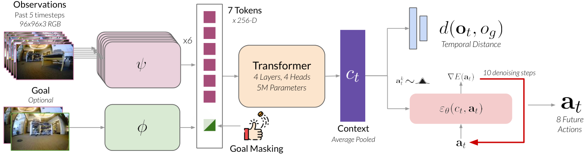
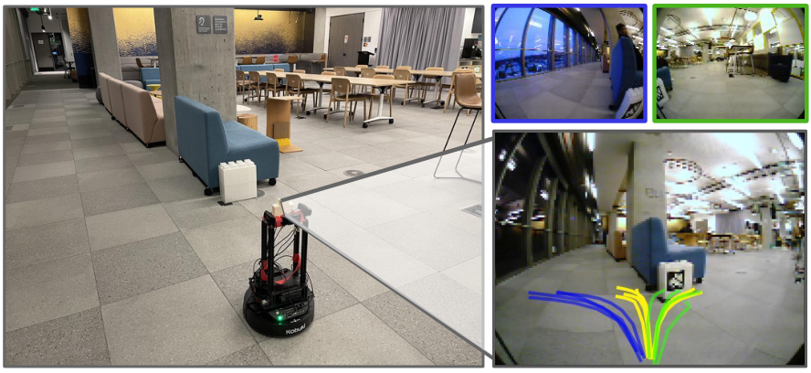
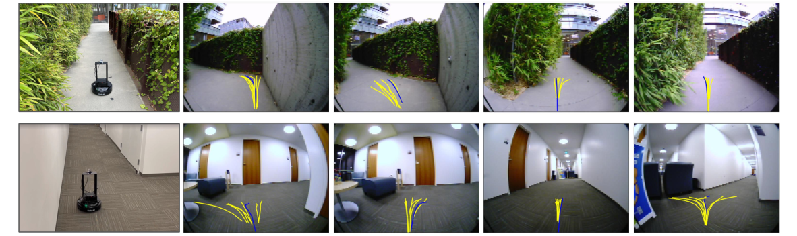
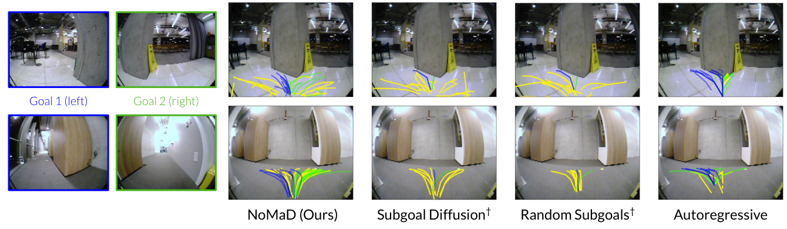

# NoMaD (ICRA 2024)

<!-- paper-source: https://chengwei920412.github.io/paper_reading/2310.07896_NoMaD_Goal_Masked_Diffusion_Policies_for_Navigation_and_Exploration/2310.07896_%E9%98%85%E8%AF%BB%E6%8A%A5%E5%91%8A.html -->

## 0. 基本信息 {#0}

- 论文标题：NoMaD: Goal Masked Diffusion Policies for Navigation and Exploration
- 作者：Ajay Sridhar, Dhruv Shah, Catherine Glossop, Sergey Levine
- 机构：UC Berkeley
- 来源（会议 / arXiv / 期刊）：arXiv
- 年份：2023
- 原始输入链接：https://arxiv.org/abs/2310.07896
- 最终使用的 arXiv 版本化 ID：2310.07896v1
- 原论文 arXiv 链接：https://arxiv.org/abs/2310.07896v1
- 幻觉翻译链接（hjfy）：https://hjfy.top/arxiv/2310.07896v1
- Cool Papers 链接：https://papers.cool/arxiv/2310.07896v1
- 论文研究方向：视觉导航、机器人探索、目标条件策略、扩散策略、拓扑图导航、跨机器人离线模仿学习
- 本文一句话概括：NoMaD 用 goal masking 把有目标导航和无目标探索合并到同一个 Transformer + action diffusion policy 中，避免 ViNT 式单独生成高维图像子目标，并在真实 LoCoBot 室内外实验中以更小模型取得更高探索成功率和更低碰撞率。

## 1. 论文核心观点与主张的系统梳理 {#1}

### 1.1 研究背景与动机 {#11}

论文研究的是一个很具体的导航矛盾：机器人最终任务可能是“到达用户给定的视觉目标”，但在陌生环境中，机器人一开始并不知道目标在哪里，因此必须先进行 task-agnostic exploration；当目标被定位或在已知拓扑图中可达时，又要切换到 task-oriented goal reaching。现有系统往往把这两种行为拆开：一个模型做目标条件导航，另一个高层策略、子目标生成器或规划模块负责探索。

作者认为这种拆分有两个工程问题。第一，系统复杂，常需要任务特定的 goal proposal、层级策略或高维生成模型。第二，如果探索和目标导航由不同模型承担，就难以共享导航 affordance，例如避障、沿走廊移动、在岔路保留多个可行方向等。NoMaD 的核心动机就是：能否训练一个足够表达力强的动作策略，同时表示“没有目标时的多模态安全探索”和“给定目标时的定向导航”。

论文把这个问题放在真实视觉导航中，而不是仿真 exploration benchmark 中。作者强调，很多模拟探索策略依赖特权信息或高质量几何地图，真实迁移困难；NoMaD 则直接用真实多机器人数据训练，并用拓扑图和 frontier exploration 做长程支撑。

### 1.2 问题设定 {#12}

论文定义的控制策略 \(\pi\) 接收当前和过去 RGB 观测：

\[\mathbf{o}_t := o_{t-P:t}\]

并输出未来动作序列的分布：

\[\mathbf{a}_t := a_{t:t+H}\]

这两条公式定义了 NoMaD 的基本输入输出。\(\mathbf{o}_t\) 是长度 \(P+1\) 的视觉历史，\(\mathbf{a}_t\) 是长度 \(H\) 的未来动作序列。自然语言直译是：机器人根据最近一小段视觉历史，预测接下来一段时间应该如何移动。工程上它对应 receding-horizon action sequence prediction，而不是单步 velocity classification。

策略还可以选择性接收目标图像 \(o_g\)。当 \(o_g\) 存在时，策略应朝目标前进；当 \(o_g\) 不存在或被 mask 时，策略应探索环境，避免碰撞并覆盖可行空间。长程上，NoMaD 仍与拓扑图 \(\mathcal{M}\) 和 high-level planner 结合，图节点是历史视觉观测，边由策略的 goal-conditioned distance prediction 判断可达。

图中展示了论文的核心设定：NoMaD 用 EfficientNet + Transformer 编码视觉历史和可选目标，通过 goal masking 选择是否让策略关注目标 token，再用 action diffusion 生成未来 8 个动作。这个图支撑“一个模型覆盖有目标和无目标模式”的核心主张。

### 1.3 核心观点（Claims）的逐条梳理 {#13-claims}

**Claim 1：探索和目标导航可以由同一个策略统一建模，而不必使用独立的子目标生成模型。** 对应 Introduction 和 Method。作者明确对比 ViNT：ViNT 需要 300M 参数级图像扩散模型生成候选子目标，NoMaD 直接扩散生成动作序列。

**Claim 2：goal masking 是同时训练 task-agnostic 和 task-oriented behavior 的简单有效机制。** 对应 Sec. IV-A。训练时以 \(p_m=0.5\) 随机 mask goal token；测试时 \(m=1\) 做无目标探索，\(m=0\) 做目标图像导航。

**Claim 3：action diffusion 比点估计、VIB 和离散 autoregressive 动作更适合建模探索中的多模态动作分布。** 对应 Sec. IV-B、Table I 和 Figure 5。论文以岔路口为例说明无目标策略应同时保留左转/右转等多个安全模式，而不是平均成撞墙或低效动作。

**Claim 4：NoMaD 在真实室内外环境中优于 ViNT 的 Subgoal Diffusion 系统，并且参数量小 15 倍。** 对应 Table I。NoMaD 19M 参数，探索成功率 98%、碰撞 0.2；Subgoal Diffusion 335M 参数，探索成功率 77%、碰撞 1.7。

**Claim 5：统一训练不会牺牲单独行为能力。** 对应 Table II。NoMaD 在 undirected exploration 上达到 98%，与专用 Diffusion Policy 相同；在 goal-conditioned navigation 上达到 92%，与专用 ViNT Policy 相同。

**Claim 6：视觉编码器和 goal masking 形式非常关键。** 对应 Table III。NoMaD 的 ViNT-style encoder + attention-based masking 达到 98% success / 0.2 collisions，而 Late Fusion CNN、Early Fusion CNN、ViT 均明显更差。

### 1.4 创新性与贡献边界 {#14}

NoMaD 的主要创新是策略表示层面的机制组合：不是扩散图像子目标，而是扩散动作；不是为探索和导航训练两个策略，而是用 attention mask 共享一个条件/无条件动作模型。它的创新不是扩散模型本身，也不是拓扑图搜索本身；DDPM、Diffusion Policy、ViNT、ViKiNG、EfficientNet、Transformer 都是已有组件。

贡献边界也很清楚。第一，论文只验证视觉目标和无目标探索，没有支持 GPS、语言或语义目标；作者在 Discussion 中明确把多目标模态作为未来工作。第二，长程探索仍依赖标准 frontier-based high-level planning，NoMaD 并没有学习“去哪块区域探索最有价值”的语义或信息增益策略。第三，实验集中在 LoCoBot 平台的 6 个室内外环境，不能直接证明跨机器人泛化。

## 2. 关键论据、理论基础与数学方法的深度解析 {#2}

### 2.1 理论基础与学术渊源 {#21}

NoMaD 建立在四条路线之上。

第一是经典和学习式探索。经典探索包括 frontier-based exploration、information-theoretic exploration、SLAM-based exploration 等；学习式探索包括 semantic curiosity、RL exploration policies、latent goal model、affordance learning。NoMaD 不直接构建高保真几何地图，而沿用拓扑图记忆和 frontier exploration，把探索质量交给局部策略的多模态 action distribution。

第二是视觉目标导航与拓扑导航，包括 ViNG、Scaling Local Control、Neural Topological SLAM、ViKiNG、ViNT。NoMaD 继承 ViNT 的视觉编码器和 distance prediction，但补上 ViNT 自身不能无目标探索的问题。

第三是多模态动作建模，包括 action quantization、Behavior Transformer、Q-Transformer、Implicit Behavioral Cloning、latent variable models。NoMaD 的批评是：离散动作可能导致 jerky 和响应慢，VIB/latent model 在复杂环境中效果弱，点估计策略无法表达多个安全模式。

第四是 diffusion policy。NoMaD 直接承接 DDPM、Diffuser、Diffusion Policy、goal-conditioned score-based diffusion policies 等工作，但将其扩展到“可选目标条件”的真实机器人导航，并与拓扑探索系统结合。

### 2.2 问题形式化与建模选择 {#22}

NoMaD 将 ViNT 的 context vector 改造成可 mask 的条件表示：

\[c_t = f(\psi(o_i), \phi(o_t,o_g), m)\]

这条公式定义 goal masking。\(\psi(o_i)\) 是对历史观测帧的 EfficientNet 编码，\(\phi(o_t,o_g)\) 是当前图像与目标图像的 goal fusion token，\(f\) 是 Transformer，\(m\) 是二值 goal mask。\(m=1\) 时，attention 不看 goal token，产生 task-agnostic context；\(m=0\) 时，goal token 可被 attention 使用，产生 goal-conditioned context。工程上它对应 Transformer attention mask，而不是简单把目标图像置零。

训练时：

\[m \sim \operatorname{Bernoulli}(p_m),\quad p_m=0.5\]

这条公式的作用是构造均衡的有目标/无目标训练样本。自然语言直译是：一半训练样本让模型看到目标，一半训练样本强迫模型忽略目标。若 \(p_m\) 太低，模型可能只学目标导航；若 \(p_m\) 太高，目标条件路径训练不足。论文固定 \(p_m=0.5\)，没有报告系统扫参，因此这个选择是工程设定而非被充分优化证明。

### 2.3 核心推导与算法构造 {#23}

NoMaD 直接建模动作条件分布：

\[p(\mathbf{a}_t \mid c_t)\]

这条公式是方法区别于 ViNT Subgoal Diffusion 的关键。ViNT 的扩散模型生成未来图像，再用 goal-conditioned policy 执行；NoMaD 的扩散模型生成未来动作序列。自然语言直译是：在当前视觉上下文下，直接采样多条可能安全动作，而不是先想象“未来会看到什么”。工程上这减少了高维图像扩散开销，论文报告参数量从 335M 降到 19M。

扩散去噪过程是式 (1)：

\[\mathbf{a}^{k-1}_t = \alpha \cdot (\mathbf{a}^k_t-\gamma\epsilon_\theta(c_t,\mathbf{a}^k_t,k)+\mathcal{N}(0,\sigma^2I))\]

式中 \(k\) 是 denoising step，\(\epsilon_\theta\) 是噪声预测网络，\(\alpha,\gamma,\sigma\) 由噪声 schedule 决定。自然语言直译是：从噪声动作序列开始，每一步预测并去除一部分噪声，逐步得到可执行动作序列。技术拆解上，\(c_t\) 决定这是无目标探索还是目标导航；\(\mathbf{a}^k_t\) 是第 \(k\) 步 noisy action；噪声项保留采样多样性。工程上它对应 1D conditional U-Net 对 action sequence 做 10 次 denoising。

toy example：假设机器人在 T 字路口，未来动作用二维 waypoint 表示。无目标模式下，从随机噪声初始化后，不同采样可能去噪成“左转一组 waypoint”或“右转一组 waypoint”；目标图像在左侧时，\(m=0\) 让 \(c_t\) 包含目标信息，多数样本会收敛到左转动作。若用 MSE 点估计，左转和右转可能平均成直行撞墙；这正是作者认为 diffusion policy 有优势的地方。

该图展示无目标路径和两个不同目标图像下的预测分布。黄色无目标动作呈双峰且避障，蓝/绿目标条件动作收窄到不同方向，直观支持“同一策略同时表达探索与目标导航”的主张。

NoMaD 的训练损失是式 (2)：

\[\mathcal{L}_{\text{NoMaD}}(\phi,\psi,f,\theta,f_d)=MSE(\varepsilon^k,\epsilon_\theta(c_t,\mathbf{a}^0_t+\varepsilon^k,k))+\lambda \cdot MSE(d(\mathbf{o}_t,o_g),f_d(c_t))\]

第一项是 diffusion noise prediction loss：给真实动作 \(\mathbf{a}^0_t\) 加第 \(k\) 步噪声 \(\varepsilon^k\)，训练 \(\epsilon_\theta\) 预测噪声。第二项是 temporal distance regression，\(f_d(c_t)\) 预测当前观测到目标图像的时间距离，\(\lambda=10^{-4}\) 控制权重。自然语言直译是：模型主要学会从 noisy action 中恢复真实动作，同时保留 ViNT 式可达距离估计以支持拓扑图。代码中对应 `mse(noise, noise_pred)` 加上一个很小权重的 distance MSE。

训练细节：数据为 GNM + SACSoN，超过 100 小时真实轨迹；输入 96 x 96 RGB、过去 5 帧；Transformer decoder 4 层 4 头；视觉 token 256 维；action diffusion 预测 8 个未来动作；Square Cosine Noise Scheduler；\(K=10\) denoising steps；1D conditional U-Net 有 15 层卷积；AdamW、学习率 \(10^{-4}\)、30 epochs、batch size 256。

### 2.4 理论结论的适用范围 {#24}

论文没有提供统一策略优于双模型系统的理论证明，也没有证明 diffusion policy 在所有探索分布上都优于 autoregressive 或 VIB。它的理论基础是表达能力和归纳偏置：扩散模型适合多峰连续动作分布；attention mask 适合在共享 backbone 中隔离/启用目标信息；拓扑图负责长程记忆和规划。

适用边界包括：目标必须是图像；传感器为 RGB；机器人是地面移动平台；动作空间可表示为未来动作/waypoint 序列；探索高层仍依赖 frontier-based planner。若任务需要语言、GPS、语义对象或主动信息增益策略，NoMaD 原文没有完整支持。

## 3. 实验设计与实验结果的充分性分析 {#3}

### 3.1 实验目标与论文主张的对应关系 {#31}

论文在 6 个室内外真实环境中评估 NoMaD，提出三个问题：Q1 比较 NoMaD 与现有视觉探索/目标到达方法；Q2 比较统一策略与分别训练的专用策略；Q3 分析视觉编码器和 goal masking 对性能的影响。

实验任务分两类：探索任务中，机器人在新环境中搜索目标位置；导航任务中，机器人在已探索环境中根据目标图像到达目标，并使用策略构建拓扑图作为 episodic memory。指标包括 mean success rate 和每次实验平均碰撞数。论文还报告参数量作为效率指标。

### 3.2 实验设置合理性 {#32}

基线覆盖了几类关键替代方案：Masked ViNT 是点估计策略加 goal masking；VIB 是 latent goal model；Autoregressive 是离散动作多模态建模；Random Subgoals 和 Subgoal Diffusion 来自 ViNT 系统，分别代表随机训练图像子目标和高容量图像扩散子目标。所有基线在 GNM + SACSoN 数据上训练 20 epochs，并做最小调参以稳定训练；NoMaD 本身训练 30 epochs。这里存在一点公平性问题：论文同时说所有 baselines 训练 20 epochs，而 NoMaD 训练细节写 30 epochs，二者是否严格等训练预算未完全展开。

实验优点是真实机器人、真实室内外环境、同时报告成功率和碰撞；不足是没有置信区间、环境逐项结果、路线数量明细和失败原因分解。论文正文一处说 “6 distinct environments”，Table I 说明文字说 “5 challenging indoor and outdoor environments”，这也是一个小的报告粒度不一致。

### 3.3 实验结果的解释力度 {#33}

主 benchmark 如下：

<table>
<thead>
<tr>
<th>Method</th>
<th>Params</th>
<th>Exploration Success</th>
<th>Exploration Coll.</th>
<th>Navigation Success</th>
</tr>
</thead>
<tbody>
<tr>
<td>Masked ViNT</td>
<td>15M</td>
<td>50%</td>
<td>1.0</td>
<td>30%</td>
</tr>
<tr>
<td>VIB</td>
<td>6M</td>
<td>30%</td>
<td>4.0</td>
<td>15%</td>
</tr>
<tr>
<td>Autoregressive</td>
<td>19M</td>
<td>90%</td>
<td>2.0</td>
<td>60%</td>
</tr>
<tr>
<td>Random Subgoals</td>
<td>30M</td>
<td>70%</td>
<td>2.7</td>
<td>90%</td>
</tr>
<tr>
<td>Subgoal Diffusion</td>
<td>335M</td>
<td>77%</td>
<td>1.7</td>
<td>90%</td>
</tr>
<tr>
<td>NoMaD</td>
<td>19M</td>
<td>98%</td>
<td>0.2</td>
<td>90%</td>
</tr>
</tbody>
</table>

这个表支撑三个核心结论。第一，动作扩散显著改善探索：NoMaD 98% success，高于 Autoregressive 90% 和 Subgoal Diffusion 77%。第二，碰撞率明显下降：NoMaD 0.2，比 Subgoal Diffusion 1.7 和 Autoregressive 2.0 更低。第三，NoMaD 在 navigation success 上与 Random Subgoals/Subgoal Diffusion 并列 90%，说明统一策略没有牺牲已知环境目标导航。

参数效率是论文最强卖点之一。NoMaD 19M 参数对比 Subgoal Diffusion 335M，约 17.6 倍差异；论文表述为 15 倍更少计算资源/参数。由于 NoMaD 不生成 300M 参数级高维图像子目标，而是生成低维动作序列，这个差异机制上是可信的。

该图展示 LoCoBot 在室内外环境中探索，黄色为无目标模式下未来动作样本，蓝色为高层 planner 选中的动作。它支持作者关于“无目标动作在走廊和岔路口仍呈现合理 navigation affordance”的定性解释。

专用策略对比如下：

<table>
<thead>
<tr>
<th>Method</th>
<th>Params</th>
<th>Undirected</th>
<th>Goal-Conditioned</th>
</tr>
</thead>
<tbody>
<tr>
<td>Diffusion Policy</td>
<td>15M</td>
<td>98%</td>
<td>不支持</td>
</tr>
<tr>
<td>ViNT Policy</td>
<td>16M</td>
<td>不支持</td>
<td>92%</td>
</tr>
<tr>
<td>NoMaD</td>
<td>19M</td>
<td>98%</td>
<td>92%</td>
</tr>
</tbody>
</table>

这个表直接支持 Claim 5：goal masking 后的统一策略没有在单任务性能上明显降级。它也说明 NoMaD 的收益不是单纯来自更大容量，因为参数量与单任务模型接近。

图中 NoMaD 在无目标模式中能表达多个可行方向，同时在两个不同目标图像下切换到对应目标方向；Autoregressive 更趋向单峰，Subgoal Diffusion/Random Subgoals 在目标条件下只是点估计。该图与 Table I 共同支撑“多模态连续动作建模”是核心机制。

### 3.4 潜在未讨论因素 {#34}

视觉编码与 masking 消融如下：

<table>
<thead>
<tr>
<th>Visual Encoder</th>
<th>Success</th>
<th># Collisions</th>
<th>结论</th>
</tr>
</thead>
<tbody>
<tr>
<td>Late Fusion CNN</td>
<td>52%</td>
<td>3.2</td>
<td>目标/观测后融合不够强</td>
</tr>
<tr>
<td>Early Fusion CNN</td>
<td>68%</td>
<td>1.5</td>
<td>优于 late fusion，但仍弱</td>
</tr>
<tr>
<td>ViT</td>
<td>32%</td>
<td>2.5</td>
<td>端到端 diffusion 下优化困难</td>
</tr>
<tr>
<td>NoMaD</td>
<td>98%</td>
<td>0.2</td>
<td>ViNT encoder + attention goal mask 最强</td>
</tr>
</tbody>
</table>

该消融说明 NoMaD 的成功不是“任意 diffusion policy + mask”都能达到，而依赖 ViNT-style visual encoder 和 attention-level goal masking。尤其 ViT 只有 32% success，说明高容量视觉模型不自动带来好控制性能。

潜在未讨论因素包括：没有给出 \(p_m\) 的 sweep；没有比较不同 denoising steps \(K\) 的实时性/性能权衡；没有在不同机器人上验证；没有报告每个环境的样本数、方差、失败类型；NoMaD 高层使用 frontier exploration，因此成功率混合了低层策略能力和 high-level planner 设计；navigation success 与 exploration success 的任务难度不同，二者不能简单横向比较。

## 4. 与当前领域主流共识及反对观点的关系 {#4}

### 4.1 与主流观点的一致性 {#41}

NoMaD 延续了视觉导航领域的分层共识：局部策略负责短程动作，拓扑图/高层规划负责长程搜索。ViNG、Scaling Local Control、ViKiNG 和 ViNT 都采用类似“learned local policy + graph memory”的结构，NoMaD 只是在局部策略层把目标导航与探索统一起来。

它也与扩散策略方向一致。Diffusion Policy、Diffuser、Diffusion Policies as expressive policy class 等工作都强调扩散模型适合连续、多模态动作分布。NoMaD 将这一观点落到真实机器人视觉探索中，并引入可选 goal conditioning。

### 4.2 与反对或竞争观点的分歧 {#42}

与 ViNT 的主要分歧是“生成什么”。ViNT 生成图像子目标，再由 goal-conditioned policy 执行；NoMaD 生成动作序列，避免高维图像生成和额外子目标系统。NoMaD 的实验证据显示，在本文设定中直接 action diffusion 更高效、更少碰撞。

与经典 frontier/information-theoretic exploration 的分歧是地图依赖。经典方法通常依赖几何地图、深度或信息增益建模；NoMaD 更依赖视觉学习策略的 implicit affordance 和拓扑图。它没有否定 frontier exploration，反而在高层沿用 frontier planner。

与 autoregressive/quantized action 方法的分歧是连续动作表达。论文认为离散化能表达多模态但会造成动作 jerky、响应慢；Table I 中 Autoregressive 探索成功率 90% 但碰撞 2.0，弱于 NoMaD 0.2。当前未检索到可靠文献直接反驳 NoMaD 结论；本报告仅基于论文引用的真实竞争路线做比较。

### 4.3 论文在学术版图中的定位 {#43}

NoMaD 是 ViNT 后续的一篇系统优化论文，定位不是更通用的 foundation model，而是更高效、更统一的导航/探索局部策略。它把 ViNT 的“基础视觉导航策略 + 外部子目标扩散”改成“一个 goal-masked action diffusion policy”，在真实探索任务上更贴近 onboard deployment。

### 4.4 文献检索说明 {#44}

- 检索范围：arXiv v1 原文、PDF 文本、arXiv 源码、图片清单、references.json、papers.cool 页面访问流程输出。
- 检索结论可信度：方法与实验数值来自论文原文，可信度高；关于外部反对观点，当前未检索到可靠直接反驳证据，因此采用保守表述。

### 4.5 相关论文补充表 {#45}

<table>
<thead>
<tr>
<th>序号</th>
<th>论文标题</th>
<th>作者 / 年份</th>
<th>来源</th>
<th>与原论文关系</th>
<th>一句话概述</th>
</tr>
</thead>
<tbody>
<tr>
<td>1</td>
<td>ViNT: A Foundation Model for Visual Navigation</td>
<td>Shah et al., 2023</td>
<td>CoRL</td>
<td>最近前作/主要 baseline</td>
<td>使用视觉导航 Transformer 和图像扩散子目标探索，NoMaD 直接扩散动作以替代高维子目标生成。</td>
</tr>
<tr>
<td>2</td>
<td>ViKiNG: Vision-Based Kilometer-Scale Navigation with Geographic Hints</td>
<td>Shah and Levine, 2022</td>
<td>RSS</td>
<td>拓扑/高层搜索基础</td>
<td>NoMaD 沿用其拓扑图和 frontier-style high-level planning 思路。</td>
</tr>
<tr>
<td>3</td>
<td>ViNG: Learning Open-World Navigation with Visual Goals</td>
<td>Shah et al., 2021</td>
<td>ICRA</td>
<td>视觉目标导航基础</td>
<td>目标图像和拓扑导航路线的代表性工作。</td>
</tr>
<tr>
<td>4</td>
<td>Rapid Exploration for Open-World Navigation with Latent Goal Models</td>
<td>Shah et al., 2021</td>
<td>CoRL</td>
<td>VIB baseline</td>
<td>使用 latent goal model 做探索，NoMaD 在 Table I 中显著优于该路线。</td>
</tr>
<tr>
<td>5</td>
<td>Diffusion Policy: Visuomotor Policy Learning via Action Diffusion</td>
<td>Chi et al., 2023</td>
<td>RSS</td>
<td>动作扩散基础</td>
<td>NoMaD 扩展 action diffusion 到可选目标条件导航。</td>
</tr>
<tr>
<td>6</td>
<td>Denoising Diffusion Probabilistic Models</td>
<td>Ho et al., 2020</td>
<td>NeurIPS</td>
<td>扩散模型基础</td>
<td>NoMaD 的去噪动作生成公式源自 DDPM 类方法。</td>
</tr>
<tr>
<td>7</td>
<td>Planning with Diffusion for Flexible Behavior Synthesis</td>
<td>Janner et al., 2022</td>
<td>ICML</td>
<td>diffusion planning 背景</td>
<td>说明扩散可用于行为/规划分布建模。</td>
</tr>
<tr>
<td>8</td>
<td>Behavior Transformers: Cloning k modes with one stone</td>
<td>Shafiullah et al., 2022</td>
<td>NeurIPS</td>
<td>多模态行为克隆对照</td>
<td>代表离散/Transformer 多模态动作策略方向。</td>
</tr>
<tr>
<td>9</td>
<td>Implicit Behavioral Cloning</td>
<td>Florence et al., 2021</td>
<td>CoRL</td>
<td>隐式策略对照</td>
<td>另一类避免点估计平均化的策略表示。</td>
</tr>
<tr>
<td>10</td>
<td>Frontier-Based Approach for Autonomous Exploration</td>
<td>Yamauchi, 1997</td>
<td>CIRA</td>
<td>经典探索基础</td>
<td>NoMaD 高层探索仍与 frontier 方法一致。</td>
</tr>
<tr>
<td>11</td>
<td>Sim2Real Predictivity: Does Evaluation in Simulation Predict Real-World Performance?</td>
<td>Kadian et al., 2020</td>
<td>RA-L</td>
<td>对仿真迁移的警示</td>
<td>支撑论文选择真实环境评估的动机。</td>
</tr>
<tr>
<td>12</td>
<td>GNM: A General Navigation Model to Drive Any Robot</td>
<td>Shah et al., 2023</td>
<td>ICRA</td>
<td>训练数据/导航前作</td>
<td>NoMaD 使用 GNM 数据，并继承跨机器人视觉导航背景。</td>
</tr>
</tbody>
</table>

## 5. 对论文理论体系的严肃反驳与系统性质疑 {#5}

### 5.1 核心假设层面的质疑 {#51}

NoMaD 的核心假设是探索和目标导航可以共享同一个 action diffusion prior，并且二值 goal mask 足以在两种模式间切换。Table II 支持这一点，但只在本文的任务与平台上验证。若任务目标模态更复杂、探索需要语义推理，或者无目标探索目标不是覆盖而是信息增益最大化，这个共享 prior 是否仍足够，论文未证明。

第二个假设是无目标模式下的多模态动作分布能从离线导航数据中学到。若训练数据缺少某类环境或危险场景，扩散模型可能高概率采样看似平滑但不安全的动作。论文报告碰撞均值很低，但没有给出 OOD 环境类型的细分。

### 5.2 数学推导与理论主张的边界 {#52}

扩散去噪式和 MSE 噪声预测损失是标准扩散训练形式，论文没有证明它对导航探索有最优性或安全保证。特别是 action samples 虽然可以多模态，但高层 planner 如何从候选动作中选择、如何确保覆盖效率和安全，仍是工程系统结果。

Goal masking 也没有理论保证。\(m=1\) 时模型“不看目标”并不意味着得到最优探索策略，只是得到在训练数据和 diffusion prior 下的无条件动作分布。这个无条件分布可能偏向训练数据中常见行为，而非当前任务最优行为。

### 5.3 工程实现与实际适用性 {#53}

工程上 NoMaD 比 ViNT Subgoal Diffusion 更务实：19M 参数、10 denoising steps、可在 Jetson Orin 级 onboard computer 上运行。相比生成图像子目标，低维动作扩散更轻，更接近实时控制需求。

但 NoMaD 仍需要集成高层拓扑图、frontier planner、distance prediction 和低层控制执行。论文没有完整报告系统延迟、控制频率、采样数量、每次 replanning 时间、Jetson Orin 上的实际帧率。这些会影响真实部署结论。

### 5.4 整体理论体系的稳健性 {#54}

NoMaD 的证据链对“统一 goal-masked action diffusion policy 可优于子目标生成系统”较强：Table I、II、III 与动作分布图相互支撑。但对“通用探索策略”或“所有未知环境鲁棒”仍不足。更简单的解释是：NoMaD 在本文训练数据和 LoCoBot 环境中学到了强导航 affordance，加上扩散策略避免多峰平均，因此比点估计和图像子目标更稳。这个解释已经足以支撑论文结果，但不需要把它上升为一般探索理论。

## 6. 最终结论 {#6}

### 6.1 论文价值总结 {#61}

NoMaD 是一篇很清晰的系统改进论文：它抓住 ViNT 系统中高维子目标扩散复杂、探索/导航模型割裂的问题，用 goal masking 和 action diffusion 形成一个更小、更统一、更适合 onboard deployment 的策略。主结果显示，它在真实室内外探索中比 Subgoal Diffusion 更高成功率、更少碰撞，同时参数量大幅降低。

它的局限是任务范围较窄：视觉目标和无目标覆盖探索，单一主要机器人平台，缺少更复杂目标模态和跨机器人实验。理论上也没有安全或探索最优性保证。作为工程路线，NoMaD 很有价值；作为通用导航理论，证据还不够。

### 6.2 一句话总评 {#62}

NoMaD 的核心价值在于把“探索用生成子目标、导航用目标策略”的双模型系统压缩成一个能表达多模态动作的 goal-masked diffusion policy。

### 6.3 综合评分（10 分制） {#63-10}

- 创新性：7.8
- 技术严谨性：7.2
- 实验说服力：7.5
- 工程价值：8.3
- 总体评分：7.7

### 6.4 最关键的三条优点 {#64}

1. 直接扩散动作而不是扩散图像子目标，显著降低模型规模和部署复杂度。
2. Goal masking 机制简单有效，Table II 显示统一策略不牺牲专用探索/导航性能。
3. 真实环境结果同时报告成功率和碰撞数，证明 NoMaD 不只是更会探索，也更安全平滑。

### 6.5 最关键的三条问题 {#65}

1. 实验主要集中在 LoCoBot 和少量环境，缺少跨机器人泛化和统计置信区间。
2. 高层探索仍是标准 frontier-based planner，NoMaD 没有解决语义探索或信息增益选择问题。
3. Goal mask 概率、denoising steps、采样数量等关键设计缺少系统扫参，机制边界不够清楚。

## 附录 A：关键实验表与消融实验表 {#a}

### A.1 主 benchmark 对比表 {#a1-benchmark}

<table>
<thead>
<tr>
<th>方法</th>
<th>设置 / 传感器</th>
<th>Params</th>
<th>Exploration Success</th>
<th>Exploration Coll.</th>
<th>Navigation Success</th>
<th>核心结论</th>
</tr>
</thead>
<tbody>
<tr>
<td>Masked ViNT</td>
<td>RGB + goal masking point estimate</td>
<td>15M</td>
<td>50%</td>
<td>1.0</td>
<td>30%</td>
<td>Masking 本身不足，点估计动作弱</td>
</tr>
<tr>
<td>VIB</td>
<td>latent goal model</td>
<td>6M</td>
<td>30%</td>
<td>4.0</td>
<td>15%</td>
<td>碰撞多、成功率低</td>
</tr>
<tr>
<td>Autoregressive</td>
<td>discretized action + goal masking</td>
<td>19M</td>
<td>90%</td>
<td>2.0</td>
<td>60%</td>
<td>探索较强但碰撞较多</td>
</tr>
<tr>
<td>Random Subgoals</td>
<td>ViNT + random training-image goals</td>
<td>30M</td>
<td>70%</td>
<td>2.7</td>
<td>90%</td>
<td>目标导航强，探索弱</td>
</tr>
<tr>
<td>Subgoal Diffusion</td>
<td>ViNT + image diffusion subgoals</td>
<td>335M</td>
<td>77%</td>
<td>1.7</td>
<td>90%</td>
<td>强 baseline 但重且探索低于 NoMaD</td>
</tr>
<tr>
<td>NoMaD</td>
<td>goal-masked action diffusion</td>
<td>19M</td>
<td>98%</td>
<td>0.2</td>
<td>90%</td>
<td>最佳探索和最低碰撞，导航并列最佳</td>
</tr>
</tbody>
</table>

### A.2 扩展指标 / 扩展 benchmark 表 {#a2-benchmark}

<table>
<thead>
<tr>
<th>方法</th>
<th>Params</th>
<th>Undirected</th>
<th>Goal-Conditioned</th>
<th>结论</th>
</tr>
</thead>
<tbody>
<tr>
<td>Diffusion Policy</td>
<td>15M</td>
<td>98%</td>
<td>不支持</td>
<td>专用探索策略很强但不能目标导航</td>
</tr>
<tr>
<td>ViNT Policy</td>
<td>16M</td>
<td>不支持</td>
<td>92%</td>
<td>专用目标导航强但不能探索</td>
</tr>
<tr>
<td>NoMaD</td>
<td>19M</td>
<td>98%</td>
<td>92%</td>
<td>统一策略匹配两个专用策略</td>
</tr>
</tbody>
</table>

### A.3 数据规模 / scaling law / 泛化表 {#a3-scaling-law}

<table>
<thead>
<tr>
<th>设置</th>
<th>数据规模 / 迁移设置</th>
<th>指标1</th>
<th>指标2</th>
<th>关键观察</th>
</tr>
</thead>
<tbody>
<tr>
<td>Training data</td>
<td>GNM + SACSoN</td>
<td>&gt;100h real trajectories</td>
<td>多 ground robots / pedestrian-rich environments</td>
<td>支撑真实视觉导航 affordance 学习</td>
</tr>
<tr>
<td>NoMaD vs Subgoal Diffusion</td>
<td>19M vs 335M</td>
<td>98% vs 77% exploration success</td>
<td>0.2 vs 1.7 collisions</td>
<td>小模型直接 action diffusion 优于高维图像子目标</td>
</tr>
<tr>
<td>NoMaD vs dedicated policies</td>
<td>19M vs 15M/16M</td>
<td>98% undirected</td>
<td>92% goal-conditioned</td>
<td>统一模型未损失单任务性能</td>
</tr>
</tbody>
</table>

### A.4 关键消融实验表 {#a4}

<table>
<thead>
<tr>
<th>消融项</th>
<th>变化设置</th>
<th>指标</th>
<th>原始数值</th>
<th>变化后数值</th>
<th>结论</th>
</tr>
</thead>
<tbody>
<tr>
<td>Visual encoder/masking</td>
<td>Late Fusion CNN -&gt; NoMaD</td>
<td>Success</td>
<td>52%</td>
<td>98%</td>
<td>attention mask + ViNT encoder 显著更强</td>
</tr>
<tr>
<td>Visual encoder/masking</td>
<td>Late Fusion CNN -&gt; NoMaD</td>
<td>Collisions</td>
<td>3.2</td>
<td>0.2</td>
<td>碰撞显著下降</td>
</tr>
<tr>
<td>Visual encoder/masking</td>
<td>Early Fusion CNN -&gt; NoMaD</td>
<td>Success</td>
<td>68%</td>
<td>98%</td>
<td>early fusion 仍不足</td>
</tr>
<tr>
<td>Visual encoder/masking</td>
<td>ViT -&gt; NoMaD</td>
<td>Success</td>
<td>32%</td>
<td>98%</td>
<td>ViT 端到端 diffusion 优化困难</td>
</tr>
<tr>
<td>Policy representation</td>
<td>Masked ViNT -&gt; NoMaD</td>
<td>Exploration Success</td>
<td>50%</td>
<td>98%</td>
<td>action diffusion 比点估计关键</td>
</tr>
<tr>
<td>Policy representation</td>
<td>Autoregressive -&gt; NoMaD</td>
<td>Collisions</td>
<td>2.0</td>
<td>0.2</td>
<td>连续扩散动作比离散 autoregressive 更平滑安全</td>
</tr>
</tbody>
</table>

### A.5 其他支撑正文结论的关键表 {#a5}

<table>
<thead>
<tr>
<th>表格主题</th>
<th>关键列</th>
<th>结论</th>
</tr>
</thead>
<tbody>
<tr>
<td>训练超参</td>
<td>\(p_m=0.5\)、\(K=10\)、\(\lambda=10^{-4}\)、30 epochs、batch 256</td>
<td>机制依赖固定 mask 比例和少步动作扩散</td>
</tr>
<tr>
<td>模型架构</td>
<td>96 x 96 RGB、过去 5 帧、Transformer 4 层 4 头、256 维 token、8 future actions</td>
<td>模型比 ViNT 图像扩散系统更紧凑</td>
</tr>
<tr>
<td>动作分布图</td>
<td>NoMaD 能无目标多峰、有目标收窄</td>
<td>支持 diffusion policy 解决多模态动作平均问题</td>
</tr>
</tbody>
</table>

## 附录 B：本报告引用的关键外部文献 {#b}

1. Shah et al., ViNT: A Foundation Model for Visual Navigation, CoRL 2023.
2. Shah and Levine, ViKiNG: Vision-Based Kilometer-Scale Navigation with Geographic Hints, RSS 2022.
3. Shah et al., ViNG: Learning Open-World Navigation with Visual Goals, ICRA 2021.
4. Shah et al., Rapid Exploration for Open-World Navigation with Latent Goal Models, CoRL 2021.
5. Chi et al., Diffusion Policy: Visuomotor Policy Learning via Action Diffusion, RSS 2023.
6. Ho et al., Denoising Diffusion Probabilistic Models, NeurIPS 2020.
7. Janner et al., Planning with Diffusion for Flexible Behavior Synthesis, ICML 2022.
8. Wang et al., Diffusion Policies as an Expressive Policy Class for Offline Reinforcement Learning, ICLR 2023.
9. Shafiullah et al., Behavior Transformers: Cloning k Modes with One Stone, NeurIPS 2022.
10. Florence et al., Implicit Behavioral Cloning, CoRL 2021.
11. Yamauchi, A Frontier-Based Approach for Autonomous Exploration, CIRA 1997.
12. Kadian et al., Sim2Real Predictivity: Does Evaluation in Simulation Predict Real-World Performance?, RA-L 2020.
13. Shah et al., GNM: A General Navigation Model to Drive Any Robot, ICRA 2023.
14. Hirose et al., SACSoN: Scalable Autonomous Data Collection for Social Navigation, 2023.
15. Vaswani et al., Attention Is All You Need, 2017.
16. Tan and Le, EfficientNet: Rethinking Model Scaling for Convolutional Neural Networks, 2020.
