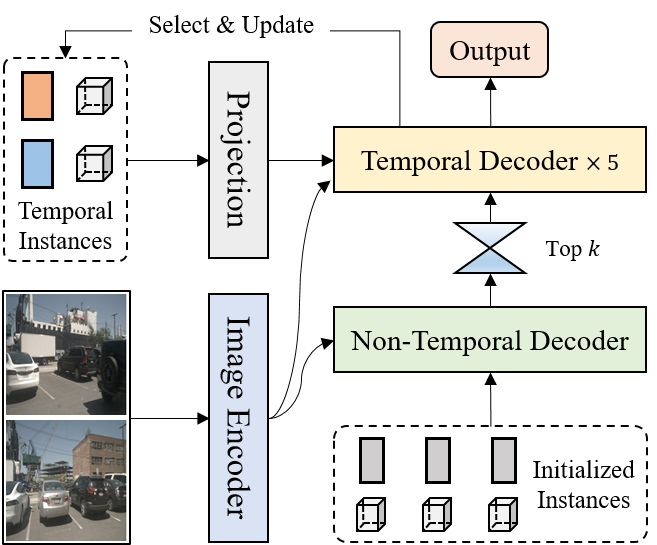
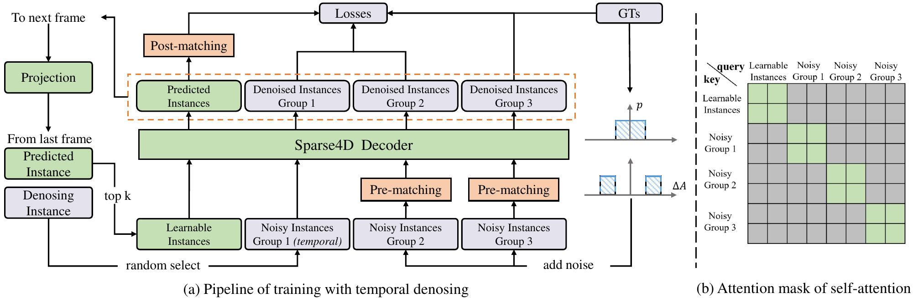
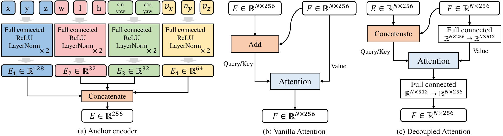
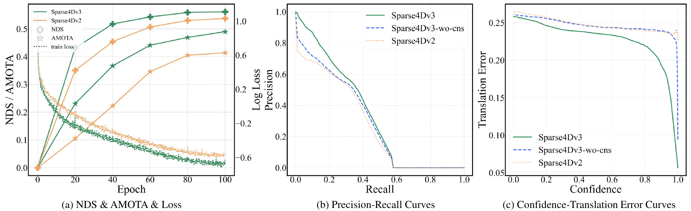

# Sparse4D v3 (arXiv 2023)

<!-- paper-source: https://chengwei920412.github.io/paper_reading/2311.11722_Sparse4D_v3_Advancing_End_to_End_3D_Detection_and_Tracking/technical_report.html -->

> **arXiv ID**: 2311.11722  
> **原文标题**: Sparse4D v3: Advancing End-to-End 3D Detection and Tracking  
> **翻译日期**: 2026-10-05

---

## 📋 论文概览 {#_1}

### 基本信息 {#_2}

- **作者**: Xuewu Lin、Zixiang Pei、Tianwei Lin、Lichao Huang、Zhizhong Su
- **机构**: 地平线机器人（Horizon Robotics）
- **发表时间**: 2023 年
- **领域**: 自动驾驶、多视角三维目标检测、三维多目标跟踪、端到端感知

### 核心贡献 {#_3}

Sparse4D v3 在 Sparse4D v2 的稀疏时序查询框架上加入三项改进：时序实例去噪、质量估计和解耦注意力。论文还指出，Sparse4D 的循环时序实例天然带有轨迹身份连续性，因此只需在推理阶段增加 ID 分配，就能把检测器扩展为端到端三维多目标跟踪器，无需跟踪 ID 标注、跟踪损失或额外微调。

以 ResNet50 为骨干网络时，Sparse4D v3 在 nuScenes 验证集达到 46.9% mAP、56.1% NDS 和 49.0% AMOTA，较 Sparse4D v2 分别提高 3.0、2.2 和 7.6 个百分点。采用 EVA02-Large 并融合未来 8 帧后，测试集 NDS 和 AMOTA 分别达到 71.9% 和 67.7%。

---

## 🎯 研究背景与动机 {#_4}

### 问题定义 {#_5}

自动驾驶感知需要从环视相机视频中持续估计目标的三维位置、尺度、朝向、速度和身份。稠密 BEV 方法先将图像特征转换到统一鸟瞰图空间；Sparse4D 则用一组稀疏三维实例查询直接采样多视角图像特征，并通过循环传播实现时序融合。

图：Sparse4D 以多视角视频为输入，通过稀疏实例查询输出各帧感知结果。

### 现有方法的局限性 {#_6}

- 一对一匹配在训练早期不稳定，正样本数量也少，导致稀疏查询解码器收敛困难。
- 分类置信度只回答“类别是否正确”，不能可靠反映三维框的位置与朝向质量，排序后的检测结果未必最准确。
- 原始 Sparse4D 将锚点嵌入与实例内容特征相加后计算注意力，不同模态会相互干扰，产生异常关联。
- 常规三维多目标跟踪依赖数据关联、轨迹滤波和大量超参数，端到端联合训练方法又通常需要真实轨迹 ID 和专门的跟踪约束。

### 本文的创新点 {#_7}

1. 将二维单帧去噪扩展到三维时序场景，让带噪查询也能随时间传播。
2. 显式预测中心度和偏航度，使置信度排序同时考虑分类、位置和朝向质量。
3. 通过特征拼接实现解耦注意力，减少锚点位置编码与实例内容特征的相互干扰。
4. 将时序实例重新解释为轨迹，以推理期 ID 分配实现无需额外训练的端到端跟踪。

---

## 🔬 方法论 {#_8}

### 整体架构 {#_9}

模型沿用 Sparse4D v2：图像编码器产生多尺度特征；解码器维护固定数量的稀疏实例，每个实例由隐式实例特征与显式三维锚点组成；上一帧排名靠前的实例经自车运动和速度补偿后传播至下一帧。Sparse4D v3 不重构主干，而是从训练监督、注意力计算和推理解释三个位置改进系统。

### 关键技术 {#_10}

#### 1. 时序实例去噪 {#1}

对每个真实三维框 \(A_{gt}\) 加入两种幅度的随机噪声，生成多组带噪锚点：

\[A_{noise}=\left\{A_i+\Delta A_{i,j,k}\mid i\in\mathbb{Z}_N,\ j\in\mathbb{Z}_M,\ k\in\mathbb{Z}_2\right\}.\]

不同于直接按噪声幅度指定正负样本，论文对每组带噪锚点与真实标注执行二分图匹配，避免“幅度较大的噪声反而更接近某个真实框”造成错误分配。训练每帧时，再随机选取 \(M&#x27;\) 组带噪实例传播到下一帧。注意力掩码隔离普通实例和各带噪组，保证一个真实目标在同组中最多对应一个正样本。

图：时序实例去噪的查询组成、跨帧传播方式和组间注意力掩码。

#### 2. 质量估计 {#2}

中心度衡量预测中心与真实中心的欧氏距离：

\[C=\exp\left(-\left\lVert[x,y,z]_{pred}-[x,y,z]_{gt}\right\rVert_2\right).\]

偏航度衡量预测朝向向量与真实朝向向量的点积：

\[Y=[\sin yaw,\cos yaw]_{pred}\cdot[\sin yaw,\cos yaw]_{gt}.\]

模型在分类置信度之外预测 \(C\) 与 \(Y\)，分别用焦点损失与交叉熵损失监督。推理排序时把中心度与分类置信度相乘，使高分框更可能具有较小平移误差。

#### 3. 解耦注意力 {#3}

普通 Sparse4D 将锚点嵌入 \(E\) 与实例特征 \(F\) 相加，随后用于查询间注意力。Sparse4D v3 改为分别编码锚点的不同分量，再将空间嵌入与内容特征拼接。这样既保留两类信息的独立性，又让多头注意力自主学习如何组合它们。

图：锚点各分量独立编码后与实例特征拼接的解耦注意力结构。

#### 4. 无需训练的跟踪扩展 {#4}

每个实例被重新定义为“ID 加逐帧边界框”的轨迹。实例置信度首次超过阈值 \(T\) 时获得一个永久 ID；低置信度的未锁定实例仍可传播。时序实例置信度使用系数 \(S\) 衰减，并由 top-k 策略自动完成轨迹生命周期管理。论文使用 \(T=0.25\)、\(S=0.6\)。

### 算法流程 {#_11}

1. 输入当前帧传感器数据、历史时序实例和当前可学习实例。
2. 解码器联合更新全部实例的三维框与置信度。
3. 对超过阈值且尚无 ID 的实例分配新 ID，并输出为感知结果。
4. 对历史实例执行置信度衰减保护。
5. 选取置信度最高的 \(N_t\) 个实例传播到下一帧。

---

## 📊 实验与结果 {#_12}

### 实验设置 {#_13}

- **数据集**: nuScenes，700/150/150 个训练、验证、测试场景；每个场景 20 秒、2 FPS、6 路相机。
- **评估指标**: 检测使用 mAP、mATE、mASE、mAOE、mAVE、mAAE、NDS；跟踪使用 AMOTA、AMOTP、Recall、IDS、MOTA、MOTP、MOTAR。
- **训练配置**: 6 层解码器、900 个实例、600 个时序实例、256 维嵌入、7 个固定关键点和 6 个可学习关键点；AdamW 训练 100 个轮次；不使用 CBGS。
- **对比方法**: BEVPoolv2、BEVFormer v2、SOLOFusion、VideoBEV、StreamPETR、DORT、DQTrack、QTrack、SRCN3D 等。

### 主要结果 {#_14}

<table>
<thead>
<tr>
<th>配置</th>
<th>mAP</th>
<th>NDS</th>
<th>AMOTA</th>
<th>关键结论</th>
</tr>
</thead>
<tbody>
<tr>
<td>Sparse4D v2, ResNet50, \(256\times704\)</td>
<td>0.439</td>
<td>0.539</td>
<td>0.414</td>
<td>基线</td>
</tr>
<tr>
<td>Sparse4D v3, ResNet50, \(256\times704\)</td>
<td>0.469</td>
<td>0.561</td>
<td>0.490</td>
<td>三项改进同时提升检测与跟踪</td>
</tr>
<tr>
<td>Sparse4D v3, ResNet101, \(512\times1408\)</td>
<td>0.537</td>
<td>0.623</td>
<td>0.567</td>
<td>保持约 8.2 FPS</td>
</tr>
<tr>
<td>Sparse4D v3, VoVNet-99, 测试集</td>
<td>0.570</td>
<td>0.656</td>
<td>0.574</td>
<td>测试集标准配置</td>
</tr>
<tr>
<td>Sparse4D v3, EVA02-Large + 8 未来帧</td>
<td>0.668</td>
<td>0.719</td>
<td>0.677</td>
<td>云端高算力配置</td>
</tr>
</tbody>
</table>

跟踪方面，ResNet50 配置的 AMOTA 为 0.490，高于同配置 DORT 的 0.424。ResNet101 配置相较 DQTrack 将 AMOTA 从 0.407 提高到 0.567，并将 IDS 从 1003 降至 557。

### 消融实验 {#_15}

<table>
<thead>
<tr>
<th>累积设置</th>
<th>mAP</th>
<th>mATE↓</th>
<th>mAVE↓</th>
<th>NDS</th>
<th>AMOTA</th>
</tr>
</thead>
<tbody>
<tr>
<td>Sparse4D v2</td>
<td>0.439</td>
<td>0.598</td>
<td>0.282</td>
<td>0.539</td>
<td>0.414</td>
</tr>
<tr>
<td>+ 单帧去噪</td>
<td>0.447</td>
<td>0.586</td>
<td>0.257</td>
<td>0.548</td>
<td>0.445</td>
</tr>
<tr>
<td>+ 解耦注意力</td>
<td>0.458</td>
<td>0.599</td>
<td>0.238</td>
<td>0.551</td>
<td>0.472</td>
</tr>
<tr>
<td>+ 时序去噪</td>
<td>0.462</td>
<td>0.581</td>
<td>0.246</td>
<td>0.557</td>
<td>0.457</td>
</tr>
<tr>
<td>+ 中心度</td>
<td>0.463</td>
<td>0.563</td>
<td>0.221</td>
<td>0.554</td>
<td>0.466</td>
</tr>
<tr>
<td>+ 偏航度（完整 v3）</td>
<td>0.469</td>
<td>0.553</td>
<td>0.227</td>
<td>0.561</td>
<td>0.490</td>
</tr>
</tbody>
</table>

解耦注意力主要提高 mAP 并降低速度误差；中心度显著降低平移误差，但会恶化朝向误差；偏航度弥补该副作用。各项改进之间并非完全单调，例如加入时序去噪后的 AMOTA 低于前一步，因此表格更适合被理解为累积设计路径，而非每个模块在所有指标上都独立增益。

图：Sparse4D v3 的训练收敛与质量排序曲线；中心度明显改善高置信度检测框的平移误差。

---

## 💡 关键见解 {#_16}

### 理论分析 {#_17}

论文的核心判断是：查询式检测器的“分类是否正确”和“几何框是否准确”是两个不同问题。一对一匹配让每个正查询都趋向高分类置信度，却不保证置信度能区分几何质量。中心度与偏航度把几何质量显式建模，改善评测前的排序步骤。

时序去噪的价值也不只是扩大正样本数量。它为跨帧循环查询提供了稳定、已知的匹配目标，使模型在训练早期就能学习“同一实例如何随时间传播”，降低匈牙利匹配波动对时序状态的污染。

### 实践启示 {#_18}

- 现有查询式三维检测器可优先尝试质量分支与查询去噪，而不必先扩大网络规模。
- 跟踪能力可能已经隐含在循环时序查询中；在设计复杂关联模块前，可先验证查询身份在帧间是否自然稳定。
- 检测分数应联合分类与几何质量，尤其在排行榜或安全阈值依赖高置信度样本时。
- 云端离线感知可通过未来帧和更大骨干网络换取显著性能，但不适用于严格在线系统。

---

## 🔍 局限性与未来工作 {#_19}

### 当前局限 {#_20}

1. 跟踪机制非常简化，ID 一旦分配便不更改，论文未深入讨论遮挡后重识别、长时消失、错误 ID 锁定或场景切换。
2. 跟踪阈值 \(T\)、衰减系数 \(S\) 与 top-k 容量仍是人工设定，不能完全等同于“无后处理超参数”。
3. 消融实验采用累积设置，缺少完整析因实验，难以精确量化各模块的独立贡献和交互作用。
4. 主要证据集中于 nuScenes，尚未验证跨数据集、恶劣天气、长尾类别和更高帧率视频上的泛化能力。
5. 使用未来帧的最佳配置是非因果的，不可直接用于实时在线驾驶。
6. 论文没有系统报告训练成本、吞吐量、延迟分解以及不同硬件上的内存占用。

### 未来方向 {#_21}

- 为查询身份设计可学习的生存、终止与重识别机制，同时保持端到端训练。
- 扩展到纯激光雷达和相机—激光雷达多模态输入。
- 在同一稀疏查询空间中继续集成预测、规划、在线建图、交通标志和信号灯检测。
- 将未来帧离线融合蒸馏到因果在线模型，缩小云端与车端性能差距。
- 在多数据集和分布外场景中检验质量估计分支是否仍能校准置信度。

---

## 📚 相关工作对比 {#_22}

<table>
<thead>
<tr>
<th>方法</th>
<th>核心思想</th>
<th>优势</th>
<th>劣势</th>
</tr>
</thead>
<tbody>
<tr>
<td>稠密 BEV 时序方法</td>
<td>将多视角图像转换到统一 BEV 网格后融合</td>
<td>规则空间表示，易接入稠密任务</td>
<td>视角变换和高分辨率 BEV 计算量较大</td>
</tr>
<tr>
<td>StreamPETR</td>
<td>以对象为中心进行时序建模和全局注意力融合</td>
<td>时序建模强、推理高效</td>
<td>全局交叉注意力随图像特征规模增长</td>
</tr>
<tr>
<td>DQTrack / MOTR 系列</td>
<td>用检测查询和轨迹查询联合训练跟踪</td>
<td>明确建模轨迹身份</td>
<td>需要跟踪约束、ID 标注或专门训练策略</td>
</tr>
<tr>
<td><strong>Sparse4D v3</strong></td>
<td>稀疏循环查询 + 时序去噪 + 质量估计 + 解耦注意力</td>
<td>检测与跟踪统一；无需跟踪微调；计算随感知范围增长较慢</td>
<td>生命周期机制简单；主要在单一基准验证</td>
</tr>
</tbody>
</table>

---

## 🎓 个人评价 {#_23}

### 优点 {#_24}

- 改进集中在训练稳定性和表示解耦，工程侵入性小，却同时提升检测与跟踪。
- “无需跟踪 ID 监督”的结果揭示了循环查询模型中值得利用的隐式轨迹一致性。
- 消融表覆盖 mAP、各类几何误差、NDS 和跟踪指标，能看出每项设计影响的具体维度。
- 质量估计直接针对置信度排序这一评测与部署中的关键环节，方法简单且可迁移。

### 可改进之处 {#_25}

- 需要更严格的独立消融、随机种子方差和统计显著性报告。
- 应补充 ID 生命周期失败案例、遮挡恢复和长序列稳定性的定量分析。
- 未来帧配置与在线配置应清晰分开，避免读者把离线结果当作实时能力。
- 若能报告质量分支的校准误差、精确率—召回率分解和不同类别收益，论证会更完整。

### 推荐阅读对象 {#_26}

适合研究 DETR 类三维检测、多摄像头时序融合、查询式跟踪和自动驾驶端到端感知的读者。对计划从 Sparse4D v2 升级、希望减少传统跟踪后处理，或需要理解“分类置信度与几何质量为何不一致”的工程团队尤其有参考价值。

---

## 📎 附录 {#_27}

### 重要公式 {#_28}

1. 带噪锚点：\(A_{noise}=A_i+\Delta A_{i,j,k}\)。
2. 中心度：\(C=\exp(-\lVert p_{pred}-p_{gt}\rVert_2)\)。
3. 偏航度：\(Y=[\sin yaw,\cos yaw]_{pred}\cdot[\sin yaw,\cos yaw]_{gt}\)。
4. 质量损失：\(L=\lambda_1\mathrm{CE}(Y_{pred},Y)+\lambda_2\mathrm{Focal}(C_{pred},C)\)。

### 术语表 {#_29}

<table>
<thead>
<tr>
<th>英文</th>
<th>中文</th>
<th>含义</th>
</tr>
</thead>
<tbody>
<tr>
<td>Temporal Instance Denoising</td>
<td>时序实例去噪</td>
<td>将带噪查询跨帧传播的辅助训练任务</td>
</tr>
<tr>
<td>Quality Estimation</td>
<td>质量估计</td>
<td>显式预测边界框几何质量</td>
</tr>
<tr>
<td>Decoupled Attention</td>
<td>解耦注意力</td>
<td>以拼接方式融合空间嵌入与内容特征</td>
</tr>
<tr>
<td>Centerness</td>
<td>中心度</td>
<td>预测中心与真实中心的接近程度</td>
</tr>
<tr>
<td>Yawness</td>
<td>偏航度</td>
<td>预测朝向与真实朝向的一致程度</td>
</tr>
<tr>
<td>Temporal Instance</td>
<td>时序实例</td>
<td>从历史帧循环传播的稀疏查询</td>
</tr>
<tr>
<td>Tracking-by-Detection</td>
<td>检测后跟踪</td>
<td>在检测结果上执行数据关联与滤波</td>
</tr>
</tbody>
</table>

### 参考资源 {#_30}

- **论文原文**: [arXiv 链接](https://arxiv.org/abs/2311.11722)
- **中文翻译 PDF**: [paper_cn.pdf](https://chengwei920412.github.io/paper_reading/2311.11722_Sparse4D_v3_Advancing_End_to_End_3D_Detection_and_Tracking/paper_cn.pdf)
- **中文 Markdown 译文**: [paper_cn.md](https://chengwei920412.github.io/paper_reading/2311.11722_Sparse4D_v3_Advancing_End_to_End_3D_Detection_and_Tracking/paper_cn.html)
- **代码实现**: [Sparse4D GitHub](https://github.com/linxuewu/Sparse4D)
- **项目主页**: 论文未单独提供项目主页
