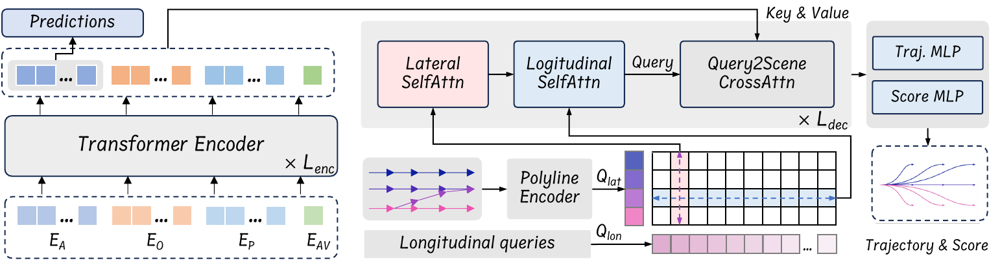
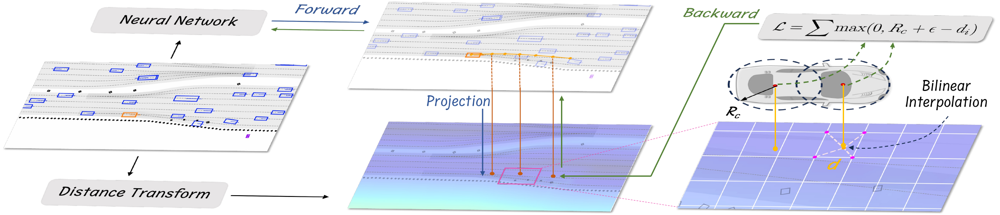
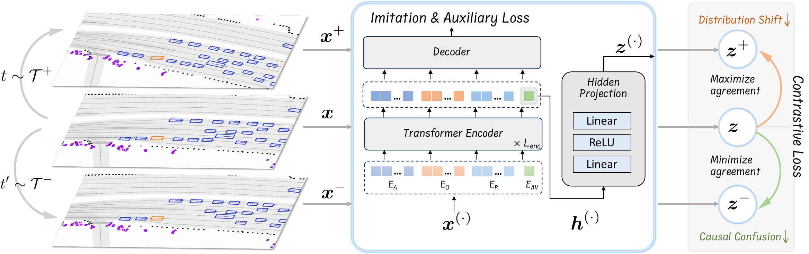

# PLUTO (arXiv 2024)

<!-- paper-source: https://chengwei920412.github.io/paper_reading/2404.14327_Pluto_Pushing_the_Limit_of_Imitation_Learning_based_Planning_for_Autonomous_Driving/technical_report.html -->

> 原文链接：[PLUTO (arXiv 2024)](https://chengwei920412.github.io/paper_reading/2404.14327_Pluto_Pushing_the_Limit_of_Imitation_Learning_based_Planning_for_Autonomous_Driving/technical_report.html)

> **arXiv ID**：2404.14327  
> **原文标题**：*Pluto: Pushing the Limit of Imitation Learning-based Planning for Autonomous Driving*  
> **翻译日期**：2026-10-15

---

## 📋 论文概览 {#_1}

### 基本信息 {#_2}

- **作者**：Jie Cheng、Yingbing Chen、Qifeng Chen
- **机构**：香港科技大学
- **发表时间**：2024 年（arXiv）
- **领域**：自动驾驶、模仿学习、运动规划、对比学习

### 核心贡献 {#_3}

Pluto 是面向真实世界自动驾驶的中间到中间规划框架。它不直接处理原始图像，而是接收感知后的智能体、静态障碍物、矢量地图与交通信号等结构化输入。论文的核心贡献包括：

1. 通过横向参考线查询与可学习纵向查询联合生成多模态候选轨迹，显式建模横向和纵向驾驶行为。
2. 以可微插值查询代价图，为碰撞、驶离道路等约束提供可批量计算的辅助损失。
3. 提出对比模仿学习（Contrastive Imitation Learning, CIL），利用正负数据增强向模型注入因果和交互知识。
4. 结合学习分数、闭环推演和规则检查进行候选轨迹选择，在 nuPlan Val14 基准上取得 93.21 分，首次超过论文对比中的规则规划器 PDM-Closed（93.08）。

---

## 🎯 研究背景与动机 {#_4}

### 问题定义 {#_5}

传统模仿学习规划器通常只需复现专家轨迹，但自动驾驶闭环执行存在三个额外难点：

- 多模态性：同一场景中可能同时存在跟车、变道、绕行等合理行为。
- 闭环分布偏移：规划误差会随时间积累，使车辆进入训练数据很少覆盖的状态。
- 因果混淆与捷径学习：模型可能只是模仿周围车辆减速，而没有真正理解红灯、前车或交互关系。

### 现有方法的局限性 {#_6}

纯模仿损失无法直接约束碰撞和驶离道路；基于栅格化的辅助损失又需要将每个轨迹点渲染成图像，计算和显存成本较高。常见的无锚多模态解码器还容易发生模式坍缩，只学到不同加减速策略，却很少产生真正的横向动作。

### 本文的创新点 {#_7}

Pluto 将问题拆为“候选生成—行为约束—候选选择”三层：结构化查询保证候选多样性，可微辅助损失和 CIL 改善训练信号，最后用闭环推演及安全检查选择轨迹。三部分分别针对模型表达能力、训练分布与部署安全性。

---

## 🔬 方法论 {#_8}

### 整体架构 {#_9}

图：Pluto 的整体网络架构。

场景编码器将 AV 状态、动态智能体历史、静态障碍物和矢量地图编码为统一的场景表示。轨迹解码器用附近参考线初始化横向查询 \(Q_{lat}\)，用可学习嵌入初始化纵向查询 \(Q_{lon}\)，再通过分解式横向—纵向自注意力融合两者。相较于对全部 \(N_RN_L\) 个组合直接执行注意力，分解计算将复杂度从 \(\mathcal{O}(N_R^2N_L^2)\) 降至 \(\mathcal{O}(N_R^2N_L+N_RN_L^2)\)。

### 关键技术 {#_10}

**1. 半锚式多模态轨迹解码**

横向查询绑定道路拓扑中的参考线，纵向查询表示不同的速度或进度模式。两者笛卡尔组合形成候选轨迹，使网络能够同时考虑跟车、制动、变道和绕行。另设不依赖参考线的解码头，用于停车场等缺少有效参考线的场景。

**2. 可微辅助损失**

图：基于代价图与双线性插值的辅助损失。

论文用若干覆盖圆近似车身，并将不可行驶区域转换为欧氏符号距离场（ESDF）。对每个轨迹点的圆心执行双线性插值，得到距离 \(d_i^t\)；若距离小于覆盖圆半径与安全余量之和，就产生铰链损失：

\[\mathcal{L}_{aux}=\frac{1}{T_f}\sum_{t=1}^{T_f}\sum_{i=1}^{N_c}\max(0,R_c+\epsilon-d_i^t).\]

该过程无需逐点渲染图像，可在现代深度学习框架中批量计算并端到端反向传播。更换代价图后，同一机制还能表示碰撞等其他约束。

**3. 对比模仿学习**

图：CIL 的正样本、负样本与三元组对比目标。

每个训练样本分别执行正增强和负增强。正增强保持原真值有效，例如状态扰动和非交互智能体丢弃；负增强改变因果结构，例如移除前车、插入前车、移除交互智能体或反转信号灯。CIL 拉近原始样本与正样本的潜在表示，同时推远负样本：

\[\mathcal{L}_{c}=-\log\frac{\exp(\operatorname{sim}(\bm z,\bm z^+)/\sigma)}{\exp(\operatorname{sim}(\bm z,\bm z^+)/\sigma)+\exp(\operatorname{sim}(\bm z,\bm z^-)/\sigma)}.\]

总损失由模仿损失、智能体预测损失、辅助损失和对比损失加权组成。

### 算法流程 {#_11}

1. 编码 AV、智能体、障碍物、地图和信号灯等场景特征。
2. 组合横向参考线查询与纵向查询，解码 \(N_RN_L\) 条候选轨迹及学习分数。
3. 按学习分数保留 Top-K 候选。
4. 用 LQR 跟踪器和运动学自行车模型进行闭环前向推演。
5. 依据进度、舒适性、交通规则与预测碰撞风险计算规则分数。
6. 用 \(\bm\pi_{rule}+\alpha\bm\pi_0\) 融合规则分数和学习分数，选择最终轨迹。

---

## 📊 实验与结果 {#_12}

### 实验设置 {#_13}

- **数据集**：nuPlan，约 1,300 小时真实驾驶数据、最多 75 种标注场景；训练使用跨场景采样的 100 万帧。
- **评估集**：Val14，共 1,090 个场景；每个闭环仿真持续 15 秒，频率为 10 Hz。
- **主要指标**：非反应式闭环总分，以及碰撞、TTC、可行驶区域、舒适性、进度、限速和行驶方向等分项指标。
- **训练配置**：4 张 RTX 3090、批大小 128、25 个 epoch；CIL 训练约 45 小时，不使用 CIL 时约 22 小时。
- **对比方法**：IDM、PDM-Closed、PDM-Open、GC-PGP、RasterModel、UrbanDriver、PlanTF、GameFormer 和 PlanTF-H。

### 主要结果 {#_14}

<table>
<thead>
<tr>
<th>方法</th>
<th>类型</th>
<th>Val14 总分</th>
<th>碰撞指标</th>
<th>TTC</th>
<th>可行驶区域</th>
</tr>
</thead>
<tbody>
<tr>
<td>PlanTF</td>
<td>纯学习</td>
<td>85.30</td>
<td>94.13</td>
<td>90.73</td>
<td>96.79</td>
</tr>
<tr>
<td>Pluto\(^\dagger\)（无后处理）</td>
<td>纯学习</td>
<td>89.04</td>
<td>96.18</td>
<td>93.28</td>
<td>98.53</td>
</tr>
<tr>
<td>PDM-Closed</td>
<td>规则</td>
<td>93.08</td>
<td>98.07</td>
<td>93.30</td>
<td>99.82</td>
</tr>
<tr>
<td><strong>Pluto</strong></td>
<td>混合</td>
<td><strong>93.21</strong></td>
<td><strong>98.30</strong></td>
<td><strong>94.04</strong></td>
<td>99.72</td>
</tr>
<tr>
<td>专家日志回放</td>
<td>专家</td>
<td>93.68</td>
<td>98.76</td>
<td>94.40</td>
<td>98.07</td>
</tr>
</tbody>
</table>

纯学习版 Pluto 相比 PlanTF 总分提高 3.74，且三个安全相关指标均明显改善。带后处理的 Pluto 以 93.21 分略高于 PDM-Closed 的 93.08，并接近日志回放专家的 93.68。需要注意，提升并非在所有分项上都占优：PDM-Closed 的可行驶区域和限速指标仍略高，Pluto 的优势主要体现在综合性能、碰撞/TTC、进度及横向行为灵活性。

### 消融实验 {#_15}

组件逐步加入时，总分呈现清晰增长：

<table>
<thead>
<tr>
<th>模型</th>
<th>新增组件</th>
<th>总分</th>
</tr>
</thead>
<tbody>
<tr>
<td>\(\mathcal{M}_0\)</td>
<td>查询式基础模型</td>
<td>87.04</td>
</tr>
<tr>
<td>\(\mathcal{M}_1\)</td>
<td>状态丢弃编码器</td>
<td>89.64</td>
</tr>
<tr>
<td>\(\mathcal{M}_2\)</td>
<td>辅助损失</td>
<td>90.03</td>
</tr>
<tr>
<td>\(\mathcal{M}_3\)</td>
<td>无参考线解码头</td>
<td>90.69</td>
</tr>
<tr>
<td>\(\mathcal{M}_4\)</td>
<td>CIL</td>
<td>91.66</td>
</tr>
<tr>
<td>\(\mathcal{M}_5\)</td>
<td>后处理</td>
<td>93.57</td>
</tr>
</tbody>
</table>

辅助损失将碰撞指标从 97.37 提高到 97.98、可行驶区域指标从 97.57 提高到 98.38；CIL 将总分从 90.69 提高到 91.66；后处理进一步提高到 93.57，但因安全检查触发更多紧急停车，舒适性有所下降。纵向查询数以 \(N_L=12\) 最佳；粗选采用 \(K=20\)；学习分数权重采用 \(\alpha=0.3\)。

---

## 💡 关键见解 {#_16}

### 理论与方法层面的启示 {#_17}

- 多模态不应只靠无结构的查询数量堆叠。把驾驶行为分解为横向道路选择与纵向速度模式，为候选轨迹赋予了更明确的结构先验。
- CIL 的价值不只是学习通用表征，而是通过设计负增强主动改变场景因果结构，使模型必须关注前车、交互智能体和交通灯。
- 可微代价查询在“学习式规划”和“优化式规划”之间建立接口：约束仍可解释，但损失能够参与端到端训练。
- 规则模块在这里不是轨迹优化器，而是候选选择器，因此不会改写网络生成的轨迹，也更便于分析学习模块自身能力。

### 实践启示 {#_18}

如果要复现或落地 Pluto，优先级应是：先保证候选轨迹具有横纵向多样性，再加入批量可微安全损失，最后使用闭环推演和轻量规则检查。仅追求开环轨迹误差不足以预测闭环规划性能。

---

## 🔍 局限性与未来工作 {#_19}

### 当前局限 {#_20}

1. 对每个动态智能体只预测一条轨迹，无法完整描述多智能体联合多模态未来。
2. 后处理只能从已有候选中选择；如果全部候选都不安全，规则检查器无法生成新的可行轨迹。
3. 最佳系统仍依赖手工规则分数与超参数 \(K\)、\(\alpha\)，尚未成为完全端到端的规划器。
4. 主要结论来自 nuPlan Val14；跨城市、极端天气、传感器误差和真实车辆闭环部署的泛化能力仍需验证。
5. CIL 将训练时间从约 22 小时提高到 45 小时，表示增强带来的性能收益伴随近一倍训练成本。

### 未来方向 {#_21}

- 建模多智能体联合多模态预测，并让规划器显式利用预测不确定性。
- 将安全评估提前到解码过程，通过可微约束或引导式生成直接修正候选分布。
- 研究可学习但具备安全边界的评分器，减少手工规则权重。
- 对正负增强进行自动发现或课程学习，扩展到施工、紧急车辆和罕见交互场景。
- 在更多城市、不同地图质量和真实车辆平台上开展闭环验证。

---

## 📚 相关工作对比 {#_22}

<table>
<thead>
<tr>
<th>方法</th>
<th>核心思想</th>
<th>优势</th>
<th>局限</th>
</tr>
</thead>
<tbody>
<tr>
<td>PlanTF</td>
<td>强化纯模仿学习设计</td>
<td>架构简洁，纯学习基线强</td>
<td>横向行为与显式安全约束有限</td>
</tr>
<tr>
<td>PDM-Closed</td>
<td>多组 IDM 策略加规则评分</td>
<td>安全稳定，Val14 分数高</td>
<td>主要偏向速度规划，横向机动能力有限</td>
</tr>
<tr>
<td>GameFormer</td>
<td>联合交互预测与规划，再用优化器细化</td>
<td>显式建模交互</td>
<td>优化器会增加复杂度并掩盖学习模块性能</td>
</tr>
<tr>
<td><strong>Pluto</strong></td>
<td>横纵向查询、可微辅助损失、CIL 与候选选择</td>
<td>候选多样、闭环性能强、安全约束可训练</td>
<td>仍依赖后处理和单模态智能体预测</td>
</tr>
</tbody>
</table>

---

## 🎓 综合评价 {#_23}

### 优点 {#_24}

- 问题拆解清晰，三个创新分别对应候选多样性、安全约束与因果学习。
- 设计兼顾学习能力和工程安全性，既有端到端损失，也保留部署阶段的安全检查。
- 实验不仅比较总分，还给出组件、查询数量、Top-K、分数权重和预测方式等消融。
- 定量结果与定性案例共同说明 Pluto 的横向机动能力，而不只是速度控制改进。

### 可改进之处 {#_25}

- 论文可进一步报告运行时、显存、参数量及不同候选规模下的实时性。
- CIL 的每一种增强可单独消融，以确定性能提升来自哪些因果干预。
- 需要更严格评估规则后处理对最终提升的贡献，以及完全纯学习版本在不同闭环分布下的稳定性。

### 推荐阅读对象 {#_26}

适合从事自动驾驶规划、模仿学习、轨迹预测、可微优化和闭环基准研究的读者，尤其适合作为“如何把学习式规划从开环误差优化推进到闭环安全性能”的工程案例。

---

## 📎 附录 {#_27}

### 术语表 {#_28}

<table>
<thead>
<tr>
<th>英文</th>
<th>中文</th>
</tr>
</thead>
<tbody>
<tr>
<td>Imitation-based Planning</td>
<td>基于模仿学习的规划</td>
</tr>
<tr>
<td>Longitudinal / Lateral</td>
<td>纵向 / 横向</td>
</tr>
<tr>
<td>Contrastive Imitation Learning (CIL)</td>
<td>对比模仿学习</td>
</tr>
<tr>
<td>Auxiliary Loss</td>
<td>辅助损失</td>
</tr>
<tr>
<td>Differentiable Interpolation</td>
<td>可微插值</td>
</tr>
<tr>
<td>Distribution Shift</td>
<td>分布偏移</td>
</tr>
<tr>
<td>Causal Confusion</td>
<td>因果混淆</td>
</tr>
<tr>
<td>Rollout</td>
<td>推演轨迹</td>
</tr>
</tbody>
</table>

### 参考资源 {#_29}

- **论文原文**：[arXiv:2404.14327](https://arxiv.org/abs/2404.14327)
- **中文翻译 PDF**：[paper_cn.pdf](https://chengwei920412.github.io/paper_reading/2404.14327_Pluto_Pushing_the_Limit_of_Imitation_Learning_based_Planning_for_Autonomous_Driving/paper_cn.pdf)
- **中文 Markdown 译文**：[paper_cn.md](https://chengwei920412.github.io/paper_reading/2404.14327_Pluto_Pushing_the_Limit_of_Imitation_Learning_based_Planning_for_Autonomous_Driving/paper_cn.html)
- **代码实现**：[GitHub](https://github.com/jchengai/pluto)
- **项目主页**：[Pluto](https://jchengai.github.io/pluto)
