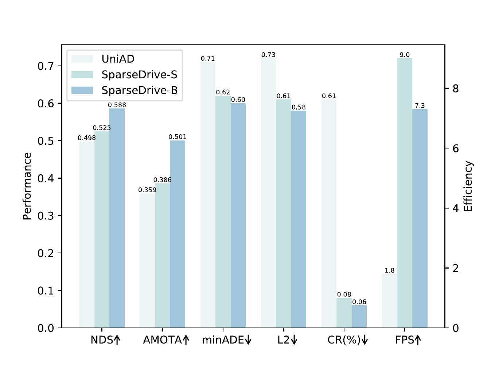
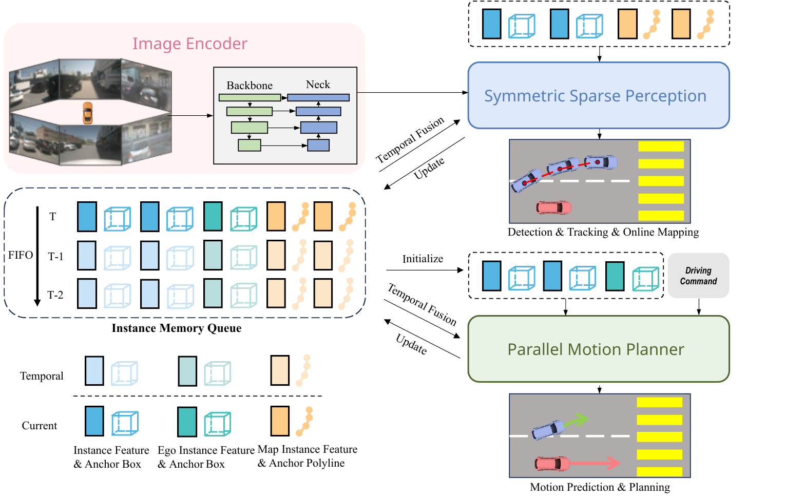
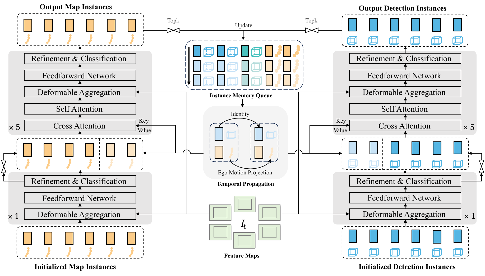
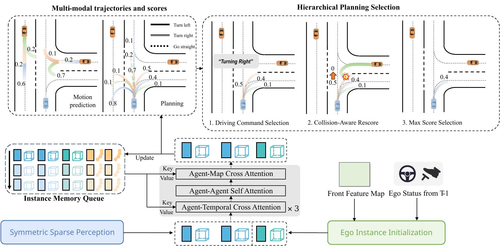

# SparseDrive (arXiv 2024)

<!-- paper-source: https://chengwei920412.github.io/paper_reading/2405.19620_SparseDrive_End_to_End_Autonomous_Driving_via_Sparse_Scene_Representation/technical_report.html -->

> **arXiv ID**：2405.19620  
> **原文标题**：SparseDrive: End-to-End Autonomous Driving via Sparse Scene Representation  
> **翻译日期**：2026-10-05

---

## 📋 论文概览 {#_1}

### 基本信息 {#_2}

- **作者**：Wenchao Sun、Xuewu Lin、Yining Shi、Chuang Zhang、Haoran Wu、Sifa Zheng
- **机构**：清华大学、地平线
- **发表时间**：2024
- **领域**：端到端自动驾驶、视觉感知、运动预测与规划

SparseDrive试图解决端到端自动驾驶中两个相互关联的问题：一是稠密BEV特征带来的高计算与存储开销，二是现有方法将运动预测与规划串行处理、对规划采用单模态确定性输出，未充分利用二者在交互建模、语义与几何信息以及多模态不确定性方面的共性。论文以稀疏实例统一表示动态交通参与者、静态地图元素和自车，并在同一框架内完成检测、跟踪、在线建图、运动预测与规划。

### 核心贡献 {#_3}

1. 提出以稀疏表示为中心的端到端自动驾驶范式SparseDrive，避免依赖稠密BEV特征，以实例特征和几何锚点构建稀疏场景表示。
2. 提出对称稀疏感知模块，以结构对称的检测和在线建图分支统一多视角3D检测、端到端跟踪与在线建图。
3. 提出并行运动规划器，将运动预测与规划视为并行的多模态轨迹预测问题；通过自车实例初始化、实例记忆队列和交通参与者级时空交互显式建模自车与周围交通参与者的双向影响。
4. 提出分层规划选择与碰撞感知重打分，从多模态候选中选择符合驾驶指令且碰撞风险低的轨迹。
5. 在nuScenes上同时提升全部任务性能和运行效率。SparseDrive-B取得49.6 mAP、58.8 NDS、50.1 AMOTA、56.2在线建图mAP，以及0.58 m规划平均L2误差和0.06%碰撞率。

图1：以BEV为中心的范式与SparseDrive稀疏范式在结构、性能和效率上的对比。

---

## 🎯 研究背景与动机 {#_4}

### 问题定义 {#_5}

传统自动驾驶栈将感知、预测和规划拆为顺序执行的独立模块，便于调试和解释，却会在接口处丢失信息并累积误差。端到端方法把多项任务纳入可微框架，可围绕最终规划目标联合优化，但仍需回答三个核心问题：如何高效表示复杂驾驶场景，如何建模交通参与者与自车之间的双向交互，以及如何在未来具有多种可能性的条件下输出安全规划。

### 现有方法的局限性 {#_6}

- **稠密BEV计算昂贵**：以BEV为中心的方法需要构建并反复处理大面积稠密特征，训练和推理开销较高。
- **预测与规划串行割裂**：先预测周围交通参与者、再规划自车轨迹的流程忽略了自车行为会反过来影响其他交通参与者。
- **自车表示不足**：现有方法会为外部目标提取语义与几何信息，却常随机初始化自车查询，造成信息不对称。
- **规划的确定性假设过强**：驾驶未来本质上是多模态的，单轨迹输出难以覆盖不同合理意图，也更容易产生碰撞。
- **后优化可能破坏端到端学习**：基于人工代价和规则的后处理与训练目标不一致，未必真正提升安全性。

### 本文的创新点 {#_7}

SparseDrive把每个动态目标或静态地图元素压缩为“实例特征＋几何锚点”，仅围绕少量实例进行特征聚合和交互。更重要的是，论文并非只替换场景表示，而是同步重构任务关系：运动预测和规划共享交通参与者级交互，并行生成多模态轨迹；规划端再按高层驾驶指令和碰撞风险分层筛选。该设计使“感知稀疏化”和“任务结构重组”共同服务于规划性能。

---

## 🔬 方法论 {#_8}

### 整体架构 {#_9}

SparseDrive包含三个部分：

1. **图像编码器**将多相机图像转换为多尺度特征图。
2. **对称稀疏感知**从图像特征中生成周围交通参与者实例与地图元素实例，统一完成检测、跟踪和在线建图。
3. **并行运动规划器**把周围交通参与者实例、地图实例和初始化后的自车实例置于同一交互空间，同时预测周围交通参与者与自车的多模态轨迹，再选择安全的规划结果。

图2：SparseDrive整体架构。多视角图像经过稀疏感知后形成实例级场景表示，再进入并行运动预测与规划流程。

### 关键技术 {#_10}

#### 1. 对称稀疏感知 {#1}

动态交通参与者由实例特征 \(F_d\in\mathbb{R}^{N_d\times C}\) 与11维锚框 \(B_d\in\mathbb{R}^{N_d\times11}\) 表示；静态地图元素由地图实例特征 \(F_m\in\mathbb{R}^{N_m\times C}\) 与锚折线 \(L_m\in\mathbb{R}^{N_m\times N_p\times2}\) 表示。检测和在线建图分支共享相同的解码器逻辑，仅几何锚点定义不同，因此形成对称结构。

每个解码器利用锚点在多视角特征图上执行可变形特征聚合，经前馈网络更新实例特征并细化几何锚点。一个非时序解码器处理随机初始化实例，其余时序解码器通过时序交叉注意力和当前实例自注意力融合历史信息。跟踪直接沿用时序实例身份：当检测置信度超过阈值时分配ID，ID在后续传播中保持不变，无需额外跟踪损失。

图3：对称稀疏感知以对应结构处理动态目标和静态地图元素，并通过时序实例传播实现跟踪。

#### 2. 自车实例与实例记忆队列 {#2}

自车同样由实例特征 \(F_e\) 与锚框 \(B_e\) 表示。由于自车处于相机盲区，无法像周围目标一样从自身投影区域采样图像特征，论文使用前视相机最小尺度特征图的全局平均池化结果初始化自车特征：

\[F_e={\rm AveragePool}(I_{front,S}).\]

这既提供场景语义上下文，也保留稠密特征对类别外障碍物的补充信息。自车锚框的位置、尺寸和偏航角可直接设定；为避免真实速度造成状态泄露，模型预测速度、加速度、角速度和转向角等自车状态，并用上一帧预测速度初始化当前帧。

实例记忆队列的尺寸为\((N_d+1)\times H\)，实验中\(H=3\)。它存储自车和周围交通参与者的历史实例，使当前实例能够聚合自身历史，而不是无差别地与整个历史场景交互。

#### 3. 并行运动规划器 {#3}

自车实例与周围交通参与者实例先拼接为统一的交通参与者集合：

\[F_a={\rm Concat}(F_d,F_e),\qquad B_a={\rm Concat}(B_d,B_e).\]

随后依次执行交通参与者时序交叉注意力、交通参与者间自注意力，以及交通参与者与地图间交叉注意力。运动预测与规划使用不同的模态查询，但共享上述交互上下文，同时输出轨迹及置信度。实验中运动预测和规划均使用6个模态；预测未来12个时间戳，规划未来6个时间戳。

图4：并行运动规划器通过实例级时空交互同时生成周围交通参与者和自车的多模态轨迹。

#### 4. 分层规划选择与碰撞感知重打分 {#4}

规划选择分两层进行：先按左转、右转或直行等高层指令选择对应的候选轨迹子集，再利用运动预测结果估计每条候选轨迹的碰撞风险。实现中，模型取每个周围交通参与者置信度最高的两条预测轨迹进行碰撞检测，并将发生碰撞的自车候选轨迹分数置零，最终输出剩余候选中得分最高者。该机制不额外优化轨迹形状，因而比规则式后优化更好地保持了学习模型的原始分布。

#### 5. 两阶段端到端训练 {#5}

第一阶段从头训练对称稀疏感知模块，先获得稳定的稀疏场景表示；第二阶段加入并行运动规划器，联合训练全部模块且不冻结权重。SparseDrive-S两个阶段分别训练100和10轮，SparseDrive-B分别训练80和10轮。总损失为：

\[\mathcal{L}=\mathcal{L}_{det}+\mathcal{L}_{map}+\mathcal{L}_{motion}+\mathcal{L}_{plan}+\mathcal{L}_{depth}.\]

检测和建图采用分类损失与回归损失，运动预测和规划采用胜者全得策略：以平均位移误差最小的模态作为正样本，再施加Focal分类损失与L1回归损失；规划还加入自车状态回归损失。深度估计作为辅助任务，提高感知训练稳定性。

### 算法流程 {#_11}

1. 编码多相机图像，得到多尺度图像特征。
2. 以锚框和锚折线为几何先验，通过对称稀疏解码器更新交通参与者与地图实例。
3. 将高置信度动态实例写入时序传播流程并维持ID，实现端到端跟踪。
4. 从前视相机特征初始化自车实例，并由历史预测补充自车运动状态。
5. 将自车、周围交通参与者和地图实例输入并行运动规划器，完成实例级时空交互。
6. 同时输出周围交通参与者和自车的多模态未来轨迹及分数。
7. 按驾驶指令筛选规划模态，通过碰撞感知重打分抑制高风险候选，输出最终轨迹。

---

## 📊 实验与结果 {#_12}

### 实验设置 {#_13}

- **数据集**：nuScenes验证集；包含1000个复杂驾驶场景，每段约20秒。
- **模型变体**：SparseDrive-S采用ResNet50和\(256\times704\)输入；SparseDrive-B采用ResNet101和\(512\times1408\)输入。
- **训练硬件**：8块NVIDIA RTX 4090 24GB GPU。
- **评估指标**：检测使用mAP和NDS等；跟踪使用AMOTA、AMOTP、Recall和IDS；在线建图使用mAP；运动预测使用minADE、minFDE、MR和EPA；规划使用平均L2误差和碰撞率。
- **对比方法**：UniAD、VAD、ST-P3、ViP3D、PnPNet、MapTR、VectorMapNet等模块化与端到端方法。

论文重新实现了规划碰撞率：根据轨迹估计自车偏航角，并直接检测自车边界框与障碍物边界框是否重叠，避免粗粒度占用栅格以及固定自车航向造成的误判。UniAD和VAD的规划结果使用官方检查点在该指标下复现。

### 主要结果 {#_14}

<table>
<thead>
<tr>
<th>任务</th>
<th>SparseDrive-B结果</th>
<th>结论</th>
</tr>
</thead>
<tbody>
<tr>
<td>3D检测</td>
<td>mAP <strong>49.6</strong>，NDS <strong>58.8</strong></td>
<td>相比UniAD分别提高11.6和9.0个百分点</td>
</tr>
<tr>
<td>多目标跟踪</td>
<td>AMOTA <strong>50.1</strong>，IDS <strong>632</strong></td>
<td>相比UniAD，AMOTA提高14.2个百分点，IDS减少30.2%</td>
</tr>
<tr>
<td>在线建图</td>
<td>mAP <strong>56.2</strong></td>
<td>相比端到端方法VAD提高8.6个百分点</td>
</tr>
<tr>
<td>运动预测</td>
<td>minADE <strong>0.60 m</strong>，minFDE <strong>0.96 m</strong>，MR <strong>13.2%</strong>，EPA <strong>0.555</strong></td>
<td>四项指标均为表中最佳</td>
</tr>
<tr>
<td>规划</td>
<td>平均L2 <strong>0.58 m</strong>，碰撞率 <strong>0.06%</strong></td>
<td>相比VAD，L2降低19.4%，碰撞率降低71.4%</td>
</tr>
</tbody>
</table>

效率方面，UniAD训练总时长为144小时、推理速度为1.8 FPS；SparseDrive-B训练30小时、推理7.3 FPS，分别达到约**4.8倍**与**4.1倍**加速；SparseDrive-S训练20小时、推理9.0 FPS，分别达到**7.2倍**与**5.0倍**加速。需要注意，UniAD效率在Tesla A100上测得，而SparseDrive使用RTX 4090，因此墙钟时间不能完全等同于同硬件公平比较；不过SparseDrive-S的192 GFLOPs也显著低于UniAD的1709 GFLOPs，仍能支持其计算效率优势。

### 消融实验 {#_15}

<table>
<thead>
<tr>
<th>设计变化</th>
<th>关键结果</th>
<th>说明</th>
</tr>
</thead>
<tbody>
<tr>
<td>完整SparseDrive-S</td>
<td>minADE 0.623；平均L2 0.61 m；碰撞率0.08%</td>
<td>消融基准</td>
</tr>
<tr>
<td>并行改为串行</td>
<td>minADE升至0.641；碰撞率升至0.10%</td>
<td>自车与周围交通参与者的双向交互有效</td>
</tr>
<tr>
<td>移除自车实例初始化</td>
<td>平均L2升至0.63 m；碰撞率升至0.11%</td>
<td>自车语义与几何信息有助于规划</td>
</tr>
<tr>
<td>单模态确定性规划</td>
<td>平均L2升至0.69 m；碰撞率升至0.25%</td>
<td>多模态建模对安全尤为关键</td>
</tr>
<tr>
<td>移除交通参与者时序注意力</td>
<td>平均L2升至0.77 m；碰撞率升至0.16%</td>
<td>实例级历史是规划精度的重要来源</td>
</tr>
<tr>
<td>移除碰撞感知重打分</td>
<td>碰撞率由0.08%升至0.12%</td>
<td>重打分几乎不增加L2误差即可改善安全性</td>
</tr>
</tbody>
</table>

进一步比较显示，给SparseDrive加入UniAD式后优化后，平均L2从0.61 m恶化到0.76 m，碰撞率从0.12%升至0.30%；相反，碰撞感知重打分将碰撞率从0.12%降至0.08%，平均L2保持0.61 m。规划模态数从1增加到6时，平均L2由0.69 m降至0.61 m，碰撞率由0.25%降至0.07%；增加到9个模态后反而退化，说明6个模态已接近性能与复杂度的平衡点。

---

## 💡 关键见解 {#_16}

### 理论分析 {#_17}

1. **统一表示比统一任务名称更重要**：SparseDrive并非简单把多个任务放进同一网络，而是让动态目标、地图元素和自车都拥有可交互的实例级表示，减少任务间信息接口的不对称。
2. **规划可以视为特殊的运动预测**：二者都需要语义与几何信息、时空交互以及多模态输出。区别主要在于规划受驾驶指令约束并承担更强的安全要求，因此适合共享主体结构，再增加分层选择机制。
3. **稀疏化与性能并不冲突**：只要实例锚点能稳定聚合局部图像证据并进行时序传播，稀疏表示既可降低计算量，也能保留规划所需的对象级结构。
4. **安全模块应尽量与模型输出对齐**：直接修改轨迹的后优化可能造成分布偏移；只对候选模态重打分能利用预测到的交互风险，同时避免破坏已学习的轨迹几何。

### 实践启示 {#_18}

- 构建端到端驾驶系统时，应同时优化场景表示和任务拓扑，仅将稠密特征替换为稀疏查询并不足以释放全部潜力。
- 自车也应像其他交通参与者一样拥有语义、几何和历史状态表示，避免把规划查询当作无信息的可学习向量。
- 多模态规划的收益主要体现在安全性；候选数量并非越多越好，需要结合查询容量、训练匹配策略和重打分机制选择。
- 评价规划安全时必须考虑自车几何形状和航向变化，否则碰撞指标可能掩盖真实差异。

---

## 🔍 局限性与未来工作 {#_19}

### 当前局限 {#_20}

- 端到端模型在部分单任务上仍未超过专用模型。例如SparseDrive-B在线建图mAP为56.2，低于表中MapTR的58.7。
- 实验集中于nuScenes和开环评估。单一数据集规模有限，开环轨迹误差也无法完整反映闭环交互、舒适性、交通规则遵守和长尾风险。
- 碰撞感知重打分依赖运动预测质量。若漏检目标或未来轨迹预测错误，安全筛选也会失效；将碰撞轨迹分数直接置零还是较硬的规则。
- 效率对比使用不同GPU，训练与推理墙钟时间存在硬件混杂因素。
- 论文主要使用相机输入，恶劣天气、低照度和严重遮挡下的鲁棒性仍需验证。

### 未来方向 {#_21}

1. 在更大规模、多城市和多天气数据上训练，并引入闭环仿真及真实车辆测试。
2. 将碰撞风险扩展为可学习、可微且带不确定性校准的安全代价，同时考虑交通规则、舒适性和可通行区域。
3. 加强类别外障碍物、感知漏检和预测失准条件下的安全冗余，并研究相机、LiDAR和雷达的稀疏多模态融合。
4. 研究更长时域的实例记忆与交互压缩，在不显著增加计算量的前提下覆盖复杂协商行为。
5. 在相同硬件、相同输入分辨率和相同训练预算下系统比较效率，以区分架构收益与工程实现收益。

---

## 📚 相关工作对比 {#_22}

<table>
<thead>
<tr>
<th>方法</th>
<th>核心思想</th>
<th>优势</th>
<th>局限</th>
</tr>
</thead>
<tbody>
<tr>
<td>UniAD</td>
<td>以统一查询串联感知、预测与规划</td>
<td>目标导向的多任务联合学习，任务覆盖完整</td>
<td>依赖稠密BEV；预测与规划偏串行；训练和推理开销大</td>
</tr>
<tr>
<td>VAD</td>
<td>以矢量化场景表示支持规划约束</td>
<td>场景结构紧凑，规划性能较强</td>
<td>对预测与规划的共性利用不足，规划碰撞率仍较高</td>
</tr>
<tr>
<td>Sparse4Dv3</td>
<td>以稀疏3D实例和时序传播完成检测跟踪</td>
<td>稀疏高效，实例身份一致性强</td>
<td>主要聚焦感知，未形成完整的预测—规划闭环</td>
</tr>
<tr>
<td>MapTR</td>
<td>将地图元素建模为等价排列点集</td>
<td>在线建图精度高</td>
<td>单任务方法，不能围绕最终规划目标联合优化</td>
</tr>
<tr>
<td><strong>SparseDrive</strong></td>
<td>稀疏实例统一感知，并行建模预测与规划，按指令和碰撞风险选择轨迹</td>
<td>全任务性能强、规划安全性高、计算效率高</td>
<td>仍依赖开环评估与运动预测质量，部分单任务不及专用模型</td>
</tr>
</tbody>
</table>

---

## 🎓 客观评价 {#_23}

### 优点 {#_24}

- 论文的贡献不仅是“使用稀疏表示”，还系统分析了运动预测与规划之间被忽略的结构共性，问题定义与方法设计衔接紧密。
- 架构具有较好的概念统一性：检测与建图在感知侧对称，预测与规划在决策侧并行，自车与外部目标在实例层面统一。
- 实验覆盖检测、跟踪、建图、预测、规划和效率，关键模块均有针对性消融，尤其是多模态规划和碰撞感知重打分的安全收益较有说服力。
- 性能与效率同时改善，说明SparseDrive并非通过堆叠计算量换取结果。

### 可改进之处 {#_25}

- 应补充闭环评测和更丰富的安全指标，验证较低开环碰撞率能否转化为真实交互中的稳健驾驶。
- 效率实验应在同硬件、同软件栈下复现，并报告端到端延迟分解，以更严格评估稀疏化收益。
- 碰撞重打分仍属于不可微选择规则，可进一步研究将风险建模纳入训练目标的方式。
- 对预测错误、地图错误和类别外障碍物的失败案例分析不足，难以判断安全提升的适用边界。

总体而言，SparseDrive是一项结构清晰且实验完整的工作。它最有价值的观点是：端到端自动驾驶不应只追求任务级联合，而应围绕实例级场景表示和预测—规划的共同结构重新设计信息流。论文结果支持这一主张，但其真实安全价值仍需要闭环和跨域评估进一步确认。

### 推荐阅读对象 {#_26}

- 从事端到端自动驾驶、规划与运动预测的研究人员
- 关注稀疏查询、时序实例建模和多任务学习的视觉研究人员
- 需要权衡部署效率与规划安全性的自动驾驶工程师
- 希望了解UniAD、VAD之后端到端驾驶架构演进的读者

---

## 📎 附录 {#_27}

### 重要公式 {#_28}

**多视角多尺度图像特征：**

\[I=\left\{I_s\in\mathbb{R}^{N\times C\times H_s\times W_s}\mid1\leq s\leq S\right\}.\]

其中，\(N\)为相机数量，\(S\)为特征尺度数，\(C\)为通道数。

**自车实例初始化：**

\[F_e={\rm AveragePool}(I_{front,S}).\]

**交通参与者实例拼接：**

\[F_a={\rm Concat}(F_d,F_e),\qquad B_a={\rm Concat}(B_d,B_e).\]

**多模态运动预测与规划输出：**

\[\tau_m=MLP(F_d+MQ_m),\qquad s_m=MLP(F_d+MQ_m),\]

\[\tau_p=MLP(F_e+MQ_p),\qquad s_p=MLP(F_e+MQ_p).\]

**端到端训练总损失：**

\[\mathcal{L}=\mathcal{L}_{det}+\mathcal{L}_{map}+\mathcal{L}_{motion}+\mathcal{L}_{plan}+\mathcal{L}_{depth}.\]

### 术语表 {#_29}

<table>
<thead>
<tr>
<th>英文术语</th>
<th>中文译名</th>
<th>含义</th>
</tr>
</thead>
<tbody>
<tr>
<td>End-to-End Autonomous Driving</td>
<td>端到端自动驾驶</td>
<td>在可微框架中联合优化感知、预测与规划</td>
</tr>
<tr>
<td>Sparse Scene Representation</td>
<td>稀疏场景表示</td>
<td>用有限实例特征与几何锚点表达驾驶场景</td>
</tr>
<tr>
<td>BEV-Centric Paradigm</td>
<td>以BEV为中心的范式</td>
<td>以稠密鸟瞰图特征作为多任务共享表示</td>
</tr>
<tr>
<td>Sparse-Centric Paradigm</td>
<td>以稀疏表示为中心的范式</td>
<td>以稀疏实例作为跨任务共享表示</td>
</tr>
<tr>
<td>Symmetric Sparse Perception</td>
<td>对称稀疏感知</td>
<td>用结构对称的分支处理动态目标与地图元素</td>
</tr>
<tr>
<td>Parallel Motion Planner</td>
<td>并行运动规划器</td>
<td>同时执行运动预测与自车规划的模块</td>
</tr>
<tr>
<td>Ego Instance</td>
<td>自车实例</td>
<td>自车的语义特征、几何锚框和历史状态表示</td>
</tr>
<tr>
<td>Instance Memory Queue</td>
<td>实例记忆队列</td>
<td>保存每个交通参与者历史实例以进行时序建模</td>
</tr>
<tr>
<td>Agent-Level Interaction</td>
<td>交通参与者级交互</td>
<td>自车与周围交通参与者之间的联合注意力交互</td>
</tr>
<tr>
<td>Hierarchical Planning Selection</td>
<td>分层规划选择</td>
<td>先按驾驶指令、再按安全风险筛选规划轨迹</td>
</tr>
<tr>
<td>Collision-Aware Rescore</td>
<td>碰撞感知重打分</td>
<td>根据预测碰撞风险降低规划候选分数</td>
</tr>
<tr>
<td>Winner-Takes-All</td>
<td>胜者全得</td>
<td>仅把与真实轨迹最接近的预测模态作为正样本</td>
</tr>
<tr>
<td>minADE / minFDE</td>
<td>最小平均/终点位移误差</td>
<td>衡量最佳预测模态的平均与终点位置误差</td>
</tr>
<tr>
<td>MR</td>
<td>漏检率</td>
<td>预测轨迹未覆盖真实未来的比例</td>
</tr>
<tr>
<td>EPA</td>
<td>端到端预测准确率</td>
<td>综合感知与轨迹预测质量的指标</td>
</tr>
</tbody>
</table>

### 参考资源 {#_30}

- **论文原文**：[arXiv链接](https://arxiv.org/abs/2405.19620)
- **中文翻译 PDF**：[paper_cn.pdf](https://chengwei920412.github.io/paper_reading/2405.19620_SparseDrive_End_to_End_Autonomous_Driving_via_Sparse_Scene_Representation/paper_cn.pdf)
- **中文 Markdown 译文**：[paper_cn.md](https://chengwei920412.github.io/paper_reading/2405.19620_SparseDrive_End_to_End_Autonomous_Driving_via_Sparse_Scene_Representation/paper_cn.html)
- **代码实现**：[SparseDrive GitHub](https://github.com/swc-17/SparseDrive)
