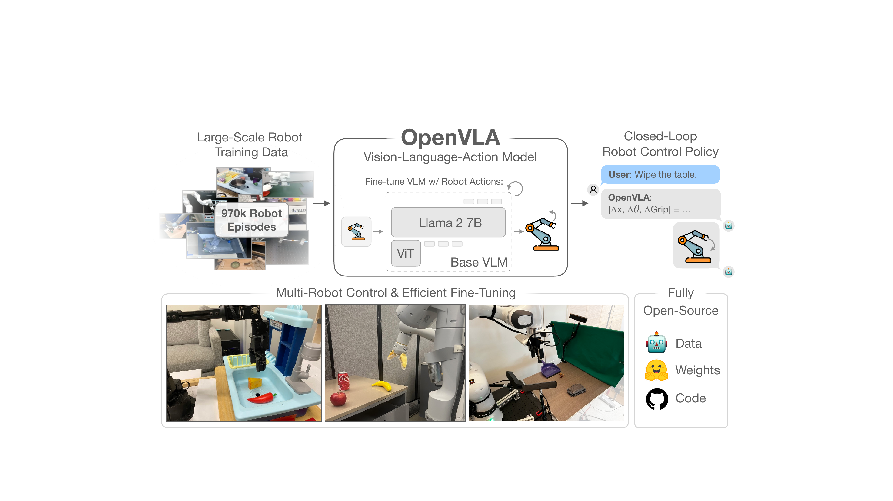
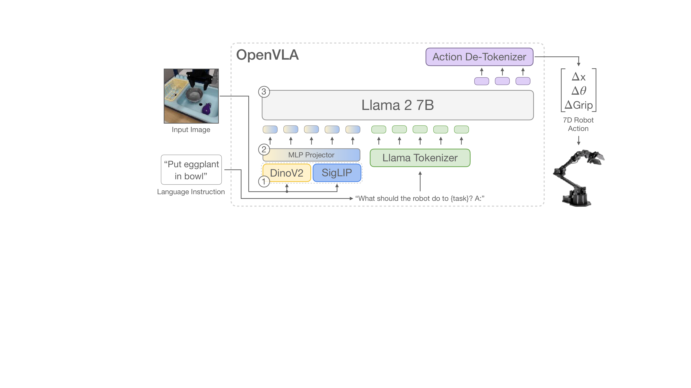
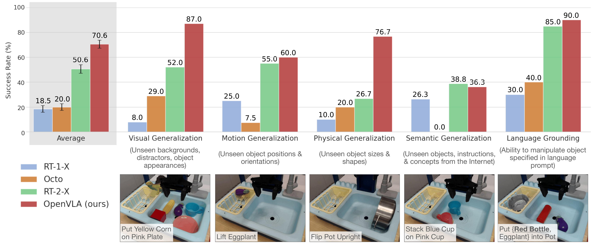
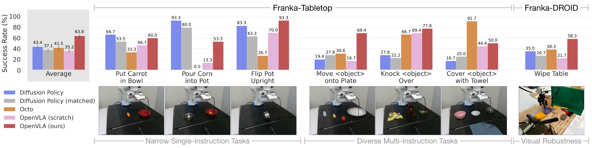
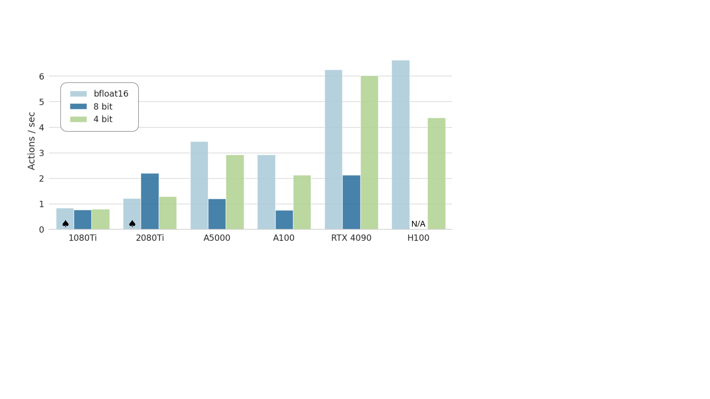

# OpenVLA (arXiv 2024)

<!-- paper-source: https://chengwei920412.github.io/paper_reading/2406.09246_OpenVLA_An_Open_Source_Vision_Language_Action_Model/technical_report.html -->

> 原文链接：[OpenVLA (arXiv 2024)](https://chengwei920412.github.io/paper_reading/2406.09246_OpenVLA_An_Open_Source_Vision_Language_Action_Model/technical_report.html)

> **arXiv ID**：2406.09246  
> **原文标题**：OpenVLA: An Open-Source Vision-Language-Action Model  
> **翻译日期**：2026-08-21

## 论文概览 {#_1}

### 基本信息 {#_2}

- **作者**：Moo Jin Kim、Karl Pertsch、Siddharth Karamcheti 等
- **机构**：斯坦福大学、加州大学伯克利分校、丰田研究院、Google DeepMind、Physical Intelligence、麻省理工学院
- **发表信息**：arXiv 预印本，2024 年；论文使用 CoRL 2024 模板
- **领域**：机器人学习、多模态基础模型、模仿学习、视觉运动控制

### 核心贡献 {#_3}

OpenVLA 是一个 70 亿参数的开源视觉—语言—动作模型（VLA），在 Open X-Embodiment 的 97 万段真实机器人轨迹上训练。它把机器人动作离散成语言模型词元，直接在视觉条件语言模型上进行端到端动作预测微调。论文不仅开放模型与训练代码，还系统研究了 VLA 的跨机器人直接控制、下游微调、参数高效微调和量化推理。

实验中，OpenVLA 在 WidowX 与 Google Robot 共 29 项任务上的绝对成功率比 550 亿参数的闭源 RT-2-X 高 16.5%，参数量仅约为后者的七分之一；在新机器人任务上，它还比从头训练的 Diffusion Policy 高 20.4%。

图：OpenVLA 的训练规模、直接控制能力与下游适配方式。

## 研究背景与动机 {#_4}

### 问题定义 {#_5}

单项技能策略通常只能在接近训练分布的初始状态下工作，面对新物体、干扰物、场景变化或未见指令时容易失效。互联网规模视觉与语言基础模型已具备更强的语义和视觉泛化能力，因此一个自然方向是把这些能力迁移到机器人控制中。

### 现有方法的局限性 {#_6}

RT-2-X 等早期 VLA 展示了强泛化能力，但模型、训练流程与数据混合方案多为闭源，且缺乏适配新机器人和新任务的公开实践。Octo 等开源通用策略支持微调，但其架构通常把预训练组件与从头初始化的策略模块拼接起来，没有充分利用大型 VLM 的端到端能力。

### 本文的创新点 {#_7}

- 以开放的 Prismatic-7B VLM 为主干，构建端到端开源 VLA。
- 使用 DINOv2 与 SigLIP 融合视觉编码器，同时保留空间细节和高层语义。
- 在 97 万段跨本体真实机器人轨迹上训练，并公开训练数据方案、模型权重和 PyTorch 流程。
- 系统评估完整微调、冻结视觉编码器、“夹心式”微调、LoRA 与量化，而不只展示直接部署结果。

## 方法论 {#_8}

### 整体架构 {#_9}

图：OpenVLA 由融合视觉编码器、投影器和 Llama 2 7B 主干组成，并输出 7 维机器人控制动作。

输入是一张第三人称观测图像和自然语言指令。DINOv2 与 SigLIP 分别提取视觉特征，通道拼接后由两层 MLP 投影到语言嵌入空间，Llama 2 主干随后以自回归方式预测动作词元。

### 动作词元化 {#_10}

每个连续动作维度独立离散为 256 个区间。区间范围采用训练数据的第 1 至第 99 百分位，而非最小值与最大值，以降低异常动作对有效分辨率的影响。由于 Llama 2 只预留 100 个特殊词元，论文复用其词表中使用频率最低的 256 个词元表示动作。训练目标仍是下一词元交叉熵，但只在动作词元上计算损失。

### 数据与训练 {#_11}

训练混合来自 Open X-Embodiment，筛选至少包含一个第三人称相机、采用单臂末端执行器控制的数据集，并参考 Octo 的混合权重平衡机器人本体、任务和场景。DROID 最初以 10% 权重加入，但其动作词元准确率长期偏低，因此在最后三分之一训练阶段移除。

最终模型以 \(224\times224\) 图像训练 27 轮，使用 64 张 A100、批大小 2048，耗时 14 天，合计约 21,500 A100 GPU 小时。作者发现 \(384\times384\) 分辨率未改善机器人性能，却使训练耗时约增至 3 倍；同时，微调视觉编码器对机器人控制至关重要。

## 实验与结果 {#_12}

### 直接跨机器人评估 {#_13}

图：BridgeData V2 WidowX 的 17 项任务及总体结果。

直接评估覆盖 WidowX 的 17 项任务、170 条试验轨迹，以及 Google Robot 的 12 项任务、60 条试验轨迹。任务考察视觉、运动、物理和语义泛化，以及多物体场景中的语言落地。OpenVLA 在 BridgeData V2 上显著优于 RT-2-X，在 Google Robot 上与 RT-2-X 相当，并整体优于 RT-1-X 与 Octo。RT-2-X 在语义泛化上仍占优势，可能因为它使用更大规模互联网预训练，并在机器人数据与互联网数据上联合微调。

### 数据高效适配 {#_14}

图：在七个 Franka 任务上从头训练或微调不同策略的结果。

下游实验使用每个任务 10–150 条示范，在 Franka-Tabletop 与 Franka-DROID 上比较 OpenVLA、Octo 和 Diffusion Policy。Diffusion Policy 在狭窄的单指令灵巧任务上轨迹更平滑，但 OpenVLA 在含多个物体、干扰物与多条语言指令的任务上更稳健，也是唯一在全部受测任务上均达到至少 50% 成功率的方法。

### 参数高效微调 {#_15}

LoRA（\(r=32\)）只训练 9,760 万个参数，约占模型的 1.4%，成功率为 \(68.2\pm7.5\%\)，接近完整微调的 \(69.7\pm7.2\%\)。其显存需求为 59.7 GB，而完整微调使用 FSDP 分片后仍需 163.3 GB。LoRA 可在单张 A100 上用 10–15 小时完成新任务微调，算力约降至完整微调的八分之一。

### 量化推理 {#_16}

图：不同 GPU 与精度下的 OpenVLA 推理速度。

默认 bfloat16 推理占用 16.8 GB 显存，Bridge 成功率为 \(71.3\pm4.8\%\)；int4 仅占 7.0 GB，成功率仍为 \(71.9\pm4.7\%\)。int8 虽将显存降至 10.2 GB，却因量化算子开销导致 A5000 上控制频率降至约 1.2 Hz，成功率下降到 \(58.1\pm5.1\%\)。这说明机器人策略的量化效果不能只用离线词元准确率判断，实时控制频率改变会直接影响闭环系统动力学。

### LIBERO 仿真 {#libero}

OpenVLA 虽只在真实机器人数据上预训练，LoRA 微调后仍在 LIBERO 四个任务套件上取得最高平均成功率 \(76.5\pm0.6\%\) 和最佳平均排名 1.5。领先幅度小于真实机器人实验，表明真实—仿真域差异限制了预训练收益；将仿真数据加入预训练混合可能进一步改善结果。

## 关键见解 {#_17}

### 理论与设计认识 {#_18}

1. VLA 的优势不只是模型规模，而是视觉语义先验、空间特征、机器人数据多样性与端到端训练的共同结果。
2. 动作离散化使成熟的语言模型训练基础设施可以直接用于机器人策略，但逐词元、单步动作生成也带来推理延迟和时序平滑不足。
3. 视觉编码器不能简单冻结。互联网预训练特征虽具语义泛化能力，精确控制仍要求视觉表征适应目标场景中的细粒度空间信息。
4. 实时机器人中的量化瓶颈可能来自吞吐量而非数值精度；推理频率与训练数据采集频率不匹配，会产生新的动力学分布偏移。

### 实践启示 {#_19}

若任务包含多个物体和语言条件，OpenVLA 是比从头训练策略更可靠的默认起点；若任务单一但要求高频、精细和流畅控制，Diffusion Policy 仍可能更合适。资源受限时，LoRA 是优先选择，推理则应优先测试 int4，而不能假定 int8 必然更快。

## 局限性与未来工作 {#_20}

### 当前局限 {#_21}

- 仅接受单张第三人称图像，不支持多视角、腕部相机、本体感知和观测历史。
- 自回归动作生成速度有限，尚不适合 ALOHA 等 50 Hz 高频控制。
- 不使用动作分块和时序平滑，灵巧单任务上的轨迹不如 Diffusion Policy 平滑。
- 多数真实任务成功率仍低于 90%，距离高可靠部署尚有差距。
- 训练成本高，许多模型规模、数据联合训练与视觉主干设计问题尚未充分消融。

### 未来方向 {#_22}

可进一步研究多图像与本体感知输入、动作分块、推测解码和专用推理引擎；在互联网视觉—语言数据与机器人动作数据上联合训练，以减少灾难性遗忘；加入仿真数据扩大预训练域；并建立同时衡量成功率、控制频率、延迟和闭环稳定性的 VLA 评测协议。

## 相关工作对比 {#_23}

<table>
<thead>
<tr>
<th>方法</th>
<th>核心思想</th>
<th>优势</th>
<th>局限</th>
</tr>
</thead>
<tbody>
<tr>
<td>RT-2-X</td>
<td>大型闭源 VLM 直接预测机器人动作</td>
<td>语义泛化强</td>
<td>550 亿参数、闭源、不支持公开微调</td>
</tr>
<tr>
<td>Octo</td>
<td>在 OpenX 上从头训练的开源通用 Transformer 策略</td>
<td>多机器人支持与微调流程成熟</td>
<td>未充分利用大型互联网预训练 VLM</td>
</tr>
<tr>
<td>Diffusion Policy</td>
<td>条件扩散生成连续动作块</td>
<td>单任务控制平滑、精确</td>
<td>多物体多指令任务的语言落地较弱</td>
</tr>
<tr>
<td><strong>OpenVLA</strong></td>
<td>融合 DINOv2/SigLIP 的 Prismatic-7B 端到端动作词元预测</td>
<td>开源、跨本体泛化强、LoRA 与 int4 有效</td>
<td>单图像、推理频率有限、训练成本高</td>
</tr>
</tbody>
</table>

## 个人评价 {#_24}

OpenVLA 的价值不只在于刷新成功率，更在于把“可复现的开放 VLA”变成了可操作的研究对象：架构、数据混合、训练基础设施、微调和部署路径均可检验。论文的真实机器人评估覆盖面较广，并把计算效率纳入核心实验，这是明显优点。

需要谨慎之处是，部分消融使用较小数据混合和仅含 SigLIP 的早期模型版本，不能完全等同于最终 OpenVLA；不同方法的动作空间、观测历史与控制方式也并非完全一致。论文通过 matched Diffusion Policy 和 A/B 初始状态尽量缓解了公平性问题，但跨平台成功率仍受硬件、控制频率和人工判定影响。

推荐机器人学习、具身智能、多模态基础模型和高效微调方向的研究者阅读。对希望部署模型的工程人员，参数高效微调与量化章节尤其有参考价值。

## 附录 {#_25}

### 关键公式与配置 {#_26}

- 每个动作维度离散到 256 个区间，范围由第 1 与第 99 百分位确定。
- 训练只在动作词元位置计算下一词元交叉熵损失。
- LoRA 推荐秩为 \(r=32\)；实验中提高到 \(r=64\) 未带来可见性能收益。
- 默认 bfloat16 推理约需 15–17 GB 显存；int4 可降至约 7 GB。

### 术语表 {#_27}

<table>
<thead>
<tr>
<th>英文</th>
<th>中文</th>
</tr>
</thead>
<tbody>
<tr>
<td>Vision-Language-Action Model (VLA)</td>
<td>视觉—语言—动作模型</td>
</tr>
<tr>
<td>Visually-Conditioned Language Model (VLM)</td>
<td>视觉条件语言模型</td>
</tr>
<tr>
<td>Robot Embodiment</td>
<td>机器人本体</td>
</tr>
<tr>
<td>Action Tokenization</td>
<td>动作词元化</td>
</tr>
<tr>
<td>Language Grounding</td>
<td>语言落地</td>
</tr>
<tr>
<td>Parameter-Efficient Fine-Tuning</td>
<td>参数高效微调</td>
</tr>
<tr>
<td>Low-Rank Adaptation (LoRA)</td>
<td>低秩适配</td>
</tr>
<tr>
<td>Action Chunking</td>
<td>动作分块</td>
</tr>
<tr>
<td>Rollout</td>
<td>试验轨迹</td>
</tr>
</tbody>
</table>

### 参考资源 {#_28}

- **论文原文**：[arXiv 2406.09246](https://arxiv.org/abs/2406.09246)
- **中文翻译 PDF**：[paper_cn.pdf](https://chengwei920412.github.io/paper_reading/2406.09246_OpenVLA_An_Open_Source_Vision_Language_Action_Model/paper_cn.pdf)
- **中文 Markdown 译文**：[paper_cn.md](https://chengwei920412.github.io/paper_reading/2406.09246_OpenVLA_An_Open_Source_Vision_Language_Action_Model/paper_cn.html)
- **项目主页与代码入口**：[OpenVLA](https://openvla.github.io)

---

**报告生成说明**：本报告基于论文 LaTeX 源码、完整中文译文与实验表格整理，评价部分与原论文内容区分呈现。
