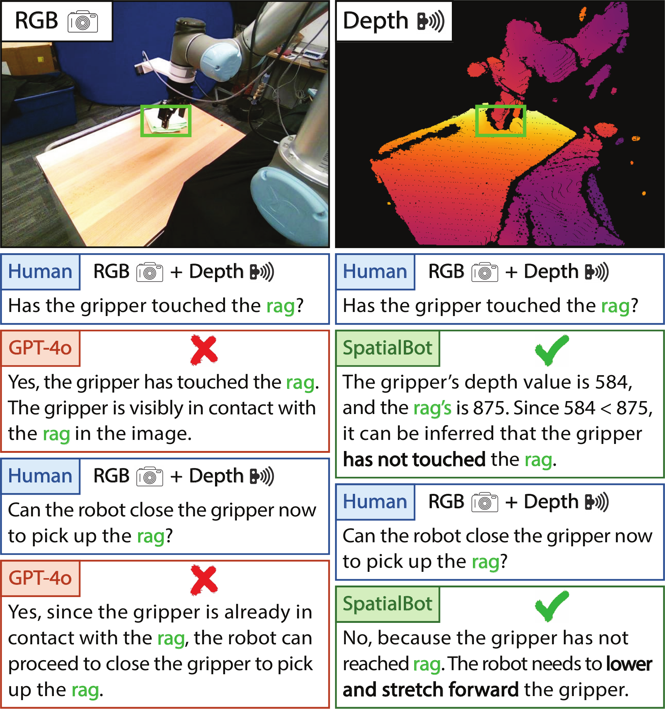
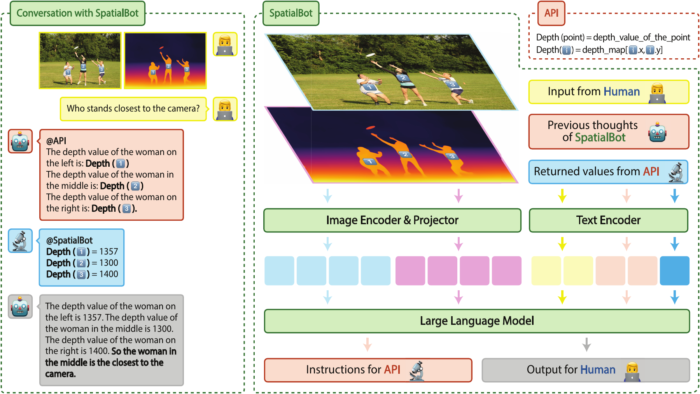
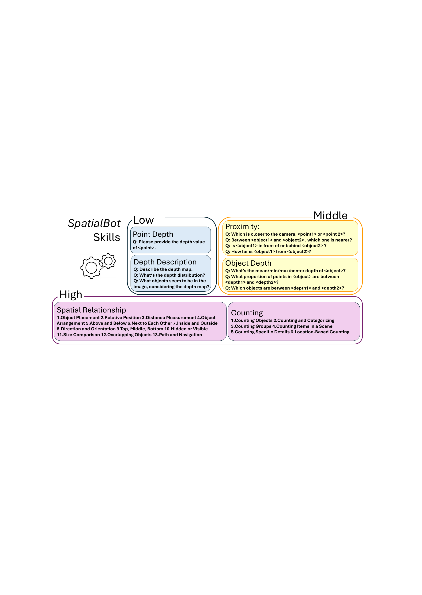
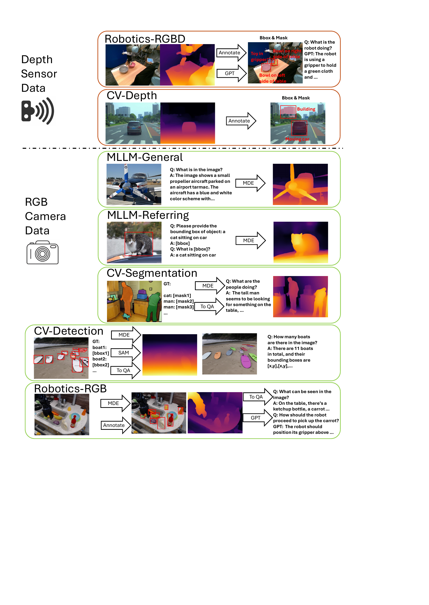
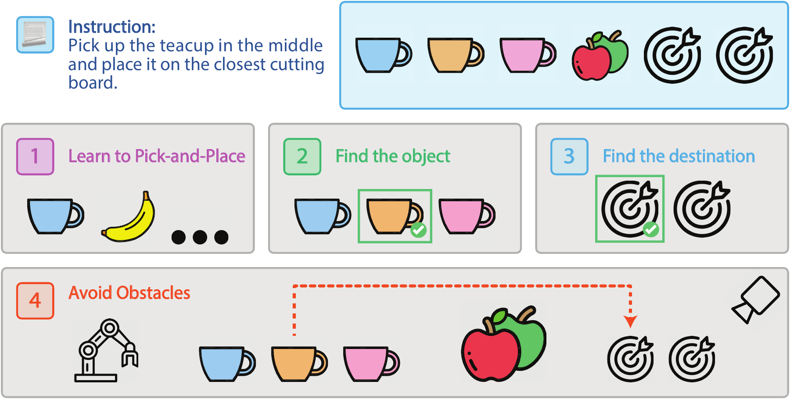
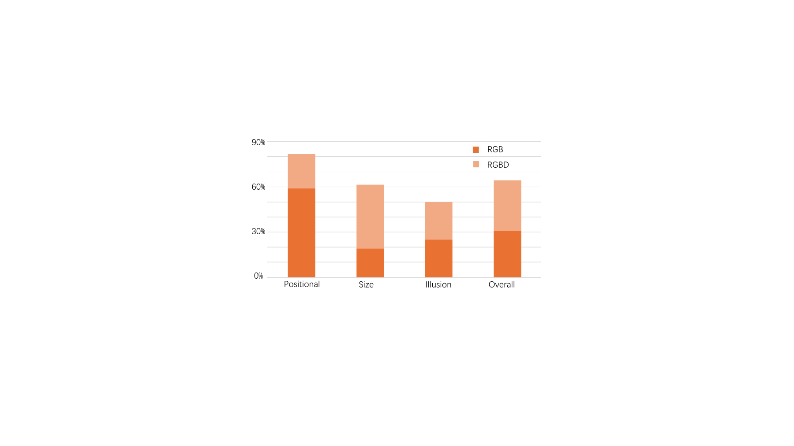
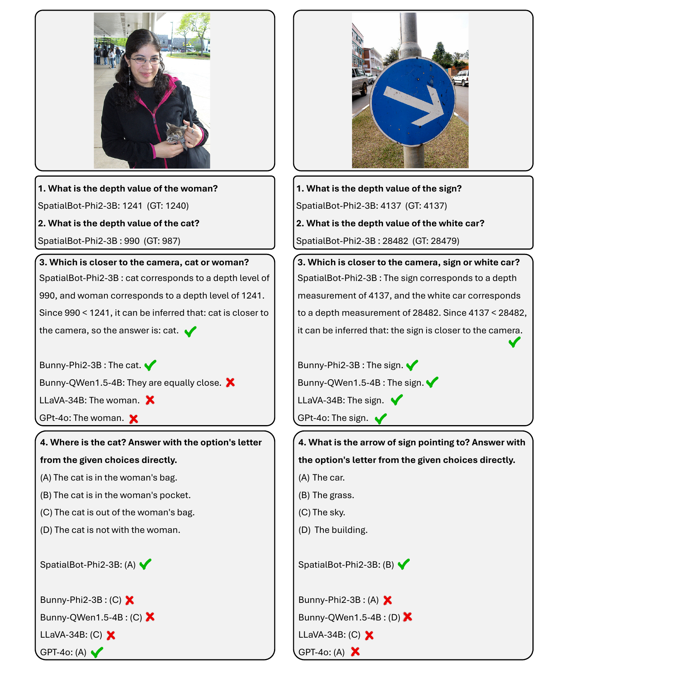

# SpatialBot (arXiv 2024)

<!-- paper-source: https://chengwei920412.github.io/paper_reading/2406.13642_SpatialBot_Precise_Spatial_Understanding_with_Vision_Language_Models/technical_report.html -->

> **arXiv ID**: 2406.13642
> **原文标题**: *SpatialBot*: Precise Spatial Understanding with Vision Language Models
> **翻译日期**: 2026-10-13

---

## 📋 论文概览 {#_1}

### 基本信息 {#_2}

- **作者**: Wenxiao Cai, Iaroslav Ponomarenko, Jianhao Yuan, Xiaoqi Li, Wankou Yang, Hao Dong, Bo Zhao（通讯作者）
- **机构**: 上海交通大学人工智能学院、斯坦福大学、北京智源人工智能研究院（BAAI）、北京大学、牛津大学、东南大学
- **发表时间**: 2024 年 6 月首次提交（arXiv v1），2025 年 3 月更新至 v2（新增 Depth API）；CVPR 模板排版
- **领域**: 视觉语言模型、空间理解、具身智能、机器人操作

### 核心贡献 {#_3}

1. **SpatialBot 模型**：一族以 RGB + 深度图为输入的 VLM，在通用视觉识别、空间理解与机器人操作三类任务上均可工作；配套 **Depth API** 机制，使模型可主动查询指定像素的精确深度值，而非依赖从深度图"读数"。
2. **SpatialQA 数据集**：大规模 RGB-D 视觉问答数据集，按"低层—中层—高层"三级渐进设计深度相关任务，并给出一条可把任意现成 RGB 数据集转为 RGB-D 问答数据集的流程。
3. **SpatialQA-E 数据集**：2000 条真实机械臂轨迹段，语言指令中显式编码空间关系（位置/尺寸/错觉三类，覆盖原级、比较级、最高级），作者称其为首个聚焦空间关系的机器人操作数据集。
4. **SpatialBench 基准**：人工标注的空间理解评测集，覆盖深度、位置关系、物体存在性、计数、触达、尺寸比较六个维度。

---

## 🎯 研究背景与动机 {#_4}

### 问题定义 {#_5}

VLM 在 2D 图像理解上已相当成熟，但"空间理解"——判断物体之间的远近、是否接触、相对尺寸——仍是短板。而这正是机器人操作与导航的前提：图 1 给出一个典型失败案例，仅凭单张 RGB 图像，连人也无法判断夹爪是否已经碰到抹布。

图 1：*SpatialBot* 的空间理解能力优于 GPT-4o。GPT-4o 即使同时看到 RGB 图像与深度图也判断错误；*SpatialBot* 先取出夹爪与抹布的深度值（584 与 875），再据此判断夹爪尚未接触抹布。

### 现有方法的局限性 {#_6}

本文把 VLM 缺乏空间理解能力归结为三条具体原因：

1. **没见过深度图**。主流 VLM 的视觉编码器（CLIP、SigLIP）只在 RGB 上预训练，训练任务也几乎不需要深度信息，直接把深度图塞进去效果很差。
2. **没有合适的数据集**。主流 VLM 微调数据既不提供深度图，也不含深度相关任务。
3. **室内外深度尺度不一致**。室内操作与导航要毫米级精度，室外要大范围，难以统一表示。

此外，本文明确反对两类替代路线：
- **只从单目 RGB 推断空间关系**（SpatialVLM、SpatialRGPT）：在真实机器人任务中，传感器深度不可替代；
- **直接让 VLM 回归像素级深度**：需要额外解码器，会破坏 VLM 的通用性（第 5 节用实验支持了这一判断）。

论文还指出一个容易被忽视的技术错误：相对深度模型（如 MiDaS）输出的 \(d_r\) 不能直接取倒数当作真实深度，用 \(\frac{1}{d_r}\) 作为问答标签 [proximityqa] 是错误的——它只保序不保比例。

### 本文的创新点 {#_7}

- **用原始深度值而非序数编码**：保留可做算术的数值深度，把拟合交给 LLM。
- **三通道 uint8 深度编码**：兼顾室内毫米级精度与室外大范围。
- **渐进式三级任务设计**：先学读深度 → 再学对齐 RGB-深度 → 最后用于高层推理。
- **Depth API**：把"精确取值"从模型能力中剥离出来，交给外部工具。

---

## 🔬 方法论 {#_8}

### 整体架构 {#_9}

SpatialBot 保持标准 VLM 结构（图像编码器 → 多模态投影器 → LLM），不引入专用解码器，因此无法输出像素级结果，但保留了通用对话能力。深度图作为**可选**的第二路图像输入；当需要精确数值时，模型以文本形式发出 `Depth(point)` 调用，外部 API 回填该点深度值，模型再据此作答。

图 4：*SpatialBot* 的架构。输入为一对 RGB 图像与深度图，其中深度图可选。当需要准确的深度信息时，*SpatialBot* 可选择调用 Depth API。

### 关键技术 {#_10}

**1. 深度图编码（uint24 / 三通道 uint8）**

以毫米为单位直接存原始深度，范围 \(1mm\) 至 \(131.071m\)。单通道 uint24 直接以毫米计；三通道 uint8 则把三个通道的单位设为 \(2^0\)、\(2^5\)、\(2^{10}\) 毫米，取值数分别为 \(2^5\)、\(2^5\)、\(2^7\)：

\[\begin{aligned}
I_{h,w}^{0} &amp;= ( d_{h,w} // 2^{10} ) *2^1, \\
I_{h,w}^{1} &amp;= ( d_{h,w} // 2^5 ) *2^3, \\
I_{h,w}^{2} &amp;= ( d_{h,w} \% 2^5 ) *2^3.
\end{aligned}\]

第一通道取 \(2^{10}\) mm ≈ \(1m\) 为单位，对应桌面抓取任务的典型深度上限；乘数 2 与 8 用于拉开三通道的数值区分度。

**2. 物体深度的四值描述**

单个中心点无法代表物体深度（如杯子内外表面差异显著），因此在掩码可用时用 **max / min / mean / center** 四个值描述；为抵抗掩码与深度图的噪声，max 与 min 取第 95 / 第 5 百分位。Visual Genome 的边界框质量差，用其提示 SAM 得到的掩码不可靠，此时退化为仅用边界框中心点深度。

**3. 三级渐进任务**

图 3：*SpatialBot* 掌握三个层次的能力：(a) 理解深度图；(b) 对齐 RGB 与深度输入，并进行远近比较；(c) 利用 RGB-D 完成空间关系理解与计数。

- **低层**：问某点深度值；仅给深度图让模型描述并推断场景内容。目标是让编码器与投影器学会编码深度图，并建立坐标与像素的对应。
- **中层**：问点与点、物体与物体的远近关系；学会用四值描述物体深度。目标是建立 RGB 与深度的跨模态对齐。
- **高层**：空间关系理解、定位、计数与枚举。深度图提供清晰边界，有利于这类任务。

**4. VLA 化的具身任务建模**

在时刻 \(t\)，给定历史与当前观测 \({x_j}_{j=0}^{t}\)，模型学习策略 \(\pi(·|i,{x_j}_{j=0}^{t})\)。二指末端执行器的动作空间为 7 自由度向量 \((\Delta X, \Delta Y, \Delta Z, \Delta R, \Delta P, \Delta Yaw, C)\)，位置与旋转增量离散为 101 个取值（0, 0.01, …, 1），模型以**文本**直接输出动作。

几条值得注意的工程发现：
- 微调阶段若让模型只输出纯参数，它会丧失通用问答能力；加入 `The robot should` 这类自然语言前缀并与通用问答数据混训可缓解；
- 预测**增量位姿**比目标位姿控制更精细，但更难学（损失下降更慢，部分数据上完全不降、模型崩溃为常数输出），作者给出的缓解办法是指数级增加数据量。

### 算法流程 {#_11}

数据构建流程（图 5）：采集 RGB 与深度 → 缺深度则用 ZoeDepth 做 MDE 估计 → 统一深度编码 → 用边界框 + 中心点提示 SAM 取掩码 → 生成三级问答（部分由 GPT-4o 生成对话）。

图 5：图像来源以及 RGB 到 RGB-Depth 数据集的转换流程。

图 6：*SpatialQA-E* 在机器人操作中引入空间关系。

---

## 📊 实验与结果 {#_12}

### 实验设置 {#_13}

- **数据集**：
- 训练：Bunny-pretrain-LAION-2M（预训练）、Bunny_695k + SpatialQA（微调）、SpatialQA-E（具身微调）
- SpatialQA 数据来源约 50k 张 GPT 标注图像，分布见下表

<table>
<thead>
<tr>
<th>数据</th>
<th>目标</th>
<th>图像数</th>
<th>深度来源</th>
</tr>
</thead>
<tbody>
<tr>
<td>Bunny695k</td>
<td>通用 MLLM 能力</td>
<td>695k</td>
<td>-</td>
</tr>
<tr>
<td>VG, COCO</td>
<td>深度图理解</td>
<td>20k</td>
<td>MDE</td>
</tr>
<tr>
<td>KITTI</td>
<td>空间理解</td>
<td>1.75k</td>
<td>MDE</td>
</tr>
<tr>
<td>NYU Depth v2</td>
<td>空间理解</td>
<td>1.5k</td>
<td>传感器深度</td>
</tr>
<tr>
<td>RT-X</td>
<td>机器人场景理解</td>
<td>7.5k</td>
<td>传感器深度 / MDE</td>
</tr>
<tr>
<td>SA-1B</td>
<td>空间理解</td>
<td>15k</td>
<td>MDE</td>
</tr>
<tr>
<td>2D-3D-S</td>
<td>空间理解</td>
<td>2.9k</td>
<td>传感器深度</td>
</tr>
</tbody>
</table>

- **评估指标**：SpatialBench 六项（Depth、Position、Existence、Counting、Reaching、Size）；通用基准 MMEP/MMEC、MMBT/MMBD、SEED-I、VQAv2、GQA、POPE。深度精度定义为 \(\frac{d_{gt} - d_{est}}{d_{gt}} \times 100\%\)。
- **对比方法**：GPT-4o（RGB 与 RGBD 两种输入）、Bunny 系列基线（Phi-2-3B / Phi-3-4B / QWen-1.5-4B / Llama-3-8B）。
- **训练资源**：8×A100；SpatialQA 上 Phi-2 约 15 小时。具身任务用 QWen-1.5-0.5B + CLIP，可在单张 RTX 4090 上推理。

### 主要结果 {#_14}

**表 1：SpatialBench 上的结果**（粗体为同基座 LLM 内最优；*SpatialBot* 行为本文方法）

<table>
<thead>
<tr>
<th>模型</th>
<th>Depth ↑</th>
<th>Position ↑</th>
<th>Existence ↑</th>
<th>Counting ↑</th>
<th>Reaching ↑</th>
<th>Size ↑</th>
</tr>
</thead>
<tbody>
<tr>
<td>GPT-4o-RGB</td>
<td>-</td>
<td>70.6</td>
<td>85.0</td>
<td>84.5</td>
<td>51.7</td>
<td>43.3</td>
</tr>
<tr>
<td>GPT-4o-RGBD</td>
<td>-</td>
<td>61.8</td>
<td>90.0</td>
<td>85.2</td>
<td>51.7</td>
<td>40.0</td>
</tr>
<tr>
<td>Bunny-Phi2-3B-RGB</td>
<td>70.6</td>
<td>50.0</td>
<td>75.0</td>
<td>89.4</td>
<td>51.7</td>
<td>26.7</td>
</tr>
<tr>
<td><strong><em>SpatialBot</em>-Phi2-3B-RGB</strong></td>
<td>84.1</td>
<td><strong>64.7</strong></td>
<td><strong>80.0</strong></td>
<td>88.0</td>
<td><strong>61.7</strong></td>
<td><strong>28.3</strong></td>
</tr>
<tr>
<td>Bunny-Phi2-3B-RGBD</td>
<td>85.8</td>
<td>50.0</td>
<td>75.0</td>
<td>90.4</td>
<td>43.3</td>
<td><strong>28.3</strong></td>
</tr>
<tr>
<td><strong><em>SpatialBot</em>-Phi2-3B-RGBD</strong></td>
<td><strong>&gt;99</strong></td>
<td>61.8</td>
<td><strong>80.0</strong></td>
<td><strong>91.7</strong></td>
<td>55.0</td>
<td>26.7</td>
</tr>
<tr>
<td>Bunny-Phi3-4B-RGB</td>
<td>32.3</td>
<td>58.8</td>
<td><strong>75.0</strong></td>
<td>91.0</td>
<td>31.7</td>
<td>16.7</td>
</tr>
<tr>
<td><strong><em>SpatialBot</em>-Phi3-4B-RGB</strong></td>
<td>83.2</td>
<td>64.7</td>
<td><strong>75.0</strong></td>
<td>91.0</td>
<td><strong>40</strong></td>
<td><strong>23.3</strong></td>
</tr>
<tr>
<td>Bunny-Phi3-4B-RGBD</td>
<td>63.3</td>
<td>52.9</td>
<td>60.0</td>
<td>85.4</td>
<td>31.7</td>
<td>18.3</td>
</tr>
<tr>
<td><strong><em>SpatialBot</em>-Phi3-4B-RGBD</strong></td>
<td><strong>&gt;99</strong></td>
<td><strong>67.7</strong></td>
<td>70.0</td>
<td><strong>91.7</strong></td>
<td>35.0</td>
<td>21.7</td>
</tr>
<tr>
<td>Bunny-QWen-1.5-4B-RGB</td>
<td>42.2</td>
<td>50.0</td>
<td><strong>75.0</strong></td>
<td><strong>91.6</strong></td>
<td>26.7</td>
<td>15.0</td>
</tr>
<tr>
<td><strong><em>SpatialBot</em>-QWen1.5-4B-RGB</strong></td>
<td>89.9</td>
<td><strong>52.9</strong></td>
<td><strong>75.0</strong></td>
<td>88.6</td>
<td><strong>46.8</strong></td>
<td>18.3</td>
</tr>
<tr>
<td>Bunny-QWen-1.5-4B-RGBD</td>
<td>74.6</td>
<td>44.1</td>
<td>70.0</td>
<td>90.7</td>
<td>25.0</td>
<td>15.0</td>
</tr>
<tr>
<td><strong><em>SpatialBot</em>-QWen1.5-4B-RGBD</strong></td>
<td><strong>&gt;99</strong></td>
<td><strong>52.9</strong></td>
<td>60.0</td>
<td>90.5</td>
<td>41.7</td>
<td><strong>26.7</strong></td>
</tr>
<tr>
<td>Bunny-Llama3-8B-RGB</td>
<td>58.1</td>
<td>50.0</td>
<td>75.0</td>
<td>91.7</td>
<td>38.3</td>
<td>23.3</td>
</tr>
<tr>
<td><strong><em>SpatialBot</em>-Llama3-8B-RGB</strong></td>
<td>85.6</td>
<td><strong>55.9</strong></td>
<td><strong>80.0</strong></td>
<td><strong>91.2</strong></td>
<td>40.0</td>
<td>20.0</td>
</tr>
<tr>
<td>Bunny-Llama3-8B-RGBD</td>
<td>64.0</td>
<td>50.0</td>
<td>75.0</td>
<td>90.4</td>
<td>38.3</td>
<td><strong>25.0</strong></td>
</tr>
<tr>
<td><strong><em>SpatialBot</em>-Llama3-8B-RGBD</strong></td>
<td><strong>&gt;99</strong></td>
<td>53.0</td>
<td>75.0</td>
<td>90.4</td>
<td><strong>45.0</strong></td>
<td>20.0</td>
</tr>
</tbody>
</table>

可以读出三点：

1. **Depth 一栏是压倒性的**：所有 SpatialBot-RGBD 变体都达到 >99，而 Bunny 基线在 32.3–85.8 之间波动。这一项本质上是"能否从深度图/Depth API 正确取值"，说明三级任务设计确实教会了模型读深度。
2. **Position 与 Reaching 有实质提升**：例如 Phi-2-3B 上 Reaching 从 51.7 → 61.7（RGB 设置），Phi-3-4B 上 Position 从 52.9 → 67.7（RGBD 设置）。这两项最依赖真实空间关系。
3. **3B–8B 模型在部分维度追平 GPT-4o**：Position 上 SpatialBot-Phi3-4B-RGBD 的 67.7 已接近 GPT-4o-RGB 的 70.6 并超过 GPT-4o-RGBD 的 61.8；Reaching 上 SpatialBot-Phi2-3B-RGB 的 61.7 超过 GPT-4o 的 51.7。但 **Size 一栏全面落后**（最高 28.3 vs GPT-4o 43.3），**Existence** 也未超过 GPT-4o-RGBD 的 90.0。

值得注意的是：给 GPT-4o 额外喂深度图（RGB → RGBD）并没有普遍帮助，Position 甚至从 70.6 掉到 61.8，Size 从 43.3 掉到 40.0。这反过来支撑了本文的核心论点——**没有针对性训练，深度图对 VLM 是噪声而非信息**。同样的现象也出现在 Bunny 基线上（Phi-3-4B 的 Existence 从 75.0 掉到 60.0）。

**表 2：通用 VLM 基准上的结果**（MME 与 GQA 使用 RGB-D；斜杠分隔 RGB / RGB-D 测试）

<table>
<thead>
<tr>
<th>模型</th>
<th>MMEP ↑</th>
<th>MMEC ↑</th>
<th>MMBT ↑</th>
<th>MMBD ↑</th>
<th>SEED-I ↑</th>
<th>VQAv2 ↑</th>
<th>GQA ↑</th>
<th>POPE ↑</th>
</tr>
</thead>
<tbody>
<tr>
<td>Bunny-Phi2-3B</td>
<td>1472/1474</td>
<td>286/285</td>
<td>67.90</td>
<td><strong>68.90</strong></td>
<td>69.91</td>
<td>78.98</td>
<td>61.52</td>
<td>86.21</td>
</tr>
<tr>
<td><strong><em>SpatialBot</em>-Phi2-3B</strong></td>
<td>1483/<strong>1487</strong></td>
<td>310/<strong>312</strong></td>
<td><strong>70.12</strong></td>
<td>68.56</td>
<td><strong>70.85</strong></td>
<td><strong>79.80</strong></td>
<td><strong>62.28</strong></td>
<td><strong>87.04</strong></td>
</tr>
<tr>
<td>Bunny-Phi3-4B</td>
<td>1417/1364</td>
<td>308/319</td>
<td>70.15</td>
<td>70.74</td>
<td>71.04</td>
<td><strong>80.57</strong></td>
<td>61.18</td>
<td>84.60</td>
</tr>
<tr>
<td><strong><em>SpatialBot</em>-Phi3-4B</strong></td>
<td><strong>1431</strong>/1433</td>
<td><strong>337</strong>/329</td>
<td><strong>73.49</strong></td>
<td><strong>73.11</strong></td>
<td><strong>71.64</strong></td>
<td>80.01</td>
<td><strong>62.16</strong></td>
<td><strong>85.47</strong></td>
</tr>
<tr>
<td>Bunny-QWen1.5-4B</td>
<td>1340/1364</td>
<td>251/254</td>
<td>69.56</td>
<td>68.56</td>
<td>70.05</td>
<td><strong>80.63</strong></td>
<td>61.55</td>
<td>85.10</td>
</tr>
<tr>
<td><strong><em>SpatialBot</em>-QWen1.5-4B</strong></td>
<td>1378/<strong>1406</strong></td>
<td>266/<strong>285</strong></td>
<td><strong>70.91</strong></td>
<td><strong>69.67</strong></td>
<td><strong>70.36</strong></td>
<td>79.69</td>
<td><strong>62.77</strong></td>
<td><strong>86.09</strong></td>
</tr>
<tr>
<td>Bunny-Llama3-8B</td>
<td>1574/1542</td>
<td>342/318</td>
<td>73.67</td>
<td>74.15</td>
<td>72.32</td>
<td>80.50</td>
<td>62.18</td>
<td>85.22</td>
</tr>
<tr>
<td><strong><em>SpatialBot</em>-LLama3-8B</strong></td>
<td><strong>1577</strong>/1576</td>
<td><strong>352</strong>/333</td>
<td><strong>75.78</strong></td>
<td><strong>74.83</strong></td>
<td><strong>72.40</strong></td>
<td><strong>80.94</strong></td>
<td><strong>62.90</strong></td>
<td><strong>85.33</strong></td>
</tr>
</tbody>
</table>

这张表回答的是"加深度训练会不会损害通用能力"。结论是**不会，且多数指标小幅上升**：GQA 在四个基座上全部提升（+0.72 ~ +1.22），MMBT 提升 +1.35 ~ +3.34，MMEC 提升幅度最大（Phi-3-4B 上 +29）。唯一反复出现的回退是 VQAv2（Phi-3-4B −0.56、QWen1.5-4B −0.94）。整体属于"不伤且略增"，而非数量级跃升。

**具身任务**

图 8：*SpatialBot* RGB 与 RGBD 变体在抓取与放置（Pick-and-Place）任务中的成功率。

在真实 Franka Research 3 上，RGBD 变体的抓取与放置成功率高于 RGB 变体，支持"深度信息有助于精确操作"的结论。

图 12：*SpatialBot* 与基线模型的对话示例。先询问物体的深度值，再让模型比较物体之间的深度，最后提出空间关系问题。

### 消融实验 {#_15}

本文**没有设置标准意义上的消融表**。可被当作消融读的对照有三组，均内嵌在主表中：

1. **RGB vs RGBD 输入**（表 1 每个基座内成对出现）：隔离深度输入的贡献；
2. **Bunny vs SpatialBot**（同基座、同输入）：隔离 SpatialQA 训练的贡献；
3. **第 5 节的纯 RGB 深度估计**：以 SpatialBot-RGB 的 Depth 分数（83.2–89.9，远低于 RGBD 的 >99）说明"让 VLM 以纯文本方式做单目深度估计"不可行，从而论证深度图输入与 Depth API 的必要性。

缺失的消融包括：深度编码方式（uint24 vs 三通道 uint8 vs 序数编码）、三级任务逐级去除、四值深度描述 vs 单中心点、Depth API 开关、以及训练数据中允许调用 API 的比例。这些都是论文正文明确提到设计选择却未量化的部分。

---

## 💡 关键见解 {#_16}

### 理论分析 {#_17}

**1. 深度表示必须保持可算术性。** 序数编码只保序不保比例，无法参与加减乘除；而 VLM 的高层推理（"A 的深度是 B 的两倍吗"、"夹爪与抹布相差多少毫米"）本质是数值运算。这解释了本文为何坚持保存原始毫米值并把换算交给 LLM 的拟合能力。同理，论文对 \(\frac{1}{d_r}\) 作标签的批评也是这个逻辑的延伸：

\[A = \frac{1}{d_{min}} - \frac{1}{d_{max}}, \quad B = \frac{1}{d_{max}}, \quad d = \frac{1}{(A * d_r + B)}\]

只有 \(d_{max} \to \infty\) 时 \(\frac{1}{d_r}\) 才等于真实深度乘一个尺度因子。

**2. 新模态需要配套任务，而非仅配套输入。** GPT-4o 与 Bunny 在加入深度图后性能反而下降，而 SpatialBot 在同样输入下大幅提升——差别只在于是否在 SpatialQA 上训练过。这说明跨模态能力的瓶颈在**监督信号的设计**，而不在输入通道的数量。

**3. 把精度需求外包给工具。** Depth API 是一个干净的职责划分：模型负责"看懂场景、决定该查哪个点"，API 负责"给出精确数值"。这避免了为追求像素级精度而引入专用解码器、进而牺牲通用性的两难。论文还刻意**只在部分训练数据上允许调用 API**，强制模型同时保留直接读图的能力——这个细节比 API 本身更能体现设计意图。

### 实践启示 {#_18}

- **把现有 RGB 数据集升级为 RGB-D 数据集的成本很低**：ZoeDepth + SAM + GPT-4o 的组合即可规模化生产，这条流程本身比模型更具复用价值。
- **VLA 的动作离散化与损失行为**：增量位姿更精确但更难收敛，甚至会塌缩为常数输出；若遇到类似现象，先怀疑数据量而非架构。
- **混训自然语言前缀**可避免 VLA 微调后丧失通用对话能力，这是一个成本极低的实用技巧。
- **RGB-D 相机便宜且已是机器人标配**，这使得"用深度而非点云"的路线在部署上更现实。

---

## 🔍 局限性与未来工作 {#_19}

### 当前局限 {#_20}

1. **无像素级输出能力**。为保通用性放弃专用解码器，模型不能做分割、不能输出稠密深度，只能回答文本。
2. **Depth 指标的 >99 存在评测设计问题**。当模型可调用 Depth API 时，"报告某点深度值"退化为一次查表 + 复述。该指标更像是在验证 API 调用链路的正确性，而非空间理解能力本身；它与 Position / Reaching 这类真正的推理指标被并列呈现，容易高估整体提升。
3. **Size 与 Existence 仍显著落后 GPT-4o**。尺寸比较需要结合深度与像素尺度做几何换算，深度图并未直接带来增益，说明"有深度"≠"会用深度做几何推理"。
4. **消融缺失**。深度编码方案是本文最具体的技术设计之一（三通道单位 \(2^0/2^5/2^{10}\)、乘数 2 与 8），但没有任何实验证明它优于替代方案；三级任务的逐级贡献同样未被拆解。
5. **具身实验规模有限**。SpatialQA-E 仅 2000 条轨迹段、单一机械臂、桌面场景；图 8 只报告成功率，未给出任务分类成功率、轨迹数、或与 Octo / OpenVLA 等 VLA 基线的对比。
6. **MDE 带来的标签噪声未被量化**。SpatialQA 中 KITTI、SA-1B、VG/COCO 部分的深度全部来自 ZoeDepth 估计，其误差会直接进入训练标签与部分评测，论文未分析这一影响。
7. **三通道编码的量化损失未讨论**。按式中 `// 2^5` 与 `% 2^5` 的划分，中间与低位通道存在表示冗余与截断，实际可分辨精度并非 \(1mm\)，论文未给出误差分析。

### 未来方向 {#_21}

- **几何推理而非仅深度读取**：把相机内参、像素尺度纳入问答设计，直接攻 Size 类任务的短板。
- **深度编码的系统性对比**：uint24、三通道 uint8、序数编码、以及直接把深度做成独立 token 的方案之间的消融。
- **Depth API 的泛化**：扩展为可查询区域统计量（分位数、梯度、法向）的工具族，甚至让模型自主决定查询策略。
- **扩展具身数据规模与多样性**：多机械臂、多场景、移动操作；与主流 VLA 基线做统一协议对比。
- **传感器深度缺失与噪声的鲁棒性**：真实深度相机存在空洞、反光失效，需要显式建模。
- **把 SpatialQA 流程推广到视频与多视角**，引入时序一致性约束。

---

## 📚 相关工作对比 {#_22}

<table>
<thead>
<tr>
<th>方法</th>
<th>核心思想</th>
<th>优势</th>
<th>劣势</th>
</tr>
</thead>
<tbody>
<tr>
<td>LLaVA / Bunny / QWen-VL 等通用 VLM</td>
<td>RGB 图像 + 视觉指令微调</td>
<td>通用能力强、生态成熟</td>
<td>无深度监督，空间理解薄弱；直接喂深度图反而掉点</td>
</tr>
<tr>
<td>SpatialVLM / SpatialRGPT</td>
<td>仅从 2D RGB 推断空间关系</td>
<td>无需深度传感器，易于规模化</td>
<td>缺少度量信息，机器人任务中精度不足</td>
</tr>
<tr>
<td>ProximityQA / Cube-LLM</td>
<td>让 VLM 直接从单目 RGB 做深度估计 / 3D 检测</td>
<td>单传感器、流程简洁</td>
<td>度量深度精度有限；ProximityQA 用 \(\frac{1}{d_r}\) 作标签在比例关系上不成立</td>
</tr>
<tr>
<td>带解码器的像素级 MLLM</td>
<td>外接解码器输出稠密深度</td>
<td>可得像素级精确深度</td>
<td>新结构限制通用性，偏离通用 VLM 形态</td>
</tr>
<tr>
<td>RT-1/RT-2、Octo、OpenVLA</td>
<td>大规模 VLA 预训练，RGB 输入</td>
<td>操作能力强、跨任务泛化好</td>
<td>指令中缺少显式空间关系监督</td>
</tr>
<tr>
<td><strong>本文方法（SpatialBot）</strong></td>
<td>RGB + 深度图输入，三级渐进任务训练，外挂 Depth API</td>
<td>保持通用 VLM 结构与通用基准性能；深度读取与远近/触达判断显著提升；数据构建流程可复用</td>
<td>无像素级输出；Depth 指标受 API 影响而虚高；Size/Existence 仍落后 GPT-4o；关键设计缺少消融</td>
</tr>
</tbody>
</table>

---

## 🎓 个人评价 {#_23}

### 优点 {#_24}

- **问题定位准确且可验证**。"VLM 缺空间理解"是个被反复提及但少有人拆解的问题，本文把它分解为三条可操作的具体障碍（没见过深度图、没有数据集、尺度不一致），每条都对应明确的技术动作。
- **"加深度反而掉点"这一负面证据很有说服力**。GPT-4o 的 Position 从 70.6 降到 61.8、Bunny-Phi3 的 Existence 从 75.0 降到 60.0，这类对照比方法本身的提升更能支撑论文的核心主张。
- **不破坏通用能力**。表 2 显示通用基准普遍小幅上升，这对"加新模态会不会损害原有能力"的担忧给出了直接回答。
- **Depth API 的职责划分干净**，且"只在部分数据上允许调用"的设计体现了对能力退化的预防意识。
- **工程细节诚实**。增量位姿难学、损失不降、模型塌缩为常数输出——这类负面经验通常不会写进论文，但对复现者价值很高。
- **交付完整**。数据集、基准、检查点、代码均已开源，流程可被直接复用。

### 可改进之处 {#_25}

- **Depth 指标的呈现方式有误导性**。>99 来自 API 查表而非模型推理能力，把它与 Position、Reaching 并列放在主表首列，会让读者高估方法的空间推理提升。应当拆分为"API 链路正确性"与"无 API 时的深度读取能力"两项分别报告。
- **消融几乎缺席**，这是本文最大的方法学缺口。深度编码（三通道单位与乘数的选择）、三级任务、四值描述、API 调用比例——全是论文花篇幅论证过的设计，却无一被量化。读者无法判断性能来自哪个组件。
- **Size 的落后未被分析**。这是最该讨论的失败项：尺寸比较需要深度 + 像素尺度的联合推理，而论文的任务设计里没有涉及相机内参，这很可能就是原因，但正文未加讨论。
- **具身实验偏演示性质**。图 8 只有成功率柱状图，缺少任务分解、试验次数、置信区间，也没有与 Octo / OpenVLA 的对比，难以评估 VLA 部分的真实水平。
- **MDE 标签噪声被回避**。大半数据的深度来自 ZoeDepth 估计，既作训练标签也部分进入评测，这个循环依赖应当被量化。
- **写作与排版存在瑕疵**。正文存在 `Table. 1`、`\textit{ spatialQA-E}` 这类格式问题；主表中 Phi-3-4B 的 Reaching 写作 `40` 而同列其他值为一位小数；结论节被排在补充材料之后。

**总体判断**：这是一篇**数据集与系统工程贡献大于方法创新**的论文。SpatialQA / SpatialQA-E / SpatialBench 三件产出加上可复用的 RGB→RGB-D 转换流程，是对社区的实质贡献；Depth API 是一个简洁有效的工程设计。但作为方法论文，消融的系统性缺失与 Depth 指标的呈现方式是明显弱点，实际空间推理能力的提升幅度应当比主表给人的第一印象更保守地解读。

### 推荐阅读对象 {#_26}

- 做**具身智能 / VLA**、需要让模型理解度量空间关系的研究者与工程师；
- 需要**构建多模态数据集**的人——第 3 节的流程与第 7 节的 GPT 提示词可直接复用；
- 关心**如何给 VLM 增加新模态而不损害通用能力**的研究者；
- 做**多模态评测基准**设计的人，可把本文 Depth 指标的问题作为反面案例参考。

---

## 📎 附录 {#_27}

### 重要公式 {#_28}

**三通道 uint8 深度编码**（单位分别为 \(2^0\)、\(2^5\)、\(2^{10}\) 毫米）：

\[\begin{aligned}
I_{h,w}^{0} &amp;= ( d_{h,w} // 2^{10} ) *2^1, \\
I_{h,w}^{1} &amp;= ( d_{h,w} // 2^5 ) *2^3, \\
I_{h,w}^{2} &amp;= ( d_{h,w} \% 2^5 ) *2^3.
\end{aligned}\]

**相对深度到真实深度的正确换算**（\(d_r\) 为相对深度）：

\[\begin{aligned}
A &amp;= \frac{1}{d_{min}} - \frac{1}{d_{max}}, \\
B &amp;= \frac{1}{d_{max}}, \\
d &amp;= \frac{1}{(A * d_r + B)}.
\end{aligned}\]

**深度精度指标**：

\[\text{Accuracy} = \frac{d_{gt} - d_{est}}{d_{gt}} \times 100\%\]

**机器人策略与动作空间**：在时刻 \(t\) 给定观测 \({x_j}_{j=0}^{t}\)，学习策略 \(\pi(·|i,{x_j}_{j=0}^{t})\)，动作 \(a_t \sim \pi\)，7 自由度动作为 \((\Delta X, \Delta Y, \Delta Z, \Delta R, \Delta P, \Delta Yaw, C)\)，各维离散为 101 个取值。

### 术语表 {#_29}

<table>
<thead>
<tr>
<th>英文</th>
<th>中文</th>
</tr>
</thead>
<tbody>
<tr>
<td>Vision Language Model (VLM)</td>
<td>视觉语言模型</td>
</tr>
<tr>
<td>Multi-modal Large Language Model (MLLM)</td>
<td>多模态大语言模型</td>
</tr>
<tr>
<td>Monocular Depth Estimation (MDE)</td>
<td>单目深度估计</td>
</tr>
<tr>
<td>Metric Depth</td>
<td>度量深度</td>
</tr>
<tr>
<td>Ordinal Encoding</td>
<td>序数编码</td>
</tr>
<tr>
<td>Depth Map</td>
<td>深度图</td>
</tr>
<tr>
<td>Proximity</td>
<td>远近关系</td>
</tr>
<tr>
<td>Bounding Box</td>
<td>边界框</td>
</tr>
<tr>
<td>Mask</td>
<td>掩码</td>
</tr>
<tr>
<td>Grounding</td>
<td>定位</td>
</tr>
<tr>
<td>Referring QA</td>
<td>指代问答</td>
</tr>
<tr>
<td>Embodied AI</td>
<td>具身智能</td>
</tr>
<tr>
<td>Vision-Language-Action (VLA)</td>
<td>视觉-语言-动作</td>
</tr>
<tr>
<td>End Effector</td>
<td>末端执行器</td>
</tr>
<tr>
<td>Gripper</td>
<td>夹爪</td>
</tr>
<tr>
<td>Delta Pose</td>
<td>增量位姿</td>
</tr>
<tr>
<td>Degree of Freedom (DoF)</td>
<td>自由度</td>
</tr>
<tr>
<td>Episode</td>
<td>轨迹段</td>
</tr>
<tr>
<td>Multi-modal Projector</td>
<td>多模态投影器</td>
</tr>
<tr>
<td>Visual Instruction Tuning</td>
<td>视觉指令微调</td>
</tr>
<tr>
<td>Pick-and-Place</td>
<td>抓取与放置</td>
</tr>
<tr>
<td>Illusion</td>
<td>错觉（打印件干扰项）</td>
</tr>
</tbody>
</table>

### 参考资源 {#_30}

- **论文原文**: [arXiv:2406.13642](https://arxiv.org/abs/2406.13642)
- **中文翻译 PDF**: [paper_cn.pdf](https://chengwei920412.github.io/paper_reading/2406.13642_SpatialBot_Precise_Spatial_Understanding_with_Vision_Language_Models/paper_cn.pdf)
- **中文 Markdown 译文**: [paper_cn.md](https://chengwei920412.github.io/paper_reading/2406.13642_SpatialBot_Precise_Spatial_Understanding_with_Vision_Language_Models/paper_cn.html)
- **代码实现**: <https://github.com/BAAI-DCAI/SpatialBot>
- **SpatialQA 数据集**: <https://huggingface.co/datasets/RussRobin/SpatialQA>
- **SpatialQA-E 数据集**: <https://huggingface.co/datasets/RussRobin/SpatialQA-E>
- **SpatialBench 基准**: <https://huggingface.co/datasets/RussRobin/SpatialBench>
- **SpatialBot-3B 检查点**: <https://huggingface.co/RussRobin/SpatialBot-3B>
- **Bunny 模型库（预训练检查点）**: <https://github.com/BAAI-DCAI/Bunny>
