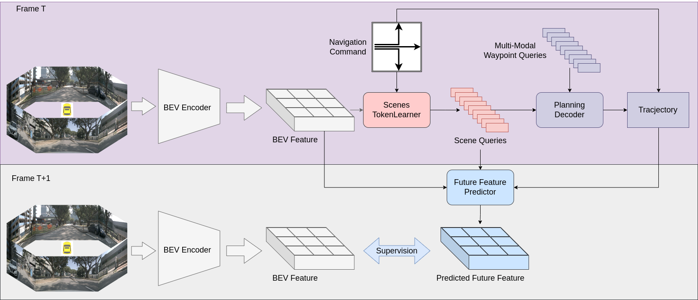
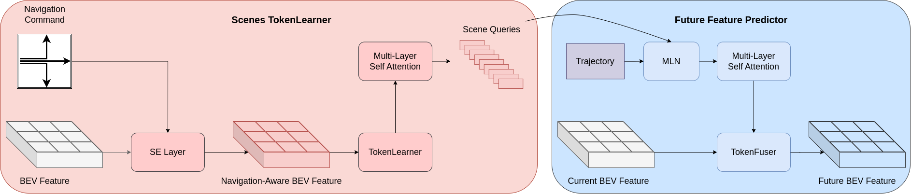
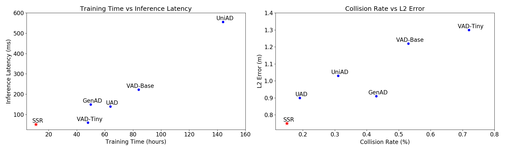

# SSR (arXiv 2024)

<!-- paper-source: https://chengwei920412.github.io/paper_reading/2409.18341_Navigation_Guided_Sparse_Scene_Representation_for_End_to_End_Autonomous_Driving/technical_report.html -->

> 原文链接：[SSR (arXiv 2024)](https://chengwei920412.github.io/paper_reading/2409.18341_Navigation_Guided_Sparse_Scene_Representation_for_End_to_End_Autonomous_Driving/technical_report.html)

> **arXiv ID**：2409.18341  
> **原文标题**：Navigation-Guided Sparse Scene Representation for End-to-End Autonomous Driving  
> **翻译日期**：2026-09-17

---

## 📋 论文概览 {#_2}

### 基本信息 {#_3}

- **作者**：Peidong Li，Dixiao Cui
- **机构**：智加科技（中国苏州）
- **发表信息**：ICLR 2025
- **研究领域**：端到端自动驾驶、鸟瞰图场景表示、自监督学习、轨迹规划

### 核心贡献 {#_4}

论文提出稀疏场景表示 SSR：在导航指令引导下，将 \(100\times100\) 的稠密 BEV 特征压缩为仅 16 个、每个 256 维的场景词元，再由规划解码器生成轨迹。训练时额外使用未来特征预测器，以真实未来 BEV 特征自监督当前场景表示和规划结果；推理时移除该分支。该设计不依赖检测、跟踪、建图、占用预测等人工标注的感知子任务，在 nuScenes 和 CARLA Town05 Long 上同时改善精度与效率。

---

## 🎯 研究背景与动机 {#_5}

### 问题定义 {#_6}

传统端到端自动驾驶虽然从图像直接预测轨迹，但通常继承模块化感知系统：先构建稠密 BEV，再通过目标检测、地图、占用或运动预测等辅助任务提取元素，最后交给规划模块。这种做法需要大量标注和任务特定查询，并未充分利用“规划损失可以反向塑造感知表示”这一端到端优势。

### 现有方法的局限性 {#_7}

- 感知子任务的标注成本高，且数据规模越大，标注负担越重。
- 检测、跟踪、建图、占用等分支增加模型复杂度与训练时间。
- 即使 SparseDrive 等方法跳过稠密 BEV 构建，仍需数百个任务查询。
- 将每个相机视图压缩为单一潜变量虽然高效，却可能损失场景细节。

### 本文的创新点 {#_8}

1. 以导航指令调制 BEV 特征，使模型优先提取与当前驾驶意图相关的信息。
2. 使用场景 TokenLearner 将稠密 BEV 压缩为极少量场景查询，避免额外感知头。
3. 用规划轨迹预测未来场景，再以真实未来 BEV 特征提供自监督，使表示显式编码场景动态。

---

## 🔬 方法论 {#_9}

### 整体架构 {#_10}

图：SSR 整体架构。紫色部分用于训练与推理，灰色未来特征预测分支仅在训练阶段启用。

输入多相机图像经图像主干和 BEV 编码器得到当前特征 \(\mathbf B_t\)。导航指令先通过 SE 层注入该特征，得到 \(\mathbf B_t^{navi}\)；STL 再生成稀疏场景查询 \(\mathbf S_t\)。航点查询对 \(\mathbf S_t\)执行交叉注意力，输出与指令匹配的规划轨迹。训练阶段，FFP 根据场景查询与轨迹预测下一时刻 BEV 特征，并与真实 \(\mathbf B_{t+1}\) 对齐。

### 关键技术 {#_11}

图：场景 TokenLearner 与未来特征预测器的结构。

**导航引导的场景 TokenLearner。** 每个词元化函数 \(M_i\)预测一幅空间注意力图，并对加权 BEV 特征做全局平均池化：

\[\mathbf s_i=M_i(\mathbf B_t^{navi})=\rho\!\left(\mathbf B_t^{navi}\odot\varpi_i(\mathbf B_t^{navi})\right).\]

不同查询倾向于覆盖不同空间区域；全部查询的注意力之和覆盖完整场景，并更强调自车前方。

**基于稀疏表示的规划。** 航点查询 \(\mathbf W_t\)仅与 16 个场景查询交互，再经 MLP 输出多模态轨迹，并按照导航指令选择最终结果。轨迹由 L1 模仿损失监督：

\[\mathcal L_{imi}=\|\mathbf T_{GT}-\mathbf T\|_1.\]

**未来特征预测。** FFP 先用运动感知层归一化把轨迹信息注入场景查询，再预测未来查询，并通过 TokenFuser 重建稠密未来 BEV。重建损失为：

\[\mathcal L_{bev}=\|\hat{\mathbf B}_{t+1}-\mathbf B_{t+1}\|_2,
\qquad
\mathcal L_{total}=\mathcal L_{imi}+\mathcal L_{bev}.\]

### 算法流程 {#_12}

1. 编码多相机图像，构建当前稠密 BEV 特征。
2. 将高层导航指令通过 SE 层注入 BEV。
3. 以 STL 的空间注意力将 BEV 压缩为 16 个场景查询。
4. 让航点查询与场景查询交互，输出规划轨迹。
5. 训练时根据轨迹预测未来场景查询和未来 BEV，以真实下一帧 BEV 自监督；推理时只执行前四步。

---

## 📊 实验与结果 {#_13}

### 实验设置 {#_14}

- **开环数据集**：nuScenes；评估 1、2、3 秒规划的 L2 位移误差和碰撞率。
- **闭环数据集**：CARLA Town05 Long；训练数据为 Roach 在四个其他城镇采集的 18.9 万帧。
- **主干与输入**：开环使用 ResNet-50、\(640\times360\) 图像；闭环使用 ResNet-34、\(900\times256\) 图像。
- **效率设置**：开环模型在 8 张 RTX 3090 上训练 12 轮，约 11 小时；推理速度为 19.6 FPS。

### 主要结果 {#_15}

图：SSR 在 nuScenes 上的速度—精度位置。

- 相比 UniAD，平均 \(L2_{MAX}\) 误差降低 0.28 m（相对降低 27.2%），平均 \(CR_{MAX}\) 相对降低 51.6%。
- SSR 达到 19.6 FPS，比 UniAD 快 10.9 倍，比 VAD-Base 快 4.3 倍。
- 按 VAD 的 AVG 协议，SSR 的平均 L2 为 0.39 m，平均碰撞率为 0.06%。
- 在 Town05 Long 上，SSR 的驾驶得分为 78.9，路线完成率为 95.5，违规得分为 0.83；驾驶得分比 TCP 高 31.7 分，是 VAD-Base 的约 2.6 倍。

### 消融实验 {#_16}

- 仅加入 STL 就把平均碰撞率从 0.43% 降至 0.20%；再加入 FFP 后降至 0.15%。
- 8 个查询的 L2 误差最低，但 16 个查询的碰撞率最佳；64 个查询反而明显退化，说明过多感知信息会削弱稀疏表示的筛选作用。
- 导航引导对直行和转向场景均有效，尤其显著降低碰撞率。
- 添加检测或地图辅助分支并未带来改善；使用经过 48 轮感知训练的预训练权重也使轨迹指标变差，支持“规划所需表示不同于传统感知表示”的观点。

---

## 💡 关键见解 {#_17}

### 理论分析 {#_18}

SSR 的核心不是简单减少词元数量，而是让压缩过程同时受导航意图和规划目标约束。导航指令决定“当前任务需要看哪里”，规划损失决定“哪些信息真正影响轨迹”，未来 BEV 重建则迫使表示包含动态变化。三者共同形成面向规划的信息瓶颈：保留足以预测安全轨迹和未来场景的信息，抑制与驾驶意图无关的细节。

### 实践启示 {#_19}

计算瓶颈仍主要在图像主干与 BEV 编码器，占总延迟 90.7%；STL 与规划解码器合计仅 9.3%。因此，若要继续提升实时性，应优先优化视觉主干、BEV 构建或输入分辨率，而不是继续压缩规划头。论文也说明，端到端系统未必需要把所有传统感知任务显式复现一遍；对于资源受限部署，任务条件化的稀疏表示可能更合适。

---

## 🔍 局限性与未来工作 {#_20}

### 当前局限 {#_21}

- 对高层导航指令依赖较强；nuScenes 中“直行”标签与实际左变道轨迹冲突时容易失败。
- 时间模块的片段首帧采用零初始化，可能引入噪声并损害预测。
- 论文主要在 nuScenes 开环和 CARLA 闭环上验证，尚缺少大规模真实道路闭环部署证据。
- FFP 以 BEV 特征为监督目标，效果会受教师特征质量和 BEV 编码器偏差影响。
- 仅使用“左转、右转、直行”三类粗粒度指令，难以表达复杂路线约束。

### 未来方向 {#_22}

可将路线、多段航点或自然语言指令作为更丰富的导航提示；为首帧设计可学习初始化或显式不确定性建模；联合优化轻量化图像主干与 BEV 编码器；在真实车辆闭环、长尾天气与城市迁移条件下验证鲁棒性；进一步研究场景词元是否能支持可解释的风险评估和安全约束。

---

## 📚 相关工作对比 {#_23}

<table>
<thead>
<tr>
<th>方法</th>
<th>核心思想</th>
<th>优势</th>
<th>局限</th>
</tr>
</thead>
<tbody>
<tr>
<td>UniAD</td>
<td>检测、跟踪、建图、运动、占用与规划级联</td>
<td>多任务场景理解全面</td>
<td>标注和计算成本高，推理慢</td>
</tr>
<tr>
<td>VAD</td>
<td>向量化场景表示与规划</td>
<td>比 UniAD 更紧凑</td>
<td>仍依赖检测、地图和运动监督</td>
</tr>
<tr>
<td>LAW</td>
<td>每个相机视图使用一个潜查询</td>
<td>速度快、无需传统辅助标注</td>
<td>压缩过强，信息保真度不足</td>
</tr>
<tr>
<td>SparseDrive</td>
<td>任务查询直接与图像特征交互</td>
<td>避免稠密 BEV 处理</td>
<td>仍使用数百个任务特定查询</td>
</tr>
<tr>
<td><strong>SSR</strong></td>
<td>导航引导的 16 个场景词元 + 未来 BEV 自监督</td>
<td>无感知标注、精度高、19.6 FPS</td>
<td>依赖导航指令，视觉主干仍占主要延迟</td>
</tr>
</tbody>
</table>

---

## 🎓 评价 {#_24}

### 优点 {#_25}

问题设定清晰，直接挑战“端到端系统必须保留传统感知子任务”的默认假设；方法结构简洁，训练专用分支不会增加推理成本；开环、闭环、效率、组件、查询数量、导航指令和感知预训练等实验形成较完整证据链；注意力可视化还为极少词元为何有效提供了直观解释。

### 可改进之处 {#_26}

论文将未来 BEV 特征相似性视为动作正确性的代理，但没有系统分析该代理在多解轨迹、遮挡或动态不确定性下是否可靠。部分指标依赖不同评估协议，跨论文比较仍需谨慎。若能增加真实道路闭环测试、导航噪声分布实验、多个随机种子和误差置信区间，结论会更稳健。

### 推荐阅读对象 {#_27}

适合研究端到端自动驾驶、BEV 表示、查询式感知、自监督世界模型、实时规划及自动驾驶系统工程的读者。

---

## 📎 附录 {#_28}

### 术语表 {#_29}

<table>
<thead>
<tr>
<th>英文</th>
<th>中文</th>
</tr>
</thead>
<tbody>
<tr>
<td>End-to-End Autonomous Driving (E2EAD)</td>
<td>端到端自动驾驶</td>
</tr>
<tr>
<td>Bird's-Eye View (BEV)</td>
<td>鸟瞰图</td>
</tr>
<tr>
<td>Sparse Scene Representation (SSR)</td>
<td>稀疏场景表示</td>
</tr>
<tr>
<td>Scenes TokenLearner (STL)</td>
<td>场景 TokenLearner</td>
</tr>
<tr>
<td>Future Feature Predictor (FFP)</td>
<td>未来特征预测器</td>
</tr>
<tr>
<td>Scene Query</td>
<td>场景查询</td>
</tr>
<tr>
<td>Navigation-Guided Perception</td>
<td>导航引导感知</td>
</tr>
<tr>
<td>Curb Collision Rate (CCR)</td>
<td>路缘碰撞率</td>
</tr>
</tbody>
</table>

### 参考资源 {#_30}

- **论文原文**：[arXiv 2409.18341](https://arxiv.org/abs/2409.18341)
- **中文翻译 PDF**：[paper_cn.pdf](https://chengwei920412.github.io/paper_reading/2409.18341_Navigation_Guided_Sparse_Scene_Representation_for_End_to_End_Autonomous_Driving/paper_cn.pdf)
- **中文 Markdown 译文**：[paper_cn.md](https://chengwei920412.github.io/paper_reading/2409.18341_Navigation_Guided_Sparse_Scene_Representation_for_End_to_End_Autonomous_Driving/paper_cn.html)
- **代码实现**：[PeidongLi/SSR](https://github.com/PeidongLi/SSR)
