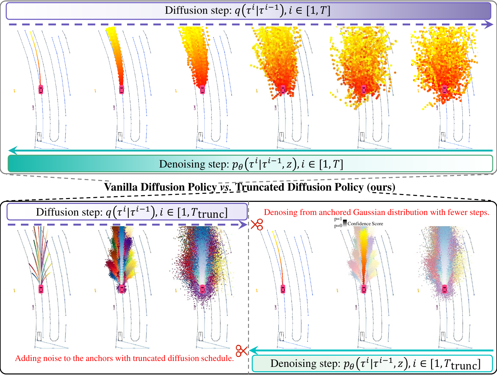
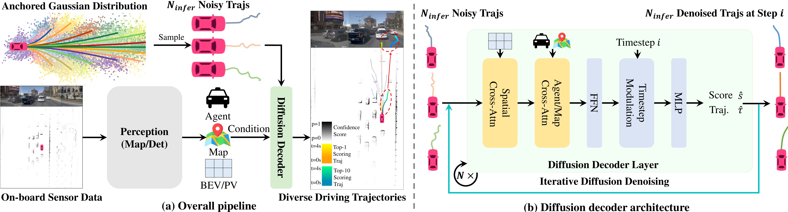
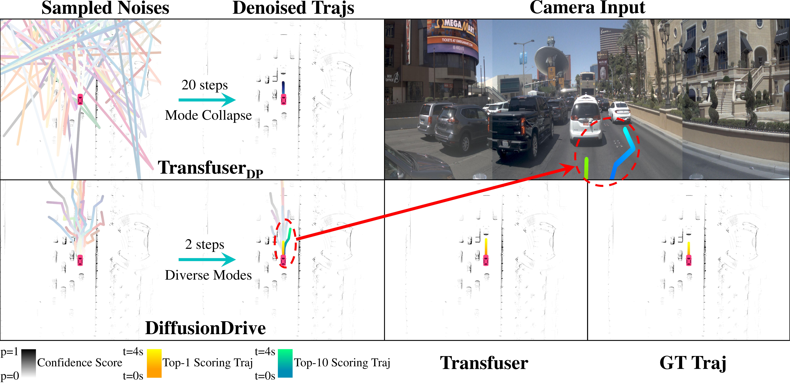

# DiffusionDrive (CVPR 2025)

<!-- paper-source: https://chengwei920412.github.io/paper_reading/2411.15139_DiffusionDrive_Truncated_Diffusion_Model_for_End_to_End_Autonomous_Driving/technical_report.html -->

> 原文链接：[DiffusionDrive (CVPR 2025)](https://chengwei920412.github.io/paper_reading/2411.15139_DiffusionDrive_Truncated_Diffusion_Model_for_End_to_End_Autonomous_Driving/technical_report.html)

> **arXiv ID**：2411.15139  
> **原文标题**：DiffusionDrive: Truncated Diffusion Model for End-to-End Autonomous Driving  
> **会议信息**：CVPR 2025 Highlight  
> **翻译日期**：2026-09-26

---

## 📋 论文概览 {#_1}

### 基本信息 {#_2}

- **作者**：Bencheng Liao、Shaoyu Chen、Haoran Yin、Bo Jiang、Cheng Wang、Sixu Yan、Xinbang Zhang、Xiangyu Li、Ying Zhang、Qian Zhang、Xinggang Wang
- **机构**：华中科技大学人工智能研究院、华中科技大学电子信息与通信学院、地平线机器人
- **发表信息**：arXiv:2411.15139；CVPR 2025 Highlight
- **研究领域**：端到端自动驾驶、轨迹规划、扩散模型、生成式策略学习

DiffusionDrive 将扩散策略引入端到端自动驾驶规划，但没有沿用“从纯高斯噪声出发、经过大量步骤去噪”的标准做法。它先用聚类轨迹构造驾驶先验，再围绕这些锚点建立锚定高斯分布，只执行短程扩散与去噪；同时设计级联扩散解码器，让候选轨迹直接与 BEV/PV 特征、智能体查询和地图查询交互。该设计把标准扩散策略的 20 步去噪压缩为 2 步，并在 NAVSIM `navtest` 上达到 88.1 PDMS 和 45 FPS。

### 核心贡献 {#_3}

1. **提出截断扩散策略**：以多模式锚点为中心构造锚定高斯分布，在训练和推理两端截断扩散调度，兼顾轨迹多样性与实时性。
2. **提出级联扩散解码器**：以 Transformer 为基础，通过空间交叉注意力、智能体/地图交叉注意力和时间步调制逐层重建轨迹。
3. **提供可调推理机制**：训练使用固定数量锚点，推理时可动态改变样本数 \(N_{\text{infer}}\)，在计算预算和规划质量之间取舍。
4. **建立性能—效率—多样性联合证据**：在 NAVSIM 上达到 88.1 PDMS、74% 模式多样性得分和 45 FPS；在 nuScenes 上达到 0.57 m 平均 L2 误差、0.08% 平均碰撞率和 8.2 FPS。

---

## 🎯 研究背景与动机 {#_4}

### 问题定义 {#_5}

端到端自动驾驶以相机、LiDAR 等原始传感器数据为输入，直接预测自车未来轨迹：

\[\tau = \{(x_t,y_t)\}_{t=1}^{T_f},\]

其中 \(T_f\) 是规划时域，\((x_t,y_t)\) 是自车坐标系中第 \(t\) 个航点。真实道路通常不只有唯一合理动作：同一场景可能允许保持车道、变道、让行或绕行。因此，规划器既要给出质量最高的主轨迹，也应覆盖多个物理合理的候选模式。

### 现有方法的局限性 {#_6}

- **单轨迹回归**：Transfuser、UniAD、VAD 等方法通常从自车查询直接回归一条轨迹，效率高，但难以表达决策不确定性和多模式驾驶行为。
- **固定词表采样**：VADv2 和 Hydra-MDP 从 8192 条固定锚点中评分、采样，覆盖范围受锚点质量限制，存在词表外问题，且大词表增加计算开销。
- **标准扩散策略**：从纯高斯噪声出发虽然具有生成能力，但移植到驾驶规划后需要约 20 个去噪步骤；不同噪声还会收敛到相似轨迹，出现模式坍缩。实验中 Transfuser\(_{\text{DP}}\) 仅有 11% 的模式多样性得分，速度由 Transfuser 的 60 FPS 降至 7 FPS。

### 本文的创新点 {#_7}

论文的关键判断是：人类驾驶并非从“完全随机动作”开始决策，而是在若干常见驾驶模式附近，依据当前交通条件做局部调整。DiffusionDrive 因此把生成起点从标准高斯分布移动到多个驾驶锚点附近。这样既保留扩散模型对连续动作的修正能力，又显著缩短从初始样本到可行轨迹的距离。

图 1：截断扩散策略与标准扩散策略的对比。训练和推理都从锚点附近的局部高斯分布出发，而非从纯高斯噪声开始。

---

## 🔬 方法论 {#_8}

### 整体架构 {#_9}

DiffusionDrive 不绑定特定感知骨干，可接入不同的相机、LiDAR 和感知模块。感知网络先生成 BEV/PV 特征、智能体查询和地图查询；截断扩散模块围绕轨迹锚点采样含噪候选；级联扩散解码器再结合场景条件逐层修正候选轨迹并预测置信度，最终输出得分最高的轨迹。

图 2：DiffusionDrive 整体流程。含噪轨迹在级联解码器中与多层次场景信息交互，并逐步完成轨迹重建。

### 关键技术 {#_10}

#### 1. 锚定高斯分布与截断扩散 {#1}

首先在训练集轨迹上执行 K-Means，得到 \(N_{\text{anchor}}\) 条锚点轨迹 \(\{\mathbf a_k\}\)。标准扩散会把数据逐渐推向标准高斯分布，而截断扩散只在锚点周围加入有限噪声：

\[\tau_k^i = \sqrt{\bar{\alpha}^i}\mathbf a_k + \sqrt{1-\bar{\alpha}^i}\boldsymbol{\epsilon},
\qquad \boldsymbol{\epsilon}\sim\mathcal N(0,\mathbf I),\]

其中 \(i\in[1,T_{\text{trunc}}]\)，且 \(T_{\text{trunc}}\ll T\)。这可视为以不同驾驶模式为中心的一组局部高斯分布：锚点提供离散的行为先验，噪声则保留连续变化空间。

#### 2. 分类与轨迹重建联合学习 {#2}

扩散解码器接收含噪轨迹集合和条件场景上下文 \(z\)，同时输出候选轨迹及其分类得分：

\[\{\hat s_k,\hat\tau_k\}_{k=1}^{N_{\text{anchor}}}
=f_\theta(\{\tau_k^i\}_{k=1}^{N_{\text{anchor}}},z).\]

距真值轨迹最近的锚点被标记为正样本，训练目标为：

\[\mathcal L=\sum_{k=1}^{N_{\text{anchor}}}
\left[y_k\mathcal L_{\text{rec}}(\hat\tau_k,\tau_{\text{gt}})
+\lambda\operatorname{BCE}(\hat s_k,y_k)\right].\]

\(\mathcal L_{\text{rec}}\) 是 L1 轨迹重建损失，BCE 负责区分高质量候选，\(\lambda\) 平衡两项。重建项只作用于正样本，避免所有模式被强制拉向同一真值轨迹；分类头则负责在多样候选中选出当前场景下最合适的模式。

#### 3. 级联扩散解码器 {#3}

每个解码层包含四类关键操作：

1. 根据轨迹坐标执行可变形空间交叉注意力，从 BEV 或 PV 特征中读取与候选路径相关的局部证据。
2. 让轨迹特征与智能体查询、地图查询交互，显式吸收动态目标和道路结构信息。
3. 通过前馈网络整合特征，并用时间步调制编码当前扩散时间步。
4. 预测候选置信度及相对初始含噪轨迹的坐标偏移，将输出送入下一层继续细化。

多个去噪时间步复用同一组解码器参数。与 UNet 对整条轨迹进行通用去噪相比，该结构把轨迹位置作为查询依据，更直接地从驾驶场景中提取条件信息。

#### 4. 模式多样性度量 {#4}

论文使用轨迹区域重叠程度定义模式多样性得分：

\[\mathcal D=1-\frac{1}{N}\sum_{i=1}^{N}
\frac{\operatorname{Area}\left(\tau_i\cap\bigcup_{j=1}^{N}\tau_j\right)}
{\operatorname{Area}\left(\tau_i\cup\bigcup_{j=1}^{N}\tau_j\right)}.\]

候选轨迹越重叠，平均 IoU 越高，\(\mathcal D\) 越低；反之，\(\mathcal D\) 越高表示候选覆盖的行为模式更丰富。该指标补充了只评价 top-1 轨迹的 PDMS。

### 训练与推理流程 {#_11}

#### NAVSIM 训练 {#navsim}

1. 使用 K-Means 从训练轨迹中聚类 20 条锚点。
2. 将扩散调度截断到完整 1000 步调度的前 50 步，在锚点附近构造含噪样本。
3. 输入三张裁剪、降采样后的前视图像，拼接分辨率为 \(1024\times256\)；同时输入栅格化 BEV LiDAR。
4. 使用与 Transfuser 相同的 ResNet-34 感知骨干；扩散解码器包含 2 个级联层。
5. 在 `navtrain` 上从头训练 100 轮，使用 AdamW、8 张 NVIDIA 4090、总批量 512，学习率为 \(6\times10^{-4}\)。
6. 不使用测试时增强；监督目标是一条覆盖 4 秒、包含 8 个航点的轨迹。

#### NAVSIM 推理 {#navsim_1}

1. 从 20 个锚点附近的锚定高斯分布采样 \(N_{\text{infer}}=20\) 条含噪轨迹。
2. 级联解码器预测每条轨迹的坐标和置信度。
3. 按 DDIM 更新规则迭代 2 个去噪步骤；不同时间步共享解码器参数。
4. 选择置信度最高的 top-1 轨迹用于执行和 PDMS 评估，同时保留其余候选以表达多模式决策。

#### nuScenes 设置 {#nuscenes}

在 nuScenes 上，方法基于 SparseDrive 实现，使用其仅在感知任务上训练的第一阶段权重；第二阶段训练 10 轮，将原规划模块替换为扩散解码器和截断扩散机制。模型使用 18 个聚类锚点、2 层级联解码器，并接收目标查询、地图查询和 PV 特征。

---

## 📊 实验与结果 {#_12}

### 实验设置 {#_13}

- **数据集**：NAVSIM `navtrain`/`navtest`；nuScenes；补充实验还在 CARLA Longest6 上验证跨数据集锚点泛化。
- **NAVSIM 指标**：无责任碰撞（NC）、可行驶区域合规性（DAC）、碰撞时间（TTC）、舒适性（Comf.）、自车行驶进度（EP）及综合 PDM Score（PDMS）。
- **nuScenes 指标**：1/2/3 秒 L2 轨迹误差、碰撞率及 FPS。
- **多样性与效率指标**：模式多样性得分 \(\mathcal D\)、规划模块耗时、参数量和 FPS。
- **主要对比方法**：Transfuser、UniAD、VAD、VADv2、Hydra-MDP、DRAMA、SparseDrive、ST-P3，以及标准扩散版本 Transfuser\(_{\text{DP}}\)。

### NAVSIM 主要结果 {#navsim_2}

<table>
<thead>
<tr>
<th>方法</th>
<th>锚点数</th>
<th>NC</th>
<th>DAC</th>
<th>TTC</th>
<th>EP</th>
<th>PDMS</th>
</tr>
</thead>
<tbody>
<tr>
<td>Transfuser</td>
<td>0</td>
<td>97.7</td>
<td>92.8</td>
<td>92.8</td>
<td>79.2</td>
<td>84.0</td>
</tr>
<tr>
<td>VADv2-\(\mathcal V_{8192}\)</td>
<td>8192</td>
<td>97.2</td>
<td>89.1</td>
<td>91.6</td>
<td>76.0</td>
<td>80.9</td>
</tr>
<tr>
<td>Hydra-MDP-\(\mathcal V_{8192}\)</td>
<td>8192</td>
<td>97.9</td>
<td>91.7</td>
<td>92.9</td>
<td>77.6</td>
<td>83.0</td>
</tr>
<tr>
<td>Hydra-MDP-\(\mathcal V_{8192}\)-W-EP</td>
<td>8192</td>
<td>98.3</td>
<td>96.0</td>
<td>94.6</td>
<td>78.7</td>
<td>86.5</td>
</tr>
<tr>
<td><strong>DiffusionDrive</strong></td>
<td><strong>20</strong></td>
<td><strong>98.2</strong></td>
<td><strong>96.2</strong></td>
<td><strong>94.7</strong></td>
<td><strong>82.2</strong></td>
<td><strong>88.1</strong></td>
</tr>
</tbody>
</table>

关键结论如下：

- 在相同 ResNet-34 骨干下，DiffusionDrive 比 Transfuser 高 4.1 PDMS。
- 相比 VADv2，PDMS 提高 7.2，而锚点数从 8192 降至 20，约减少 400 倍。
- 相比带额外规则监督和后处理的 Hydra-MDP-\(\mathcal V_{8192}\)-W-EP，DiffusionDrive 的 EP 高 3.5、PDMS 高 1.6，且只从人类示范学习，推理无需后处理。

### 性能、效率与多样性的演进 {#_14}

<table>
<thead>
<tr>
<th>方法</th>
<th>去噪步数</th>
<th>单步耗时</th>
<th>总规划耗时</th>
<th>\(\mathcal D\)</th>
<th>参数量</th>
<th>FPS</th>
<th>PDMS</th>
</tr>
</thead>
<tbody>
<tr>
<td>Transfuser</td>
<td>1</td>
<td>0.2 ms</td>
<td>0.2 ms</td>
<td>0%</td>
<td>56M</td>
<td>60</td>
<td>84.0</td>
</tr>
<tr>
<td>Transfuser\(_{\text{DP}}\)</td>
<td>20</td>
<td>6.5 ms</td>
<td>130.0 ms</td>
<td>11%</td>
<td>101M</td>
<td>7</td>
<td>84.6</td>
</tr>
<tr>
<td>Transfuser\(_{\text{TD}}\)</td>
<td>2</td>
<td>6.9 ms</td>
<td>13.8 ms</td>
<td>70%</td>
<td>102M</td>
<td>27</td>
<td>85.7</td>
</tr>
<tr>
<td><strong>DiffusionDrive</strong></td>
<td><strong>2</strong></td>
<td><strong>3.8 ms</strong></td>
<td><strong>7.6 ms</strong></td>
<td><strong>74%</strong></td>
<td><strong>60M</strong></td>
<td><strong>45</strong></td>
<td><strong>88.1</strong></td>
</tr>
</tbody>
</table>

标准扩散只带来 0.6 PDMS 增益，却使规划总耗时达到 130 ms；截断扩散把 20 步缩减到 2 步，同时把多样性从 11% 提升到 70%。换用专用扩散解码器后，总耗时进一步降到 7.6 ms，最终达到 74% 多样性和 88.1 PDMS。

图 3：NAVSIM 挑战场景定性结果。DiffusionDrive 的 top-1 轨迹与真值接近，top-10 候选还覆盖了合理的变道动作。

### nuScenes 主要结果 {#nuscenes_1}

<table>
<thead>
<tr>
<th>方法</th>
<th>平均 L2 误差（m）</th>
<th>平均碰撞率（%）</th>
<th>FPS</th>
</tr>
</thead>
<tbody>
<tr>
<td>VAD</td>
<td>0.72</td>
<td>0.22</td>
<td>4.5</td>
</tr>
<tr>
<td>SparseDrive</td>
<td>0.61</td>
<td>0.08</td>
<td>9.0</td>
</tr>
<tr>
<td><strong>DiffusionDrive</strong></td>
<td><strong>0.57</strong></td>
<td><strong>0.08</strong></td>
<td><strong>8.2</strong></td>
</tr>
</tbody>
</table>

DiffusionDrive 相比 VAD 快 1.8 倍，平均 L2 误差降低 20.8%，平均碰撞率降低 63.6%。相较其实现基础 SparseDrive，平均 L2 误差进一步降低 0.04 m，同时维持相同的 0.08% 平均碰撞率。

### 消融实验 {#_15}

#### 解码器设计 {#_16}

- 仅保留自车查询交互的轻量解码器只有 55.1 PDMS，说明缺少环境交互会严重损害规划。
- 加入空间交叉注意力后，PDMS 从 55.1 提升至 87.1，是最关键的结构增益。
- 只加入智能体/地图交叉注意力达到 85.1；同时加入空间与智能体/地图交互达到 87.4。
- 再加入 2 层级联机制后达到 88.1 PDMS；相较采用 UNet 的 Transfuser\(_{\text{TD}}\)，论文报告参数量减少 39%，PDMS 提高 2.4。

#### 去噪步数、级联深度和采样数 {#_17}

<table>
<thead>
<tr>
<th>变量</th>
<th>设置</th>
<th>PDMS</th>
<th>观察</th>
</tr>
</thead>
<tbody>
<tr>
<td>去噪步数</td>
<td>1 / 2 / 3</td>
<td>87.9 / 88.1 / 88.1</td>
<td>2 步已基本饱和</td>
</tr>
<tr>
<td>级联阶段数</td>
<td>1 / 2 / 4</td>
<td>87.4 / 88.1 / 88.2</td>
<td>4 层仅增 0.1，但参数量由 60M 增至 65M</td>
</tr>
<tr>
<td>\(N_{\text{infer}}\)</td>
<td>10 / 20 / 40</td>
<td>84.9 / 88.1 / 88.2</td>
<td>20 个样本取得较好的质量—成本平衡</td>
</tr>
</tbody>
</table>

#### 驾驶先验与跨数据集泛化 {#_18}

- 训练和推理都使用锚定分布时为 88.1 PDMS。
- 使用锚定分布训练、改用当前状态外推轨迹推理时降至 81.3。
- 仅用单条外推轨迹训练和推理时为 84.7。

这些结果说明，收益不只是“给扩散模型一个较好初值”，还来自多锚点对潜在动作空间的覆盖以及训练—推理分布的一致性。进一步地，在 CARLA 上训练模型、却使用从 NAVSIM 聚类得到的锚点时，DiffusionDrive 在 Longest6 上取得 64.27 DS、94.16 RC 和 0.69 IS，高于 Transfuser 的 47.30、93.38 和 0.50，表明锚点先验具有一定跨数据集迁移能力。

---

## 💡 关键见解 {#_19}

### 理论分析 {#_20}

论文没有给出收敛性或最优性证明，其核心更接近一种概率建模与优化路径上的设计直觉：

1. **缩短生成路径**：标准扩散要把标准高斯噪声运输到驾驶轨迹流形；锚定高斯分布已位于可行轨迹附近，因此所需逆扩散步数更少。
2. **离散先验与连续生成互补**：锚点负责覆盖左转、直行、变道等粗粒度模式，扩散噪声和条件解码负责在每个模式周围生成连续变化，避免固定词表只能“选已有轨迹”的限制。
3. **场景条件决定模式排序**：同一组锚点不直接决定最终动作。交叉注意力读取场景证据，分类头再选择当前时刻最合适的候选，因此驾驶先验和实时环境信息分工明确。
4. **多样性不必以 top-1 质量为代价**：联合的分类—重建目标允许候选保持分散，同时通过置信度选出高质量主轨迹。实验中 \(\mathcal D\) 从 11% 升至 74%，PDMS 也从 84.6 升至 88.1。

### 实践启示 {#_21}

- 对低维、强结构化动作空间，完全从白噪声生成可能是不必要的；用任务先验初始化，可大幅减少采样步数。
- 扩散模型的实时化不仅依赖更少步骤，也依赖面向任务重新设计去噪网络。截断策略和专用解码器分别解决“步数多”和“单步慢”。
- \(N_{\text{infer}}\) 可作为部署旋钮：资源紧张时减少样本，复杂场景中增加样本以扩大动作覆盖。
- 只报告 top-1 规划指标不足以评价生成式规划器，应同时检查候选多样性、物理合理性、排序质量和实际延迟。
- 跨数据集锚点实验提示，轨迹锚点可被视为相对稳定的驾驶几何先验，而不完全是某一数据集的记忆。

---

## 🔍 局限性与未来工作 {#_22}

### 当前局限 {#_23}

1. **缺少真实车辆闭环验证**：主要结果来自 NAVSIM 非反应式仿真指标和 nuScenes 开环指标，尚不能完整反映自车动作引起其他交通参与者反应后的长期行为。
2. **锚点仍是数据驱动先验**：虽然只需 20 个锚点且具有一定跨数据集泛化性，但极端道路拓扑、罕见驾驶习惯或分布外区域仍可能超出其覆盖范围。
3. **多样性指标较粗粒度**：\(\mathcal D\) 衡量轨迹区域重叠，却不能区分“有意义的行为多样性”和由局部抖动、不可执行曲线产生的表面差异。
4. **候选排序缺少不确定性校准**：论文用分类得分选择 top-1，但没有系统分析置信度是否校准，也没有讨论低置信度时的安全降级策略。
5. **训练成本仍然较高**：NAVSIM 配置使用 8 张 NVIDIA 4090、批量 512、训练 100 轮；推理实时并不等同于训练成本低。
6. **安全约束主要通过数据与场景特征隐式学习**：没有显式动力学约束、交通规则验证器或可证明的安全层。

### 未来方向 {#_24}

- 在交互式闭环仿真和真实车辆上评估长期安全性、舒适性及对其他交通参与者的影响。
- 学习可动态生成或在线更新的锚点，使先验适应新城市、道路拓扑和天气条件。
- 将候选数量、去噪步数和级联深度做成场景自适应计算策略：简单场景早停，复杂场景增加预算。
- 引入动力学可行性、交通规则和风险约束，并研究带安全证书的生成式规划。
- 改进多模式评价体系，分别衡量行为覆盖、可行性、模式概率校准及候选间的语义差异。
- 将规划不确定性传递给控制器或决策仲裁模块，设计置信度不足时的保守回退机制。
- 研究跨数据集、跨传感器配置和跨车型的锚点复用规律，验证驾驶先验的可迁移边界。

---

## 📚 相关工作对比 {#_25}

<table>
<thead>
<tr>
<th>方法</th>
<th>核心思想</th>
<th>优势</th>
<th>局限</th>
</tr>
</thead>
<tbody>
<tr>
<td>Transfuser</td>
<td>融合相机与 LiDAR，直接回归单条轨迹</td>
<td>结构直接、60 FPS</td>
<td>不表达多模式决策，\(\mathcal D=0\)</td>
</tr>
<tr>
<td>VADv2</td>
<td>对 8192 条固定锚点组成的词表评分并采样</td>
<td>能表示多模式</td>
<td>词表大、依赖锚点覆盖，存在词表外问题</td>
</tr>
<tr>
<td>Hydra-MDP</td>
<td>在 VADv2 上改进评分，并可加入规则评分器监督和后处理</td>
<td>PDMS 较高，规则知识可增强评分</td>
<td>使用 8192 条锚点；最佳版本依赖额外监督与后处理</td>
</tr>
<tr>
<td>Transfuser\(_{\text{DP}}\)</td>
<td>从标准高斯噪声开始，以 UNet 执行 20 步 DDIM 去噪</td>
<td>验证扩散规划可提升 PDMS</td>
<td>7 FPS，模式多样性仅 11%，去噪开销高</td>
</tr>
<tr>
<td>Transfuser\(_{\text{TD}}\)</td>
<td>在 Transfuser\(_{\text{DP}}\) 上加入截断扩散</td>
<td>2 步去噪，\(\mathcal D\) 提升至 70%</td>
<td>UNet 单步仍慢，参数量 102M</td>
</tr>
<tr>
<td><strong>DiffusionDrive</strong></td>
<td>锚定高斯分布、截断扩散和级联 Transformer 解码器</td>
<td>88.1 PDMS、74% 多样性、45 FPS；推理样本数可调</td>
<td>仍依赖聚类锚点，缺少交互式真实闭环和显式安全保证</td>
</tr>
</tbody>
</table>

---

## 🎓 个人评价 {#_26}

### 优点 {#_27}

- **问题拆解清楚**：论文没有把“扩散模型慢”视为单一工程问题，而是分别处理起点不合理、步数过多、单步网络过重和场景交互不足。
- **创新与驾驶结构高度匹配**：锚定高斯分布并非简单减少 DDIM 步数，而是利用驾驶动作具有有限主模式这一事实重新定义生成起点。
- **实验链条完整**：从 Transfuser、标准扩散、截断扩散到最终解码器逐步对比，并同时报告质量、速度、参数量和多样性。
- **部署价值明确**：2 步推理、45 FPS、60M 参数，以及可调整 \(N_{\text{infer}}\) 的机制，使方法具备现实系统中的预算弹性。
- **跨基准有效**：NAVSIM 闭环派生指标与 nuScenes 开环指标都获得改善，降低了结果只适用于单一评测体系的可能性。

### 可改进之处 {#_28}

- 模式多样性最好与轨迹可行性、语义模式覆盖和概率校准联合评价，避免单一几何重叠指标高估有效多样性。
- 可进一步报告端到端延迟分解、显存占用、不同 GPU/车载芯片上的速度，以及采样数变化对应的真实延迟。
- 锚点数量、聚类稳定性、不同城市之间的迁移，以及极端分布外场景值得更系统的压力测试。
- 需要在反应式仿真和真实道路闭环中验证：多样候选能否稳定转化为更安全的长期决策，而非只改善单帧规划指标。

### 推荐阅读对象 {#_29}

- 研究端到端自动驾驶、运动规划和生成式策略的研究者。
- 希望将扩散模型部署到实时机器人系统的工程师。
- 关注多假设预测、候选轨迹排序、动作先验与推理加速的读者。
- 想理解“任务结构先验如何改变生成模型采样路径”的机器学习研究者。

---

## 📎 附录 {#_30}

### 重要公式 {#_31}

<table>
<thead>
<tr>
<th>公式</th>
<th>含义</th>
</tr>
</thead>
<tbody>
<tr>
<td>\(q(\tau^i\mid\tau^0)=\mathcal N(\tau^i;\sqrt{\bar\alpha^i}\tau^0,(1-\bar\alpha^i)\mathbf I)\)</td>
<td>标准前向扩散：逐步向干净轨迹加入噪声</td>
</tr>
<tr>
<td>\(\tau_k^i=\sqrt{\bar\alpha^i}\mathbf a_k+\sqrt{1-\bar\alpha^i}\epsilon\)</td>
<td>截断扩散：只在第 \(k\) 个轨迹锚点附近加噪</td>
</tr>
<tr>
<td>\(\{\hat s_k,\hat\tau_k\}=f_\theta(\{\tau_k^i\},z)\)</td>
<td>条件扩散解码器联合预测候选分数和去噪轨迹</td>
</tr>
<tr>
<td>\(\mathcal L=\sum_k[y_k\mathcal L_{\text{rec}}+\lambda\operatorname{BCE}(\hat s_k,y_k)]\)</td>
<td>正样本轨迹重建与候选分类的联合损失</td>
</tr>
<tr>
<td>\(\mathcal D=1-\frac1N\sum_i\operatorname{IoU}(\tau_i,\bigcup_j\tau_j)\)</td>
<td>模式多样性得分；轨迹越不重叠，得分越高</td>
</tr>
</tbody>
</table>

### 术语表 {#_32}

<table>
<thead>
<tr>
<th>英文术语</th>
<th>中文译法</th>
<th>说明</th>
</tr>
</thead>
<tbody>
<tr>
<td>DiffusionDrive</td>
<td>DiffusionDrive</td>
<td>本文提出的实时生成式驾驶规划模型</td>
</tr>
<tr>
<td>end-to-end autonomous driving</td>
<td>端到端自动驾驶</td>
<td>从原始传感器输入直接学习驾驶策略</td>
</tr>
<tr>
<td>vanilla diffusion policy</td>
<td>标准扩散策略</td>
<td>从标准高斯噪声开始完整去噪的策略</td>
</tr>
<tr>
<td>truncated diffusion policy</td>
<td>截断扩散策略</td>
<td>从锚定高斯分布开始短程去噪的策略</td>
</tr>
<tr>
<td>anchored Gaussian distribution</td>
<td>锚定高斯分布</td>
<td>以多条先验轨迹锚点为中心的局部高斯分布集合</td>
</tr>
<tr>
<td>anchor trajectory</td>
<td>锚点轨迹</td>
<td>由训练轨迹聚类得到的代表性驾驶模式</td>
</tr>
<tr>
<td>multi-mode</td>
<td>多模式</td>
<td>指多种规划决策，不等同于输入的“多模态”</td>
</tr>
<tr>
<td>multimodal</td>
<td>多模态</td>
<td>指相机、LiDAR 等不同输入模态</td>
</tr>
<tr>
<td>mode collapse</td>
<td>模式坍缩</td>
<td>不同噪声样本经过去噪后生成高度相似的轨迹</td>
</tr>
<tr>
<td>cascade diffusion decoder</td>
<td>级联扩散解码器</td>
<td>逐层与场景信息交互并细化轨迹的解码器</td>
</tr>
<tr>
<td>spatial cross-attention</td>
<td>空间交叉注意力</td>
<td>根据轨迹坐标从 BEV/PV 特征中提取相关信息</td>
</tr>
<tr>
<td>Timestep Modulation</td>
<td>时间步调制</td>
<td>向解码器注入扩散时间步信息的模块</td>
</tr>
<tr>
<td>non-reactive simulation</td>
<td>非反应式仿真</td>
<td>环境不因规划器输出而重新演化的评测设置</td>
</tr>
<tr>
<td>PDMS</td>
<td>PDM 综合评分</td>
<td>NAVSIM 综合 NC、DAC、TTC、舒适性和 EP 的规划指标</td>
</tr>
<tr>
<td>\(N_{\text{infer}}\)</td>
<td>推理样本数</td>
<td>推理时从锚定高斯分布采样的候选轨迹数量</td>
</tr>
</tbody>
</table>

### 参考资源 {#_33}

- **论文原文**：[arXiv 2411.15139](https://arxiv.org/abs/2411.15139)
- **中文翻译 PDF**：[paper_cn.pdf](https://chengwei920412.github.io/paper_reading/2411.15139_DiffusionDrive_Truncated_Diffusion_Model_for_End_to_End_Autonomous_Driving/paper_cn.pdf)
- **中文 Markdown 译文**：[paper_cn.md](https://chengwei920412.github.io/paper_reading/2411.15139_DiffusionDrive_Truncated_Diffusion_Model_for_End_to_End_Autonomous_Driving/paper_cn.html)
- **代码实现**：[hustvl/DiffusionDrive](https://github.com/hustvl/DiffusionDrive)
- **项目主页**：[DiffusionDrive GitHub 项目页](https://github.com/hustvl/DiffusionDrive)
