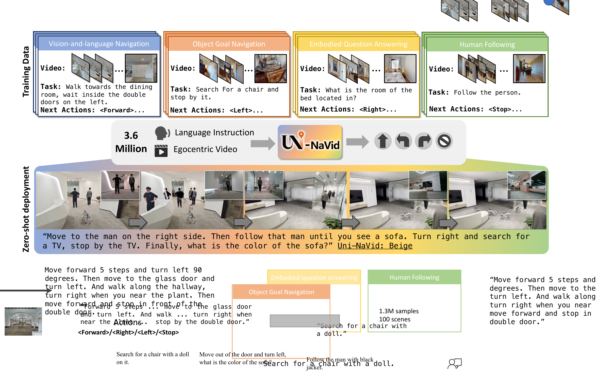
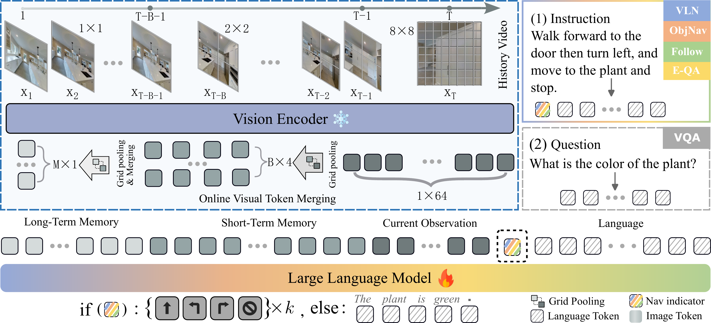
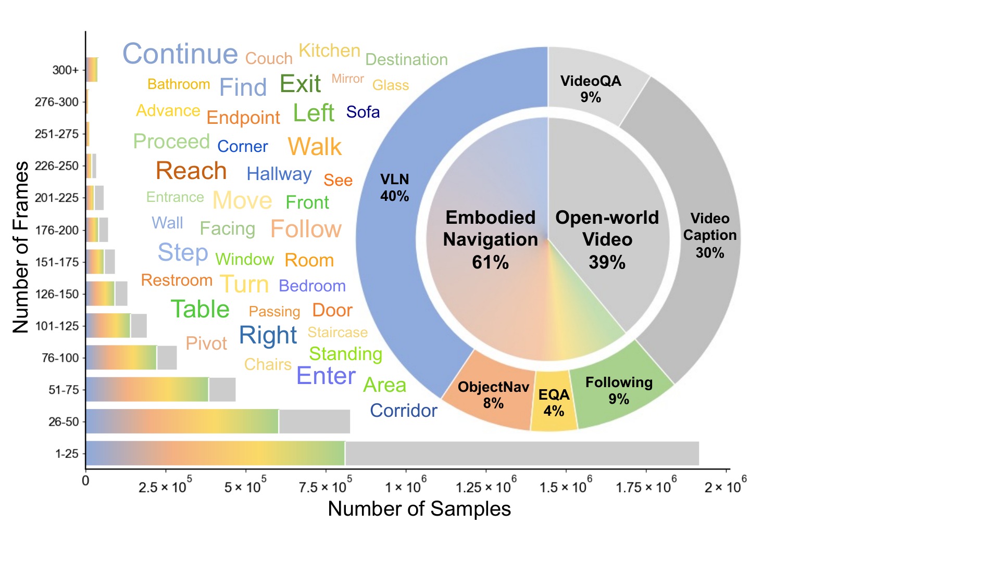
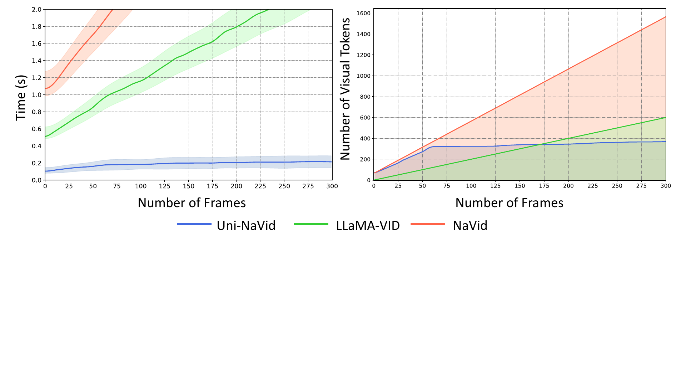

# Uni-NaVid (arXiv 2024)

<!-- paper-source: https://chengwei920412.github.io/paper_reading/2412.06224_Uni_NaVid_A_Video_based_Vision_Language_Action_Model_for_Unifying_Embodied_Navigation_Tasks/technical_report.html -->

> **arXiv ID**：2412.06224  
> **原文标题**：Uni-NaVid: A Video-based Vision-Language-Action Model for Unifying Embodied Navigation Tasks  
> **翻译日期**：2026-09-24

---

## 📋 论文概览 {#_1}

### 基本信息 {#_2}

- **作者**：Jiazhao Zhang、Kunyu Wang、Shaoan Wang、Minghan Li、Haoran Liu、Songlin Wei、Zhongyuan Wang、Zhizheng Zhang、He Wang
- **机构**：北京大学计算机学院 CFCS、银河通用、北京智源人工智能研究院
- **首次提交**：2024 年 12 月
- **领域**：具身智能、机器人导航、视觉-语言-动作模型、多任务学习

### 一句话总结 {#_3}

Uni-NaVid 将视觉-语言导航、目标物体导航、具身问答和人员跟随统一为“语言指令 + 在线第一视角 RGB 视频 → 低层动作/答案”的端到端建模问题，并通过在线视觉令牌合并把长视频推理速度提升到约 5 Hz。

图：Uni-NaVid 使用 360 万条导航样本联合学习四项具身导航任务，并在真实机器人上执行通用导航。

### 核心贡献 {#_4}

1. 提出统一四类具身导航任务的视频式 VLA 模型，以同一套输入输出接口直接预测连续环境中的低层动作。
2. 提出在线视觉令牌合并机制：按当前、短期和长期记忆分层压缩视频令牌，并在长期记忆中按余弦相似度合并冗余信息。
3. 整合 360 万条仿真导航样本，并加入 230 万条真实世界互联网视频问答与视频描述数据，联合训练跨任务能力与开放世界理解能力。
4. 在 VLN、ObjectNav、EQA、人员跟随和视频问答基准上进行统一评估，并在宇树 GO2 上展示约 5 Hz 的真实世界非阻塞导航。

---

## 🎯 研究背景与动机 {#_5}

### 问题定义 {#_6}

传统具身导航通常按任务分别建模：VLN 需要理解自由形式路线指令，ObjectNav 需要探索并寻找类别目标，EQA 需要先导航再回答问题，人员跟随则需要处理动态目标。论文关注的问题是：能否用一个模型在不依赖预构建地图、离散地标或任务专用模块的前提下，统一这些能力，并达到可部署的推理速度？

在时间步 \(T\)，模型接收语言指令 \(\mathcal{I}\) 和截至当前的 RGB 视频 \(\mathcal{O}_T=\{\mathbf{x}_1,\ldots,\mathbf{x}_T\}\)，一次预测未来 \(k=4\) 个动作。动作空间为 `FORWARD`、`TURN-LEFT`、`TURN-RIGHT` 和 `STOP`；EQA 在停止导航后移除 `<NAV>` 标识，再基于导航历史生成答案。

### 现有方法的局限性 {#_7}

- 单任务系统难以共享不同导航任务之间的知识和数据。
- 基于现成 LLM 的零样本方法常把视觉信息先压缩成文本或离散地标，容易损失密集空间信息。
- 端到端视频模型若保留所有历史帧令牌，令牌数量会随时间线性增长，长时程导航的推理延迟不可接受。
- 仿真数据覆盖有限，直接迁移到真实世界时容易遇到仿真到现实差距。

### 本文的创新点 {#_8}

论文的关键并非单独提出新的视觉编码器或 LLM，而是把任务统一、长视频压缩、动作接口统一和跨域数据联合训练组合成一条可运行的导航链路。其工程价值在于：模型只依赖 RGB 与语言，不要求深度、里程计或显式地图，同时保持在线推理频率。

---

## 🔬 方法论 {#_9}

### 整体架构 {#_10}

图：视觉编码器提取逐帧令牌；在线令牌合并压缩历史；MLP 将视觉特征投影至语言空间；Vicuna-7B 生成导航动作或问答结果。

模型由三部分组成：

1. **视觉编码器**：EVA-CLIP 将每帧编码为 \(N_x=256\) 个视觉令牌。
2. **在线视觉令牌合并**：当前帧、短期历史和长期历史分别压缩为每帧 64、4、1 个令牌。
3. **大语言模型**：MLP 投影后的视觉令牌与指令令牌拼接，输入 Vicuna-7B；导航任务一次输出未来四个动作。

### 在线视觉令牌合并 {#_11}

视觉历史按时间划分为三层：

<table>
<thead>
<tr>
<th>记忆层</th>
<th>时间范围</th>
<th>池化尺度</th>
<th>每帧令牌数</th>
<th>作用</th>
</tr>
</thead>
<tbody>
<tr>
<td>当前观测</td>
<td>\(t=T\)</td>
<td>\(\alpha_{curr}=2\)</td>
<td>64</td>
<td>保留当前场景的细粒度信息</td>
</tr>
<tr>
<td>短期记忆</td>
<td>\(t\in[T-B,T)\)</td>
<td>\(\alpha_{short}=8\)</td>
<td>4</td>
<td>保留近期运动与局部历史</td>
</tr>
<tr>
<td>长期记忆</td>
<td>\(t\in[1,T-B)\)</td>
<td>\(\alpha_{long}=16\)</td>
<td>1</td>
<td>以极低成本保存长程上下文</td>
</tr>
</tbody>
</table>

短期缓冲区长度 \(B=64\)。当短期帧移入长期记忆时，计算其与最新长期令牌的余弦相似度；若相似度高于 \(\tau=0.95\)，则以已合并帧数 \(K\) 加权更新：

\[\mathbf{X}_{long}\leftarrow\frac{K\mathbf{X}_{long}+\mathbf{X}_{short\rightarrow long}}{K+1}.\]

这种设计只处理分组边界上的少量令牌，避免每一步重新编码和整理完整历史。

### 数据与训练 {#_12}

图：四类导航任务的数据构成与场景来源。

- VLN：约 64 万条真实轨迹样本、约 169 万条 DAgger 样本，另有约 7 万条低层指令增强样本。
- ObjectNav：约 48.3 万条成功导航轨迹。
- EQA：约 24 万条视频-动作样本与 1 万条视频-回答样本。
- 人员跟随：约 54.4 万条视频-动作样本。
- 辅助真实世界数据：230 万条视频问答与视频描述样本。

训练分两阶段：先用图像/视频问答数据完成模态对齐，再联合微调投影器和 LLM。论文报告使用 40 张 NVIDIA H800 训练约 35 小时，即约 1400 GPU 小时；视觉编码器保持冻结，仅优化可训练参数一个 epoch。

---

## 📊 实验与结果 {#_13}

### 主要结果 {#_14}

<table>
<thead>
<tr>
<th>任务/基准</th>
<th>Uni-NaVid 结果</th>
<th>代表性对照</th>
<th>结论</th>
</tr>
</thead>
<tbody>
<tr>
<td>VLN-CE R2R Val-Unseen</td>
<td>SR 47.0，SPL 42.7</td>
<td>NaVid：SR 37.4，SPL 35.9</td>
<td>仅用单目 RGB，显著优于同类视频导航模型</td>
</tr>
<tr>
<td>VLN-CE RxR Val-Unseen</td>
<td>SR 48.7，SPL 40.9</td>
<td>NaVid：SR 23.8，SPL 21.2</td>
<td>对更长、更丰富的 RxR 指令提升明显</td>
</tr>
<tr>
<td>HM3D ObjectNav</td>
<td>SR 73.7，SPL 37.1</td>
<td>PIRLNav-IL-RL：SR 70.4，SPL 34.1</td>
<td>无里程计、无深度仍取得最佳结果</td>
</tr>
<tr>
<td>HM3D-OVON 未见类别</td>
<td>SR 39.5，SPL 19.8</td>
<td>VLFM：SR 35.2，SPL 19.6</td>
<td>零样本开放词汇导航具有竞争力</td>
</tr>
<tr>
<td>MP3D-EQA 连续环境</td>
<td>ACC 47.3</td>
<td>NaviLLM：44.5</td>
<td>统一连续动作框架优于离散环境方法</td>
</tr>
<tr>
<td>人员跟随</td>
<td>SR 61.21，FR 71.93</td>
<td>IBVS + GT框：SR 50.58，FR 68.89</td>
<td>无需外部人员检测框也能更好跟随</td>
</tr>
<tr>
<td>ScanQA</td>
<td>CIDEr 94.72</td>
<td>BridgeQA：83.75</td>
<td>空间视频问答能力得到保留</td>
</tr>
</tbody>
</table>

### 消融实验 {#_15}

<table>
<thead>
<tr>
<th>配置</th>
<th>VLN SR</th>
<th>ObjectNav SR</th>
<th>EQA ACC</th>
<th>跟随 SR</th>
</tr>
</thead>
<tbody>
<tr>
<td>无 <code>&lt;NAV&gt;</code> 令牌</td>
<td>35.2</td>
<td>69.1</td>
<td>20.4</td>
<td>55.1</td>
</tr>
<tr>
<td>无 VQA 数据</td>
<td>40.5</td>
<td>50.6</td>
<td>1.19</td>
<td>58.8</td>
</tr>
<tr>
<td>仅当前观测</td>
<td>9.61</td>
<td>44.3</td>
<td>32.5</td>
<td>56.3</td>
</tr>
<tr>
<td>当前 + 短期记忆</td>
<td>39.7</td>
<td>67.8</td>
<td>44.1</td>
<td>59.7</td>
</tr>
<tr>
<td>当前 + 短期 + 长期记忆</td>
<td><strong>48.7</strong></td>
<td><strong>73.7</strong></td>
<td><strong>47.3</strong></td>
<td><strong>61.2</strong></td>
</tr>
</tbody>
</table>

最有信息量的结论有三点：

- `<NAV>` 是任务路由标识，尤其能防止 EQA 中“继续导航还是回答问题”的歧义。
- VQA 辅助数据不仅影响问答，还明显帮助 ObjectNav，说明开放世界语义知识能迁移到导航。
- VLN 对历史记忆最敏感；人员跟随更多依赖近期帧，因此移除记忆的降幅较小。

### 运行效率与真实部署 {#_16}

图：推理时间与令牌数量随导航时间变化。在线合并使推理时间保持约 0.2 秒，而完整视频方法的开销随历史增长。

模型部署在远程 NVIDIA A100 服务器，宇树 GO2 通过网络上传压缩图像并接收动作。论文报告模型推理约 0.2 秒、通信约 0.3 秒；机器人执行当前动作时异步上传新观测，形成约 5 Hz 的非阻塞导航流程。

---

## 💡 关键见解 {#_17}

### 理论与建模层面 {#_18}

在线令牌合并体现了一种面向控制的记忆偏置：越新的观测分辨率越高，越旧的历史压缩越强。它不是通用视频摘要，而是利用导航任务的时序性质——即时避障依赖当前细节，路径与指令对齐需要短期历史，长程状态只需少量关键线索。

统一动作空间使多任务数据能够直接混合，但 EQA 的输出语义不同，因此仍需 `<NAV>` 完成模式切换。这说明“统一模型”不等于完全取消任务条件；一个极轻量的任务标识往往能显著降低多任务输出空间的歧义。

### 实践启示 {#_19}

- 对长视频机器人策略而言，增量缓存和边界更新比每步重算完整历史更重要。
- 多任务训练是否有效，取决于输入输出接口能否真正统一，而不只是把数据混在一起。
- 真实世界 VQA/描述数据可以作为仿真导航与开放世界语义之间的桥梁。
- 一次预测多个未来动作可隐藏网络与推理延迟，但也会带来动作陈旧问题；论文用“最新命令优先”进行缓解。

---

## 🔍 局限性与未来工作 {#_20}

### 当前局限 {#_21}

1. 仅覆盖四类定义明确的导航任务，离真正的开放式通用导航仍有距离。
2. 训练假设机器人尺寸处于既定范围，尚未显式建模不同本体尺寸和动力学。
3. 输出是短时域离散动作序列，轨迹可能不够平滑，也不适合高速或精细控制。
4. 真实世界实验规模有限，缺少跨建筑、室外、长时间运行和故障恢复等系统性评估。
5. 结果来自多个基准，统一模型与各任务专用模型所用数据和监督并不完全等价；“通用性”仍需更严格的统一基准验证。
6. 训练成本较高，且依赖 360 万导航样本与 230 万辅助样本，数据质量、任务比例和缩放规律尚未被充分剖析。

### 未来方向 {#_22}

- 用机器人尺寸、相机高度和动力学参数作为显式条件，支持跨本体迁移。
- 将离散动作预测替换为连续轨迹或与运动规划器联合建模。
- 构建统一的通用导航基准，覆盖跨楼层、跨建筑、动态障碍、移动操作与长期任务。
- 研究可学习的记忆保留策略，让模型根据任务与场景动态分配令牌预算。
- 增加不确定性估计与安全约束，处理网络延迟、错误指令、目标丢失和无法到达等失败模式。

---

## 📚 相关方法对比 {#_23}

<table>
<thead>
<tr>
<th>方法类型</th>
<th>核心思想</th>
<th>优势</th>
<th>局限</th>
</tr>
</thead>
<tbody>
<tr>
<td>模块化导航</td>
<td>感知、建图、规划和控制分离</td>
<td>可解释、易插入安全规则</td>
<td>任务接口碎片化，跨任务共享较弱</td>
</tr>
<tr>
<td>LLM 零样本导航</td>
<td>用文本描述场景并让 LLM 选择地标</td>
<td>开放词汇理解强，无需大量任务训练</td>
<td>视觉信息压缩严重，推理慢，常依赖离散图</td>
</tr>
<tr>
<td>单任务视频 VLM</td>
<td>从视频端到端输出动作</td>
<td>输入简单，能学习隐式记忆</td>
<td>难以共享多任务数据，长视频开销增长</td>
</tr>
<tr>
<td><strong>Uni-NaVid</strong></td>
<td>多任务 VLA + 分层在线令牌合并</td>
<td>统一四项任务、仅需 RGB、约 5 Hz</td>
<td>仍依赖离散动作和大量仿真数据</td>
</tr>
</tbody>
</table>

---

## 🎓 综合评价 {#_24}

### 优点 {#_25}

- 问题选择具有实际价值：同时关注任务统一、视觉历史压缩和真实机器人延迟。
- 输入假设简洁，只使用第一视角 RGB 与语言，降低了部署传感器门槛。
- 实验覆盖面广，并通过多任务、VQA 数据、记忆结构和压缩超参数消融支撑核心设计。
- 真实世界系统给出了推理与通信延迟，工程链路比纯仿真实验更完整。

### 可改进之处 {#_26}

- 需要更大规模、更标准化的真实世界评测，尤其是失败率、干预次数和安全指标。
- 应报告任务采样比例、不同数据源质量和训练稳定性，以便判断性能来自架构还是数据规模。
- 在线令牌合并以固定池化尺度和阈值为主，可进一步与可学习记忆或信息增益准则比较。
- “SOTA”结论在不同输入模态、预训练数据和训练预算下并非完全同口径，应谨慎解读。

### 推荐阅读对象 {#_27}

适合关注具身导航、长视频 VLM/VLA、机器人多任务学习、仿真到现实和在线记忆压缩的研究者与工程师。若目标是复现，应优先阅读数据收集、令牌组织、动作预测与真实部署部分，并仔细核对各基准的传感器输入与训练数据差异。

---

## 📎 附录 {#_28}

### 术语表 {#_29}

<table>
<thead>
<tr>
<th>术语</th>
<th>含义</th>
</tr>
</thead>
<tbody>
<tr>
<td>VLA</td>
<td>视觉-语言-动作模型</td>
</tr>
<tr>
<td>VLN</td>
<td>视觉-语言导航</td>
</tr>
<tr>
<td>ObjectNav</td>
<td>目标物体导航</td>
</tr>
<tr>
<td>EQA</td>
<td>具身问答</td>
</tr>
<tr>
<td>SR / OSR / SPL</td>
<td>成功率 / 预言成功率 / 路径长度加权成功率</td>
</tr>
<tr>
<td>FR / CR</td>
<td>跟随率 / 碰撞率</td>
</tr>
<tr>
<td>当前/短期/长期令牌</td>
<td>按时间新旧采用不同压缩率的视觉记忆层</td>
</tr>
</tbody>
</table>

### 参考资源 {#_30}

- **论文原文**：[arXiv 2412.06224](https://arxiv.org/abs/2412.06224)
- **中文翻译 PDF**：[paper_cn.pdf](https://chengwei920412.github.io/paper_reading/2412.06224_Uni_NaVid_A_Video_based_Vision_Language_Action_Model_for_Unifying_Embodied_Navigation_Tasks/paper_cn.pdf)
- **中文 Markdown 译文**：[paper_cn.md](https://chengwei920412.github.io/paper_reading/2412.06224_Uni_NaVid_A_Video_based_Vision_Language_Action_Model_for_Unifying_Embodied_Navigation_Tasks/paper_cn.html)
- **项目主页**：[Uni-NaVid](https://pku-epic.github.io/Uni-NaVid)
- **代码实现**：论文原文表示将公开完整源代码；请以项目主页的最新链接为准。
