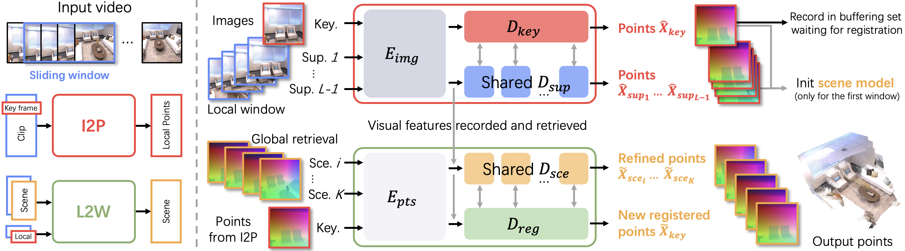
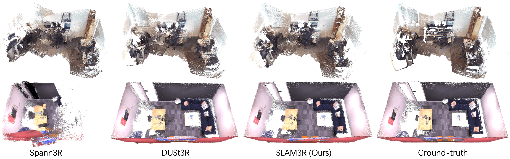
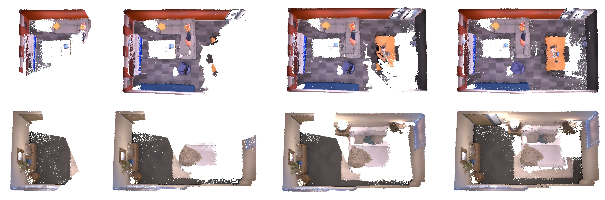

# SLAM3R (arXiv 2024)

<!-- paper-source: https://chengwei920412.github.io/paper_reading/2412.09401_SLAM3R_Real_Time_Dense_Scene_Reconstruction_from_Monocular_RGB_Videos/technical_report.html -->

> **arXiv ID**: 2412.09401  
> **原文标题**: SLAM3R: Real-Time Dense Scene Reconstruction from Monocular RGB Videos  
> **翻译日期**: 2026-10-12

---

## 📋 论文概览 {#_1}

### 基本信息 {#_2}

- **作者**: Yuzheng Liu、Siyan Dong、Shuzhe Wang、Yingda Yin、Yanchao Yang、Qingnan Fan、Baoquan Chen
- **机构**: 北京大学、香港大学、阿尔托大学、VIVO
- **发表时间**: CVPR 2025
- **领域**: 计算机视觉、稠密三维重建、单目 SLAM

### 核心贡献 {#_3}

SLAM3R 将单目视频稠密重建改写为两个前馈网络串联的问题：图像到点（Image-to-Points，I2P）网络负责在短视频窗口内生成局部三维点图，局部到世界（Local-to-World，L2W）网络负责把局部结果逐步注册到统一世界坐标系。整个流程不显式求解相机内外参，也不依赖代价高昂的全局优化；在 7 Scenes 与 Replica 上实现约 24–25 FPS，并在精度与完整度之间取得领先的综合表现。

---

## 🎯 研究背景与动机 {#_4}

### 问题定义 {#_5}

输入是捕获静态场景的单目 RGB 视频帧序列 \(\{I_i\}_{i=1}^{N}\)，目标是重建稠密三维点云 \(P\in\mathbb{R}^{M\times3}\)。系统需同时满足三个目标：尽可能恢复更多场景点、提高每个点的几何精度，并保持实时速度。

### 现有方法的局限性 {#_6}

传统 SfM/MVS 流程通常先估计相机，再进行稠密重建，质量较高但依赖离线优化。神经隐式或高斯表示 SLAM 虽能改善视觉质量，却常依赖深度传感器、侧重新视角合成，或运行速度远低于实时。DUSt3R 可实时处理图像对，但扩展到多视图时需穷举配对和全局优化；Spann3R 的逐帧增量方式速度快，却容易积累漂移。

### 本文的创新点 {#_7}

- 用直接预测统一坐标系三维点图的方式替代“先估相机、再建图”的显式流水线。
- 让 I2P 同时利用一个关键帧和多个支持帧，通过多视图交叉注意力降低单对图像预测的不稳定性。
- 让 L2W 通过场景帧缓冲池、蓄水池采样和相关性检索获得长时全局参考，控制漂移与内存开销。
- 支持多关键帧联合配准，在一次场景解码中融合多个新关键帧，提升吞吐率。

---

## 🔬 方法论 {#_8}

### 整体架构 {#_9}

图：SLAM3R 的两级架构。I2P 在滑动窗口内恢复局部点图，L2W 将其逐步融合到全局坐标系。

输入视频先被切分为重叠窗口。第一个窗口用于初始化世界坐标系；后续窗口分别经过 I2P 局部重建和 L2W 全局注册。系统维护有限数量的已注册场景帧，并为每个新关键帧检索最相关的历史帧作为全局参考。

### 关键技术 {#_10}

**I2P 局部重建。** 默认选择窗口中间帧为关键帧，其余帧为支持帧。共享 ViT 编码器独立提取各帧特征；关键帧解码器让关键帧查询分别与每个支持帧的键和值交互，再以最大池化聚合多视图信息。支持帧解码器则与关键帧双向交换信息。预测头输出三维点图和置信度图。

**L2W 全局注册。** 系统将 I2P 生成的点图编码为几何词元，并与视觉词元相加。注册解码器将新关键帧变换到场景坐标系，场景解码器同时细化历史场景帧。缓冲池采用蓄水池采样维持无偏历史子集；轻量检索模块综合视觉相似度与适合三维重建的基线关系，选出前 \(K\) 个场景帧。

**置信度感知训练。** I2P 的核心目标可写为：

\[\mathcal{L}_{I2P}=\sum_{i=1}^{L}M_i\cdot\left(\hat C_i\cdot \mathrm{L1}\left(\frac{\hat X_i}{\hat z},\frac{X_i}{z}\right)-\alpha\log\hat C_i\right).\]

其中 \(M_i\) 是有效点掩码，\(z\) 与 \(\hat z\) 是尺度因子，\(\hat C_i\) 是预测置信度。L2W 使用相似损失，但不做尺度归一化，以确保输出与既有世界坐标系保持一致尺度。

### 算法流程 {#_11}

1. 将视频划分为重叠滑动窗口，并在每个窗口内指定关键帧。
2. I2P 编码窗口内所有图像，以多视图交叉注意力预测局部点图与置信度。
3. 用第一个窗口中总置信度最高的重建结果初始化世界坐标系和场景帧缓冲池。
4. 对新关键帧，从缓冲池检索前 \(K\) 个相关场景帧。
5. L2W 联合编码视觉与几何特征，将新点图注册到世界坐标系，并细化相关场景帧。
6. 按蓄水池策略更新缓冲池，持续处理后续窗口，最终合并为全局点云。

---

## 📊 实验与结果 {#_12}

### 实验设置 {#_13}

- **训练数据集**: ScanNet++、Aria Synthetic Environments（ASE）和 CO3D-v2，共约 85 万个视频片段
- **评估数据集**: 7 Scenes、Replica；另在 ScanNet、Tanks and Temples、ETH3D、DTU 和真实拍摄视频上进行泛化验证
- **评估指标**: 精度、完整度、每秒帧数（FPS）和绝对轨迹误差均方根（ATE-RMSE）
- **对比方法**: DUSt3R、MASt3R、Spann3R、NICER-SLAM、DROID-SLAM、DIM-SLAM、GO-SLAM 等
- **训练资源**: 8 张 NVIDIA 4090D GPU，每张 24 GB；总训练约一天

### 主要结果 {#_14}

<table>
<thead>
<tr>
<th>数据集</th>
<th>方法</th>
<th>精度（cm）↓</th>
<th>完整度（cm）↓</th>
<th>FPS↑</th>
</tr>
</thead>
<tbody>
<tr>
<td>7 Scenes</td>
<td>DUSt3R</td>
<td>2.19</td>
<td>3.24</td>
<td>&lt;1</td>
</tr>
<tr>
<td>7 Scenes</td>
<td>Spann3R</td>
<td>3.42</td>
<td>2.41</td>
<td>&gt;50</td>
</tr>
<tr>
<td>7 Scenes</td>
<td><strong>SLAM3R</strong></td>
<td><strong>2.13</strong></td>
<td><strong>2.34</strong></td>
<td><strong>约25</strong></td>
</tr>
<tr>
<td>Replica</td>
<td>DUSt3R</td>
<td>3.49</td>
<td>2.48</td>
<td>&lt;1</td>
</tr>
<tr>
<td>Replica</td>
<td>NICER-SLAM</td>
<td>3.65</td>
<td>4.16</td>
<td>≪1</td>
</tr>
<tr>
<td>Replica</td>
<td>Spann3R</td>
<td>10.32</td>
<td>13.33</td>
<td>&gt;50</td>
</tr>
<tr>
<td>Replica</td>
<td><strong>SLAM3R</strong></td>
<td><strong>3.57</strong></td>
<td><strong>2.62</strong></td>
<td><strong>约24</strong></td>
</tr>
</tbody>
</table>

SLAM3R 在 7 Scenes 上同时优于 DUSt3R、MASt3R 与 Spann3R 的平均精度和完整度；在 Replica 上，其几何质量接近离线优化的 DUSt3R，却比后者快一个数量级以上。与更快的 Spann3R 相比，SLAM3R 显著降低了累积漂移。

图：7 Scenes 与 Replica 上的重建对比。SLAM3R 以实时速度获得接近离线 DUSt3R 的全局一致性。

### 消融实验 {#_15}

窗口长度从 2 增加到 51 帧时，I2P 关键帧重建精度从 3.39 cm 改善到 2.23 cm、完整度从 3.04 cm 改善到 1.86 cm，但速度从 42.55 FPS 降至 11.97 FPS。默认 11 帧窗口达到 2.38/2.03 cm 和 40.11 FPS，是质量与效率的折中。

对齐模块消融显示，完整的 I2P+L2W+检索方案达到 3.62/2.70 cm、约 43 FPS；去掉检索后为 6.19/3.54 cm、约 92 FPS。检索牺牲部分吞吐率，却明显改善全局几何质量。场景帧数量也存在收益饱和：约 10–30 帧时性能最好，继续增大反而可能引入无关参考并降低速度。

图：Replica 场景中的增量重建过程。即使没有全局优化阶段，系统仍保持较低漂移。

---

## 💡 关键见解 {#_16}

### 理论分析 {#_17}

论文的核心转变不是换一种相机位姿求解器，而是将“坐标一致性”直接吸收到网络预测目标中。I2P 在局部窗口内利用多帧冗余降低点预测歧义，L2W 再以少量历史场景帧提供长时坐标锚点。这种局部—全局分解避免了全视频联合优化的二次配对开销，也比纯逐帧递推更不易积累漂移。

置信度既用于训练时抑制不可靠点，也用于测试时筛除低质量预测、选择初始化结果和更新缓冲池，因此它实际上承担了统一的不确定性接口。检索模块则把长视频历史压缩为有限且相关的全局上下文，使算法复杂度不随视频长度线性增长到不可控规模。

### 实践启示 {#_18}

- 若任务更重视局部几何质量，可增大 I2P 窗口；若重视吞吐率，11 帧附近是较稳妥的默认值。
- 场景帧并非越多越好。检索质量和参考帧覆盖度比单纯扩大缓冲池更重要。
- 在不需要高精度相机轨迹的扫描、机器人感知或 AR 建图任务中，直接点图预测可能比传统“位姿优先”流程更合适。
- 训练数据同时覆盖室内场景、合成环境和物体中心序列，有助于提升跨域泛化。

---

## 🔍 局限性与未来工作 {#_19}

### 当前局限 {#_20}

- 不显式预测相机参数，因此无法直接使用成熟的全局束调整进一步纠正长期漂移。
- 从预测场景点反推出的相机位姿仍明显弱于专门优化定位精度的 SLAM 系统。
- 训练和实验主要面向静态场景；动态物体、严重运动模糊、弱纹理或极端视角变化下的鲁棒性尚未被充分验证。
- 直接输出点云，尚未提供面向纹理网格、可编辑表面或照片级新视角合成的完整表示。

### 未来方向 {#_21}

可探索可微的轻量全局一致性约束，在保持前馈速度的同时引入闭环修正；也可联合学习点图与相机轨迹，让几何重建和定位互相约束。进一步研究可扩展到动态场景、开放世界长视频、多传感器融合，以及从点图直接生成可渲染表面或高斯表示。

---

## 📚 相关工作对比 {#_22}

<table>
<thead>
<tr>
<th>方法</th>
<th>核心思想</th>
<th>优势</th>
<th>劣势</th>
</tr>
</thead>
<tbody>
<tr>
<td>DUSt3R</td>
<td>成对图像端到端预测点图，多视图时做全局优化</td>
<td>几何质量高，弱依赖传统相机模型</td>
<td>多视图扩展慢，难以实时</td>
</tr>
<tr>
<td>Spann3R</td>
<td>以空间记忆逐帧增量重建</td>
<td>吞吐率高，无需全局优化</td>
<td>容易累积漂移，重建质量下降</td>
</tr>
<tr>
<td>传统稠密 SLAM</td>
<td>交替优化相机位姿和场景表示</td>
<td>位姿估计成熟，可加入闭环与束调整</td>
<td>流程复杂，部分方法依赖深度或运行缓慢</td>
</tr>
<tr>
<td><strong>SLAM3R</strong></td>
<td>I2P 局部多帧重建 + L2W 检索式全局注册</td>
<td>约 24–25 FPS，质量与效率平衡好</td>
<td>位姿精度仍弱，缺少显式全局优化</td>
</tr>
</tbody>
</table>

---

## 🎓 个人评价 {#_23}

### 优点 {#_24}

方法设计简洁，两个网络共享相近的编码—解码范式，局部重建与全局注册的职责划分清楚。实验不仅展示平均指标，还同时报告质量、速度、位姿和多项消融，较好地支撑了“无需显式相机参数也能实时高质量重建”的主张。尤其值得肯定的是，作者没有以极慢的优化换取小幅精度提升，而是正面处理实时性与完整度的共同约束。

### 可改进之处 {#_25}

论文的相机位姿结果与重建结果并不完全正相关，这既支持其“点图优先”的论点，也暴露了定位能力不足。若要用于机器人闭环控制或精确导航，需要更系统地评估轨迹稳定性、闭环场景和长时误差。对动态场景、非连续采样、不同分辨率以及计算资源受限设备的实验也有补充空间。

### 推荐阅读对象 {#_26}

适合研究或开发稠密 SLAM、三维重建、视觉 Transformer、多视图几何、机器人感知和 AR/VR 建图系统的读者；也适合作为理解“从显式几何优化转向前馈点图预测”这一研究趋势的案例。

---

## 📎 附录 {#_27}

### 重要公式 {#_28}

重建精度与完整度分别度量预测点到真实点云、真实点到预测点云的最近邻距离：

\[\mathrm{Accuracy}=\frac{1}{P}\sum_{i=1}^{P}\min_j D(x_i,y_j),\]

\[\mathrm{Completeness}=\frac{1}{Q}\sum_{j=1}^{Q}\min_i D(x_i,y_j).\]

检索模块用完整 I2P 预测的平均置信度监督场景帧相关性分数：

\[\mathcal{L}_{Retr}=\sum_{i=1}^{R}\left|S&#x27;_i-\mathrm{Mean}(C&#x27;_i)\right|.\]

### 术语表 {#_29}

<table>
<thead>
<tr>
<th>英文</th>
<th>中文</th>
</tr>
</thead>
<tbody>
<tr>
<td>Dense Scene Reconstruction</td>
<td>稠密场景重建</td>
</tr>
<tr>
<td>Pointmap</td>
<td>点图</td>
</tr>
<tr>
<td>Image-to-Points (I2P)</td>
<td>图像到点网络</td>
</tr>
<tr>
<td>Local-to-World (L2W)</td>
<td>局部到世界网络</td>
</tr>
<tr>
<td>Inner-Window Local Reconstruction</td>
<td>窗内局部重建</td>
</tr>
<tr>
<td>Inter-Window Global Registration</td>
<td>窗间全局配准</td>
</tr>
<tr>
<td>Scene Frame</td>
<td>场景帧</td>
</tr>
<tr>
<td>Supporting Frame</td>
<td>支持帧</td>
</tr>
<tr>
<td>Retrieval Module</td>
<td>检索模块</td>
</tr>
<tr>
<td>Accuracy / Completeness</td>
<td>精度 / 完整度</td>
</tr>
</tbody>
</table>

### 参考资源 {#_30}

- **论文原文**: [arXiv链接](https://arxiv.org/abs/2412.09401)
- **中文翻译 PDF**: [paper_cn.pdf](https://chengwei920412.github.io/paper_reading/2412.09401_SLAM3R_Real_Time_Dense_Scene_Reconstruction_from_Monocular_RGB_Videos/paper_cn.pdf)
- **中文 Markdown 译文**: [paper_cn.md](https://chengwei920412.github.io/paper_reading/2412.09401_SLAM3R_Real_Time_Dense_Scene_Reconstruction_from_Monocular_RGB_Videos/paper_cn.html)
- **代码实现**: [PKU-VCL-3DV/SLAM3R](https://github.com/PKU-VCL-3DV/SLAM3R)
- **项目主页**: [SLAM3R GitHub 项目](https://github.com/PKU-VCL-3DV/SLAM3R)
