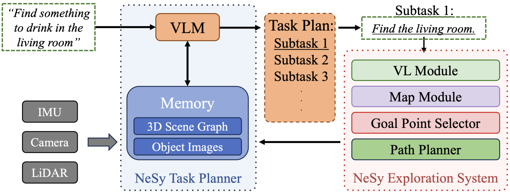
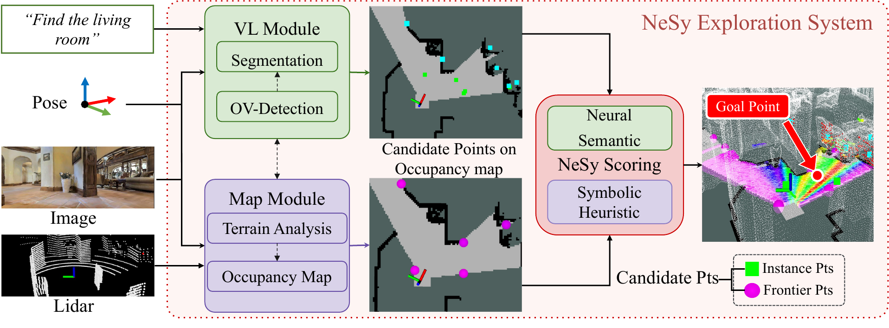
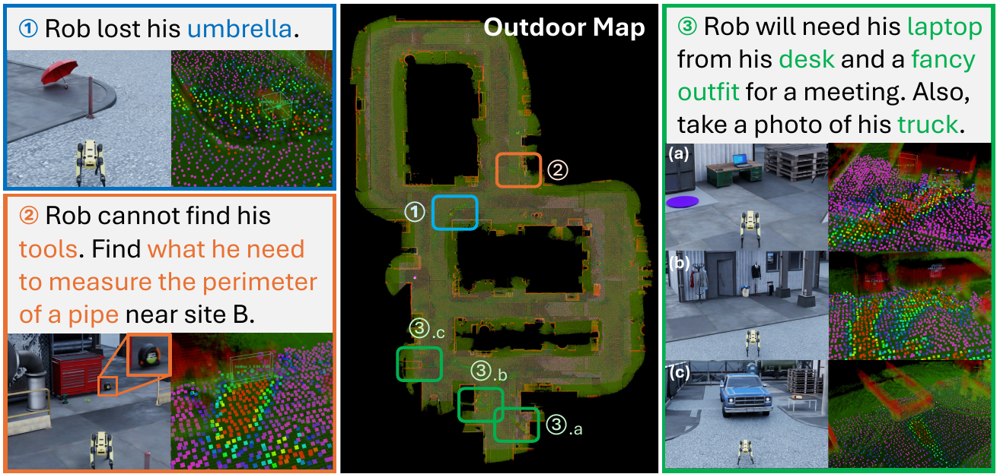

# VL-Nav (arXiv 2025)

<!-- paper-source: https://chengwei920412.github.io/paper_reading/2502.00931_VL_Nav_Neuro_Symbolic_Reasoning_based_Vision_Language_Navigation/technical_report.html -->

> 原文链接：[VL-Nav (arXiv 2025)](https://chengwei920412.github.io/paper_reading/2502.00931_VL_Nav_Neuro_Symbolic_Reasoning_based_Vision_Language_Navigation/technical_report.html)

> **arXiv ID**：2502.00931（v7）  
> **原文标题**：VL-Nav: Neuro-Symbolic Reasoning-based Vision-Language Navigation  
> **翻译日期**：2026-10-05

---

## 📋 论文概览 {#_1}

### 基本信息 {#_2}

- **作者**：Yi Du、Taimeng Fu、Zhipeng Zhao、Shaoshu Su、Zitong Zhan、Qiwei Du、Zhuoqun Chen、Bowen Li、Chen Wang
- **机构**：纽约州立大学布法罗分校 Spatial AI & Robotics Lab；卡内基梅隆大学 Robotics Institute
- **发表信息**：arXiv 首次提交于 2025-02-02；论文条目注明收录于 IEEE/RSJ International Conference on Intelligent Robots and Systems（IROS）2026
- **领域**：机器人学（cs.RO）、计算机视觉（cs.CV）、视觉语言导航、开放词汇感知、神经符号推理

### 核心贡献 {#_3}

VL-Nav 面向全新大规模环境中的抽象、多目标导航指令，把高层视觉语言推理与可解释的几何导航机制组合起来。系统包含两个核心模块：NeSy 任务规划器使用三维场景图与物体中心图像记忆约束 VLM 的任务分解和重规划；NeSy 探索系统则融合开放词汇检测得到的语义线索、几何前沿、距离偏好和未知区域比例，在实时约束下选择目标点。论文在 DARPA TIAMAT 仿真任务和四类真实环境中验证了该方法，并展示了最长 483 米的运行及多楼层复杂任务。

---

## 🎯 研究背景与动机 {#_4}

### 问题定义 {#_5}

传统视觉语言导航通常假定目标在指令中被明确说出，例如“前往 L 形沙发”。本文关注更困难的推理型 VLN：指令只给出隐含需求，如“天气预报说会下雨，请找齐合适的装备”。机器人需要先推断“雨伞、雨衣和雨靴”等真实目标，再在未知大场景中规划搜索顺序、记录候选物体并完成多个目标的核验。

### 现有方法的局限性 {#_6}

- 经典 SLAM 与前沿探索具备稳定的几何能力，却无法理解语言中的隐含语义。
- 端到端策略和 VLA 模型数据需求高、实时开销大，且在仿真到真实迁移时容易退化。
- 基础模型驱动的模块化方法通常擅长显式单目标搜索，但把目标核验与探索紧密耦合，难以处理抽象、多目标和长时序任务。
- 单纯依赖神经语义分数容易反复前往相似区域；单纯依赖几何前沿又无法优先搜索与任务相关的位置。

### 本文的创新点 {#_7}

1. 用显式的三维场景图和图像记忆为 VLM 提供可查询、可更新的符号记忆，避免仅靠当前视野进行长时序推理。
2. 把任务分解为“探索”和“前往”两类原子子任务，并在每个子任务完成后依据最新记忆重规划。
3. 同时维护基于实例的目标点与基于前沿的目标点：前者用于接近并核验疑似目标，后者用于持续获取未知区域信息。
4. 以视觉语言得分、距离权重和未知区域权重构成神经符号评分，使语义相关性与几何探索效率在同一目标选择机制中协同作用。

---

## 🔬 方法论 {#_8}

### 整体架构 {#_9}

图：VL-Nav 总体流程。VLM 在统一记忆的约束下将复杂任务分解为子任务，当前子任务进入 NeSy 探索系统，后者选择探索目标或直接导航目标。

任务规划器负责“要找什么、下一步做什么”，探索系统负责“在地图上去哪里”。两者通过动态目标列表、三维场景图、最佳视角图像和子任务完成状态形成闭环，而非让大模型参与每一个低层导航周期。

### 关键技术 {#_10}

**1. 统一记忆系统**

三维场景图包含物体节点和房间节点。房间区域由形态学方法分割，再由 LLM 根据相连物体推断房间标签；若物体质心落入某房间掩码，则建立物体—房间边。每个物体节点保存质心、最高检测置信度、最佳观察位姿和对应 RGB 图像。空间结构与视觉证据因而能够被 VLM 联合查询。

**2. 粗到细目标核验**

场景图先按检测置信度筛出 top-\(k\) 候选；VLM 再结合候选的最佳视角图像和邻近场景图节点完成细粒度判断。确定目标后，系统把保存的最佳观察位姿发布为导航目标。

**3. 双类型候选目标点**

- 基于前沿的目标点来自自由栅格与未知栅格的边界，用于扩大已知空间。
- 基于实例的目标点来自开放词汇检测。当检测置信度超过阈值时，即使尚未确认目标，系统也可主动靠近核验，从而形成搜索“捷径”。

**4. 神经符号评分**

视觉语言得分将 YOLO-World 与 FastSAM 的检测结果转换为视场角上的高斯混合分布，并用中心视野置信度削弱大角偏移检测。好奇心部分同时偏好距离较近的目标和周围未知区域较多的前沿，减少远距离往返与局部徘徊。

图：NeSy 探索系统。语义检测产生实例目标点，占据地图产生前沿目标点，评分模块从候选池中选择导航目标。

### 算法流程 {#_11}

1. VLM 读取用户指令和统一符号记忆，将复杂任务分解为“探索”或“前往”子任务。
2. 开放词汇检测器依据当前子任务处理 RGB 图像，形成语义分数和实例候选点；地图模块根据 LiDAR 与位姿维护占据栅格并提取前沿点。
3. 若存在距离阈值之外的有效实例点，优先选择视觉语言得分最高者进行核验。
4. 若无有效实例点，则选择综合 NeSy 得分最高的前沿点以获取信息。
5. FAR Planner 生成无碰路径并动态避障；子任务完成后更新场景图与图像记忆，再次触发规划。

---

## 📊 实验与结果 {#_12}

### 实验设置 {#_13}

- **仿真环境**：HabitatSim 中的 Apartment 1、Apartment 2；IsaacSim 中的 Camping Site、Factory。每个环境包含 8 个抽象导航任务，每项任务运行 3 次。
- **真实环境**：Hallway、Office、Apartment、Outdoor，共 9 类不常见目标描述，每项任务运行 3–5 次。
- **机器人与传感器**：仿真使用配备五个 RGB-D 相机的 Boston Dynamics Spot；真实实验使用四轮 Rover，多楼层演示使用 Unitree Go2。真实平台配备 Livox Mid-360 LiDAR 和 Intel RealSense D455，相应计算由 Jetson Orin NX 与远端 RTX 4090 分担。
- **指标**：仿真使用成功率（SR）和最大时间使用率（MTUR）；真实实验使用 SR 和路径长度加权成功率（SPL）。
- **对比方法**：最近前沿探索、VLFM、SG-Nav、ApexNav，以及移除 IBTP 或移除好奇心项的 VL-Nav 变体。

### 主要结果 {#_14}

<table>
<thead>
<tr>
<th>场景</th>
<th>VL-Nav SR</th>
<th>最强对比基线 SR</th>
<th>VL-Nav 效率指标</th>
</tr>
</thead>
<tbody>
<tr>
<td>Apartment 1（仿真）</td>
<td>87.5%</td>
<td>ApexNav 25.0%</td>
<td>MTUR 0.562</td>
</tr>
<tr>
<td>Apartment 2（仿真）</td>
<td>79.2%</td>
<td>ApexNav 25.0%</td>
<td>MTUR 0.591</td>
</tr>
<tr>
<td>Camping Site（仿真）</td>
<td>75.0%</td>
<td>ApexNav 20.8%</td>
<td>MTUR 0.647</td>
</tr>
<tr>
<td>Factory（仿真）</td>
<td>75.0%</td>
<td>ApexNav 12.5%</td>
<td>MTUR 0.679</td>
</tr>
<tr>
<td>Hallway（真实）</td>
<td>86.7%</td>
<td>VLFM 53.3%</td>
<td>SPL 0.672</td>
</tr>
<tr>
<td>Office（真实）</td>
<td>91.7%</td>
<td>VLFM 75.0%</td>
<td>SPL 0.812</td>
</tr>
<tr>
<td>Apartment（真实）</td>
<td>88.9%</td>
<td>VLFM 66.7%</td>
<td>SPL 0.733</td>
</tr>
<tr>
<td>Outdoor（真实）</td>
<td>77.8%</td>
<td>VLFM 44.4%</td>
<td>SPL 0.637</td>
</tr>
</tbody>
</table>

仿真中，完整 VL-Nav 在四个场景的成功率均为 75.0%–87.5%，且 MTUR 最低。真实实验中，完整系统在四种环境的 SR 和 SPL 均优于前沿探索与 VLFM。高 SPL 表明系统不仅能够找到目标，也能减少冗余路径。

图：DARPA TIAMAT 室外工厂环境中的定性结果，覆盖单目标检索、隐含语义推断和大范围多目标任务。

### 消融实验 {#_15}

- **移除 IBTP**：复杂、拥挤环境下降最明显。仿真 Apartment 1 的 SR 从 87.5% 降至 70.8%，真实 Apartment 从 88.9% 降至 70.2%，说明主动靠近候选进行核验对消歧至关重要。
- **移除好奇心项**：大规模开放环境下降最明显。仿真 Factory 从 75.0% 降至 66.7%，真实 Outdoor 从 77.8% 降至 55.6%，说明距离与未知区域权重有助于避免局部最优和重复移动。

---

## 💡 关键见解 {#_16}

### 理论分析 {#_17}

论文的核心不是把“神经”和“符号”简单串联，而是给二者明确分工：神经模型负责模糊语义匹配、属性判断和抽象指令解释；符号结构负责空间关系、历史记忆、候选过滤和可执行目标表达。该设计把大模型调用限制在任务级异步周期，同时让低层目标选择保持连续、轻量和可解释。

对前沿点 \(mathbf{g}\)，最终得分为：

\[S_{\mathrm{NeSy}}(\mathbf{g}) = w_{\mathrm{dist}} S_{\mathrm{dist}}(\mathbf{g}) + w_{\mathrm{VL}} S_{\mathrm{VL}}(\mathbf{g}) S_{\mathrm{unknown}}(\mathbf{g}).\]

其中，\(S_{\mathrm{dist}}\) 偏好近目标，\(S_{\mathrm{VL}}\) 表示任务语义相关性，\(S_{\mathrm{unknown}}\) 奖励潜在信息增益。乘积项意味着未知区域只有在语义相关时才获得较强奖励，而距离项提供独立的运动成本偏好。

### 实践启示 {#_18}

- 长时序机器人任务需要可持久化、可查询的外部记忆，不能只依赖模型上下文或当前相机帧。
- 大模型适合低频任务规划，开放词汇检测和几何规划适合高频执行；异步分层可显著降低边缘部署压力。
- 目标发现不应是二元判断。把中等置信度检测转化为“可接近并核验”的实例点，比立即接受或丢弃更符合真实搜索过程。
- 探索策略必须同时考虑语义、信息增益和运动代价；任一因素独立使用都容易出现明显失败模式。

---

## 🔍 局限性与未来工作 {#_19}

### 当前局限 {#_20}

- 任务规划器依赖远端 RTX 4090 承载 Qwen3-VL-8B，完整系统尚未实现全边缘端部署。
- 场景图候选首先按检测置信度筛选 top-\(k\)；若开放词汇检测漏检或把正确目标排除在候选之外，后续 VLM 核验无法恢复。
- NeSy 分数中的权重、检测阈值和距离阈值需要人工设定，跨机器人、传感器和环境的稳定性尚缺少系统研究。
- 论文主要报告任务级 SR、MTUR 与 SPL，缺少对规划延迟、VLM 调用次数、功耗、地图误差敏感性和故障恢复的细粒度量化。
- 场景记忆以静态空间关系为主，尚不能系统处理目标移动或环境随时间变化。

### 未来方向 {#_21}

论文明确提出扩展符号记忆以支持时间推理。进一步可以研究：动态场景图与目标轨迹估计；不确定性校准和自适应阈值；规划器蒸馏或端侧小模型；针对检测漏召回的主动观察策略；在定位噪声、网络中断和传感器退化条件下的鲁棒性评测。

---

## 📚 相关工作对比 {#_22}

<table>
<thead>
<tr>
<th>方法</th>
<th>核心思想</th>
<th>优势</th>
<th>劣势</th>
</tr>
</thead>
<tbody>
<tr>
<td>经典前沿探索</td>
<td>选择已知自由区与未知区边界</td>
<td>轻量、可解释、几何稳定</td>
<td>不理解语言语义，搜索无任务偏好</td>
</tr>
<tr>
<td>VLFM</td>
<td>以预训练 VLM 语义值引导前沿</td>
<td>零样本语义探索，模块化</td>
<td>更适合显式单目标，复杂任务推理和记忆有限</td>
</tr>
<tr>
<td>SG-Nav / ApexNav</td>
<td>场景图或开放词汇表征结合基础模型</td>
<td>能处理新类别和语义关系</td>
<td>计算成本高，长时序多目标管理仍受限</td>
</tr>
<tr>
<td><strong>VL-Nav</strong></td>
<td>统一符号记忆约束任务级 VLM 推理，以混合目标点和 NeSy 得分执行探索</td>
<td>抽象任务分解、可解释记忆、实时探索、仿真到真实泛化较强</td>
<td>依赖检测质量、手工阈值和远端大模型，动态环境能力有限</td>
</tr>
</tbody>
</table>

---

## 🎓 个人评价 {#_23}

### 优点 {#_24}

最突出的价值是系统边界设计清晰：VLM 不被塞进每个控制周期，而是只在需要分解、核验和重规划时调用；空间记忆也不是非结构化日志，而是同时保留关系结构与最佳视角证据。消融结果与设计动机吻合，IBTP 主要帮助复杂拥挤环境，好奇心项主要帮助大尺度开放环境，说明两个模块解决的是互补问题。

### 可改进之处 {#_25}

论文对系统工程有效性给出了有说服力的结果，但对关键超参数、推理延迟和资源消耗披露不足。实验任务数量和环境类型仍有限，且真实实验没有与 SG-Nav、ApexNav 直接比较。若能增加统一硬件下的延迟—成功率曲线、场景图错误注入、检测置信度校准、动态目标以及跨楼宇长期运行评测，结论会更扎实。

### 推荐阅读对象 {#_26}

适合关注视觉语言导航、开放词汇感知、机器人长期任务规划、场景图、神经符号系统和真实机器人部署的研究者与工程师。对希望把基础模型接入实时机器人系统、同时保留可解释性和算力可控性的读者尤其有参考价值。

---

## 📎 附录 {#_27}

### 重要公式 {#_28}

距离权重：

\[S_{\mathrm{dist}}(\mathbf{g}) = \frac{1}{1+d(\mathbf{x}_r,\mathbf{g})}.\]

未知区域权重：

\[S_{\mathrm{unknown}}(\mathbf{g}) = 1-\exp\left(-k\,\mathrm{ratio}(\mathbf{g})\right).\]

视场中心置信度：

\[C(\Delta\theta)=\cos^2\left(\frac{\Delta\theta}{\theta_{\mathrm{fov}}/2}\cdot\frac{\pi}{2}\right).\]

### 术语表 {#_29}

<table>
<thead>
<tr>
<th>英文</th>
<th>中文</th>
</tr>
</thead>
<tbody>
<tr>
<td>Vision-Language Navigation (VLN)</td>
<td>视觉语言导航</td>
</tr>
<tr>
<td>Neuro-Symbolic (NeSy)</td>
<td>神经符号</td>
</tr>
<tr>
<td>Vision-Language Model (VLM)</td>
<td>视觉语言模型</td>
</tr>
<tr>
<td>Unified Memory System</td>
<td>统一记忆系统</td>
</tr>
<tr>
<td>3D Scene Graph</td>
<td>三维场景图</td>
</tr>
<tr>
<td>Object-Centric Image Memory</td>
<td>以物体为中心的图像记忆</td>
</tr>
<tr>
<td>Frontier-Based Target Point</td>
<td>基于前沿的目标点</td>
</tr>
<tr>
<td>Instance-Based Target Point (IBTP)</td>
<td>基于实例的目标点</td>
</tr>
<tr>
<td>Curiosity Cue</td>
<td>好奇心线索</td>
</tr>
<tr>
<td>Success Rate (SR)</td>
<td>成功率</td>
</tr>
<tr>
<td>Max Time Usage Ratio (MTUR)</td>
<td>最大时间使用率</td>
</tr>
<tr>
<td>Success weighted by Path Length (SPL)</td>
<td>路径长度加权成功率</td>
</tr>
</tbody>
</table>

### 参考资源 {#_30}

- **论文原文**：[arXiv](https://arxiv.org/abs/2502.00931)
- **中文翻译 PDF**：[paper_cn.pdf](https://chengwei920412.github.io/paper_reading/2502.00931_VL_Nav_Neuro_Symbolic_Reasoning_based_Vision_Language_Navigation/paper_cn.pdf)
- **中文 Markdown 译文**：[paper_cn.md](https://chengwei920412.github.io/paper_reading/2502.00931_VL_Nav_Neuro_Symbolic_Reasoning_based_Vision_Language_Navigation/paper_cn.html)
- **代码实现**：论文项目页未提供完整系统代码仓库
- **项目主页**：[VL-Nav Project](https://sairlab.org/vlnav/)
