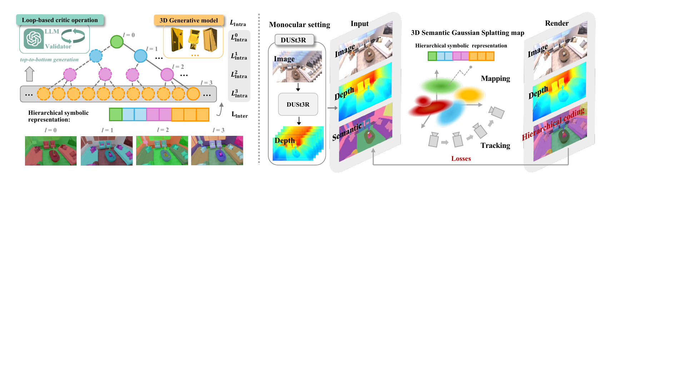
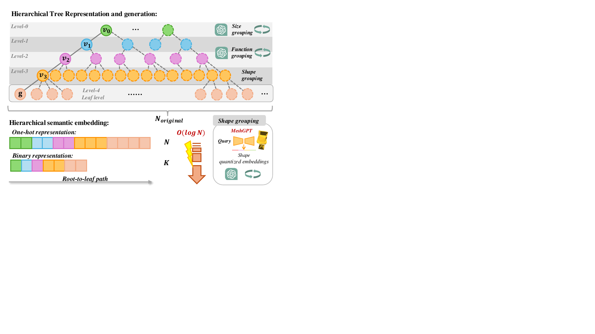
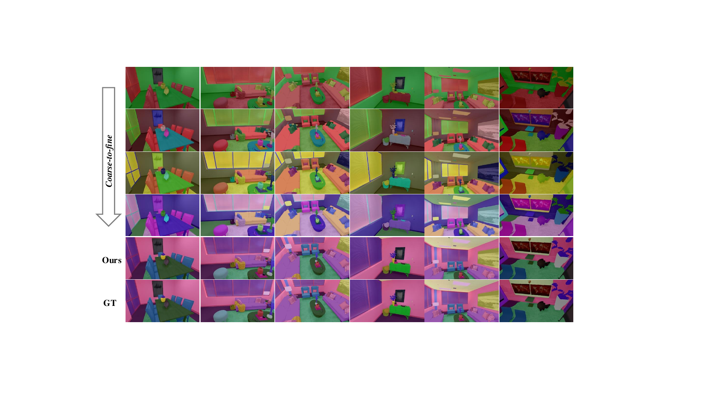

# Hier-SLAM++ (arXiv 2025)

<!-- paper-source: https://chengwei920412.github.io/paper_reading/2502.14931_Hier_SLAM_Neuro_Symbolic_Semantic_SLAM_with_a_Hierarchically_Categorical_Gaussian_Splatting/technical_report.html -->

> 原文链接：[Hier-SLAM++ (arXiv 2025)](https://chengwei920412.github.io/paper_reading/2502.14931_Hier_SLAM_Neuro_Symbolic_Semantic_SLAM_with_a_Hierarchically_Categorical_Gaussian_Splatting/technical_report.html)

> **arXiv ID**：2502.14931  
> **原文标题**：Hier-SLAM++: Neuro-Symbolic Semantic SLAM with a Hierarchically Categorical Gaussian Splatting  
> **翻译日期**：2026-09-28

---

## 📋 论文概览 {#_1}

### 基本信息 {#_2}

- **作者**：Boying Li、Vuong Chi Hao、Peter J. Stuckey、Ian Reid、Hamid Rezatofighi
- **机构**：莫纳什大学、VinUniversity、穆罕默德·本·扎耶德人工智能大学
- **发表时间**：2025（arXiv:2502.14931）
- **领域**：视觉 SLAM、三维场景表示、语义建图、神经符号学习

### 核心贡献 {#_3}

1. 提出同时支持 RGB-D 与单目输入的语义三维高斯泼溅 SLAM 系统 Hier-SLAM++。
2. 用大语言模型与三维生成模型共同构建融合语义、尺寸和形状信息的层次树，将平坦类别编码压缩为符号路径。
3. 给出独热与二进制两种层次语义编码，并以层内损失和层间损失联合优化。
4. 在单目设置中引入 DUSt3R 深度几何先验，通过尺度—偏移校正融入在线 SLAM。
5. 在 Replica、ScanNet 和 TUM-RGBD 上验证定位、建图、渲染与语义理解能力，并显著降低语义参数存储和训练开销。

---

## 🎯 研究背景与动机 {#_4}

### 问题定义 {#_5}

传统视觉 SLAM 主要估计相机位姿和几何地图，但机器人执行导航、交互和任务规划时还需要类别级场景理解。直接给每个三维高斯基元附加长度等于类别数的平坦语义向量，会使内存与计算量随类别数线性增长；在观测有限时，高维参数也更难优化。论文的目标是在保留细粒度语义的同时，把语义表示从 \(O(N)\) 压缩到接近 \(O(\log N)\)，并让同一系统兼容 RGB-D 与单目输入。

### 现有方法的局限性 {#_6}

- NeRF 类语义 SLAM 收敛慢、优化开销高，难以满足在线系统效率要求。
- 既有高斯 SLAM 多聚焦几何与外观；语义方法通常使用平坦类别嵌入，没有利用类别天然存在的层级结构。
- 平坦表示在 ScanNet 这类包含数百类别的场景中容易触及显存上限。
- 单目系统没有度量深度传感器，尺度歧义和跨帧几何一致性更难处理。

### 本文的创新点 {#_7}

Hier-SLAM++ 把语义类别组织成由尺寸、功能和形状共同决定的树。树的路径既是可解释的符号表示，也是每个高斯基元的紧凑可学习嵌入。这样，同一场景可以按“粗类别→细类别”逐级渲染；模型也能在不为每个原始类别保留独立高维参数的情况下扩展到更多类别。

---

## 🔬 方法论 {#_8}

### 整体架构 {#_9}

图：Hier-SLAM++ 总体流程。左侧为层次树生成、符号编码和层次语义损失；右侧为交替执行的跟踪与建图流程，单目模式由 DUSt3R 提供几何先验。

系统以视频流为输入，首先用首帧初始化全局高斯地图。后续帧到来时交替执行：固定地图优化相机位姿的“跟踪”，以及固定位姿优化高斯几何、颜色、不透明度和语义嵌入的“建图”。RGB-D 模式直接使用传感器深度；单目模式先预测深度并在线校正。

### 关键技术 {#_10}

**1. 层次树生成**

树生成包含三类信息：LLM 按典型物理尺寸和语义功能聚类；三维生成模型 MeshGPT 从生成网格中提取形状嵌入，再用 K-means++ 聚类；LLM 为几何簇生成可读标签。循环式验证器检查遗漏、重复和语义不一致，最终再做整体自动检查与人工检查。

图：层次树、树生成流程，以及独热和二进制两种层次语义编码。

**2. 两种紧凑编码**

- 独热层次编码：把每一层节点的独热向量拼接为 \(\bm{h}\)，维度为各层宽度之和。
- 二进制层次编码：把每层节点索引编码为 \(\lceil\log_2 n\rceil\) 位，再跨层拼接为 \(\bm{b}\)，进一步节省参数。

**3. 层次语义优化**

层内损失分别监督每一层的预测：独热表示对各层的 Softmax 输出使用交叉熵，二进制表示改用二元交叉熵。方法节关于二进制层内损失的文字说明明确，但紧随其后的公式左侧写成了 \(L_{\mathrm{Inter}}^{\mathrm{bin}}\)，应视为符号笔误。层间损失则使用由两个二维卷积层和中间 ReLU 组成的轻量解码器，把完整层次嵌入恢复为平坦类别分布，使各层联合保留最终细粒度语义。总损失为：

\[L_{\mathrm{Semantic}}=\omega_1 L_{\mathrm{Intra}}+\omega_2 L_{\mathrm{Inter}}.\]

根据方法节公式和实验权重，前 15 次迭代设置 \(\omega_1=1\)、\(\omega_2=0\)，即先仅启用层内项；之后保持 \(\omega_1=1\)，并将 \(\omega_2\) 提高到 5 以加入层间约束。论文实验设置段落将这两个阶段另称为“Inter-level”和“Cross-level”，与方法节的 Intra-level/Inter-level 术语不一致；此处按公式和权重解释。

**4. 单目几何先验**

系统周期性抽取稀疏帧组输入 DUSt3R，只采用其深度预测，不采用精度较低的位姿预测。通过当前全局地图渲染深度与预测深度的最小二乘对齐，估计尺度 \(\lambda_c\) 与偏移 \(\tau_c\)；随后在建图中把这两个参数与高斯地图共同优化。

### 算法流程 {#_11}

1. 根据任务类别表生成并验证层次树，为每个类别建立符号路径。
2. 用首帧初始化三维高斯地图；为每个高斯附加层次语义嵌入。
3. 新帧到来时，用恒速模型初始化位姿；单目模式同时取得并校正 DUSt3R 深度。
4. 固定地图，最小化颜色和深度损失以更新相机位姿。
5. 固定位姿，联合优化深度、颜色和层次语义损失，更新全局地图。
6. 按任意树层级解码和渲染语义，从粗到细理解场景。

---

## 📊 实验与结果 {#_12}

### 实验设置 {#_13}

- **数据集**：Replica（合成室内场景、102 类）、ScanNet（真实室内场景、最多 550 类）、TUM-RGBD。
- **评估指标**：相机跟踪使用 ATE RMSE；建图使用 Depth L1；渲染使用 PSNR、SSIM、LPIPS；语义使用 mIoU；效率报告逐迭代/逐帧运行时间和参数存储。
- **对比方法**：NICE-SLAM、ESLAM、Point-SLAM、SplaTAM、MonoGS、SemGauss-SLAM、SGS-SLAM、SNI-SLAM、DNS-SLAM 等。

### 主要结果 {#_14}

- Replica RGB-D 跟踪中，独热版与二进制版平均 ATE RMSE 均为 **0.31 cm**。论文正文声称方法在 8 个序列中的 6 个超过既有方法，但该说法与表格逐列数值并不完全一致。
- Replica 建图中，独热版平均 Depth L1 为 **0.48 cm**，二进制版为 **0.49 cm**。论文正文声称方法在 8 个序列中的 7 个取得最低误差，但该说法与表格逐列数值并不完全一致，宜以表中各序列结果为准。
- Replica 全部 102 类上，平坦版、独热版、二进制版平均 mIoU 分别为 **90.35% / 89.41% / 81.27%**；对应平均语义参数存储为 **2662.25 / 927.50 / 591.75 MB**。
- 在可见类别子集协议下，独热版和二进制版 mIoU 分别为 **96.79%** 和 **95.26%**。
- 按表中数值计算，独热版存储为平坦版的 **34.8%**，即减少 **65.2%**（平坦版约为独热版的 **2.87 倍**）；二进制版为独热版的 **63.8%**、平坦版的 **22.2%**。论文正文所称“4.5 倍更少”和“平坦版的 20%”与表格并不完全一致。
- 在 L40S 上，独热版逐帧跟踪时间为 **2.49 s**，是平坦版 **6.75 s** 的 **36.9%**；二进制版为 **2.36 s**。逐帧建图时间分别为平坦版 **12.26 s**、独热版 **12.76 s**、二进制版 **12.64 s**，说明主要加速来自跟踪，而建图时间基本相当、层次版本略慢。
- ScanNet 的平坦 550 类编码因显存限制无法运行；层次树把编码压缩为 73 个符号编码，超过 **7 倍**压缩。
- 单目 TUM-RGBD 的 fr2-xyz 序列上，方法达到 **24.67 dB PSNR、0.946 SSIM、0.110 LPIPS**，渲染指标优于表中对比方法。

图：Replica 上从粗到细的层次语义渲染；最细层对应原始 102 个类别。

### 消融实验 {#_15}

两棵由 LLM 与三维先验共同生成的新树均表现稳定；默认 tree2 在四个 Replica 序列上取得最高 mIoU（76.754）和最低平均深度误差（0.408），渲染指标与其他树接近。独热与二进制嵌入在跟踪、建图和渲染方面差异很小，主要权衡发生在语义精度、存储和运行时间之间。

---

## 💡 关键见解 {#_16}

### 理论分析 {#_17}

论文最重要的思想不是单纯“压缩向量”，而是把类别编码变为一条可解释路径。对于深度为 \(L\)、每层宽度为 \(n_l\) 的树，独热编码长度为 \(\sum_l n_l\)；二进制编码进一步降至 \(\sum_l\lceil\log_2 n_l\rceil\)。相似类别共享路径前缀，由此获得结构化归纳偏置和压缩能力；不过，论文没有单独实验验证这种结构对未见类别语义泛化的贡献。

### 实践启示 {#_18}

- 类别数较少、语义精度优先时，独热层次编码是更稳妥的选择。
- 类别数很大、显存和实时性受限时，二进制编码更有吸引力。
- 语义层次提供多尺度接口，可按树层级输出从粗到细的结果；论文展示了这种分层渲染，但尚未量化根据距离或算力动态选择层级所带来的计算收益。
- 用外部三维模型作为单目几何先验时，不应盲目采用其全部输出；论文只保留较可靠的深度，并把尺度对齐纳入在线优化。

---

## 🔍 局限性与未来工作 {#_19}

### 当前局限 {#_20}

- 树构建仍依赖 LLM、三维生成模型以及最终人工检查，生成成本和可重复性尚未完全量化。
- 类别层次是离线构建的，遇到开放词汇新类别时如何在线插入、合并或纠错仍不明确。
- 二进制表示在全部 102 类协议下相对独热版下降约 8 个 mIoU 百分点，说明极端压缩会损失细粒度可分性。
- 单目实验规模较小，且未集成回环检测；长序列漂移、动态环境和跨域泛化仍需更系统评估。
- 论文使用的树结构带有人类可读语义，但尚未充分证明每个中间节点都对应稳定、可迁移的视觉概念。

### 未来方向 {#_21}

1. 设计可在线生长和重构的开放词汇语义树。
2. 用不确定性或信息增益自动决定树的分支数和深度。
3. 把层次语义用于任务规划、目标导航和语言条件交互，而不只用于分割渲染。
4. 联合训练树生成器、语义编码器与 SLAM 后端，减少人工验证。
5. 在大规模室外、动态场景和长时运行中评估地图压缩、遗忘与语义一致性。

---

## 📚 相关工作对比 {#_22}

<table>
<thead>
<tr>
<th>方法</th>
<th>核心思想</th>
<th>优势</th>
<th>劣势</th>
</tr>
</thead>
<tbody>
<tr>
<td>NeRF 语义 SLAM</td>
<td>用隐式神经场联合表示几何、外观与语义</td>
<td>连续表达、细节质量高</td>
<td>优化慢，在线开销高</td>
</tr>
<tr>
<td>平坦语义高斯 SLAM</td>
<td>每个高斯附加固定长度类别向量</td>
<td>结构直接，训练目标简单</td>
<td>参数随类别数线性增长，不适合大类别空间</td>
</tr>
<tr>
<td>动态场景图方法</td>
<td>以实体和关系构成结构化地图</td>
<td>关系表达清晰，利于高层推理</td>
<td>常依赖场景特定定义，与可微地图优化结合较弱</td>
</tr>
<tr>
<td><strong>Hier-SLAM++</strong></td>
<td>用语义—几何层次树编码每个高斯的类别路径</td>
<td>紧凑、可解释、可多层渲染，支持 RGB-D 与单目</td>
<td>依赖离线树质量；高压缩二进制编码会损失细粒度精度</td>
</tr>
</tbody>
</table>

---

## 🎓 个人评价 {#_23}

### 优点 {#_24}

这项工作的工程价值在于把“语义类别天然有层级”转化为可测量的存储和速度收益，而非只把树当作展示结构。它把 LLM、三维生成先验、可微渲染和在线 SLAM 串成闭环，并在 550 类场景中展示了平坦编码无法运行、层次编码仍可工作的明确扩展性案例。

### 可改进之处 {#_25}

实验应进一步区分收益来自“层次先验”还是仅来自“更低维编码”，例如加入同维度随机树、频率平衡树、视觉聚类树等更强对照。树生成的调用成本、随机性、人工修改量及失败案例也应量化。单目部分若加入更多数据集、回环检测和长期一致性分析，会更有说服力。

### 推荐阅读对象 {#_26}

适合从事语义 SLAM、三维高斯泼溅、具身智能地图、开放词汇三维理解和神经符号表示的研究者；也适合关注大类别场景中显存与在线优化效率的工程团队。

---

## 📎 附录 {#_27}

### 重要公式 {#_28}

层次独热表示：

\[\bm{h}=\mathcal{C}(\bm{h}_l),\qquad N=\sum_l n_l.\]

层次二进制表示：

\[\bm{b}=\mathcal{C}(\bm{b}_l),\qquad k_l=\left\lceil\log_2 n_l\right\rceil.\]

层内与层间语义损失：

\[L_{\mathrm{Intra}}=\sum_{l=0}^{L}L_{\mathrm{ce}}\!\left(\mathcal{S}(\bm{h}^{l}),\mathcal{P}^{l}\right),\]

\[L_{\mathrm{Inter}}=L_{\mathrm{ce}}\!\left(\mathcal{S}(\text{decoder}(\bm{h})),\mathcal{P}\right).\]

语义高斯渲染：

\[H=\sum_{i=1}^{n}\bm{h}_i\alpha_i(\bm{X})T_i,\qquad T_i=\prod_{j=1}^{i-1}\left(1-\alpha_j(\bm{X})\right).\]

### 术语表 {#_29}

<table>
<thead>
<tr>
<th>术语</th>
<th>含义</th>
</tr>
</thead>
<tbody>
<tr>
<td>层次类别表示</td>
<td>以类别在树中的多层路径替代单个平坦类别向量</td>
</tr>
<tr>
<td>层内损失</td>
<td>在每个树层级内监督节点预测</td>
</tr>
<tr>
<td>层间损失</td>
<td>将完整层次嵌入解码为原始平坦类别并联合监督</td>
</tr>
<tr>
<td>几何先验</td>
<td>单目模式下由 DUSt3R 提供、再经尺度—偏移校正的深度</td>
</tr>
<tr>
<td>符号节点</td>
<td>树中的语义概念，可表示尺寸、功能、形状或最终类别</td>
</tr>
</tbody>
</table>

### 参考资源 {#_30}

- **论文原文**：[arXiv 链接](https://arxiv.org/abs/2502.14931)
- **中文翻译 PDF**：[paper_cn.pdf](https://chengwei920412.github.io/paper_reading/2502.14931_Hier_SLAM_Neuro_Symbolic_Semantic_SLAM_with_a_Hierarchically_Categorical_Gaussian_Splatting/paper_cn.pdf)
- **中文 Markdown 译文**：[paper_cn.md](https://chengwei920412.github.io/paper_reading/2502.14931_Hier_SLAM_Neuro_Symbolic_Semantic_SLAM_with_a_Hierarchically_Categorical_Gaussian_Splatting/paper_cn.html)
- **代码实现**：截至 2026-09-28，[项目主页](https://hierslampp.github.io/)仍标注“Coming Soon”，未提供公开代码仓库链接
- **项目主页**：[Hier-SLAM++](https://hierslampp.github.io/)
