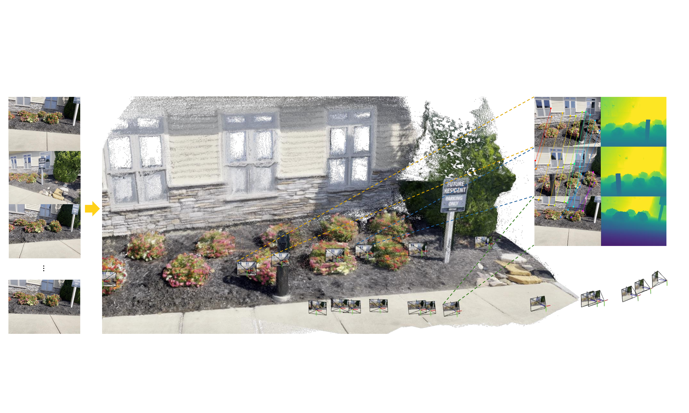
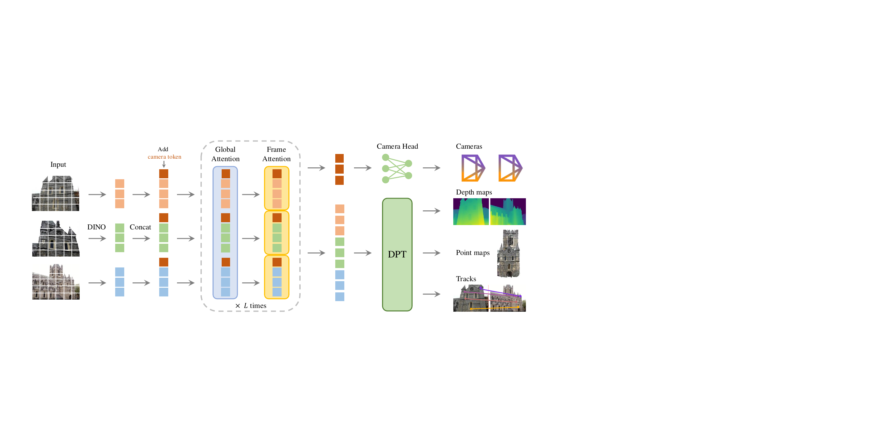
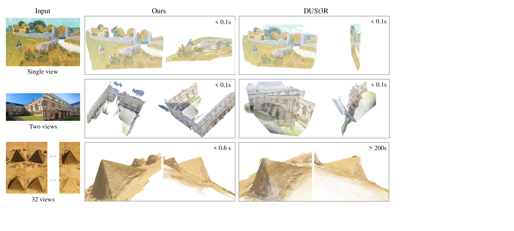

# VGGT (CVPR 2025)

<!-- paper-source: https://chengwei920412.github.io/paper_reading/2503.11651_VGGT_Visual_Geometry_Grounded_Transformer/technical_report.html -->

> **arXiv ID**：2503.11651  
> **原文标题**：VGGT: Visual Geometry Grounded Transformer  
> **翻译日期**：2026-09-21

---

## 📋 论文概览 {#_1}

### 基本信息 {#_2}

- **作者**：Jianyuan Wang、Minghao Chen、Nikita Karaev、Andrea Vedaldi、Christian Rupprecht、David Novotny
- **机构**：牛津大学视觉几何组、Meta AI
- **发表时间**：CVPR 2025
- **领域**：三维计算机视觉、相机位姿估计、稠密重建、点跟踪、视觉 Transformer

### 核心贡献 {#_3}

VGGT 将过去由多个专用网络与几何优化模块组成的三维视觉流程，统一为一个约 12 亿参数的前馈 Transformer。它接收一张、少量或多达数百张图像，一次前向传播即可预测相机内外参、深度图、点图和点跟踪特征。模型只保留很弱的三维归纳偏置，通过大规模带三维标注的数据和多任务目标学习几何关系。

主要贡献包括：

1. 提出统一的多视图三维网络，同时处理相机位姿、深度、点图和跨视图点轨迹。
2. 设计交替注意力（Alternating-Attention，AA）：每个模块先在单帧内部聚合，再在全部帧之间进行全局交互，兼顾局部表征稳定性与跨视图信息融合。
3. 证明联合预测彼此存在解析关系的三维量仍能提高性能；推理时又可组合独立预测的深度与相机参数，得到比专用点图头更准确的点云。
4. 在多项三维任务上以约 0.2 秒的前馈速度超过依赖全局对齐或光束法平差的强基线，并展示预训练特征对动态点跟踪和新视角合成的迁移能力。

图 1：VGGT 从多张输入图像统一预测相机、深度、点图和点轨迹。

---

## 🎯 研究背景与动机 {#_4}

### 问题定义 {#_5}

经典三维重建通常先匹配特征，再完成三角化、运动恢复结构（Structure-from-Motion，SfM）、多视图立体（Multi-view Stereo，MVS）和光束法平差（Bundle Adjustment，BA）。学习方法不断替换其中的局部组件，但整个系统仍依赖迭代几何优化，流程复杂、耗时较长，也难以共享不同三维任务之间的知识。

论文提出更激进的问题：当网络、数据和算力足够大时，能否几乎完全绕过测试时几何优化，直接从图像预测场景的关键三维属性？

### 现有方法的局限性 {#_6}

- COLMAP、PixSfM 和 VGGSfM 等系统需要多阶段处理与迭代优化。
- DUSt3R、MASt3R 将成对图像映射为点图，但处理多视图时仍需融合成对重建与全局对齐。
- Depth Anything、MoGe、LRM 等大型三维网络通常只针对深度估计或新视角合成等单一任务。
- 专用模型很难同时共享相机、深度、点云和对应关系之间的互补信号。

### 本文的创新点 {#_7}

VGGT 的关键不是引入复杂几何层，而是将多种三维监督统一到一个大模型中。模型保持近似标准的 Transformer 结构，仅通过参考帧专用标记和帧内/全局交替注意力表达多视图结构。由此，网络在训练中学习几何规律，在推理中直接给出大部分传统优化流程的结果。

---

## 🔬 方法论 {#_8}

### 整体架构 {#_9}

输入是同一场景的 \(N\) 张 RGB 图像 \((I_i)_{i=1}^N\)。主干网络输出每帧的相机参数 \(\mathbf{g}_i\)、深度图 \(D_i\)、点图 \(P_i\) 和跟踪特征 \(T_i\)：

\[f\left((I_i)_{i=1}^{N}\right)=\left(\mathbf{g}_i,D_i,P_i,T_i\right)_{i=1}^{N}.\]

相机参数由旋转四元数、平移向量和视场角组成。点图具有视点不变性：不同图像预测的三维点都表达在第一台相机定义的世界坐标系中。第一帧使用独立的相机标记和寄存器标记，使网络能够识别参考坐标系；除第一帧外，网络对输入帧排列保持置换等变。

图 2：VGGT 架构。DINOv2 将图像分块标记化，主干交替执行帧内与全局自注意力，相机头和 DPT 头分别输出相机参数与稠密预测。

### 关键技术 {#_10}

**交替注意力。** 主干包含 24 个注意力模块。帧内自注意力分别处理每张图像的标记，全局自注意力则联合处理所有帧。消融实验中，AA 在 ETH3D 上的总体误差为 0.709，优于仅用全局自注意力的 0.827 和交叉注意力变体的 1.061。

**多预测头。** 相机标记经过额外四层自注意力和线性层输出内外参；DINOv2 图像标记经 DPT 上采样后，由卷积层生成深度图、点图及其偶然不确定性；稠密跟踪特征输入 CoTracker2 风格的跟踪模块，以查询点和跨图像相关图预测二维轨迹。

**过完备多任务监督。** 即使相机参数、深度和点图可通过解析关系相互转换，联合训练仍明显有效。ETH3D 点图实验中，完整多任务模型总体误差为 0.709；去掉相机、深度或跟踪损失后分别退化到 0.834、0.727 和 0.790。

### 算法流程 {#_11}

1. DINOv2 将每张输入图像转换为图像标记，并加入相机标记和寄存器标记。
2. 24 个交替注意力模块反复执行帧内信息聚合与跨帧全局交互。
3. 相机头预测每帧内外参；DPT 头恢复高分辨率稠密特征并预测深度、点图和不确定性。
4. 跟踪头对查询点特征与其余帧建立相关图，再用自注意力细化跨帧对应点。
5. 以相机、深度、点图和跟踪损失联合训练，其中跟踪损失权重为 \(\lambda=0.05\)。

训练采用 AdamW，共 16 万次迭代，峰值学习率为 \(2\times10^{-4}\)，预热 8000 次迭代。每个场景随机采样 2–24 帧，图像最长边缩放至 518 像素。模型在 64 张 A100 GPU 上训练 9 天，并使用 bfloat16、梯度检查点和梯度裁剪。

---

## 📊 实验与结果 {#_12}

### 实验设置 {#_13}

- **数据集**：训练集覆盖 CO3Dv2、BlendMVS、DL3DV、MegaDepth、Kubric、WildRGB、ScanNet、HyperSim、Mapillary、Habitat、Replica、MVS-Synth、PointOdyssey、Virtual KITTI、Aria Synthetic Environments、Aria Digital Twin 等；评测涵盖 RealEstate10K、CO3Dv2、DTU、ETH3D、ScanNet-1500、GSO、TAP-Vid 和 IMC。
- **评估指标**：相机位姿使用 AUC@30；DTU/ETH3D 使用准确度、完整度及其平均总体误差；匹配使用 AUC@5/10/20；新视角合成使用 PSNR、SSIM、LPIPS；点跟踪使用 AJ、可见点平均准确率和遮挡准确率。
- **对比方法**：COLMAP、PixSfM、PoseDiffusion、DUSt3R、MASt3R、VGGSfM v2、CUT3R、FLARE、Fast3R、GeoMVSNet、RoMa、LVSM、CoTracker 等。

### 主要结果 {#_14}

<table>
<thead>
<tr>
<th>任务</th>
<th>VGGT 结果</th>
<th>代表性对比</th>
<th>结论</th>
</tr>
</thead>
<tbody>
<tr>
<td>Re10K 相机位姿 AUC@30</td>
<td>85.3；加 BA 为 93.5</td>
<td>VGGSfM v2：78.9</td>
<td>前馈已领先，轻量 BA 可继续提升</td>
</tr>
<tr>
<td>CO3Dv2 相机位姿 AUC@30</td>
<td>88.2；加 BA 为 91.8</td>
<td>VGGSfM v2：83.4</td>
<td>约 0.2 秒完成前馈估计</td>
</tr>
<tr>
<td>DTU 无真值相机总体误差</td>
<td>0.382</td>
<td>DUSt3R：1.741</td>
<td>无真值相机条件下优势明显</td>
</tr>
<tr>
<td>ETH3D 点图总体误差</td>
<td>0.677（深度+相机）</td>
<td>MASt3R：0.826</td>
<td>0.2 秒对比约 9 秒</td>
</tr>
<tr>
<td>ScanNet AUC@5/10/20</td>
<td>33.9 / 55.2 / 73.4</td>
<td>RoMa：31.8 / 53.4 / 70.9</td>
<td>非专用跟踪头仍优于强匹配器</td>
</tr>
<tr>
<td>GSO 新视角合成 PSNR</td>
<td>30.41</td>
<td>LVSM：31.71</td>
<td>不使用已知输入相机且只用 20% 训练集，仍具竞争力</td>
</tr>
</tbody>
</table>

在 TAP-Vid 上，以 VGGT 权重微调 CoTracker 后，Kinetics 的 AJ 从 49.6 提升至 57.2，RGB-Stacking 从 67.4 提升至 72.1，DAVIS 从 61.8 提升至 64.7，说明三维预训练特征可迁移到动态点跟踪。

图 3：VGGT 与 DUSt3R 的点图重建对比，包含绘画、无重叠视图和重复纹理等困难场景。

### 消融实验 {#_15}

- 交替注意力显著优于纯全局自注意力和交叉注意力变体。
- 相机、深度与跟踪三类辅助监督都能改善点图估计，验证多任务共享的价值。
- 直接使用点图头时 ETH3D 总体误差为 0.709；组合独立预测的深度与相机参数后降至 0.677，说明训练阶段的冗余输出与推理阶段的最优组合并不矛盾。
- DINOv2 分块标记化比单个 \(14\times14\) 卷积层训练更稳定、性能更高，因此成为默认输入编码器。

---

## 💡 关键见解 {#_16}

### 理论分析 {#_17}

VGGT 的核心观点是：解析上相关的输出并不意味着学习上冗余。相机、深度、点图和轨迹从不同角度约束同一场景几何，多任务损失为共享主干提供互补梯度。与此同时，网络显式选择第一帧作为参考坐标系，并按平均三维点距归一化真值，消除了全局刚体变换和尺度的不可辨识性。

这种设计也解释了为何模型能弱化手工几何模块：传统几何约束没有消失，而是通过数据、坐标规范化、多任务监督与跨视图注意力被吸收到参数中。

### 实践启示 {#_18}

- 需要快速相机初始化、深度或点云时，可直接使用前馈输出；对精度要求更高时，再用短时 BA 细化。
- 下游任务不一定需要从头训练三维骨干。VGGT 的稠密特征可作为点跟踪、新视角合成等任务的初始化。
- 在显存受限时，DPT 预测头可逐帧运行；跨帧关系只在共享骨干中处理。

---

## 🔍 局限性与未来工作 {#_19}

### 当前局限 {#_20}

1. 当前模型不支持鱼眼或全景图像，对极端输入旋转也较敏感。
2. 能处理轻微非刚体运动，但面对大幅非刚体形变会失败；主模型的静态场景假设仍然明显。
3. 训练成本很高：约 12 亿参数，需 64 张 A100 训练 9 天，并依赖大量三维标注数据。
4. 全局自注意力的显存开销随标记数量迅速增长。论文报告 100 帧需 21.15 GB、200 帧需 40.63 GB；对应运行时间分别为 3.12 秒和 8.75 秒。因此“不到一秒”主要适用于较短序列，不能无条件推广到数百帧。
5. 与已知真值相机的 MVS 方法比较时，输入条件不同；DTU 上 GeoMVSNet 的总体误差 0.295 仍优于 VGGT 的 0.382，但后者不使用真值相机。
6. 坐标归一化使输出适合相对几何重建，但绝对尺度仍需额外信息恢复。

### 未来方向 {#_21}

- 引入鱼眼、全景、极端旋转和大幅动态场景数据，扩大成像模型与运动类型覆盖范围。
- 使用稀疏、分块或线性注意力，以及张量并行和 KV 缓存等大模型推理技术，降低长序列显存与时延。
- 将可微 BA 作为弱监督信号，在缺少显式三维标注的数据上训练；论文未采用该方案的主要原因是现有 PyTorch/Theseus 实现使每步训练约慢 4 倍。
- 研究绝对尺度、重力方向和语义等额外输出，让统一几何骨干服务机器人导航、AR 和自动驾驶。
- 分析模型内部是否真正形成可解释的多视图几何表征，以及数据规模、模型规模与几何泛化之间的缩放规律。

---

## 📚 相关工作对比 {#_22}

<table>
<thead>
<tr>
<th>方法</th>
<th>核心思想</th>
<th>优势</th>
<th>劣势</th>
</tr>
</thead>
<tbody>
<tr>
<td>COLMAP / PixSfM</td>
<td>特征匹配、三角化和 BA 的多阶段几何流程</td>
<td>几何约束明确、结果可解释</td>
<td>流程复杂，推理慢，困难场景依赖匹配质量</td>
</tr>
<tr>
<td>DUSt3R / MASt3R</td>
<td>从图像对直接预测对齐点图，再做多视图全局对齐</td>
<td>弱化相机先验，稠密预测直观</td>
<td>多视图仍依赖成对处理和测试时优化</td>
</tr>
<tr>
<td>VGGSfM</td>
<td>学习匹配与可微 BA 结合的端到端 SfM</td>
<td>在复杂地标场景中精度高</td>
<td>仍需迭代优化，计算成本较高</td>
</tr>
<tr>
<td><strong>VGGT</strong></td>
<td>大型交替注意力主干联合预测相机、深度、点图和轨迹</td>
<td>单次前馈统一多任务，速度快、迁移性强</td>
<td>模型与训练成本高，长序列显存大，动态与特殊镜头适应性有限</td>
</tr>
</tbody>
</table>

---

## 🎓 个人评价 {#_23}

### 优点 {#_24}

这项工作的价值不只在于刷新若干指标，更在于证明“神经网络优先”的统一三维视觉系统已具备工程可行性。架构没有堆叠大量专用几何算子，方法边界清晰；实验覆盖相机、深度、点云、匹配、动态跟踪和新视角合成，较充分地支持统一表征的主张。前馈结果还可与 BA 组合，而不是把学习与几何优化对立起来，这一点尤其务实。

### 可改进之处 {#_25}

论文的效率表述需要按输入帧数解读；数百帧并非亚秒级。模型训练所用各数据集的采样权重、去重方式和数据许可影响复现与公平比较，但正文披露有限。消融主要集中在 ETH3D 点图误差，尚不足以完全解释每个任务、每种监督和模型规模对其他指标的贡献。与使用真值相机或不同后处理预算的方法对比时，也应始终强调输入条件差异。

### 推荐阅读对象 {#_26}

适合研究三维重建、多视图几何、视觉基础模型、机器人感知和高效推理的读者。若正在设计 SfM/MVS 系统，这篇论文尤其值得用于判断哪些传统模块可以由学习模型替代，哪些几何优化仍适合作为最终精修步骤。

---

## 📎 附录 {#_27}

### 重要公式 {#_28}

多任务训练目标为：

\[\mathcal{L}=\mathcal{L}_{\text{camera}}+\mathcal{L}_{\text{depth}}+\mathcal{L}_{\text{pmap}}+\lambda\mathcal{L}_{\text{track}},\qquad \lambda=0.05.\]

深度和点图损失同时约束数值与空间梯度，并由预测的不确定性加权；相机参数使用 Huber 损失；跟踪损失对所有查询点和输入帧的二维对应误差求和，并附加可见性二元交叉熵。

### 术语表 {#_29}

<table>
<thead>
<tr>
<th>英文</th>
<th>中文</th>
</tr>
</thead>
<tbody>
<tr>
<td>Visual Geometry Grounded Transformer</td>
<td>以视觉几何为基础的 Transformer</td>
</tr>
<tr>
<td>Point Map</td>
<td>点图</td>
</tr>
<tr>
<td>Camera Pose / Parameters</td>
<td>相机位姿 / 相机参数</td>
</tr>
<tr>
<td>Bundle Adjustment (BA)</td>
<td>光束法平差</td>
</tr>
<tr>
<td>Alternating-Attention (AA)</td>
<td>交替注意力</td>
</tr>
<tr>
<td>Frame-wise / Global Self-Attention</td>
<td>帧内 / 全局自注意力</td>
</tr>
<tr>
<td>Feature Backbone</td>
<td>特征骨干网络</td>
</tr>
<tr>
<td>Track-Any-Point</td>
<td>任意点跟踪</td>
</tr>
<tr>
<td>Novel View Synthesis</td>
<td>新视角合成</td>
</tr>
<tr>
<td>Aleatoric Uncertainty</td>
<td>偶然不确定性</td>
</tr>
</tbody>
</table>

### 参考资源 {#_30}

- **论文原文**：[arXiv 2503.11651](https://arxiv.org/abs/2503.11651)
- **中文翻译 PDF**：[paper_cn.pdf](https://chengwei920412.github.io/paper_reading/2503.11651_VGGT_Visual_Geometry_Grounded_Transformer/paper_cn.pdf)
- **中文 Markdown 译文**：[paper_cn.md](https://chengwei920412.github.io/paper_reading/2503.11651_VGGT_Visual_Geometry_Grounded_Transformer/paper_cn.html)
- **代码实现**：[facebookresearch/vggt](https://github.com/facebookresearch/vggt)
- **项目主页**：[VGGT](https://vgg-t.github.io/)
