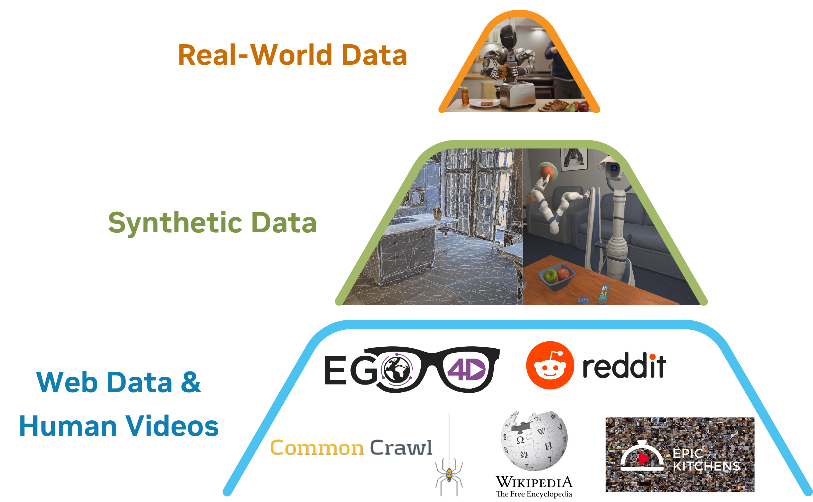
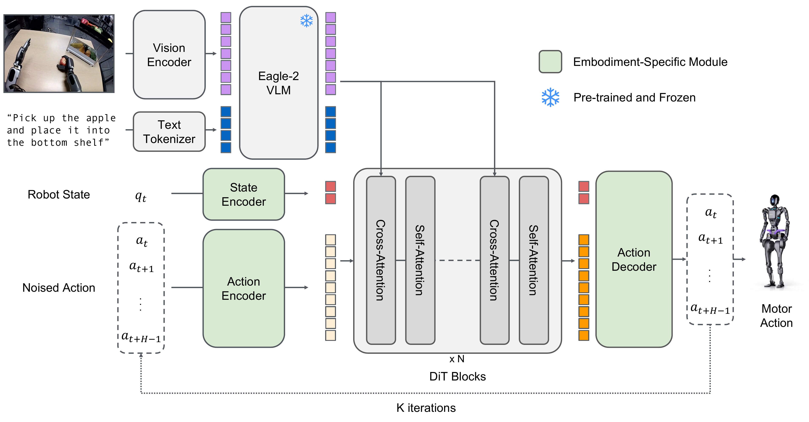
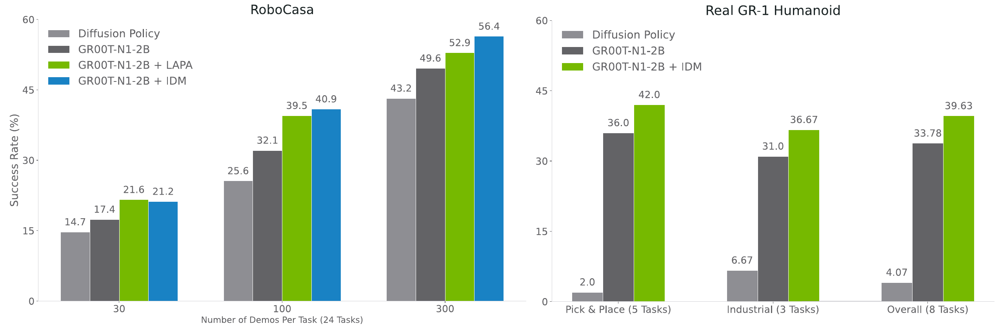

# GR00T N1 (arXiv 2025)

<!-- paper-source: https://chengwei920412.github.io/paper_reading/2503.14734_GR00T_N1_An_Open_Foundation_Model_for_Generalist_Humanoid_Robots/technical_report.html -->

> 原文链接：[GR00T N1 (arXiv 2025)](https://chengwei920412.github.io/paper_reading/2503.14734_GR00T_N1_An_Open_Foundation_Model_for_Generalist_Humanoid_Robots/technical_report.html)

> **arXiv ID**：2503.14734  
> **原文标题**：GR00T N1: An Open Foundation Model for Generalist Humanoid Robots  
> **版本**：arXiv v2（2025-03-27）  
> **翻译日期**：2026-10-01

---

## 📋 论文概览 {#_1}

### 基本信息 {#_2}

- **作者**：NVIDIA（Johan Bjorck、Fernando Castañeda、Nikita Cherniadev 等 41 位作者）
- **机构**：NVIDIA，联合 1X、Fourier 等硬件与机器人团队开展实验支持
- **领域**：机器人学习、视觉—语言—动作模型、人形机器人、模仿学习
- **开放内容**：GR00T-N1-2B 模型、部分训练数据和仿真基准

### 核心贡献 {#_3}

1. 提出面向通用型人形机器人的开放 VLA 基础模型 GR00T N1，将视觉—语言推理与高频动作生成统一到一个端到端训练的双系统架构中。
2. 构建“数据金字塔”，联合使用真实机器人轨迹、仿真轨迹、神经生成轨迹和人类第一视角视频，缓解人形机器人数据昂贵且形态割裂的问题。
3. 通过机器人形态特定的状态/动作投影器，在单臂、双臂、灵巧手和人形机器人等多种形态之间共享主体模型。
4. 在三个仿真基准和 Fourier GR-1 真实机器人上验证了预训练带来的泛化能力与数据效率。

---

## 🎯 研究背景与动机 {#_4}

### 问题定义 {#_5}

通用机器人需要同时解决三个问题：硬件必须具备足够的物理能力，模型必须理解开放世界任务并生成精细动作，训练数据则要覆盖大量任务与环境变化。人形机器人适合人类环境，但真实轨迹采集慢、成本高，而且不同机器人在传感器、自由度和控制接口上差异巨大，形成彼此隔离的“数据孤岛”。

### 现有方法的局限性 {#_6}

- 高层基础模型加低层专用策略的级联方案依赖预先存在的技能库，接口也会限制端到端适应。
- 单一机器人、单一任务的模仿学习难以迁移到新物体、新容器和新形态。
- 真实机器人遥操作数据难以达到互联网数据规模。
- 仿真数据存在 sim-to-real 差距；人类视频和生成视频又缺少可直接监督策略的动作标签。

### 本文的创新点 {#_7}

核心思想是把“模型统一”和“数据统一”同时推进：模型侧用系统 2 理解图像与语言，系统 1 以 120 Hz 生成动作；数据侧通过潜在动作、逆动力学模型和形态特定投影器，将原本不兼容的数据源映射到可联合训练的表示空间。

图：GR00T N1 的数据金字塔。底层数据量大、形态特异性低；越靠近顶层，数据越贴近具体机器人执行。

---

## 🔬 方法论 {#_8}

### 整体架构 {#_9}

GR00T N1 是双系统 VLA 模型：

- **系统 2：视觉—语言模块。** 使用 Eagle-2 VLM 编码任务指令和相机图像。图像以 \(224\times224\) 分辨率输入，经像素重排后每帧产生 64 个图像词元；GR00T-N1-2B 使用 LLM 第 12 层的中间表示。
- **系统 1：扩散 Transformer。** DiT 以视觉—语言词元、机器人本体感知状态和加噪动作块为条件，通过流匹配生成未来动作。
- **形态适配。** 每种机器人形态拥有自己的状态编码器、动作编码器和动作解码器，主体 VLM 与 DiT 参数在不同形态之间共享。
- **动作分块。** 每次预测 \(H=16\) 个动作；在 L40 GPU 上，以 bf16 采样一个动作块约需 63.9 ms。

图：GR00T N1 模型架构。VLM 的视觉—语言词元通过交叉注意力调节 DiT 的动作生成过程。

### 关键技术 {#_10}

**1. 动作流匹配**

给定真实动作块 \(A_t\)、时间步 \(\tau\in[0,1]\) 和高斯噪声 \(\epsilon\)，加噪动作为：

\[A_t^{\tau}=\tau A_t+(1-\tau)\epsilon.\]

网络 \(V_\theta\) 学习从加噪动作指向真实动作的向量场：

\[\mathcal{L}_{fm}(\theta)=\mathbb{E}_{\tau}\left[\left\|V_\theta(\phi_t,A_t^{\tau},q_t)-(\epsilon-A_t)\right\|^2\right].\]

推理时从高斯噪声开始，以四步前向欧拉积分生成动作块。

**2. 潜在动作（LAPA）**

VQ-VAE 根据当前帧 \(x_t\) 和未来帧 \(x_{t+H}\) 学习离散动作码本。人类视频与无动作生成视频由此获得潜在动作标签，并作为一种独立机器人形态参与预训练。

**3. 神经轨迹与 IDM 伪标签**

论文在 88 小时内部遥操作数据上微调图生视频模型，生成 827 小时神经轨迹，规模扩大约 10 倍。生成视频经多模态 LLM 筛选和重描述，再由逆动力学模型（IDM）预测动作块，获得可用于策略训练的伪动作标签。

**4. 仿真轨迹**

DexMimicGen 从少量人工示范出发，通过对象中心分段、变换和重组自动生成大规模双臂与灵巧手轨迹。

### 算法流程 {#_11}

1. 将任务语言、相机图像和机器人状态编码为统一条件表示。
2. 根据数据类型使用真实动作、LAPA 潜在动作或 IDM 伪动作作为监督。
3. 在跨形态数据混合上端到端联合训练 VLM、DiT 和形态适配器。
4. 后训练阶段用少量目标任务数据快速适配；必要时加入与任务匹配的神经轨迹共同训练。
5. 部署时系统 2 负责环境与任务理解，系统 1 以较高频率闭环输出动作。

---

## 📊 实验与结果 {#_12}

### 实验设置 {#_13}

- **仿真基准**：RoboCasa Kitchen（24 项任务）、DexMimicGen Cross-Embodiment Suite（9 项任务）、GR-1 Tabletop（24 项任务）
- **真实机器人**：Fourier GR-1，覆盖取放、关节物体、工业操作和多机器人协调任务
- **基线**：BC-Transformer、Diffusion Policy
- **训练规模**：仿真每任务 30、100 或 300 条示范；真实机器人使用 10% 或完整数据
- **指标**：策略成功率；真实机器人部分任务采用分阶段计分

### 主要结果 {#_14}

<table>
<thead>
<tr>
<th>设置</th>
<th>BC-Transformer</th>
<th>Diffusion Policy</th>
<th>GR00T N1</th>
</tr>
</thead>
<tbody>
<tr>
<td>RoboCasa，100 条/任务</td>
<td>26.3%</td>
<td>25.6%</td>
<td><strong>32.1%</strong></td>
</tr>
<tr>
<td>DexMG，100 条/任务</td>
<td>53.9%</td>
<td>56.1%</td>
<td><strong>66.5%</strong></td>
</tr>
<tr>
<td>GR-1 仿真，100 条/任务</td>
<td>16.1%</td>
<td>32.7%</td>
<td><strong>50.0%</strong></td>
</tr>
<tr>
<td>三基准平均</td>
<td>26.4%</td>
<td>33.4%</td>
<td><strong>45.0%</strong></td>
</tr>
</tbody>
</table>

真实 GR-1 上，GR00T N1 在 10% 数据设置下取得 42.6% 平均成功率，Diffusion Policy 为 10.2%；使用完整数据时，两者分别为 76.8% 和 46.4%。只用 10% 数据训练的 GR00T N1 与使用完整数据的 Diffusion Policy 仅相差 3.8 个百分点，体现出预训练带来的数据效率。

预训练模型在两个零样本式真实机器人任务上分别达到 76.6% 和 73.3% 成功率，说明多源预训练确实学到了一定的双手协调和新物体泛化能力。

图：神经轨迹消融。神经轨迹与真实轨迹联合训练，在不同数据规模的 RoboCasa 和真实 GR-1 任务上均带来增益。

### 消融实验 {#_15}

- RoboCasa 每任务 30、100、300 条真实轨迹时，加入神经轨迹分别带来约 +4.2、+8.8、+6.8 个百分点的平均提升。
- GR-1 的 8 项真实任务平均提升约 +5.8 个百分点。
- 低数据量下 LAPA 标签具有竞争力；随着 IDM 可用训练数据增多，IDM 伪动作与真实动作的一致性提高，优势更加明显。

---

## 💡 关键见解 {#_16}

### 理论与方法层面 {#_17}

这项工作最重要的判断并不是“再做一个更大的策略网络”，而是把形态差异限制在输入输出适配层，让主体模型学习跨形态共享的视觉、语言与运动规律。数据金字塔则把不同数据源的作用分开：底层提供广泛先验，中层扩大行为覆盖，顶层保证动作能落到真实硬件上。

### 实践启示 {#_18}

- 对真实机器人项目，预训练的最大价值可能是降低每个新任务的数据门槛，而非直接零样本部署。
- 视频生成数据必须配合筛选、重描述和动作恢复；仅生成“看起来合理”的视频不足以形成控制监督。
- 跨机器人训练不能只统一张量维度，还要显式记录各字段的语义、旋转表示和控制方式。
- 系统 2 与系统 1 紧耦合，可以兼顾语义理解与高频控制，但部署成本仍取决于 VLM 推理效率。

---

## 🔍 局限性与未来工作 {#_19}

### 当前局限 {#_20}

1. 任务主要是短时域桌面操作，尚未覆盖长时域移动操作、全身导航和复杂接触序列。
2. 论文缺少与更多同期通用 VLA 方法在统一协议下的大规模比较，跨方法结论仍受实验设置影响。
3. 神经生成轨迹可能违反物理规律；多模态 LLM 筛选只能部分控制伪数据质量。
4. 真实机器人评估任务数与试验次数有限，部分指标采用部分成功计分，统计不确定性未被充分量化。
5. 后训练可能造成能力遗忘：论文观察到只含右手数据的后训练会削弱预训练模型原有的双手传递能力。
6. 2.2B 参数模型依赖较强算力，论文报告的 L40 推理速度不能直接代表边缘设备部署表现。

### 未来方向 {#_21}

- 扩展到移动操作、长时域规划和全身控制，研究语言规划与连续控制之间的层级接口。
- 引入物理一致的视频生成与可验证世界模型，减少神经轨迹中的动力学错误。
- 研究防遗忘的后训练方法，例如回放、多任务正则化与形态平衡采样。
- 在更多硬件平台上开展统一、可复现的跨形态评测，并报告置信区间和失败模式。
- 压缩 VLM/DiT、缓存视觉词元并设计异步双系统调度，以降低实时部署成本。

---

## 📚 相关工作对比 {#_22}

<table>
<thead>
<tr>
<th>方法</th>
<th>核心思想</th>
<th>优势</th>
<th>局限</th>
</tr>
</thead>
<tbody>
<tr>
<td>高层基础模型 + 低层技能库</td>
<td>基础模型负责任务规划，专用策略负责执行</td>
<td>模块化、可解释</td>
<td>依赖现成技能和接口，难以端到端适应</td>
</tr>
<tr>
<td>Diffusion Policy</td>
<td>以条件扩散模型生成动作序列</td>
<td>动作分布表达能力强</td>
<td>通常从单任务数据训练，数据效率和语义泛化有限</td>
</tr>
<tr>
<td>OpenVLA / \(\pi_0\) 等 VLA</td>
<td>视觉语言骨干直接连接动作生成</td>
<td>可复用网络规模语义先验</td>
<td>跨形态数据与高频动作建模仍具挑战</td>
</tr>
<tr>
<td><strong>GR00T N1</strong></td>
<td>双系统 VLA + 数据金字塔 + 形态适配器</td>
<td>跨形态、数据高效、开放模型与数据</td>
<td>任务时域短，生成数据质量与算力成本仍受限</td>
</tr>
</tbody>
</table>

---

## 🎓 综合评价 {#_23}

### 优点 {#_24}

- 系统性强：模型、数据生成、数据格式、训练和真实部署形成了较完整的技术栈。
- 工程选择清晰：VLM 中间层特征、四步流匹配推理、形态特定投影器都直接服务于实时控制与跨形态训练。
- 实验不仅比较最终成功率，也覆盖数据规模、神经轨迹标签方式和真实硬件任务。
- 模型与部分数据开放，使论文比纯封闭机器人系统更具复现和扩展价值。

### 可改进之处 {#_25}

最需要补强的是评估广度与统计严谨性：更多机器人平台、更长任务、更强同期基线、更多随机种子及置信区间，会让“通用型”这一主张更有说服力。神经轨迹部分也值得增加人工或自动物理一致性评估，从而明确性能增益究竟来自数据规模、视觉多样性还是动作标签质量。

### 推荐阅读对象 {#_26}

适合关注 VLA、机器人基础模型、跨形态模仿学习、合成数据和人形机器人部署的研究者与工程团队。若正在设计多机器人统一数据格式，附录中的 LeRobot 扩展和动作空间标准化细节尤其值得参考。

---

## 📎 附录 {#_27}

### 术语表 {#_28}

<table>
<thead>
<tr>
<th>英文</th>
<th>中文</th>
</tr>
</thead>
<tbody>
<tr>
<td>Vision-Language-Action (VLA)</td>
<td>视觉—语言—动作模型</td>
</tr>
<tr>
<td>Embodiment</td>
<td>机器人形态</td>
</tr>
<tr>
<td>Data Pyramid</td>
<td>数据金字塔</td>
</tr>
<tr>
<td>Flow Matching</td>
<td>流匹配</td>
</tr>
<tr>
<td>Action Chunking</td>
<td>动作分块</td>
</tr>
<tr>
<td>Latent Action</td>
<td>潜在动作</td>
</tr>
<tr>
<td>Neural Trajectory</td>
<td>神经轨迹</td>
</tr>
<tr>
<td>Inverse Dynamics Model (IDM)</td>
<td>逆动力学模型</td>
</tr>
<tr>
<td>Post-training</td>
<td>后训练</td>
</tr>
</tbody>
</table>

### 参考资源 {#_29}

- **论文原文**：[arXiv 2503.14734](https://arxiv.org/abs/2503.14734)
- **中文翻译 PDF**：[paper_cn.pdf](https://chengwei920412.github.io/paper_reading/2503.14734_GR00T_N1_An_Open_Foundation_Model_for_Generalist_Humanoid_Robots/paper_cn.pdf)
- **中文 Markdown 译文**：[paper_cn.md](https://chengwei920412.github.io/paper_reading/2503.14734_GR00T_N1_An_Open_Foundation_Model_for_Generalist_Humanoid_Robots/paper_cn.html)
- **代码实现**：[NVIDIA Isaac-GR00T](https://github.com/NVIDIA/Isaac-GR00T)
- **训练数据**：[PhysicalAI-Robotics-GR00T-X-Embodiment-Sim](https://huggingface.co/datasets/nvidia/PhysicalAI-Robotics-GR00T-X-Embodiment-Sim)
- **项目主页**：[NVIDIA Isaac GR00T](https://developer.nvidia.com/isaac/gr00t)
