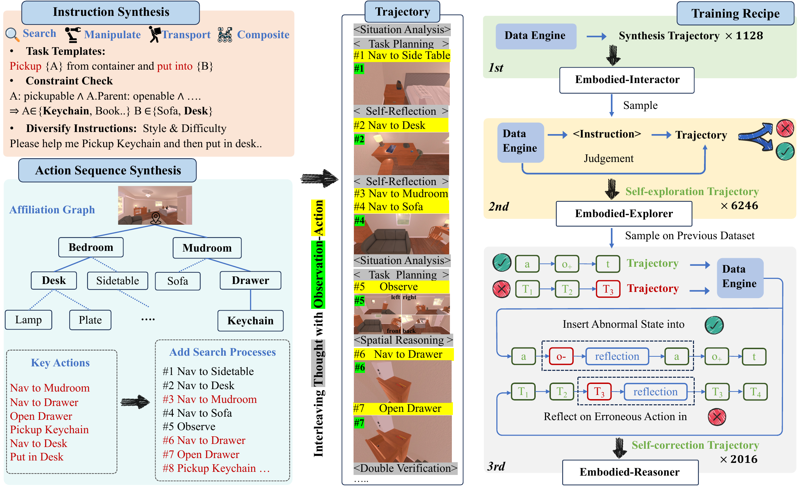
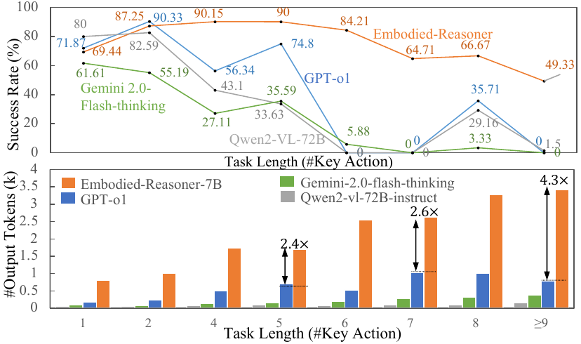
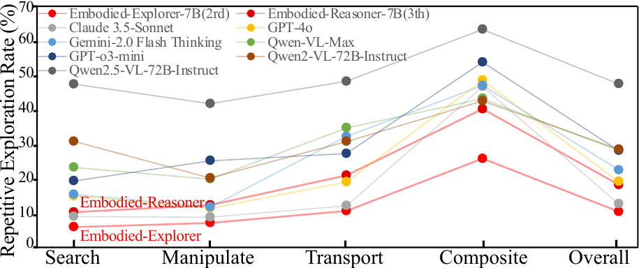
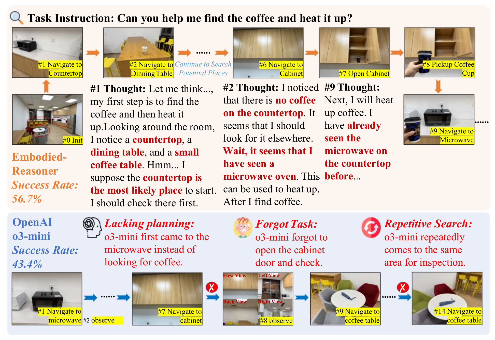
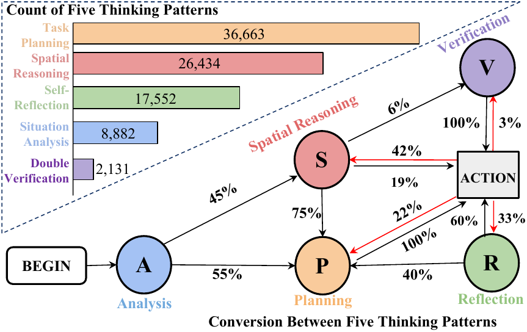

# Embodied Reasoner (arXiv 2025)

<!-- paper-source: https://chengwei920412.github.io/paper_reading/2503.21696_Embodied_Reasoner_Synergizing_Visual_Search_Reasoning_and_Action_for_Embodied_Interactive_Tasks/technical_report.html -->

> **arXiv ID**: 2503.21696
> **原文标题**: Embodied-Reasoner: Synergizing Visual Search, Reasoning, and Action for Embodied Interactive Tasks
> **翻译日期**: 2026-09-01

---

## 📋 论文概览 {#_1}

### 基本信息 {#_2}

- **作者**: Wenqi Zhang、Mengna Wang（同等贡献）、Gangao Liu、Xu Huixin、Yiwei Jiang、Yongliang Shen、Guiyang Hou、Zhe Zheng、Hang Zhang、Xin Li、Weiming Lu、Peng Li（通讯）、Yueting Zhuang（通讯）
- **机构**: 浙江大学计算机科学与技术学院、中国科学院软件研究所、中国科学院大学、阿里巴巴集团、阿里巴巴集团达摩院、南京软件技术研究院、南京邮电大学、河海大学
- **发表时间**: arXiv 预印本 2025 年 3 月（v2 于 2025 年 5 月更新），投稿 ICCV 2025
- **领域**: 具身智能、多模态大模型推理、视觉-语言-动作模型

### 核心贡献 {#_3}

1. **将 o1 式深度思考范式扩展到交互式具身任务**。此前长思维链推理集中在数学与代码这类"单轮输入—单轮输出"的封闭任务上；本文把它搬到需要与环境反复交互、上下文为图文交错的具身搜索任务中。
2. **一个可控的数据引擎**，自动合成 9,390 条 *观察-思考-动作（Observation-Thought-Action, O-T-A）* 交错轨迹，含 64K 张第一人称图像与 8M 思考 token，并显式注入五类思考模式（情境分析、任务规划、空间推理、自我反思、二次验证）。
3. **三阶段迭代训练流程**：模仿学习 → 拒绝采样微调 → 反思微调，把 Qwen2-VL-7B 的任务成功率从 14.8% 提升到 80.96%。
4. **一套交互式评估框架**：809 个人工标注测试任务，覆盖 12 个训练未见场景，提出成功率、搜索效率、任务完成度三项指标，外加重复探索率（RER）用于诊断行为退化。

---

## 🎯 研究背景与动机 {#_4}

### 问题定义 {#_5}

任务设定为**陌生室内环境中的隐藏物体搜索及后续操作**。机器人初始化在房间一角、视野受限，只能通过 9 个高层动作（`Observe`、`Move Forward`、`Navigate to {}`、`Pickup {}`、`Put in {}`、`Toggle {}`、`Open {}`、`Close {}`、`Termination`）与环境交互。每次动作返回一张第一人称图像。四类任务按复杂度递增：

<table>
<thead>
<tr>
<th>任务类别</th>
<th>说明</th>
<th>典型关键动作数</th>
</tr>
</thead>
<tbody>
<tr>
<td>搜索（Search）</td>
<td>找到某物体，可能暴露在表面或藏于容器内</td>
<td>1–2</td>
</tr>
<tr>
<td>操作（Manipulate）</td>
<td>找到后与之交互（如开灯）</td>
<td>2、4–5</td>
</tr>
<tr>
<td>搬运（Transport）</td>
<td>找到后搬运到指定位置</td>
<td>4–7</td>
</tr>
<tr>
<td>复合（Composite）</td>
<td>按顺序完成多个搬运/操作子任务</td>
<td>8–27</td>
</tr>
</tbody>
</table>

论文明确把任务定位在**高层规划与推理**层面，而非底层运动控制——这是理解全文定位的关键：它不解决抓取姿态或轨迹优化，只解决"下一步该去哪、该做什么"。

### 现有方法的局限性 {#_6}

论文归纳出两个结构性挑战：

**挑战 1：长程多模态交互。** 数学/代码推理是单轮的：给定题目，输出一段长思考与答案。具身任务是多轮的：模型必须处理 \(o_1, t_1, a_1, o_2, t_2, a_2, \dots\) 这样不断增长的图文交错上下文，并保持跨轮次的逻辑一致。论文观察到即使 o3-mini 这类先进推理模型也会在此退化为重复搜索与自相矛盾的行为。

**挑战 2：多样的推理模态。** 数学推理主要依赖专业知识与逻辑演绎；具身搜索则需要常识知识（"鸡蛋大概在冰箱里"）、空间关系理解（规划不绕路的探索顺序）、时序推理（回忆"我已经查过这个柜子了"）与自我反思（"上一轮的搜索计划漏了抽屉"）。这四类能力在现有视觉推理模型的训练目标中基本没有被显式激励。

### 本文的创新点 {#_7}

核心洞察是：**具身推理的瓶颈不在"能否处理多模态输入"，而在"能否在交互的不同阶段生成恰当类型的思考"**。因此论文不去改模型架构，而是改训练数据的形态——把思考显式地插入到观察与动作之间，并按阶段区分思考的类型，让模型学会"什么时候该规划、什么时候该反思"。

---

## 🔬 方法论 {#_8}

### 整体架构 {#_9}

图：左侧为数据引擎（指令合成 → 归属关系图 → 关键动作序列 → 插入探索动作 → 插入思考）；右侧为三阶段训练方案。

整个系统由**数据引擎**与**三阶段训练**两半组成，二者形成闭环：训练出的模型被用来采样新轨迹，数据引擎又充当奖励模型筛选并修补这些轨迹，作为下一阶段的训练数据。

### 关键技术 {#_10}

**① 带约束的指令合成。** 具身指令不能凭空生成——引用场景中不存在的物体或不可执行的动作会导致指令无效。做法是：为每类任务设计模板（如 `pickup {invisible A} and put in {B}`），用 GPT-4o 根据模拟器提供的物体元数据**生成约束检查代码**（如 `Pickupable(A) ∧ ¬Openable(Parent(A)) ∧ Openable(B)`），筛出满足约束的物体填入模板，再由 GPT-4o 改写成多种口语风格，并把简单任务顺序拼接成复合任务。

**② 归属关系图与关键动作推导。** 从模拟器元数据构建一张图：节点是物体，边是"包含"关系（钥匙扣 → 抽屉 → 玄关）。给定目标物体，从叶节点向上追溯到根，即可机械地推导出完成任务的**最小动作序列**（关键动作）。这一步是全文工程上最巧妙的地方：它把"什么算成功"从主观判断变成了可自动验证的图路径问题，从而使数据引擎能够充当过程监督奖励模型（PRM）。

**③ 插入探索过程。** 只有关键动作的轨迹不真实——真实机器人会先找错几个地方。引擎因此在关键动作前插入若干失败的搜索动作（`Nav to Sidetable` → `Desk` → `Sofa` → `Observe` → 最终在抽屉找到），使轨迹呈现渐进探索的形态。

**④ 五类思考模式的交错注入。** 对每次交互，GPT-4o 在已有轨迹 \((o_1, t_1, a_1, \dots, o_n)\) 与即将执行的动作 \(a_n\) 的条件下，选择一种或多种思考模式并生成 \(t_n\)，插入到观察与动作之间：

\[o_n, a_n \rightarrow o_n, t^{1}_n, t^{2}_n, \dots, t^{k}_n, a_n\]

生成 \(t_n\) 时有三个约束：必须考虑最新观察 \(o_n\)、必须为 \(a_n\) 提供合理依据、必须与此前思考 \(t_{1:n-1}\) 逻辑一致。**最后一条是让长程一致性可学习的关键**——它把"连贯性"变成了数据里的显式属性，而非期望模型自行涌现的性质。

### 算法流程 {#_11}

训练组织为多轮对话：每轮以图像与模拟器反馈作为 *User Input*，思考与动作作为 *Assistant Output*，**损失只在思考与动作 token 上计算**。三个阶段：

**阶段 1 — 模仿学习（Learn to Interact）。** 在 1,128 条以关键动作为主的合成轨迹上微调 Qwen2-VL-7B-Instruct，得到 *Embodied-Interactor*。它学会了读图文交错上下文并输出合法动作，但**几乎不会搜索**：打开冰箱发现没有鸡蛋，它会回答"鸡蛋不存在"而不是换个地方找。原因很直接——训练数据里没有失败后继续探索的样本。

**阶段 2 — 拒绝采样微调（Learn to Search）。** 用 *Embodied-Interactor* 在新指令上高温采样多条轨迹，用数据引擎（关键动作序列 + 最终状态）作为 PRM 判定成败，保留 6,246 条成功轨迹再次微调，得到 *Embodied-Explorer*。这些轨迹多数是"试错几次后成功"，因此模型学到了带优先级的多区域搜索计划。

**阶段 3 — 反思微调（Learn to Self-reflect）。** 针对长时程任务中的幻觉与硬件故障，构造两类自我纠错数据：

- **向成功轨迹注入异常**：模拟导航异常（指令去冰箱却到了桌子）与操作异常（机械臂临时失效）。在动作 \(a\) 后插入异常观察 \(o_-\)，生成反思思考 \(t_r\)，再重试同一动作：
  \(\{\dots, a, o_{-}, t_r, a, o_{+}, \dots\}\)
- **对失败轨迹纠错**：借关键动作定位首个错误动作，生成反思 \(t_r\) 并接上正确的剩余轨迹：
  \(\{Traj^{1:t}_{-},\ t^{t}_r,\ Traj^{t:n}_{+}\}\)
  损失计算时**屏蔽错误前缀** \(Traj^{1:t}_{-}\)，只对反思 token 与正确后缀计算损失。这一屏蔽很重要：否则模型会同时学会犯错和纠错。

最终得到 *Embodied-Reasoner*。三阶段数据规模如下：

<table>
<thead>
<tr>
<th>阶段</th>
<th>#轨迹</th>
<th>来源</th>
<th>#图像</th>
<th>平均动作数</th>
</tr>
</thead>
<tbody>
<tr>
<td>Train1st</td>
<td>1,128</td>
<td>合成</td>
<td>4,636</td>
<td>4.11</td>
</tr>
<tr>
<td>Train2nd</td>
<td>6,246</td>
<td>自我探索</td>
<td>45.8k</td>
<td>7.33</td>
</tr>
<tr>
<td>Train3rd</td>
<td>2,016</td>
<td>合成</td>
<td>13.8k</td>
<td>8.63</td>
</tr>
<tr>
<td>总计</td>
<td>9,390</td>
<td>—</td>
<td>64k</td>
<td>7.22</td>
</tr>
<tr>
<td>测试集</td>
<td>809</td>
<td>人工标注</td>
<td>4.9k</td>
<td>6.06</td>
</tr>
</tbody>
</table>

值得注意的是**平均动作数随阶段单调上升**（4.11 → 7.33 → 8.63），这与三阶段"交互 → 探索 → 反思"的能力递进设计是自洽的：越往后的数据包含越多的探索与回溯步骤。

---

## 📊 实验与结果 {#_12}

### 实验设置 {#_13}

- **数据集**: 训练覆盖 107 个 AI2-THOR 室内场景、2,100 个可交互物体、2,600 个容器；测试为 12 个训练未见场景中人工标注的 809 个任务（含 25 个含四子任务、14–27 个关键动作的超长时程任务）。另有 30 个任务的真实世界实验（6 厨房 / 12 浴室 / 12 卧室），由人持相机采图、模型输出动作、人执行。
- **评估指标**:
- **成功率（%）**：关键动作是否正确对齐且最终状态达标。
- **搜索效率**：关键动作数 / 预测动作数——步数越多越低。
- **任务完成度（%）**：预测动作中属于关键动作集合的比例。
- **重复探索率（RER）**：重访此前位置次数 / 总探索次数。例如路径 \(Place_a, Place_b, Place_b, Place_c, Place_c\) 的 RER 为 \(2/5 = 40\%\)。
- **对比方法**: 通用视觉语言模型（Qwen2/2.5-VL-7B/72B、Claude 3.5-Sonnet、Qwen-VL-Max、GPT-4o）与视觉推理模型（QVQ-72B-Preview、Kimi-K1.5、GPT-o3-mini、Gemini-2.0 Flash Thinking、Claude-3.7-Sonnet-thinking、GPT-o1）。

### 主要结果 {#_14}

表：主结果（成功率 / 搜索效率 / 任务完成度 + 四类子任务成功率）。

<table>
<thead>
<tr>
<th>类别</th>
<th>模型</th>
<th>成功率 ↑</th>
<th>搜索效率 ↑</th>
<th>任务完成度 ↑</th>
<th>搜索</th>
<th>操作</th>
<th>搬运</th>
<th>复合</th>
</tr>
</thead>
<tbody>
<tr>
<td>通用 VLM</td>
<td>Qwen2.5-VL-7B-Instruct</td>
<td>12.38%</td>
<td>10.87%</td>
<td>27.53%</td>
<td>6.45%</td>
<td>23.55%</td>
<td>7.56%</td>
<td>0.95%</td>
</tr>
<tr>
<td>通用 VLM</td>
<td>Qwen2-VL-7B-Instruct（基座）</td>
<td>14.79%</td>
<td>11.97%</td>
<td>38.67%</td>
<td>23.33%</td>
<td>25.50%</td>
<td>2.82%</td>
<td>0.00%</td>
</tr>
<tr>
<td>通用 VLM</td>
<td>Qwen2.5-VL-72B-Instruct</td>
<td>31.75%</td>
<td>22.61%</td>
<td>50.62%</td>
<td>52.14%</td>
<td>38.89%</td>
<td>21.90%</td>
<td>0.00%</td>
</tr>
<tr>
<td>通用 VLM</td>
<td>Qwen2-VL-72B-Instruct</td>
<td>39.00%</td>
<td>28.88%</td>
<td>54.56%</td>
<td>50.00%</td>
<td>52.36%</td>
<td>33.19%</td>
<td>0.00%</td>
</tr>
<tr>
<td>通用 VLM</td>
<td>Claude 3.5-Sonnet</td>
<td>45.35%</td>
<td>28.05%</td>
<td>64.12%</td>
<td>54.25%</td>
<td>50.51%</td>
<td>51.22%</td>
<td>3.84%</td>
</tr>
<tr>
<td>通用 VLM</td>
<td>Qwen-VL-Max</td>
<td>49.81%</td>
<td>36.28%</td>
<td>68.39%</td>
<td>63.87%</td>
<td>63.21%</td>
<td>45.16%</td>
<td>1.90%</td>
</tr>
<tr>
<td>通用 VLM</td>
<td>GPT-4o</td>
<td>66.67%</td>
<td>41.68%</td>
<td>79.07%</td>
<td>69.03%</td>
<td>79.26%</td>
<td>71.95%</td>
<td>14.42%</td>
</tr>
<tr>
<td>视觉推理</td>
<td>QVQ-72B-Preview</td>
<td>7.54%</td>
<td>6.39%</td>
<td>36.33%</td>
<td>4.35%</td>
<td>7.50%</td>
<td>10.53%</td>
<td>0.00%</td>
</tr>
<tr>
<td>视觉推理</td>
<td>Kimi-K1.5†</td>
<td>46.00%</td>
<td>—</td>
<td>—</td>
<td>—</td>
<td>—</td>
<td>—</td>
<td>—</td>
</tr>
<tr>
<td>视觉推理</td>
<td>GPT-o3-mini</td>
<td>56.55%</td>
<td>26.93%</td>
<td>67.41%</td>
<td><strong>78.57%</strong></td>
<td>59.32%</td>
<td>66.67%</td>
<td>0.00%</td>
</tr>
<tr>
<td>视觉推理</td>
<td>Gemini-2.0 Flash Thinking</td>
<td>56.74%</td>
<td>43.01%</td>
<td>71.70%</td>
<td>71.05%</td>
<td>75.60%</td>
<td>40.67%</td>
<td>8.89%</td>
</tr>
<tr>
<td>视觉推理</td>
<td>Claude-3.7-Sonnet-thinking</td>
<td>67.70%</td>
<td>37.95%</td>
<td>78.63%</td>
<td>69.12%</td>
<td>75.88%</td>
<td>71.94%</td>
<td>13.79%</td>
</tr>
<tr>
<td>视觉推理</td>
<td>GPT-o1</td>
<td>71.73%</td>
<td>43.06%</td>
<td>82.49%</td>
<td>78.42%</td>
<td>79.10%</td>
<td>67.36%</td>
<td>13.16%</td>
</tr>
<tr>
<td><strong>本文</strong></td>
<td>Embodied-Interactor-7B（阶段 1）</td>
<td>25.46%</td>
<td>24.75%</td>
<td>53.67%</td>
<td>30.97%</td>
<td>27.09%</td>
<td>29.20%</td>
<td>3.81%</td>
</tr>
<tr>
<td><strong>本文</strong></td>
<td>Embodied-Explorer-7B（阶段 2）</td>
<td>65.39%</td>
<td>46.25%</td>
<td>77.73%</td>
<td>60.00%</td>
<td>75.92%</td>
<td>72.24%</td>
<td>26.67%</td>
</tr>
<tr>
<td><strong>本文</strong></td>
<td>Embodied-Reasoner-7B（阶段 3）</td>
<td><strong>80.96%</strong></td>
<td><strong>55.07%</strong></td>
<td><strong>86.30%</strong></td>
<td>65.16%</td>
<td><strong>93.31%</strong></td>
<td><strong>87.20%</strong></td>
<td><strong>54.29%</strong></td>
</tr>
</tbody>
</table>

† Kimi-K1.5 为通过网页人工评测 50 个用例的结果，与其他行不完全可比。

从表中可读出四点：

1. **7B 模型全面超越闭源推理模型**：80.96% vs GPT-o1 的 71.73%（+9.2），vs o3-mini 的 56.55%（+24.4），vs Claude-3.7-thinking 的 67.70%（+13.3）。搜索效率 55.07% 亦高于 GPT-o1 的 43.06%（+12）。
2. **优势随任务复杂度放大**：复合任务上 54.29% vs 次优的 GPT-4o 14.42%（+39.9），而所有闭源推理模型在复合任务上都在 14% 以下，o3-mini 甚至为 0.00%。
3. **在最简单的搜索子任务上反而落后**：65.16% vs o3-mini 的 78.57%（−13.4）。论文归因为**过度探索**——模型倾向于多看几个地方，反而漏检近处物体。这是一个诚实且有信息量的负面结果：三阶段训练把模型推向了"谨慎探索"的策略，在长任务上是收益，在短任务上是成本。
4. **视觉推理模型并不天然优于通用 VLM**：QVQ-72B-Preview 仅 7.54%，低于 7B 的通用模型；GPT-4o（66.67%）高于 o3-mini（56.55%）。这直接支持了论文的出发点——面向数学/代码优化的长思维链能力并不自动迁移到具身交互。

### 消融实验 {#_15}

论文没有设置独立的消融小节，**三阶段训练序列本身承担了消融的角色**——每一行都是前一行加一个训练阶段的结果：

<table>
<thead>
<tr>
<th>配置</th>
<th>成功率</th>
<th>相对增益</th>
<th>新增能力</th>
</tr>
</thead>
<tbody>
<tr>
<td>Qwen2-VL-7B（基座）</td>
<td>14.79%</td>
<td>—</td>
<td>仅能输出合法动作格式</td>
</tr>
<tr>
<td>+ 阶段 1 模仿学习</td>
<td>25.46%</td>
<td>+10.7</td>
<td>基础交互：读图文交错上下文、输出动作</td>
</tr>
<tr>
<td>+ 阶段 2 拒绝采样微调</td>
<td>65.39%</td>
<td>+39.9</td>
<td>探索：失败后换区域、带优先级的搜索计划</td>
</tr>
<tr>
<td>+ 阶段 3 反思微调</td>
<td>80.96%</td>
<td>+15.6</td>
<td>自我纠错：识别异常状态、纠正错误动作</td>
</tr>
</tbody>
</table>

**阶段 2 贡献了最大的单步增益（+39.9）**，说明"失败后继续探索"这一行为是该任务的主要瓶颈，而它只能靠包含探索过程的轨迹来教——阶段 1 的关键动作轨迹无论怎么加量都学不到。阶段 3 的 +15.6 主要体现在复合任务上（26.67% → 54.29%，翻倍），与"长时程任务更需要及时纠错"的直觉一致。

需要指出的是，这个序列**混合了两个变量**：训练阶段与数据量（1,128 → +6,246 → +2,016）。论文没有做等数据量对照（例如用 9,390 条纯合成轨迹一次性训练），因此无法完全区分增益来自"迭代式自举"还是单纯来自"更多、更多样的数据"。这是方法论上一个可以补强的地方。

### 关键分析实验 {#_16}

**① 长时程鲁棒性与推理 token 的自发扩展。**

图：任务长度（关键动作数）与成功率、输出 token 数的关系。

两个观察：基线模型的成功率在任务超过 5 个关键动作后显著下降，而本文模型在多数区间维持 60% 以上；同时本文模型的响应长度随任务复杂度**从约 1,000 增长到 3,500 token**（复杂搜索任务上接近 Gemini-2.0-flash-thinking 的五倍），而 Gemini 始终维持在 1,000 左右。

这是全文最有价值的发现之一：**推理长度的自适应扩展是一种可以被数据教出来的行为，而不是模型规模的副产品**。Gemini 在复杂任务上不增加思考长度，说明它未能识别"这个任务更难"这一信号——而 Embodied-Reasoner 通过训练数据中"复合任务对应更长思考链"的统计规律学到了这种识别。反过来说，这也提示论文的结论有一定的数据分布依赖性：模型学到的可能是"任务描述看起来长/复杂 → 输出更多思考"的相关性，而非真正的难度估计。

**② 重复探索率（RER）——行为退化的直接度量。**

图：四类任务上的重复探索率对比。

本文模型在四类任务上 RER 一致低约 50%。复合任务上 *Embodied-Explorer* 达到最低的 26%，而 GPT-o3-mini 与 Qwen2-VL-72B 分别为 54% 与 43%。

一个耐人寻味的细节：**Reasoner（阶段 3）的 RER 略高于 Explorer（阶段 2）**，论文解释为"更谨慎、倾向多次检查与反思"。这揭示了反思训练的双刃性——反思提升了成功率（65.39% → 80.96%），但同时引入了额外的确认性重访。RER 因此不是一个越低越好的指标，它与成功率之间存在权衡。这也与前面"简单搜索任务上过度探索"的负面结果互相印证：同一种"谨慎"倾向在不同任务长度上表现为收益或成本。

**③ 真实世界实验。**

图：真实世界物体搜索实验示例（"帮我找到咖啡并加热"）。

30 个任务、三个场景的结果：

<table>
<thead>
<tr>
<th>模型</th>
<th>成功率（%）</th>
</tr>
</thead>
<tbody>
<tr>
<td>Qwen2.5-VL-72B-Instruct</td>
<td>43.3</td>
</tr>
<tr>
<td>OpenAI o1</td>
<td>50.0</td>
</tr>
<tr>
<td>OpenAI o3-mini</td>
<td>44.0</td>
</tr>
<tr>
<td><strong>Embodied-Reasoner</strong></td>
<td><strong>56.7</strong></td>
</tr>
</tbody>
</table>

模型在纯 AI2-THOR 合成数据上训练、零真实数据微调，仍在真实图像上领先 o1 6.7 个百分点，这是对"学到的是策略而非模拟器纹理"的一个有力（但样本量偏小）的证据。定性上，o3-mini 在示例中直奔微波炉而不先找咖啡，暴露了规划顺序错误；本文模型则先排除台面与餐桌，再在橱柜中找到目标。

注：正文图 7 的图注标注 o3-mini 为 43.4%，而附录表 A1 为 44.0%，两处数值存在轻微不一致（不影响结论排序）。

---

## 💡 关键见解 {#_17}

### 理论分析 {#_18}

**具身推理与数学推理的结构差异。** 论文实际上论证了一个可形式化的区分。数学推理是在固定信息集上做演绎：所有前提在 \(t=0\) 时给定，推理过程不改变环境。具身搜索是**信息获取与决策交织**的过程：动作 \(a_n\) 的价值不只在于推进任务，还在于它揭示的信息 \(o_{n+1}\)（`Observe`、`Open` 这类动作几乎纯粹是信息获取动作）。这使得具身推理本质上更接近部分可观测马尔可夫决策过程（POMDP）中的信念更新，而非定理证明。

正是这个差异解释了为什么长思维链能力不能直接迁移：数学长思考优化的是"在给定信息下少犯逻辑错误"，而具身任务需要的是"高效缩小信念空间并记住已排除的假设"。RER 指标测的正是后者的失败模式——重访已探索区域等价于忘记了自己已经更新过的信念。

**为什么"思考类型"需要显式区分。** 五类思考模式对应交互循环的不同阶段，转移概率统计支持了这一点：

图：五类思考的频率与转移关系。

- *任务规划*（36.6K，约每轨迹 4 次）与*空间推理*（26.4K，约每轨迹 3 次）最频繁；
- 轨迹通常以*任务规划*开始，随后转向*任务规划*（55%）或*空间推理*（45%）；
- 导航未知区域时依赖*空间推理*（Action→S：42%）；
- 搜索失败后转向*自我反思*（Action→R：33%）；
- 子任务完成后偶尔*二次验证*（Action→V：3%，S→V：6%）。

这组数字说明思考类型与交互状态之间存在强条件依赖——不是随机混合，而是有结构的策略。把这个结构写进训练数据，等价于给模型提供了一个关于"何时该做何种推理"的先验。

### 实践启示 {#_19}

1. **可自动验证的成功判据是数据引擎的前提。** 归属关系图之所以关键，是它把"任务是否完成"化归为图路径匹配，从而让数据引擎兼任 PRM，使拒绝采样与错误定位都无需人工标注。任何想复制这套流程的工作，第一步应该是找到自己领域中等价的可验证结构。
2. **屏蔽错误前缀的损失设计不可省略。** 自我纠错数据天然包含错误动作；若不屏蔽，模型会同时学到犯错分布。这是构造反思类数据的通用注意点。
3. **小模型 + 领域轨迹数据可以在特定交互任务上超过通用大推理模型。** 7B 超过 o1 说明这类任务的瓶颈是**行为先验**而非知识或参数量。
4. **反思能力有成本。** 阶段 3 在长任务上大幅获益，却在最简单的搜索任务上因过度探索而退步。部署时可考虑按任务长度估计动态调节反思强度。

---

## 🔍 局限性与未来工作 {#_20}

### 当前局限 {#_21}

1. **动作空间是高层封装的，规避了真实控制难题。** 9 个高层动作中 `Navigate to {}` 隐含了完整的路径规划与避障，`Pickup {}` 隐含了抓取姿态求解。论文明确声明聚焦高层规划，但这意味着结论无法直接外推到端到端 VLA 模型。
2. **训练数据完全来自单一模拟器。** 107 个场景全部来自 AI2-THOR，物体类别与布局风格受限于该资产库。真实世界实验仅 30 个任务，且由人代为执行动作、人持相机取景——这引入了人类操作者的隐式辅助（取景角度的选择本身就携带信息），使真实世界数字偏乐观。
3. **思考数据由 GPT-4o 生成，存在教师模型上限与风格同质化。** 五类思考模式由提示词定义，模型学到的"反思"在多大程度上是真实的信念修正、在多大程度是模仿 GPT-4o 的反思措辞，论文未做区分实验（例如检验反思内容是否真的影响后续动作分布）。
4. **消融不充分。** 如前所述，三阶段序列混合了训练策略与数据量两个变量；五类思考模式也没有做逐类剔除的消融，因此无法判断哪些思考类型是必要的、哪些是冗余的。
5. **评估指标的局限。** 成功率依赖人工标注的关键动作序列作为唯一正确路径，可能惩罚了合理但不同的替代路径；搜索效率定义为关键动作数/预测动作数，会系统性惩罚必要的信息获取动作（`Observe`）。
6. **无强化学习对照。** 论文以 DeepSeek-R1 的拒绝采样为灵感，但只做了拒绝采样微调（离线），未与在线 RL（如 GRPO/PPO）对比，而后者是同期该方向的主流做法。

### 未来方向 {#_22}

1. **引入在线强化学习**：数据引擎已是现成的过程奖励模型，天然适配 GRPO 等算法，把阶段 2/3 从离线拒绝采样升级为在线策略优化是最直接的延伸。
2. **降低动作抽象层级**：把 `Navigate to {}` 展开为底层运动指令，检验深度思考范式在含真实控制失败的场景下是否仍然有效。
3. **自适应思考预算**：针对"简单任务过度探索"问题，训练模型显式预测所需思考量，或引入思考长度的代价项。
4. **跨模拟器与真机泛化**：在 Habitat、ProcTHOR 等其他环境上验证，并在真实机器人上做闭环（而非人代执行）实验。
5. **思考质量的因果检验**：设计干预实验（如替换/删除某类思考后观察动作分布变化），验证思考是否真正参与决策，而非仅是与动作相关的装饰性文本。
6. **思考模式的逐类消融**，明确五类模式各自的边际贡献。

---

## 📚 相关工作对比 {#_23}

<table>
<thead>
<tr>
<th>方法</th>
<th>核心思想</th>
<th>优势</th>
<th>劣势</th>
</tr>
</thead>
<tbody>
<tr>
<td>o1 / DeepSeek-R1 / QwQ</td>
<td>文本长思维链，RL 或长思考轨迹后训练</td>
<td>数学/代码推理强，自我反思能力内化</td>
<td>单轮设定，无多模态交互；长思考能力不自动迁移到具身任务（o3-mini 复合任务 0%）</td>
</tr>
<tr>
<td>QVQ / Kimi-1.5 等视觉推理模型</td>
<td>把长思维链扩展到多模态</td>
<td>支持图像输入的深度思考</td>
<td>仍是单轮对话；难处理图文交错的长上下文（QVQ-72B 仅 7.54%）</td>
</tr>
<tr>
<td>PaLM-E / RT-2 / OpenVLA 等 VLA</td>
<td>机器人数据 + 视觉语言数据联合训练，直接预测动作</td>
<td>端到端，覆盖底层控制</td>
<td>直接输出动作序列，缺少显式思考过程；长时程规划弱</td>
</tr>
<tr>
<td>ChatGPT for Robotics</td>
<td>定义高层函数库 + 提示工程驱动 LLM</td>
<td>无需训练，工程上易落地</td>
<td>依赖人工提示设计；思考是被提示驱动而非自发；无法从失败中学习</td>
</tr>
<tr>
<td><strong>本文（Embodied-Reasoner）</strong></td>
<td>合成 O-T-A 交错轨迹，显式注入五类思考；三阶段模仿→探索→反思自举</td>
<td>7B 超越 o1（+9.2）；复合任务优势巨大（+39.9）；RER 低约 50%；推理 token 随难度自发扩展；零真实数据仍泛化到真机场景</td>
<td>动作空间高层封装，回避真实控制；数据仅来自 AI2-THOR 与 GPT-4o；消融不充分；简单任务因过度探索反而退步；无在线 RL 对照</td>
</tr>
</tbody>
</table>

---

## 🎓 个人评价 {#_24}

### 优点 {#_25}

1. **问题选得准。** "长思维链能否迁移到交互式任务"是 2025 年初一个真实且尚未被系统回答的问题，论文用一个干净的任务设定给出了明确答案：不能直接迁移，但可以通过数据形态的重构教出来。
2. **数据引擎的工程设计扎实。** 归属关系图 → 关键动作序列这一步把主观的成功判据变成可自动验证的图问题，进而使 PRM、拒绝采样、错误定位全部自动化。这是全文最可复用的技术资产。
3. **结论有量化支撑且包含负面结果。** 论文如实报告了简单搜索任务上落后 o3-mini 13.4%，并给出"过度探索"的解释；也如实报告 Reasoner 的 RER 高于 Explorer。这种诚实显著提高了整体可信度。
4. **RER 是一个好指标。** 它把"重复搜索"这一定性观察变成可比较的数字，且直接对应时序推理的失败模式，比单看成功率信息量更大。
5. **推理长度自适应扩展的发现有普遍意义。** 它说明"按难度调节思考量"是一种可学习的行为，而不必依赖模型规模——这对小模型部署有实际价值。

### 可改进之处 {#_26}

1. **消融的严谨性是最大短板。** 三阶段序列同时改变训练策略与数据量；五类思考模式无逐类消融。至少应补一组"9,390 条数据一次性训练"的等量对照，才能支撑"迭代自举有效"这一论断。
2. **真实世界实验偏弱。** 30 个任务、人持相机取景、人代执行动作——三个因素都使结果偏乐观。图 7 图注（43.4%）与表 A1（44.0%）的数值不一致也说明这部分实验的记录不够严整。
3. **缺少在线 RL 对照。** 论文以 DeepSeek-R1 为灵感却只做离线拒绝采样，未与同期主流的在线 RL 方法比较，削弱了"三阶段流程是较优选择"的说服力。
4. **思考的因果作用未被验证。** 全文的隐含主张是"思考导致更好的动作"，但所有证据都是相关性的。缺少干预实验（删除/扰动思考后观察动作变化）来排除"思考只是与好动作共现的文本"这一替代解释。
5. **评估指标偏向标注路径。** 以人工标注的关键动作为唯一正确解，可能低估了合理的替代策略；搜索效率的定义也会系统性惩罚必要的 `Observe` 动作。
6. **对 GPT-4o 的依赖未被讨论。** 指令、约束代码、思考全部由 GPT-4o 生成，教师模型的偏差如何传导到学生模型，论文没有分析。

### 推荐阅读对象 {#_27}

- **具身智能 / VLA 方向研究者**：本文提供了在高层规划层面把推理能力注入 VLM 的完整配方，数据引擎部分尤其值得借鉴。
- **做长思维链 / 推理后训练的研究者**：本文是"长思考范式跨领域迁移"的一个有价值的负例 + 正例组合，尤其"推理 token 随难度自发扩展"的分析。
- **做合成数据与自动化标注的工程团队**：归属关系图 → 可验证成功判据 → PRM 的链路是一个可迁移的设计模式。
- **不适合**：寻找底层运动控制、抓取姿态、真机闭环部署方案的读者——本文明确不覆盖这些层面。

---

## 📎 附录 {#_28}

### 重要公式 {#_29}

**① 思考插入（把 O-A 轨迹改写为 O-T-A 轨迹）**

\[o_n, a_n \rightarrow o_n, t^{1}_n, t^{2}_n, \dots, t^{k}_n, a_n\]

其中 \(o_n\) 为第 \(n\) 步第一人称观察图像，\(a_n\) 为动作，\(t^{i}_n\) 为第 \(i\) 段思考。生成 \(t_n\) 的条件为 \((o_1, t_1, a_1, \dots, o_n; a_n)\)，并要求与 \(t_{1:n-1}\) 逻辑一致。

**② 异常状态注入（成功轨迹 → 反思轨迹）**

\[\{\dots, a, o_{+}, t, \dots\} \Rightarrow \{\dots, a, o_{-}, t_r, a, o_{+}, \dots\}\]

\(o_-\) 为注入的异常观察（导航异常或操作异常），\(t_r\) 为针对异常生成的反思思考，随后重试同一动作 \(a\)。

**③ 失败轨迹纠错**

\[\{Traj^{1:t}_{-},\ t^{t}_r,\ Traj^{t:n}_{+}\}\]

\(t\) 为首个错误动作的位置。损失只对 \(t^{t}_r\) 与 \(Traj^{t:n}_{+}\) 计算，屏蔽 \(Traj^{1:t}_{-}\)。

**④ 搜索效率**

\[\text{Search Efficiency} = \frac{|\text{关键动作}|}{|\text{预测动作}|}\]

**⑤ 重复探索率**

\[\text{RER} = \frac{\text{重访此前位置的次数}}{\text{探索总次数}}\]

例：路径 \(Place_a, Place_b, Place_b, Place_c, Place_c\) 中 \(Place_b\)、\(Place_c\) 各重访一次，\(\text{RER} = 2/5 = 40\%\)。

**⑥ 约束检查谓词（示例：暴露到封闭物体搬运）**

\[\text{Pickupable}(A) \land \neg\text{Openable}(\text{Parent}(A)) \land \text{Openable}(B)\]

\(\text{Parent}(\cdot)\) 为归属关系图中的父节点，用于判定目标物体是否需要开启容器才能取得。

### 术语表 {#_30}

<table>
<thead>
<tr>
<th>英文</th>
<th>中文</th>
<th>说明</th>
</tr>
</thead>
<tbody>
<tr>
<td>Observation-Thought-Action (O-T-A)</td>
<td>观察-思考-动作</td>
<td>本文轨迹的交错格式</td>
</tr>
<tr>
<td>Affiliation Graph</td>
<td>归属关系图</td>
<td>节点为物体、边为"包含"关系的图，用于推导关键动作</td>
</tr>
<tr>
<td>Key Action</td>
<td>关键动作</td>
<td>完成任务不可或缺的最小动作序列</td>
</tr>
<tr>
<td>Imitation Learning</td>
<td>模仿学习</td>
<td>阶段 1：在合成轨迹上微调</td>
</tr>
<tr>
<td>Rejection Sampling Tuning</td>
<td>拒绝采样微调</td>
<td>阶段 2：采样后按成败筛选再训练</td>
</tr>
<tr>
<td>Reflection Tuning</td>
<td>反思微调</td>
<td>阶段 3：注入异常/纠错并训练反思</td>
</tr>
<tr>
<td>Process Supervision Reward Model (PRM)</td>
<td>过程监督奖励模型</td>
<td>本文由数据引擎充当</td>
</tr>
<tr>
<td>Situation Analysis</td>
<td>情境分析</td>
<td>五类思考模式之一</td>
</tr>
<tr>
<td>Task Planning</td>
<td>任务规划</td>
<td>五类思考模式之一，出现最频繁（36.6K）</td>
</tr>
<tr>
<td>Spatial Reasoning</td>
<td>空间推理</td>
<td>五类思考模式之一（26.4K）</td>
</tr>
<tr>
<td>Self-Reflection</td>
<td>自我反思</td>
<td>五类思考模式之一，常出现在搜索失败后</td>
</tr>
<tr>
<td>Double Verification</td>
<td>二次验证</td>
<td>五类思考模式之一，子任务完成后偶发</td>
</tr>
<tr>
<td>Repetitive/Repeat Exploration Rate (RER)</td>
<td>重复探索率</td>
<td>重访率，度量时序推理失败</td>
</tr>
<tr>
<td>Long-Horizon</td>
<td>长时程</td>
<td>需要多次交互的任务</td>
</tr>
<tr>
<td>Pickupable / Openable / Toggleable</td>
<td>可拾取 / 可开启 / 可开关</td>
<td>模拟器物体属性，用于约束检查</td>
</tr>
<tr>
<td>Embodied-Interactor / Explorer / Reasoner</td>
<td>—</td>
<td>三阶段训练分别产出的模型（保留英文）</td>
</tr>
</tbody>
</table>

### 参考资源 {#_31}

- **论文原文**: [arXiv:2503.21696](https://arxiv.org/abs/2503.21696)
- **中文翻译 PDF**: [paper_cn.pdf](https://chengwei920412.github.io/paper_reading/2503.21696_Embodied_Reasoner_Synergizing_Visual_Search_Reasoning_and_Action_for_Embodied_Interactive_Tasks/paper_cn.pdf)
- **中文 Markdown 译文**: [paper_cn.md](https://chengwei920412.github.io/paper_reading/2503.21696_Embodied_Reasoner_Synergizing_Visual_Search_Reasoning_and_Action_for_Embodied_Interactive_Tasks/paper_cn.html)
- **代码实现**: <https://github.com/zwq2018/embodied_reasoner>
- **数据集**: <https://huggingface.co/datasets/zwq2018/embodied_reasoner>
- **项目主页**: <https://embodied-reasoner.github.io/>
