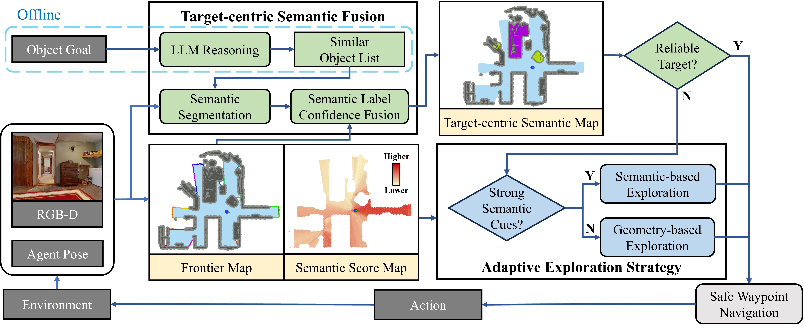
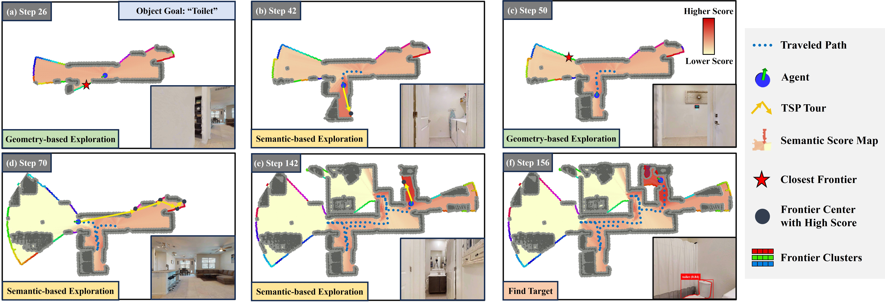
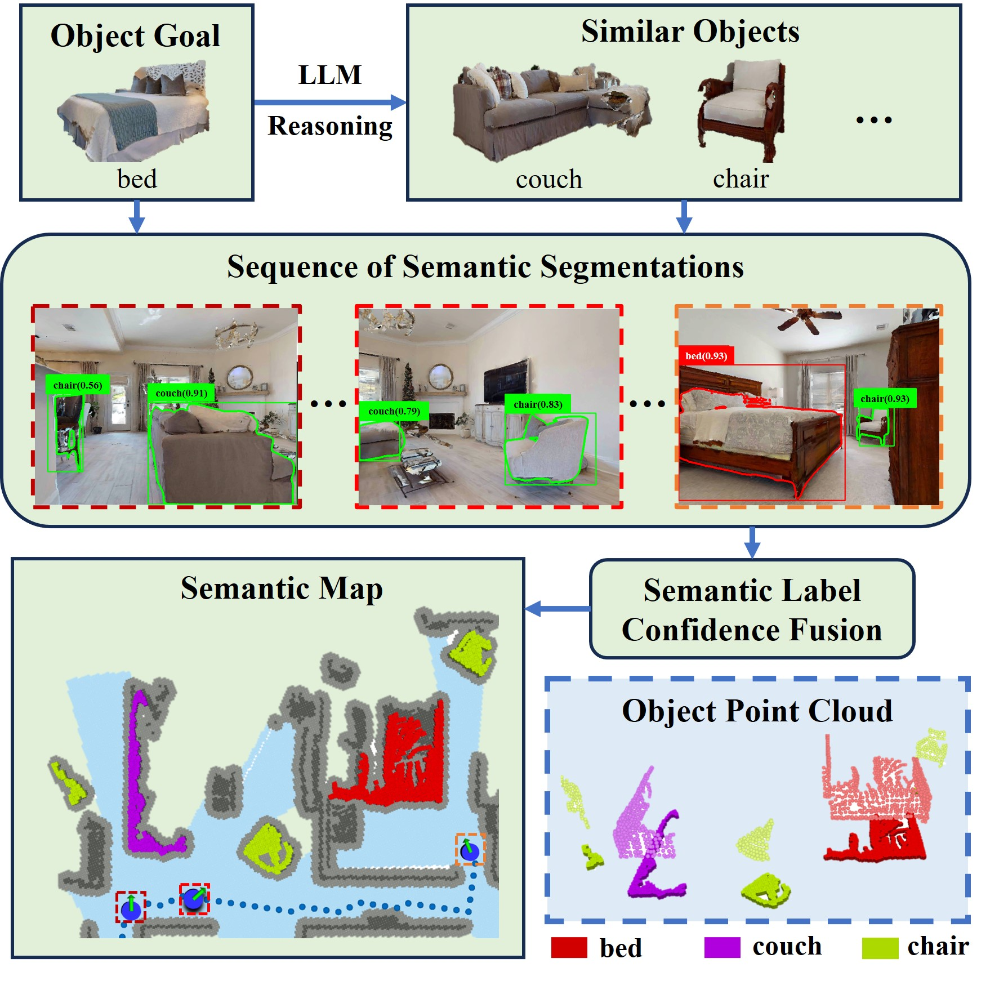
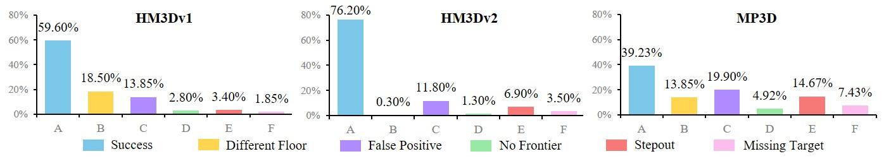

# ApexNav (arXiv 2025)

<!-- paper-source: https://chengwei920412.github.io/paper_reading/2504.14478_ApexNav_An_Adaptive_Exploration_Strategy_for_Zero_Shot_Object_Navigation_with_Target_centric_Semantic_Fusion/technical_report.html -->

> **arXiv ID**：2504.14478  
> **原文标题**：ApexNav: An Adaptive Exploration Strategy for Zero-Shot Object Navigation with Target-centric Semantic Fusion  
> **翻译日期**：2026-10-08

---

## 📋 论文概览 {#_1}

### 基本信息 {#_2}

- **作者**：Mingjie Zhang、Yuheng Du、Chengkai Wu、Jinni Zhou、Zhenchao Qi、Jun Ma、Boyu Zhou
- **机构**：香港科技大学（广州）、南方科技大学
- **发表时间**：2025 年（arXiv）
- **领域**：具身智能、零样本目标导航、语义建图、自主探索

### 核心贡献 {#_3}

1. 提出自适应探索策略，根据前沿语义得分的分布动态切换基于语义与基于几何的探索模式。
2. 在语义模式中以旅行商问题（TSP）规划高得分前沿的全局访问顺序，减少贪心策略造成的振荡与回溯。
3. 提出以目标为中心的语义融合方法，长期维护目标及相似物体的多标签置信度，利用多帧观测纠正误检测。
4. 设计兼顾效率与安全的离散动作评价机制，并在真实机器人上以连续轨迹规划替代。
5. 在 HM3Dv1、HM3Dv2 和 MP3D 上取得有竞争力的零样本结果，并完成六次真实世界测试。

图：ApexNav 总体架构。系统在“发现可靠目标”与“继续探索”之间切换，并分别调用安全航点导航或自适应探索模块。

---

## 🎯 研究背景与动机 {#_4}

### 问题定义 {#_5}

目标物体导航（ObjectNav）要求智能体仅根据目标类别，在未知环境中找到指定物体。零样本目标导航（ZSON）进一步要求系统无需针对目标类别或场景进行任务特定训练。智能体使用第一视角 RGB-D 图像与里程计，在有限动作预算内尽量以短路径抵达目标附近。

### 现有方法的局限性 {#_6}

- **持续依赖语义会降低效率**：任务初期可能只看到白墙、遮挡或与目标关联较弱的物体，语义推理此时不能提供有效方向。
- **贪心前沿选择缺少全局性**：始终追逐当前最高分前沿容易在相近候选之间振荡，并产生重复回溯。
- **单帧与最大置信度融合不稳健**：偶发的高置信度误检测会长期污染语义地图，后续正确观测也难以纠正。
- **最短路径未必安全**：离散动作沿 A\* 最短路移动时可能过于贴近障碍，碰撞会损害最终成功率。

### 本文的创新点 {#_7}

论文把探索与目标识别拆成两个可独立验证的问题：探索侧判断“当前语义是否值得信任”，识别侧判断“多帧证据是否足以把候选物体认定为目标”。这一拆分使语义信息不再被无条件使用，而是同时受到分布统计与长期观测证据的约束。

---

## 🔬 方法论 {#_8}

### 整体架构 {#_9}

系统持续构建三类地图：二维前沿地图、语义得分地图，以及保存目标/相似物体置信度的物体级语义地图。若语义融合模块产生可靠目标，系统生成物体航点；否则，自适应探索模块选择前沿航点。航点随后交给安全导航模块执行。

### 关键技术 {#_10}

#### 1. 自适应探索模式切换 {#1}

对所有前沿簇的语义得分计算最大值与均值之比 \(r\) 以及标准差 \(\sigma\)：

\[r=\frac{s_{\max}}{\bar{s}}, \qquad
\sigma=\sqrt{\frac{1}{N_f}\sum_{i=1}^{N_f}(s_i-\bar{s})^2}.\]

当 \(r&gt;r_t\) 且 \(\sigma&gt;\sigma_t\) 时，系统认为存在明显的高价值语义区域，切换到基于语义的探索；否则采用最近前沿的几何探索，以快速扩大覆盖范围。实验采用 \(r_t=1.10\)、\(\sigma_t=0.015\)。

图：同一回合中，智能体根据语义得分分布在几何模式和语义模式之间多次切换。

#### 2. 语义模式下的 TSP 规划 {#2-tsp}

系统保留高得分前沿，以智能体与前沿间的 A\* 路径长度构建非对称 TSP 代价矩阵。回到智能体节点的代价设为零，使求解结果对应从当前位置出发、访问全部高价值前沿的开放路径。LKH-Solver 给出访问顺序，系统只执行其中的下一航点并滚动重规划。

#### 3. 以目标为中心的语义融合 {#3}

LLM 离线生成目标的相似物体列表、可能出现的房间和自适应置信度阈值。在线阶段，YOLOv7 或 Grounding-DINO 负责检测，Mobile-SAM 负责分割，DBSCAN 清理点云噪声。

每个物体簇为目标及相似类别分别保存点云、置信度与累计检测体量。新观测按检测点数加权融合：

\[n_{\mathrm{new}}=n_{\mathrm{last}}+v_{\mathrm{det}},\]

\[c_{\mathrm{new}}=
\frac{n_{\mathrm{last}}}{n_{\mathrm{new}}}c_{\mathrm{last}}+
\frac{v_{\mathrm{det}}}{n_{\mathrm{new}}}c_{\mathrm{det}}.\]

若一个历史物体簇位于当前视场，却没有再次被检测到，系统将该次观测视为零置信度证据，对历史置信度施加惩罚。最终以 \(c_o n_o\) 最大的类别作为簇标签；只有目标标签置信度超过 LLM 给出的阈值时，候选才成为可靠目标。

图：多时刻语义分割结果被融合到同一物体簇中，并持续更新各候选标签的证据。

#### 4. 安全航点导航 {#4}

动作代价由三部分构成：到局部目标的距离、是否远离局部目标，以及沿动作轨迹采样得到的障碍距离惩罚。系统选择总代价最低的离散动作。真实机器人部署时使用 MINCO 生成连续无碰撞时空轨迹。

### 算法流程 {#_11}

1. 旋转初始化并更新占用栅格、前沿和语义得分地图。
2. 检测目标及相似物体，将实例点云融入物体簇。
3. 若存在可靠目标，生成物体航点；否则统计前沿得分分布。
4. 强语义线索下用 TSP 选择高分前沿，弱线索下选择最近前沿。
5. 通过效率和安全代价选择动作，执行后重复上述流程，直到成功或达到 500 步上限。

---

## 📊 实验与结果 {#_12}

### 实验设置 {#_13}

- **数据集**：HM3Dv1（2000 回合、20 场景、6 类目标）、HM3Dv2（1000 回合、36 场景、6 类目标）、MP3D（2195 回合、11 场景、21 类目标）
- **评估指标**：SR、SPL；消融实验额外使用 SoftSPL、DTG
- **主要基线**：SemExp、PONI、ZSON、CoW、ESC、L3MVN、OpenFMNav、InstructNav、VLFM、TriHelper、SG-Nav
- **仿真硬件**：RTX 4090 GPU、Intel i9-13900K CPU

### 主要结果 {#_14}

<table>
<thead>
<tr>
<th>数据集</th>
<th>ApexNav SR</th>
<th>ApexNav SPL</th>
<th>关键对比</th>
</tr>
</thead>
<tbody>
<tr>
<td>HM3Dv1</td>
<td>59.6</td>
<td>33.0</td>
<td>SR 相对 TriHelper 提升 5.5%；SPL 相对 VLFM 提升 8.6%</td>
</tr>
<tr>
<td>HM3Dv2</td>
<td>76.2</td>
<td>38.0</td>
<td>相对 VLFM，SR/SPL 分别提升 19.8%/16.9%</td>
</tr>
<tr>
<td>MP3D</td>
<td>39.2</td>
<td>17.8</td>
<td>SR 略低于 SG-Nav 的 40.2；SPL 为表中最佳</td>
</tr>
</tbody>
</table>

六次真实世界测试全部成功，平均 SPL 为 0.723，平均行进距离 15.85 m，平均用时 56 s。样本数很小，因此这些结果更适合作为可部署性验证，而不是稳健的泛化统计。

### 消融实验 {#_15}

- **探索组合**：语义模式使用 TSP、几何模式使用贪心最近前沿时表现最佳，HM3Dv2 上达到 SR 76.20、SPL 38.03、SoftSPL 40.44。
- **切换阈值**：性能随阈值呈倒 U 形；\(\sigma_t=0.015\)、\(r_t=1.10\) 最优，说明持续偏向语义或几何都会造成损失。
- **语义融合**：去除融合后，HM3Dv2 SR 从 76.20 降至 55.00；最大置信度融合只有 67.90。去除相似物体检测后，MP3D SR 从 39.23 降至 28.70。
- **安全导航**：HM3Dv2 上，相比直接沿最短路径移动，安全导航将 SR 从 66.20 提高到 76.20，并把 DTG 从 1.72 降至 1.31。

图：ApexNav 在三个数据集上的失败原因分布；误检测、跨楼层目标和步数耗尽是主要剩余问题。

---

## 💡 关键见解 {#_16}

### 理论分析 {#_17}

1. **语义的价值取决于分布而非绝对分数**：单个高分可能是异常值；同时使用最大值/均值比与标准差，可要求“突出候选”和“整体不均匀”同时成立。
2. **探索策略必须与任务终止条件匹配**：完整覆盖问题中 TSP 通常优于贪心，但 ObjectNav 找到目标即可停止；在无明显语义目标时，最近前沿反而更贴合任务目标。
3. **负观测也是证据**：候选在视场内却未被再次检测到，不应简单忽略，而应降低其置信度。这是系统从一次性识别转向序贯证据更新的关键。
4. **相似类别显式建模优于只追踪目标**：把沙发、桌子等易混淆类别纳入同一物体簇，可通过相对证据纠正目标标签。

### 实践启示 {#_18}

- 大模型最适合承担低频、可缓存的知识生成任务，而非每个导航步都在线调用。
- 将感知、探索和局部避障的失败模式分开建模，有利于逐模块消融与工程迭代。
- 成功率与 SPL 必须联合观察：高成功率未必意味着高效，高 SPL 也可能掩盖识别失败。

---

## 🔍 局限性与未来工作 {#_19}

### 当前局限 {#_20}

- 系统使用单层二维地图，难以处理目标与起点位于不同楼层的情况。
- 默认目标可直接看见，不能搜索抽屉、柜门之后等需要交互操作的位置。
- 视场经过即视为已探索，对小目标和细粒度区域不够充分。
- 当目标与周围环境的语义关联弱时，系统退回几何探索，仍可能低效。
- 目标与相似物体列表由 LLM 给出，提示偏差或类别覆盖不足可能影响融合效果。
- 真实世界实验只有六次，缺少跨建筑、跨光照和长期运行统计。

### 未来方向 {#_21}

1. 使用三维或分层拓扑地图处理楼梯、电梯与跨楼层导航。
2. 将开门、开抽屉、移动遮挡物等交互动作纳入目标搜索。
3. 引入视觉语言导航中的语言先验，改善弱语义目标的区域推断。
4. 将固定阈值切换扩展为在线不确定性估计或可学习策略，同时保持可解释性。
5. 使用时序检测器、开放词汇分割和几何一致性共同校准目标置信度。
6. 在更多真实场景开展重复试验，报告置信区间、碰撞率、恢复时间和能源消耗。

---

## 📚 相关工作对比 {#_22}

<table>
<thead>
<tr>
<th>方法</th>
<th>核心思想</th>
<th>优势</th>
<th>局限</th>
</tr>
</thead>
<tbody>
<tr>
<td>CoW</td>
<td>几何最近前沿</td>
<td>简单、无需语义推理</td>
<td>忽略室内语义线索</td>
</tr>
<tr>
<td>VLFM</td>
<td>VLM 价值地图引导前沿</td>
<td>语义引导直接、SPL 较强</td>
<td>弱线索环境中不稳定；目标识别依赖单帧</td>
</tr>
<tr>
<td>SG-Nav</td>
<td>3D 场景图提示 LLM</td>
<td>显式场景关系推理</td>
<td>仍缺少能持续纠错的目标融合机制</td>
</tr>
<tr>
<td>TriHelper</td>
<td>动态辅助与 VLM 验证</td>
<td>改善目标确认</td>
<td>验证成本与复杂度较高</td>
</tr>
<tr>
<td><strong>ApexNav</strong></td>
<td>自适应语义/几何探索 + 多帧目标中心融合</td>
<td>同时提高探索效率与识别可靠性；模块化且可解释</td>
<td>依赖单层 2D 地图、固定阈值与目标可见假设</td>
</tr>
</tbody>
</table>

---

## 🎓 评价 {#_23}

### 优点 {#_24}

- 问题拆解清晰，三个主要模块均有针对性消融。
- 方法主要由可解释的统计量和融合规则构成，便于调试与真实部署。
- 不只报告成功率，还用 SPL、SoftSPL、DTG 和失败原因说明性能来源。
- 仿真基准覆盖三套数据，且提供真实机器人实验作为工程闭环。

### 可改进之处 {#_25}

- 模式切换阈值依赖数据集调参，论文尚未充分验证跨场景迁移时的敏感性。
- 融合权重以点数近似检测体量，可能受到距离、遮挡、深度噪声和实例尺寸的系统性偏差影响。
- 与不同基线的感知器、局部规划器和 PointNav 组件并非完全一致，仍可能存在实现差异带来的比较偏差。
- 真实世界实验规模不足以支持强统计结论，也未报告失败恢复或长时间运行稳定性。

### 推荐阅读对象 {#_26}

适合从事具身智能、移动机器人、语义建图、开放词汇感知和自主探索的研究者与工程师。尤其适合关注“如何把大模型先验嵌入传统导航栈，同时保留实时性与可解释性”的读者。

---

## 📎 附录 {#_27}

### 术语表 {#_28}

<table>
<thead>
<tr>
<th>英文</th>
<th>中文</th>
</tr>
</thead>
<tbody>
<tr>
<td>Zero-Shot Object Navigation (ZSON)</td>
<td>零样本目标导航</td>
</tr>
<tr>
<td>Adaptive Exploration Strategy</td>
<td>自适应探索策略</td>
</tr>
<tr>
<td>Target-centric Semantic Fusion</td>
<td>以目标为中心的语义融合</td>
</tr>
<tr>
<td>Frontier Map</td>
<td>前沿地图</td>
</tr>
<tr>
<td>Semantic Score Map</td>
<td>语义得分地图</td>
</tr>
<tr>
<td>Reliable / Suspected Target</td>
<td>可靠目标 / 疑似目标</td>
</tr>
<tr>
<td>Success Rate (SR)</td>
<td>成功率</td>
</tr>
<tr>
<td>Success weighted by Path Length (SPL)</td>
<td>按路径长度加权的成功率</td>
</tr>
<tr>
<td>Distance to Goal (DTG)</td>
<td>距目标距离</td>
</tr>
</tbody>
</table>

### 参考资源 {#_29}

- **论文原文**：[arXiv:2504.14478](https://arxiv.org/abs/2504.14478)
- **中文翻译 PDF**：[paper_cn.pdf](https://chengwei920412.github.io/paper_reading/2504.14478_ApexNav_An_Adaptive_Exploration_Strategy_for_Zero_Shot_Object_Navigation_with_Target_centric_Semantic_Fusion/paper_cn.pdf)
- **中文 Markdown 译文**：[paper_cn.md](https://chengwei920412.github.io/paper_reading/2504.14478_ApexNav_An_Adaptive_Exploration_Strategy_for_Zero_Shot_Object_Navigation_with_Target_centric_Semantic_Fusion/paper_cn.html)
- **代码实现**：[Robotics-STAR-Lab/ApexNav](https://github.com/Robotics-STAR-Lab/ApexNav)
- **项目主页**：论文未提供独立项目主页
