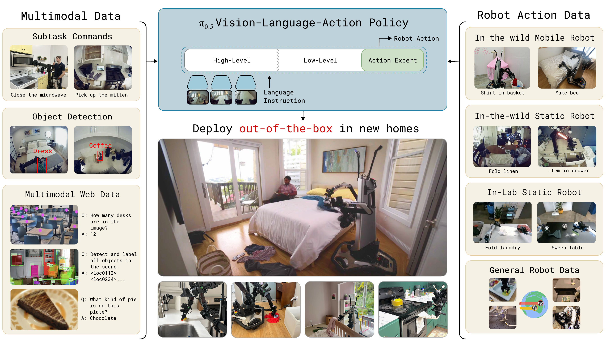
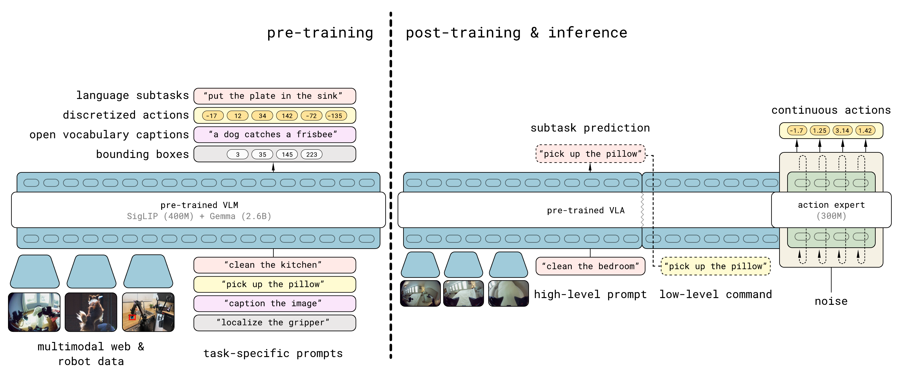
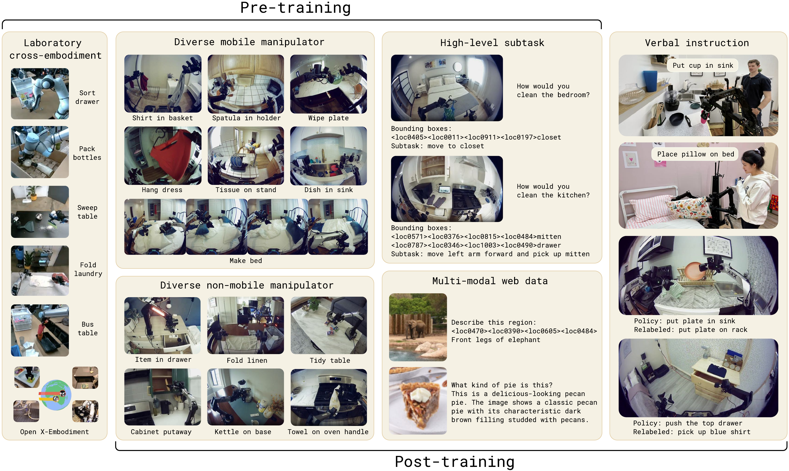
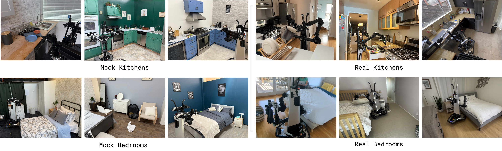
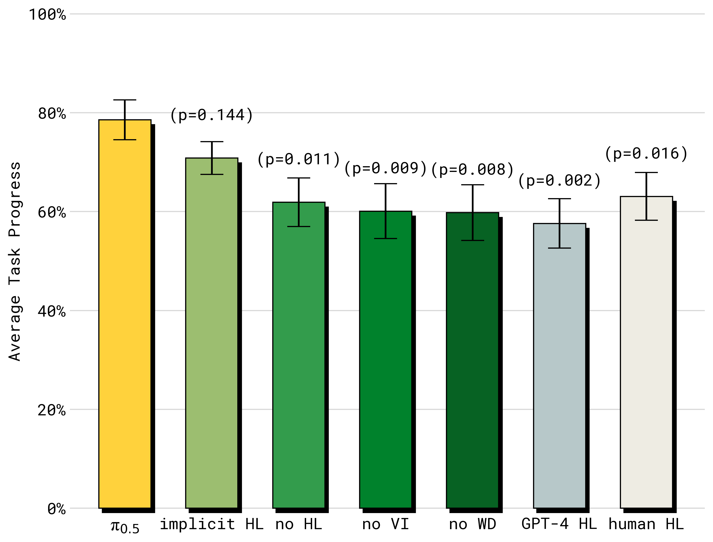

# π₀.₅ (arXiv 2025)

<!-- paper-source: https://chengwei920412.github.io/paper_reading/2504.16054_pi_0_5_a_Vision_Language_Action_Model_with_Open_World_Generalization/technical_report.html -->

> **arXiv ID**：2504.16054  
> **原文标题**：\(\pi_{0.5}\): a Vision-Language-Action Model with Open-World Generalization  
> **作者**：Physical Intelligence  
> **翻译日期**：2026-08-21

## 论文概览 {#_1}

本文研究视觉-语言-动作模型（VLA）能否离开训练环境，在全新的真实家庭中完成长时程、灵巧、多阶段的移动操作任务。作者提出 \(\pi_{0.5}\)：在 \(\pi_0\) 基础上，以统一 Transformer 协同训练机器人动作、高层语义子任务、人工语言指导和网络视觉语言数据，并在推理时先预测高层子任务，再生成底层连续动作。

核心结论不是“增加目标机器人数据就足够”，而是异构数据源之间的知识迁移对开放世界泛化至关重要。模型仅使用约 400 小时目标移动操作数据，却能在训练集之外的厨房和卧室中整理物品、收拾餐具、整理床铺，并完成约 10–15 分钟的任务。

图：\(\pi_{0.5}\) 将其他机器人、高层语义预测、语言指导和网络数据中的知识迁移到真实家庭移动操作。

## 研究背景与动机 {#_2}

以往通用机器人策略主要通过扩大机器人演示数据覆盖更多任务和场景，但复杂家庭任务具有长时程、对象和布局组合爆炸、部分可观测等特点，仅靠穷举式采集难以覆盖。VLA 将图像、语言和动作统一成序列建模问题，为不同监督形式的协同训练提供了接口。

本文关注三个层次的泛化：在新对象上复用已有技能；调整或重组技能以适应新任务序列；利用语义常识判断应打开哪个抽屉、哪个物体可能是沥水架等。对应地，训练数据不能只包含目标平台动作，还应提供跨机器人本体动作经验、高层任务分解和网络语义知识。

## 方法论 {#_3}

### 统一的分层模型 {#_4}

模型表示联合分布：

\[\pi_\theta(\mathbf{a}_{t:t+H}, \hat{\ell}\mid \mathbf{o}_t,\ell)
=\pi_\theta(\mathbf{a}_{t:t+H}\mid \mathbf{o}_t,\hat{\ell})
\pi_\theta(\hat{\ell}\mid \mathbf{o}_t,\ell).\]

其中 \(\ell\) 是总体任务指令，\(\hat{\ell}\) 是模型生成的文本输出（通常为下一高层子任务），\(\mathbf{a}_{t:t+H}\) 是动作片段。高层与底层推理使用同一模型：先根据观测和总体指令生成子任务，再以子任务为条件生成连续动作。

图：两阶段训练与分层推理流程。

### 离散动作与连续动作的结合 {#_5}

预训练阶段用 FAST 将动作压缩为离散 token，以获得稳定、可扩展的自回归训练；后训练阶段加入约 3 亿参数的动作专家，以流匹配生成连续动作。联合损失由文本/FAST token 的交叉熵与流匹配误差组成：

\[\mathbb{E}\left[H(x_{1:M},f_\theta^\ell)+
\alpha\left\|\omega-\mathbf{a}_{t:t+H}-f_\theta^a(\mathbf{a}^{\tau,\omega}_{t:t+H},\mathbf{o}_t,\ell)\right\|^2\right].\]

预训练进行 28 万步，此时 \(\alpha=0\)；后训练再进行 8 万步，设置 \(\alpha=10\)。推理先自回归生成文本，再执行 10 个去噪步骤生成动作。

### 协同训练数据 {#_6}

- **MM**：约 400 小时、约 100 个真实家庭中的移动操作数据，最接近目标任务。
- **ME**：不同家庭中的非移动单臂或双臂机器人数据，提供更多环境多样性。
- **CE**：实验室内多任务、跨机器人本体数据及 OXE 数据集，提供操作技能迁移。
- **HL**：人工标注的高层子任务及相关边界框，使统一模型同时学会任务分解和动作执行。
- **WD**：图像描述、视觉问答和物体定位等网络数据，补充视觉语义与长尾对象知识。
- **VI**：专家通过语言逐步“遥控”已学习底层策略形成的语言演示，用于后训练高层决策。

图：预训练和后训练采用的数据类别。

### 机器人系统 {#_7}

实验使用两种双臂移动操作平台，每个平台配备四个相机、两条 6 自由度机械臂、平行夹爪、全向移动底盘和躯干升降机构。状态与动作空间为 18 或 19 维，模型以 50 Hz 直接输出手臂、夹爪、躯干目标姿态和底盘速度，不依赖额外轨迹规划或碰撞检测。

## 实验与主要发现 {#_8}

所有核心实验均在训练时未见的环境中进行：可控的模拟厨房/卧室用于量化比较，三个真实家庭用于最终评估。主要任务包括把物品放入抽屉、把餐具放入水槽、把衣物放进洗衣篮和整理床铺。

图：模拟评估环境与真实家庭环境。

实验支持以下判断：

- \(\pi_{0.5}\) 能在全新真实家庭中完成持续 2–5 分钟的多阶段量化任务，并可展示 10–15 分钟的整屋清理行为。
- 将训练地点从 3 个增加到 12、22、53、82 和 104 个时，任务表现、语言遵循率及对分布外对象的成功率持续提高；控制样本总量后，场景多样性本身仍有价值。
- 移除 ME 或 CE 都会明显降低性能，说明来自其他环境和其他机器人本体的动作经验不能由目标平台中等规模数据完全替代。
- WD 对总体家庭任务分数的影响未必总是统计显著，但对分布外对象的语言遵循和高层推理尤为关键。
- 完整模型明显优于 \(\pi_0\) 与仅结合 FAST/Flow 的 \(\pi_0\) 变体，表明收益并非仅来自动作表示或更多训练步数。
- 完整高层推理表现最佳；仅在训练时加入 HL、运行时不显式生成子任务的“隐式 HL”仍是很强的基线，说明子任务预测本身构成有效的辅助监督。
- VI 仅约占高层移动操作样例的 11%，移除后性能仍明显下降；零样本 GPT-4 高层策略表现更差，显示机器人领域内适配的重要性。

图：不同高层推理与数据消融方案的比较。

## 批判性评价 {#_9}

### 优点 {#_10}

1. 评估环境与训练环境严格分离，且包含真实家庭，证据比在训练布置附近测试更有说服力。
2. 消融同时覆盖场景数量、跨机器人本体数据、网络数据、高层监督和模型基线，较好地区分了数据多样性与架构收益。
3. 同一模型兼任高层与底层策略，避免两个独立模型之间的接口误差，并允许网络语义知识进入动作系统。
4. 离散 FAST 预训练与连续流匹配后训练兼顾训练效率、语言能力和实时控制。

### 局限 {#_11}

1. 论文展示的是真实但仍受控的家庭任务集合；能否推广到更开放的任务表达、安全约束和多人动态环境尚未验证。
2. 约 400 小时目标平台数据与大量内部异构数据仍是较高门槛，数据规模、清洗和标注成本不易复现。
3. 系统没有额外碰撞检测或轨迹规划，端到端控制的安全边界、失败恢复和硬件磨损分析不足。
4. 高层推理仍可能反复开关抽屉或被局部场景干扰；有限上下文也不利于跨房间记忆和长程导航。
5. 若缺少公开训练数据配比、完整代码与检查点，外部研究者难以严格复现各项消融。

## 未来方向 {#_12}

- 引入持久记忆与更长上下文，支持跨房间导航、物体位置记忆和任务恢复。
- 用人工反馈或合成标注扩展复杂偏好、约束和多轮指令。
- 研究语言指导之外的在线监督，例如示范纠正、失败解释和安全介入。
- 在动态家庭、陌生硬件、更多机器人本体和更长时间跨度上验证开放世界泛化。
- 将端到端策略与安全监控、碰撞约束或可验证控制层结合。

## 术语表 {#_13}

<table>
<thead>
<tr>
<th>英文</th>
<th>中文</th>
</tr>
</thead>
<tbody>
<tr>
<td>Open-world generalization</td>
<td>开放世界泛化</td>
</tr>
<tr>
<td>Vision-Language-Action model (VLA)</td>
<td>视觉-语言-动作模型</td>
</tr>
<tr>
<td>Co-training</td>
<td>协同训练</td>
</tr>
<tr>
<td>High-level subtask</td>
<td>高层子任务</td>
</tr>
<tr>
<td>Flow matching</td>
<td>流匹配</td>
</tr>
<tr>
<td>Action expert</td>
<td>动作专家</td>
</tr>
<tr>
<td>Cross-embodiment</td>
<td>跨机器人本体</td>
</tr>
<tr>
<td>Language following</td>
<td>语言指令遵循</td>
</tr>
</tbody>
</table>

## 参考资源 {#_14}

- **论文原文**：[arXiv 2504.16054](https://arxiv.org/abs/2504.16054)
- **中文翻译 PDF**：[paper_cn.pdf](https://chengwei920412.github.io/paper_reading/2504.16054_pi_0_5_a_Vision_Language_Action_Model_with_Open_World_Generalization/paper_cn.pdf)
- **中文 Markdown 译文**：[paper_cn.md](https://chengwei920412.github.io/paper_reading/2504.16054_pi_0_5_a_Vision_Language_Action_Model_with_Open_World_Generalization/paper_cn.html)
- **项目介绍**：[Physical Intelligence：\(\pi_{0.5}\)](https://www.pi.website/blog/pi05)

---

**报告生成说明**：本报告依据论文 LaTeX 源码、完整中文译文和编译后的中文 PDF 整理；评价部分为对论文证据与复现条件的独立分析。
