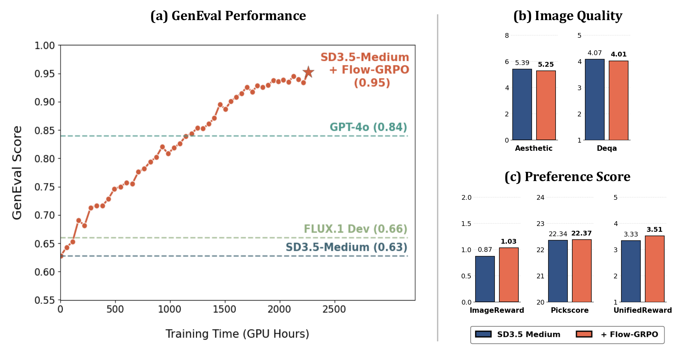
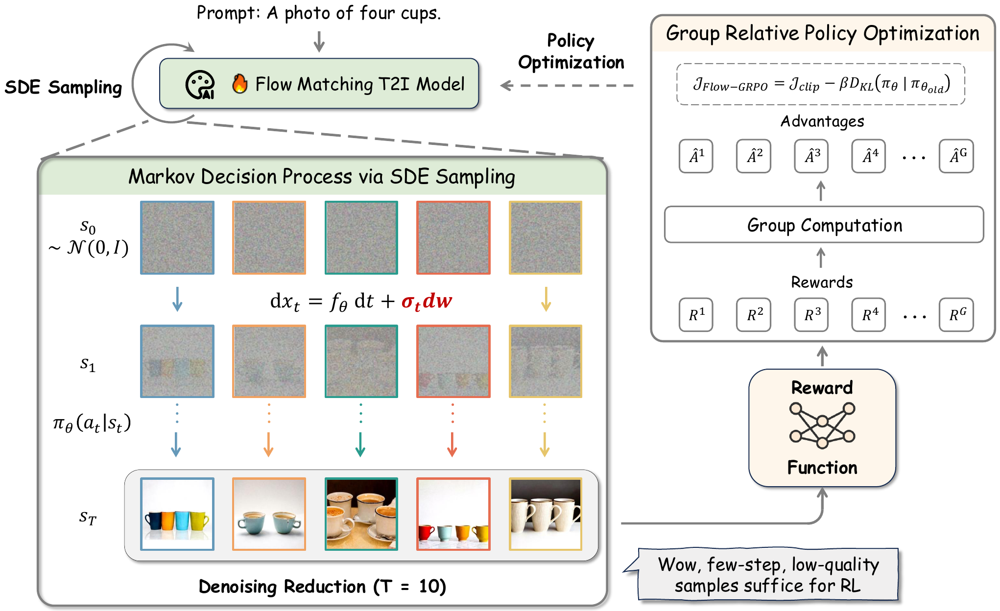
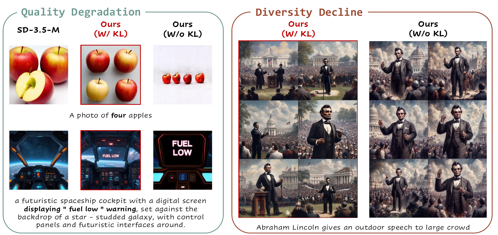

# Flow-GRPO (arXiv 2025)

<!-- paper-source: https://chengwei920412.github.io/paper_reading/2505.05470_Flow_GRPO_Training_Flow_Matching_Models_via_Online_RL/technical_report.html -->

> 原文链接：[Flow-GRPO (arXiv 2025)](https://chengwei920412.github.io/paper_reading/2505.05470_Flow_GRPO_Training_Flow_Matching_Models_via_Online_RL/technical_report.html)

> **arXiv ID**: 2505.05470  
> **原文标题**: Flow-GRPO: Training Flow Matching Models via Online RL  
> **翻译日期**: 2026-10-12

---

## 📋 论文概览 {#_1}

### 基本信息 {#_2}

- **作者**: Jie Liu、Gongye Liu、Jiajun Liang、Yangguang Li、Jiaheng Liu、Xintao Wang、Pengfei Wan、Di Zhang、Wanli Ouyang
- **机构**: 香港中文大学 MMLab、清华大学、快手科技可灵团队、南京大学、上海人工智能实验室
- **发表时间**: 2025
- **领域**: 文生图生成、流匹配、在线强化学习、生成模型对齐

### 核心贡献 {#_3}

1. 首次将群体相对策略优化（Group Relative Policy Optimization，GRPO）形式的在线策略梯度强化学习引入流匹配模型，并把迭代去噪过程表述为多步马尔可夫决策过程。
2. 提出 ODE-to-SDE 转换：将确定性概率流 ODE 改写为与原过程在各时刻具有相同边缘分布的随机 SDE，使轨迹转移概率可计算，并为策略探索注入随机性。
3. 提出去噪缩减：训练采样仅使用 10 个去噪步，推理恢复 40 步，在三个任务上获得超过 \(4\times\) 的训练加速，同时保持最终奖励。
4. 通过相对优势、策略比率截断与 KL 正则化联合优化，使模型在提高目标能力的同时抑制图像质量下降和多样性崩溃。
5. 在组合图像生成、视觉文本渲染和人类偏好对齐上验证通用性：SD3.5-M 的 GenEval 总分由 0.63 提升至 0.95，OCR 准确率由 0.59 提升至 0.92，并在多项 DrawBench 图像质量与偏好指标上维持或改善性能。

图：Flow-GRPO 训练期间，GenEval 性能持续上升并超过 GPT-4o；DrawBench 图像质量大体保持，人类偏好得分提高。

---

## 🎯 研究背景与动机 {#_4}

### 问题定义 {#_5}

流匹配已成为 SD3、FLUX 等先进图像生成系统的重要基础。它直接学习连续时间速度场，通过求解 ODE 将噪声映射为数据，采样步数通常少于传统扩散模型。然而，现有流匹配模型仍不擅长复杂组合约束与视觉文本渲染，例如准确控制物体数量、颜色、空间关系和属性绑定。

在线强化学习能从模型当前策略生成的样本中持续探索，并依据可验证奖励或偏好奖励更新策略。论文要解决的问题是：如何让确定性的流匹配采样器支持在线策略梯度更新，并将采样成本控制在可接受范围内，同时避免模型只追逐奖励而损害图像质量或多样性。

### 现有方法的局限性 {#_6}

- **确定性与探索冲突**：给定初始噪声后，ODE 采样轨迹确定；GRPO 则需要随机转移产生多样化轨迹，并计算 \(p_\theta(\mathbf{x}_{t-1}\mid\mathbf{x}_t,\mathbf{c})\) 的策略比率。
- **在线数据收集昂贵**：高质量流模型需要多步去噪，每次参数更新前都要在线生成一组图像，采样开销随模型规模和时间步数增长。
- **离线偏好优化受数据限制**：Flow-DPO 等方法依赖固定偏好对；在线方法能够持续使用更新后的策略收集更有信息量的数据。论文实验也显示在线 DPO 优于离线 DPO。
- **奖励投机**：只优化计数、OCR 或偏好分数，可能导致图像质量下降、风格单一或不同随机种子生成近乎相同的图像。
- **既有随机化方案适配成本高**：同期文本转语音工作通过同时预测速度均值与方差引入随机性，需要重新训练预训练模型；Flow-GRPO 的 ODE-to-SDE 直接利用既有速度模型。

### 本文的创新点 {#_7}

Flow-GRPO 的关键不是简单把 GRPO 损失套到图像模型上，而是补齐在线策略优化所需的随机动力学与高效轨迹采集机制：

1. 从 Fokker--Planck 方程出发构造与原 ODE 共享边缘分布的 SDE，再推导其逆时间采样形式。
2. 对整流流利用“分数--速度”关系消去额外分数网络，仅用原速度场即可实现随机采样。
3. 通过 Euler--Maruyama 离散化得到高斯转移策略，因此策略概率比与 KL 散度均可直接计算。
4. 训练时允许轨迹样本质量较低，只要同组样本仍能提供可靠的相对奖励顺序；推理时再恢复完整步数。这一观察使在线 RL 的采样质量要求与最终生成质量解耦。

---

## 🔬 方法论 {#_8}

### 整体架构 {#_9}

Flow-GRPO 包含三段相互配合的流程：

1. **随机轨迹采样**：将预训练流模型的 ODE 采样器转换为边缘分布等价的 SDE 采样器，并使用不同初始噪声与逐步噪声探索轨迹空间。
2. **高效在线数据收集**：对每条提示词生成一组 \(G\) 个样本，训练轨迹只运行 \(T=10\) 步，而非推理时的 \(T=40\) 步。
3. **GRPO 策略更新**：根据终态图像奖励计算组内标准化优势，使用截断策略比更新速度模型，并以参考模型上的 KL 项限制策略漂移。

图：Flow-GRPO 方法概览。ODE-to-SDE 提供随机探索，去噪缩减降低在线轨迹采集成本，GRPO 根据组内相对奖励更新策略。

### 关键技术 {#_10}

#### 1. 将去噪过程建模为 MDP {#1-mdp}

状态、动作与策略定义为：

\[\mathbf{s}_t=(\mathbf{c},t,\mathbf{x}_t),\qquad \mathbf{a}_t=\mathbf{x}_{t-1},\qquad \pi_\theta(\mathbf{a}_t\mid\mathbf{s}_t)=p_\theta(\mathbf{x}_{t-1}\mid\mathbf{x}_t,\mathbf{c}).\]

奖励只在最终生成图像上给出：\(R(\mathbf{s}_t,\mathbf{a}_t)=r(\mathbf{x}_0,\mathbf{c})\)（\(t=0\)），其余步骤为 0。这样，一次完整去噪对应一条 RL 轨迹。

#### 2. 群体相对优势与截断更新 {#2}

对同一提示词采样 \(G\) 张图像，使用组内均值和标准差归一化奖励：

\[\hat A_t^i=\frac{R(\mathbf{x}_0^i,\mathbf{c})-\operatorname{mean}_{j=1}^{G}R(\mathbf{x}_0^j,\mathbf{c})}{\operatorname{std}_{j=1}^{G}R(\mathbf{x}_0^j,\mathbf{c})}.\]

每一步的策略比率为

\[r_t^i(\theta)=\frac{p_\theta(\mathbf{x}_{t-1}^i\mid\mathbf{x}_t^i,\mathbf{c})}{p_{\theta_{\mathrm{old}}}(\mathbf{x}_{t-1}^i\mid\mathbf{x}_t^i,\mathbf{c})}.\]

Flow-GRPO 使用类似 PPO 的截断目标，同时加入参考策略 KL 惩罚：

\[\mathcal{J}(\theta)=\mathbb{E}\!\left[\frac{1}{GT}\sum_{i=1}^{G}\sum_{t=0}^{T-1}\left(\min\!\left(r_t^i\hat A_t^i,\operatorname{clip}(r_t^i,1-\varepsilon,1+\varepsilon)\hat A_t^i\right)-\beta D_{\mathrm{KL}}(\pi_\theta\Vert\pi_{\mathrm{ref}})\right)\right].\]

GRPO 无需训练与策略网络规模相近的价值网络，比 PPO 更节省显存；组内相对奖励也使它适合只有终态奖励的图像生成任务。

#### 3. ODE-to-SDE {#3-ode-to-sde}

原始流模型满足确定性动力学 \(\mathrm{d}\mathbf{x}_t=\mathbf{v}_t(\mathbf{x}_t)\mathrm{d}t\)。论文构造的逆时间 SDE 为

\[\mathrm{d}\mathbf{x}_t=\left(\mathbf{v}_t(\mathbf{x}_t)-\frac{\sigma_t^2}{2}\nabla\log p_t(\mathbf{x}_t)\right)\mathrm{d}t+\sigma_t\mathrm{d}\mathbf{w}.\]

附录通过 Fokker--Planck 方程证明，其前向随机过程与原 ODE 具有相同边缘密度演化。对整流流 \(\mathbf{x}_t=(1-t)\mathbf{x}_0+t\mathbf{x}_1\)，分数与速度满足

\[\nabla\log p_t(\mathbf{x})=-\frac{\mathbf{x}}{t}-\frac{1-t}{t}\mathbf{v}_t(\mathbf{x}),\]

因而无需额外训练分数网络。代入后得到

\[\mathrm{d}\mathbf{x}_t=\left[\mathbf{v}_t(\mathbf{x}_t)+\frac{\sigma_t^2}{2t}\left(\mathbf{x}_t+(1-t)\mathbf{v}_t(\mathbf{x}_t)\right)\right]\mathrm{d}t+\sigma_t\mathrm{d}\mathbf{w}.\]

#### 4. Euler--Maruyama 更新与闭式 KL {#4-euler-maruyama-kl}

实际采样使用以下离散更新：

\[\mathbf{x}_{t+\Delta t}=\mathbf{x}_t+\left[\mathbf{v}_\theta(\mathbf{x}_t,t)+\frac{\sigma_t^2}{2t}\left(\mathbf{x}_t+(1-t)\mathbf{v}_\theta(\mathbf{x}_t,t)\right)\right]\Delta t+\sigma_t\sqrt{\Delta t}\,\epsilon,\]

其中 \(\epsilon\sim\mathcal{N}(0,\mathbf{I})\)，噪声调度为 \(\sigma_t=a\sqrt{t/(1-t)}\)。该转移是各向同性高斯分布，策略与参考策略间的 KL 可化为速度场差异：

\[D_{\mathrm{KL}}(\pi_\theta\Vert\pi_{\mathrm{ref}})=\frac{\Delta t}{2}\left(\frac{\sigma_t(1-t)}{2t}+\frac{1}{\sigma_t}\right)^2\left\|\mathbf{v}_\theta(\mathbf{x}_t,t)-\mathbf{v}_{\mathrm{ref}}(\mathbf{x}_t,t)\right\|^2.\]

#### 5. 去噪缩减与 KL 正则化 {#5-kl}

- **去噪缩减**：训练采用 \(T=10\)，推理采用 \(T=40\)。10 步和 5 步 SDE 样本可能出现颜色漂移或细节模糊，但 GRPO 只需可靠的组内相对偏好，因此低成本轨迹仍可提供有效学习信号。
- **KL 正则化**：通过限制新策略相对预训练参考模型的漂移，避免任务奖励提高时破坏通用图像生成能力。KL 并非提前停止：适当 KL 会减慢早期学习，却可在更长训练后达到与无 KL 相近的任务奖励，同时保持质量和多样性。

### 算法流程 {#_11}

1. 从训练提示词分布采样提示词 \(\mathbf{c}\)。
2. 对每条提示词使用不同初始噪声，通过 10 步 SDE 采样生成 \(G=24\) 条轨迹。
3. 用任务奖励评估终态图像：GenEval 使用物体计数、位置与颜色规则；OCR 使用归一化编辑距离；人类偏好对齐使用 PickScore。
4. 在组内标准化奖励，得到每条轨迹共享的相对优势 \(\hat A^i\)。
5. 计算新旧策略高斯转移概率比，并对每个时间步应用截断 GRPO 目标。
6. 计算当前速度场与冻结参考速度场之间的闭式 KL，根据任务设置 \(\beta\)，完成 LoRA 参数更新。
7. 重复在线采样与更新；评估和最终推理恢复 40 步采样。

---

## 📊 实验与结果 {#_12}

### 实验设置 {#_13}

- **数据集**: GenEval 官方脚本生成的组合提示词；GPT-4o 生成的 20K 条 OCR 训练提示词与 1K 条测试提示词；PickScore 人类偏好任务提示词；通用质量评估采用 DrawBench；泛化评估采用 GenEval 未见类别/未见计数与 T2I-CompBench++。
- **评估指标**: GenEval 总分及六个子任务；OCR 字符准确率；PickScore；DrawBench 上的 Aesthetic Score、DeQA、ImageReward、PickScore、UnifiedReward；附录另报告 CLIP 分数与多样性分数。
- **对比方法**: SD3.5-M、GPT-4o、Janus-Pro-7B、SANA-1.5、FLUX.1-Dev 等生成模型；SFT、Flow-RWR、Flow-DPO 及在线变体，以及 DDPO、ReFL、ORW 等对齐方法。
- **训练配置**: SD3.5-M 为主要基础模型；512 分辨率；LoRA \(r=32,\alpha=64\)；训练/评估时间步为 10/40；\(G=24\)；\(a=0.7\)；GenEval 与 OCR 的 \(\beta=0.04\)，PickScore 的 \(\beta=0.01\)；使用 24 块 NVIDIA A800 GPU。

### 主要结果 {#_14}

<table>
<thead>
<tr>
<th>任务或指标</th>
<th>基础 SD3.5-M</th>
<th>Flow-GRPO</th>
<th>结论</th>
</tr>
</thead>
<tbody>
<tr>
<td>GenEval 总分</td>
<td>0.63</td>
<td><strong>0.95</strong></td>
<td>超过 GPT-4o 的 0.84；位置从 0.24 提升至 0.99，计数从 0.50 提升至 0.95</td>
</tr>
<tr>
<td>OCR 准确率</td>
<td>0.59</td>
<td><strong>0.92</strong>（有 KL）</td>
<td>无 KL 为 0.93；KL 版本更好地保持通用质量</td>
</tr>
<tr>
<td>人类偏好任务 PickScore</td>
<td>21.72</td>
<td><strong>23.31</strong>（有 KL）</td>
<td>无 KL 为 23.41，但出现多样性崩溃</td>
</tr>
<tr>
<td>DrawBench PickScore</td>
<td>22.34</td>
<td><strong>23.53</strong>（人类偏好、有 KL）</td>
<td>偏好对齐同时提高通用提示词上的偏好得分</td>
</tr>
<tr>
<td>T2I-CompBench++ 二维空间</td>
<td>0.2850</td>
<td><strong>0.5447</strong></td>
<td>显示 GenEval 训练可迁移到不同开放世界组合关系</td>
</tr>
<tr>
<td>未见物体总体分数</td>
<td>0.64</td>
<td><strong>0.90</strong></td>
<td>训练于 60 类，评估于 20 个未见类别</td>
</tr>
<tr>
<td>未见 5--6 个物体计数</td>
<td>0.13</td>
<td><strong>0.48</strong></td>
<td>训练仅包含 2--4 个物体</td>
</tr>
<tr>
<td>未见 12 个物体计数</td>
<td>0.02</td>
<td><strong>0.12</strong></td>
<td>绝对性能仍低，但体现外推能力</td>
</tr>
</tbody>
</table>

在 GenEval 训练且使用 KL 时，DrawBench 的 Aesthetic/DeQA 分数由 5.39/4.07 变为 5.25/4.01，变化较小；ImageReward、PickScore、UnifiedReward 分别由 0.87/22.34/3.33 提升至 1.03/22.37/3.51。相比之下，无 KL 的对应结果为 4.93/2.77/0.44/21.16/2.94，表明任务准确率相同并不意味着通用质量相同。

补充实验显示方法也能迁移到 FLUX.1-Dev：Aesthetic Score 从 5.71 提升至 6.02，ImageReward 从 0.85 提升至 1.32，PickScore 从 22.62 提升至 23.97，UnifiedReward 从 3.65 提升至 3.81；DeQA 从 4.31 略降至 4.24。

### 消融实验 {#_15}

1. **去噪步数**：从 40 步减至 10 步，在三个任务上带来超过 \(4\times\) 的加速，最终奖励基本不变；继续减至 5 步并不稳定加速，有时反而更慢。
2. **噪声水平**：\(a=0.1\) 探索不足、奖励增长慢；提高至 \(a=0.7\) 可加快学习并获得最高 OCR 准确率；从 0.7 增至 1.0 不再受益，噪声过大还会破坏图像并使训练失败。
3. **群体大小**：\(G=24\) 训练稳定；\(G=12\) 或 \(G=6\) 时优势估计方差增大，训练最终崩溃。
4. **初始噪声**：每条轨迹使用不同随机初始噪声，整个训练过程的奖励高于所有轨迹复用同一初始噪声的变体。
5. **KL 正则化**：组合生成与 OCR 不加 KL 时，DrawBench 图像质量明显下降；人类偏好任务不加 KL 时，自动质量指标未下降，但不同随机种子输出趋同、风格多样性崩溃。
6. **对齐算法**：Flow-GRPO 显著优于 SFT、Flow-RWR、Flow-DPO 及其在线版本；DDPO 的奖励提升更慢且后期崩溃；在奖励可微时仍优于 ReFL。与 ORW 相比，Flow-GRPO 的 CLIP/多样性分数为 30.18/1.02，ORW 为 28.40/0.97。

图：KL 正则化抑制奖励投机；在 GenEval 与 OCR 上防止质量下降，在 PickScore 优化中防止多样性崩溃。

---

## 💡 关键见解 {#_16}

### 理论分析 {#_17}

1. **同边缘分布不等于同路径分布**：ODE-to-SDE 保持每个时刻的边缘密度，却引入不同的随机路径。这恰好满足在线 RL 的需要——保留预训练模型的分布基础，同时扩展可探索的轨迹集合。
2. **速度模型隐式包含分数信息**：在线性整流流中，\(\nabla\log p_t\) 可由 \(\mathbf{x}_t\) 与 \(\mathbf{v}_t\) 代数恢复，因此随机化不要求训练第二个分数网络。
3. **高斯转移使策略优化可计算**：Euler--Maruyama 更新把每一步变为均值由速度场决定、方差由 \(\sigma_t\) 决定的高斯策略，从而避免确定性 ODE 中昂贵的散度估计。
4. **组相对学习降低了对绝对样本质量的要求**：只要低步数生成的同组样本仍能被奖励可靠排序，模糊或带伪影的中间训练图像也能提供有效梯度。
5. **KL 控制的是路径级策略漂移**：闭式 KL 最终等价于带时间依赖权重的速度场差异惩罚，比仅监测终态奖励或提前停止更直接。

### 实践启示 {#_18}

- 将确定性生成器用于在线 RL 时，首要问题不是更换奖励，而是构造可计算、可探索的随机策略。
- 在线轨迹的采样精度可低于部署时推理精度；训练和推理使用不同步数，是降低生成式 RL 成本的有效手段。
- 噪声、组大小与 KL 系数共同决定偏差--方差--探索权衡：噪声或组太小会探索不足/优势估计不准，噪声过大又会破坏可学习信号。
- 任务奖励必须与通用质量指标共同监测。GenEval 从 0.63 提升到 0.95 时，有 KL 与无 KL 的任务分数相同，但通用质量差异很大。
- 非可微奖励并非障碍。GRPO 只使用奖励标量，可接入规则、OCR、PickScore，未来也可接入具备结构化评估能力的视觉语言模型。

---

## 🔍 局限性与未来工作 {#_19}

### 当前局限 {#_20}

- 主要实验集中于 512 分辨率的 T2I 模型，以 SD3.5-M 为核心；FLUX.1-Dev 仅提供补充结果，跨架构、跨分辨率结论仍需更广泛验证。
- 在线训练使用 24 块 NVIDIA A800 GPU。去噪缩减降低了轨迹成本，但整体资源门槛仍高。
- 理论上的边缘分布等价针对连续时间过程；实际 10 步或 5 步 Euler--Maruyama 离散化会引入颜色漂移与细节模糊。
- 奖励和评估大量依赖自动规则与奖励模型。论文未报告覆盖全部任务的大规模新人工盲测，模型奖励的偏差仍可能传递给训练结果。
- KL 正则化会延缓训练，且作者指出某些提示词仍偶尔出现奖励投机；它是有效缓解手段，而非完整保证。
- 未见 12 物体计数虽从 0.02 提升到 0.12，但绝对水平仍低，说明远距离组合外推尚未解决。

### 未来方向 {#_21}

1. 扩展到视频生成，研究物理真实性、时序平滑性、身份一致性与文本对齐等多奖励联合优化。
2. 使用物体检测器、跟踪器和更强视觉语言模型设计细粒度、可解释的奖励，并研究奖励校准与不确定性。
3. 开发自适应噪声调度、动态组大小和按时间步分配的 KL 权重，在探索充分性与样本质量间自动平衡。
4. 研究更高阶随机微分方程求解器，减少低步数离散化误差，使轨迹采集进一步加速。
5. 将在线 RL 与蒸馏结合，使训练得到的策略在推理时也能用更少步数保持质量，而不仅训练阶段降步。
6. 建立更强的奖励投机诊断，包括人工盲测、跨奖励模型评估、样式/语义多样性测量及分布外提示词压力测试。

---

## 📚 相关工作对比 {#_22}

<table>
<thead>
<tr>
<th>方法</th>
<th>核心思想</th>
<th>优势</th>
<th>劣势</th>
</tr>
</thead>
<tbody>
<tr>
<td>SFT / Flow-RWR</td>
<td>选择高奖励样本监督微调，或按奖励加权最大化似然</td>
<td>简单稳定，不要求计算策略梯度</td>
<td>利用低奖励样本的信息有限；RWR 在本文在线实验中没有明显提升</td>
</tr>
<tr>
<td>Flow-DPO / Online DPO</td>
<td>从同组样本构造 chosen/rejected 对，优化偏好损失</td>
<td>无需显式奖励梯度；在线版本优于固定离线数据</td>
<td>对二元样本对与 \(\beta\) 敏感，\(\beta\) 过小可能训练崩溃；实验性能低于 Flow-GRPO</td>
</tr>
<tr>
<td>DDPO</td>
<td>把去噪链视为策略，用策略梯度优化扩散模型</td>
<td>可直接使用不可微终态奖励</td>
<td>原本面向扩散骨干；适配流模型后在本文实验中提升慢且后期崩溃</td>
</tr>
<tr>
<td>ReFL</td>
<td>将可微奖励的梯度反传到后期去噪时间步</td>
<td>目标直接、实现清晰</td>
<td>必须使用可微奖励，难以直接接入规则或通用 VLM 评价</td>
</tr>
<tr>
<td>ORW</td>
<td>在线奖励加权回归，并用 Wasserstein-2 正则维持多样性</td>
<td>在线收集数据，显式考虑分布稳定性</td>
<td>需要调节多项正则与更新频率；本文 CLIP 与多样性结果低于 Flow-GRPO</td>
</tr>
<tr>
<td><strong>Flow-GRPO</strong></td>
<td>ODE-to-SDE 随机化 + 组相对策略梯度 + 去噪缩减 + KL</td>
<td>支持不可微奖励；无需价值网络；在线探索强；任务与骨干可扩展</td>
<td>训练计算仍高；对噪声、组大小、KL 敏感；低步数离散轨迹质量较差</td>
</tr>
</tbody>
</table>

---

## 🎓 个人评价 {#_23}

### 优点 {#_24}

- **问题定位准确**：论文识别出“确定性 ODE 无法自然支持在线策略探索与概率比计算”这一真正的接口障碍，而不只是提出新的奖励函数。
- **理论与工程闭环完整**：从边缘分布等价的 SDE 推导，到高斯转移、闭式 KL、10 步采样和多任务实验，方法链条相互支撑。
- **实验结果幅度大且覆盖奖励类型多**：GenEval 从 0.63 到 0.95，OCR 从 0.59 到 0.92，同时覆盖规则奖励与模型奖励。
- **奖励投机分析有说服力**：不仅报告任务分数，还用多种 DrawBench 指标、视觉多样性和有/无 KL 曲线说明高奖励可能掩盖质量退化。
- **泛化证据较丰富**：除已见 GenEval 类别外，还测试未见类别、未见数量、T2I-CompBench++ 与 FLUX.1-Dev。

### 可改进之处 {#_25}

- 需要更系统地报告训练吞吐、GPU 小时、峰值显存和相对各基线的总成本，才能完整量化“超过 \(4\times\)”在端到端训练中的实际收益。
- 应增加大规模人工偏好评测，验证 PickScore、ImageReward、UnifiedReward 等自动指标的一致性，并防止对奖励模型集合的共同偏差过拟合。
- 可进一步分离初始噪声随机性与逐时间步 SDE 噪声各自的贡献，并报告不同求解器和时间离散误差。
- 对 \(G\)、\(a\)、\(\beta\) 的稳定区域可给出更全面的二维或三维敏感性分析，帮助复现者迁移到其他骨干与分辨率。
- 视频方向的讨论合理，但尚无实证；时间一致性奖励、显存成本和长轨迹信用分配可能产生与图像任务不同的新问题。

### 推荐阅读对象 {#_26}

- 研究扩散模型、流匹配、整流流和随机微分方程的生成模型研究者。
- 关注 RLHF、GRPO、在线偏好优化和不可微奖励优化的强化学习研究者。
- 希望提升文生图组合遵循、OCR 渲染或人类偏好对齐能力的工程团队。
- 研究奖励投机、生成多样性及自动评估可靠性的评测人员。

---

## 📎 附录 {#_27}

### 重要公式 {#_28}

**1. 整流流插值与流匹配目标**

\[\mathbf{x}_t=(1-t)\mathbf{x}_0+t\mathbf{x}_1,\]

\[\mathcal{L}(\theta)=\mathbb{E}_{t,\mathbf{x}_0,\mathbf{x}_1}\left[\left\|\mathbf{x}_1-\mathbf{x}_0-\mathbf{v}_\theta(\mathbf{x}_t,t)\right\|^2\right].\]

**2. 组内相对优势**

\[\hat A^i=\frac{R_i-\operatorname{mean}(R_1,\ldots,R_G)}{\operatorname{std}(R_1,\ldots,R_G)}.\]

它无需额外价值网络，但依赖足够大的 \(G\) 获得稳定估计。

**3. 边缘分布等价的逆时间 SDE**

\[\mathrm{d}\mathbf{x}_t=\left(\mathbf{v}_t-\frac{\sigma_t^2}{2}\nabla\log p_t\right)\mathrm{d}t+\sigma_t\mathrm{d}\mathbf{w}.\]

**4. 整流流的分数--速度关系**

\[\nabla\log p_t(\mathbf{x})=-\frac{\mathbf{x}}{t}-\frac{1-t}{t}\mathbf{v}_t(\mathbf{x}).\]

**5. Euler--Maruyama 策略更新**

\[\mathbf{x}_{t+\Delta t}=\mathbf{x}_t+\left[\mathbf{v}_\theta+\frac{\sigma_t^2}{2t}\bigl(\mathbf{x}_t+(1-t)\mathbf{v}_\theta\bigr)\right]\Delta t+\sigma_t\sqrt{\Delta t}\,\epsilon.\]

### 术语表 {#_29}

<table>
<thead>
<tr>
<th>英文术语</th>
<th>中文释义</th>
<th>本文中的作用</th>
</tr>
</thead>
<tbody>
<tr>
<td>Flow Matching</td>
<td>流匹配</td>
<td>通过回归速度场学习噪声与数据间的连续输运</td>
</tr>
<tr>
<td>Rectified Flow</td>
<td>整流流</td>
<td>使用线性路径 \(\mathbf{x}_t=(1-t)\mathbf{x}_0+t\mathbf{x}_1\) 的流匹配形式</td>
</tr>
<tr>
<td>Online Reinforcement Learning</td>
<td>在线强化学习</td>
<td>用当前策略持续采样并更新模型</td>
</tr>
<tr>
<td>Group Relative Policy Optimization (GRPO)</td>
<td>群体相对策略优化</td>
<td>用同组奖励标准化估计优势，无需价值网络</td>
</tr>
<tr>
<td>ODE-to-SDE</td>
<td>ODE-to-SDE 转换</td>
<td>将确定性流采样器改写为边缘分布等价的随机采样器</td>
</tr>
<tr>
<td>Denoising Reduction</td>
<td>去噪缩减</td>
<td>训练采样 10 步、推理 40 步，降低在线数据收集成本</td>
</tr>
<tr>
<td>Marginal Distribution</td>
<td>边缘分布</td>
<td>ODE 与所构造 SDE 在每一时刻保持一致的概率分布</td>
</tr>
<tr>
<td>Velocity Field</td>
<td>速度场</td>
<td>流模型预测的连续动力学方向 \(\mathbf{v}_\theta\)</td>
</tr>
<tr>
<td>Euler--Maruyama Discretization</td>
<td>Euler--Maruyama 离散化</td>
<td>将连续 SDE 转为可执行的高斯采样步骤</td>
</tr>
<tr>
<td>Advantage</td>
<td>优势函数</td>
<td>表示单个样本相对同组平均奖励的好坏程度</td>
</tr>
<tr>
<td>Clipping</td>
<td>截断</td>
<td>限制新旧策略概率比的更新幅度</td>
</tr>
<tr>
<td>KL Regularization</td>
<td>KL 正则化</td>
<td>约束当前策略偏离预训练参考策略，抑制奖励投机</td>
</tr>
<tr>
<td>Reward Hacking</td>
<td>奖励投机</td>
<td>奖励升高但图像质量或多样性下降</td>
</tr>
<tr>
<td>Verifiable Reward</td>
<td>可验证奖励</td>
<td>可由计数、位置、颜色或 OCR 等规则自动计算的奖励</td>
</tr>
<tr>
<td>Model-based Reward</td>
<td>基于模型的奖励</td>
<td>由 PickScore 或视觉语言模型等评价器输出的奖励</td>
</tr>
</tbody>
</table>

### 参考资源 {#_30}

- **论文原文**: [arXiv链接](https://arxiv.org/abs/2505.05470)
- **中文翻译 PDF**: [paper_cn.pdf](https://chengwei920412.github.io/paper_reading/2505.05470_Flow_GRPO_Training_Flow_Matching_Models_via_Online_RL/paper_cn.pdf)
- **中文 Markdown 译文**: [paper_cn.md](https://chengwei920412.github.io/paper_reading/2505.05470_Flow_GRPO_Training_Flow_Matching_Models_via_Online_RL/paper_cn.html)
- **代码实现**: [Flow-GRPO GitHub](https://github.com/yifan123/flow_grpo)
- **项目主页**: [Flow-GRPO Project Page](https://gongyeliu.github.io/Flow-GRPO/)
