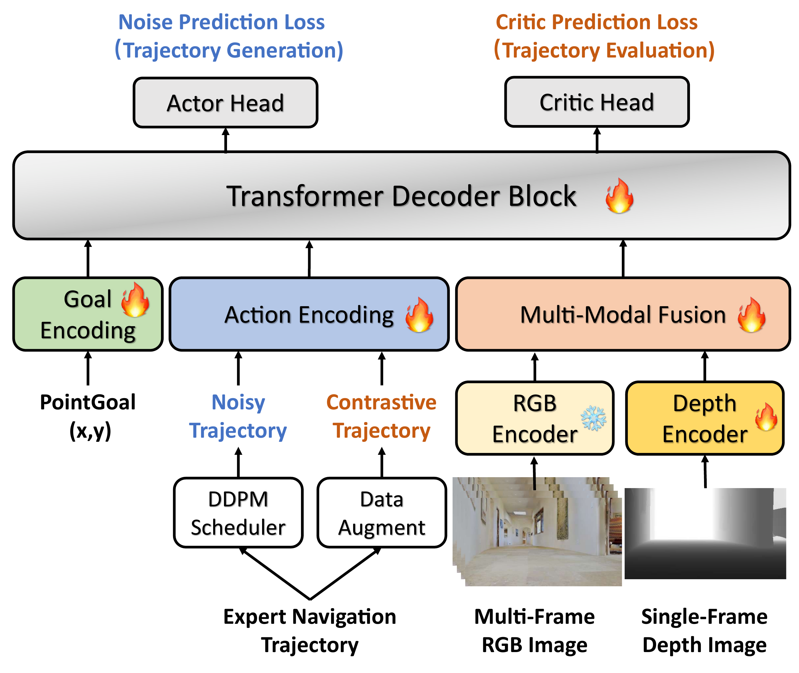

# NavDP (arXiv 2025)

<!-- paper-source: https://chengwei920412.github.io/paper_reading/2505.08712_NavDP_Learning_Sim_to_Real_Navigation_Diffusion_Policy_with_Privileged_Information_Guidance/technical_report.html -->

> **arXiv ID**: 2505.08712  
> **原文标题**: NavDP: Learning Sim-to-Real Navigation Diffusion Policy with Privileged Information Guidance  
> **翻译日期**: 2026-07-29

## 论文概览 {#_1}

### 基本信息 {#_2}

- **作者**: Wenzhe Cai, Jiaqi Peng, Yuqiang Yang, Yujian Zhang, Meng Wei, Hanqing Wang, Yilun Chen, Tai Wang, Jiangmiao Pang
- **机构**: 上海人工智能实验室、清华大学、浙江大学、香港大学
- **领域**: 机器人导航、扩散策略、仿真到真实迁移、跨本体泛化
- **项目主页/代码**: <https://wzcai99.github.io/navigation-diffusion-policy.github.io>

### 核心贡献 {#_3}

1. 提出 NavDP，一个完全使用仿真数据训练的端到端导航扩散策略，实现零样本仿真到真实迁移和跨本体泛化。
2. 将扩散式轨迹生成与 Critic 轨迹评估合并到统一 Transformer 架构中，使策略不仅能生成候选轨迹，还能基于安全性选择轨迹。
3. 利用仿真中的 ESDF 和全局规划器作为特权信息，构造可扩展的正负轨迹监督。
4. 构建大规模导航数据集，覆盖 3,154 个场景、约 1,627.1 km 轨迹、4,000 万张图像。

## 研究背景与动机 {#_4}

### 问题定义 {#_5}

目标是在动态开放世界中训练一个局部视觉导航策略，使其仅依赖 RGB-D 观测和可选目标向量，就能在不同机器人本体、相机高度、视角、室内外场景之间泛化。难点在于：真实数据昂贵且难扩展；模块化导航存在误差累积；纯模仿学习缺乏负反馈；强化学习数据效率低。

### 现有方法局限 {#_6}

- 模块化规划系统依赖建图、定位、局部规划等级联模块，延迟和误差传播会损害安全性。
- 端到端模仿学习方法依赖真实轨迹示范，难以覆盖长尾危险场景。
- 强化学习可从环境反馈学习，但训练成本高，跨本体和跨传感器泛化仍困难。
- 仅依赖单帧深度的导航模型容易受深度噪声、不规则几何和短视野规划影响。

## 方法论 {#_7}

### 整体架构 {#_8}

NavDP 由三部分组成：RGB-D 多模态编码器、统一策略 Transformer、双输出头。Actor 头负责扩散式轨迹生成，Critic 头负责对任意候选轨迹打安全分。推理时先生成多条候选轨迹，再由 Critic 选择风险最低的轨迹执行。

### 数据引擎 {#_9}

数据引擎将场景网格转成体素地图并估计 ESDF，用 A\* 生成全局路径，再通过局部 ESDF 贪心优化和三次样条插值形成平滑轨迹。相机高度、俯仰角、FOV、光照、纹理和视角均被随机化，以模拟不同机器人本体与真实环境差异。

表：数据集规模对比。

<table>
<thead>
<tr>
<th>数据集</th>
<th>场景</th>
<th>距离 (Km)</th>
<th>小时</th>
<th>图像</th>
<th>采集方式</th>
</tr>
</thead>
<tbody>
<tr>
<td>GoStanford</td>
<td>27</td>
<td>25.5</td>
<td>16.7</td>
<td>178K</td>
<td>遥操作</td>
</tr>
<tr>
<td>RECON</td>
<td>9</td>
<td>152.5</td>
<td>40</td>
<td>610K</td>
<td>自主</td>
</tr>
<tr>
<td>SCAND</td>
<td>1</td>
<td>40</td>
<td>8.7</td>
<td>100K</td>
<td>遥操作</td>
</tr>
<tr>
<td>SACSoN</td>
<td>5</td>
<td>58</td>
<td>75</td>
<td>241K</td>
<td>自主</td>
</tr>
<tr>
<td>AMR</td>
<td>54</td>
<td>-</td>
<td>-</td>
<td>7.5M</td>
<td>仿真</td>
</tr>
<tr>
<td><strong>NavDP</strong></td>
<td><strong>3154</strong></td>
<td><strong>1627.1</strong></td>
<td><strong>452</strong></td>
<td><strong>40M</strong></td>
<td>仿真</td>
</tr>
</tbody>
</table>

### 关键技术 {#_10}

- **RGB-D 融合**: 多帧 RGB 用预训练 DepthAnything 编码器提取特征，单帧深度由从头训练的 ViT 编码器处理，再用轻量 Transformer Decoder 压缩 Token。
- **统一 Transformer**: 轨迹嵌入作为 Query，RGB-D Token 和扩散时间步 Token 作为 Key/Value。生成任务和评估任务共享网络权重。
- **对比 Critic 学习**: 通过轨迹增强构造无碰撞和碰撞轨迹，并使用 ESDF 变化与安全阈值生成监督信号。
- **候选轨迹选择**: 生成阶段输出一批轨迹，评估头基于 Critic 值选择更安全轨迹，提高部署稳定性。

## 关键公式 {#_11}

Actor 的无目标与 PointGoal 轨迹生成损失分别为：

\[\mathcal{L}_{\text{act}}^{\text{ng}} = \mathbb{E}_{\tau,g,d,I\sim \mathcal{D}}[(\epsilon_{k} - \epsilon_{\theta}(\tau+\epsilon_{k+1}, k, d_{t}, I_{t-N:t}))^{2}]\]

\[\mathcal{L}_{\text{act}}^{\text{pg}} = \mathbb{E}_{\tau,g,d,I\sim \mathcal{D}}[(\epsilon_{k} - \epsilon_{\theta}(\tau+\epsilon_{k+1}, k, g_{t}, d_{t}, I_{t-N:t}))^{2}]\]

二者按权重合并：

\[\mathcal{L}_{\text{act}} = \alpha \cdot \mathcal{L}_{\text{act}}^{\text{ng}} + \beta \cdot  \mathcal{L}_{\text{act}}^{\text{pg}}\]

Critic 标签结合沿轨迹的 ESDF 变化和低于安全阈值的路点比例：

\[V(\hat{\tau}) = \gamma \cdot \sum_{m=0}^{M}(d_{\hat{\tau}}^{m+1} - d_{\hat{\tau}}^{m})+ \lambda \cdot \frac{1}{M}\sum_{m=0}^{M}\mathbb{I}(d_{\hat{\tau}}^{m} &lt; d_{safe})\]

直观理解：轨迹越靠近障碍物、越频繁进入不安全距离，Critic 值越差；因此该头为扩散模型提供了类似“反事实安全判断”的能力。

## 实验与结果 {#_12}

### 主结果 {#_13}

表：PointGoal 导航。

<table>
<thead>
<tr>
<th>方法</th>
<th>仿真 SR</th>
<th>仿真 SPL</th>
<th>真实世界 SR</th>
</tr>
</thead>
<tbody>
<tr>
<td>DD-PPO</td>
<td>8.6</td>
<td>8.5</td>
<td>-</td>
</tr>
<tr>
<td>iPlanner</td>
<td>54.1</td>
<td>51.2</td>
<td>16.7</td>
</tr>
<tr>
<td>ViPlanner</td>
<td>60.9</td>
<td>58.6</td>
<td>53.3</td>
</tr>
<tr>
<td><strong>NavDP</strong></td>
<td><strong>67.2</strong></td>
<td><strong>62.6</strong></td>
<td><strong>76.7</strong></td>
</tr>
</tbody>
</table>

表：无目标导航。

<table>
<thead>
<tr>
<th>方法</th>
<th>仿真时间</th>
<th>仿真面积</th>
<th>真实世界时间</th>
</tr>
</thead>
<tbody>
<tr>
<td>GNM</td>
<td>12.5</td>
<td>29.6</td>
<td>15.2</td>
</tr>
<tr>
<td>ViNT</td>
<td>18.9</td>
<td>46.6</td>
<td>13.1</td>
</tr>
<tr>
<td>NoMaD</td>
<td>36.6</td>
<td>85.7</td>
<td>29.3</td>
</tr>
<tr>
<td><strong>NavDP</strong></td>
<td><strong>106.2</strong></td>
<td><strong>274.1</strong></td>
<td><strong>112.9</strong></td>
</tr>
</tbody>
</table>

NavDP 在 PointGoal 仿真中比 ViPlanner 成功率高 6.3 个百分点，真实世界跨本体成功率高 23.4 个百分点；在无目标导航中，相比 NoMaD 的仿真探索时间约 2.9 倍、探索面积约 3.1 倍，真实世界探索时间约 3.8 倍。

### 消融结论 {#_14}

<table>
<thead>
<tr>
<th>变体</th>
<th>家庭成功率</th>
<th>商业成功率</th>
<th>结论</th>
</tr>
</thead>
<tbody>
<tr>
<td>w/o Depth</td>
<td>47.8</td>
<td>66.1</td>
<td>深度对尺度和避障很重要</td>
</tr>
<tr>
<td>w/o RGB</td>
<td>53.9</td>
<td>70.3</td>
<td>RGB 对语义和泛化有贡献</td>
</tr>
<tr>
<td>w/o Multiframe RGB</td>
<td>56.9</td>
<td>72.0</td>
<td>历史帧提升时间一致性</td>
</tr>
<tr>
<td>w/o Selection</td>
<td>53.1</td>
<td>65.6</td>
<td>Critic 选择显著提升安全性</td>
</tr>
<tr>
<td>w/o Augmentation</td>
<td>57.3</td>
<td>73.4</td>
<td>对比轨迹对 Critic 学习有用</td>
</tr>
<tr>
<td>w/o No-Goal</td>
<td>56.8</td>
<td>73.5</td>
<td>无目标任务是有效辅助目标</td>
</tr>
<tr>
<td><strong>原始 NavDP</strong></td>
<td><strong>60.3</strong></td>
<td><strong>74.1</strong></td>
<td>最优整体表现</td>
</tr>
</tbody>
</table>

跨本体数据消融显示，缺少高度和视角随机化时，Galaxea R1 上对桌子绕行的成功率从 90% 降到 20%，说明跨本体数据不是装饰性增强，而是模型学会“同一障碍对不同本体有不同可通行性”的关键。

## 关键见解 {#_15}

1. 仿真数据有效的前提不是只做域随机化，而是能提供真实世界难以标注的特权监督，例如全局 ESDF 和对比碰撞轨迹。
2. 扩散策略适合表达导航中的多解性，但直接采样并不保证安全；Critic 选择机制弥补了这一点。
3. 跨本体泛化需要显式覆盖传感器高度、视角和机器人通过能力差异，否则模型容易学习到单一本体的通行规则。
4. 多帧 RGB 与深度互补：RGB 提供语义和外观线索，深度提供尺度和局部几何，两者缺一都会明显掉点。

## 局限性与未来工作 {#_16}

- 论文主要聚焦局部导航，尚未提供带全局记忆的长程任务规划能力。
- 目标形式以 PointGoal 和无目标探索为主，尚未覆盖复杂自然语言目标。
- 真实世界评估集规模相对仿真仍小，尤其是极端动态人群、强反光、雨雾等场景仍需进一步验证。
- 训练成本较高，论文报告使用 32 张 A100 训练 24 小时。

未来方向包括高效后训练、自然语言目标扩展、全局记忆机制和更大规模真实部署验证。

## 术语表 {#_17}

<table>
<thead>
<tr>
<th>英文</th>
<th>中文</th>
</tr>
</thead>
<tbody>
<tr>
<td>Navigation Diffusion Policy (NavDP)</td>
<td>导航扩散策略</td>
</tr>
<tr>
<td>Sim-to-Real Transfer</td>
<td>仿真到真实迁移</td>
</tr>
<tr>
<td>Cross-Embodiment Generalization</td>
<td>跨本体泛化</td>
</tr>
<tr>
<td>Privileged Information</td>
<td>特权信息</td>
</tr>
<tr>
<td>Euclidean Signed Distance Field (ESDF)</td>
<td>欧氏符号距离场</td>
</tr>
<tr>
<td>Critic Value</td>
<td>Critic 值</td>
</tr>
<tr>
<td>PointGoal Navigation</td>
<td>PointGoal 导航</td>
</tr>
<tr>
<td>No-Goal Navigation</td>
<td>无目标导航</td>
</tr>
<tr>
<td>Domain Randomization</td>
<td>域随机化</td>
</tr>
<tr>
<td>Success Rate (SR)</td>
<td>成功率</td>
</tr>
<tr>
<td>Success Weighted by Path Length (SPL)</td>
<td>按路径长度加权的成功率</td>
</tr>
</tbody>
</table>

## 参考资源 {#_18}

- **论文原文**: [arXiv 链接](https://arxiv.org/abs/2505.08712)
- **中文翻译 PDF**: [paper_cn.pdf](https://chengwei920412.github.io/paper_reading/2505.08712_NavDP_Learning_Sim_to_Real_Navigation_Diffusion_Policy_with_Privileged_Information_Guidance/paper_cn.pdf)
- **中文 Markdown 译文**: [paper_cn.md](https://chengwei920412.github.io/paper_reading/2505.08712_NavDP_Learning_Sim_to_Real_Navigation_Diffusion_Policy_with_Privileged_Information_Guidance/paper_cn.html)
- **项目主页/代码**: <https://wzcai99.github.io/navigation-diffusion-policy.github.io>
