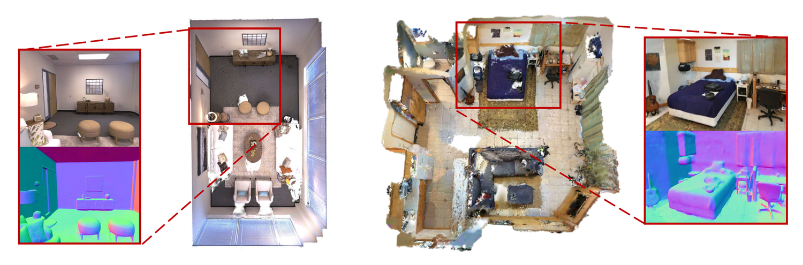
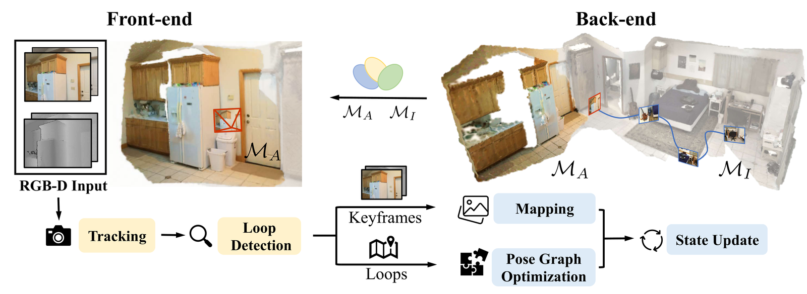
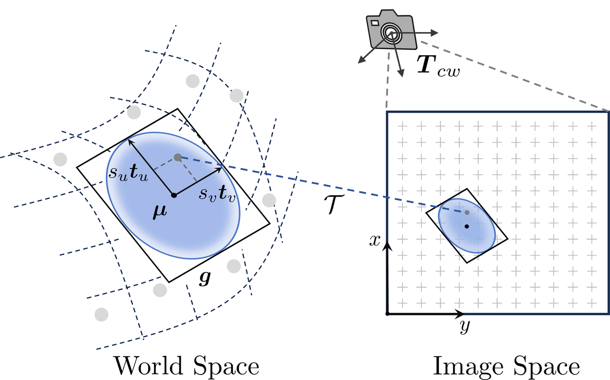
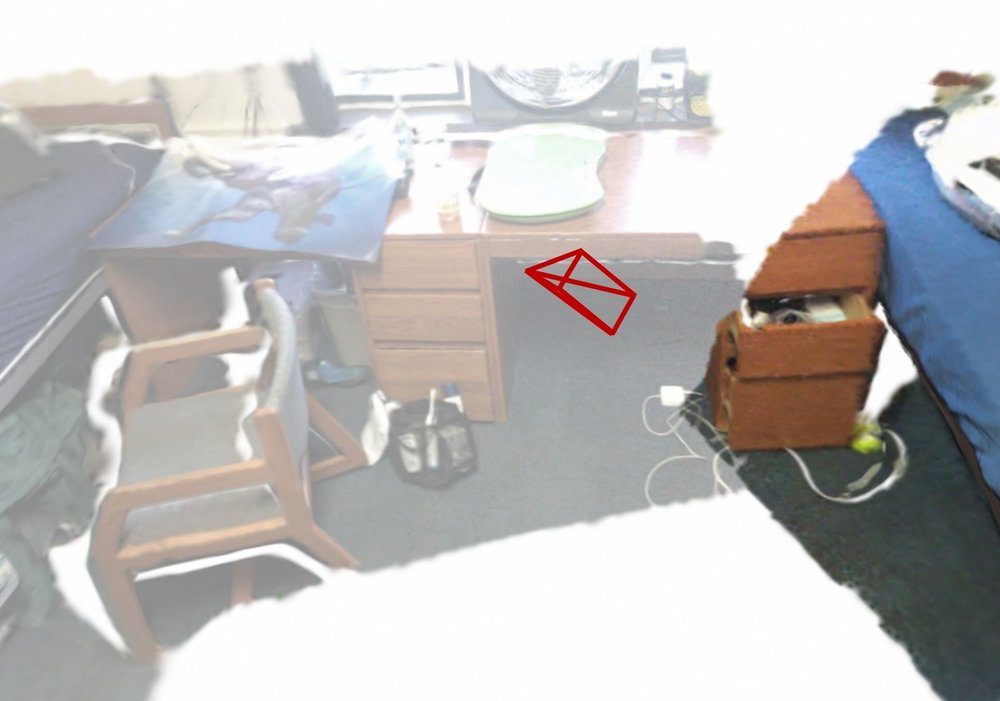
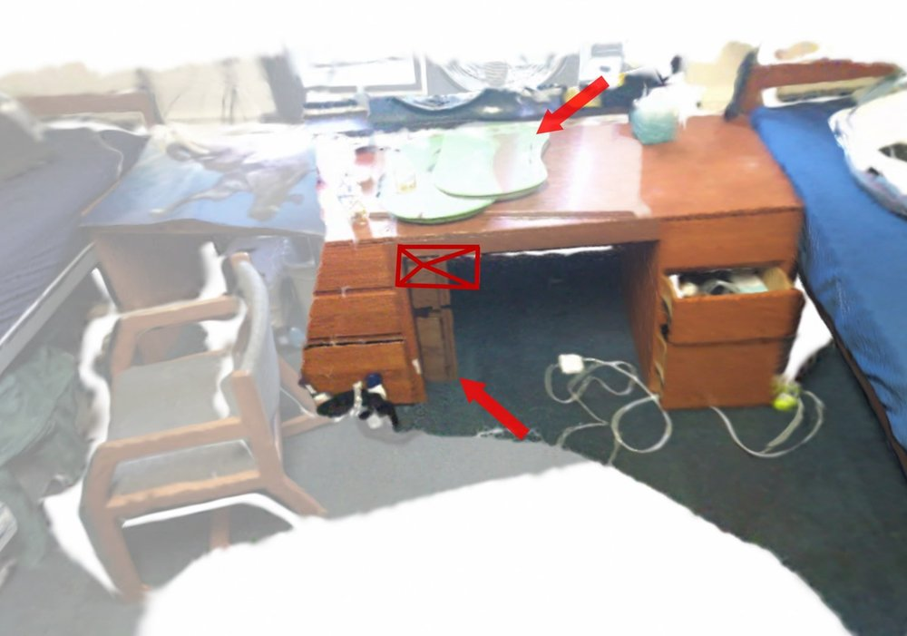
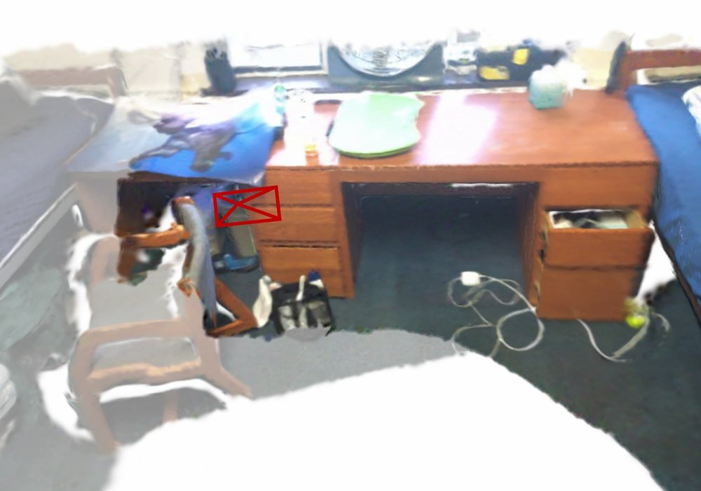
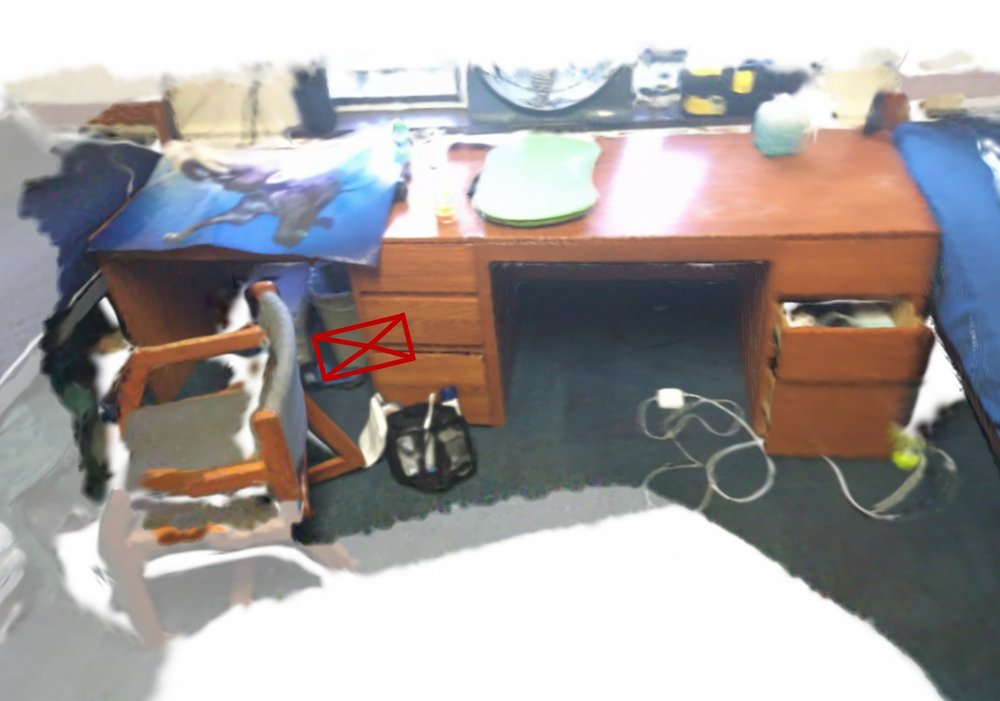
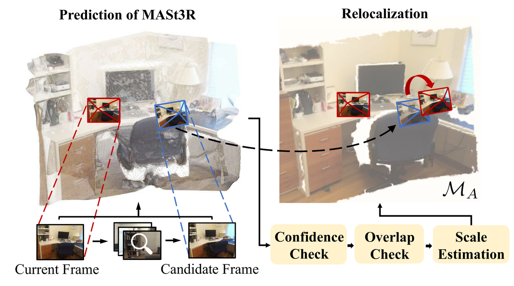
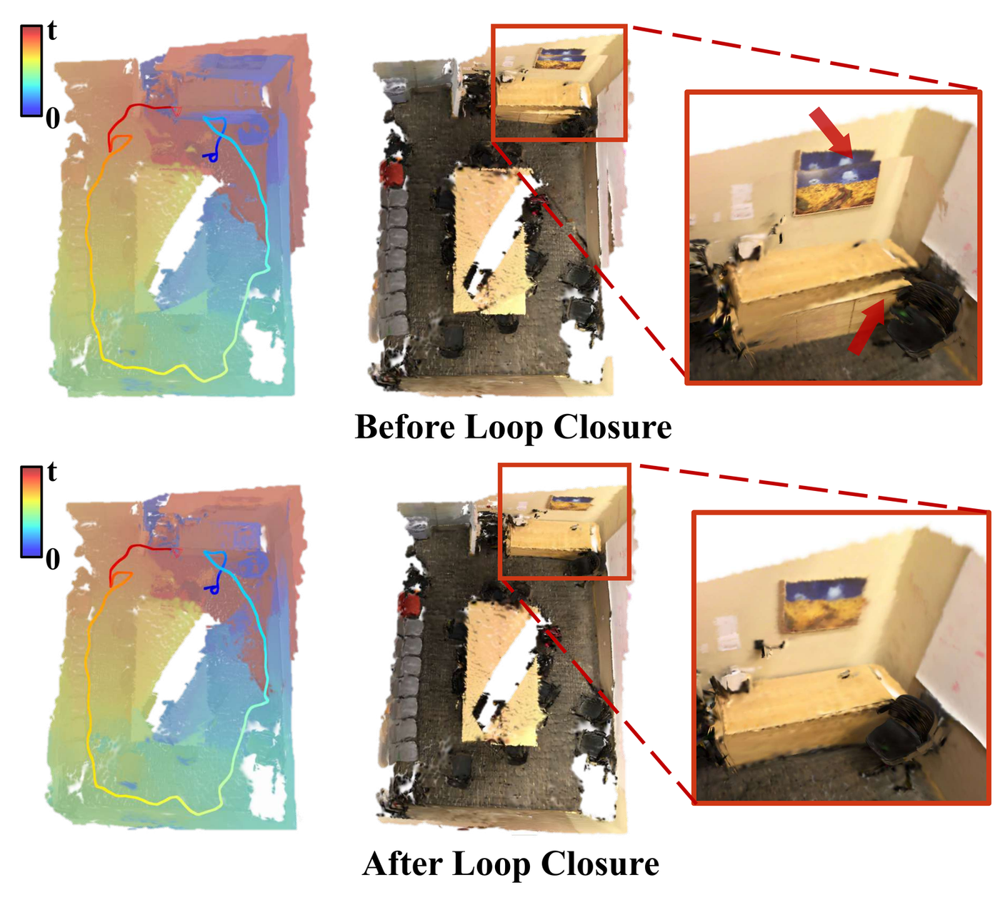

# 2DGS-SLAM (arXiv 2025)

<!-- paper-source: https://chengwei920412.github.io/paper_reading/2506.00970_Globally_Consistent_RGB_D_SLAM_with_2D_Gaussian_Splatting/technical_report.html -->

> 原文链接：[2DGS-SLAM (arXiv 2025)](https://chengwei920412.github.io/paper_reading/2506.00970_Globally_Consistent_RGB_D_SLAM_with_2D_Gaussian_Splatting/technical_report.html)

> **arXiv ID**: 2506.00970
> **原文标题**: Globally Consistent RGB-D SLAM with 2D Gaussian Splatting
> **翻译日期**: 2026-10-16

---

## 📋 论文概览 {#_1}

### 基本信息 {#_2}

- **作者**: Xingguang Zhong, Yue Pan, Liren Jin, Marija Popović, Jens Behley, Cyrill Stachniss
- **机构**: Center for Robotics, University of Bonn；MAVLab, TU Delft；Lamarr Institute for Machine Learning and Artificial Intelligence
- **发表时间**: 2025 年 6 月（arXiv v1）
- **领域**: 机器人视觉、稠密 RGB-D SLAM、辐射场 / 高斯泼溅建图

图：2DGS-SLAM 在 Replica（合成）与 ScanNet（真实）数据集上的重建结果，包括全局 2DGS 地图以及局部放大视角下的 RGB 渲染和法向渲染。

### 核心贡献 {#_3}

1. 以 2D 高斯泼溅（2DGS）作为唯一地图表示，基于李代数显式推导 2DGS 渲染对 SE(3) 相机位姿的解析雅可比，并在 CUDA 光栅化器中实现，用于帧到地图的渲染式跟踪。
2. 提出无子图的地图管理策略：每个高斯基元关联到最近观测它的关键帧，并维护活跃/非活跃两种状态，回环后按关键帧位姿增量直接形变地图。
3. 用三维基础模型 MASt3R 同时完成回环检测（ASMK 图像检索）与粗略重定位，再在活跃地图上用渲染式跟踪精化回环约束，实现在线全局一致建图。
4. 在 Replica、TUM-RGBD、ScanNet 和自采机器人数据上验证：跟踪精度在渲染式方法中领先，地图更紧凑，运行效率高于其他带回环的辐射场 SLAM。

---

## 🎯 研究背景与动机 {#_4}

### 问题定义 {#_5}

目标是构建一个在线运行的 RGB-D SLAM 系统，同时满足三点：几何精确的表面重建、高保真的辐射场渲染、以及在长轨迹下通过回环闭合保持全局一致。

### 现有方法的局限性 {#_6}

- **3DGS 深度不一致**：MonoGS、SplaTAM、Gaussian-SLAM 等耦合式 3DGS SLAM 用三维高斯椭球建图，不同视角渲染的深度存在不一致，影响基于深度的位姿优化和表面重建精度。
- **缺少回环**：多数耦合式 3DGS SLAM 本质上是视觉里程计，长轨迹漂移无法校正。
- **子图方案代价高**：LoopSplat、Loopy-SLAM 用子图实现回环，子图内部仍会漂移，重叠区域造成内存冗余，回环后需要合并子图并做开销较大的后处理精化；LoopSplat 缺少粗略全局定位，大回环时重定位困难。
- **位姿梯度不在流形上**：部分方法对位姿矩阵逐元素自动微分再转四元数，梯度不能保证位于 SE(3) 上。MonoGS 为 3DGS 推导了流形雅可比，但由于渲染机制不同，无法直接用于 2DGS；同期的 2DGS SLAM 工作也没有实现流形上的位姿优化。

### 本文的创新点 {#_7}

- 把 MonoGS 式的 SE(3) 解析雅可比推广到 2DGS 的射线-圆盘求交渲染流程。
- 借鉴 ElasticFusion 等面元 SLAM 的思路，用活跃/非活跃地图代替子图，避免新旧结构叠加导致的跟踪与重定位失败。
- 回环检测与重定位共用 MASt3R：ASMK 检索候选，MASt3R 点图给出初始相对位姿，再做尺度估计和渲染式精化。

---

## 🔬 方法论 {#_8}

### 整体架构 {#_9}

图：2DGS-SLAM 系统概览。前端以 RGB-D 帧为输入，在活跃地图 M_A 上做帧到地图跟踪并搜索回环；关键帧送往后端扩展和优化地图。检测到回环时，前端把回环约束发给后端，执行位姿图优化与地图校正；后端随后更新活跃状态并与前端同步，空闲时用历史关键帧持续精化地图。

系统由两个并行进程组成：

- **前端**：跟踪当前帧位姿、选取关键帧、检测回环并计算回环约束。
- **后端**：用关键帧扩展与优化地图、更新活跃状态、执行位姿图优化并形变地图。

地图在原始 2DGS 参数之外扩展了几个管理字段：

\[\mathcal{M} = \{ \boldsymbol{g}_i, \delta_i, t_i^c, d_i^c, t_i^l \mid i=1,\dots,N \}\]

- \(\boldsymbol{g}_i = (\boldsymbol{\mu}, \boldsymbol{R}, \boldsymbol{t}_u, \boldsymbol{t}_v, s_u, s_v, \boldsymbol{c}, \alpha)\)：可学习的 2DGS 参数。
- \(t_i^c\)：以最近距离观测到该基元的帧 ID（用于回环后的形变关联），\(d_i^c\) 为这个最近距离。
- \(t_i^l\)：最后一次观测到该基元的帧 ID（用于判断是否失活）。
- \(\delta_i \in \{0,1\}\)：活跃状态，据此把地图分为活跃子集 \(\mathcal{M}_A\) 与非活跃子集 \(\mathcal{M}_I\)。

### 关键技术 {#_10}

#### 1. 2DGS 表示 {#1-2dgs}

图：2D 高斯泼溅示意。基元由中心 μ 和两个带尺度的切向量 s_u t_u、s_v t_v 确定；给定相机位姿 T_cw，基元局部 uv 空间中的点通过单应变换映射到图像平面上的像素。

2DGS 把三维椭球的一个轴压缩为零，得到定义在局部切平面上的二维高斯圆盘。旋转 \(\boldsymbol{R} = [\boldsymbol{t}_u, \boldsymbol{t}_v, \boldsymbol{t}_n]\)，法向 \(\boldsymbol{t}_n = \boldsymbol{t}_u \times \boldsymbol{t}_v\)，尺度 \(\boldsymbol{S} = \mathrm{diag}(s_u, s_v, 0)\)。局部坐标到世界坐标的齐次变换为

\[\boldsymbol{H} = \begin{bmatrix} \boldsymbol{RS} &amp; \boldsymbol{\mu} \\ 0 &amp; 1 \end{bmatrix}, \quad
\mathcal{T} = \boldsymbol{W}\boldsymbol{T}_{cw}\boldsymbol{H} = \boldsymbol{W}\boldsymbol{H}_c .\]

渲染时显式求射线与圆盘的交点，再按深度排序做 alpha 混合。颜色、深度、法向、不透明度图都用同一套混合公式得到，因此深度和法向在多视角下是一致的。为节省内存，本文不使用球谐函数表示视角相关颜色。

#### 2. SE(3) 相机雅可比 {#2-se3}

2DGS 原始实现能给出损失对单应矩阵的逐元素梯度 \(\partial L / \partial \mathcal{T}\)。由链式法则：

\[\frac{\partial L}{\partial \boldsymbol{H}_c} = \boldsymbol{W}^\top \frac{\partial L}{\partial \mathcal{T}},\]

从中直接读出 \(\partial L/\partial \boldsymbol{t}_{uc}\)、\(\partial L/\partial \boldsymbol{t}_{vc}\)、\(\partial L/\partial \boldsymbol{\mu}_c\)；法向图渲染的反向传播再给出 \(\partial L/\partial \boldsymbol{t}_{nc}\)，拼成 \(\partial L/\partial \boldsymbol{R}_c = [\partial L/\partial \boldsymbol{t}_{uc}, \partial L/\partial \boldsymbol{t}_{vc}, \partial L/\partial \boldsymbol{t}_{nc}]\)。

相机位姿同时作用于中心和朝向，所以位姿梯度由两部分在同一切空间中相加：

\[\frac{\partial L}{\partial \boldsymbol{T}_{cw}} = \frac{\partial L}{\partial \boldsymbol{\mu}_c}\frac{\mathcal{D}\boldsymbol{\mu}_c}{\mathcal{D}\boldsymbol{T}_{cw}} \oplus \frac{\partial L}{\partial \boldsymbol{R}_c}\frac{\mathcal{D}\boldsymbol{R}_c}{\mathcal{D}\boldsymbol{T}_{cw}},\]

\[\frac{\mathcal{D}\boldsymbol{\mu}_c}{\mathcal{D}\boldsymbol{T}_{cw}} = \begin{bmatrix} I &amp; -\boldsymbol{\mu}_c^\times \end{bmatrix}, \quad
\frac{\mathcal{D}\boldsymbol{R}_c}{\mathcal{D}\boldsymbol{T}_{cw}} = \begin{bmatrix} 0 &amp; -\boldsymbol{R}_{c,:,1}^\times \\ 0 &amp; -\boldsymbol{R}_{c,:,2}^\times \\ 0 &amp; -\boldsymbol{R}_{c,:,3}^\times \end{bmatrix}.\]

流形导数沿用 MonoGS 的定义 \(\frac{\mathcal{D}f(\boldsymbol{T})}{\mathcal{D}\boldsymbol{T}} = \lim_{\tau\to 0}\frac{\mathrm{Log}(f(\mathrm{Exp}(\tau)\circ\boldsymbol{T})\circ f(\boldsymbol{T})^{-1})}{\tau}\)。整个计算在 CUDA 中实现。

#### 3. 跟踪损失与掩膜 {#3}

在活跃地图 \(\mathcal{M}_A\) 上渲染 RGB 和深度，逐像素 L1 损失 \(\boldsymbol{L}_I\)、\(\boldsymbol{L}_D\)。加两个掩膜：

- **法向掩膜** \(\boldsymbol{M}_n = \mathbf{1}(\boldsymbol{N}_r^\top \boldsymbol{r} &gt; 0)\)：剔除背向相机的基元。
- **不透明度掩膜** \(\boldsymbol{M}_o = \mathbf{1}(\boldsymbol{O} &gt; 0.95)\)：忽略重建不充分区域。

\[L_t = \frac{1}{|\Omega|}\sum_{\boldsymbol{p}\in\Omega} \boldsymbol{M}_n(\boldsymbol{p})\,\boldsymbol{M}_o(\boldsymbol{p})\,(\boldsymbol{L}_I(\boldsymbol{p}) + \lambda_d \boldsymbol{L}_D(\boldsymbol{p}))\]

以上一帧位姿初始化，用 AdamW 迭代至收敛或 \(n_{\text{iter}}=120\) 次，跟踪期间地图参数固定。

#### 4. 共视性关键帧选取 {#4}

基元 \(\boldsymbol{g}_k\) 在视角 \(V\) 下的贡献 \(\mathcal{C}_k^V\) 定义为其在所有像素上的 alpha 混合权重之和，大于 0.5 视为可见。两视角共视得分为可见集合的交并比：

\[S_{cov}(A,B) = \frac{|G_A \cap G_B|}{|G_A \cup G_B|}.\]

若与上一关键帧的共视得分低于 \(c_k=0.9\)，或平移距离超过 \(d_k=15\) cm，则当前帧成为关键帧。

#### 5. 建图 {#5}

- **基元初始化**：关键帧 RGB-D 转为彩色点云并随机降采样；尺度由最近邻距离确定，不透明度初始化为 0.99，法向取自深度图梯度外积得到的法向图 \(\boldsymbol{N}_D\)，两个切向量随机取与法向垂直的方向。
- **体素哈希表**：为活跃地图维护分辨率为 \(r_h\) 的体素哈希，只在空体素中新建基元，基元增加或状态切换时同步更新。因分辨率低且只覆盖活跃区域，内存开销很小。
- **建图损失**：

\[L_m = \frac{1}{|\Omega|}\sum_{\boldsymbol{p}}(\boldsymbol{L}_c + w_d\boldsymbol{L}_D + w_n\boldsymbol{L}_n),\]

其中 \(\boldsymbol{L}_c = \lambda_c\|\boldsymbol{I}_r - \boldsymbol{I}\|_1 + (1-\lambda_c)L_{SSIM}\)，法向一致性损失 \(\boldsymbol{L}_n = 1 - \boldsymbol{N}_{D_r}\cdot\boldsymbol{N}_r\) 约束渲染深度导出的法向与渲染法向一致。超参数为 \(\lambda_c=0.125\)、\(w_d=0.5\)、\(w_n=0.02\)。
- **训练帧采样**：每次迭代从活跃帧集合 \(\mathcal{S}_a = \{t_i^c \mid \boldsymbol{g}_i \in \mathcal{M}_A\}\) 采样 \(N_a=3\) 帧优化活跃地图，从其余帧采样 \(N_i=2\) 帧优化非活跃地图。

#### 6. 活跃/非活跃状态更新与重新激活 {#6}

- 新关键帧 \(K_n\) 生成的基元设为活跃；\(\mathcal{M}_A\) 中在 \(K_n\) 下可见的基元更新 \(t_i^l=n\)，若距离更近则更新 \(t_i^c=n\) 与 \(d_i^c\)。
- 若 \(n - t_i^l\) 超过时间阈值，基元转为非活跃，不再参与跟踪渲染，避免漂移后的新旧结构叠加。
- 当前帧 \(F_c\) 与历史关键帧 \(K_h\) 回环并完成校正后，在之后 \(T\) 个关键帧内，被观测到且 \(t_i^c &gt; h\) 的非活跃基元重新激活，\(t_i^l\) 更新为当前帧。
- 建图时对采样到的历史关键帧 \(K_r\) 检查其关联基元的贡献，低于 0.5 视为被遮挡并删除，保持地图紧凑。

图：状态更新过程（按时间从左到右）。亮色为活跃地图，暗色为非活跃地图。(a) 正常运行；(b) 相机看到部分非活跃地图但尚未回环，两者因漂移失配；(c) 检测到回环，非活跃地图被对齐并部分重新激活；(d) 随相机移动更多非活跃基元被重新激活。

#### 7. 回环检测与重定位 {#7}

图：回环流程。当前帧与候选帧送入 MASt3R，得到相对位姿和稠密点云；经置信度与重叠率检查后，用观测深度估计尺度，再把位姿转到世界坐标系并在活跃地图 M_A 上通过跟踪精化。

- **检索**：MASt3R ViT 编码器特征经 ASMK（预计算 k-means 码本量化、二值化）建库。当前帧跟踪后与所有关键帧比对，取最高相似度且超过 \(s_r=0.025\) 的关键帧为候选。
- **置信度检查**：MASt3R 输出点图 \(\boldsymbol{P}_c, \boldsymbol{P}_l\)、深度、置信度图与相对位姿 \(\boldsymbol{T}_{lc}\)；若 \(\boldsymbol{C}_c\) 均值低于 \(c_s=3.0\)，舍弃。
- **重叠率检查**：把 \(\boldsymbol{P}_l\) 重投影到当前图像平面，统计重投影深度与预测深度差小于 \(\tau_d=0.05\) 的像素比例 \(O_{lc}\)，低于 \(\delta_o=0.5\) 则拒绝。
- **尺度估计**：MASt3R 深度只精确到尺度，用观测深度求加权最小二乘 \(s^* = \arg\min_s\|\boldsymbol{C}_c\cdot(\boldsymbol{D}_c - s\boldsymbol{D}_c^p)\|_2\)（闭式解），缩放 \(\boldsymbol{T}_{lc}\) 的平移得 \(\boldsymbol{T}_{lc}^r\)。
- **活跃地图上精化**：以 \(\boldsymbol{T}_l = \boldsymbol{T}_{lc}^r\boldsymbol{T}_c\) 为初值在 \(\mathcal{M}_A\) 上做渲染式跟踪，得到 \(\boldsymbol{T}_l^t\)；用带掩膜的深度 L1 误差 \(e_t\) 验证，低于 \(\varepsilon_t\) 才接受，回环约束为 \(\boldsymbol{T}_{lc}^t = \boldsymbol{T}_l^t\boldsymbol{T}_c^{-1}\)。
- **位姿图优化**：关键帧为顶点，相邻关键帧相对位姿和回环约束为边，用 GTSAM 的 Levenberg-Marquardt 求解，最多 50 次迭代。
- **非活跃地图回访**：除图像检索外，每帧还用 \(\mathcal{M}_I\) 渲染不透明度图，有效面积超过 \(a_v=0.5\) 时，统计被观测基元 \(t_i^c\) 的众数作为候选，走同样的验证流程，以增加有效回环数量。

#### 8. 地图校正 {#8}

位姿图优化后，每个关键帧得到增量 \(\Delta\boldsymbol{T}_i = \boldsymbol{T}_i^o\boldsymbol{T}_i^{-1}\)。每个基元按其关联关键帧的增量更新：

\[\boldsymbol{\mu}_k&#x27; = \Delta\boldsymbol{T}_{f_c^k}\boldsymbol{\mu}_k, \quad \boldsymbol{R}_k&#x27; = \Delta\boldsymbol{R}_{f_c^k}\boldsymbol{R}_k .\]

这相当于以关键帧为粒度的非刚性形变，不需要子图合并。

图：回环与地图校正效果。左侧为每个基元关联的关键帧 ID 和相机轨迹（按时间着色），右侧为回环前后的重建对比；校正前的漂移与失配（红色箭头）在校正后消除。

### 算法流程 {#_11}

1. 前端读入 RGB-D 帧，以上一帧位姿初始化，在 \(\mathcal{M}_A\) 上最小化 \(L_t\) 估计位姿。
2. 计算与上一关键帧的共视得分和平移距离，满足条件则发送关键帧到后端。
3. 前端用 ASMK 检索或非活跃地图回访产生回环候选，经 MASt3R、置信度/重叠率检查、尺度估计、活跃地图跟踪精化与误差验证，得到回环约束发往后端。
4. 后端对新关键帧：降采样点云 → 体素哈希过滤 → 初始化新基元 → 用 \(L_m\) 优化活跃与非活跃地图 → 更新 \(t^c, t^l, \delta\) → 同步给前端。
5. 后端收到回环约束：GTSAM 位姿图优化 → 按 \(\Delta\boldsymbol{T}\) 形变全部基元 → 在随后 \(T\) 个关键帧内重新激活被观测的非活跃基元 → 同步地图。
6. 无消息时后端用历史关键帧持续精化地图，并剔除贡献低于 0.5 的被遮挡基元。
7. 序列结束后合并 \(\mathcal{M}_A\) 与 \(\mathcal{M}_I\)；评估重建与渲染时，参照已有工作再用全部关键帧精化 26,000 次迭代。

---

## 📊 实验与结果 {#_12}

### 实验设置 {#_13}

- **数据集**: Replica（合成，无噪声深度，8 个序列）；TUM-RGBD（真实，运动捕捉真值，5 个序列）；ScanNet（真实，BundleFusion 参考位姿，8 个序列）；自采数据（轮式机器人 + RealSense D455，`corridor` 约 20 m 走廊，`kitchen`、`office` 约 7 m × 6 m 房间，天花板 AprilTag 提供约 1 cm 精度的近似真值）。
- **评估指标**: 跟踪用 ATE RMSE（cm）；重建用 Depth L1（cm，1,000 个随机视角）与 F1（1 cm 阈值）；渲染用 PSNR、SSIM、LPIPS；效率用 FPS、地图大小（MB）、峰值 GPU 显存（MB），在 5,578 帧的 ScanNet `scene0000` 上测得。
- **对比方法**: NICE-SLAM、GO-SLAM、E-SLAM、Point-SLAM、Loopy-SLAM、PIN-SLAM、RTG-SLAM、MonoGS、SplaTAM、Gaussian-SLAM、LoopSplat；TUM 上另比较 Kintinuous、ElasticFusion、ORB-SLAM2、RTAB-Map。
- **实现**: 主体为 PyTorch，雅可比与光栅化为 CUDA；NVIDIA A6000 GPU；超参数在所有实验中固定，仅跟踪深度权重 \(\lambda_d\) 与跟踪成功阈值 \(\varepsilon_t\) 按数据集调整。

### 主要结果 {#_14}

**跟踪精度（ATE RMSE，cm）**

<table>
<thead>
<tr>
<th>数据集</th>
<th>2DGS-SLAM</th>
<th>主要对比</th>
<th>排名</th>
</tr>
</thead>
<tbody>
<tr>
<td>Replica 平均</td>
<td><strong>0.07</strong></td>
<td>RTG-SLAM 0.18（次优）、LoopSplat 0.26、MonoGS 0.32</td>
<td>第一，8 个序列均最优</td>
</tr>
<tr>
<td>TUM 平均</td>
<td><strong>2.74</strong>（渲染式方法中最优）</td>
<td>LoopSplat 3.33、Loopy-SLAM 3.85、MonoGS 4.02；ORB-SLAM2 2.0、ElasticFusion 3.28、RTAB-Map 3.3</td>
<td>渲染式第一，仍落后 ORB-SLAM2</td>
</tr>
<tr>
<td>ScanNet 平均</td>
<td>7.1</td>
<td>GO-SLAM 6.9（最优）、Loopy-SLAM 7.7、LoopSplat 8.4、MonoGS 15.2、SplaTAM 16.6</td>
<td>第二</td>
</tr>
<tr>
<td>自采数据平均</td>
<td><strong>5.0</strong></td>
<td>LoopSplat 11.6、MonoGS 13.6、Point-SLAM 23.5、SplaTAM 59.0；Loopy-SLAM 在 <code>corridor</code> 失败</td>
<td>第一</td>
</tr>
</tbody>
</table>

- Replica 上误差不到次优方法 RTG-SLAM 的一半，论文将其部分归因于 Replica 无噪声深度，使 2DGS 深度一致性的优势得以发挥。
- TUM 上 `desk2`（运动模糊）与 `room`（大场景）取得渲染式方法中的最优（2.76、5.98）。
- ScanNet 上无回环的方法（Point-SLAM、MonoGS、SplaTAM）误差明显偏高；GO-SLAM 依赖 DROID-SLAM 光流跟踪。论文也指出 ScanNet 真值来自 BundleFusion，结果仅供参考。
- 自采数据中 `corridor` 上 LoopSplat 更好（2.1 vs 3.4），`kitchen`（6.8）和 `office`（4.7）上本文最优，两段序列均成功闭环。

**表面重建（Replica）**

<table>
<thead>
<tr>
<th>方法</th>
<th>Depth L1 (cm) ↓</th>
<th>F1 (%) ↑</th>
</tr>
</thead>
<tbody>
<tr>
<td>Loopy-SLAM*（用真值深度引导采样）</td>
<td><strong>0.35</strong></td>
<td><strong>90.8</strong></td>
</tr>
<tr>
<td>LoopSplat</td>
<td>0.51</td>
<td>90.4</td>
</tr>
<tr>
<td>2DGS-SLAM</td>
<td>0.46</td>
<td>89.7</td>
</tr>
<tr>
<td>Gaussian-SLAM</td>
<td>0.68</td>
<td>88.9</td>
</tr>
<tr>
<td>SplaTAM</td>
<td>0.72</td>
<td>86.1</td>
</tr>
</tbody>
</table>

Depth L1 排第二、F1 排第三。论文解释 Loopy-SLAM 渲染深度时需要真值深度引导，LoopSplat 用数十个局部子图分别渲染深度再 TSDF 融合，渲染深度接近原始输入，在合成数据上占优，但在 ScanNet 的定性结果中两者分别表现为网格粗糙与伪影/地图重复，本文重建更平滑、一致。

**渲染质量**

<table>
<thead>
<tr>
<th>设置</th>
<th>2DGS-SLAM（PSNR / SSIM / LPIPS）</th>
<th>主要对比</th>
</tr>
</thead>
<tbody>
<tr>
<td>Replica</td>
<td><strong>38.50</strong> / 0.972 / <strong>0.045</strong></td>
<td>MonoGS 37.50 / 0.960 / 0.070；LoopSplat 36.63 / <strong>0.985</strong> / 0.112</td>
</tr>
<tr>
<td>ScanNet（含精化）</td>
<td>22.09 / 0.781 / 0.418</td>
<td>LoopSplat <strong>24.92</strong> / <strong>0.845</strong> / 0.425；SplaTAM LPIPS <strong>0.358</strong></td>
</tr>
<tr>
<td>ScanNet（无精化）</td>
<td><strong>20.05</strong> / <strong>0.731</strong> / <strong>0.450</strong></td>
<td>MonoGS 16.70 / 0.644 / 0.569；LoopSplat 11.84 / 0.447 / 0.759</td>
</tr>
</tbody>
</table>

LoopSplat 在 ScanNet 上的高分依赖后处理：先 TSDF 融合子图深度得到网格，再以网格顶点初始化新高斯并用全部关键帧优化 30,000 次。去掉精化后，本文方法三项指标均最优。TUM 定性结果中，LoopSplat 原始地图伪影明显，MonoGS 与 LoopSplat 的法向图不平滑，SplaTAM 质量相近但基元数量多得多。

**运行时间与内存（ScanNet `scene0000`）**

<table>
<thead>
<tr>
<th>方法</th>
<th>LC</th>
<th>FPS ↑</th>
<th>地图大小 (MB) ↓</th>
<th>峰值 GPU 显存 (MB) ↓</th>
</tr>
</thead>
<tbody>
<tr>
<td>Point-SLAM</td>
<td>否</td>
<td>0.05</td>
<td>99.4</td>
<td><strong>8236</strong></td>
</tr>
<tr>
<td>Loopy-SLAM</td>
<td>是</td>
<td>0.13</td>
<td>195.3</td>
<td>12475</td>
</tr>
<tr>
<td>MonoGS</td>
<td>否</td>
<td><strong>1.92</strong></td>
<td>13.2</td>
<td>9062</td>
</tr>
<tr>
<td>SplaTAM</td>
<td>否</td>
<td>0.18</td>
<td>213.1</td>
<td>12939</td>
</tr>
<tr>
<td>LoopSplat</td>
<td>是</td>
<td>0.17</td>
<td>4608</td>
<td>9616</td>
</tr>
<tr>
<td>2DGS-SLAM</td>
<td>是</td>
<td>0.92</td>
<td><strong>9.7</strong></td>
<td>10822</td>
</tr>
</tbody>
</table>

FPS 仅次于不做回环的 MonoGS，相比 Loopy-SLAM 与 LoopSplat 约快 6-7 倍；地图最小，SplaTAM 是其 20 倍以上。峰值显存高于 LoopSplat，后者把子图卸载到磁盘，但频繁 I/O 与 CPU-GPU 传输使其速度显著更慢。

### 消融实验 {#_15}

论文没有单独的消融实验，未对 SE(3) 解析雅可比、法向/不透明度掩膜、活跃/非活跃地图、体素哈希、非活跃地图回访、MASt3R 重定位精化等组件逐一做开关对比，也没有超参数敏感性分析。

以下对比可以间接反映部分设计的作用，但都是跨方法比较，混杂了表示、跟踪器、实现等多种差异，不能等同于消融：

- **地图精化的影响**：论文中 ScanNet“无地图精化”渲染表与“含精化”渲染表对比，本文 PSNR 从 20.05 升到 22.09，说明 26,000 次离线精化带来约 2 dB 提升，而在线地图本身已有可用的渲染质量；LoopSplat 从 11.84 升到 24.92，说明其渲染质量主要来自后处理。
- **回环闭合的作用**：在 ScanNet 和自采数据上，无回环的 MonoGS、SplaTAM、Point-SLAM 误差明显偏大（ScanNet 15.2、16.6、14.3 cm），带回环的方法普遍更好；上文回环校正效果图给出了本文回环前后地图的定性对比。
- **2DGS 与 3DGS 表示**：与同为耦合式 GS SLAM 的 MonoGS、SplaTAM、LoopSplat 对比，以及 TUM 法向渲染的定性图，可间接看出 2DGS 在深度/法向一致性上的作用。

---

## 💡 关键见解 {#_16}

### 理论分析 {#_17}

- 渲染式跟踪的精度上限取决于深度渲染是否视角一致。2DGS 用射线-圆盘显式求交，深度定义明确，因此深度项的梯度对位姿更可靠；这一点在无噪声的 Replica 上表现得最明显。
- 把位姿梯度写在 SE(3) 切空间，并利用 \(\boldsymbol{W}^\top\) 从单应梯度直接提取相机系下中心和切向量的梯度，避免对所有基元施加位姿矩阵再自动微分的开销。
- 以关键帧为粒度的点式形变把位姿图优化结果直接传递给每个基元，本质上是面元 SLAM（ElasticFusion）思想在高斯泼溅上的延续，省去子图的刚体假设。
- 活跃/非活跃划分的作用是在回环之前把漂移后的“旧地图”从跟踪中隔离出来，避免新旧结构叠加造成跟踪错误，并给回环后的重新激活提供明确时机。

### 实践启示 {#_18}

- 对机器人在线建图，一张统一、紧凑的全局地图（9.7 MB）比大量重叠子图（4608 MB）更便于下游规划等任务使用。
- 三维基础模型适合承担“粗定位”这一传统难点：MASt3R 给出初值，再由渲染式跟踪精化，比只用局部跟踪更能处理大回环。
- 回环约束需要多道几何检查（置信度、重叠率、跟踪残差）把关，误回环对稠密地图的破坏比稀疏地图更大。
- 深度质量对结果影响明显，部署时需要按传感器调 \(\lambda_d\) 和 \(\varepsilon_t\)。

---

## 🔍 局限性与未来工作 {#_19}

### 当前局限 {#_20}

- **渲染质量在真实数据上不占优**：ScanNet 含精化后 PSNR 22.09、SSIM 0.781，低于 LoopSplat 的 24.92、0.845；LPIPS 也不如 SplaTAM。不使用球谐函数，视角相关外观表达能力受限。
- **几何指标并非全面领先**：Replica 上 Depth L1 第二、F1 第三（89.7%，低于 Loopy-SLAM 90.8% 与 LoopSplat 90.4%）。
- **跟踪仍落后经典方法**：TUM 平均 2.74 cm，ORB-SLAM2 为 2.0 cm；ScanNet 上排在 GO-SLAM 之后。
- **显存与速度**：峰值显存 10822 MB，高于 LoopSplat 和 MonoGS；0.92 FPS 仍远未达到相机帧率。
- **依赖 MASt3R**：回环检测和重定位要在线运行 ViT 编码器和 MASt3R 推理，增加 GPU 开销；MASt3R 深度只到尺度，需要额外的尺度估计和验证。
- **需要按数据集调参**：\(\lambda_d\) 与 \(\varepsilon_t\) 需随深度传感器精度调整，论文未给出各数据集的具体取值或敏感性分析。
- **评估范围**：只在室内 RGB-D 场景测试，没有涉及室外、大尺度、动态场景或纯单目输入。
- **没有消融实验**：各组件的独立贡献缺少定量证据。

### 未来方向 {#_21}

论文结论部分没有专门讨论未来工作。结合上述局限，可能的方向包括：
- 引入轻量的视角相关颜色表示，或在线的全局精化策略，缩小与带后处理方法的渲染差距。
- 降低回环模块开销，例如用更轻的检索特征或降低 MASt3R 调用频率，并进一步优化显存与帧率。
- 根据深度噪声自适应地调整深度损失权重和跟踪验证阈值，减少人工调参。
- 扩展到室外、多房间大尺度、动态场景和单目/双目输入。
- 补充系统性的消融实验，量化雅可比、掩膜、活跃地图管理和重定位精化各自的贡献。

---

## 📚 相关工作对比 {#_22}

<table>
<thead>
<tr>
<th>方法</th>
<th>核心思想</th>
<th>优势</th>
<th>劣势</th>
</tr>
</thead>
<tbody>
<tr>
<td>MonoGS</td>
<td>耦合式 3DGS SLAM，为 3DGS 推导 SE(3) 解析雅可比，共视性关键帧</td>
<td>速度最快（1.92 FPS），地图紧凑（13.2 MB），Replica 渲染较好</td>
<td>无回环，ScanNet ATE 15.2 cm；3DGS 深度/法向不一致</td>
</tr>
<tr>
<td>SplaTAM</td>
<td>耦合式 3DGS SLAM，基于轮廓掩膜的渲染式跟踪与建图</td>
<td>ScanNet LPIPS 最优（0.358），Replica 重建尚可</td>
<td>无回环，ScanNet ATE 16.6 cm；不剔除冗余基元，地图 213.1 MB，0.18 FPS</td>
</tr>
<tr>
<td>LoopSplat</td>
<td>3DGS 子图 + NetVLAD 回环 + 渲染式关键帧到子图配准</td>
<td>首个带回环的耦合式 3DGS SLAM；含后处理时 ScanNet 渲染最佳（PSNR 24.92）</td>
<td>子图重叠导致地图 4608 MB；依赖 30,000 次后处理，无精化 PSNR 仅 11.84；缺粗定位，大回环困难；0.17 FPS</td>
</tr>
<tr>
<td>Loopy-SLAM</td>
<td>神经点云子图 + 回环，子图刚体调整</td>
<td>Replica 重建最优（Depth L1 0.35、F1 90.8）</td>
<td>深度渲染需真值深度引导采样；真实场景网格粗糙；0.13 FPS；自采 <code>corridor</code> 失败</td>
</tr>
<tr>
<td><strong>本文方法</strong></td>
<td>2DGS 单一全局地图 + SE(3) 解析雅可比 + 活跃/非活跃管理 + MASt3R 回环 + 关键帧粒度形变</td>
<td>Replica ATE 0.07 cm，TUM 渲染式方法最优，地图 9.7 MB，带回环方法中最快（0.92 FPS），无精化渲染最佳</td>
<td>ScanNet 含精化渲染不如 LoopSplat；Replica F1 第三；显存 10822 MB；依赖 MASt3R；部分阈值需按数据集调整</td>
</tr>
</tbody>
</table>

---

## 🎓 个人评价 {#_23}

### 优点 {#_24}

- 问题拆解清楚：一方面用 2DGS 解决渲染式跟踪中的深度不一致，另一方面用面元 SLAM 式的地图管理解决回环，两条线都有明确的工程实现。
- 雅可比推导完整，复用 2DGS 已有的单应梯度，再投到 SE(3) 切空间，思路直接，并以 CUDA 实现。
- 无子图设计在内存上优势明显（9.7 MB 对 4608 MB），也让回环后的地图更新变得简单。
- 实验覆盖合成、两个公开真实数据集与自采机器人数据，跟踪、重建、渲染、效率四方面都有评估；作者主动报告了不占优的指标，并单独给出无精化的渲染对比，便于理解后处理的影响。
- 代码开源。

### 可改进之处 {#_25}

- 缺少消融实验，难以判断法向掩膜、不透明度掩膜、非活跃地图回访、MASt3R 精化等环节各自贡献多少。
- 跟踪深度权重 \(\lambda_d\) 和成功阈值 \(\varepsilon_t\) 按数据集调整但未给出取值，复现时需要自行调试。
- 真实数据上的渲染质量仍有差距，ScanNet 结果受 BundleFusion 参考位姿精度限制，结论偏保守。
- 运行速度 0.92 FPS、峰值显存约 10.8 GB，距离在嵌入式机器人平台上实时运行仍有距离；效率评估只在单个 ScanNet 序列上进行。
- 评估限于室内 RGB-D，未讨论动态物体、光照变化或更大尺度场景。

### 推荐阅读对象 {#_26}

- 研究高斯泼溅 / 辐射场 SLAM 的研究者，尤其关注渲染式跟踪的位姿梯度推导。
- 关注稠密 SLAM 回环与全局一致性、希望摆脱子图方案的机器人建图工程师。
- 想了解如何把 MASt3R 等三维基础模型接入传统 SLAM 回环流程的读者。

---

## 📎 附录 {#_27}

### 重要公式 {#_28}

2DGS 单应变换：

\[\mathcal{T} = \boldsymbol{W}\boldsymbol{T}_{cw}\boldsymbol{H}, \quad \boldsymbol{H} = \begin{bmatrix} \boldsymbol{RS} &amp; \boldsymbol{\mu} \\ 0 &amp; 1 \end{bmatrix}\]

alpha 混合渲染：

\[\boldsymbol{V}_{\boldsymbol{p}} = \sum_{i=0}^{N}\boldsymbol{v}_i\alpha_i\mathcal{G}(\boldsymbol{u}_i^{\boldsymbol{p}})\prod_{j=0}^{i-1}\left(1-\alpha_j\mathcal{G}(\boldsymbol{u}_j^{\boldsymbol{p}})\right)\]

相机位姿梯度：

\[\frac{\partial L}{\partial \boldsymbol{H}_c} = \boldsymbol{W}^\top\frac{\partial L}{\partial \mathcal{T}}, \quad
\frac{\partial L}{\partial \boldsymbol{T}_{cw}} = \frac{\partial L}{\partial \boldsymbol{\mu}_c}\frac{\mathcal{D}\boldsymbol{\mu}_c}{\mathcal{D}\boldsymbol{T}_{cw}} \oplus \frac{\partial L}{\partial \boldsymbol{R}_c}\frac{\mathcal{D}\boldsymbol{R}_c}{\mathcal{D}\boldsymbol{T}_{cw}}\]

跟踪损失：

\[L_t = \frac{1}{|\Omega|}\sum_{\boldsymbol{p}}\boldsymbol{M}_n\,\boldsymbol{M}_o\,(\boldsymbol{L}_I + \lambda_d\boldsymbol{L}_D)\]

建图损失：

\[L_m = \frac{1}{|\Omega|}\sum_{\boldsymbol{p}}(\boldsymbol{L}_c + w_d\boldsymbol{L}_D + w_n\boldsymbol{L}_n)\]

回环尺度估计与地图形变：

\[s^* = \arg\min_s\left\|\boldsymbol{C}_c\cdot(\boldsymbol{D}_c - s\boldsymbol{D}_c^p)\right\|_2, \quad
\boldsymbol{\mu}_k&#x27; = \Delta\boldsymbol{T}_{f_c^k}\boldsymbol{\mu}_k,\ \boldsymbol{R}_k&#x27; = \Delta\boldsymbol{R}_{f_c^k}\boldsymbol{R}_k\]

### 术语表 {#_29}

- **2D 高斯泼溅（2DGS）**：把 3D 高斯椭球“压扁”成有方向的二维高斯圆盘。渲染时直接算视线打在圆盘上的位置，因此每个圆盘的深度和法向都很明确，从不同角度看深度保持一致。
- **渲染式跟踪（帧到地图跟踪）**：用当前地图在猜测的相机位姿下渲染出彩色图和深度图，与真实观测比较，再用梯度下降调整位姿使两者对齐。
- **李代数 / SE(3) 流形雅可比**：相机位姿是旋转加平移，不能像普通向量那样直接加减。在李代数（切空间）里求导和更新，可以保证每一步更新后仍是合法的位姿。
- **法向掩膜 / 不透明度掩膜**：跟踪时只用“正面朝向相机”且“已经重建充分（不透明度大于 0.95）”的像素，避免背面和空洞区域干扰位姿估计。
- **共视性**：两个视角能共同看到的高斯基元占比（交并比）。共视性下降说明相机看到了足够多的新内容，就该新增关键帧。
- **体素哈希表**：把空间划成小格子，用哈希表记录哪些格子已有基元，新数据只往空格子里添加，防止同一位置重复堆积。
- **活跃 / 非活跃地图**：最近看到的基元是活跃的，用于跟踪；长时间没看到的基元转为非活跃，暂时“封存”，等回环校正后再按需重新启用。
- **回环闭合**：相机回到之前去过的地方时识别出来，并据此修正一路累积的漂移。
- **MASt3R**：一种三维视觉基础模型，输入两张 RGB 图像即可直接输出稠密三维点图、置信度与相对位姿。
- **ASMK（聚合选择性匹配核）**：把大量局部特征量化成稀疏二值码，再快速计算图像间相似度的检索方法，这里用于找回环候选帧。
- **位姿图优化**：把关键帧位姿当作节点、相对位姿当作约束边，整体求解使所有约束最一致的位姿，本文用 GTSAM 实现。
- **基于关键帧的地图形变**：每个基元“挂靠”在最近观测它的关键帧上，关键帧位姿被修正多少，挂在它上面的基元就跟着移动多少。
- **ATE RMSE**：估计轨迹与真值轨迹对齐后的位置误差均方根，越小越好。

### 参考资源 {#_30}

- **论文原文**: [arXiv链接](https://arxiv.org/abs/2506.00970)
- **中文翻译 PDF**: [paper_cn.pdf](https://chengwei920412.github.io/paper_reading/2506.00970_Globally_Consistent_RGB_D_SLAM_with_2D_Gaussian_Splatting/paper_cn.pdf)
- **中文 Markdown 译文**: [paper_cn.md](https://chengwei920412.github.io/paper_reading/2506.00970_Globally_Consistent_RGB_D_SLAM_with_2D_Gaussian_Splatting/paper_cn.html)
- **代码实现**: <https://github.com/PRBonn/2DGS-SLAM>
- **项目主页**: 论文未提供独立项目主页
