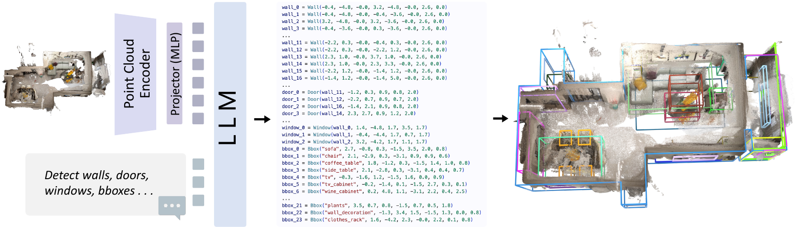
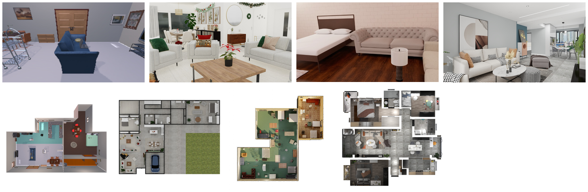
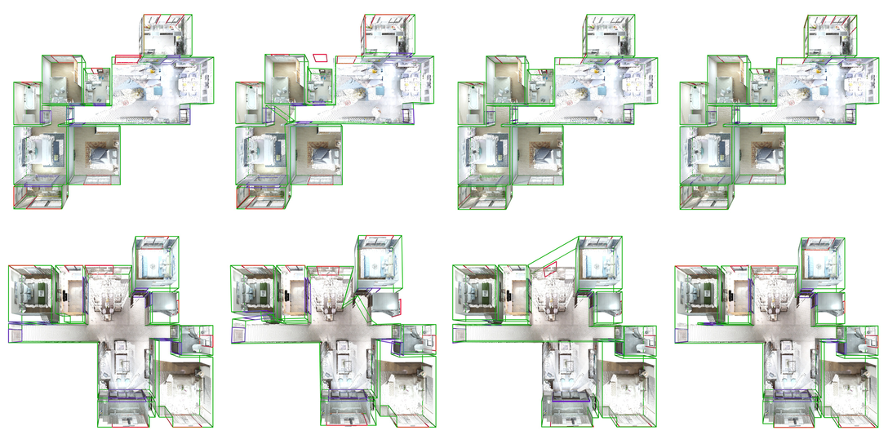
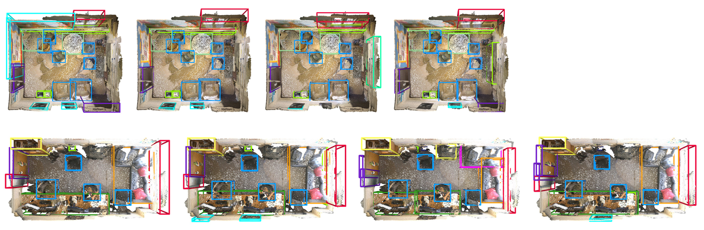

# SpatialLM (arXiv 2025)

<!-- paper-source: https://chengwei920412.github.io/paper_reading/2506.07491_SpatialLM_Training_Large_Language_Models_for_Structured_Indoor_Modeling/technical_report.html -->

> 原文链接：[SpatialLM (arXiv 2025)](https://chengwei920412.github.io/paper_reading/2506.07491_SpatialLM_Training_Large_Language_Models_for_Structured_Indoor_Modeling/technical_report.html)

> **arXiv ID**：2506.07491  
> **原文标题**：SpatialLM: Training Large Language Models for Structured Indoor Modeling  
> **作者**：Yongsen Mao、Junhao Zhong、Chuan Fang、Jia Zheng、Rui Tang、Hao Zhu、Ping Tan、Zihan Zhou  
> **机构**：群核科技、香港科技大学  
> **论文时间**：2025 年 6 月（arXiv 预印本；使用 NeurIPS 2025 模板）  
> **研究领域**：三维场景理解、多模态大语言模型、布局估计、三维目标检测

---

## 📋 论文概览 {#_1}

SpatialLM 是一个面向结构化室内建模的大语言模型。它接收带有 XYZRGB 信息的三维点云，不输出稠密网格或体素，而是自回归生成可执行、可编辑的文本脚本；脚本同时描述墙、门、窗等建筑布局，以及带语义类别、尺寸和朝向的三维目标包围盒。

论文的核心贡献有三点：

1. 将结构化场景表示为通用编程语言脚本，使输出易于理解、编辑和扩展，并可直接利用预训练 LLM 的代码生成能力。
2. 构建大规模、高质量合成室内数据集，包含 12,328 个场景、54,778 个房间、412,932 个目标实例和 35,426 个不同 CAD 模型，同时提供布局与目标标注。
3. 系统研究点云编码器、视觉词元分辨率与训练流程，证明标准“Encoder–MLP–LLM”架构经大规模预训练和下游微调后，可以在布局估计上达到最先进性能，并在三维目标检测上达到专用模型水平。

---

## 🎯 研究背景与动机 {#_2}

### 问题定义 {#_3}

结构化室内建模要求从 RGBD 扫描等原始传感器数据中恢复两类结构：建筑布局 \(\mathcal{L}\)，包括墙、门和窗；目标集合 \(\mathcal{O}\)，包括各目标的语义类别和定向三维包围盒。与网格、体素或隐式场相比，这种表示更紧凑，适合场景编辑、增强现实和机器人导航，也更接近人类可读的场景描述。

### 现有方法的局限 {#_4}

- RoomFormer、V-DETR 等专用模型通常分别针对布局或目标检测设计，任务扩展往往需要修改网络头、类别空间或训练目标。
- SceneScript 已将场景重建转化为序列建模，但使用领域专用词元和专门训练的 Transformer 解码器，未充分复用现代开源基础模型。
- 3D-LLM、LL3DA、Scene-LLM 等工作主要关注问答、定位或空间推理；结构化几何恢复要求精确预测坐标，对空间细节保真度更敏感。
- 真实 RGBD 数据集通常只有数百至数千个场景，且大多只提供目标标注；大规模程序生成数据又容易出现不符合真实统计规律的布局和物体摆放。

### 本文的创新点 {#_5}

SpatialLM 的关键转变不是为每项三维任务另建一个预测头，而是将结构化场景统一为文本语言，让 LLM 成为通用结构生成器。模型架构保持标准化，任务差异主要由输出脚本和语言提示词表达；论文进一步用高质量、人工设计来源的合成场景弥补训练数据不足，并以系统消融确定适合精确几何恢复的点云词元化方案。

---

## 🔬 方法论 {#_6}

### 整体架构 {#_7}

SpatialLM 采用“点云编码器—两层 MLP 投影器—LLM”的标准多模态架构：Sonata/PTv3 编码器把稠密点云压缩为空间特征词元；MLP 将其映射至语言模型嵌入空间；Qwen2.5-0.5B 自回归生成 Python 风格的墙、门、窗和三维包围盒定义。输出脚本经解析后恢复三维结构，并可叠加回点云进行检查。

*图 1：SpatialLM 整体流程。点云经 Encoder–MLP–LLM 对齐后，以文本脚本形式输出布局和目标结构。*

### 结构化语言表示 {#_8}

模型将每个建筑元素和目标写成带参数的通用语言对象。布局元素由端点、尺寸或朝向等几何参数描述，目标则由语义类别、中心、尺寸和旋转信息描述。这种设计有三项直接收益：输出可读、可执行；增加类别无需改变网络结构；自然语言提示词和已有结构脚本都能成为任务条件。

### 点云编码与词元化 {#_9}

输入点云 \(\mathcal{P}\in\mathbb{R}^{N\times6}\) 的每个点包含 XYZ 和 RGB。编码器将其映射为远少于输入点数的特征序列：

\[\mathcal{F}=\mathcal{E}(\mathcal{P}),\qquad \mathcal{F}\in\mathbb{R}^{K\times D},\quad K\ll N.\]

直接汇聚 DINOv2 特征后再体素化或采样，会损失精确坐标恢复所需的空间细节。学习式三维编码器明显更有效，其中仅编码器式 Sonata/PTv3 在四项布局与目标指标上均优于 3DCNN 变体。分辨率并非越高越好：增加词元数可改善空间精度，但序列过长后性能反而下降。

### 数据集 {#_10}

数据来自专业设计师创建并用于实际生产的室内设计资源。每套住宅被解析为独立房间，再经规则筛选；59 个常见目标类别得到保留，并过滤三边均小于 \(15\,\mathrm{cm}\) 的小物体。渲染时模拟穿越房间的相机轨迹，每隔 \(0.5\,\mathrm{m}\) 生成一帧 RGBD 图像，最终按 11,328/500/500 个场景划分训练、验证和测试集。

*图 2：合成数据集视觉质量对比。SpatialLM 数据集兼顾人工设计质量与万级场景规模。*

数据规模还包括 403,291 面墙、123,301 扇门、48,887 扇窗，总建筑面积约 \(863,986\,\mathrm{m^2}\)。与程序生成的 ProcTHOR 和 ASE 相比，人工设计场景更接近真实布局与物体共现统计；与同为人工设计的 HSSD 相比，SpatialLM 数据集的场景规模大得多。

### 训练流程与实现 {#_11}

- 基础模型为 Qwen2.5-0.5B，点云编码器为 Sonata，投影器为两层 MLP；完整模型约 603.5M 参数。
- 点云及标注先平移到非负坐标，再按 \(2.5\,\mathrm{cm}\) 分辨率量化至 1,280 个区间；LLM 预测离散整数，最后执行逆变换恢复连续坐标。
- 最终采用单阶段联合训练，使 Encoder、MLP 和 LLM 全部可训练。主数据集训练 4 个轮次，总批大小 64，学习率 \(10^{-4}\)，使用 0.03 预热比例的余弦调度和 AdamW。
- 训练使用 32 块 NVIDIA H20 GPU，在主数据集上约需一天。数据增强包括长方体裁剪、多尺度抖动、弹性形变、旋转、缩放和颜色扰动。
- Structured3D 微调 50 个轮次；ScanNet 先进行 3 个轮次的类别空间适配，再微调 30 个轮次。

### 算法流程 {#_12}

1. 输入并增强 XYZRGB 点云，同时对真实布局和包围盒执行一致的几何变换。
2. Sonata 以五级由粗到细层次结构提取特征，并在选定空间分辨率下生成 \(K\) 个视觉词元。
3. 两层 MLP 将点云词元投影至 Qwen2.5 的语言嵌入空间。
4. LLM 根据点云词元和文本提示，自回归生成结构化 Python 风格脚本。
5. 解析脚本、反量化坐标并恢复墙、门、窗及定向目标包围盒。
6. 在下游数据集上微调，以适配传感器噪声、几何分布和类别空间差异。

---

## 📊 实验与结果 {#_13}

### 实验设置 {#_14}

- **布局估计**：在 Structured3D 上测试，使用匈牙利匹配，报告 IoU\(_\mathrm{2D}\) 阈值 0.25/0.5 下的类别平均 F1；对比 RoomFormer 与 SceneScript。
- **三维目标检测**：在 ScanNet 的 18 个类别上测试，报告 IoU\(_\mathrm{3D}\) 阈值 0.25/0.5 下的类别平均 F1；对比 V-DETR 与 SceneScript。由于自回归方法没有置信度分数，论文采用 F1 而非 mAP。
- **视频零样本检测**：对 107 段虚拟室内漫游视频使用 MASt3R-SLAM 重建点云，不微调 SpatialLM，评估噪声、遮挡和不完整几何下的泛化能力。

### 关键定量结果 {#_15}

<table>
<thead>
<tr>
<th>任务与指标</th>
<th>专用/序列基线</th>
<th>仅下游数据训练</th>
<th>主数据集预训练后微调</th>
<th>结论</th>
</tr>
</thead>
<tbody>
<tr>
<td>Structured3D，F1@IoU\(_\mathrm{2D}\) 0.25</td>
<td>RoomFormer 83.4；SceneScript 90.4</td>
<td>32.6</td>
<td><strong>94.3</strong></td>
<td>超过两项基线</td>
</tr>
<tr>
<td>Structured3D，F1@IoU\(_\mathrm{2D}\) 0.5</td>
<td>RoomFormer 81.4；SceneScript 89.2</td>
<td>18.1</td>
<td><strong>93.5</strong></td>
<td>比 SceneScript 高 4.3 点</td>
</tr>
<tr>
<td>ScanNet，F1@IoU\(_\mathrm{3D}\) 0.25</td>
<td>V-DETR 65.1；SceneScript 49.1</td>
<td>2.9</td>
<td><strong>65.6</strong></td>
<td>比 V-DETR 高 0.5 点</td>
</tr>
<tr>
<td>ScanNet，F1@IoU\(_\mathrm{3D}\) 0.5</td>
<td>V-DETR <strong>56.8</strong>；SceneScript 36.8</td>
<td>0.7</td>
<td>52.6</td>
<td>比 V-DETR 低 4.2 点，但比 SceneScript 高 15.8 点</td>
</tr>
<tr>
<td>视频零样本，布局 F1@IoU 0.25</td>
<td>—</td>
<td>—</td>
<td>55.7</td>
<td>无下游微调</td>
</tr>
<tr>
<td>视频零样本，目标 F1@IoU 0.25</td>
<td>—</td>
<td>—</td>
<td>36.9</td>
<td>前 20 个高频类别平均值</td>
</tr>
</tbody>
</table>

*图 3：Structured3D 布局估计定性结果。自回归结构表示有助于保持墙、门、窗之间的一致关系。*

*图 4：ScanNet 三维目标检测定性结果。SpatialLM 相比 SceneScript 检出更多目标，但对小目标和稀有类别仍较困难。*

### 消融实验 {#_16}

**编码器选择。** 基于 DINOv2 映射后体素化的方案，在布局 F1@0.25/0.5 上仅为 10.8/5.5，目标检测为 0.1/0.0；Sonata/PTv3 则达到 84.6/82.6 和 65.1/49.4。差距说明三维结构恢复不能只依赖通用二维语义特征，编码器必须保留细粒度几何信息。

**空间分辨率。** 从默认 \(1\times\) 提升到 \(2\times\) 后，布局 F1 提升至 87.4/85.3；\(2.5\times\) 时目标检测达到最高的 72.2/61.7。继续提高到 \(4\times\)、约 2,000 个词元后，两项任务均下降，体现了空间精度与 LLM 上下文负担之间的权衡。最终配置采用 \(2.5\,\mathrm{cm}\) 的最细层级分辨率。

**训练策略。** 单阶段训练但冻结编码器时，布局和目标 F1 分别为 73.8/68.4、40.2/22.7；单阶段联合训练全部组件后提升至 84.6/82.6、65.1/49.4。两阶段方案可将布局指标小幅提高到 85.3/83.4，但目标指标降至 60.7/45.6，因此论文选择整体更均衡的单阶段联合训练。

**数据规模与迁移。** 只用 Structured3D 或 ScanNet 训练 LLM 时，结果分别低至 32.6/18.1 和 2.9/0.7；先在 SpatialLM 数据集上训练再做下游微调，结果跃升到 94.3/93.5 和 65.6/52.6。论文最有说服力的证据并非单一架构技巧，而是“大规模高质量数据 + 下游适配”对 LLM 三维建模能力的决定性作用。

### 扩展实验 {#_17}

SpatialLM 可以零样本处理文本生成三维场景、手持相机视频、LiDAR 重建和合成网格采样得到的点云。通过语言提示词，它还可只检测用户指定类别；当输入已有包围盒但类别留空的结构脚本时，模型可补全语义标签，在主数据集测试集上达到 96.8% 分类准确率。这些结果说明文本接口确实提供了比固定检测头更灵活的任务组合方式，但目前主要属于概念验证。

---

## 💡 关键见解 {#_18}

### 方法层面 {#_19}

1. **精确三维生成需要保留几何细节。** 适用于语义理解的二维特征汇聚方案，不一定适合坐标级重建；Sonata 的优势来自对点云空间结构的直接建模。
2. **视觉词元存在最佳密度区间。** 过少会丢失几何信息，过多则增加序列长度并降低优化效率；这与“分辨率越高越好”的直觉不同。
3. **点云编码器必须参与下游优化。** 冻结编码器造成的显著性能损失表明，现有三维预训练主干尚未像成熟二维视觉编码器那样具备通用迁移能力。
4. **通用语言可以承担结构化预测协议。** Python 风格脚本同时兼顾机器可解析性、人类可编辑性和类别扩展能力，使检测、结构补全和提示控制共享同一接口。

### 实践启示 {#_20}

- 若目标是把 LLM 用于精确三维任务，数据的几何标注质量和规模比单纯扩大语言模型更优先。
- 合成预训练不能完全替代真实下游适配，但能把小数据集从“不足以训练”转化为“足以微调”。
- 低 IoU 阈值与高 IoU 阈值应同时报告：SpatialLM 在 ScanNet IoU 0.25 上匹敌 V-DETR，却在 0.5 上仍落后，说明目标发现能力较强，而精确定位仍有改进空间。
- 文本输出有利于扩展和交互，但部署时还需要语法约束、置信度估计与失败检测，才能满足可靠的自动化流程。

---

## 🔍 局限性与未来方向 {#_21}

### 当前局限 {#_22}

1. **跨来源泛化尚未解决。** 单目视频、RGBD、LiDAR 和合成网格产生的点云分布差异很大；达到最佳性能仍需特定数据集微调。
2. **依赖预定义类别。** 主数据集只覆盖 59 个目标类别，尚未发挥 LLM 的开放词汇语言能力。
3. **精确定位仍弱于最佳专用模型。** ScanNet 的 IoU\(_\mathrm{3D}\)@0.5 F1 比 V-DETR 低 4.2 点，尤其容易漏检或错定位 picture、sink、shower curtain 等小目标或稀有类别。
4. **自回归输出缺少置信度。** 论文因此使用 F1 而非标准 mAP；这也限制了阈值调节、排序、校准和风险控制。
5. **语言能力保持情况未知。** 论文没有系统评估三维微调是否损害 Qwen2.5 原有的自然语言理解、代码和推理能力。
6. **训练成本较高。** 约 603.5M 参数的模型仍需 32 块 H20 训练约一天；与 RoomFormer、V-DETR 和 SceneScript 相比，参数规模也明显更大。

### 未来方向 {#_23}

- 扩大真实与合成混合数据，并研究跨传感器、跨数据集统一训练和无需微调的域泛化。
- 引入开放词汇三维检测、三维视觉问答和场景级交互，验证结构建模是否真正提升空间推理。
- 为脚本生成加入受约束解码、语法验证、置信度或不确定性估计，提升工程可靠性。
- 改进小目标、稀有类别与遮挡目标的高精度定位，并探索分层或局部放大式视觉词元策略。
- 研究参数高效微调、模型蒸馏和更紧凑的点云词元，以降低训练与推理成本。
- 进行语言能力保持评测，分析三维任务微调与通用语言/代码能力之间是否存在灾难性遗忘。

---

## 📚 相关工作对比 {#_24}

<table>
<thead>
<tr>
<th>方法</th>
<th>核心思想</th>
<th>主要优势</th>
<th>主要局限</th>
</tr>
</thead>
<tbody>
<tr>
<td>RoomFormer</td>
<td>用两级查询预测房间多边形及角点</td>
<td>布局专用结构高效，几何约束明确</td>
<td>只面向布局；独立检测元素时可能出现门窗未贴墙</td>
</tr>
<tr>
<td>V-DETR</td>
<td>在 DETR 上加入三维顶点相对位置编码和任务专用改进</td>
<td>ScanNet 高精度定位强，IoU 0.5 结果最佳</td>
<td>专用于目标检测，难以统一布局、交互和结构补全</td>
</tr>
<tr>
<td>SceneScript</td>
<td>用领域专用结构语言自回归重建场景</td>
<td>保持结构关系，序列建模灵活</td>
<td>需要专用词元与解码器，无法直接复用现代开源 LLM</td>
</tr>
<tr>
<td>3D-LLM / LL3DA / Scene-LLM</td>
<td>将多视图、目标级或体素级三维特征与 LLM 对齐</td>
<td>支持问答、定位与空间推理</td>
<td>重点并非同时精确恢复布局和目标几何；简单体素聚合可能损失坐标细节</td>
</tr>
<tr>
<td><strong>SpatialLM</strong></td>
<td>Sonata 点云词元 + MLP + 开源 LLM，生成 Python 风格结构脚本</td>
<td>统一布局与目标；可读、可编辑、可提示扩展；布局达到最先进水平</td>
<td>依赖大规模合成数据和下游微调；参数量大；高 IoU 定位及开放词汇能力仍不足</td>
</tr>
</tbody>
</table>

---

## 🎓 客观评价 {#_25}

### 优点 {#_26}

- 研究问题清晰，统一文本表示、数据集构建和系统消融形成完整证据链，而不是只展示一个架构原型。
- 数据消融非常有说服力：只用小型下游数据训练几乎失败，预训练后微调却达到或接近最先进水平，直接支撑论文关于数据规模的主张。
- 同时比较编码器、空间分辨率和一至三阶段训练，揭示了精确三维任务与常规视觉语言对齐之间的重要差异。
- 结果覆盖布局、目标、视频零样本、提示控制和语义补全，证明文本接口具有实际扩展潜力。

### 需要谨慎解读之处 {#_27}

- 与专用模型的比较并非同参数量或同训练数据预算；SpatialLM 的 603.5M 参数和额外大规模数据是性能的重要组成部分，不能把提升全部归因于 LLM 架构。
- Structured3D 上的领先结果很强，但 ScanNet 高阈值指标仍低于 V-DETR，说明“通用结构生成器”尚未全面超过专用模型。
- 零样本视频结果受到相机轨迹对齐误差影响，平均 F1 仍有限；定性鲁棒性不能替代更广泛的真实传感器评测。
- 提示词扩展和语义补全展示了潜力，但任务数量、类别范围和交互复杂度仍较有限，尚不足以证明通用三维智能。

### 综合判断 {#_28}

SpatialLM 的主要价值在于验证了一条可复用路线：用高质量结构数据训练标准多模态 LLM，使其直接生成可执行的三维场景脚本。论文在布局估计上取得明确领先，在目标检测上达到有竞争力的水平；其最大贡献更接近“数据与接口范式”而非某个单独网络模块。它适合三维视觉、多模态大模型、具身智能、室内设计自动化和场景编辑研究者阅读，也为需要统一结构预测与语言交互接口的工程团队提供了有价值的基线。

---

## 📎 附录 {#_29}

### 重要公式与指标 {#_30}

点云编码器的核心映射为：

\[\mathcal{F}=\mathcal{E}(\mathcal{P}),\qquad
\mathcal{P}\in\mathbb{R}^{N\times6},\quad
\mathcal{F}\in\mathbb{R}^{K\times D},\quad K\ll N.\]

布局指标先将预测平面片段投影到真实标注所在平面，计算 IoU\(_\mathrm{2D}\)，再用匈牙利算法匹配并统计 F1。目标检测则对预测与真实定向包围盒执行匈牙利匹配，计算 IoU\(_\mathrm{3D}\) 并统计 F1。论文均报告 0.25 和 0.5 两个阈值，以分别反映较宽松的目标发现能力和更严格的几何定位精度。

### 术语表 {#_31}

<table>
<thead>
<tr>
<th>术语</th>
<th>含义</th>
</tr>
</thead>
<tbody>
<tr>
<td>SpatialLM</td>
<td>本文模型；接收点云并生成结构化室内场景脚本的 LLM</td>
</tr>
<tr>
<td>结构化室内建模</td>
<td>从原始三维观测恢复建筑布局和带语义的三维目标结构</td>
</tr>
<tr>
<td>布局估计</td>
<td>预测墙、门、窗等建筑元素的位置、形状与关系</td>
</tr>
<tr>
<td>定向包围盒（OBB）</td>
<td>带中心、尺寸和方向的三维目标包围盒</td>
</tr>
<tr>
<td>点云</td>
<td>由三维坐标及可选颜色、法向等属性构成的不规则点集合</td>
</tr>
<tr>
<td>Encoder–MLP–LLM</td>
<td>编码器提取多模态特征、MLP 对齐嵌入、LLM 生成文本的标准架构</td>
</tr>
<tr>
<td>视觉词元 \(K\)</td>
<td>点云编码器输出并输入 LLM 的特征嵌入数量</td>
</tr>
<tr>
<td>Sonata</td>
<td>基于 PTv3 的仅编码器式自监督点云主干</td>
</tr>
<tr>
<td>自回归生成</td>
<td>按顺序逐词元预测结构脚本，前文结果成为后续预测条件</td>
</tr>
<tr>
<td>IoU\(_\mathrm{2D}\)/IoU\(_\mathrm{3D}\)</td>
<td>二维平面片段或三维包围盒的交并比</td>
</tr>
<tr>
<td>匈牙利匹配</td>
<td>在预测集合与真实标注集合之间求最优一一分配的算法</td>
</tr>
<tr>
<td>零样本检测</td>
<td>不在目标数据分布上微调，直接进行检测</td>
</tr>
<tr>
<td>开放词汇检测</td>
<td>不把类别限制在固定训练标签集合中的检测设定</td>
</tr>
</tbody>
</table>

### 参考资源 {#_32}

- **论文原文**：[arXiv:2506.07491](https://arxiv.org/abs/2506.07491)
- **中文翻译 PDF**：[paper_cn.pdf](https://chengwei920412.github.io/paper_reading/2506.07491_SpatialLM_Training_Large_Language_Models_for_Structured_Indoor_Modeling/paper_cn.pdf)
- **中文 Markdown 译文**：[paper_cn.md](https://chengwei920412.github.io/paper_reading/2506.07491_SpatialLM_Training_Large_Language_Models_for_Structured_Indoor_Modeling/paper_cn.html)
- **项目主页**：[SpatialLM Project Page](https://manycore-research.github.io/SpatialLM)
