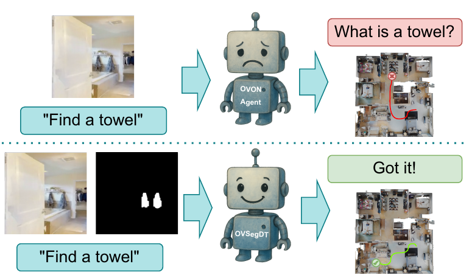
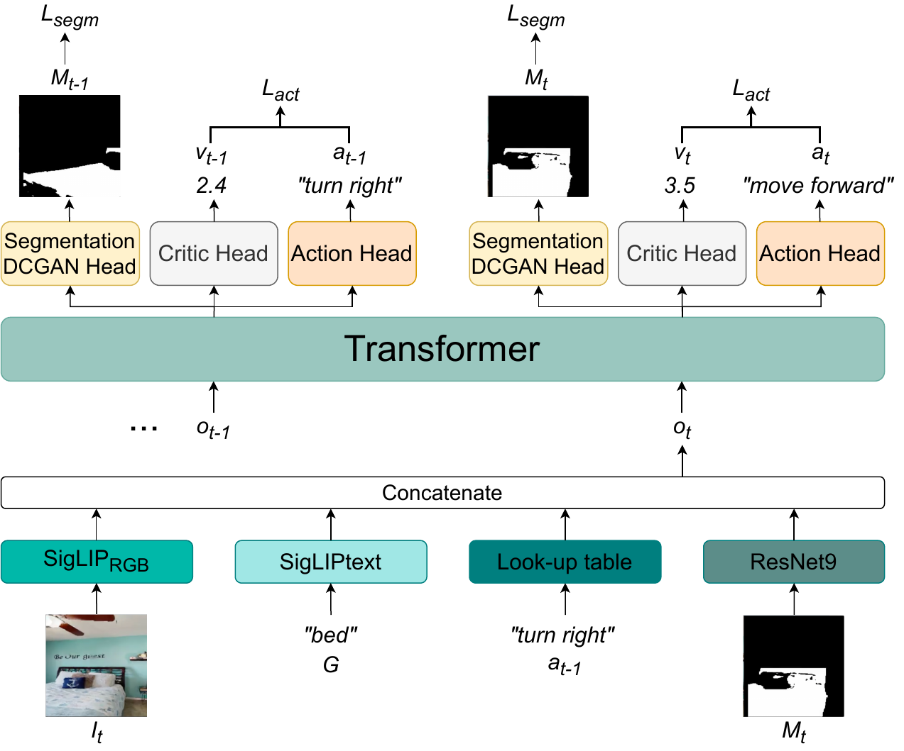
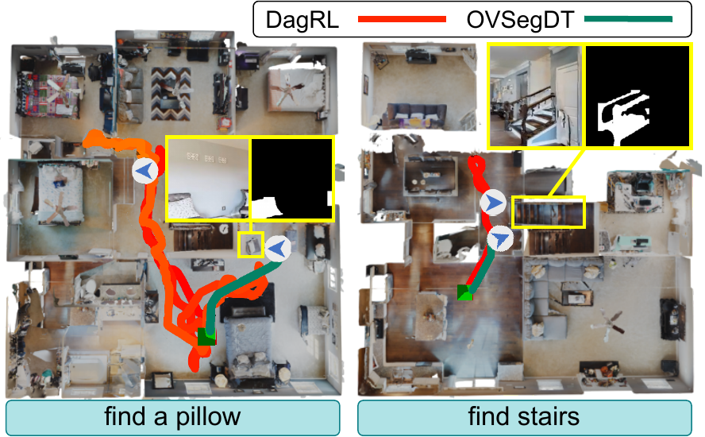
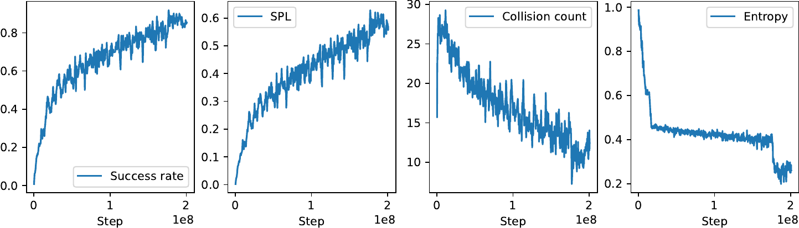

# OVSegDT (arXiv 2025)

<!-- paper-source: https://chengwei920412.github.io/paper_reading/2508.11479_OVSegDT_Segmenting_Transformer_for_Open_Vocabulary_Object_Goal_Navigation/technical_report.html -->

> **arXiv ID**: 2508.11479
> **原文标题**: OVSegDT: Segmenting Transformer for Open-Vocabulary Object Goal Navigation
> **翻译日期**: 2026-08-26

---

## 📋 论文概览 {#_1}

### 基本信息 {#_2}

- **作者**: Tatiana Zemskova, Aleksei Staroverov, Dmitry Yudin, Aleksandr Panov
- **机构**: Cognitive AI Systems Lab；MIRAI；NUST MISIS
- **发表时间**: 2025 年 8 月（arXiv 预印本，CVPR 2026 投稿模板）
- **领域**: 具身智能（Embodied AI）、开放词汇视觉语言导航、强化学习与模仿学习

### 核心贡献 {#_3}

论文的核心主张是：**开放词汇物体目标导航不需要大型视觉语言模型，也不需要深度与里程计传感器**。一个 130M 参数、仅吃 RGB 的轻量 Transformer，只要把「目标物体的二值分割掩码」显式喂进观测空间，就能在未见类别上取得与已见类别相当的性能。三项具体贡献：

1. **OVSegDT 架构** —— 在 SigLIP 图文编码之外，增加一路 ResNet9 目标掩码编码器，把文本目标落地为像素级空间线索；训练时另加一个 DCGAN 分割头做辅助监督。
2. **EALM（Entropy-Adaptive Loss Modulation，熵自适应损失调制）** —— 用策略熵的 EMA 作为归一化不确定性度量，逐 mini-batch 连续插值 DAgger 与 PPO 的损失权重，取代脆弱的人工阶段硬切换。样本复杂度降低 33%，碰撞减少 10%。
3. **预测分割适配方案** —— 辅助分割损失 + 基于真值掩码面积的语义奖励，配合 YOLOE 逐类别置信度校准与预测掩码微调，把「真值掩码训练、预测掩码部署」的性能鸿沟从 40.5 个点压缩到 24.6 个点。

在 HM3D-OVON 的 val unseen 上取得 **44.7% SR / 20.6% SPL**，超过所有对比方法，包括使用深度+里程计的 MTU3D 和大型 VLN 模型 Uni-NaVid。

图 1：OVSegDT 总览。泛化能力来自目标掩码编码器，以及在使用外部模块预测分割时同时提升学习速度与导航性能的训练策略。

---

## 🎯 研究背景与动机 {#_4}

### 问题定义 {#_5}

物体目标导航（ObjectNav）要求智能体在陌生室内环境中，根据指令找到并靠近指定物体。**开放词汇**版本（OVON）进一步要求：目标类别以自由形式自然语言给出，且可能是训练中从未出现过的类别。任务被形式化为 POMDP \(\langle \mathcal{S}, \mathcal{A}, P, R, \rho_0, \gamma \rangle\)，每步观测为

\[o_t = (I_t,\; g,\; a_{t-1},\; M_t),\]

其中 \(I_t\) 为 RGB 帧，\(g\) 为文本目标，\(a_{t-1}\) 为上一动作，\(M_t\) 为目标类别的二值分割掩码。动作空间是 6 个离散指令（stop / forward 0.25 m / 左右转 30° / 上下看 30°），回合上限 500 步。

### 现有方法的局限性 {#_6}

论文把已有方案分成三类并逐一指出痛点：

<table>
<thead>
<tr>
<th>路线</th>
<th>代表方法</th>
<th>痛点</th>
</tr>
</thead>
<tbody>
<tr>
<td>基于地图的模块化</td>
<td>VLFM、SG-Nav、ESC、TANGO</td>
<td>依赖语义地图质量；检测与位姿误差逐级累积；需要深度与里程计</td>
</tr>
<tr>
<td>端到端无地图</td>
<td>DagRL、PSL</td>
<td>HM3DSem 只有 216 个标注场景，比 VLM 预训练语料小数个数量级，策略过拟合训练场景、无法泛化到新类别</td>
</tr>
<tr>
<td>混合式（探索+技能切换）</td>
<td>PixelNav、DagRL+OD</td>
<td>兼具二者优点，但通常仍需额外传感器或额外的 LVLM/LLM 规划模块</td>
</tr>
</tbody>
</table>

另一个被论文着重强调、却常被忽视的问题：**端到端策略在训练场景上 SR 很高，但行为不安全**。DAgger 在训练场景近乎完美，却在未见回合平均每回合碰撞 50+ 次——这是过拟合的直接证据，而单看 SR 完全看不出来。

### 本文的创新点 {#_7}

1. **把分割掩码当作观测，而不是当作切换信号**。PixelNav 把掩码转成像素目标后交给规划器；本文直接把掩码编码进策略的观测向量，让 Transformer 自己学会何时从探索切到目标导向。掩码天然与类别名解耦——只要外部分割模型认得新类别，策略就能导航过去，这正是泛化的来源。
2. **用策略熵做 IL→RL 的连续调度**。这是论文最有普适性的部分，与导航任务本身无关，可迁移到任何 IL+RL 混合训练场景。
3. **把分割同时用作输入、辅助监督与奖励信号**，三处协同，才使模型在含噪 YOLOE 掩码下仍能工作。

---

## 🔬 方法论 {#_8}

### 整体架构 {#_9}

图 2：OVSegDT 模型结构。观测嵌入由四路拼接而成，送入 4 层解码器 Transformer，再分出动作头、Critic 头与分割头。

观测嵌入的四路构成（总计 130M 参数，其中状态编码器仅 34M）：

<table>
<thead>
<tr>
<th>分支</th>
<th>编码器</th>
<th>维度</th>
<th>说明</th>
</tr>
</thead>
<tbody>
<tr>
<td>RGB 图像 \(I_t\)</td>
<td>SigLIP\(_\text{RGB}\)（冻结）</td>
<td>768</td>
<td>沿用 HM3D-OVON 基准的最优选择</td>
</tr>
<tr>
<td>文本目标 \(G\)</td>
<td>SigLIP\(_\text{text}\)（冻结）</td>
<td>768</td>
<td>开放词汇的语义入口</td>
</tr>
<tr>
<td>上一动作 \(a_{t-1}\)</td>
<td>可学习 lookup</td>
<td>32</td>
<td>—</td>
</tr>
<tr>
<td><strong>目标掩码 \(M_t\)</strong></td>
<td><strong>ResNet9</strong></td>
<td><strong>128</strong></td>
<td><strong>本文新增，泛化的关键</strong></td>
</tr>
</tbody>
</table>

拼接得 \(o_t = [i_t, g_t, p_t, m_t]\)，最近 100 步序列 \([o_{t-99},\dots,o_t]\) 输入 decoder-only Transformer（4 层、8 头、隐藏 512、上下文 100）。输出接三个头：线性动作头、线性 Critic 头、DCGAN 分割头（仅训练时使用，从 Transformer 特征重建 \(M_t\)）。

值得注意的一处设计：分割头重建的是**以历史观测为条件的当前状态表示**中的掩码，而非单帧观测的掩码——这与 A2CAT-VN、MTU3D 把分割用作单帧表示学习的做法不同，也是论文自认为与 Unified-IO2 相关但更轻量的地方。

### 关键技术 {#_10}

#### 1）EALM：熵自适应损失调制 {#1ealm}

**动机**：端到端 ObjectNav 的标准流程是「DAgger 冷启动 → 硬切换到 PPO」，切换点靠拍脑袋定。切早了，智能体还没掌握导航原语就断了专家信号，SR 中途塌陷；切晚了，模型过拟合专家轨迹，且迟迟得不到碰撞的负奖励。

**做法**：每个 mini-batch 计算动作分布的香农熵

\[H_t = -\sum_{a\in\mathcal{A}} \pi_\theta(a\mid o_t)\log \pi_\theta(a\mid o_t),\]

用 EMA 平滑（\(\alpha=0.95\)）得 \(\hat H_t = \alpha \hat H_{t-1} + (1-\alpha)H_t\)，再线性映射为混合系数

\[\lambda_t = \mathrm{clip}\!\left(\frac{H_\text{high} - \hat H_t}{H_\text{high} - H_\text{low}},\, 0,\, 1\right),\]

最终策略损失为 \(\mathcal{L}_\text{EALM} = \lambda_t \mathcal{L}_\text{PPO} + (1-\lambda_t)\mathcal{L}_\text{BC}\)。

**直觉**：熵高 = 策略不确定 = 让专家带；熵低 = 策略自信 = 放手让它自己探索试错。切换不是一个时刻，而是一条连续曲线。

**阈值怎么定（这是论文写得比较扎实的一处）**：不是拍脑袋，而是按动作空间归一化。\(|\mathcal{A}|=6\) 时 \(H_{\max} = \log 6 \approx 1.79\) nats，取

- \(H_\text{high} = 0.42\,H_{\max} \approx 0.75\)，对应最优动作概率约 80%；
- \(H_\text{low} = 0.20\,H_{\max} \approx 0.35\)，对应最优动作概率约 95%。

并给出可迁移的经验法则：\(H_\text{high}\in[0.4,0.5]\cdot\log|\mathcal{A}|\)，\(H_\text{low}\in[0.15,0.25]\cdot\log|\mathcal{A}|\)。

另一个容易被略过但很重要的实现细节：**行为克隆阶段同时更新 Critic**。否则切到 PPO 时价值函数是随机初始化的，优势估计全错，这正是很多 BC→RL 流程崩溃的原因。

#### 2）语义奖励 {#2}

\[R^{sem}_t = \lambda_{sem}\bigl(\mathrm{clip}(d_{t-1}-d_t) + \mathrm{clip}(b_t - b_{t-1})\bigr),\quad \lambda_{sem}=0.5\]

第一项是常规的测地距离缩减；**第二项是本文重点**：\(b_t\) 为当前帧中目标真值掩码的像素面积，奖励「让目标在视野中变大」。这一项的作用是教会智能体主动把目标摆到画面中央、靠近它——恰好也是让 YOLOE 更容易分割成功的视角。两项均 clip 到 \([-1,1]\)。

#### 3）辅助分割损失 {#3}

\[\mathcal{L}_\text{seg}(\theta) = \mathcal{L}_\text{Dice}(\theta) + \mathcal{L}_\text{CE}(\theta)\]

作用机理：观测是四路拼接的单一向量，Transformer 需要自己学会「哪一段是什么」。分割损失相当于强制模型在早期（BC 主导阶段）就学会读懂掩码那一段，加速有效导航表示的形成。

#### 4）总损失 {#4}

\[\mathcal{L}_\text{total}(\theta) = c_v\mathcal{L}_V(\theta) + \mathcal{L}_\text{EALM}(\theta) - \beta H_t + \mathcal{L}_\text{seg}(\theta)\]

所有系数跨实验固定，未做任务级调参。

### 算法流程 {#_11}

训练分两阶段（注意：**单阶段指的是 IL/RL 不再硬切，而非只训一次**）：

1. **真值分割训练，200M 步**。观测中的 \(M_t\) 来自仿真器真值。EALM 全程自动调度 DAgger/PPO 配比；教师动作由 A\* 规划器（真值地图 + GPS + 前沿探索）给出。40 环境并行、2×A100、Variable Experience Rollout。
2. **预测分割微调，15M 步**。\(M_t\) 换成 YOLOE 实时预测，改用纯 PPO 损失，但**保留**语义奖励与辅助分割损失——论文强调这一保留是泛化不崩的关键，否则智能体会学到「即使掩码缺失也能蒙对回合奖励」的退化行为。

推理侧的两项工程处理：

- **逐类别置信度校准**：不同类别难度差异极大——「dishwasher」需丢弃置信度 < 0.4 的掩码，「book」「flowerpot」则要保留 ≥ 0.01 的全部掩码。未知新类别用 0.3 作为稳健默认值。
- **词表去冗余**：移除语义重叠类别（如 rug / carpet 只留其一）。

论文特别指出：**调分割模型的代价，远低于重训需要数千万步的导航策略**——这是一个务实的部署论点。

---

## 📊 实验与结果 {#_12}

### 实验设置 {#_13}

- **数据集**: HM3D-OVON（基于 HM3DSem，216 个标注场景），四个划分：train、val seen、val seen synonyms、val unseen
- **评估指标**: SR（成功率）、SPL（路径长度加权成功率）、每回合平均碰撞次数
- **对比方法**: BC / DAgger / RL / BCRL / DAgRL / Uni-NaVid（纯 RGB）；VLFM / DAgRL+OD / TANGO / MTU3D（含深度+里程计）
- **统计口径**: 3 个随机种子，报告均值 ± 标准差，非配对单侧 t 检验

### 主要结果 {#_14}

表 1：HM3D-OVON 主结果（加粗最优，下划线次优）

<table>
<thead>
<tr>
<th>方法</th>
<th>深度</th>
<th>里程计</th>
<th>Val Seen SR↑</th>
<th>Val Seen SPL↑</th>
<th>Val Seen Syn. SR↑</th>
<th>Val Seen Syn. SPL↑</th>
<th>Val Unseen SR↑</th>
<th>Val Unseen SPL↑</th>
</tr>
</thead>
<tbody>
<tr>
<td>BC</td>
<td>✗</td>
<td>✗</td>
<td>11.1 ± 0.1</td>
<td>4.5 ± 0.1</td>
<td>9.9 ± 0.4</td>
<td>3.8 ± 0.1</td>
<td>5.4 ± 0.1</td>
<td>1.9 ± 0.2</td>
</tr>
<tr>
<td>DAgger</td>
<td>✗</td>
<td>✗</td>
<td>18.1 ± 0.4</td>
<td>9.4 ± 0.3</td>
<td>15.0 ± 0.4</td>
<td>7.4 ± 0.3</td>
<td>10.2 ± 0.5</td>
<td>4.7 ± 0.3</td>
</tr>
<tr>
<td>RL</td>
<td>✗</td>
<td>✗</td>
<td>39.2 ± 0.4</td>
<td>18.7 ± 0.2</td>
<td>27.8 ± 0.1</td>
<td>11.7 ± 0.2</td>
<td>18.6 ± 0.3</td>
<td>7.5 ± 0.2</td>
</tr>
<tr>
<td>BCRL</td>
<td>✗</td>
<td>✗</td>
<td>20.2 ± 0.6</td>
<td>8.2 ± 0.4</td>
<td>15.2 ± 0.1</td>
<td>5.3 ± 0.1</td>
<td>8.0 ± 0.2</td>
<td>2.8 ± 0.1</td>
</tr>
<tr>
<td>DAgRL</td>
<td>✗</td>
<td>✗</td>
<td>41.3 ± 0.3</td>
<td>21.2 ± 0.3</td>
<td>29.4 ± 0.3</td>
<td>14.4 ± 0.1</td>
<td>18.3 ± 0.3</td>
<td>7.9 ± 0.1</td>
</tr>
<tr>
<td>Uni-NaVid</td>
<td>✗</td>
<td>✗</td>
<td>41.3</td>
<td><u>21.1</u></td>
<td><u>43.9</u></td>
<td><strong>21.8</strong></td>
<td>39.5</td>
<td><u>19.8</u></td>
</tr>
<tr>
<td>VLFM</td>
<td>✓</td>
<td>✓</td>
<td>35.2</td>
<td>18.6</td>
<td>32.4</td>
<td>17.3</td>
<td>35.2</td>
<td>19.6</td>
</tr>
<tr>
<td>DAgRL+OD</td>
<td>✓</td>
<td>✓</td>
<td>38.5 ± 0.4</td>
<td>21.1 ± 0.4</td>
<td>39.0 ± 0.7</td>
<td><u>21.4</u> ± 0.5</td>
<td>37.1 ± 0.2</td>
<td><u>19.8</u> ± 0.3</td>
</tr>
<tr>
<td>TANGO</td>
<td>✓</td>
<td>✓</td>
<td>-</td>
<td>-</td>
<td>-</td>
<td>-</td>
<td>35.5 ± 0.3</td>
<td>19.5 ± 0.3</td>
</tr>
<tr>
<td>MTU3D</td>
<td>✓</td>
<td>✓</td>
<td><strong>55.0</strong></td>
<td><strong>23.6</strong></td>
<td><strong>45.0</strong></td>
<td>14.7</td>
<td><u>40.8</u></td>
<td>12.1</td>
</tr>
<tr>
<td><strong>OVSegDT</strong></td>
<td>✗</td>
<td>✗</td>
<td><u>43.6</u> ± 0.4</td>
<td>20.1 ± 0.2</td>
<td>40.1 ± 0.4</td>
<td>17.9 ± 0.1</td>
<td><strong>44.7</strong> ± 0.4</td>
<td><strong>20.6</strong> ± 0.2</td>
</tr>
</tbody>
</table>

**最值得注意的不是 44.7 这个数，而是 43.6 / 40.1 / 44.7 这三个数几乎相等**。所有基线在 seen→unseen 上都出现断崖（DAgRL：41.3→18.3，掉了 23 个点；MTU3D：55.0→40.8）；OVSegDT 的 unseen 甚至略高于 seen。这直接支撑了论文的核心论点——掩码把类别语义外包给了分割模型，导航策略本身对类别不敏感。

代价是 val seen 上并非最优：MTU3D 以 55.0 领先 11 个点。OVSegDT 换来的是跨划分的平坦性，而不是单点峰值。

图 3：与基线 DagRL 的轨迹定性对比。左：DagRL 认不出 *a pillow* 而失败，OVSegDT 借掩码成功。右：面对 *stairs*，DagRL 在开局与目标擦肩而过并多走冤枉路。

### 消融实验 {#_15}

#### 切换策略对比（EALM 的价值） {#ealm}

表 2：不同 DAgger–PPO 切换方案对比

<table>
<thead>
<tr>
<th>方法</th>
<th>训练步数</th>
<th>Val seen SR↑</th>
<th>Val seen SPL↑</th>
<th>Val seen 碰撞↓</th>
<th>Val unseen SR↑</th>
<th>Val unseen SPL↑</th>
<th>Val unseen 碰撞↓</th>
</tr>
</thead>
<tbody>
<tr>
<td>PPO</td>
<td>200M</td>
<td>7.3</td>
<td>3.2</td>
<td>6.0</td>
<td>0.5</td>
<td>0.3</td>
<td>1.3</td>
</tr>
<tr>
<td>Dagger</td>
<td>200M</td>
<td>29.0</td>
<td>15.3</td>
<td>36.5</td>
<td>15.7</td>
<td>6.7</td>
<td>50.4</td>
</tr>
<tr>
<td>Dagger+PPO</td>
<td>200M</td>
<td>29.2</td>
<td>16.0</td>
<td>31.1</td>
<td>14.3</td>
<td>6.5</td>
<td><u>35.8</u></td>
</tr>
<tr>
<td>EarlySwitcher</td>
<td>200M</td>
<td>32.6</td>
<td>16.9</td>
<td><u>25.6</u></td>
<td>16.4</td>
<td>7.5</td>
<td><strong>27.7</strong></td>
</tr>
<tr>
<td>DagRL</td>
<td>300M</td>
<td><u>41.3</u> ± 0.3</td>
<td><u>21.2</u> ± 0.3</td>
<td>33.4</td>
<td><u>18.3</u> ± 0.3</td>
<td><u>7.9</u> ± 0.1</td>
<td>50.2</td>
</tr>
<tr>
<td><strong>EALM（本文）</strong></td>
<td><strong>200M</strong></td>
<td><strong>42.5</strong> ± 0.4</td>
<td><strong>21.3</strong> ± 0.2</td>
<td><strong>25.3</strong> ± 2.1</td>
<td><strong>20.2</strong> ± 0.5</td>
<td><strong>8.8</strong> ± 0.2</td>
<td>41.8 ± 2.5</td>
</tr>
</tbody>
</table>

读法要点：

- EALM 用 200M 步超过 DagRL 的 300M 步——这就是摘要所说的样本复杂度降低 33%。
- **纯 PPO 的 1.3 次碰撞是陷阱**。论文诚实地做了澄清：纯 PPO 平均回合长度 < 15 步就终止了，低碰撞反映的是失败而非安全。EALM 在 val unseen 上平均成功回合约 450 步，41.8 次碰撞折合碰撞率约 9%。这个澄清是必要的——否则表格会误导读者。
- EarlySwitcher 的 unseen 碰撞最低（27.7），但 SR 只有 16.4。安全与成功之间存在真实的张力，EALM 的定位是折中而非双赢。

#### 训练组件消融（各部件贡献） {#_16}

表 3：Val Unseen 上的组件消融（输入均为 YOLOE 掩码）

<table>
<thead>
<tr>
<th>方法</th>
<th>EALM</th>
<th>目标掩码</th>
<th>\(r^{\text{sem}}\)</th>
<th>\(\mathcal{L}_{\text{seg}}\)</th>
<th>SR↑</th>
<th>SPL↑</th>
<th>碰撞↓</th>
</tr>
</thead>
<tbody>
<tr>
<td>DagRL</td>
<td>✗</td>
<td>✗</td>
<td>✗</td>
<td>✗</td>
<td>18.3 ± 0.3</td>
<td>7.9 ± 0.1</td>
<td>50.2</td>
</tr>
<tr>
<td>OVSegDT</td>
<td>✓</td>
<td>✗</td>
<td>✗</td>
<td>✗</td>
<td>20.2 ± 0.6</td>
<td>8.8 ± 0.3</td>
<td>41.8 ± 2.5</td>
</tr>
<tr>
<td>OVSegDT</td>
<td>✓</td>
<td>✓</td>
<td>✗</td>
<td>✓</td>
<td>26.7 ± 0.5</td>
<td>13.2 ± 0.2</td>
<td><strong>29.4</strong> ± 3.1</td>
</tr>
<tr>
<td>OVSegDT</td>
<td>✓</td>
<td>✓</td>
<td>✓</td>
<td>✗</td>
<td><u>36.9</u> ± 0.7</td>
<td><u>16.5</u> ± 0.1</td>
<td>49.3 ± 0.4</td>
</tr>
<tr>
<td>OVSegDT</td>
<td>✓</td>
<td>✓</td>
<td>✓</td>
<td>✓</td>
<td><strong>44.7</strong> ± 0.4</td>
<td><strong>20.6</strong> ± 0.2</td>
<td><u>45.4</u> ± 0.6</td>
</tr>
</tbody>
</table>

增量拆解：EALM 单独 +1.9 SR；加掩码与分割损失 +6.5；语义奖励贡献最大（26.7→44.7 一线中 \(r^{sem}\) 的边际是 +18.0，\(\mathcal{L}_\text{seg}\) 的边际是 +7.8）。**两者不可互换也不可省略**——只用 \(\mathcal{L}_\text{seg}\) 得 26.7，只用 \(r^{sem}\) 得 36.9，合用得 44.7，明显超过加性预期。

代价同样清晰：语义奖励把碰撞从 29.4 推高到 45.4。论文的取舍是「导航任务中 SR/SPL 更重要」，并把更优的奖励整合方式留给未来工作——这个交代是坦率的，但也意味着安全性问题并未解决。

#### 预测分割适配 {#_17}

表 4：适配策略分析（Val Unseen）

<table>
<thead>
<tr>
<th>预测掩码微调</th>
<th>分割来源</th>
<th>SR↑</th>
<th>SPL↑</th>
<th>碰撞↓</th>
<th>推理时间（ms, Jetson Orin）</th>
</tr>
</thead>
<tbody>
<tr>
<td>✗</td>
<td>GT</td>
<td>69.3 ± 0.2</td>
<td>39.1 ± 0.2</td>
<td>23.3 ± 0.3</td>
<td>107 ± 5</td>
</tr>
<tr>
<td>✗</td>
<td>YOLOE</td>
<td>28.8 ± 0.4</td>
<td>14.0 ± 0.2</td>
<td><strong>19.6</strong> ± 0.2</td>
<td>132 ± 5</td>
</tr>
<tr>
<td>✗</td>
<td>YOLOE+calib.</td>
<td><u>35.6</u> ± 0.4</td>
<td><u>16.2</u> ± 0.3</td>
<td><u>20.2</u> ± 0.8</td>
<td>132 ± 5</td>
</tr>
<tr>
<td>✓</td>
<td>YOLOE+calib.</td>
<td><strong>44.7</strong> ± 0.4</td>
<td><strong>20.6</strong> ± 0.2</td>
<td>45.4 ± 0.6</td>
<td>132 ± 5</td>
</tr>
</tbody>
</table>

这张表是全文信息量最大的一张：

- **真值掩码上限 69.3 SR**，直接掉到 YOLOE 的 28.8——40.5 个点的落差，说明整套方法的性能天花板由分割模型决定。
- 置信度校准 +6.8，预测掩码微调 +9.1，两步共补回 15.9 个点，但仍距上限 24.6 个点。
- 推理开销只增加 23%（107→132 ms），Jetson Orin 上仍可实时。

#### 失败分析与分割误差 {#_18}

表 5：失败分析（Val Unseen，GT 列为参考上界）

<table>
<thead>
<tr>
<th>方法</th>
<th>OVSegDT (GT)</th>
<th>OVSegDT (YOLOE)</th>
<th>OVSegDT (+calib.)</th>
<th>OVSegDT (+calib.+微调)</th>
<th>DagRL</th>
</tr>
</thead>
<tbody>
<tr>
<td>探索失败, %</td>
<td>12.3 ± 0.1</td>
<td>12.1 ± 0.3</td>
<td>12.2 ± 0.2</td>
<td><strong>8.9</strong> ± 0.1</td>
<td><u>12.0</u> ± 0.1</td>
</tr>
<tr>
<td>目标识别失败, %</td>
<td>5.5 ± 0.4</td>
<td>37.8 ± 0.4</td>
<td><u>34.0</u> ± 0.5</td>
<td><strong>28.2</strong> ± 0.5</td>
<td>45.7 ± 0.3</td>
</tr>
<tr>
<td>　忽略目标物体, %</td>
<td>5.5 ± 0.4</td>
<td><u>16.6</u> ± 0.3</td>
<td>19.5 ± 0.6</td>
<td><strong>15.8</strong> ± 0.4</td>
<td>33.0 ± 0.2</td>
</tr>
<tr>
<td>　停在错误物体处, %</td>
<td>0.0 ± 0.0</td>
<td>21.2 ± 0.4</td>
<td><u>14.5</u> ± 0.4</td>
<td><strong>12.5</strong> ± 0.3</td>
<td>12.8 ± 0.5</td>
</tr>
<tr>
<td>目标到达失败, %</td>
<td>13.5 ± 0.1</td>
<td>21.3 ± 0.5</td>
<td><strong>18.1</strong> ± 0.5</td>
<td><u>18.2</u> ± 0.1</td>
<td>24.5 ± 0.4</td>
</tr>
<tr>
<td>　停得过远, %</td>
<td>10.3 ± 0.1</td>
<td>17.0 ± 0.4</td>
<td><u>13.2</u> ± 0.2</td>
<td><strong>12.0</strong> ± 0.4</td>
<td>15.9 ± 0.6</td>
</tr>
<tr>
<td>　远离目标, %</td>
<td>3.2 ± 0.2</td>
<td><strong>4.2</strong> ± 0.4</td>
<td><u>4.9</u> ± 0.3</td>
<td>6.2 ± 0.3</td>
<td>8.6 ± 0.2</td>
</tr>
<tr>
<td>总失败率, %</td>
<td>31.3 ± 0.4</td>
<td>71.2 ± 0.3</td>
<td><u>64.3</u> ± 0.4</td>
<td><strong>55.3</strong> ± 0.3</td>
<td>82.2 ± 0.2</td>
</tr>
</tbody>
</table>

关键读数：**探索失败几乎不受分割质量影响（12.3 vs 12.1 vs 12.2）**——说明掩码对「找路」帮助有限，它的价值全在「认出目标」。目标识别失败从 GT 的 5.5% 暴增到 YOLOE 的 37.8%，正是 40 个点性能落差的所在。校准主要压制「停在错误物体处」（21.2→14.5），微调主要压制「忽略目标物体」（19.5→15.8）。

表 H1：分割误差来源（Val Unseen）

<table>
<thead>
<tr>
<th>分割方法</th>
<th>预测掩码微调</th>
<th>SR, %</th>
<th>FPR, %</th>
<th>FNR, %</th>
</tr>
</thead>
<tbody>
<tr>
<td>YOLOE</td>
<td>✗</td>
<td>28.8 ± 0.4</td>
<td>11.9 ± 0.3</td>
<td>68.0 ± 0.3</td>
</tr>
<tr>
<td>YOLOE calib.</td>
<td>✗</td>
<td>35.7 ± 0.4</td>
<td><strong>5.5</strong> ± 0.3</td>
<td>68.5 ± 0.3</td>
</tr>
<tr>
<td>YOLOE calib.</td>
<td>✓</td>
<td><strong>44.7</strong> ± 0.4</td>
<td><u>7.2</u> ± 0.2</td>
<td><strong>61.3</strong> ± 0.3</td>
</tr>
<tr>
<td>YOLOE calib. (图像增强)</td>
<td>✓</td>
<td><u>42.2</u> ± 0.7</td>
<td>7.3 ± 0.2</td>
<td><u>63.6</u> ± 0.3</td>
</tr>
</tbody>
</table>

**FNR 高达 61–68%**，是误差的绝对主项。校准只降 FPR（11.9→5.5），对 FNR 无改善；微调把 FNR 压到 61.3——而且机理很有意思：模型并没有让 YOLOE 变强，而是**学会了选择 YOLOE 能分割成功的轨迹**。随机光照增强下 SR 仅从 44.7 掉到 42.2，说明预训练 YOLOE 对光度扰动稳健。

#### 观测组件消融（最出人意料的一张表） {#_19}

表 G1：目标掩码与文本指令的作用

<table>
<thead>
<tr>
<th>方法</th>
<th>观测</th>
<th>SR</th>
<th>SPL</th>
<th>碰撞</th>
</tr>
</thead>
<tbody>
<tr>
<td>OVSegDT</td>
<td>Goal Mask + Text Goal</td>
<td><strong>44.7</strong> ± 0.4</td>
<td><strong>20.6</strong> ± 0.2</td>
<td><u>45.4</u> ± 0.6</td>
</tr>
<tr>
<td>OVSegDT</td>
<td>仅 Goal Mask</td>
<td>12.6 ± 0.6</td>
<td>4.5 ± 0.2</td>
<td>70.0 ± 0.5</td>
</tr>
<tr>
<td>OVSegDT</td>
<td>仅 Text Goal</td>
<td><strong>0.1</strong> ± 0.07</td>
<td>0.01 ± 0.02</td>
<td>68.0 ± 0.2</td>
</tr>
</tbody>
</table>

去掉掩码，SR 归零（0.1%）——策略对掩码的依赖是绝对的，不是「有帮助」而是「没它就不工作」。但反过来，只给掩码也只有 12.6%，文本目标同样不可缺。这说明模型学到的不是「跟着掩码走」，而是掩码与文本的联合表示。

图 E2：训练过程中 train 划分的指标演化（SR、SPL、碰撞次数、策略熵）。熵在模仿主导阶段急降，EALM 混合期缓降，末期切纯 PPO 时二次下降，且未引入不稳定。

---

## 💡 关键见解 {#_20}

### 理论分析 {#_21}

**为什么掩码能带来开放词汇泛化？** 本质是一次**职责重划分**。传统端到端策略必须同时学会「这个文本描述的是什么样子」和「怎么走过去」，前者需要海量语义数据，而 HM3DSem 只有 216 个场景。OVSegDT 把语义识别外包给在互联网规模数据上预训练的 YOLOE，导航策略只需学「有掩码就靠近、无掩码就探索」——这个技能与类别无关，因此在 216 个场景上训练也不会过拟合类别。表 1 中 seen/unseen 性能几乎相等，正是这一解耦的直接证据。

**为什么熵是合适的调度信号？** 策略熵是免费可得的、与任务无关的不确定性度量，且天然有界（\([0, \log|\mathcal{A}|]\)），因此可按 \(\log|\mathcal{A}|\) 归一化后跨动作空间迁移。相比之下，用训练步数调度需要为每个任务重新调参，用回报调度则受奖励尺度影响。论文给出的经验区间（\(H_\text{high}\in[0.4,0.5]\log|\mathcal{A}|\)、\(H_\text{low}\in[0.15,0.25]\log|\mathcal{A}|\)）把这个信号变成了可复用的配方。

不过要注意，\(\lambda_t\) 由 **mini-batch 级别**的熵 EMA 决定，摘要中「per-sample scheduler（按样本调度）」的表述略显宽泛——实际粒度是 batch，不是单个样本。

**为什么语义奖励与分割损失必须共存？** 表 3 显示二者的组合收益（44.7）显著超过各自单独使用（36.9 与 26.7）。一个合理解释是：\(\mathcal{L}_\text{seg}\) 保证 Transformer 内部状态里保留了掩码信息（表示层面），\(r^{sem}\) 则驱动策略主动制造「掩码面积大」的观测（行为层面）。前者让模型「看得见」，后者让模型「愿意去看」，缺一不可。这也解释了为什么在预测掩码微调阶段必须保留二者——否则智能体会发现「反正蒙对也有回合奖励」，退化为忽略掩码。

### 实践启示 {#_22}

1. **EALM 可独立迁移**。它不依赖导航任务的任何特性，任何 BC→RL 的混合训练（机器人操作、游戏 AI、对话策略）都可直接套用，改动量约几十行。BC 阶段同步更新 Critic 这一细节同样值得照搬。
2. **部署时优先调分割，而非重训策略**。逐类别置信度校准 +6.8 SR，成本是若干次前向推理；重训策略需要数千万步。论文明确点出这一性价比差异，对工业落地有直接价值。
3. **报告碰撞次数时必须同时报告回合长度**。纯 PPO 的 1.3 次碰撞是失败的伪装。任何以碰撞为安全代理的工作都应做这个归一化。
4. **仅用 RGB 的部署可行性**。130M 参数、Jetson Orin 上 132 ms（约 7.6 Hz）、显存 5 GB 以内，无需深度与里程计，硬件门槛显著低于基于地图的方案。

---

## 🔍 局限性与未来工作 {#_23}

### 当前局限 {#_24}

论文自己承认的两点：

1. **性能上限由分割模型决定**。真值掩码 69.3 SR vs YOLOE 44.7 SR，24.6 个点的差距无法靠导航侧优化弥补。FNR 高达 61.3% 是硬伤。
2. **无法遵循自由形式文本指令**。当前只处理类别名（"chair"、"plant"），不支持「客厅沙发旁边那盆植物」这类含空间关系与属性的复合指令——而这恰恰是「开放词汇」最有价值的部分。

需要补充指出的、论文未充分展开的问题：

1. **安全性倒退且未解决**。语义奖励把碰撞从 29.4 抬到 45.4（+54%）。EarlySwitcher 的 27.7 次碰撞仍是全表最低。论文选择「SR 优先」并把奖励整合留给未来，但对家庭机器人而言 45 次碰撞/回合难以接受。
2. **真实机器人实验只是定性演示**。仅两个场景、无量化指标、无成功率统计，且需要为宽视场 ZED X 相机（105° vs 仿真 42°）单独重训一版模型——这本身说明策略对相机内参敏感，Sim-to-Real 并非即插即用。论文还坦言观察到「目标附近的冒险行为」，源于 25 cm 停止奖励远大于碰撞惩罚。
3. **统计检验的呈现存在瑕疵**。表 E1 中有一行「无显著证据表明 EALM 优于 DagRL / SR / val seen」，但同表其余多行的假设名与结论行对不上（连续四行重复 EarlySwitcher vs DAgger+PPO 却分属不同指标），疑似原文表格存在复制粘贴错误。此外每个配置仅 3 个种子，t 检验的功效有限。
4. **val seen 上并非最优**。MTU3D 以 55.0 vs 43.6 领先 11.4 个点。论文的优势严格限定在 unseen 划分与「无额外传感器」这一约束下。

### 未来方向 {#_25}

- **提升掩码质量或降低对它的依赖**：用 SAM 系列替换 YOLOE、引入时序掩码融合（当前每帧独立预测，浪费了历史信息）、或让分割头的预测在推理时也参与决策（目前仅训练时使用，是一处明显的资源浪费）。
- **奖励函数的更优整合**：论文明确点名这是遗留问题。可考虑把碰撞惩罚随训练进程增大，或对语义奖励做基于风险的调制。
- **扩展到复合指令**：接入轻量 LLM 做指令解析，把「沙发旁的植物」拆解为可供分割模型消费的类别 + 空间约束，同时保持策略主干轻量。
- **EALM 的理论分析**：目前熵阈值是经验法则，缺乏收敛性保证。若能给出 \(\lambda_t\) 调度下的策略改进界，会显著提升方法的说服力。
- **多目标与长时程任务**：真机实验第一个场景已涉及顺序抵达两个目标，但未系统评估。

---

## 📚 相关工作对比 {#_26}

<table>
<thead>
<tr>
<th>方法</th>
<th>核心思想</th>
<th>优势</th>
<th>劣势</th>
</tr>
</thead>
<tbody>
<tr>
<td>VLFM</td>
<td>用 VLM 构建语义前沿地图引导探索</td>
<td>零训练；可解释</td>
<td>依赖深度+里程计；地图误差累积</td>
</tr>
<tr>
<td>MTU3D</td>
<td>3D 场景理解 + 探索统一建模</td>
<td>val seen SR 最高（55.0）</td>
<td>需深度+里程计；unseen SPL 仅 12.1，泛化差</td>
</tr>
<tr>
<td>Uni-NaVid</td>
<td>大型视频 VLM 端到端输出动作</td>
<td>语义理解强；seen synonyms SPL 最优</td>
<td>模型庞大，推理成本高，难以机载部署</td>
</tr>
<tr>
<td>DagRL / DagRL+OD</td>
<td>DAgger 冷启动 + 硬切 PPO；OD 版加检测器线索</td>
<td>流程简洁；HM3D-OVON 官方基线</td>
<td>切换点需人工调；seen→unseen 掉 23 个点</td>
</tr>
<tr>
<td>PixelNav</td>
<td>掩码转像素目标 + LVLM/LLM 全局规划</td>
<td>掩码提供精确空间线索</td>
<td>依赖额外大模型模块</td>
</tr>
<tr>
<td><strong>OVSegDT（本文）</strong></td>
<td>掩码作为观测输入 + 熵自适应 IL/RL 调度 + 分割三重利用</td>
<td>仅 RGB、130M 参数；unseen SR/SPL 双最优；seen≈unseen</td>
<td>上限受分割模型制约；碰撞偏高；不支持复合指令</td>
</tr>
</tbody>
</table>

---

## 🎓 个人评价 {#_27}

### 优点 {#_28}

- **论点清晰且被证据直接支撑**。「seen 与 unseen 性能相当」这一现象比任何 SOTA 数字都更有说服力地证明了掩码解耦的价值，且表 G1（去掉掩码 SR 归零）从反面锁死了因果。
- **EALM 是可迁移的真贡献**。阈值按 \(\log|\mathcal{A}|\) 归一化并给出经验区间，而非报告一组魔法数字——这是把 trick 变成方法的关键一步。
- **实验诚实度较高**。主动澄清纯 PPO 低碰撞是失败伪装；明确承认语义奖励抬高碰撞并说明取舍理由；给出真值掩码的 69.3 上限，不回避 24.6 个点的差距；FPR/FNR 分解定位到 FNR 是主因。这些在同类论文中并不常见。
- **失败分析与误差归因扎实**。表 5 把失败拆到「探索 / 识别 / 到达」三层并进一步细分，清楚显示掩码只帮识别不帮探索——这个负面发现比正面数字更有信息量。
- **部署导向明确**。Jetson Orin 实测延迟、显存占用、校准成本对比重训成本，都是面向落地的考量。

### 可改进之处 {#_29}

- **「单阶段训练」的表述有歧义**。EALM 确实消除了 IL/RL 硬切，但整体流程仍是「200M 真值分割 + 15M 预测分割微调」两阶段，且第二阶段用纯 PPO。摘要中的「single-stage」容易被误读为端到端一次训完。
- **分割头在推理时被丢弃**。训练时费力学会重建掩码，推理时却完全不用——若能用它做掩码去噪或置信度估计，可能直接缓解 FNR 问题。这是架构上一处未被利用的资源。
- **真机实验分量偏轻**。两个定性场景、无量化结果，且需为不同相机重训，对「实际部署可行」的支撑较弱。
- **统计表格质量**。表 E1 的假设行与指标行明显错配，应属编辑疏漏但影响可信度；3 个种子对 t 检验偏少。
- **安全性问题被搁置**。45.4 次碰撞/回合在真实家庭环境中不可接受，而论文仅以「SR 更重要」带过，未给出任何缓解方案的初步尝试。
- **未与「掩码 + 大模型」组合对比**。若把同样的掩码输入接到 Uni-NaVid 这类大模型上，收益是否更大？论文只论证了「轻量模型 + 掩码 > 大模型」，未论证「掩码本身」与「模型规模」的交互。

### 推荐阅读对象 {#_30}

- **具身导航研究者**：掩码作为观测的设计与失败分析值得细读，尤其是表 5 与表 H1 的误差归因方法论。
- **IL+RL 混合训练的实践者**：第 4.2.1 节（EALM）可独立阅读并迁移，附录 C 的阈值消融给出了调参依据。
- **机器人部署工程师**：附录 D（逐类别置信度校准）、附录 I（Jetson Orin 性能）、附录 J（真机经验教训）有直接工程价值。
- **不建议**：寻找理论突破或新架构范式的读者——本文是系统性工程整合与训练技巧的胜利，而非表示学习或架构层面的创新。

---

## 📎 附录 {#_31}

### 重要公式 {#_32}

**1. 观测构成**

\[o_t = (I_t,\; g,\; a_{t-1},\; M_t),\qquad o_t = [\,i_t,\; g_t,\; p_t,\; m_t\,]\]

四路嵌入维度分别为 768（SigLIP RGB）、768（SigLIP text）、32（动作 lookup）、128（ResNet9 掩码）。

**2. PPO 裁剪替代目标**

\[\mathcal{L}_{\text{PPO}}(\theta)=\mathbb{E}_t\Bigl[-\min\bigl( r_t\hat A_t,\; \operatorname{clip}(r_t,1-\varepsilon,1+\varepsilon)\hat A_t\bigr)\Bigr],\qquad r_t=\frac{\pi_\theta(a_t\mid o_t)}{\pi_{\theta_{\text{old}}}(a_t\mid o_t)}\]

**3. 行为克隆损失**（教师动作来自 A\* + 前沿探索）

\[\mathcal{L}_{\text{BC}}(\theta)=\mathbb{E}_t[-\log \pi_\theta(a_t^E\mid o_t)]\]

**4. 策略熵与 EMA**

\[H_t = -\sum_{a\in\mathcal{A}} \pi_\theta(a\mid o_t)\log \pi_\theta(a\mid o_t),\qquad \hat H_t = \alpha \hat H_{t-1} + (1-\alpha) H_t,\quad \alpha = 0.95\]

**5. EALM 混合系数（核心）**

\[\lambda_t = \mathrm{clip}\!\left(\frac{H_{\text{high}} - \hat H_t}{H_{\text{high}} - H_{\text{low}}},\, 0,\, 1\right),\qquad H_{\text{low}}=0.35,\; H_{\text{high}}=0.75\]

归一化形式：\(H_{\text{high}} = 0.42\log|\mathcal{A}|\)，\(H_{\text{low}} = 0.20\log|\mathcal{A}|\)；通用经验区间 \(H_{\text{high}}\in[0.4,0.5]\log|\mathcal{A}|\)，\(H_{\text{low}}\in[0.15,0.25]\log|\mathcal{A}|\)。

**6. EALM 策略损失**

\[\mathcal{L}_{\text{EALM}}(\theta) = \lambda_t\,\mathcal{L}_{\text{PPO}}(\theta) + (1-\lambda_t)\,\mathcal{L}_{\text{BC}}(\theta)\]

**7. 语义奖励**

\[R^{sem}_t = \lambda_{sem}\bigl(\mathrm{clip}(d_{t-1}-d_t) + \mathrm{clip}(b_t - b_{t-1})\bigr),\qquad \lambda_{sem} = 0.5\]

\(d_t\) 为测地距离，\(b_t\) 为真值掩码像素面积，两项均 clip 至 \([-1,1]\)。

**8. 辅助分割损失**

\[\mathcal{L}_{\text{seg}}(\theta) = \mathcal{L}_{\text{Dice}}(\theta) + \mathcal{L}_{\text{CE}}(\theta)\]

**9. 总训练损失**

\[\mathcal{L}_{\text{total}}(\theta) = c_v\,\mathcal{L}_V(\theta) + \mathcal{L}_{\text{EALM}}(\theta) - \beta H_t + \mathcal{L}_{\text{seg}}(\theta)\]

**10. 分割评估指标**

\[\text{FPR} = \frac{\text{FP}}{\text{FP} + \text{TN}},\qquad \text{FNR} = \frac{\text{FN}}{\text{FN} + \text{TP}}\]

判定规则：双空掩码计 TN；IoU > 0.5 计 TP；IoU ≤ 0.5 且预测非空计 FP；预测空而真值非空计 FN。

### 术语表 {#_33}

<table>
<thead>
<tr>
<th>英文</th>
<th>中文</th>
<th>说明</th>
</tr>
</thead>
<tbody>
<tr>
<td>Open-Vocabulary Object Goal Navigation</td>
<td>开放词汇物体目标导航</td>
<td>目标类别以自由文本给出，含训练未见类别</td>
</tr>
<tr>
<td>ObjectNav</td>
<td>物体目标导航</td>
<td>经典封闭词汇版本</td>
</tr>
<tr>
<td>OVSegDT</td>
<td>（保留）</td>
<td>本文方法，Segmenting Decision Transformer</td>
</tr>
<tr>
<td>EALM (Entropy-Adaptive Loss Modulation)</td>
<td>熵自适应损失调制</td>
<td>用策略熵连续插值 BC 与 PPO 损失</td>
</tr>
<tr>
<td>DAgger (Dataset Aggregation)</td>
<td>数据集聚合</td>
<td>交互式模仿学习算法</td>
</tr>
<tr>
<td>PPO (Proximal Policy Optimization)</td>
<td>近端策略优化</td>
<td>主力 On-Policy RL 算法</td>
</tr>
<tr>
<td>BC (Behavior Cloning)</td>
<td>行为克隆</td>
<td>监督式模仿</td>
</tr>
<tr>
<td>goal mask</td>
<td>目标掩码</td>
<td>目标物体的二值分割掩码，本文关键输入</td>
</tr>
<tr>
<td>semantic reward</td>
<td>语义奖励</td>
<td>基于真值掩码面积变化的奖励项</td>
</tr>
<tr>
<td>SR (Success Rate)</td>
<td>成功率</td>
<td>—</td>
</tr>
<tr>
<td>SPL (Success weighted by Path Length)</td>
<td>路径长度加权成功率</td>
<td>兼顾成功与路径效率</td>
</tr>
<tr>
<td>FPR / FNR</td>
<td>假正率 / 假负率</td>
<td>分割质量指标，本文中 FNR 是主要误差</td>
</tr>
<tr>
<td>POMDP</td>
<td>部分可观测马尔可夫决策过程</td>
<td>任务形式化框架</td>
</tr>
<tr>
<td>EMA (Exponential Moving Average)</td>
<td>指数移动平均</td>
<td>平滑策略熵</td>
</tr>
<tr>
<td>Frontier-based exploration</td>
<td>基于前沿的探索</td>
<td>A* 教师的搜索策略</td>
</tr>
<tr>
<td>Sim-to-Real</td>
<td>仿真到现实</td>
<td>用预训练分割模型缩小此差距</td>
</tr>
<tr>
<td>Variable Experience Rollout</td>
<td>（保留）</td>
<td>多环境异步采样机制</td>
</tr>
<tr>
<td>calibration</td>
<td>置信度校准</td>
<td>逐类别调整 YOLOE 阈值</td>
</tr>
<tr>
<td>val seen / val seen synonyms / val unseen</td>
<td>（保留）</td>
<td>HM3D-OVON 的三个验证划分</td>
</tr>
</tbody>
</table>

### 参考资源 {#_34}

- **论文原文**: [arXiv:2508.11479](https://arxiv.org/abs/2508.11479)
- **中文翻译 PDF**: [paper_cn.pdf](https://chengwei920412.github.io/paper_reading/2508.11479_OVSegDT_Segmenting_Transformer_for_Open_Vocabulary_Object_Goal_Navigation/paper_cn.pdf)
- **中文 Markdown 译文**: [paper_cn.md](https://chengwei920412.github.io/paper_reading/2508.11479_OVSegDT_Segmenting_Transformer_for_Open_Vocabulary_Object_Goal_Navigation/paper_cn.html)
- **代码实现**: <https://github.com/CognitiveAISystems/OVSegDT>
- **基准数据集**: HM3D-OVON（基于 HM3DSem）
