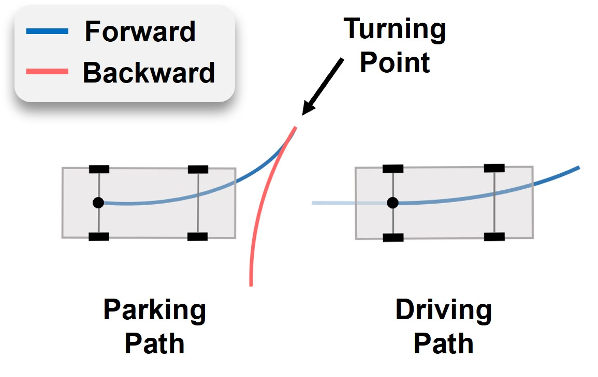
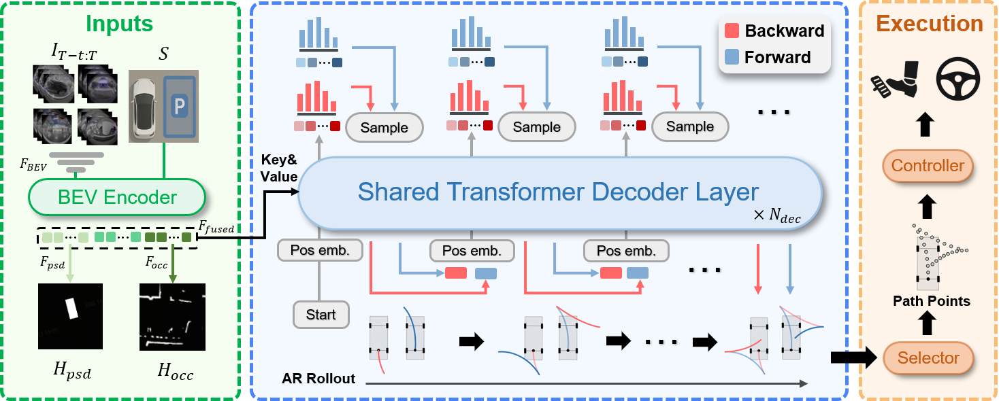
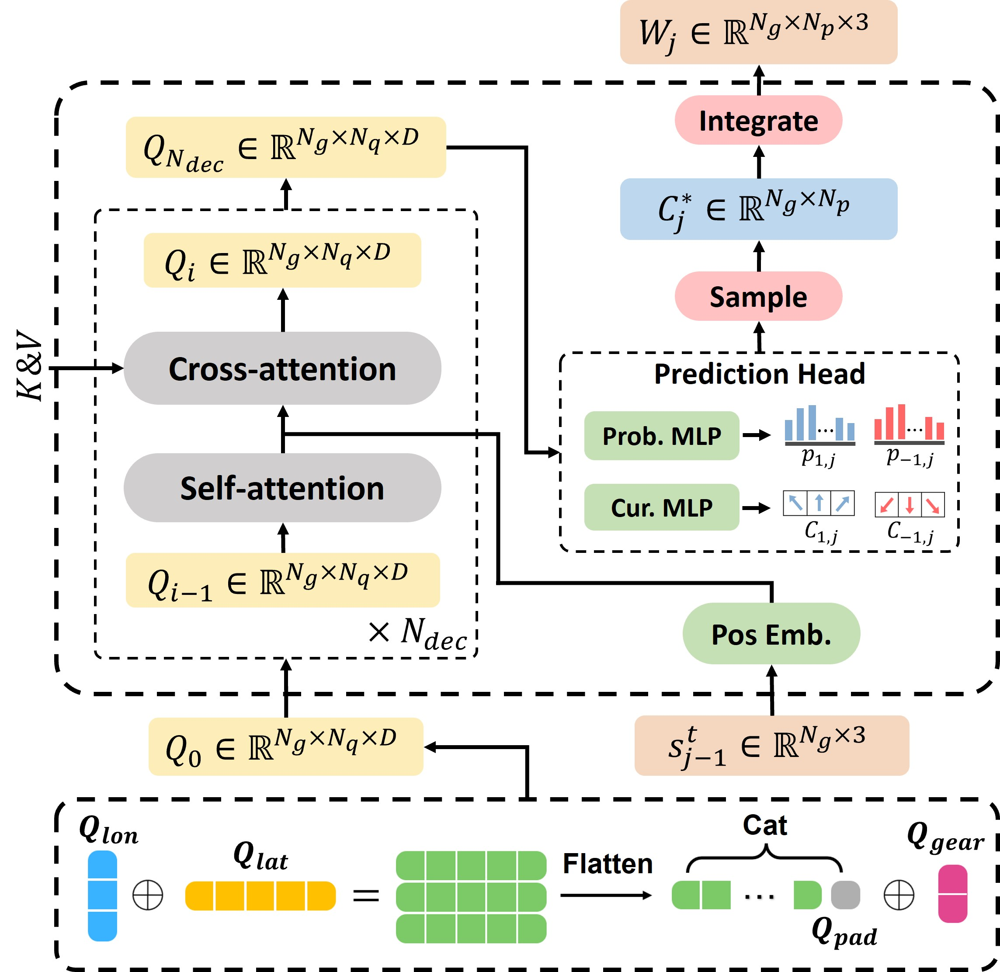
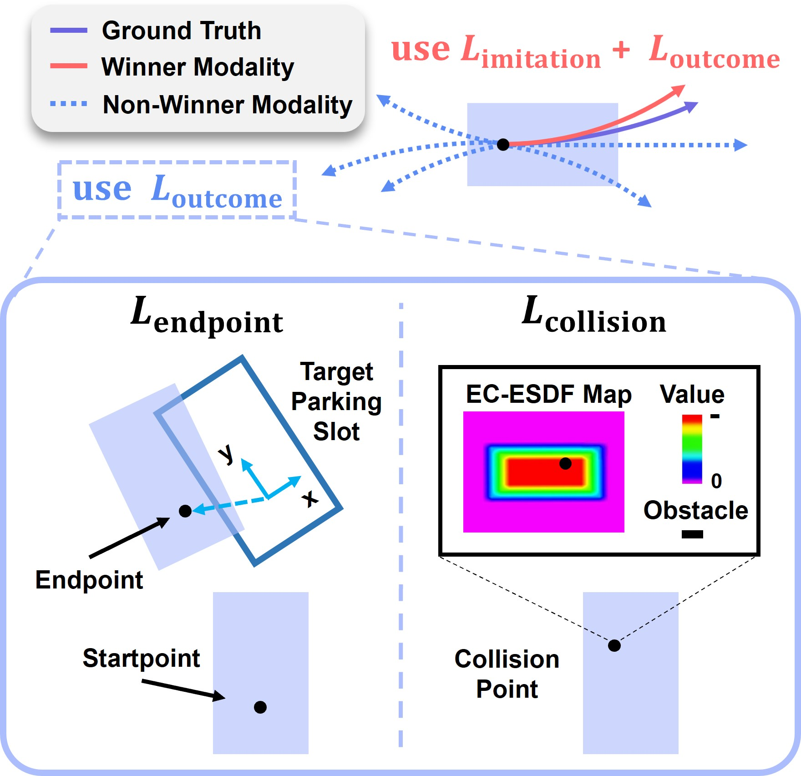
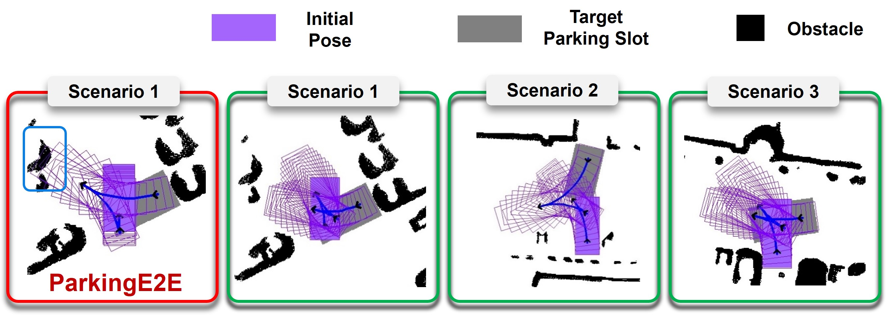
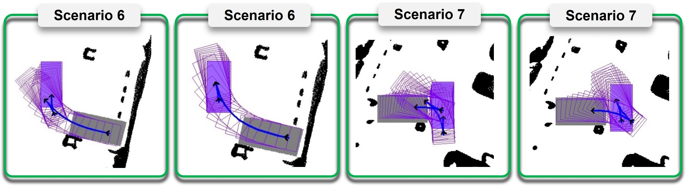
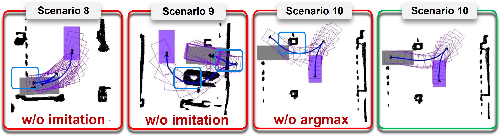
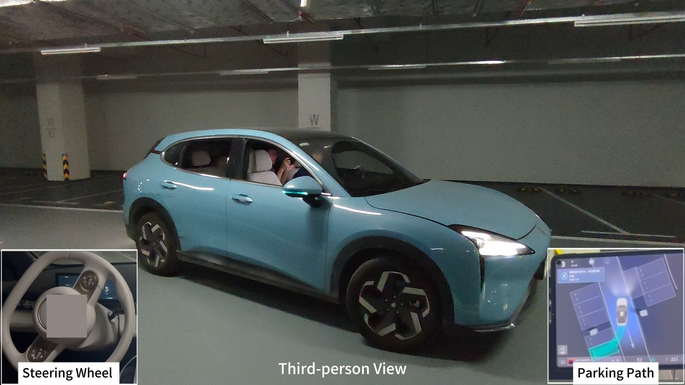

# MultiPark (arXiv 2025)

<!-- paper-source: https://chengwei920412.github.io/paper_reading/2508.11537_MultiPark_Multimodal_Parking_Transformer_with_Next_Segment_Prediction/technical_report.html -->

> **arXiv ID**: 2508.11537
> **原文标题**: MultiPark: Multimodal Parking Transformer with Next-Segment Prediction
> **翻译日期**: 2026-08-25

---

## 📋 论文概览 {#_1}

### 基本信息 {#_2}

- **作者**: Han Zheng, Zikang Zhou, Guli Zhang, Zhepei Wang, Kaixuan Wang, Peiliang Li, Shaojie Shen, Ming Yang, Tong Qin（通讯作者）
- **机构**: 上海交通大学；卓驭科技有限公司；香港科技大学电子与计算机工程系
- **发表时间**: 2025-08-15（arXiv v1，cs.RO；行文与格式面向 IEEE 会议）
- **领域**: 机器人学 / 端到端自动泊车 / 模仿学习 / 多模态轨迹预测

### 核心贡献 {#_3}

1. **下一段预测（Next-Segment Prediction）范式**：把泊车路径按换挡点（GSP）切分为若干「运动方向恒定」的分段，以自回归方式预测下一段，而非逐点预测下一个 token。
2. **半锚点泊车查询（Semi-Anchor Parking Queries）**：把泊车行为分解为挡位 × 纵向 × 横向三个语义维度，用 \(2\times3\times5+1=31\)（实现中记为 32）个可学习查询并行解码多模态路径。
3. **结果导向损失（Outcome-Oriented Loss）+ 两阶段训练**：先教师强制预训练，再做 argmax 微调；微调阶段对**全部模态**施加「终点对准 + EC-ESDF 碰撞」损失，同时保留模仿损失作正则。
4. **实车落地**：在 QC8650 车规芯片上实时运行（59 ms），完全替换量产车原有泊车规划器。

---

## 🎯 研究背景与动机 {#_4}

### 问题定义 {#_5}

给定 \(t\) 帧环视相机图像 \(\mathcal{I}_{T-t:T}\) 与用户选定的目标车位位姿 \(\mathcal{S}=[x_0,y_0,\psi_0]^\top\)，输出 \(N_g\) 条带评分的多模态泊车路径 \(\mathcal{P}_{pred}\in\mathbb{R}^{N_s\times N_p\times 4}\)，每条路径含 \(N_s\) 个分段、每段 \(N_p\) 个等距路径点。训练集每个样本**只有一条**专家真值路径，但模型被要求输出多个合理解。

### 现有方法的局限性 {#_6}

论文把差距归纳为三点，对应图 1 的四个子图：

图：泊车路径同时包含前进与后退挡，形成带急剧转折点的不连续分段。

1. **路径不连续**。行车路径平滑、方向恒定；泊车路径被换挡点切成若干段，逐点自回归既浪费数据又难以建模跨段因果。
2. **分布本身多模态**。同一车位、同一初始位姿，不同驾驶员会给出不同方案。用单条路径拟合会导致模式崩塌，得到"平均解"——实际不可执行。
3. **分布偏移 + 因果混淆**。模型被短视地优化于「下一步动作」，而非「泊车成功」；一旦偏离专家分布便无法纠错。

第 3 点最有意思：论文用 GoalStatus 实验（仿 EgoStatus [40] 的思路）证明，**只喂车位信息、完全不给占据信息**的模型在普通场景下就能打到与完整模型相当的水平（表 II 中 0.1917 vs ParkingE2E 完整模型 0.3013）。这说明既有 benchmark 太简单，模型学到的是「对准车位」这个捷径，而非真正的避障因果。

### 本文的创新点 {#_7}

把「预测粒度」从**点**提升到**段**，把「多模态」从隐式期望变成**显式的查询分解**，把「监督信号」从纯模仿扩展到**结果导向**。三者相互支撑：分段化让自回归步数从数十步降到 ≤5 步（这才让多模态并行解码在车端可负担），显式多模态让结果导向损失有多个模态可优化（单模态下该损失失效，论文在 ParkingMLP 基线里专门改成多路径输出来说明这点）。

---

## 🔬 方法论 {#_8}

### 整体架构 {#_9}

图：MultiPark 总览。BEV 编码器输出融合场景特征作为交叉注意力的键与值；基于查询的解码器并行预测前进/后退两挡的带评分路径；GSP 状态反向嵌入实现挡位切换，自回归推演下一段。

**编码器**：环视 RGB → EfficientNet [33] → IPM 逆透视变换 [34] → BEV 特征 → BEV 编码器输出车位检测（PSD）与占据（OCC）的实例级时序特征 → 检测头产出对齐后轴中心的热力图 \(\mathcal{H}_{psd},\mathcal{H}_{occ}\) → 融合为 \(\mathcal{F}_{fused}\)。注意 PSD 热力图经用户选择 \(\mathcal{S}\) 掩码后只保留目标车位。

**解码器**：DETR 式 [36]，4 层，隐藏维度 64，4 头。

### 关键技术 {#_10}

**（1）下一段预测的自回归分解**

\[p(\mathcal{P}\mid s_0,\mathcal{F}_{fused}) = \prod_{j=1}^{N_s} p(s_j \mid s_{j-1}, \mathcal{F}_{fused})\]

其中 \(s_j\) 是第 \(j\) 个换挡点状态。这里显式假设了**马尔可夫性** \(p(s_j\mid s_{1:j-1},\mathcal{F}_{fused})=p(s_j\mid s_{j-1},\mathcal{F}_{fused})\)，论文的理由是"静态泊车场景"。

段内不直接回归坐标，而是预测一个**曲率块** \(\mathcal{C}_j=\{\Delta s,\kappa_1,\dots,\kappa_{N_p}\}\)，再用 RK2 [35] 积分出路径点：

\[\mathbf{p}_{j}^{k+1} = \mathbf{p}_{j}^{k} + f_{RK2}(\mathcal{C}_j, \mathbf{p}_{j}^{k})\]

这一步是全文的工程精髓：**用曲率参数化保证运动学可行性**（曲率在自行车模型下直接对应方向盘角度），同时把「预测 \(N_p\) 个 3 维位姿」降维成「预测 \(N_p\) 个标量曲率 + 1 个弧长」，既压缩输出空间又天然平滑。

**（2）半锚点泊车查询**

\[Q_0 = \big(\text{cat}(Q_{\mathrm{lon}} \oplus Q_{\mathrm{lat}},\, Q_{\mathrm{pad}})\big) \oplus Q_{\mathrm{gear}} \in \mathbb{R}^{N_g\times N_q\times D}\]

\(N_q = N_{lon}N_{lat}+1\)。取 \(N_g{=}2\)（前进/后退）、\(N_{lon}{=}3\)（短/中/长）、\(N_{lat}{=}5\)（急左/缓左/直行/缓右/急右），得 \(N_q=16\)、总查询 32。

图：第 \(j\) 段预测中带半锚点泊车查询的解码器网络结构。

"半锚点"的含义：不像 MultiPath [19] 那样用 k-means 聚出的**完整轨迹锚点**（论文指出泊车数据上 k-means 会得到高度冗余的簇），也不像纯 anchor-free 那样毫无先验（易模式崩塌 [37]），而是在**语义维度上做笛卡尔积**式的组合先验。三组查询靠广播加法组合，参数量只有 \(N_g+N_{lon}+N_{lat}=10\) 个嵌入向量，却张出 32 个模态。

**（3）结果导向损失**

\[\mathcal{L}_{\text{argmax}} = \underbrace{\lambda_{\text{i}}\mathcal{L}_{\text{imitation}}(\mathcal{M}_{\text{win}})}_{\text{正则}} + \underbrace{\lambda_{\text{o}}\mathcal{L}_{\text{outcome}}(\mathcal{M}_{\text{all}})}_{\text{探索}}\]

- \(\mathcal{L}_{\text{endpoint}}=\|\mathbf{p}_t\|^2\)：把预测终点变换到**目标车位坐标系**后取模——目标即原点，形式极简。
- \(\mathcal{L}_{\text{collision}}=\sum_{i=1}^{N_c}d_i^2\)：\(d_i\) 由 **EC-ESDF**（自车中心欧氏符号距离场 [39]）查询得到。EC-ESDF 把「车辆是任意形状」的复杂性预计算进一张以自车为中心的场里：内部为负（到车身边界的符号距离），外部为零。因此碰撞检测退化为「把障碍点变换到自车系 + 查表」，可微且对任意车形精确，避免了传统凸多边形/圆盘近似的保守性。

图：模仿损失只作用于胜者模态，结果导向损失作用于全部模态。

### 算法流程 {#_11}

**阶段一 · 教师强制预训练**：用真值 GSP \(s_{j-1}^{gt}\) 作为每段输入（因此各段可并行），采用 winner-takes-all [25]，只对真值模态回传：

\[\mathcal{L}_{\text{teach}} = \sum_{j=1}^{N_s}\big( \lambda_{\text{p}}\mathcal{L}_{\text{wpt}} + \lambda_{\text{c}}\mathcal{L}_{\text{cur}} + \lambda_{\text{p}}\mathcal{L}_{\text{prob}} + \lambda_{\text{v}}\mathcal{L}_{\text{val}} \big)\]

回归用 smooth L1，评分用交叉熵，分段有效性用 BCE。

**阶段二 · argmax 微调**：改为同策略推演（用自己上一段的输出作为下一段输入），暴露真实的分布偏移，再叠加结果导向损失。模仿损失保留作正则，防止行为漂移出人类习惯。

推理时：从两个挡位各自的分布中采样/取 argmax 得曲率块 → RK2 积分 → 用 \(\mathbf{p}_{-1,j+1}^{0}=\mathbf{p}_{1,j}^{N_p}\)、\(\mathbf{p}_{1,j+1}^{0}=\mathbf{p}_{-1,j}^{N_p}\) 交叉传递起点，实现相邻段的前进/后退切换 → 最多推演 5 段。

---

## 📊 实验与结果 {#_12}

### 实验设置 {#_13}

- **数据集**: HP5，自建。人类泊车路径（车载设备采集，地下+地面停车场，多光照/多占据/混合车位类型，VINS [42] 定位）+ 专家规划器（含特权信息）增广路径。
- **评估指标**: 纵向/横向/朝向偏差、覆盖率、碰撞率、碰撞比例、成功率（覆盖率 > 90% 且无碰撞）。
- **对比方法**: ParkingE2E [9]、TransParking [27]、TransFuser [12]、GoalStatus（仿 [40] 自实现）、ParkingMLP（仿 AD-MLP [41] 自实现）、OnlyReg（自身单模态消融）。全部在同一 HP5 上训至收敛，共用同一编码器。

### 主要结果 {#_14}

表：不同场景下与已有工作的性能对比（数值为比例，非百分数）。

<table>
<thead>
<tr>
<th>方法</th>
<th>纵向偏差 (m) ↓</th>
<th>横向偏差 (m) ↓</th>
<th>朝向偏差 (deg) ↓</th>
<th>覆盖率 ↑</th>
<th>碰撞率 ↓</th>
<th>碰撞比例 ↓</th>
<th>成功率 ↑</th>
</tr>
</thead>
<tbody>
<tr>
<td>ParkingE2E [9]</td>
<td>0.2794</td>
<td>0.1540</td>
<td>10.182</td>
<td>0.9211</td>
<td>0.3167</td>
<td>0.0712</td>
<td>0.6453</td>
</tr>
<tr>
<td>TransParking [27]</td>
<td>0.5901</td>
<td>0.2005</td>
<td>11.269</td>
<td>0.8816</td>
<td>0.3120</td>
<td>0.0606</td>
<td>0.5933</td>
</tr>
<tr>
<td>TransFuser [12]</td>
<td>0.6069</td>
<td>0.2142</td>
<td>41.476</td>
<td>0.7072</td>
<td>0.6359</td>
<td>0.1522</td>
<td>0.1134</td>
</tr>
<tr>
<td>GoalStatus [40]</td>
<td>0.7161</td>
<td>0.3867</td>
<td>2.4257</td>
<td>0.8661</td>
<td>0.4326</td>
<td>0.0895</td>
<td>0.4680</td>
</tr>
<tr>
<td>ParkingMLP [41]</td>
<td>0.1904</td>
<td>0.1330</td>
<td>1.5140</td>
<td>0.9665</td>
<td>0.2458</td>
<td>0.0511</td>
<td>0.7304</td>
</tr>
<tr>
<td>OnlyReg</td>
<td>0.1873</td>
<td>0.1095</td>
<td>1.7871</td>
<td>0.9564</td>
<td>0.2151</td>
<td>0.0349</td>
<td>0.7470</td>
</tr>
<tr>
<td><strong>MultiPark</strong></td>
<td><strong>0.1185</strong></td>
<td><strong>0.0777</strong></td>
<td><strong>1.0176</strong></td>
<td><strong>0.9720</strong></td>
<td><strong>0.1749</strong></td>
<td><strong>0.0268</strong></td>
<td><strong>0.7895</strong></td>
</tr>
</tbody>
</table>

MultiPark 在全部 7 个指标上取胜：成功率 78.95% vs 次优 ParkingMLP 73.04%（+5.9 个百分点），朝向偏差 1.02° vs ParkingE2E 10.18°（降低一个数量级）。

三处值得单独拎出来的对比：

- **TransFuser 朝向偏差 41.48°**：GRU 解码器直接从行车任务搬到泊车任务几乎失效。论文的解释是行车以直线为主、泊车需要急转——这也侧面印证了曲率参数化的必要性。
- **ParkingMLP（0.7304）反超 ParkingE2E（0.6453）**：一个直接回归全部路径点的 MLP 竟胜过 SOTA 自回归 token 方法。这是全文最诚实的一笔——说明 MultiPark 的增益**并非主要来自 Transformer 架构**，而来自编码器、多模态输出与结果导向损失等其他设计。
- **OnlyReg（0.7470）已超过所有外部基线**：即使去掉多模态，本文的其余设计仍然够强。多模态再贡献 +4.25 个百分点。

表：不同感知特征在不同难度场景下的因果混淆研究（碰撞率，比例）。

<table>
<thead>
<tr>
<th>方法</th>
<th>配置</th>
<th>普通</th>
<th>复杂</th>
<th>极限</th>
</tr>
</thead>
<tbody>
<tr>
<td>GoalStatus</td>
<td>无 OCC</td>
<td>0.1917</td>
<td>0.3698</td>
<td>0.4426</td>
</tr>
<tr>
<td>ParkingE2E</td>
<td>完整模型</td>
<td>0.3013</td>
<td>0.3561</td>
<td>0.5901</td>
</tr>
<tr>
<td>ParkingE2E</td>
<td>无 OCC</td>
<td>0.3287</td>
<td>0.4246</td>
<td>0.5409</td>
</tr>
<tr>
<td>ParkingE2E</td>
<td>无 PSD</td>
<td>0.7397</td>
<td>0.8082</td>
<td>0.7704</td>
</tr>
<tr>
<td><strong>MultiPark</strong></td>
<td><strong>完整模型</strong></td>
<td><strong>0.1643</strong></td>
<td><strong>0.2465</strong></td>
<td><strong>0.1803</strong></td>
</tr>
<tr>
<td>MultiPark</td>
<td>无 OCC</td>
<td>0.2465</td>
<td>0.3972</td>
<td>0.4098</td>
</tr>
<tr>
<td>MultiPark</td>
<td>无 PSD</td>
<td>0.2465</td>
<td>0.4109</td>
<td>0.2950</td>
</tr>
</tbody>
</table>

这张表是全文最有价值的诊断：ParkingE2E 屏蔽 OCC 后在**极限场景反而变好**（0.5901 → 0.5409），屏蔽 PSD 则崩溃（0.7397/0.8082/0.7704）。即它几乎只依赖目标车位、基本没在用障碍信息——教科书级的因果混淆。MultiPark 屏蔽任一路径都明显退化，说明两类感知都被真正用上了。

图：困难场景下的表现对比（MultiPark 绿色，对比方法红色，浅蓝车身框表示碰撞）。

图：同一场景下 MultiPark 给出的多个合理解。

### 消融实验 {#_15}

表：自回归模型的推理时间。

<table>
<thead>
<tr>
<th>方法</th>
<th>推理时间 (ms) ↓</th>
</tr>
</thead>
<tbody>
<tr>
<td>ParkingE2E</td>
<td>224.42</td>
</tr>
<tr>
<td>TransParking</td>
<td>226.94</td>
</tr>
<tr>
<td>OnlyReg</td>
<td>60.306</td>
</tr>
<tr>
<td><strong>MultiPark</strong></td>
<td><strong>59.062</strong></td>
</tr>
</tbody>
</table>

3.8× 加速，来自 AR 步数从「逐点」降到「逐段（≤5）」。

表：结果导向损失的监督对象。

<table>
<thead>
<tr>
<th>监督对象</th>
<th>纵向偏差 (m) ↓</th>
<th>横向偏差 (m) ↓</th>
<th>朝向偏差 (deg) ↓</th>
</tr>
</thead>
<tbody>
<tr>
<td>无模态</td>
<td>0.1871</td>
<td>0.1083</td>
<td>1.7503</td>
</tr>
<tr>
<td>胜者模态</td>
<td>0.1303</td>
<td>0.0879</td>
<td>1.2014</td>
</tr>
<tr>
<td>非胜者模态</td>
<td>0.1135</td>
<td><strong>0.0752</strong></td>
<td><strong>0.7660</strong></td>
</tr>
<tr>
<td>全部模态</td>
<td><strong>0.1085</strong></td>
<td>0.0800</td>
<td>0.8913</td>
</tr>
</tbody>
</table>

结论很反直觉：**只监督胜者模态收益有限**（论文认为那只是对模仿损失做了重新缩放，没有引入新信息），而**监督非胜者模态才是精度提升的主要来源**。逻辑上讲得通——非胜者模态在纯模仿训练下完全没有梯度约束，是"自由生长"的；给它们施加「终点要对准、不许碰撞」的硬约束，等价于让整个模态集合都保持物理合理。

表：两阶段训练的损失项消融。

<table>
<thead>
<tr>
<th>损失</th>
<th>覆盖率 ↑</th>
<th>碰撞率 ↓</th>
<th>成功率 ↑</th>
</tr>
</thead>
<tbody>
<tr>
<td>无模仿损失</td>
<td>0.8882</td>
<td>0.2198</td>
<td>0.6595</td>
</tr>
<tr>
<td>无终点损失</td>
<td>0.8508</td>
<td>0.2293</td>
<td>0.5059</td>
</tr>
<tr>
<td>无 argmax 微调</td>
<td>0.7541</td>
<td>0.3215</td>
<td>0.5082</td>
</tr>
<tr>
<td><strong>完整训练</strong></td>
<td><strong>0.9720</strong></td>
<td><strong>0.1749</strong></td>
<td><strong>0.7895</strong></td>
</tr>
</tbody>
</table>

三项都不可去。去掉 argmax 微调掉得最多（0.7895 → 0.5082），说明**闭环暴露分布偏移**是核心；去掉终点损失次之（→ 0.5059）；去掉模仿正则则"像稀疏奖励一样无法收敛，甚至产生怪异行为"。

图：去除 argmax 损失或模仿损失后的失效行为。

### 实车部署 {#_16}

图：量产车实验平台。

四路鱼眼环视，QC8650 车规芯片，ONNX 导出时把 Transformer 解码器中不受支持的算子替换为卷积。车端系统三段解耦：MultiPark 规划候选路径（**完全替换原厂规划器，第一阶段无任何规则算法介入**）→ 按安全性与质量选最优 → 分配速度 + MPC 跟踪。测试按 ISO 20900 / GB/T 41630-2022 分为普通/复杂/极限三档。

---

## 💡 关键见解 {#_17}

### 理论分析 {#_18}

**分段化为什么是「数据高效」的。** 逐点自回归把一条 \(N\) 点路径当成 \(N\) 个训练信号，但这些信号高度相关（相邻点几乎决定于同一转向动作），有效信息远小于 \(N\)。按换挡点分段后，每段内部由一组曲率描述，模型学的是「这一段该怎么打方向」这个决策单元。论文声称的"空间泛化与时间外推"即由此而来：段是可复用的运动基元，段数可变（\(N_s\le5\)）便实现了对更长、更复杂机动的外推。

**马尔可夫假设的适用边界。** \(p(s_j\mid s_{1:j-1})=p(s_j\mid s_{j-1})\) 只在静态场景成立。这不是疏漏而是设计选择——论文把动态障碍完全推给车端第三阶段的速度分配（时空避让 + MPC），路径规划层只管静态几何。代价是：遇到必须**改变路径形状**才能避让的动态场景（而非减速让行），当前架构无解。

**结果导向损失 vs RL。** 这是本文最值得借鉴的一招：想要 RL 的「优化最终结果」而不想要 RL 的稀疏奖励、样本低效与 sim2real gap，于是把奖励改写成**可微的解析损失**（终点距离 + ESDF 查表），直接梯度下降。前提是环境模型可微且已知——泊车恰好满足（静态几何 + 运动学积分可微）。这个技巧能否迁移，取决于任务的"结果"是否能写成对预测的可微函数。

### 实践启示 {#_19}

1. **输出参数化 > 网络架构**。ParkingMLP 反超 ParkingE2E 是强证据：把坐标离散成 token 是个糟糕的选择，换成曲率块后连 MLP 都能打。
2. **显式多模态几乎免费**。32 个查询只需 10 个嵌入向量，并行解码后推理时间（59.1 ms）甚至略低于单模态 OnlyReg（60.3 ms）。
3. **评测集难度必须分层**。若只在普通场景评测，GoalStatus 这种"只看车位"的退化模型也能拿到好分数，整个 benchmark 就失去了鉴别力。

---

## 🔍 局限性与未来工作 {#_20}

### 当前局限 {#_21}

1. **数据与代码均未公开**。HP5 自建、六个基线全部自行复现、项目主页只有视频。整套结果**外部不可复现**，与 ParkingE2E [9] 等原始论文的数字也无法直接对照。
2. **成功率 78.95% 与"量产替换"的落差**。约五分之一的样本仍失败（覆盖率不足 90% 或发生碰撞）。论文声称第一阶段完全替换原厂规划器，但真正兜底的可能是第二阶段的"评估安全性与质量选最优"——这一层的规则细节全文未述，实际系统的安全边界因此看不清。
3. **表格单位标注与数值口径不一致**。原文表头写 `(%)`，但数值是 0–1 的比例（如覆盖率 0.9720 实为 97.20%）。译文与本报告统一按比例呈现并去掉了 `%` 标注。
4. **表 I 与表 IV 的全模型数字不一致**：表 I 中 MultiPark 纵向偏差 0.1185，表 IV「全部模态」（应即完整模型）为 0.1085；横向 0.0777 vs 0.0800。论文未说明两者是否为不同随机种子或不同子集，需注意。
5. **表 IV 的"最优"标注偏宽松**。「全部模态」只在纵向偏差上最好，横向（0.0800 vs 0.0752）与朝向（0.8913 vs 0.7660）均逊于「非胜者模态」。按表内数据，"全部模态最优"这一结论并不完整成立；选择全部模态或许另有稳定性考量，但论文未给出。
6. **关键超参无消融**。查询数（32）、最大推演段数（\(N_s{=}5\)）、曲率块长度（\(N_p{=}10\)）、\(\lambda_i/\lambda_o\) 配比均无敏感性实验——从 LaTeX 源码可见相关描述曾被注释掉。
7. **碰撞点来源未说明**。\(\mathcal{L}_{collision}\) 需要障碍点集合，训练时应来自 OCC 真值（即特权信息）。若如此，该损失在部署时无对应监督，训练/推理的信息不对称程度未被讨论。
8. **表 II 中 0.2465 重复出现三次**（MultiPark 完整模型-复杂、无 OCC-普通、无 PSD-普通）。可能是小测试子集下的真实巧合，但缺少样本量说明，无法判断。

### 未来方向 {#_22}

- 论文自陈：接入视觉语言模型的场景理解与推理能力，把 MultiPark 扩展为 **ParkAgent**；源码注释中还有一条被删去的设想——把 MultiPark 扩展为统一的行车 + 泊车模型。
- 可自然延伸的方向：把动态障碍纳入路径层（打破静态马尔可夫假设）；用可微 ESDF 思路替换更多 RL 奖励；公开一个分难度的端到端泊车基准，解决论文自己指出的"评测集太简单"问题。

---

## 📚 相关工作对比 {#_23}

<table>
<thead>
<tr>
<th>方法</th>
<th>核心思想</th>
<th>优势</th>
<th>劣势</th>
</tr>
</thead>
<tbody>
<tr>
<td>ParkingE2E [9]</td>
<td>坐标离散为 token，逐点自回归</td>
<td>首个开源端到端泊车网络</td>
<td>逐点 AR 慢（224 ms）；行为不自然；严重因果混淆（几乎只用 PSD）</td>
</tr>
<tr>
<td>TransParking [27]</td>
<td>双解码器 Transformer + 软定位</td>
<td>缓解单解码器与时序输入的错配</td>
<td>仍是单段、单模态；227 ms</td>
</tr>
<tr>
<td>TransFuser [12]</td>
<td>GRU 解码器预测差分路径点（行车）</td>
<td>行车任务上成熟</td>
<td>迁移到泊车几乎失效（朝向偏差 41.5°）</td>
</tr>
<tr>
<td>HOPE [29]</td>
<td>RL + Reeds-Shepp 曲线提供正样本</td>
<td>擅长狭窄空间多段规划</td>
<td>sim2real gap、样本低效、行为偏离人类（过度换挡/抖动）</td>
</tr>
<tr>
<td>MultiPath [19] / MTR [24] / QCNet [25]</td>
<td>锚点 / 可学习查询做多模态轨迹预测</td>
<td>多模态建模成熟</td>
<td>面向行车；泊车数据上 k-means 锚点高度冗余</td>
</tr>
<tr>
<td>ParkingMLP（本文复现 [41]）</td>
<td>MLP 直接回归全部路径点</td>
<td>简单，却超过 ParkingE2E</td>
<td>无自回归，难以外推更长机动</td>
</tr>
<tr>
<td><strong>MultiPark（本文）</strong></td>
<td>按换挡点分段 + 曲率块 + 半锚点查询 + 结果导向损失</td>
<td>全指标 SOTA；3.8× 加速；实车落地；显式多模态近乎免费</td>
<td>数据/代码闭源；成功率 78.95%；静态马尔可夫假设；关键超参无消融</td>
</tr>
</tbody>
</table>

---

## 🎓 个人评价 {#_24}

### 优点 {#_25}

- **问题拆解精准**。「不连续分段 / 多模态 / 分布偏移」三点确实抓住了泊车相对行车的本质差异，且三个模块一一对应，不是拼凑。
- **曲率块 + RK2 积分**是漂亮的工程设计：一步同时解决输出降维、运动学可行性与路径平滑，比离散 token 高明得多。
- **GoalStatus 消融极具批判精神**。作者主动构造一个"退化模型"去证明既有 benchmark 无鉴别力，等于质疑了包括自己引用的 SOTA 在内的整条评测线，这种自我审查在应用类论文中不常见。
- **ParkingMLP 的诚实**。明确承认增益不主要来自 Transformer，而非把功劳都归给架构。
- **结果导向损失的思路可迁移**：把 RL 奖励改写为可微解析损失，规避 sim2real——这是本文最有普适价值的一点。
- **真的上了量产车**，且说明了 ONNX 算子替换等落地细节，不是仿真自嗨。

### 可改进之处 {#_26}

- **可复现性是最大硬伤**。自建数据 + 自行复现的全部基线 + 无代码，读者只能选择相信。论文一边论证"公开泊车基准稀缺、既有评测太简单"，一边没有公开自己的分难度基准，略显遗憾。
- **表 IV 的结论与数据不完全一致**（见局限 5），加粗与高亮的选取需要更谨慎的说明。
- **表 I / 表 IV 数字打不平**（见局限 4），审稿时应要求统一。
- **单位标注错误**贯穿所有表格（`(%)` 配 0–1 比例）。
- **安全论证不足**。78.95% 成功率 + "完全替换原厂规划器"的表述，与第二阶段那个未公开细节的"安全性评估"之间，缺少一个说清责任边界的论述。
- 关键超参（查询数、\(N_s\)、损失权重）无敏感性分析，而这些恰是复现者最需要的。

### 推荐阅读对象 {#_27}

- 做**端到端泊车 / 低速自动驾驶规划**的研究者与工程师：本文基本是该方向当前的参考基线，曲率块参数化与分段 AR 值得直接借鉴。
- 关心**模仿学习中因果混淆与分布偏移**的人：GoalStatus 消融与两阶段训练是很好的实证案例。
- 做**多模态轨迹预测**的人：半锚点查询提供了一种介于 anchor-based 与 anchor-free 之间、参数极省的组合式先验。
- 研究**可微优化替代 RL** 的人：EC-ESDF 碰撞损失 + 目标中心终点损失是一个完整、可落地的范例。
- 不适合：想找开源可复现 baseline 的人（无代码无数据）；只关心高速行车规划的人。

---

## 📎 附录 {#_28}

### 重要公式 {#_29}

**1. 总优化目标**

\[\phi^* = \arg\min_{\phi}\ \mathbb{E}_{(\mathcal{I}_{T-t:T}, \mathcal{S}, \mathcal{P}_{e}) \sim \mathcal{D}} \left[\mathcal{L}\left(\mathcal{P}_{e},\, f_\phi(\mathcal{I}_{T-t:T}, \mathcal{S})\right)\right]\]

**2. 下一段预测的自回归分解**（马尔可夫性，仅静态场景）

\[p(\mathcal{P}\mid s_0,\mathcal{F}_{fused}) = \prod_{j=1}^{N_{s}} p(s_j\mid s_{j-1}, \mathcal{F}_{fused})\]

**3. 曲率块 RK2 积分**

\[\mathbf{p}_{j}^{k+1} = \mathbf{p}_{j}^{k} + f_{RK2}(\mathcal{C}_j, \mathbf{p}_{j}^{k}),\qquad \mathcal{C}_j=\{\Delta s,\kappa_1,\dots,\kappa_{N_p}\}\]

**4. 半锚点查询组合**

\[Q_0 = \big(\text{cat}(Q_{\mathrm{lon}} \oplus Q_{\mathrm{lat}},\, Q_{\mathrm{pad}})\big) \oplus Q_{\mathrm{gear}} \in \mathbb{R}^{N_{g}\times N_{q} \times D},\qquad N_q = N_{lon}N_{lat}+1\]

**5. 注意力两步**

\[\begin{aligned}
Q&#x27;_{i-1} &amp;= \text{SelfAttn}(Q_{i-1}) \\
Q_i &amp;= \text{CrossAttn}\big(Q&#x27;_{i-1}+\text{PE}(s_{j-1}^t),\ \mathcal{F}_{fused}\big)
\end{aligned}\]

**6. 教师强制阶段损失**

\[\mathcal{L}_{\text{teach}} = \sum_{j=1}^{N_{s}}\big( \lambda_{\text{p}}\mathcal{L}_{\text{wpt}} + \lambda_{\text{c}}\mathcal{L}_{\text{cur}} + \lambda_{\text{p}}\mathcal{L}_{\text{prob}} + \lambda_{\text{v}}\mathcal{L}_{\text{val}} \big)\]

**7. argmax 微调阶段损失**

\[\mathcal{L}_{\text{argmax}} = \lambda_{\text{i}}\mathcal{L}_{\text{imitation}}(\mathcal{M}_{\text{win}}) + \lambda_{\text{o}}\mathcal{L}_{\text{outcome}}(\mathcal{M}_{\text{all}})\]

**8. 结果导向损失的两个分量**

\[\mathcal{L}_{\text{endpoint}} = \|\mathbf{p}_{t}\|^2,\qquad \mathcal{L}_{\text{collision}} = \sum_{i=1}^{N_{c}} d_{i}^2\]

### 术语表 {#_30}

<table>
<thead>
<tr>
<th>英文</th>
<th>中文</th>
<th>说明</th>
</tr>
</thead>
<tbody>
<tr>
<td>Next-Segment Prediction</td>
<td>下一段预测</td>
<td>本文核心范式，以换挡点为界的自回归</td>
</tr>
<tr>
<td>Gear Shift Point (GSP)</td>
<td>换挡点</td>
<td>前进/后退切换处，分段边界</td>
</tr>
<tr>
<td>Curvature Chunk</td>
<td>曲率块</td>
<td>\(\{\Delta s,\kappa_1,\dots,\kappa_{N_p}\}\)，段内参数化</td>
</tr>
<tr>
<td>Semi-Anchor Parking Queries</td>
<td>半锚点泊车查询</td>
<td>挡位 × 纵向 × 横向组合式查询先验</td>
</tr>
<tr>
<td>Outcome-Oriented Loss</td>
<td>结果导向损失</td>
<td>终点对准 + 碰撞，作用于全部模态</td>
</tr>
<tr>
<td>Teacher-Forcing</td>
<td>教师强制</td>
<td>阶段一，用真值 GSP 并行训练</td>
</tr>
<tr>
<td>Argmax Finetuning</td>
<td>argmax 微调</td>
<td>阶段二，同策略推演暴露分布偏移</td>
</tr>
<tr>
<td>Winner-Takes-All</td>
<td>胜者全取</td>
<td>只对真值模态回传梯度</td>
</tr>
<tr>
<td>Causal Confusion</td>
<td>因果混淆</td>
<td>学到捷径而非真实因果</td>
</tr>
<tr>
<td>Distribution Shift</td>
<td>分布偏移</td>
<td>训练（开环）与部署（闭环）分布不一致</td>
</tr>
<tr>
<td>EC-ESDF</td>
<td>自车中心欧氏符号距离场</td>
<td>任意车形的可微碰撞查询</td>
</tr>
<tr>
<td>PSD / OCC</td>
<td>车位检测 / 占据</td>
<td>两路 BEV 感知特征</td>
</tr>
<tr>
<td>HP5</td>
<td>HP5 数据集</td>
<td>本文自建，人类路径 + 专家增广</td>
</tr>
<tr>
<td>OnlyReg</td>
<td>单模态消融</td>
<td>去掉分类头、只回归一条路径</td>
</tr>
<tr>
<td>GoalStatus</td>
<td>仅车位输入基线</td>
<td>仿 EgoStatus [40]，用于诊断因果混淆</td>
</tr>
<tr>
<td>ParkingMLP</td>
<td>MLP 基线</td>
<td>仿 AD-MLP [41]，直接回归全部路径点</td>
</tr>
</tbody>
</table>

### 参考资源 {#_31}

- **论文原文**: [arXiv:2508.11537](https://arxiv.org/abs/2508.11537)
- **中文翻译 PDF**: [paper_cn.pdf](https://chengwei920412.github.io/paper_reading/2508.11537_MultiPark_Multimodal_Parking_Transformer_with_Next_Segment_Prediction/paper_cn.pdf)
- **中文 Markdown 译文**: [paper_cn.md](https://chengwei920412.github.io/paper_reading/2508.11537_MultiPark_Multimodal_Parking_Transformer_with_Next_Segment_Prediction/paper_cn.html)
- **代码实现**: 未公开
- **项目主页**: <https://wuyi2121.github.io/MultiPark/>
