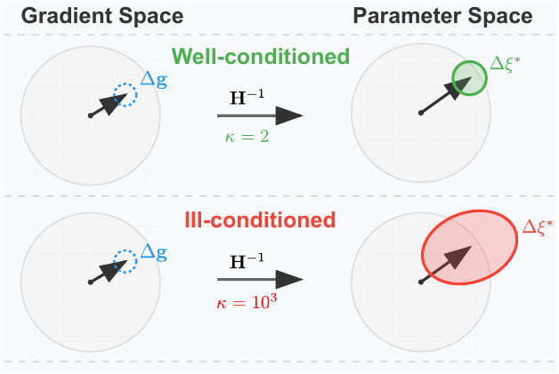
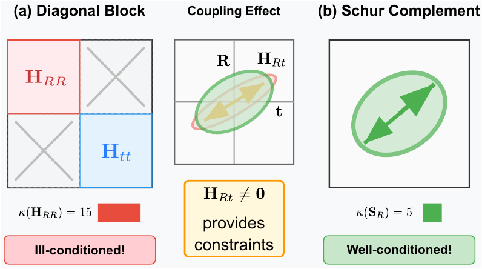
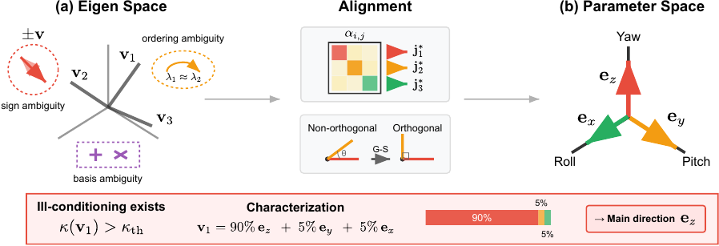
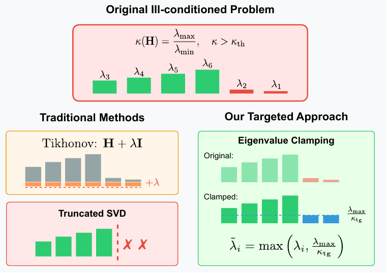
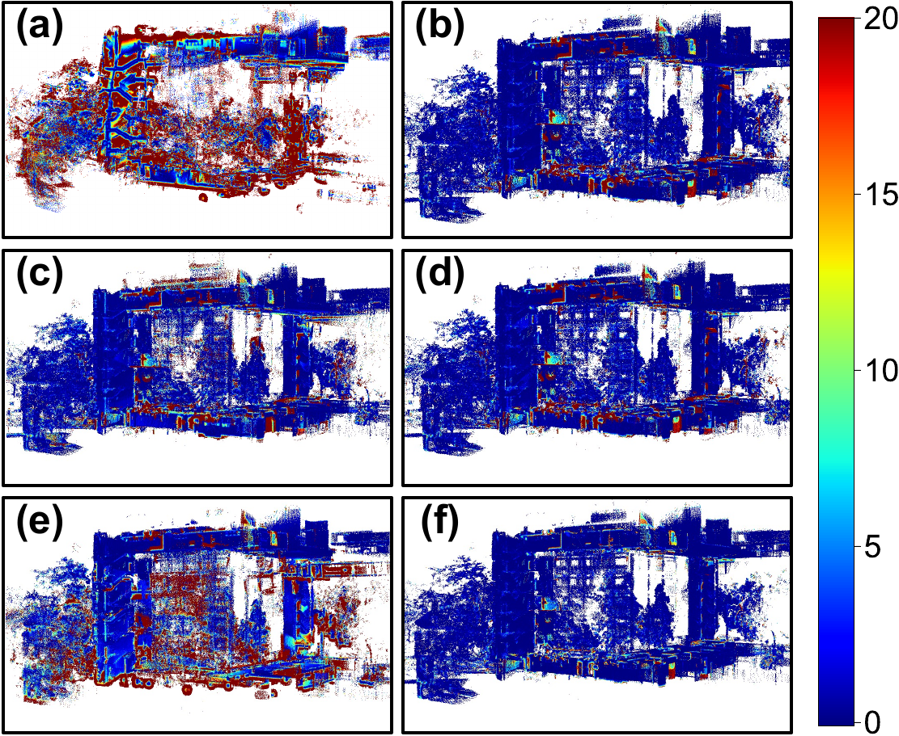
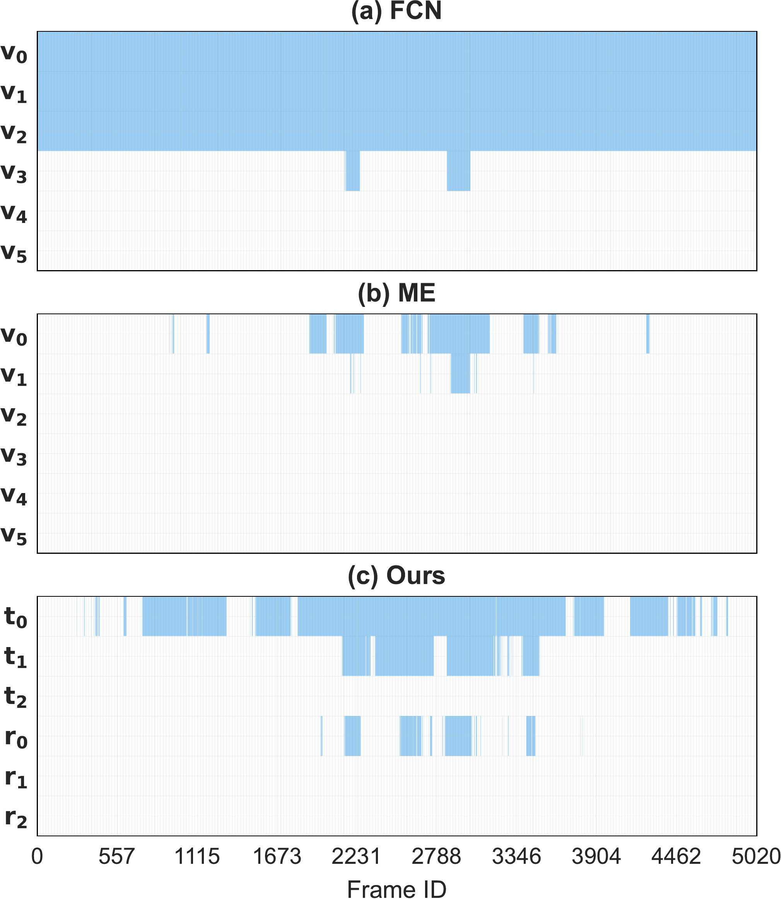

# DCReg (arXiv 2025)

<!-- paper-source: https://chengwei920412.github.io/paper_reading/2509.06285_DCReg_Decoupled_Characterization_for_Efficient_Degenerate_LiDAR_Registration/technical_report.html -->

> **arXiv ID**: 2509.06285
> **原文标题**: DCReg: Decoupled Characterization for Efficient Degenerate LiDAR Registration
> **翻译日期**: 2026-09-02

---

## 📋 论文概览 {#_1}

### 基本信息 {#_2}

- **作者**: Xiangcheng Hu, Xieyuanli Chen, Mingkai Jia, Jin Wu, Ping Tan, Steven L. Waslander
- **机构**: 香港科技大学电子与计算机工程系；国防科技大学机电工程学院；北京科技大学智能科学与技术学院；多伦多大学航空航天研究所与机器人研究院
- **投稿去向**: *The International Journal of Robotics Research* (IJRR) 格式，2025 年 9 月挂 arXiv
- **领域**: 机器人感知、LiDAR SLAM、点云配准、数值优化

### 核心贡献 {#_3}

论文把"几何退化环境下的 LiDAR 配准失效"重新表述为一个\*\*数值病态（ill-conditioning）\*\*问题，并用一条完整的 **检测 → 表征 → 缓解** 链路替代已有工作的"检测 → 缓解"两段式范式。三项贡献相互咬合：

1. **可靠检测**：用 **Schur 补**把 6 自由度 Hessian 精确解耦为两个 3 自由度子空间（纯旋转、纯平移），消除旋转—平移耦合项对退化模式的掩盖。这与常见的"取对角块"近似有本质区别——对角块丢弃耦合信息，Schur 补则把耦合影响折算进子空间内部。
2. **物理可解释表征**：在解耦子空间内用「内积匹配 → 最大分量分析 → Gram-Schmidt 正交化」三步消除特征基的**符号、排序、基**三重模糊性，把抽象特征方向稳定映射到物理运动轴，从而能给出"yaw 对本次病态贡献 80%"这类可操作结论，而不只是"某个特征值很小"。
3. **针对性缓解**：把特征值钳制**只放进预条件子**，不动正规方程。这样原最小二乘目标与其最小值点被完整保留（论文用定理证明了解等价性），同时通过预条件共轭梯度（PCG）获得受控的有效条件数，且只有一个物理可解释的超参数 \(\kappa_{\mathrm{tg}}\)。

实测收益：长时定位精度提升 **20%–50%**（部分场景远超此区间），相比同类退化感知基线**典型加速 5–30 倍，个别场景 116 倍**。

---

## 🎯 研究背景与动机 {#_4}

### 问题定义 {#_5}

点到平面 ICP 的每次迭代求解正规方程

\[\boldsymbol{H}\,\Delta\boldsymbol{\xi} = -\boldsymbol{g},\qquad
\boldsymbol{H} = \boldsymbol{J}^\top\boldsymbol{J} \in \mathbb{R}^{6\times 6}\]

把 \(\boldsymbol{H}\) 做特征分解后，位姿更新可按谱分量写成

\[\Delta\xi_j^* = -\sum_i \frac{\boldsymbol{v}_i^\top \boldsymbol{g}}{\lambda_i}\,[\boldsymbol{v}_i]_j\]

**病态性的本质就藏在这个 \(1/\lambda_i\) 里**：当某个 \(\lambda_i\) 极小时，该方向的逆增益把线性化误差与传感器噪声放大成一个过大且不可靠的步长。而 \(\boldsymbol{v}_i^\top \boldsymbol{g}\) 几乎从不精确为零，所以"信息很弱"并不会自动变成"不更新"，反而变成"乱更新"。

论文特别强调一个常被混淆的区分：走廊、隧道、楼梯这类场景通常**不是**真正的不可观测（信息为零），而是**弱约束**（信息很小但非零）。真·不可观测在现实中极少出现，而弱约束是常态——这正是缓解方法有用武之地的区间。

### 现有方法的局限性 {#_6}

论文把已有工作的失效归结为三点，每一点都对应一项贡献：

- **检测不可靠**。最小特征值（ME）与全条件数（FCN）都在完整 6×6 Hessian 上做谱分析，而旋转块与平移块的特征值**量级本就不同**（单位不同、杠杆臂效应）。结果是系统性偏差：ME 倾向于漏检旋转退化（旋转特征值天然更大，不会落到阈值以下），FCN 倾向于把三个平移维度一概判为退化。论文在停车场序列上把这一点做实：把 LiDAR 量程压到 10 m 后，ME 的检测率对旋转退化基本无响应。
- **表征不充分**。即便检测到"第 \(i\) 个特征值小"，也无法回答"是哪个物理运动缺约束"。根因是特征分解本身的三重模糊性（符号、排序、基），使得特征向量与物理轴之间没有稳定对应。
- **缓解破坏问题本身**。Tikhonov 正则化（TReg）把所有特征值统一平移 \(\lambda_i \mapsto \lambda_i + \lambda\)，等于给每个方向都加各向同性虚拟观测，**连良好约束的方向一起惩罚**，求解的已经是另一个问题；截断 SVD（TSVD）直接丢弃弱方向的贡献，信息不可逆丢失；解重映射（SR）等价于对选定方向施加无穷大惩罚，把可行更新集合重新定义了。

图：条件数如何决定相对参数误差的上界——病态性的误差放大效应（对应译文图 2）

### 本文的创新点 {#_7}

三项创新的关键在于**它们不是三个独立模块，而是同一条信息流**：Schur 解耦给出干净的子空间 → 基对齐把子空间里的特征方向锚定到物理轴 → 方向性谱信息直接喂给预条件子做定向钳制。少了中间那步，第三步就退化成"又一种各向同性正则化"。

---

## 🔬 方法论 {#_8}

### 整体架构 {#_9}

把 Hessian 按旋转/平移分块：

\[\boldsymbol{H} =
\begin{bmatrix}
\boldsymbol{H}_{RR} &amp; \boldsymbol{H}_{Rt} \\
\boldsymbol{H}_{tR} &amp; \boldsymbol{H}_{tt}
\end{bmatrix}\]

**Schur 条件化**给出两个 3×3 的解耦子空间矩阵：

\[\boldsymbol{S}_R = \boldsymbol{H}_{RR} - \boldsymbol{H}_{Rt}\boldsymbol{H}_{tt}^{-1}\boldsymbol{H}_{tR},
\qquad
\boldsymbol{S}_t = \boldsymbol{H}_{tt} - \boldsymbol{H}_{tR}\boldsymbol{H}_{RR}^{-1}\boldsymbol{H}_{Rt}\]

论文用\*\*定理 1（消元—曲率等价性）\*\*说明 \(\boldsymbol{S}_R\) 的物理含义：它正是"把平移分量按最优方式消去之后，目标函数沿旋转方向的有效曲率"。换句话说，\(\boldsymbol{S}_R\) 回答的是"在平移可以自由补偿的前提下，旋转还剩多少真实约束"——这恰好是退化诊断该问的问题，而对角块 \(\boldsymbol{H}_{RR}\) 回答的是"平移固定不动时旋转有多少约束"，会高估约束强度。

图：对角解耦（忽略耦合项，可能掩盖病态）与 Schur 补解耦（计入耦合，正确隔离子空间）的对比（对应译文图 3）

**命题 1（投影表示）**给出等价的几何解读：\(\boldsymbol{S}_R = \boldsymbol{J}_R^\top(\boldsymbol{I} - \boldsymbol{P}_t)\boldsymbol{J}_R\)，其中 \(\boldsymbol{P}_t\) 是到 \(\mathrm{range}(\boldsymbol{J}_t)\) 的正交投影。即：只有**不能被平移解释掉**的那部分旋转 Jacobian 才计入旋转约束。**命题 2**进一步证明 Schur 补具备尺度不变性与正交基不变性，这是把它当作可跨场景比较的诊断量的前提。

**定理 2（Schur 条件化的谱界）**是全篇最"诚实"的结论之一：它明确指出 \(\kappa(\boldsymbol{S}_R)\) **并不保证**优于 \(\kappa(\boldsymbol{H}_{RR})\)——Loewner 序意味着消元只会减少信息。论文对此的立场是：Schur 补的价值不在于"让条件数变好看"，而在于**暴露被对角块掩盖的退化**。定理的第 (iv) 部分给出了这种"掩盖"的定量形式：当 \(\lambda_{\max}(\boldsymbol{M}_R) \to \lambda_{\min}(\boldsymbol{H}_{RR})\) 时 \(\kappa(\boldsymbol{S}_R) \to \infty\)，而对角块分析对此毫无察觉。

### 关键技术 {#_10}

#### 1）相对条件数与检测判据 {#1}

在每个 3 自由度子空间内用**相对条件数**（而非绝对特征值）判定，配合归一化特征值，使判据不受单位与量级影响。检测阈值 \(\kappa_{\mathrm{th}} = 10\)。

#### 2）三步消除特征基模糊性 {#2}

图：定量病态表征的三阶段流程（对应译文图 4）

<table>
<thead>
<tr>
<th>步骤</th>
<th>消除的模糊性</th>
<th>做法</th>
</tr>
</thead>
<tbody>
<tr>
<td>内积匹配</td>
<td><strong>符号</strong>模糊性</td>
<td>用特征向量与标准物理基的内积定符号，同时得到参数空间中的线性组合系数</td>
</tr>
<tr>
<td>最大分量分析</td>
<td><strong>排序</strong>模糊性</td>
<td>按最大分量确定主轴对齐关系，而不是按特征值大小排序</td>
</tr>
<tr>
<td>Gram-Schmidt 正交化</td>
<td><strong>基</strong>模糊性</td>
<td>产生与参数空间对齐的稳定正交基，供缓解阶段使用</td>
</tr>
</tbody>
</table>

输出是一张"贡献度表"：每个特征方向在各物理运动轴上的贡献百分比与强度角度。论文图 16、17（停车场与走廊的表征结果）展示了它的实际读法。

#### 3）结构感知预条件子（核心设计取舍） {#3}

图：病态的谱视角——TReg/TSVD/SR 与本文预条件化在谱层面的差异（对应译文图 5）

特征值钳制在**解耦子空间的特征基**内进行：

\[\tilde{\lambda}_{R,i} = \max\!\left(\lambda_{R,i},\; \lambda_{R,3}/\kappa_{\mathrm{tg}}\right)\]

关键在于这个钳制**只构成预条件子 \(\boldsymbol{P}\)，不修改 \(\boldsymbol{H}\) 和 \(\boldsymbol{g}\)**。于是：

- **定理 3（解耦子空间上的等价重建）**：PCG 求解的仍是原正规方程，最小值点不变——预条件只改变迭代路径，不改变解。
- **定理 4（特征值钳制的 MAP 解释）**：钳制在概念上对应一个 MAP 正则化的谱整形，因此参数 \(\kappa_{\mathrm{tg}}\) 有明确的统计含义，而非纯数值旋钮。
- **附录 A.4 定理 2 的第 (iii) 部分**给出条件数上界：\(\kappa(\boldsymbol{S}_R + \boldsymbol{\Gamma}_R) \le \kappa_{\mathrm{tg}}\)，即单参数直接控制有效条件数。

这是与 TReg 的分水岭：TReg 改的是问题（求解 \((\boldsymbol{H}+\lambda\boldsymbol{I})\Delta\boldsymbol{\xi}=-\boldsymbol{g}\)，解已偏移），DCReg 改的是求解器（解不变，只是收敛得更稳更快）。

### 算法流程 {#_11}

论文给出三个算法：**算法 1** 方向相关的病态检测（Schur 补 → 相对条件数 → 退化掩码）、**算法 2** 病态性的表征（三步消模糊）、**算法 3** 预条件共轭梯度。整体嵌入 ICP 迭代：每次迭代构建 Hessian 后，先检测、再表征、再用带钳制预条件子的 PCG 解出更新量。

---

## 📊 实验与结果 {#_12}

### 实验设置 {#_13}

- **数据集**：
- 仿真：对称圆柱场景（沿用 [tuna2024informed] 的协议），带受控扰动，真值精确
- 真实：FusionPortable (FP)、GEODE、SubT-MRS，外加自采序列（MS，Pandar XT-32 + RTK-INS 真值）
- 场景分三类：受限环境约束不足（楼梯、洞穴）、复合退化（走廊、停车场）、良好约束（建筑，作为对照）
- 部分序列通过**人为限制 LiDAR 量程**（如压到 10 m）制造可控退化
- **评估指标**：ATE（定位）、AC / CD（建图）、DR 退化率（检测特性）、迭代次数、耗时、拟合度
- **对比方法**：
- 检测类：ME、FCN、CN
- 缓解类：SR、TReg、TSVD
- 完整方案：ME-SR、FCN-SR、ME-TSVD、ME-TReg、X-ICP、O3D、SuperLoc
- 明确**排除**全局配准方法（TEASER、GeoTransformer、SC²-PCR），理由是它们解决粗对齐而非退化感知的局部配准

### 主要结果 {#_14}

**仿真圆柱场景**（表 3）——DCReg 在旋转误差、CD、RMSE、拟合度、耗时五项上均最优：

<table>
<thead>
<tr>
<th>方法</th>
<th>平移 (cm)</th>
<th>旋转 (deg)</th>
<th>CD (cm)</th>
<th>RMSE (cm)</th>
<th>迭代</th>
<th>拟合度 (%)</th>
<th>耗时 (ms)</th>
</tr>
</thead>
<tbody>
<tr>
<td>ME-SR</td>
<td>96.19</td>
<td>3.66</td>
<td>92.30</td>
<td>19.73</td>
<td>30</td>
<td>2.25</td>
<td>19.40</td>
</tr>
<tr>
<td>ME-TSVD</td>
<td>2.91</td>
<td>0.97</td>
<td>34.81</td>
<td>14.57</td>
<td>30</td>
<td>24.85</td>
<td>19.81</td>
</tr>
<tr>
<td>ME-TReg</td>
<td>22.18</td>
<td>0.11</td>
<td>21.96</td>
<td>4.18</td>
<td>30</td>
<td>34.96</td>
<td>20.05</td>
</tr>
<tr>
<td>FCN-SR</td>
<td>96.24</td>
<td>3.76</td>
<td>93.12</td>
<td>19.58</td>
<td>12</td>
<td>2.43</td>
<td>29.74</td>
</tr>
<tr>
<td>SuperLoc</td>
<td>23.82</td>
<td>2.81</td>
<td>71.37</td>
<td>43.94</td>
<td>–</td>
<td>2.29</td>
<td>16.98</td>
</tr>
<tr>
<td>X-ICP</td>
<td><strong>0.42</strong></td>
<td>2.86</td>
<td>55.88</td>
<td>18.27</td>
<td><strong>9</strong></td>
<td>10.08</td>
<td>43.06</td>
</tr>
<tr>
<td><strong>DCReg</strong></td>
<td>2.71</td>
<td><strong>0.05</strong></td>
<td><strong>3.29</strong></td>
<td><strong>3.16</strong></td>
<td>10</td>
<td><strong>100</strong></td>
<td><strong>7.79</strong></td>
</tr>
</tbody>
</table>

值得注意的是**退化掩码**列：ME/FCN 判定三个平移维度全退化（`111`），DCReg 判定为 `001`——只有一个平移方向真正弱约束。拟合度 100% 与 CD 3.29 cm 说明这个判断是对的。

**真实场景轨迹与建图精度**（表 4，摘录 ATE / 耗时）：

<table>
<thead>
<tr>
<th>方法</th>
<th>楼梯 ATE (cm)</th>
<th>楼梯 耗时 (ms)</th>
<th>走廊 ATE (cm)</th>
<th>走廊 耗时 (ms)</th>
<th>建筑 ATE (cm)</th>
<th>建筑 耗时 (ms)</th>
</tr>
</thead>
<tbody>
<tr>
<td>Odom（纯里程计）</td>
<td>25.18</td>
<td>16.79</td>
<td>26.34</td>
<td>49.10</td>
<td>16.53</td>
<td>101.83</td>
</tr>
<tr>
<td>O3D</td>
<td>80.51</td>
<td>889.69</td>
<td>1418.37</td>
<td>15.02</td>
<td>9.42</td>
<td>385.64</td>
</tr>
<tr>
<td>ME-SR</td>
<td>160.75</td>
<td>129.19</td>
<td>173.82</td>
<td>13.31</td>
<td><strong>8.58</strong></td>
<td>65.91</td>
</tr>
<tr>
<td>ME-TSVD</td>
<td>6.44</td>
<td>56.16</td>
<td>94.32</td>
<td>11.60</td>
<td>8.64</td>
<td>66.94</td>
</tr>
<tr>
<td>ME-TReg</td>
<td>7.16</td>
<td>59.41</td>
<td>26.24</td>
<td>8.22</td>
<td>8.63</td>
<td>66.94</td>
</tr>
<tr>
<td>FCN-SR</td>
<td>280.07</td>
<td>207.13</td>
<td>231.40</td>
<td>38.17</td>
<td>299.46</td>
<td>786.45</td>
</tr>
<tr>
<td><strong>DCReg</strong></td>
<td><strong>3.96</strong></td>
<td><strong>6.47</strong></td>
<td><strong>7.44</strong></td>
<td><strong>1.24</strong></td>
<td>8.65</td>
<td><strong>6.78</strong></td>
</tr>
</tbody>
</table>

- 楼梯：ATE 从次优 6.44 降到 3.96（**–38%**），耗时 56.16 → 6.47 ms（**8.7×**）
- 走廊：ATE 从次优 26.24 降到 7.44（**–72%**），耗时 8.22 → 1.24 ms（**6.6×**）
- **建筑（良好约束对照组）**：DCReg 的 ATE 8.65 cm 略逊于 ME-SR 的 8.58 cm，但建图精度 AC 4.60 最优，耗时快近 10 倍。这一格恰好是论文最有说服力的地方——在不该"帮忙"的场景里，DCReg 正确地把 DR 判为 0.00%，没有引入额外偏差；相反 FCN-SR 在此误检 99.23%，ATE 崩到 299.46 cm。

**洞穴与限程停车场**（表 5）：

<table>
<thead>
<tr>
<th>方法</th>
<th>Cave02 ATE (cm)</th>
<th>Cave02 耗时 (ms)</th>
<th>Parking Lot ATE (cm)</th>
<th>Parking Lot 耗时 (ms)</th>
</tr>
</thead>
<tbody>
<tr>
<td>Odom</td>
<td>129.78</td>
<td>22.39</td>
<td>32.98</td>
<td>22.31</td>
</tr>
<tr>
<td>ME-SR</td>
<td>565.61</td>
<td>146.80</td>
<td>62.11</td>
<td>16.01</td>
</tr>
<tr>
<td>ME-TSVD</td>
<td>497.05</td>
<td>116.54</td>
<td>30.46</td>
<td>13.96</td>
</tr>
<tr>
<td>ME-TReg</td>
<td>209.53</td>
<td>115.87</td>
<td>47.07</td>
<td>11.40</td>
</tr>
<tr>
<td>FCN-SR</td>
<td>491.29</td>
<td>232.51</td>
<td>64.50</td>
<td>17.59</td>
</tr>
<tr>
<td><strong>DCReg</strong></td>
<td><strong>4.57</strong></td>
<td><strong>3.71</strong></td>
<td><strong>29.56</strong></td>
<td><strong>2.11</strong></td>
</tr>
</tbody>
</table>

Cave02 含剧烈运动，多数基线**完全失效**（ATE 数米级），DCReg 保持 4.57 cm，耗时 3.71 ms（相对 ME-TReg 约 **31×**）。这也是论文所称 116× 加速的量级来源。

图：楼梯场景建图误差色图对比（蓝→红表示误差递增），DCReg 蓝色区域显著更大（对应译文图 11）

**检测特性**（图 12、14）：FCN 系统性过度检测——走廊 85.28%，且在**良好约束的建筑序列上仍报 99.23%**，直接导致其 ATE 崩到 299.46 cm。ME 系族则系统性检测不足：楼梯 9.20–18.91%、走廊 33.21–39.27%、Cave02 0.83–19.03%，而 DCReg 在同样场景分别为 50.71%、58.04%、32.90%。三个建筑序列上 ME 系与 DCReg 一致给出 0.00%，说明 DCReg 的更高检测率不是普遍性的过度检测，而是集中在真正退化的场景。逐维度分析显示所有方法都能正确判定最大特征值维度 \(\boldsymbol{v}_5\) 非退化，但**只有 DCReg 检测出 \(\boldsymbol{v}_4\) 上的退化**。

图：停车场场景中各方法在特征空间不同方向上的退化检测时间演化（对应译文图 12）

**计算效率**（表 6、7）：量程 10 m → 60 m（点数 1–1.5k → 5–10k），耗时 2.11 → 5.99 ms，近似线性。组件拆解显示**检测与缓解本身只占极小开销**，主要耗时在对应关系建立，其次是 Hessian 构建——这解释了为什么"更可靠的退化处理"反而更快：收敛所需迭代更少，对应关系重算次数更少。

### 消融实验 {#_15}

走廊序列（DR 58.04%），四种配置：

<table>
<thead>
<tr>
<th>配置</th>
<th>ATE (cm)</th>
<th>AC (cm)</th>
<th>耗时 (ms)</th>
</tr>
</thead>
<tbody>
<tr>
<td>不含全部组件（无退化感知的 QR）</td>
<td>28.54</td>
<td>3.67</td>
<td><strong>1.21</strong></td>
</tr>
<tr>
<td>不含 PCG（只检测、不缓解）</td>
<td><strong>164.14</strong></td>
<td>4.42</td>
<td>2.03</td>
</tr>
<tr>
<td>不含预条件子（裸 CG）</td>
<td>23.95</td>
<td>3.57</td>
<td>1.82</td>
</tr>
<tr>
<td>不含 CG（谱预条件 + QR 求解）</td>
<td>9.22</td>
<td>3.49</td>
<td>1.27</td>
</tr>
<tr>
<td><strong>DCReg（完整）</strong></td>
<td><strong>7.44</strong></td>
<td><strong>3.45</strong></td>
<td>1.24</td>
</tr>
</tbody>
</table>

两个结论很干净：

1. **"只检测不缓解"比什么都不做更糟**（164.14 vs 28.54 cm）。这在直觉上不显然，但符合机理：检测本身不改变求解器行为，而检测出的退化方向仍在被病态更新污染。这条实际上是对"检测即价值"这一常见假设的反驳。
2. **结构感知预条件子是主导因素**，不是 CG。仅换求解器（裸 CG）只把 ATE 从 28.54 降到 23.95；而加上预条件即便仍用 QR 求解（不含 CG）就降到 9.22。CG 只是把 9.22 进一步压到 7.44 并顺带把耗时拉回基线水平。

**混合方法评估**（本文检测 + 经典缓解）给出一个反直觉的负面结果：

<table>
<thead>
<tr>
<th>配置</th>
<th>ATE (cm)</th>
<th>AC (cm)</th>
</tr>
</thead>
<tbody>
<tr>
<td>DCReg + SR</td>
<td>37.75</td>
<td>4.61</td>
</tr>
<tr>
<td>DCReg + TSVD</td>
<td>17.81</td>
<td>3.60</td>
</tr>
<tr>
<td>DCReg + TReg</td>
<td>22.79</td>
<td>3.51</td>
</tr>
<tr>
<td><strong>DCReg（完整）</strong></td>
<td><strong>7.44</strong></td>
<td><strong>3.45</strong></td>
</tr>
</tbody>
</table>

DCReg + SR 的 37.75 cm 甚至**差于完全不做退化处理的 28.54 cm**。论文的解释是 SR 直接丢弃退化维度上的更新，损害了下一次迭代的初始位姿，进而污染对应关系建立——这与论文在讨论章节强调的"退化、初始位姿、缓解策略三者相互作用"是自洽的。不过即便如此，DCReg+SR 仍显著优于基线 ME-SR（173.82 cm），说明检测环节本身确实更准。

**参数敏感性**（图 19）：\(\kappa_{\mathrm{tg}}\) 在 1–100 范围内扫描，PCG 迭代次数随之单调上升，而 ATE 与 CD 基本平坦。论文取 \(\kappa_{\mathrm{tg}} = \kappa_{\mathrm{th}} = 10\)，位于平坦区。这是单参数设计的实证支撑。

---

## 💡 关键见解 {#_16}

### 理论分析 {#_17}

- **"退化"应当被理解为求解器的数值属性，而不只是场景的几何属性。** 论文在结论中给出的这一洞见值得单独拎出来：位姿估计完全依赖于**在迭代过程中随初始位姿演化的对应点对**。因此退化不仅源于重复几何（隧道），也源于稀疏环境与不佳初始位姿导致的约束不足。这把"退化检测"从一次性的场景判定，变成了迭代过程中的动态量。
- **消元 ≠ 改善条件数。** 定理 2 明确否认 Schur 补必然优于对角块。作者没有掩饰这一点，而是把它转化为论证：Schur 补的价值是**诊断的正确性**，不是数值的好看。这种自我设限反而增强了可信度。
- **"改问题" vs "改求解器"是一条清晰的设计边界。** TReg/TSVD/SR 都在动最小二乘问题本身（目标函数或可行集），代价是解的偏移不可控；把干预限制在预条件子内，则解不变而收敛可控。定理 3 把这一点做成了可验证的陈述。
- **尺度差异是 ME/FCN 系统性偏差的根因。** 旋转与平移特征值量级本就不同，任何在完整 6×6 Hessian 上用单一阈值的方案都会有方向性偏见。解耦是必要条件，不是优化技巧。

### 实践启示 {#_18}

- 若已有系统在用 ME 或 FCN 做退化检测，**优先怀疑旋转退化被漏检**（ME）或**平移维度被过度抑制**（FCN），这两种偏差有明确方向性，可以针对性验证。
- 单参数 \(\kappa_{\mathrm{tg}}\) 且存在宽平坦区，意味着实际部署的调参成本很低——可直接取 10 起步。
- "更稳健的退化处理反而更快"在本文得到了机理层面的解释（收敛迭代少 → 对应关系重算少），这对实时系统的取舍判断有直接价值：不必在鲁棒性与实时性之间二选一。
- 已开源 C++ 实现，代码地址见下方参考资源。

---

## 🔍 局限性与未来工作 {#_19}

### 当前局限 {#_20}

论文自己划出了适用边界，这部分写得相当克制：

- **真·退化场景仍然无解**。完美平面、无限长走廊这类理论极限下某些维度信息趋零，任何缓解方法都会失效。论文的立场是这类理想化条件在真实环境中极少出现，DCReg 的价值区间是"部分信息存在"的中间地带。
- **依赖初始位姿落在收敛域内**。若初始估计在收敛域之外，优化会陷入局部极小，此时退化分析整体失效——无论用什么缓解策略。论文明确把"环境几何 + 初始位姿 + 缓解策略"三者的相互作用列为可靠退化配准的前提。
- **对良好约束场景无增益**（建筑序列 ATE 8.65 vs 8.58 cm）。这不是缺陷，但说明方法的收益高度集中在退化场景。
- 报告未涉及的一点：论文以 Schur 补需要 \(\boldsymbol{H}_{tt}^{-1}\)（或 \(\boldsymbol{H}_{RR}^{-1}\)）为前提，在其中一个块本身接近奇异时的数值处理，文中未展开讨论。

### 未来方向 {#_21}

论文列了四条，按可操作性排序：

1. **从位姿级走向因子级/测量级信息分析**——把"纯约束能力"与"各自噪声"分开，可支撑选择性感知与主动感知，并推广到标定、雷达 SLAM、视觉 SLAM。
2. **位姿解耦原理推广到多模态融合的异质参数组**——揭示各参数块的可观测性，避免误差补偿造成的虚假约束假象。
3. **与时序先验的相互作用**——IMU 等强先验既可能稳定弱约束估计，也可能重新分布甚至**掩盖**退化模式。这一条在卡尔曼滤波与因子图系统里尤其现实。
4. **时变观测条件**——动态或稀疏环境下测量可用性快速变化、约束在各维度分布失衡。

---

## 📚 相关工作对比 {#_22}

<table>
<thead>
<tr>
<th>方法</th>
<th>核心思想</th>
<th>优势</th>
<th>劣势</th>
</tr>
</thead>
<tbody>
<tr>
<td><strong>ME</strong>（最小特征值）[Zhang2016On]</td>
<td>完整 Hessian 最小特征值低于阈值即判退化</td>
<td>实现极简、开销可忽略</td>
<td>受旋转/平移量级差异影响，系统性漏检旋转退化（楼梯 DR 9.20–18.91% vs DCReg 50.71%；Cave02 0.83–19.03% vs 32.90%）</td>
</tr>
<tr>
<td><strong>FCN</strong>（全条件数）[hinduja2019degeneracy]</td>
<td>用完整 Hessian 条件数判定</td>
<td>无量纲，比绝对特征值稳健</td>
<td>系统性过度检测：走廊 85.28%，良好约束的建筑序列仍报 99.23%，ATE 因此恶化到 299.46 cm</td>
</tr>
<tr>
<td><strong>SR</strong>（解重映射）[Zhang2016On]</td>
<td>把更新投影到良好约束子空间</td>
<td>直接、无参数</td>
<td>等价于无穷大惩罚，丢弃退化维度更新，污染后续迭代初始位姿（消融中 DCReg+SR 反而恶化到 37.75 cm）</td>
</tr>
<tr>
<td><strong>TReg</strong>（Tikhonov）[tuna2024informed]</td>
<td>\(\lambda_i \mapsto \lambda_i + \lambda\) 统一平移谱</td>
<td>稳定，理论成熟</td>
<td>各向同性惩罚，连良好约束方向一起压缩；解已偏移</td>
</tr>
<tr>
<td><strong>TSVD</strong>（截断 SVD）[tuna2024informed]</td>
<td>丢弃阈值以下的奇异方向</td>
<td>稳定性好</td>
<td>信息不可逆丢失</td>
</tr>
<tr>
<td><strong>X-ICP</strong> [tuna2023x]</td>
<td>约束优化式退化处理</td>
<td>仿真中平移误差最优（0.42 cm）</td>
<td>旋转误差 2.86°、CD 55.88 cm，耗时 43.06 ms，综合表现受限</td>
</tr>
<tr>
<td><strong>本文 DCReg</strong></td>
<td>Schur 解耦 → 基对齐表征 → 预条件子内钳制</td>
<td>检测无方向性偏差；给出物理可解释归因；<strong>解不变</strong>（定理 3）；单参数控制有效条件数；5–30× 加速</td>
<td>真·退化场景仍失效；依赖初始位姿在收敛域内；良好约束场景无精度增益；块矩阵近奇异时的数值处理未讨论</td>
</tr>
</tbody>
</table>

---

## 🎓 个人评价 {#_23}

### 优点 {#_24}

- **问题重构干净**。把"几何退化"翻译成"数值病态"，并明确区分弱约束与不可观测，这个框架本身就消解了不少文献中的混淆。
- **三项贡献真正互补**，不是拼装。没有基对齐这一环，方向性谱信息无从获得，第三步就只能退回各向同性正则化。这种耦合性使得消融实验的结论（预条件子主导、只检测不缓解更糟）读起来是自洽的而非偶然。
- **理论与工程都不空**。四个定理 + 两个命题，附录给出完整证明（附录 A/B 共约 200 行推导）；同时给出 C++ 实现与跨 4 个数据集的实测。定理 3（解等价性）和定理 2 第 (iii) 部分（条件数上界）是对设计取舍的直接支撑，不是装饰性推导。
- **自我设限诚实**。定理 2 主动声明 Schur 补不保证改善条件数；建筑序列如实给出略逊于 ME-SR 的 ATE；混合方法给出反直觉的负面结果并加以解释。这些本可以省略或淡化。
- **加速比的机理解释可信**。"更稳健 → 迭代更少 → 对应关系重算更少 → 更快"由组件耗时拆解（表 7）支撑，而不是仅归因于实现优化。

### 可改进之处 {#_25}

- **加速比的口径需要读者自己校准**。摘要的"5–30×（最高 116×）"是相对退化感知基线（ME-TReg 等）而言的，而这些基线本身实现效率未必经过同等优化；论文也承认"并行化实现"贡献了一部分增益。把算法收益与工程收益分离报告会更有说服力。
- **主要对比集偏"经典"**。ME/FCN/SR/TReg/TSVD 都是谱分析路线。论文以"解决粗对齐而非局部退化"为由排除学习类与全局配准方法，理由成立，但这也意味着与近年基于学习的退化感知工作缺少直接对话（补充材料中有部分结果）。
- **块矩阵近奇异的数值细节缺失**。Schur 补依赖 \(\boldsymbol{H}_{tt}^{-1}\)；当平移块自身接近奇异（例如极端稀疏点云），求逆的数值稳定性如何保障，文中未交代实现层面的处理。
- \*\*\(\kappa_{\mathrm{th}}\) 与 \(\kappa_{\mathrm{tg}}\) 取同值（均为 10）\*\*是工程上的合理简化，但两者语义不同（检测阈值 vs 目标条件数），论文未讨论它们解耦取值是否有额外收益。
- **仿真场景单一**。只有对称圆柱一种受控场景，若增加不同退化型态（纯平面、纯旋转弱约束）的受控实验，理论主张会更立体。

### 推荐阅读对象 {#_26}

- **LiDAR SLAM / 里程计工程师**：直接可用。若系统在走廊、隧道、楼梯、矿道场景有漂移问题，第 4 节（检测）与第 6 节（缓解）可直接指导改造，且只需调一个参数。
- **状态估计与传感器融合研究者**：第 4.2 节的 Schur 解耦与附录 A 的证明，对任何存在异质参数块的估计问题（VIO、标定、多传感器融合）都有迁移价值。
- **数值优化背景的读者**：第 6 节把 Tikhonov / TSVD / SR / 预条件化放在统一的谱框架下对比，是一份很好的"正则化手段的几何解读"。
- **不推荐**：只想找现成鲁棒配准 API 的读者——本文的价值在诊断框架，而非即插即用的黑盒。

---

## 📎 附录 {#_27}

### 重要公式 {#_28}

**正规方程与谱形式的位姿更新**

\[\boldsymbol{H}\,\Delta\boldsymbol{\xi} = -\boldsymbol{g},
\qquad
\Delta\xi_j^* = -\sum_i \frac{\boldsymbol{v}_i^\top \boldsymbol{g}}{\lambda_i}\,[\boldsymbol{v}_i]_j\]

**Schur 条件化（子空间解耦）**

\[\boldsymbol{S}_R = \boldsymbol{H}_{RR} - \boldsymbol{H}_{Rt}\boldsymbol{H}_{tt}^{-1}\boldsymbol{H}_{tR},
\qquad
\boldsymbol{S}_t = \boldsymbol{H}_{tt} - \boldsymbol{H}_{tR}\boldsymbol{H}_{RR}^{-1}\boldsymbol{H}_{Rt}\]

**投影表示（命题 1）**

\[\boldsymbol{S}_R = \boldsymbol{J}_R^\top\left(\boldsymbol{I} - \boldsymbol{P}_t\right)\boldsymbol{J}_R,
\qquad
\boldsymbol{P}_t = \boldsymbol{J}_t\boldsymbol{J}_t^{+}\]

**特征值钳制（仅作用于预条件子）**

\[\tilde{\lambda}_{R,i} = \max\!\left(\lambda_{R,i},\; \lambda_{R,3}/\kappa_{\mathrm{tg}}\right)\]

**有效条件数上界（定理 2 第 (iii) 部分）**

\[\kappa\!\left(\boldsymbol{S}_R + \boldsymbol{\Gamma}_R\right)
= \frac{\tilde{\lambda}_{R,3}}{\tilde{\lambda}_{R,1}}
\;\le\; \kappa_{\mathrm{tg}}\]

**条件数上界（揭示被对角块掩盖的退化）**

\[\kappa(\boldsymbol{S}_R) \le
\frac{\lambda_{\max}(\boldsymbol{H}_{RR})}{\lambda_{\min}(\boldsymbol{H}_{RR}) - \lambda_{\max}(\boldsymbol{M}_R)}\]

### 术语表 {#_29}

<table>
<thead>
<tr>
<th>英文</th>
<th>中文</th>
<th>说明</th>
</tr>
</thead>
<tbody>
<tr>
<td>ill-conditioning</td>
<td>病态性</td>
<td>本文核心概念：某些方向弱约束导致 \(1/\lambda_i\) 放大噪声</td>
</tr>
<tr>
<td>degeneracy</td>
<td>退化</td>
<td>几何层面的成因；与病态性对应但不等同</td>
</tr>
<tr>
<td>weakly constrained</td>
<td>弱约束</td>
<td>信息很小但非零，与"不可观测"（信息为零）严格区分</td>
</tr>
<tr>
<td>Schur complement</td>
<td>Schur 补</td>
<td>精确解耦旋转/平移子空间的工具</td>
</tr>
<tr>
<td>Schur Conditioning</td>
<td>Schur 条件化</td>
<td>本文对用 Schur 补做条件性分析的命名</td>
</tr>
<tr>
<td>relative condition number</td>
<td>相对条件数</td>
<td>子空间内的无量纲判据，检测阈值 \(\kappa_{\mathrm{th}}=10\)</td>
</tr>
<tr>
<td>eigen-basis ambiguity</td>
<td>特征基模糊性</td>
<td>符号 / 排序 / 基三重模糊性</td>
</tr>
<tr>
<td>basis alignment</td>
<td>基对齐</td>
<td>三步消模糊，把特征方向锚定到物理运动轴</td>
</tr>
<tr>
<td>eigenvalue clamping</td>
<td>特征值钳制</td>
<td>仅在预条件子内抬高小特征值</td>
</tr>
<tr>
<td>preconditioner</td>
<td>预条件子</td>
<td>干预点：改求解器而不改问题</td>
</tr>
<tr>
<td>PCG</td>
<td>预条件共轭梯度</td>
<td>Preconditioned Conjugate Gradient</td>
</tr>
<tr>
<td>MAP</td>
<td>最大后验</td>
<td>Maximum A Posteriori，为钳制提供统计解释</td>
</tr>
<tr>
<td>solution remapping (SR)</td>
<td>解重映射</td>
<td>基线方法，等价于无穷大惩罚</td>
</tr>
<tr>
<td>Degeneracy Ratio (DR)</td>
<td>退化率</td>
<td>衡量检测特性（过度检测 / 检测不足）</td>
</tr>
<tr>
<td>ATE / AC / CD</td>
<td>绝对轨迹误差 / 配准精度 / 倒角距离</td>
<td>定位与建图评价指标</td>
</tr>
<tr>
<td>effective curvature</td>
<td>有效曲率</td>
<td>定理 1 给出的 \(\boldsymbol{S}_R\) 物理含义</td>
</tr>
<tr>
<td>Loewner order</td>
<td>Loewner 序</td>
<td>用于说明"消元只会减少信息"</td>
</tr>
</tbody>
</table>

### 参考资源 {#_30}

- **论文原文**: [arXiv:2509.06285](https://arxiv.org/abs/2509.06285)
- **中文翻译 PDF**: [paper_cn.pdf](https://chengwei920412.github.io/paper_reading/2509.06285_DCReg_Decoupled_Characterization_for_Efficient_Degenerate_LiDAR_Registration/paper_cn.pdf)
- **中文 Markdown 译文**: [paper_cn.md](https://chengwei920412.github.io/paper_reading/2509.06285_DCReg_Decoupled_Characterization_for_Efficient_Degenerate_LiDAR_Registration/paper_cn.html)
- **代码实现**: <https://github.com/JokerJohn/DCReg>
- **补充材料**: <https://github.com/JokerJohn/DCReg/blob/main/paper/supp.pdf>
- **相关数据集**: FusionPortable、GEODE、SubT-MRS
