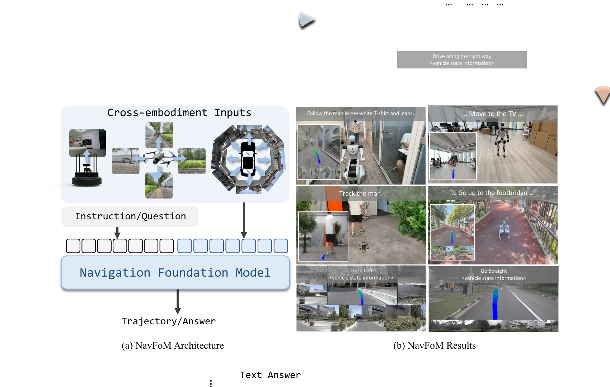
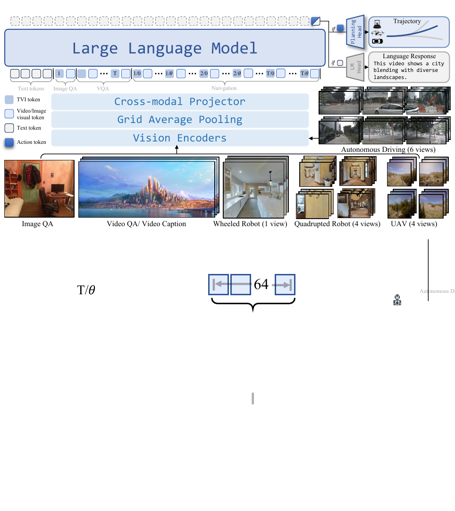
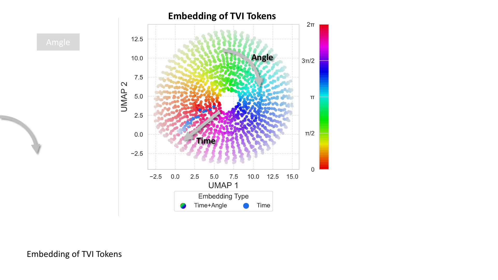
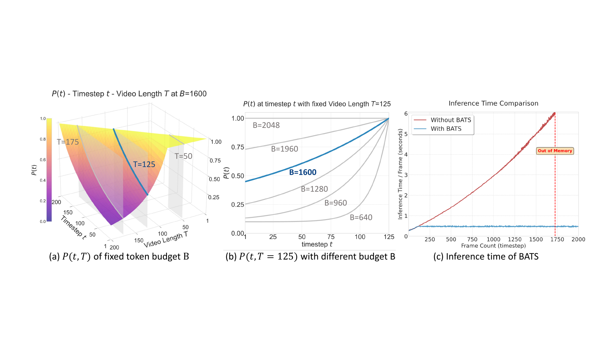
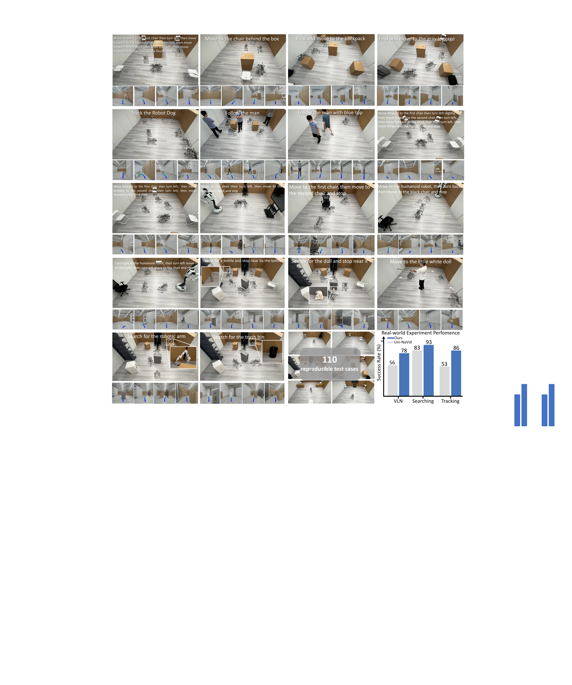

# NavFoM (arXiv 2025)

<!-- paper-source: https://chengwei920412.github.io/paper_reading/2509.12129_Embodied_Navigation_Foundation_Model/technical_report.html -->

> **arXiv ID**：2509.12129  
> **原文标题**：Embodied Navigation Foundation Model  
> **翻译日期**：2026-10-05

---

## 📋 论文概览 {#_2}

### 基本信息 {#_3}

- **作者**：Jiazhao Zhang、Anqi Li、Yunpeng Qi、Minghan Li、Jiahang Liu、Shaoan Wang、Haoran Liu、Gengze Zhou、Yuze Wu、Xingxing Li、Yuxin Fan、Wenjun Li、Zhibo Chen、Fei Gao、Qi Wu、Zhizheng Zhang、He Wang
- **机构**：北京大学、银河通用、中国科学技术大学、北京智源人工智能研究院、阿德莱德大学、浙江大学、Differential Robotics
- **发表时间**：2025 年 9 月（arXiv 首次公开）
- **领域**：具身智能、机器人导航、视觉—语言—动作模型、多任务学习

### 核心贡献 {#_4}

1. 提出 NavFoM，将视觉—语言导航、目标搜索、主动视觉跟踪和自动驾驶统一为“多相机自我中心视频 + 语言指令 → 航点轨迹”的通用导航问题。
2. 汇集 802 万条导航样本和 476 万条图像/视频问答样本，覆盖轮式机器人、四足机器人、无人机和汽车，并采用端到端联合微调。
3. 提出时间—视点指示（Temporal-Viewpoint Indicator，TVI）词元，显式编码相机方位与时间位置，使不同相机数量、不同时间跨度的数据能够进入同一大语言模型。
4. 提出预算感知时间采样（Budget-Aware Temporal Sampling，BATS），在固定词元预算下优先保留近期观测，同时保留一定概率的远期历史，以稳定推理延迟和显存占用。
5. 在七个公共基准及多个真实机器人平台上验证了跨任务、跨具身和零样本迁移能力。

图：NavFoM 的总体目标、跨任务与跨具身真实环境实验概览。

---

## 🎯 研究背景与动机 {#_5}

### 问题定义 {#_6}

具身导航系统通常围绕单一任务、机器人形态和传感器配置设计，难以共享跨平台数据。论文希望建立导航领域的基础模型：模型接收 \(N\) 个相机在 \(1\!:\!T\) 时刻采集的图像序列 \(I_{1:T}^{1:N}\) 与语言指令 \(L\)，输出由若干航点组成的轨迹 \(\tau_T\)。其中二维移动平台预测 \((x,y,\theta)\)，无人机额外预测高度 \(z\)。

### 现有方法的局限性 {#_7}

- 跨任务方法通常假设相机配置固定；跨具身方法又多局限于单一导航任务，两条研究路线尚未真正合流。
- 直接拼接多相机、多帧视觉词元，不能清楚表达“哪个相机、哪个时刻”，且上下文长度随任务时长持续增长。
- 词元合并会增加额外计算，均匀采样又可能丢失近期关键观测；二者都难以适配可变相机数量。
- 不同具身平台的动作尺度差异显著，室内机器人以米为尺度，而车辆轨迹可达数十米，直接回归会造成航点分布不一致。

### 本文的创新点 {#_8}

论文没有为各任务增加独立专家网络，而是从“词元组织”和“有限预算历史建模”两处改造通用 VLM。TVI 解决视觉词元的时空身份问题，BATS 解决长时历史的资源约束问题，任务相关缩放系数则统一不同平台的动作尺度。

---

## 🔬 方法论 {#_9}

### 整体架构 {#_10}

NavFoM 以 DINOv2 和 SigLIP 提取视觉特征，将二者在通道维拼接后做网格平均池化：当前观测和图像问答使用每帧 64 个细粒度词元，历史观测和视频问答使用每帧 4 个粗粒度词元。两层 MLP 将视觉特征投影到 Qwen2-7B 的隐空间；LLM 的动作隐状态再由三层 MLP 规划头解码为 8 个航点。问答分支使用自回归语言建模头。

图：NavFoM 统一处理图像问答、视频问答和导航任务的双分支架构。

### 关键技术 {#_11}

**1. TVI 词元。** TVI 由可学习基础嵌入、时间嵌入和视角嵌入组成：

\[\mathbf{E}_{\mathrm{TVI}}=
\begin{cases}
\mathbf{E}_{\mathrm{Base}}+\mathcal{P}_{\mathrm{time}}(\mathrm{TimePE}(t))+\mathcal{P}_{\mathrm{angle}}(\mathrm{AnglePE}(\phi)), &amp; \text{导航},\\
\mathbf{E}_{\mathrm{Base}}+\mathcal{P}_{\mathrm{time}}(\mathrm{TimePE}(t)), &amp; \text{视频问答},\\
\mathbf{E}_{\mathrm{Base}}, &amp; \text{图像问答}.
\end{cases}\]

角度编码分别对方位角的正弦与余弦做位置编码，以保持 \(0\) 与 \(2\pi\) 的环形连续性；时间编码使用正弦位置编码。不同任务仅启用所需分量，从而保持可分离性。

图：TVI 词元在二维嵌入空间中形成与视角和时间对应的结构。

**2. BATS。** 当视觉词元超过预算时，第 \(t\) 帧的采样概率定义为：

\[P(t)=(1-\epsilon)e^{k(t-T)/T}+\epsilon,\qquad k&gt;0,\]

其中 \(\epsilon=0.1\) 保留远期历史的最低采样概率，\(k\) 根据词元预算、相机数量和当前时长用 Brent 方法离线求解。期望采样帧数近似为：

\[\mathbb{E}_{\mathrm{frames}}\approx (1-\epsilon)\frac{1-e^{-k}}{k}T+\epsilon T.\]

该设计随相机数量和预算动态调整，并使导航全过程的推理速度较稳定。

图：不同时间跨度和词元预算下的 BATS 采样概率及推理耗时。

**3. 轨迹归一化。** 规划头输出经任务缩放系数 \(\alpha_{\mathrm{task}}\) 恢复为绝对轨迹：

\[\tau_T=\{\mathbf{a}_1,\ldots,\mathbf{a}_M\}_T=\alpha_{\mathrm{task}}\,\mathcal{A}_{\theta}(E_T^A),\qquad M=8.\]

室内机器人、无人机和车辆分别使用不同尺度，并以各维度第 99 百分位估计缩放值，以降低异常值影响。

### 算法流程 {#_12}

1. 采集一个或多个相机的在线 RGB 帧，并编码为粗、细两种视觉词元。
2. 若历史词元超过预算，依据 BATS 概率采样历史帧；当前帧始终保留细粒度表示。
3. 按任务类型为视觉词元插入不同组合的 TVI 分量，再与语言词元拼接送入 LLM。
4. 问答样本由语言建模头预测下一词元；导航样本由规划头回归归一化轨迹。
5. 训练损失为 \(L=\beta L_{\mathrm{nav}}+L_{\mathrm{QA}}\)，其中 \(\beta=10\)；真实部署时由各机器人已有的局部规划器执行预测轨迹。

---

## 📊 实验与结果 {#_13}

### 实验设置 {#_14}

- **数据集**：VLN-CE R2R/RxR、OpenUAV、HM3D ObjectNav/OVON、EVT-Bench、nuScenes、OpenScene，以及 Sekai 网络视频；另有 315 万条图像问答和 161 万条视频问答样本。
- **评估指标**：SR、OS/OSR、SPL、nDTW、NE、TR；自动驾驶使用 L2 距离、碰撞率及 NAVSIM 的 PDMS 等闭环指标。
- **对比方法**：涵盖任务专用导航模型、VLM 导航模型、开放词汇搜索/跟踪方法和自动驾驶规划模型。
- **训练开销**：56 张 NVIDIA H100 训练约 72 小时，共 4,032 GPU 小时；视觉特征缓存使训练速度提升 2.9 倍、显存占用降低 1.8 倍。

### 主要结果 {#_15}

<table>
<thead>
<tr>
<th>场景</th>
<th>NavFoM 结果</th>
<th>关键对比</th>
</tr>
</thead>
<tbody>
<tr>
<td>VLN-CE RxR，单相机</td>
<td>SR 57.4%</td>
<td>前一强基线 51.8%</td>
</tr>
<tr>
<td>VLN-CE RxR，四相机</td>
<td>SR 64.4%，SPL 56.2%，nDTW 65.8%</td>
<td>前一多视角强基线 SR 56.3%</td>
</tr>
<tr>
<td>HM3D-OVON，四相机零样本</td>
<td>未见类别 SR 45.2%，SPL 31.9%</td>
<td>优于任务专用方法的 SR 40.8%</td>
</tr>
<tr>
<td>EVT-Bench，四相机零样本</td>
<td>单目标 SR 88.4%；干扰目标 SR 62.0%</td>
<td>单视角训练仍能受益于多视角测试</td>
</tr>
<tr>
<td>NAVSIM，八相机</td>
<td>PDMS 84.3</td>
<td>接近专用自动驾驶强基线</td>
</tr>
<tr>
<td>OpenUAV，未见地图</td>
<td>SR 6.30%</td>
<td>虽为表中最佳，但绝对成功率仍低</td>
</tr>
</tbody>
</table>

结果说明 TVI 不仅能适配训练时见过的配置，还支持由单相机训练向多相机测试迁移。真实环境中，作者构建了 110 个可复现实例，并在四足、人形、无人机和轮式机器人上验证了长时导航。

图：真实环境中视觉—语言导航、搜索与跟踪任务的定量和定性结果。

### 消融实验 {#_16}

- 在 RxR 四相机设置下，预算为 2048 时，BATS 达到 SR 64.4%、nDTW 65.8%，优于均匀采样的 SR 62.4%、nDTW 63.9，也优于词元合并。
- 将预算从 2048 降至 1024 时，BATS 的 nDTW 仅下降 1.4%，而均匀采样和线性概率采样分别下降 6.0% 和 5.2%。
- TVI 词元明显优于视点—历史位置嵌入、独立可学习特殊词元和手工构造词元，说明在视觉词元之间插入身份词元比直接扰动视觉嵌入更易学习。
- 相机数量从 1 增至 4 时性能持续提升；增至 6 个相机后略降，原因是固定预算下视角词元挤占了历史帧容量。
- 多任务联合训练带来稳定增益，搜索 SR 从 10.3% 提升至 45.2%，跟踪 SR 从 12.6% 提升至 62.0%，显示异构导航数据存在明显协同效应。

---

## 💡 关键见解 {#_17}

### 理论分析 {#_18}

NavFoM 的核心并非增加模型规模，而是建立统一的数据接口。TVI 把相机几何和帧时间表示为 LLM 可消费的离散“边界词元”，避免直接修改预训练视觉特征空间；BATS 则把长时记忆转化为带资源约束的随机采样问题。两者共同解耦了模型结构与具体相机数量、任务时长，使跨平台数据可以进入同一训练流程。

### 实践启示 {#_19}

- 多任务混合的收益不只来自数据量；其他任务提供的多视角和开放类别信息能补足单任务数据偏差。
- 当前观测与历史观测的信息密度不同，采用“当前细粒度、历史粗粒度”比统一压缩更符合导航需求。
- 面向真实机器人的基础模型仍需保留传统局部规划器和控制接口；论文的 VLA 模型负责语义理解与轨迹预测，底层安全执行由平台现有模块承担。

---

## 🔍 局限性与未来工作 {#_20}

### 当前局限 {#_21}

1. OpenUAV 未见地图的最佳 SR 仅 6.30%，表明长距离探索和真正未见环境泛化仍远未解决。
2. 各任务数据质量不一致：网络视频的指令由 VLM 生成、轨迹由 SLAM 估计，UAV 训练轨迹也并非高质量专家策略，噪声可能限制上限。
3. BATS 设定固定最低概率 \(\epsilon\)；当任务长达数千步时仍可能超出预算，论文采用直接删除最老帧的退化处理。
4. 六相机结果下降揭示固定预算下“空间覆盖—时间记忆”的竞争，当前方法尚未学习自适应分配视角和历史容量。
5. 自动驾驶结果接近专用方法，但模型没有显式车道、交通参与者或安全约束建模；在闭环真实道路上的可靠性尚未得到验证。
6. 训练成本约 4,032 H100 GPU 小时，复现门槛较高；论文也未给出不同数据源的系统性质量/偏差审计。

### 未来方向 {#_22}

- 学习内容感知的时空词元路由，使词元预算能在相机视角、当前帧和长期记忆之间动态分配。
- 引入显式地图、对象持久性与不确定性估计，提升未见地图上的主动探索能力。
- 将轨迹预测与安全约束、世界模型或闭环强化学习结合，尤其加强无人机和自动驾驶长时决策。
- 研究数据配比、噪声过滤和课程学习，区分“跨任务协同”与单纯规模效应。
- 在更多机器人平台上开展统一协议的闭环、长时、故障恢复和安全评测。

---

## 📚 相关工作对比 {#_23}

<table>
<thead>
<tr>
<th>方法</th>
<th>核心思想</th>
<th>优势</th>
<th>劣势</th>
</tr>
</thead>
<tbody>
<tr>
<td>Uni-NaVid</td>
<td>基于视频 VLM 统一多类室内导航任务</td>
<td>跨任务能力强，端到端预测动作</td>
<td>主要面向受控室内环境，跨具身与相机配置有限</td>
</tr>
<tr>
<td>NaVILA / StreamVLN</td>
<td>用视频 VLM 处理连续视觉历史</td>
<td>单视角 VLN 表现较强，具备在线推理能力</td>
<td>任务和具身覆盖窄，历史处理与可变多相机支持有限</td>
</tr>
<tr>
<td>通用跨具身策略</td>
<td>在多机器人数据上训练 Transformer/VLA 策略</td>
<td>可共享不同机器人经验</td>
<td>往往要求动作空间对齐，导航任务覆盖有限</td>
</tr>
<tr>
<td><strong>NavFoM</strong></td>
<td>TVI + BATS 统一跨任务、跨具身、多相机导航</td>
<td>数据覆盖广，支持零样本相机配置迁移，资源预算明确</td>
<td>超长时记忆、未见地图探索、安全闭环和训练成本仍是瓶颈</td>
</tr>
</tbody>
</table>

---

## 🎓 个人评价 {#_24}

### 优点 {#_25}

- 问题设定清晰且工程价值高：论文将分散的导航任务转换为统一轨迹接口，而非仅在单一基准上追求分数。
- TVI 与 BATS 都是结构简单、可解释、易移植的改动，并有针对性的消融实验支持。
- 公共基准、真实机器人、多相机零样本迁移和资源效率共同构成了较完整的证据链。

### 可改进之处 {#_26}

- 需要更严格地区分数据规模、多任务配比、TVI 和 BATS 各自带来的收益，并报告随机种子方差。
- 真实环境评测应给出更标准化的失败类型、安全事件、延迟分布和网络异常处理，而不仅是成功率与案例展示。
- 应增加对数据许可、隐私、类别/场景偏差以及网络视频伪标签误差的分析。

### 推荐阅读对象 {#_27}

适合研究具身导航、VLA/VLM、多任务机器人学习、长视频词元压缩与真实机器人部署的读者；对希望把多个专用导航模型整合为统一策略的工程团队也有直接参考价值。

---

## 📎 附录 {#_28}

### 重要公式 {#_29}

- TVI：按任务选择基础、时间和视角三类嵌入的组合。
- BATS：\(P(t)=(1-\epsilon)e^{k(t-T)/T}+\epsilon\)。
- 轨迹预测：\(\tau_T=\alpha_{\mathrm{task}}\mathcal{A}_{\theta}(E_T^A)\)。
- 联合训练：\(L=\beta L_{\mathrm{nav}}+L_{\mathrm{QA}}\)，其中 \(\beta=10\)。

### 术语表 {#_30}

<table>
<thead>
<tr>
<th>英文</th>
<th>中文</th>
</tr>
</thead>
<tbody>
<tr>
<td>Embodied Navigation Foundation Model</td>
<td>具身导航基础模型</td>
</tr>
<tr>
<td>Temporal-Viewpoint Indicator Tokens</td>
<td>时间—视点指示词元</td>
</tr>
<tr>
<td>Budget-Aware Temporal Sampling</td>
<td>预算感知时间采样</td>
</tr>
<tr>
<td>Vision-and-Language Navigation</td>
<td>视觉—语言导航</td>
</tr>
<tr>
<td>Visual-Language-Action Model</td>
<td>视觉—语言—动作模型</td>
</tr>
<tr>
<td>Object Goal Navigation</td>
<td>目标物体导航</td>
</tr>
<tr>
<td>Active Visual Tracking</td>
<td>主动视觉跟踪</td>
</tr>
<tr>
<td>Waypoint</td>
<td>航点</td>
</tr>
<tr>
<td>Token Budget</td>
<td>词元预算</td>
</tr>
</tbody>
</table>

### 参考资源 {#_31}

- **论文原文**：[arXiv 链接](https://arxiv.org/abs/2509.12129)
- **中文翻译 PDF**：[paper_cn.pdf](https://chengwei920412.github.io/paper_reading/2509.12129_Embodied_Navigation_Foundation_Model/paper_cn.pdf)
- **中文 Markdown 译文**：[paper_cn.md](https://chengwei920412.github.io/paper_reading/2509.12129_Embodied_Navigation_Foundation_Model/paper_cn.html)
- **代码实现**：论文未在正文中提供独立代码仓库
- **项目主页**：[NavFoM-Web](https://pku-epic.github.io/NavFoM-Web/)
