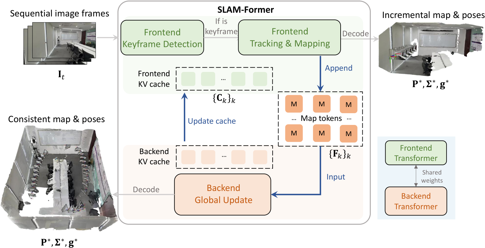
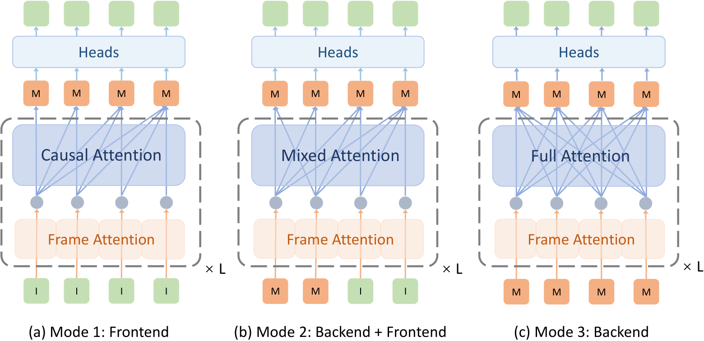
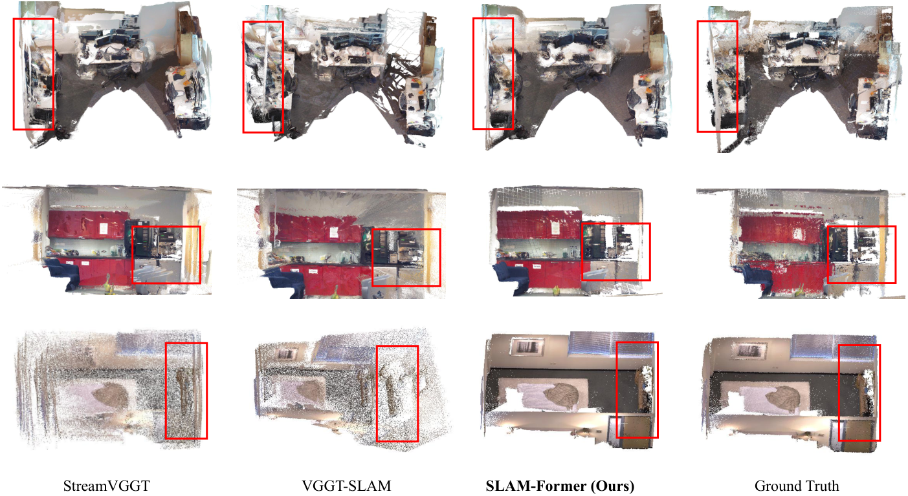
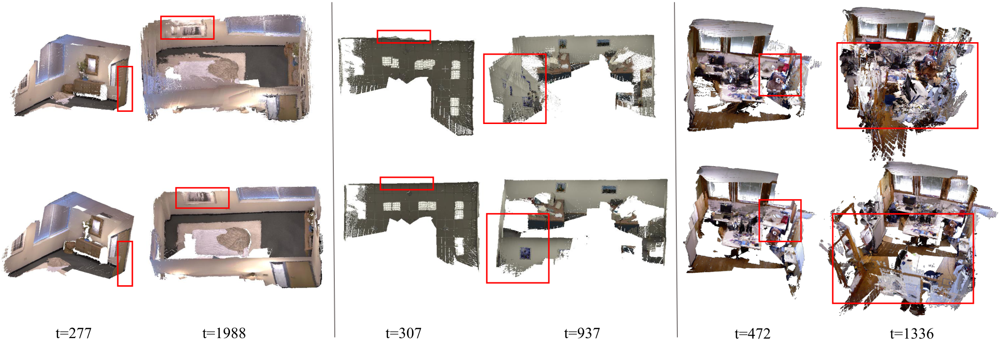
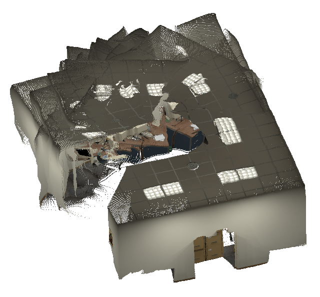
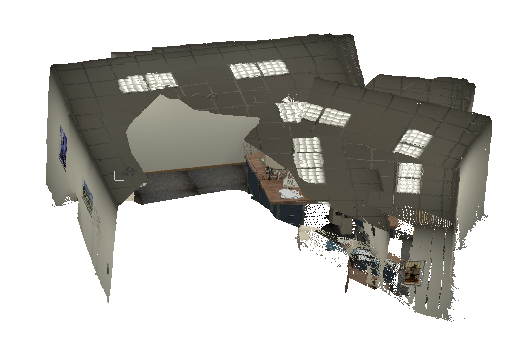
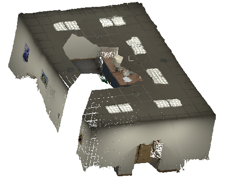

# SLAM-Former (arXiv 2025)

<!-- paper-source: https://chengwei920412.github.io/paper_reading/2509.16909_SLAM-Former_Putting_SLAM_into_One_Transformer/2509.16909_%E9%98%85%E8%AF%BB%E6%8A%A5%E5%91%8A.html -->

## 0. 基本信息 {#0}

- 论文标题：SLAM-Former: Putting SLAM into One Transformer
- 作者：Yijun Yuan, Zhuoguang Chen, Kenan Li, Weibang Wang, Hang Zhao
- 机构：IIIS, Tsinghua University
- 来源（会议 / arXiv / 期刊）：arXiv preprint；源码模板标注 CVPR 2026，但 arXiv 页面未显示已接收会议
- 年份：2025
- 原始输入链接：https://arxiv.org/abs/2509.16909
- 最终使用的 arXiv 版本化 ID：2509.16909v1
- 原论文 arXiv 链接：https://arxiv.org/abs/2509.16909v1
- 幻觉翻译链接（hjfy）：https://hjfy.top/arxiv/2509.16909v1
- Cool Papers 链接：https://papers.cool/arxiv/2509.16909v1
- 项目页：https://tsinghua-mars-lab.github.io/SLAM-Former
- 论文研究方向：Dense RGB SLAM、单目稠密重建、视觉几何基础模型、Transformer 式前端/后端 SLAM
- 本文一句话概括：SLAM-Former 把传统 SLAM 中前端增量跟踪/建图与后端全局优化放进同一个 Transformer，通过 map token memory、KV cache 共享和三种训练模式，让单目 RGB 输入同时获得在线性和全局一致性。

## 1. 论文核心观点与主张的系统梳理 {#1}

### 1.1 研究背景与动机 {#11}

论文讨论的是稠密单目 SLAM 的一个结构性问题：传统 SLAM 管线通常把前端跟踪、局部建图、回环检测、图优化或 bundle adjustment 分成多个模块；近年来的几何基础模型，例如 DUSt3R、VGGT、Pi3、MASt3R、StreamVGGT、Stream3R，则把多视角几何估计推向 Transformer 式前馈或流式建模。但作者指出，现有两类路线各有缺陷。

第一类是“几何基础模型 + 传统 SLAM 管线”。例如 MASt3R-SLAM 或 VGGT-SLAM 依赖 pair-wise / submap-wise 几何，再用对齐、TSDF fusion 或 SL(4) 连接子图。作者认为这会导致局部子图之间结构冲突，尤其是长序列中不同子图对同一空间区域的预测不一致。

第二类是“流式 3D reconstruction”。StreamVGGT、Stream3R、CUT3R 等方法使用 KV cache、因果注意力或 persistent state 来处理增量视觉输入，但它们主要面向流式更新，通常不会重新优化过去结果，因此容易积累 drift，并在新旧数据之间产生 mismatch。

SLAM-Former 的核心动机是：保留传统 SLAM 前端/后端协作思想，但把前端和后端都实现为同一个 Transformer 的不同运行模式。前端负责实时增量 keyframe 选择、pose 和 map update；后端周期性对所有 map tokens 做 full attention 全局 refinement。二者通过共享 map token memory 和 KV cache 互相促进。

### 1.2 问题设定 {#12}

论文输入是单目 RGB 图像序列，目标是同时输出相机轨迹和稠密几何重建。它不是 RGB-D SLAM：虽然在 TUM RGB-D、7-Scenes、Replica 等 benchmark 上评估，但方法本身面向 RGB-only / uncalibrated dense SLAM，并与 calibrated 和 uncalibrated baseline 分别比较。

作者将 SLAM-Former 分为两个逻辑角色：

1. **Frontend**：在线接收新帧，判断是否成为 keyframe；若是 keyframe，则增量生成当前 frame 的 map tokens、pose 和点图。
2. **Backend**：周期性读取累积 map tokens，用 full attention 进行全局 refinement，并把 refined KV cache 回传给 frontend，使后续增量跟踪以更一致的全局结构为条件。

该图是论文的方法总览：前端检测 keyframe 并做增量 pose/map 更新；后端低频全局更新 pose 和 map；蓝色箭头表示共享 map token memory 与 KV cache update 让前端和后端互相影响。它对应传统 SLAM 的 frontend/backend 结构，但把显式回环检测和图优化替换为 Transformer full attention。

**式 (1) 前端 map token 生成**

\[\mathbf{F}_t = f_{\text{fn}}(\mathbf{I}_t)_{\{\mathbf{C}_k\}_{k\in\mathbf{S}}}\]

这条公式定义了在线前端：给定当前图像 \(\mathbf{I}_t\)，前端 \(f_{\text{fn}}\) 在历史 keyframe 的 KV cache \(\{\mathbf{C}_k\}_{k\in\mathbf{S}}\) 条件下生成当前帧 map tokens \(\mathbf{F}_t\)。\(\mathbf{S}\) 是 keyframe index 集合，\(\mathbf{C}_k\) 是第 \(k\) 个 keyframe 的 key/value cache。自然语言直译：当前帧不是孤立处理，而是借助过去 keyframe 的 Transformer cache 来定位和建图。工程上，它对应 streaming inference 中把历史 KV cache 喂给当前 forward pass。

极简例子：假设已有 keyframe 1 和 2 的 cache，当前第 20 帧进来后，模型并不重新处理 1 到 19 的全部图像，而是用 \(\{\mathbf{C}_1,\mathbf{C}_2\}\) 作为条件生成 \(\mathbf{F}_{20}\)。这使前端具备在线效率，但也意味着若 cache 中累积了 drift，就会污染后续 frame。

### 1.3 核心观点（Claims）的逐条梳理 {#13-claims}

**Claim 1：完整 SLAM 功能可以由一个共享 Transformer 统一实现。**  
对应位置：Abstract、Introduction、Transformer Architecture、Training Strategy。作者把 frontend、backend、cache sharing 都放在一个 backbone \(f\) 和 heads \(h\) 内，并用三种训练模式训练同一组权重。

**Claim 2：前端和后端需要交替协作，而不是单纯 streaming 或单次 batch feed-forward。**  
对应位置：Introduction、Execution Pipeline、Frontend and backend co-operation。前端提供在线顺序和初始结果；后端通过 full attention 修正全局一致性；后端 refinement 后的 KV cache 又反馈给前端。

**Claim 3：后端 full attention 可以替代传统 SLAM 中部分 loop detection 和 pose graph optimization 功能。**  
对应位置：Introduction、Backend。作者称后端 full attention 在所有 map tokens 之间建立 dense connections，等价于在 dense factor graph 上处理 loop detection。这个 claim 是启发式类比，不是严格数学等价证明。

**Claim 4：SLAM-Former 在跟踪和稠密重建上相对现有 dense RGB SLAM / geometry foundation baseline 更强或有竞争力。**  
对应位置：Experiments。TUM RGB-D、7-Scenes、Replica 的 ATE 和重建指标支撑该 claim。特别是 uncalibrated setting 下，SLAM-Former 的平均 ATE 在 TUM 为 0.039 m、7-Scenes 为 0.042 m、Replica 为 0.030 m。

**Claim 5：backend 模块不仅提升最终 ATE，也在长序列中抑制前端累积误差。**  
对应位置：Ablation、Figure 5、Table 6。F-only 在 TUM 平均 ATE 为 0.134 m，加入 backend 后降到约 0.039-0.042 m。

### 1.4 创新性与贡献边界 {#14}

实质性创新主要体现在系统结构和训练方式，而不是单个新的几何损失或新的注意力算子。

1. **结构创新**：把传统 SLAM 的 frontend/backend 拆分映射到同一 Transformer 的不同推理模式，使用 map tokens 和 KV cache 连接在线增量处理与全局 refinement。
2. **训练创新**：三种训练模式共同训练同一模型，让它同时学习 frontend causal processing、frontend-backend cooperation 和 backend full-attention refinement。
3. **系统目标创新**：尝试把“几何基础模型的前馈稠密几何能力”和“SLAM 的闭环式全局一致性”合并。

但贡献边界也很明确：

1. 论文没有证明 full attention 与 loop closure / graph optimization 的严格等价性。
2. 后端 full attention 有 \(\mathcal{O}(n^2)\) 复杂度，作者在 limitation 中明确承认。
3. 训练成本高：36 层 Transformer，32 张 A100 训练 11 小时，且初始化来自 Pi3 pretrained weights；这不是从零训练的轻量 SLAM。
4. 论文说不支持“locally frontend mode”：推理时仍需把所有之前 KV caches 喂入模型，这限制了长序列部署。

## 2. 关键论据、理论基础与数学方法的深度解析 {#2}

### 2.1 理论基础与学术渊源 {#21}

SLAM-Former 建立在三条技术传统之上。

第一是经典 SLAM 的前端/后端分工。前端通常做 feature tracking、keyframe selection、局部 pose/map update；后端做 loop closure、pose graph optimization 或 BA。本文保留这个系统分解，但用 Transformer attention 和 token memory 替换显式几何优化组件。

第二是几何 foundation models。DUSt3R 将多视角几何转成点图回归；VGGT 进一步以 Transformer 做 visual geometry grounded prediction；Pi3 引入 permutation-equivariant 设计减少 reference frame 依赖；MASt3R 和 VGGT-SLAM 则把 foundation model 接入 SLAM pipeline。SLAM-Former 直接初始化 Pi3 权重，并继承 pointmap、camera pose、confidence 等预测头范式。

第三是 streaming Transformer 的 KV cache 思想。StreamVGGT、Stream3R、CUT3R 等说明用 cache 或 persistent state 可以处理长序列，但论文认为仅 causal/streaming 不足以修正过去错误，因此引入周期性 backend full attention。

### 2.2 问题形式化与建模选择 {#22}

SLAM-Former 的关键中间表示是 map tokens，而不是显式地图网格、TSDF、NeRF 或 Gaussian primitives。每个 keyframe 产生一组 \(\mathbf{F}_t\)，所有 keyframes 的 map tokens 组成 token map \((\mathbf{M}, \mathbf{S})\)。

**式 (2) keyframe pose 估计与相对位姿判定**

\[\mathbf{g}_t = h_{\text{pose}}(\mathbf{F}_t)\]

\[\mathbf{g}_{k_{\text{prev}},t} = \mathbf{g}_{k_S}^{-1}\mathbf{g}_t\]

这组公式负责 keyframe detection。\(\mathbf{g}_t\) 是当前帧 pose head 输出的相机位姿，\(k_{\text{prev}}\) 或 \(k_S\) 是最近 keyframe。若当前帧相对最近 keyframe 的位移超过阈值 \(\tau\)，则被标记为新 keyframe。工程上，这相当于传统 SLAM 中的关键帧插入策略，只是 pose 来自神经网络 head，而不是显式 PnP/BA。

**式 (3) token map 增量更新**

\[\mathbf{M} \leftarrow \mathbf{M}\cup\{\mathbf{F}_t\},\quad \mathbf{S}\leftarrow\mathbf{S}\cup\{t\},\quad S\leftarrow S+1\]

这条公式说明前端如何把新 keyframe 写入全局 token memory。\(\mathbf{M}\) 是 map token 集合，\(\mathbf{S}\) 是 keyframe index 集合，\(S\) 是 keyframe 数量。自然语言直译：每来一个通过阈值的新 keyframe，就把它的神经地图表示加入全局记忆。若删掉这一步，后端就没有可全局 refinement 的对象。

图中 \(I\) 表示 image patch tokens，\(M\) 表示 map tokens，\(f\) 是共享 Transformer backbone，\(h\) 是输出 heads。三种模式分别训练 frontend、frontend 与 backend 协作、backend 全局 refinement。该图是理解“一个 Transformer 承担完整 SLAM”的关键。

### 2.3 核心推导与算法构造 {#23}

后端是论文最强的结构主张。它不再只依赖过去 cache 做 causal 更新，而是周期性对累积 map tokens 做 full attention。

**式 (4) 后端全局 refinement**

\[\bar{\mathbf{M}} = f_{\text{bn}}(\mathbf{M})\]

这里 \(\mathbf{M}\) 是前端累积的 map tokens，\(\bar{\mathbf{M}}\) 是后端 refine 后的 map tokens。自然语言直译：把所有关键帧的地图 token 一次性送入 backend，让 token 之间全连接交互，从而修正漂移和结构冲突。工程上，这对应一个 non-causal Transformer pass，复杂度随 keyframe token 数近似二次增长。

**式 (5) 后端 KV cache 回写前端**

\[\{\mathbf{C}_k\}_{k\in\mathbf{S}}\leftarrow \mathbf{C}_{\mathbf{M}}\]

这条公式负责 frontend/backend 的闭环：后端 refined map tokens 产生的 KV cache \(\mathbf{C}_{\mathbf{M}}\) 被写回前端 cache。自然语言直译：前端后续不是继续基于旧的、可能漂移的历史 cache 工作，而是基于后端修正后的全局结构继续跟踪。代码中，它对应 backend pass 之后更新 streaming inference state。

极简数值例子：假设前端在第 50 个 keyframe 时累计漂移 8 cm，后端通过全局 attention 发现第 1 和第 50 个 keyframe 看到同一墙面并修正 token 表示。如果不回写 cache，第 51 帧仍会沿着旧漂移继续；回写后，第 51 帧的 attention context 已包含修正后的全局结构。

**式 (6) heads 输出**

\[\mathbf{P}^*,\mathbf{\Sigma}^*,\mathbf{g}^* = h(\mathbf{F})\]

\(\mathbf{P}^*\) 是预测 pointmap，\(\mathbf{\Sigma}^*\) 是 confidence，\(\mathbf{g}^*\) 是 camera pose。与 VGGT 预测 global geometry 不同，作者说 SLAM-Former 预测每帧 local pointmaps，以避免必须指定某个 world coordinate。工程上，这意味着 head 可以从 token 中同时 decode 几何、置信度和位姿。

**式 (7) 总监督损失**

\[L = L_{\text{depth}} + L_{\text{pmap}} + \lambda L_{\text{cam}}\]

这条公式负责将深度、点图和相机监督合并。\(\lambda\) 在实验中设为 100，说明 camera loss 权重很大。训练中若去掉 \(L_{\text{cam}}\)，pose tracking 可能退化；若去掉 \(L_{\text{pmap}}\) 或 \(L_{\text{depth}}\)，稠密重建质量会失去直接监督。

**式 (8) depth confidence loss**

\[L_{\text{depth}} = \sum_t \left(\|\mathbf{\Sigma}^*_t\odot(s^*\mathbf{D}^*_t-\mathbf{D}_t)\|+\|\mathbf{\Sigma}^*_t\odot(\nabla s^*\mathbf{D}^*_t-\nabla\mathbf{D}_t)\|-\alpha\log\mathbf{\Sigma}^*_t\right)\]

该式用 ground-truth depth \(\mathbf{D}_t\) 监督预测深度 \(\mathbf{D}^*_t=\mathbf{P}^*_z\)，并加入梯度项约束局部结构边缘。\(\mathbf{\Sigma}^*_t\) 是 confidence，\(s^*\) 是尺度因子。自然语言直译：预测深度不仅要数值接近，还要边缘/梯度接近；confidence 不能无限趋零，因为有 \(-\alpha\log\mathbf{\Sigma}^*_t\) 约束。代码中通常对应 per-pixel depth residual、gradient residual 和 confidence regularization。

极简例子：若某像素真实深度为 2.0 m，预测尺度对齐后为 2.1 m，残差为 0.1 m；若边缘梯度也错，第二项会额外惩罚。若模型把 confidence 设得很低来逃避残差，log 项会惩罚这种退缩。

**式 (9) pointmap 对齐与 pointmap loss**

\[\mathbf{P}^*_{t,1} = {\mathbf{g}^*_1}^{-1}\mathbf{g}^*_t\mathbf{P}^*_t\]

\[L_{\text{pmap}} = \sum_t \left(\|\mathbf{\Sigma}^*_t\odot(s^*\mathbf{P}^*_{t,1}-\mathbf{P}_t)\|+\|\mathbf{\Sigma}^*_t\odot(\nabla s^*\mathbf{P}^*_{t,1}-\nabla\mathbf{P}_t)\|-\alpha\log\mathbf{\Sigma}^*_t\right)\]

第一条公式把第 \(t\) 帧局部 pointmap 通过预测 pose 对齐到第一帧坐标，用于监督一致性。第二条 loss 类似 depth loss，但约束的是 3D pointmap。它在训练中迫使 local pointmaps 与 pose 预测互相一致。若该项不足，模型可能每帧重建都局部合理，但跨帧几何无法对齐。

**式 (10) camera relative pose loss**

\[L_{\text{cam}} = \sum_{i,j}\left\|s^*\otimes(\mathbf{g}_i^{*^{-1}}\mathbf{g}^*_j)-(\mathbf{g}_i^{-1}\mathbf{g}_j)\right\|_\epsilon\]

这条公式监督任意帧对之间的相对位姿。\(\otimes\) 表示缩放平移部分，\(\|\cdot\|_\epsilon\) 是 scaled Huber loss。自然语言直译：预测的相对运动必须接近真实相对运动，而不是只让单帧 pose 看起来合理。工程映射上，它对应 pairwise pose residual，这也是 SLAM 中位姿图优化思想在神经训练中的监督形式。

**式 (11) 三模式联合训练目标**

\[L_{\text{all}} = L_1 + L_2 + \beta L_3\]

\(L_1,L_2,L_3\) 分别对应三种训练模式；实验中 \(\beta=10\)。这条公式是“一个 Transformer”能同时承担三类运行模式的训练 glue。若只训练 mode 1，模型只有 causal frontend 能力；若只训练 mode 3，模型缺少在线 cache 条件；mode 2 则桥接 backend refinement 与 frontend cache sharing。

### 2.4 理论结论的适用范围 {#24}

论文主要是系统和经验论文，没有给出严格定理。它把 full attention 类比为 dense factor graph 上的 loop detection/global refinement，但没有证明 attention weights 与几何 factor、回环约束或 BA Hessian 存在等价关系。

适用范围主要受以下条件限制：

1. 后端复杂度为 \(\mathcal{O}(n^2)\)，长序列 keyframes 很多时会成为瓶颈。
2. 推理时所有 previous KV caches 仍需输入模型，作者承认目前不支持真正局部前端模式。
3. 方法依赖大规模预训练和多数据集监督，不是无需数据的几何 SLAM。
4. 输出全局一致性是学习出来的，缺少传统优化中明确的几何可验证残差和收敛标准。

## 3. 实验设计与实验结果的充分性分析 {#3}

### 3.1 实验目标与论文主张的对应关系 {#31}

<table>
<thead>
<tr>
<th>实验</th>
<th>验证的主张</th>
<th>主要指标</th>
<th>是否直接对应</th>
</tr>
</thead>
<tbody>
<tr>
<td>TUM RGB-D / 7-Scenes / Replica tracking</td>
<td>SLAM-Former 具备高质量相机跟踪</td>
<td>ATE RMSE</td>
<td>直接对应 tracking claim</td>
</tr>
<tr>
<td>7-Scenes / Replica reconstruction</td>
<td>SLAM-Former 改善稠密几何一致性</td>
<td>Accuracy、Completeness、Chamfer</td>
<td>直接对应 reconstruction claim</td>
</tr>
<tr>
<td>Frontend/backend ablation</td>
<td>后端全局 refinement 抑制 drift</td>
<td>TUM ATE、定性重建</td>
<td>直接对应 frontend/backend cooperation claim</td>
</tr>
<tr>
<td>Runtime</td>
<td>方法可实时运行</td>
<td>KF-detection TPE、Frontend TPE、Backend TPE、FPS</td>
<td>部分对应，因为 backend 低频运行但 full attention 扩展性未充分扫参</td>
</tr>
<tr>
<td>Qualitative figures</td>
<td>后端修正结构错位</td>
<td>重建可视化</td>
<td>支撑但不能替代统计检验</td>
</tr>
</tbody>
</table>

### 3.2 实验设置合理性 {#32}

实验覆盖了三个常用数据集：TUM RGB-D、7-Scenes、Replica。TUM 和 7-Scenes是真实采集数据，Replica 是合成室内数据。比较对象覆盖传统 SLAM、深度 SLAM、NeRF/implicit 相关稠密 SLAM、几何基础模型 SLAM 和流式 foundation model 方法。论文还区分 calibrated 与 uncalibrated setting，这对单目 RGB SLAM 很重要。

训练设置也比较明确：36 层 Transformer；Pi3 pretrained weights 初始化；冻结 image encoder 和 camera head；训练 10 epochs，batch size 32；AdamW，learning rate \(1e^{-5}\)，cosine scheduler；训练数据包括 ARKitScenes、ScanNet、ScanNet++、HyperSim、BlendedMVS、MegaDepth、MVS-Synth；32 张 A100 训练 11 小时；测试单张 RTX 4090。

需要注意的公平性边界：

1. 多个 baseline 带 \(+\)，表示作者在自己机器上重跑；不同方法对 keyframe selection、输入分辨率、相机内参、后处理的敏感性可能不同。
2. SLAM-Former 初始化自 Pi3，且训练数据覆盖广泛；与传统几何 SLAM 的数据需求不可直接等价。
3. Replica 合成数据中，DROID-SLAM 在 calibrated tracking 下显著强于 SLAM-Former，作者也承认这是因为合成数据少噪声、匹配足够准确，bundle adjustment 更有优势。

### 3.3 实验结果的解释力度 {#33}

**Tracking 主结果汇总**

<table>
<thead>
<tr>
<th>Dataset</th>
<th>Setting</th>
<th>Best calibrated baseline Avg ATE</th>
<th>Best uncalibrated baseline Avg ATE</th>
<th>SLAM-Former Avg ATE</th>
<th>论文结论</th>
</tr>
</thead>
<tbody>
<tr>
<td>TUM RGB-D</td>
<td>ATE RMSE, m</td>
<td>MASt3R-SLAM 0.030</td>
<td>VGGT-SLAM 0.053 / MASt3R-SLAM* 0.060</td>
<td>0.039</td>
<td>Ours 在 uncalibrated 中最优，并接近 calibrated SOTA</td>
</tr>
<tr>
<td>7-Scenes</td>
<td>ATE RMSE, m</td>
<td>MASt3R-SLAM 0.047 / DROID 0.049</td>
<td>VGGT-SLAM 0.067 / VGGT-SLAM+ 0.068</td>
<td>0.042</td>
<td>Ours 平均优于 calibrated 与 uncalibrated baselines</td>
</tr>
<tr>
<td>Replica</td>
<td>ATE RMSE, m</td>
<td>DROID-SLAM 0.003</td>
<td>SLAM3R 0.066 / VGGT-SLAM+ 0.071</td>
<td>0.030</td>
<td>Ours 是 uncalibrated 最优，但不及 calibrated DROID-SLAM</td>
</tr>
</tbody>
</table>

该表支持 SLAM-Former 的 tracking claim，但也揭示了边界：在 Replica 这类合成、低噪声场景中，传统 calibrated DROID-SLAM 的 ATE 远低于 Ours。这说明 SLAM-Former 的强项更像是 uncalibrated dense RGB setting，而不是普遍超过所有几何优化方法。

**TUM RGB-D uncalibrated 关键序列**

<table>
<thead>
<tr>
<th>Method</th>
<th>360</th>
<th>desk</th>
<th>desk2</th>
<th>floor</th>
<th>plant</th>
<th>room</th>
<th>rpy</th>
<th>teddy</th>
<th>xyz</th>
<th>Avg</th>
</tr>
</thead>
<tbody>
<tr>
<td>DROID-SLAM*</td>
<td>0.202</td>
<td>0.032</td>
<td>0.091</td>
<td>0.064</td>
<td>0.045</td>
<td>0.918</td>
<td>0.056</td>
<td>0.045</td>
<td>0.012</td>
<td>0.158</td>
</tr>
<tr>
<td>MASt3R-SLAM*</td>
<td>0.070</td>
<td>0.035</td>
<td>0.055</td>
<td>0.056</td>
<td>0.035</td>
<td>0.118</td>
<td>0.041</td>
<td>0.114</td>
<td>0.020</td>
<td>0.060</td>
</tr>
<tr>
<td>VGGT-SLAM</td>
<td>0.071</td>
<td>0.025</td>
<td>0.040</td>
<td>0.141</td>
<td>0.023</td>
<td>0.102</td>
<td>0.030</td>
<td>0.034</td>
<td>0.014</td>
<td>0.053</td>
</tr>
<tr>
<td>CUT3R+</td>
<td>0.102</td>
<td>0.054</td>
<td>0.118</td>
<td>0.211</td>
<td>0.083</td>
<td>0.264</td>
<td>0.044</td>
<td>0.120</td>
<td>0.020</td>
<td>0.113</td>
</tr>
<tr>
<td>StreamVGGT+</td>
<td>0.088</td>
<td>0.063</td>
<td>0.105</td>
<td>0.604</td>
<td>0.070</td>
<td>0.633</td>
<td>0.025</td>
<td>0.081</td>
<td>0.015</td>
<td>0.187</td>
</tr>
<tr>
<td>VGGT-SLAM+</td>
<td>0.053</td>
<td>0.024</td>
<td>0.040</td>
<td>0.335</td>
<td>0.022</td>
<td>0.166</td>
<td>0.040</td>
<td>0.037</td>
<td>0.041</td>
<td>0.084</td>
</tr>
<tr>
<td>SLAM-Former</td>
<td>0.067</td>
<td>0.018</td>
<td>0.026</td>
<td>0.079</td>
<td>0.021</td>
<td>0.082</td>
<td>0.017</td>
<td>0.030</td>
<td>0.011</td>
<td>0.039</td>
</tr>
</tbody>
</table>

TUM 表对 backend claim 很有帮助：floor、room 等包含大旋转和潜在 loop closure 的序列中，纯流式方法 StreamVGGT+ 明显漂移，而 SLAM-Former 更稳。它支持“后端 global refinement 缓解累积误差”。

**7-Scenes tracking 结果**

<table>
<thead>
<tr>
<th>Method</th>
<th>Avg ATE</th>
</tr>
</thead>
<tbody>
<tr>
<td>DROID-SLAM calibrated</td>
<td>0.049</td>
</tr>
<tr>
<td>MASt3R-SLAM calibrated</td>
<td>0.047</td>
</tr>
<tr>
<td>DROID-SLAM* uncalibrated</td>
<td>0.078</td>
</tr>
<tr>
<td>MASt3R-SLAM* uncalibrated</td>
<td>0.066</td>
</tr>
<tr>
<td>VGGT-SLAM</td>
<td>0.067</td>
</tr>
<tr>
<td>CUT3R+</td>
<td>0.073</td>
</tr>
<tr>
<td>StreamVGGT+</td>
<td>0.081</td>
</tr>
<tr>
<td>VGGT-SLAM+</td>
<td>0.068</td>
</tr>
<tr>
<td>SLAM-Former</td>
<td>0.042</td>
</tr>
</tbody>
</table>

7-Scenes 是论文最强的 tracking 证据：SLAM-Former 平均 ATE 低于 calibrated MASt3R-SLAM 和 DROID-SLAM。作者特别指出 office、pumpkin、kitchen 等复杂场景差距更明显。

**重建主结果**

<table>
<thead>
<tr>
<th>Dataset</th>
<th>Method</th>
<th>ATE</th>
<th>Acc.</th>
<th>Completeness</th>
<th>Chamfer</th>
</tr>
</thead>
<tbody>
<tr>
<td>7-Scenes</td>
<td>DROID-SLAM calibrated</td>
<td>0.049</td>
<td>0.141</td>
<td>0.048</td>
<td>0.094</td>
</tr>
<tr>
<td>7-Scenes</td>
<td>MASt3R-SLAM calibrated</td>
<td>0.047</td>
<td>0.089</td>
<td>0.085</td>
<td>0.087</td>
</tr>
<tr>
<td>7-Scenes</td>
<td>Spann3R @20</td>
<td>N/A</td>
<td>0.069</td>
<td>0.047</td>
<td>0.058</td>
</tr>
<tr>
<td>7-Scenes</td>
<td>VGGT-SLAM</td>
<td>0.067</td>
<td>0.052</td>
<td>0.058</td>
<td>0.055</td>
</tr>
<tr>
<td>7-Scenes</td>
<td>CUT3R+</td>
<td>0.073</td>
<td>0.032</td>
<td>0.047</td>
<td>0.040</td>
</tr>
<tr>
<td>7-Scenes</td>
<td>StreamVGGT+</td>
<td>0.081</td>
<td>0.058</td>
<td>0.057</td>
<td>0.057</td>
</tr>
<tr>
<td>7-Scenes</td>
<td>SLAM-Former</td>
<td>0.042</td>
<td>0.017</td>
<td>0.037</td>
<td>0.027</td>
</tr>
</tbody>
</table>

7-Scenes reconstruction 支撑论文最强的 claim：在 accuracy、completeness、Chamfer 三项中都显著优于 baseline。作者称 Acc. 0.017 m，而其他 dense SLAM SOTA 都高于 0.05 m；从表中看 CUT3R+ 的 Acc. 为 0.032 m，也仍明显高于 Ours。

<table>
<thead>
<tr>
<th>Replica reconstruction</th>
<th>Acc. / Comp. Avg</th>
</tr>
</thead>
<tbody>
<tr>
<td>DUSt3R</td>
<td>3.49 / 2.48</td>
</tr>
<tr>
<td>MASt3R</td>
<td>4.71 / 3.36</td>
</tr>
<tr>
<td>NICER-SLAM*</td>
<td>3.65 / 4.16</td>
</tr>
<tr>
<td>DROID-SLAM*</td>
<td>5.50 / 12.29</td>
</tr>
<tr>
<td>GO-SLAM-</td>
<td>3.81 / 4.79</td>
</tr>
<tr>
<td>SLAM3R-</td>
<td>3.57 / 2.62</td>
</tr>
<tr>
<td>CUT3R+</td>
<td>7.52 / 3.62</td>
</tr>
<tr>
<td>StreamVGGT+</td>
<td>9.88 / 4.73</td>
</tr>
<tr>
<td>VGGT-SLAM+</td>
<td>7.52 / 5.86</td>
</tr>
<tr>
<td>SLAM-Former</td>
<td>2.09 / 1.56</td>
</tr>
</tbody>
</table>

Replica reconstruction 表明 SLAM-Former 的稠密地图更一致，Acc./Comp. 平均优于第二梯队至少约 1 cm 级差距。这里单位按原表呈现，原文未在表头明确写 m/百分制转换，正文按 cm gap 解释，报告保留原表数值并避免额外单位推断。

该图展示 baseline 在红框区域出现表面错位或多层结构，而 SLAM-Former 的全局 refinement 修正了这些局部不一致。它与 reconstruction 表互相支撑。

**模块协作消融**

<table>
<thead>
<tr>
<th>Method</th>
<th>360</th>
<th>desk</th>
<th>desk2</th>
<th>floor</th>
<th>plant</th>
<th>room</th>
<th>rpy</th>
<th>teddy</th>
<th>xyz</th>
<th>Avg ATE</th>
</tr>
</thead>
<tbody>
<tr>
<td>F-only</td>
<td>0.137</td>
<td>0.041</td>
<td>0.045</td>
<td>0.264</td>
<td>0.053</td>
<td>0.547</td>
<td>0.036</td>
<td>0.073</td>
<td>0.013</td>
<td>0.134</td>
</tr>
<tr>
<td>F + EB</td>
<td>0.073</td>
<td>0.021</td>
<td>0.026</td>
<td>0.078</td>
<td>0.022</td>
<td>0.104</td>
<td>0.018</td>
<td>0.027</td>
<td>0.011</td>
<td>0.042</td>
</tr>
<tr>
<td>F + MB</td>
<td>0.067</td>
<td>0.018</td>
<td>0.025</td>
<td>0.081</td>
<td>0.023</td>
<td>0.082</td>
<td>0.017</td>
<td>0.031</td>
<td>0.011</td>
<td>0.039</td>
</tr>
<tr>
<td>F + MB + EB</td>
<td>0.067</td>
<td>0.018</td>
<td>0.026</td>
<td>0.079</td>
<td>0.021</td>
<td>0.082</td>
<td>0.017</td>
<td>0.030</td>
<td>0.011</td>
<td>0.039</td>
</tr>
</tbody>
</table>

这张表直接验证 Claim 5：仅前端平均 ATE 0.134 m，加入中间或最终后端后降到约 0.039-0.042 m。值得注意的是，F+MB 与 F+MB+EB 的平均值相同，说明最终 ATE 对 EB 的额外收益不敏感；论文用中间重建图说明 MB 的价值更多体现在时间一致性和过程稳定性，而不完全体现在最终 ATE。

图中第一行是 frontend-only，在长序列后期结构逐渐扭曲；第二行加入 backend KV caches 后保持一致。它补充解释了为什么 backend 模块在 ATE 表中有效。

这组三图回答“backend 是否只是把所有 keyframes 喂给 VGGT/Pi3”的问题。论文认为 VGGT/Pi3 缺少前端提供的隐式顺序信息，因此 reconstruction 更乱；SLAM-Former 的 backend 利用 frontend 顺序和 token memory 得到更 coherent 的结果。不过这是定性实验，没有配套定量表。

**执行速度**

<table>
<thead>
<tr>
<th>Dataset / sequence</th>
<th>KF-detection TPE ms</th>
<th>Frontend TPE ms</th>
<th>Backend TPE ms</th>
<th>FPS</th>
</tr>
</thead>
<tbody>
<tr>
<td>TUM: room</td>
<td>89</td>
<td>97</td>
<td>187</td>
<td>10.8</td>
</tr>
<tr>
<td>7Scene: chess</td>
<td>89</td>
<td>77</td>
<td>83</td>
<td>11.0</td>
</tr>
<tr>
<td>Replica: room1</td>
<td>87</td>
<td>76</td>
<td>113</td>
<td>11.3</td>
</tr>
</tbody>
</table>

速度表支持“实时” claim：总体 FPS 大于 10。但这并不完全消除复杂度担忧，因为后端低频执行，表中没有展示随 keyframe 数增长的 latency 曲线。

### 3.4 潜在未讨论因素 {#34}

<table>
<thead>
<tr>
<th>潜在因素</th>
<th>论文处理</th>
<th>风险</th>
</tr>
</thead>
<tbody>
<tr>
<td>后端复杂度</td>
<td>limitation 承认 \(\mathcal{O}(n^2)\)</td>
<td>长序列或大场景部署可能不可扩展</td>
</tr>
<tr>
<td>KV cache 全量依赖</td>
<td>limitation 承认前端不支持 local mode</td>
<td>内存和推理状态会随历史增长</td>
</tr>
<tr>
<td>数据与预训练依赖</td>
<td>Pi3 初始化，多数据集监督训练</td>
<td>与传统几何 SLAM 的数据需求不可直接比较</td>
</tr>
<tr>
<td>定性消融不足</td>
<td>VGGT/Pi3 all-keyframe 对比只有图</td>
<td>难量化“frontend 顺序信息”到底贡献多少</td>
</tr>
<tr>
<td>标定设置差异</td>
<td>calibrated 与 uncalibrated 分组</td>
<td>Ours 与 calibrated DROID/MASt3R 的结论需按 setting 解读</td>
</tr>
<tr>
<td>统计显著性</td>
<td>表格给平均值，未给方差/置信区间</td>
<td>难评估小差距是否稳定</td>
</tr>
</tbody>
</table>

## 4. 与当前领域主流共识及反对观点的关系 {#4}

### 4.1 与主流观点的一致性 {#41}

SLAM-Former 延续了两个主流共识。第一，SLAM 仍然需要前端/后端分工：在线性与全局一致性之间存在天然权衡，纯流式处理会积累 drift，纯 batch 处理又难实时。第二，几何 foundation model 已经能提供强多视角几何先验，但要做 SLAM，还必须解决长序列一致性、回环和增量状态维护。

它也支持 recent transformer geometry 的趋势：DUSt3R、VGGT、Pi3、CUT3R、StreamVGGT 等都说明 Transformer 可以承载多视角几何信息。SLAM-Former 的区别是把后端 refinement 也训练进同一模型，而不是只做前馈或流式 reconstruction。

### 4.2 与反对或竞争观点的分歧 {#42}

与传统 SLAM 的分歧在于可解释性和优化保证。ORB-SLAM、DROID-SLAM、GO-SLAM、MASt3R-SLAM 等方法保留显式优化结构，几何误差、factor graph、bundle adjustment 更可诊断。SLAM-Former 用 attention 替代一部分显式后端，换来统一模型和更好的重建一致性，但牺牲了明确几何收敛解释。

与纯 streaming methods 的分歧在于是否 revisiting past。StreamVGGT、Stream3R、CUT3R 强调增量效率和 cache/state 传递；SLAM-Former 认为只更新新帧会导致过去结果与新数据 mismatch，因此必须周期性 backend refinement。

与 feed-forward multi-view foundation models 的分歧在于输入顺序和在线性。VGGT/Pi3 可以处理多图，但不是 SLAM 管线意义上的前端/后端交替系统。论文定性结果显示，直接把 keyframes 全喂给 VGGT/Pi3 可能缺少序列结构约束。

### 4.3 论文在学术版图中的定位 {#43}

这篇论文是“neural dense RGB SLAM + geometry foundation model”的系统整合型工作。它不是传统 SLAM 的简单替代，也不是纯 3D reconstruction model；更准确的定位是：把传统 SLAM 的 frontend/backend 协作抽象成 Transformer 的 causal/full attention 两种运行模式，并用 token memory 和 cache sharing 连接二者。

### 4.4 文献检索说明 {#44}

- 检索范围：本报告基于 arXiv v1 页面、论文 PDF/源码、ar5iv 抽取文本、papers.cool 页面与论文 references.json。papers.cool 页面仅显示论文条目、摘要和 REL 入口，本次抓取未获得可直接解析的 REL 结果，因此相关论文表主要来自原论文真实引用。
- 检索结论可信度：原论文主张、表格、图和公式的可信度高；外部论文关系基于原文引用和文献题名/用途，不额外虚构未被原文支持的结论。

### 4.5 相关论文补充表 {#45}

<table>
<thead>
<tr>
<th>序号</th>
<th>论文标题</th>
<th>作者 / 年份</th>
<th>来源</th>
<th>与原论文关系</th>
<th>一句话概述</th>
</tr>
</thead>
<tbody>
<tr>
<td>1</td>
<td>ORB-SLAM: A Versatile and Accurate Monocular SLAM System</td>
<td>Mur-Artal et al., 2015</td>
<td>IEEE T-RO</td>
<td>传统 sparse SLAM 基线</td>
<td>代表经典 feature-based SLAM 管线。</td>
</tr>
<tr>
<td>2</td>
<td>LSD-SLAM: Large-scale Direct Monocular SLAM</td>
<td>Engel et al., 2014</td>
<td>ECCV</td>
<td>传统 direct SLAM</td>
<td>单目直接法 SLAM，代表早期非稠密 neural pipeline。</td>
</tr>
<tr>
<td>3</td>
<td>DROID-SLAM: Deep Visual SLAM for Monocular, Stereo, and RGB-D Cameras</td>
<td>Teed &amp; Deng, 2021</td>
<td>NeurIPS</td>
<td>强 calibrated baseline</td>
<td>通过深度 optical flow 和 BA 结构实现高精度跟踪。</td>
</tr>
<tr>
<td>4</td>
<td>MASt3R-SLAM: Real-Time Dense SLAM with 3D Reconstruction Priors</td>
<td>Murai et al., 2025</td>
<td>arXiv</td>
<td>直接竞争方法</td>
<td>把 MASt3R prior 接入传统 SLAM pipeline。</td>
</tr>
<tr>
<td>5</td>
<td>VGGT-SLAM: Dense RGB SLAM Optimized on the SL(4) Manifold</td>
<td>Maggio et al., 2025</td>
<td>arXiv</td>
<td>直接竞争方法</td>
<td>使用 VGGT submaps 和 SL(4) manifold 优化 dense RGB SLAM。</td>
</tr>
<tr>
<td>6</td>
<td>DUSt3R: Geometric 3D Vision Made Easy</td>
<td>Wang et al., 2024</td>
<td>arXiv</td>
<td>几何基础模型源头</td>
<td>以点图回归推进多视角几何 foundation model。</td>
</tr>
<tr>
<td>7</td>
<td>VGGT: Visual Geometry Grounded Transformer</td>
<td>Wang et al., 2025</td>
<td>arXiv</td>
<td>几何 Transformer baseline</td>
<td>强 multi-view geometry Transformer，SLAM-Former 对其 SLAM 化。</td>
</tr>
<tr>
<td>8</td>
<td>Pi3: Scalable Permutation-Equivariant Visual Geometry Learning</td>
<td>Wang et al., 2025</td>
<td>arXiv</td>
<td>初始化与架构相关</td>
<td>SLAM-Former 初始化 Pi3 权重并借鉴无固定参考帧思路。</td>
</tr>
<tr>
<td>9</td>
<td>3D Reconstruction with Spatial Memory</td>
<td>Wang &amp; Agapito, 2024</td>
<td>arXiv</td>
<td>streaming memory baseline</td>
<td>Spann3R 用 spatial memory 做 streaming reconstruction。</td>
</tr>
<tr>
<td>10</td>
<td>Continuous 3D Perception Model with Persistent State</td>
<td>Wang et al., 2025</td>
<td>arXiv</td>
<td>streaming baseline</td>
<td>CUT3R 用 persistent state 处理连续 3D perception。</td>
</tr>
<tr>
<td>11</td>
<td>Streaming 4D Visual Geometry Transformer</td>
<td>Zhuo et al., 2025</td>
<td>arXiv</td>
<td>streaming baseline</td>
<td>使用 KV cache 支持增量 visual geometry。</td>
</tr>
<tr>
<td>12</td>
<td>SLAM3R: Real-Time Dense Scene Reconstruction from Monocular RGB Videos</td>
<td>Liu et al., 2025</td>
<td>arXiv</td>
<td>dense RGB reconstruction baseline</td>
<td>Replica reconstruction 中的重要 baseline。</td>
</tr>
<tr>
<td>13</td>
<td>NICER-SLAM: Neural Implicit Scene Encoding for RGB SLAM</td>
<td>Zhu et al., 2023</td>
<td>arXiv</td>
<td>neural implicit SLAM baseline</td>
<td>代表 neural implicit dense RGB SLAM 路线。</td>
</tr>
</tbody>
</table>

## 5. 对论文理论体系的严肃反驳与系统性质疑 {#5}

### 5.1 核心假设层面的质疑 {#51}

最强假设是：Transformer full attention 可以替代传统 SLAM 后端中的 loop detection 和 global optimization。这个假设在实验上有支持，但理论上仍很强。传统后端优化的是明确几何残差，具有可解释 factor、边、节点和误差项；SLAM-Former 的后端 attention 学到的是 token interaction，未保证满足多视图几何约束、可逆性或全局最优。

第二个假设是：map tokens 足以作为长期地图表示。论文证明其在 benchmark 上有效，但没有分析 token 里保留了哪些几何量、如何对应真实空间结构、是否能被独立验证。若 token 表示出现错误，调试难度可能高于显式地图。

第三个假设是训练分布足够覆盖测试分布。SLAM-Former 使用多个大型数据集训练，但真实机器人部署中的动态物体、强光照变化、运动模糊、长时间回环和户外尺度未被系统覆盖。

### 5.2 数学推导与理论主张的边界 {#52}

论文的数学部分主要定义 forward pass 与 loss，并没有提出或证明新的 SLAM 定理。关键边界包括：

1. \(\bar{\mathbf{M}} = f_{\text{bn}}(\mathbf{M})\) 只说明后端输入输出，不说明它如何等价于 BA 或 pose graph optimization。
2. \(L_{\text{cam}}\) 监督 pairwise relative pose，但推理时没有显式优化该 loss；模型泛化依赖训练学到的隐式优化。
3. \(L_{\text{depth}}\) 与 \(L_{\text{pmap}}\) 需要 ground-truth depth/pointmap 监督，方法不是自监督 SLAM。
4. \(L_{\text{all}}=L_1+L_2+\beta L_3\) 中 \(\beta=10\) 是经验设定，论文未系统报告对 \(\beta\) 或 \(\lambda\) 的敏感性。

### 5.3 工程实现与实际适用性 {#53}

工程上，10 Hz 以上的结果很有吸引力，但表中只列了三个序列的 TPE/FPS，没有给出 keyframe 数增长曲线。由于后端 full attention 是 \(\mathcal{O}(n^2)\)，大规模场景的内存和延迟会成为主要问题。

此外，训练资源门槛较高。32 张 A100 训练 11 小时、初始化 Pi3、冻结部分 heads，这说明方法更接近 foundation-model-based system，而不是轻量即插即用 SLAM 模块。

### 5.4 整体理论体系的稳健性 {#54}

整体体系是有说服力的，但归因仍不完全。性能提升来自 Pi3 初始化、多数据集训练、frontend/backend 结构、cache sharing、full attention backend、loss 设计共同作用。消融证明 backend 重要，但没有逐项拆解：共享 cache、三种训练模式、full attention、local pointmap、confidence loss 分别贡献多少。

更简单的替代解释是：SLAM-Former 主要收益来自大模型和多数据训练，而不一定来自“SLAM 被放进一个 Transformer”的结构本身。论文的 F-only vs backend 消融缓解了这一质疑，但还需要更多 compute-matched、data-matched ablation 才能完全排除。

## 6. 最终结论 {#6}

### 6.1 论文价值总结 {#61}

SLAM-Former 的价值在于把传统 SLAM 的核心系统结构重新映射到 Transformer：前端是 causal/streaming token update，后端是 full-attention global refinement，二者通过 KV cache 共享形成闭环。实验显示它在 uncalibrated dense RGB SLAM 的 tracking 和 reconstruction 上很强，尤其在重建一致性上显著超过多个 foundation-model-based baseline。

其主要风险是理论解释不足和规模扩展压力。它展示了“一个 Transformer 可以学出 SLAM-like behavior”，但还没有证明它能在长时间、大场景、强动态和资源受限条件下可靠替代传统几何优化后端。

### 6.2 一句话总评 {#62}

这是一篇很强的 neural SLAM 系统论文：结构设计抓住了前端在线性和后端全局一致性的本质矛盾，但它更像学习式 SLAM 后端的有力实验方案，而不是已经具备传统 SLAM 可解释性和扩展保证的终局替代。

### 6.3 综合评分（10 分制） {#63-10}

- 创新性：8.5
- 技术严谨性：7.2
- 实验说服力：8.0
- 工程价值：8.0
- 总体评分：7.9

### 6.4 最关键的三条优点 {#64}

1. 把传统 SLAM frontend/backend 协作清晰地转写为同一 Transformer 的 causal/full-attention 运行模式。
2. Tracking、reconstruction、ablation、runtime 都有实验支撑，尤其 7-Scenes 和 Replica reconstruction 结果很强。
3. 后端 KV cache 回写前端的设计让全局 refinement 能影响后续在线跟踪，不只是离线修图。

### 6.5 最关键的三条问题 {#65}

1. full attention 后端与传统 loop closure / graph optimization 的关系仍是类比，缺少几何保证。
2. \(\mathcal{O}(n^2)\) 后端和全量 KV cache 依赖限制长序列可扩展性。
3. 方法强依赖 Pi3 初始化、多数据集监督和大规模训练，无法直接说明结构本身在低数据或分布外场景下稳健。

## 附录 A：关键实验表与消融实验表 {#a}

### A.1 主 benchmark 对比表 {#a1-benchmark}

<table>
<thead>
<tr>
<th>Benchmark</th>
<th>指标</th>
<th>SLAM-Former</th>
<th>最强相关 baseline</th>
<th>核心结论</th>
</tr>
</thead>
<tbody>
<tr>
<td>TUM RGB-D tracking</td>
<td>Avg ATE RMSE, m</td>
<td>0.039</td>
<td>calibrated MASt3R-SLAM 0.030；uncalibrated VGGT-SLAM 0.053</td>
<td>Ours 是 uncalibrated 最优，接近 calibrated SOTA。</td>
</tr>
<tr>
<td>7-Scenes tracking</td>
<td>Avg ATE RMSE, m</td>
<td>0.042</td>
<td>calibrated MASt3R-SLAM 0.047；uncalibrated MASt3R-SLAM* 0.066</td>
<td>Ours 平均最好。</td>
</tr>
<tr>
<td>Replica tracking</td>
<td>Avg ATE RMSE, m</td>
<td>0.030</td>
<td>calibrated DROID-SLAM 0.003；uncalibrated SLAM3R 0.066</td>
<td>Ours 是 uncalibrated 最优，但不及 calibrated DROID。</td>
</tr>
<tr>
<td>7-Scenes reconstruction</td>
<td>Acc./Comp./Chamfer, m</td>
<td>0.017 / 0.037 / 0.027</td>
<td>CUT3R+ 0.032 / 0.047 / 0.040</td>
<td>Ours 三项均优。</td>
</tr>
<tr>
<td>Replica reconstruction</td>
<td>Avg Acc./Comp.</td>
<td>2.09 / 1.56</td>
<td>DUSt3R 3.49 / 2.48；SLAM3R 3.57 / 2.62</td>
<td>Ours 稠密重建一致性最好。</td>
</tr>
</tbody>
</table>

### A.2 扩展指标 / 扩展 benchmark 表 {#a2-benchmark}

<table>
<thead>
<tr>
<th>Dataset</th>
<th>Method</th>
<th>Avg ATE</th>
<th>备注</th>
</tr>
</thead>
<tbody>
<tr>
<td>TUM RGB-D</td>
<td>DROID-SLAM*</td>
<td>0.158</td>
<td>uncalibrated</td>
</tr>
<tr>
<td>TUM RGB-D</td>
<td>MASt3R-SLAM*</td>
<td>0.060</td>
<td>uncalibrated</td>
</tr>
<tr>
<td>TUM RGB-D</td>
<td>VGGT-SLAM</td>
<td>0.053</td>
<td>uncalibrated</td>
</tr>
<tr>
<td>TUM RGB-D</td>
<td>StreamVGGT+</td>
<td>0.187</td>
<td>streaming baseline</td>
</tr>
<tr>
<td>TUM RGB-D</td>
<td>SLAM-Former</td>
<td>0.039</td>
<td>uncalibrated best</td>
</tr>
<tr>
<td>7-Scenes</td>
<td>VGGT-SLAM</td>
<td>0.067</td>
<td>uncalibrated</td>
</tr>
<tr>
<td>7-Scenes</td>
<td>CUT3R+</td>
<td>0.073</td>
<td>persistent/continuous baseline</td>
</tr>
<tr>
<td>7-Scenes</td>
<td>StreamVGGT+</td>
<td>0.081</td>
<td>streaming baseline</td>
</tr>
<tr>
<td>7-Scenes</td>
<td>SLAM-Former</td>
<td>0.042</td>
<td>best average</td>
</tr>
</tbody>
</table>

### A.3 数据规模 / scaling law / 泛化表 {#a3-scaling-law}

<table>
<thead>
<tr>
<th>设置</th>
<th>数据规模 / 迁移设置</th>
<th>指标</th>
<th>数值</th>
<th>关键观察</th>
</tr>
</thead>
<tbody>
<tr>
<td>Training</td>
<td>10 epochs, batch size 32</td>
<td>GPU time</td>
<td>32 A100, 11 hours</td>
<td>训练成本较高。</td>
</tr>
<tr>
<td>Architecture</td>
<td>Transformer</td>
<td>layers</td>
<td>36</td>
<td>模型容量大。</td>
</tr>
<tr>
<td>Training datasets</td>
<td>ARKitScenes, ScanNet, ScanNet++, HyperSim, BlendedMVS, MegaDepth, MVS-Synth</td>
<td>datasets</td>
<td>7</td>
<td>数据覆盖广。</td>
</tr>
<tr>
<td>Testing</td>
<td>single RTX 4090</td>
<td>FPS</td>
<td>10.8-11.3</td>
<td>论文报告可实时。</td>
</tr>
</tbody>
</table>

### A.4 关键消融实验表 {#a4}

<table>
<thead>
<tr>
<th>消融项</th>
<th>变化设置</th>
<th>指标</th>
<th>原始数值</th>
<th>变化后数值</th>
<th>结论</th>
</tr>
</thead>
<tbody>
<tr>
<td>Backend</td>
<td>F-only -&gt; F+EB</td>
<td>TUM Avg ATE</td>
<td>0.134</td>
<td>0.042</td>
<td>end backend 显著降低 drift。</td>
</tr>
<tr>
<td>Backend</td>
<td>F-only -&gt; F+MB</td>
<td>TUM Avg ATE</td>
<td>0.134</td>
<td>0.039</td>
<td>middle backend 效果最明显。</td>
</tr>
<tr>
<td>Backend</td>
<td>F+MB -&gt; F+MB+EB</td>
<td>TUM Avg ATE</td>
<td>0.039</td>
<td>0.039</td>
<td>叠加 EB 对最终平均 ATE 无明显额外收益。</td>
</tr>
<tr>
<td>Sequential frontend information</td>
<td>VGGT/Pi3 all-keyframes -&gt; SLAM-Former</td>
<td>定性重建</td>
<td>无定量</td>
<td>更一致</td>
<td>论文只给图像证据。</td>
</tr>
</tbody>
</table>

### A.5 其他支撑正文结论的关键表 {#a5}

<table>
<thead>
<tr>
<th>表格主题</th>
<th>关键列</th>
<th>结论</th>
</tr>
</thead>
<tbody>
<tr>
<td>Time cost</td>
<td>KF-detection、Frontend、Backend TPE、FPS</td>
<td>三个测试序列均大于 10 FPS。</td>
</tr>
<tr>
<td>TUM per-sequence ATE</td>
<td>360、desk、floor、room 等</td>
<td>SLAM-Former 在大旋转和潜在回环序列中更稳。</td>
</tr>
<tr>
<td>Reconstruction qualitative</td>
<td>red-box surface mismatch</td>
<td>后端全局一致性减少跨帧表面错位。</td>
</tr>
</tbody>
</table>

## 附录 B：本报告引用的关键外部文献 {#b}

1. Mur-Artal R, Montiel J M M, Tardos J D. ORB-SLAM: A Versatile and Accurate Monocular SLAM System. IEEE Transactions on Robotics, 2015.
2. Engel J, Schops T, Cremers D. LSD-SLAM: Large-scale Direct Monocular SLAM. ECCV, 2014.
3. Teed Z, Deng J. DROID-SLAM: Deep Visual SLAM for Monocular, Stereo, and RGB-D Cameras. NeurIPS, 2021.
4. Murai R, Dexheimer E, Davison A J. MASt3R-SLAM: Real-Time Dense SLAM with 3D Reconstruction Priors. arXiv, 2025.
5. Maggio D, Lim H, Carlone L. VGGT-SLAM: Dense RGB SLAM Optimized on the SL(4) Manifold. arXiv, 2025.
6. Wang S, Leroy V, Cabon Y, Chidlovskii B, Revaud J. DUSt3R: Geometric 3D Vision Made Easy. arXiv, 2024.
7. Wang J, Chen M, Karaev N, Vedaldi A, Rupprecht C, Novotny D. VGGT: Visual Geometry Grounded Transformer. arXiv, 2025.
8. Wang Y et al. Pi3: Scalable Permutation-Equivariant Visual Geometry Learning. arXiv, 2025.
9. Wang H, Agapito L. 3D Reconstruction with Spatial Memory. arXiv, 2024.
10. Wang Q et al. Continuous 3D Perception Model with Persistent State. arXiv, 2025.
11. Zhuo D et al. Streaming 4D Visual Geometry Transformer. arXiv, 2025.
12. Liu Y et al. SLAM3R: Real-Time Dense Scene Reconstruction from Monocular RGB Videos. arXiv, 2025.
13. Zhu Z et al. NICER-SLAM: Neural Implicit Scene Encoding for RGB SLAM. arXiv, 2023.
14. Sturm J et al. A Benchmark for the Evaluation of RGB-D SLAM Systems. IROS, 2012.
15. Glocker B et al. Real-Time RGB-D Camera Relocalization. ISMAR, 2013.
