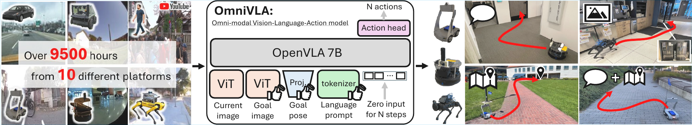
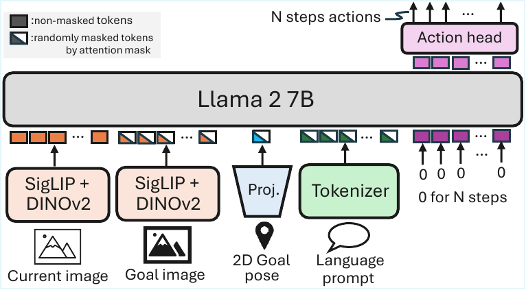
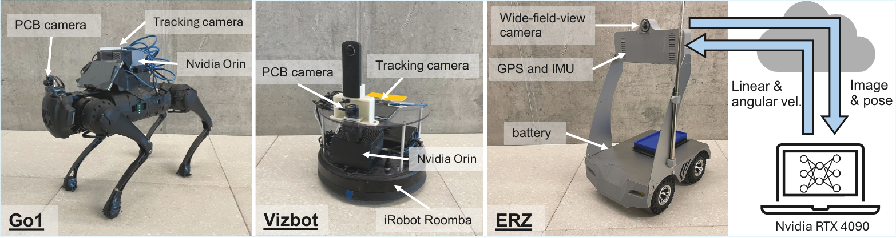
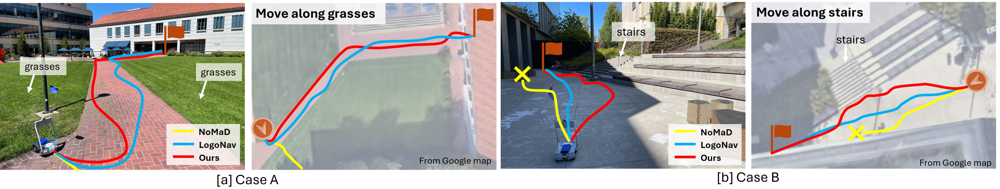
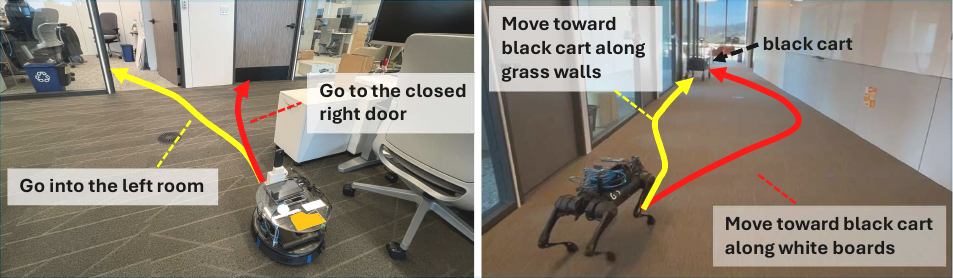

# OmniVLA (arXiv 2025)

<!-- paper-source: https://chengwei920412.github.io/paper_reading/2509.19480_OmniVLA_An_Omni_Modal_Vision_Language_Action_Model_for_Robot_Navigation/technical_report.html -->

> 原文链接：[OmniVLA (arXiv 2025)](https://chengwei920412.github.io/paper_reading/2509.19480_OmniVLA_An_Omni_Modal_Vision_Language_Action_Model_for_Robot_Navigation/technical_report.html)

> **arXiv ID**: 2509.19480  
> **原文标题**: OmniVLA: An Omni-Modal Vision-Language-Action Model for Robot Navigation  
> **翻译日期**: 2026-08-04

## 论文概览 {#_1}

### 基本信息 {#_2}

- **作者**: Noriaki Hirose, Catherine Glossop, Dhruv Shah, Sergey Levine
- **机构**: UC Berkeley, Toyota Motor North America, Princeton University
- **领域**: 机器人导航、视觉-语言-动作模型、多模态机器人基础模型

### 核心贡献 {#_3}

本文提出 OmniVLA，一个面向机器人导航的全模态VLA模型。它将语言、2D目标位姿、自我中心目标图像及其组合统一到一个端到端导航策略中，并使用约9500小时、跨10种平台的真实导航数据训练。论文的核心结果是：OmniVLA在语言、2D位姿和图像条件导航上均超过多数专用基线，并能处理“到哪里”和“如何去”的组合式全模态任务。

图：OmniVLA使用跨平台大规模导航数据训练，并支持多种目标模态。

## 研究背景与动机 {#_4}

### 问题定义 {#_5}

真实导航指令很少只有单一形式。人类会同时使用语言、坐标、地标图像和视觉参照来描述目标，但现有机器人导航策略通常按单一目标模态训练。这会限制训练数据来源，也限制部署时用户与机器人交互的方式。

### 现有方法的局限性 {#_6}

单模态导航策略通常在某一类目标表示上表现不错，但难以泛化到其他目标表达。语言导航方法受限于语言标注质量和合成动作噪声；图像目标导航方法适合短距离或拓扑导航，但不自然支持“如何走”的行为指令；2D位姿导航适合长距离GPS目标，但缺少语义和行为约束。已有VLA模型多集中于操作任务，导航数据、导航本体和导航动作空间与其预训练域存在差异。

### 本文创新点 {#_7}

OmniVLA的创新在于将导航目标的多种表示统一到VLA策略中，并通过模态丢弃让模型在训练时学习任意可用模态组合。它不是只做语言导航或图像导航，而是把语言、位姿和目标图像都投影到共享token空间中，由同一策略输出动作序列。

## 方法论 {#_8}

### 整体架构 {#_9}

OmniVLA以OpenVLA为基础，使用视觉编码器处理当前观测，并为目标图像、2D位姿和语言提示分别建立输入通路。每种目标模态被映射到共享token空间，再送入LLM/VLA主干。动作输出端采用线性动作头生成未来 \(N\) 步动作。

图：OmniVLA网络架构。目标图像、目标位姿和语言提示被统一为token条件。

### 关键技术 {#_10}

- **全模态目标条件**: 同时支持语言、2D位姿、自我中心目标图像及组合。
- **模态丢弃与注意力掩码**: 训练时随机选择可用目标模态，未选或不可用模态被注意力掩码排除。
- **跨数据集训练混合**: 训练数据来自GNM、LeLaN、Frodobots-2K和BDD-V等数据源，总计约9500小时。
- **重标注动作**: 对Frodobots、LeLaN和BDD-V使用或训练重标注模型生成可用动作标签。
- **边缘版本**: OmniVLA-edge基于ViNT构建，适合资源受限部署。

### 算法流程 {#_11}

策略形式为：

\[\{ \hat{a}_i \}_{i=1 \ldots N} = \pi_{\theta}(I_c, I_g, p_g, l_g, t_m)\]

其中 \(I_c\) 是当前图像，\(I_g\) 是目标图像，\(p_g\) 是2D目标位姿，\(l_g\) 是语言提示，\(t_m\) 是采样到的模态组合。主要模仿学习损失为：

\[J_{il} = \frac{1}{N}\sum_{i=1}^{N}(a^{ref}_i - \hat{a}_i)^2\]

附录中还加入物体到达目标 \(J_{obj}\) 和动作平滑目标 \(J_{sm}\)：

\[\min_\theta J := J_{il} + m_{obj}J_{obj} + J_{sm}\]

## 实验与结果 {#_12}

### 实验设置 {#_13}

- **数据集**: GNM mixture、LeLaN mixture、Frodobots-2K、BDD-V，总计约9500小时。
- **评估任务**: 语言条件导航、自我中心目标图像导航、2D目标位姿导航、组合式语言+位姿导航、新模态/新环境适应、跨本体部署。
- **平台**: FrodoBots ERZ为主，另含VizBot和Unitree Go1。
- **指标**: SR、Prog.、Behavior、SR\(^S\)、SR\(^C\)。
- **基线**: CoW、LeLaN、CounterfactualVLA、MBRA-pose、NoMaD、ViNT、MBRA-image、SmolVLA、MiniVLA。

图：真实机器人评估平台。

### 主要结果 {#_14}

OmniVLA在单模态条件评估中表现最强：语言SR为0.73，Behavior为0.65，2D位姿SR为0.95，图像导航SR为1.00。它在语言和位姿任务上明显超过专用基线，在图像任务上达到MBRA-image的100%成功率。

<table>
<thead>
<tr>
<th>方法</th>
<th>语言SR</th>
<th>Behavior</th>
<th>2D位姿SR</th>
<th>图像SR</th>
</tr>
</thead>
<tbody>
<tr>
<td>LeLaN</td>
<td>0.43</td>
<td>0.15</td>
<td>--</td>
<td>--</td>
</tr>
<tr>
<td>MBRA-pose</td>
<td>--</td>
<td>--</td>
<td>0.86</td>
<td>--</td>
</tr>
<tr>
<td>MBRA-image</td>
<td>--</td>
<td>--</td>
<td>--</td>
<td>1.00</td>
</tr>
<tr>
<td>OmniVLA-edge</td>
<td>0.60</td>
<td>0.25</td>
<td>0.91</td>
<td>1.00</td>
</tr>
<tr>
<td><strong>OmniVLA</strong></td>
<td><strong>0.73</strong></td>
<td><strong>0.65</strong></td>
<td><strong>0.95</strong></td>
<td><strong>1.00</strong></td>
</tr>
</tbody>
</table>

在组合式语言+位姿导航中，OmniVLA达到0.80成功率和0.60 Behavior，而NoMaD和MBRA-pose只能处理位姿，无法评估Behavior。这个实验是论文最有说服力的部分，因为它直接测试了“where + how”的组合能力。

图：目标位姿与语言共同条件下的长时域导航。

### 消融实验 {#_15}

多模态训练消融显示，OmniVLA-edge在语言、2D位姿、自我中心图像和卫星图像任务上整体优于单模态训练版本。特别是语言任务从0.43提升到0.60，卫星目标图像从0.19提升到0.57，说明多模态训练带来的共享导航表征对稀缺或新模态有帮助。

### 适应能力 {#_16}

OmniVLA-edge在不使用卫星模态预训练的情况下，仅替换并训练卫星图像编码器，就能将卫星目标导航从0.19提升到0.62。对新环境1.2小时数据微调后，卫星目标图像SR从0.57提升到0.83，2D目标位姿SR从0.81提升到0.86。使用CounterfactualVLA微调后，语言相关指标也进一步提升。

图：OmniVLA部署到VizBot和Unitree Go1，展示跨本体迁移能力。

## 关键见解 {#_17}

### 理论分析 {#_18}

论文的核心假设是：导航目标的不同模态虽然表达形式不同，但共享底层空间、语义和行为结构。通过随机模态丢弃训练，模型不能依赖某个单一输入，而必须从可用模态中学习一致的目标表征。这种训练方式类似于多任务/多模态学习中的共享表征机制。

### 实践启示 {#_19}

对真实机器人系统而言，全模态接口更符合实际使用：用户可以给坐标、给图片、说语言，也可以组合这些信息。该论文说明，使用大规模混合数据训练的VLA可以成为导航策略的统一骨干，再通过少量新数据适应新传感器、新目标模态或新机器人。

## 局限性与未来工作 {#_20}

### 当前局限 {#_21}

语言导航仍不是完全解决：最高Behavior为0.65，说明复杂行为指令仍有失败空间。论文没有充分展开失败模式、延迟、算力成本和安全边界。大模型版本依赖高容量VLA，部署成本高，边缘版本虽然轻量但语言遵循明显弱于完整模型。此外，数据重标注质量会影响策略上限，尤其是BDD-V等跨本体数据。

### 未来方向 {#_22}

后续可以加强语言指令数据的规模和质量，加入更细粒度的行为评估；探索更高效的VLA推理和蒸馏；系统研究安全约束、碰撞风险和失败恢复；扩展到地图、语音、触觉、卫星图像等更多模态；并评估更复杂的长时域任务规划。

## 相关工作对比 {#_23}

<table>
<thead>
<tr>
<th>方法</th>
<th>核心思想</th>
<th>优势</th>
<th>劣势</th>
</tr>
</thead>
<tbody>
<tr>
<td>ViNT / NoMaD</td>
<td>基于视觉的导航Transformer或扩散策略</td>
<td>轻量，适合图像目标导航</td>
<td>对语言和多模态组合支持弱</td>
</tr>
<tr>
<td>LeLaN / CoW</td>
<td>语言条件导航</td>
<td>用户接口自然</td>
<td>对OOD语言和复杂行为泛化有限</td>
</tr>
<tr>
<td>MBRA</td>
<td>基于模型的动作重标注和导航策略</td>
<td>位姿/图像导航强</td>
<td>不直接统一语言、图像、位姿</td>
</tr>
<tr>
<td>SmolVLA / MiniVLA</td>
<td>将VLA用于全模态条件</td>
<td>模型规模较小</td>
<td>预训练域或容量限制导致性能弱</td>
</tr>
<tr>
<td><strong>OmniVLA</strong></td>
<td>大规模导航数据上的全模态VLA</td>
<td>统一多目标模态，真实评估强，适应能力好</td>
<td>依赖大模型和大规模数据，语言行为仍未完全可靠</td>
</tr>
</tbody>
</table>

## 个人评价 {#_24}

### 优点 {#_25}

论文问题设置很实用：真实机器人导航确实需要“坐标 + 视觉 + 语言”的组合接口。实验覆盖真实机器人、多模态组合、数据消融、新模态适应和跨本体部署，证据链比较完整。使用大规模导航数据而非只依赖VLA通用预训练，也让结果更贴近机器人落地。

### 可改进之处 {#_26}

论文对失败案例、环境复杂度分布和安全性讨论不足。部分数据标注依赖合成或重标注，噪声影响没有被充分量化。大模型版本的实时性、部署成本和延迟也应更明确报告。

### 推荐阅读对象 {#_27}

适合研究机器人导航、VLA、具身智能、多模态控制和机器人基础模型的读者。对希望构建真实机器人导航系统的人，数据混合、模态丢弃和边缘版本设计尤其值得参考。

## 附录 {#_28}

### 术语表 {#_29}

<table>
<thead>
<tr>
<th>英文</th>
<th>中文</th>
</tr>
</thead>
<tbody>
<tr>
<td>Vision-Language-Action (VLA)</td>
<td>视觉-语言-动作</td>
</tr>
<tr>
<td>omni-modal</td>
<td>全模态</td>
</tr>
<tr>
<td>goal conditioning</td>
<td>目标条件</td>
</tr>
<tr>
<td>egocentric image</td>
<td>自我中心图像</td>
</tr>
<tr>
<td>2D goal pose</td>
<td>2D目标位姿</td>
</tr>
<tr>
<td>modality dropout</td>
<td>模态丢弃</td>
</tr>
<tr>
<td>attention mask</td>
<td>注意力掩码</td>
</tr>
<tr>
<td>cross-embodiment</td>
<td>跨本体</td>
</tr>
<tr>
<td>reannotation</td>
<td>重标注</td>
</tr>
<tr>
<td>out-of-distribution (OOD)</td>
<td>分布外</td>
</tr>
</tbody>
</table>

### 参考资源 {#_30}

- **论文原文**: [arXiv链接](https://arxiv.org/abs/2509.19480)
- **中文翻译 PDF**: [paper_cn.pdf](https://chengwei920412.github.io/paper_reading/2509.19480_OmniVLA_An_Omni_Modal_Vision_Language_Action_Model_for_Robot_Navigation/paper_cn.pdf)
- **中文 Markdown 译文**: [paper_cn.md](https://chengwei920412.github.io/paper_reading/2509.19480_OmniVLA_An_Omni_Modal_Vision_Language_Action_Model_for_Robot_Navigation/paper_cn.html)
- **项目主页**: [omnivla-nav.github.io](https://omnivla-nav.github.io/)

---

**报告生成说明**: 本报告基于 arXiv LaTeX 源码、中文 TeX 译文和编译后的中文PDF整理而成，旨在提供论文的结构化总结和技术洞察。
