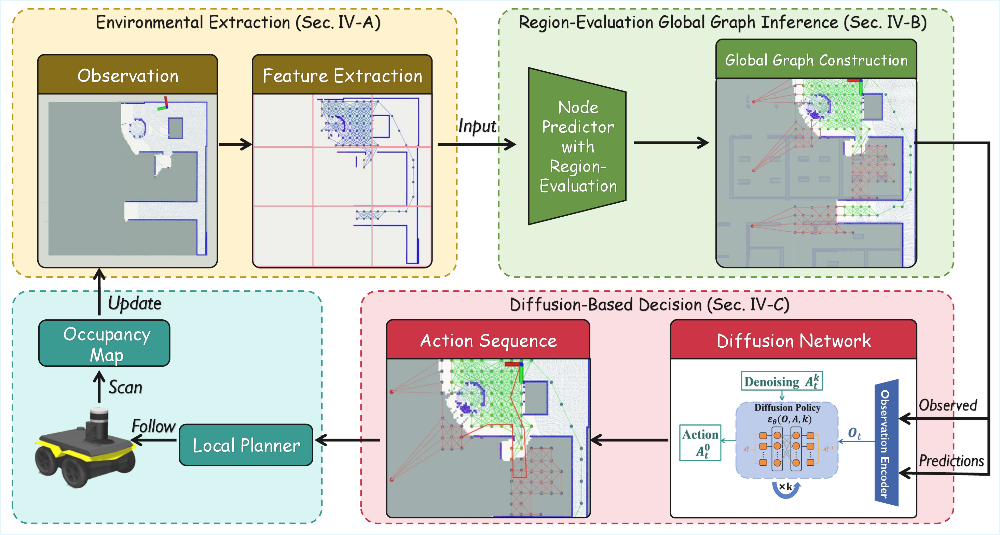
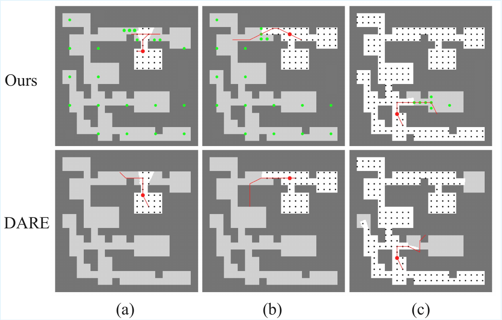

# GUIDE (arXiv 2025)

<!-- paper-source: https://chengwei920412.github.io/paper_reading/2509.19916_GUIDE_A_Diffusion_Based_Autonomous_Robot_Exploration_Framework_Using_Global_Graph_Inference/technical_report.html -->

> 原文链接：[GUIDE (arXiv 2025)](https://chengwei920412.github.io/paper_reading/2509.19916_GUIDE_A_Diffusion_Based_Autonomous_Robot_Exploration_Framework_Using_Global_Graph_Inference/technical_report.html)

论文：GUIDE: A Diffusion-Based Autonomous Robot Exploration Framework Using Global Graph Inference

原文：https://arxiv.org/abs/2509.19916

交付文件：[paper_cn.pdf](https://chengwei920412.github.io/paper_reading/2509.19916_GUIDE_A_Diffusion_Based_Autonomous_Robot_Exploration_Framework_Using_Global_Graph_Inference/paper_cn.pdf)，[paper_cn.md](https://chengwei920412.github.io/paper_reading/2509.19916_GUIDE_A_Diffusion_Based_Autonomous_Robot_Exploration_Framework_Using_Global_Graph_Inference/paper_cn.html)

## 核心问题 {#_1}

自主探索的主要难点是：机器人只能看到局部已观测地图，但任务目标是全局覆盖。传统 frontier 或采样方法容易短视，基于学习的方法虽然能生成策略，但通常只编码已观测区域，对未知区域结构利用不足。

## 方法概览 {#_2}

GUIDE 把未知区域预测、全局图表示和扩散策略连接起来。

系统包含三个模块：

1. 环境提取：从占据地图中采样已知自由节点，并把空间划分为已探索、边界和未观测区域。
2. 区域评估全局图推理：用 LaMa 修复模型预测潜在自由节点，再通过区域评分过滤不可靠预测，构建紧凑全局图。
3. 基于扩散的决策：把全局图编码为潜在表示，作为扩散策略条件，生成稳定且具前瞻性的动作序列。

## 关键结果 {#_3}

在迷宫环境中，GUIDE 的路径长度为 545(±65)m，优于 NBVP、DRL、MapEx、DARE 和 TARE，并且相对最优解差距为 8.8%。在 Gazebo 实验中，相比 TARE、DRL 和 DARE，覆盖完成速度最高提升 18.3%，冗余运动减少 34.9%。真实机器人实验也验证了方法的稳定性。

## 工程关注点 {#_4}

该方法的实用价值在于不追求像素级完整地图预测，而是预测和过滤图节点，用较低计算成本提供结构先验。复现时应重点关注区域评分、未知节点过滤阈值、图编码器输入格式，以及扩散策略的去噪步数。论文显示 GUIDE 在 \(K=30\) 时即可获得可靠输出，而 DARE 往往需要更高去噪步数。

## 结论 {#_5}

GUIDE 的核心贡献是把“可信未知结构预测”放入全局图，并用该图引导扩散策略做长时域探索决策。这一设计同时改善路径效率、减少冗余运动，并保持可部署的计算开销。
