# MASt3R-Fusion (arXiv 2025)

<!-- paper-source: https://chengwei920412.github.io/paper_reading/2509.20757_MASt3R_Fusion_Integrating_Feed_Forward_Visual_Model_with_IMU_GNSS_for_High_Functionality_SLAM/technical_report.html -->

> 原文链接：[MASt3R-Fusion (arXiv 2025)](https://chengwei920412.github.io/paper_reading/2509.20757_MASt3R_Fusion_Integrating_Feed_Forward_Visual_Model_with_IMU_GNSS_for_High_Functionality_SLAM/technical_report.html)

> **arXiv ID**: 2509.20757
> **原文标题**: MASt3R-Fusion: Integrating Feed-Forward Visual Model with IMU, GNSS for High-Functionality SLAM
> **翻译日期**: 2026-08-29

---

## 📋 论文概览 {#_1}

### 基本信息 {#_2}

- **作者**: Yuxuan Zhou, Xingxing Li（通讯作者）, Shengyu Li, Zhuohao Yan, Chunxi Xia, Shaoquan Feng
- **机构**: 武汉大学测绘学院（GREAT Group）
- **发表时间**: 2025 年 9 月（arXiv 预印本，v2 更新于 2025 年 11 月）
- **领域**: 视觉 SLAM、多传感器融合、前馈三维视觉基础模型、组合导航

### 核心贡献 {#_3}

论文的核心命题可以概括为一句话：**把前馈点图回归得到的稠密视觉约束，压缩成 Hessian 形式的 <span class="paper-math">\(7\times7\)</span> 紧凑信息块，再通过"同构群变换"搬到米制尺度的 SE(3) 因子图上，与 IMU 预积分和 GNSS 位置测量做严格的概率融合。**

具体贡献有五点：

1. **紧耦合框架**：在基于 Sim(3) 的视觉对齐约束与米制尺度 SE(3) 状态/因子之间建立桥梁，使前馈视觉范式首次能够接入成熟的概率多传感器融合体系。
2. **实时视觉惯性 SLAM**：滑动窗口 + 概率化边缘化，支持米制尺度位姿估计与稠密结构感知，8 GB 显存即可处理任意长序列。
3. **全局一致 SLAM**：引入回环闭合与 GNSS，采用"基于几何的回环候选筛选 + 全信息迭代优化"的两阶段策略。
4. **系统性评估**：KITTI-360、SubT-MRS 两个公开数据集 + 自采武汉城区多传感器数据集。
5. **开源**：<https://github.com/GREAT-WHU/MASt3R-Fusion>

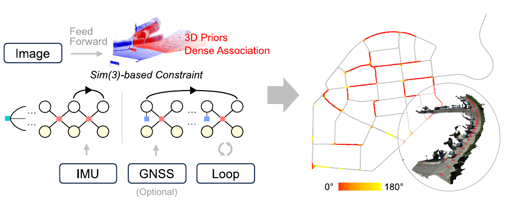

图：MASt3R-Fusion 系统总览。热力图表示跨时序数据关联的帧间视角夹角，体现了前馈模型在大视角差异下的关联能力。

---

## 🎯 研究背景与动机 {#_4}

### 问题定义 {#_5}

DUSt3R / MASt3R / VGGT 一类**前馈点图回归模型**改变了视觉几何的求解方式：网络直接从图像对回归出统一参考系下的 2D→3D 点图（Pointmap），不再需要显式的相机参数标定与迭代式多视图三角化。这一范式已经催生了 MASt3R-SLAM、SLAM3R、VGGT-SLAM 等纯视觉 SLAM 系统。

但纯视觉方案有两个绕不开的硬伤：

1. **尺度不可观**：单目视觉本质上只能恢复到相似变换（Sim(3)）意义下的结构，尺度需要外部信息锚定。在公里级场景中尺度漂移会被放大到灾难性程度。
2. **视觉退化**：低纹理、过曝、纯旋转、动态物体密集的场景下性能骤降。

传统解法是融合 IMU 与 GNSS——这在 OKVIS、VINS-Mono/Fusion、GVINS 等系统中已被充分验证。**但这套概率融合机制怎样嫁接到前馈范式上，此前没有答案。**

### 现有方法的局限性 {#_6}

论文的批评指向三类做法：


<table>
<thead>
<tr>
<th>类别</th>
<th>代表</th>
<th>局限</th>
</tr>
</thead>
<tbody>
<tr>
<td>纯视觉前馈 SLAM</td>
<td>MASt3R-SLAM、VGGT-SLAM、VGGT-Long</td>
<td>尺度漂移严重；大场景下全局优化困难、对错误回环敏感，只能采取保守策略</td>
</tr>
<tr>
<td>学习式视觉 + IMU</td>
<td>DBA-Fusion、SL-SLAM、SuperVINS</td>
<td>仍以 BA 为视觉约束核心，缺乏三维先验；长直线路段尺度可观测性弱的问题依旧存在</td>
</tr>
<tr>
<td>视觉惯性 + GNSS 全局融合</td>
<td>VINS-Fusion（全局位姿图）</td>
<td>位姿图丢弃了原始 IMU/视觉信息，位置残差无法在概率意义上分配到所有位姿，GNSS 粗差既难检测也难抑制</td>
</tr>
</tbody>
</table>


论文中一段话点出了关键矛盾——**"这类流程往往舍弃了已被广泛验证的概率化多传感器信息融合优势"**。前馈模型给出的是强先验，而不是概率分布；要把它塞进因子图，必须先解决表示层面的不匹配。

### 本文的创新点 {#_7}

三个真正的技术要点（而非工程堆叠）：

1. **同构群变换（Isomorphic Group Transformation）**：把 Sim(3) 的 7 维李代数扰动，通过一个对角矩阵 <span class="paper-math">\(\boldsymbol{\Lambda}=\mathrm{diag}(1, s\mathbf{I}, s)\)</span> 线性映射到 <span class="paper-math">\(\mathrm{SE}(3)\times\mathbb{R}\)</span> 的扰动。这是全文的枢纽。
2. **Hessian 形式的视觉信息传递**：稠密投影残差在 GPU 上以 float32 计算，但只把压缩后的 <span class="paper-math">\((\mathbf{H}_{ij}, \mathbf{v}_{ij})\in\mathbb{R}^{7\times7}\times\mathbb{R}^{7}\)</span> 交给 CPU 的 float64 因子图。既保住了数值精度，又把稠密像素的信息量完整保留下来。
3. **基于位置不确定性的回环候选筛选**：用 VIO 的低漂移特性，把里程计误差建模为沿向/横向各向异性的高斯过程，向量化地算出帧间距离不确定性 <span class="paper-math">\(\sigma_{p,q}\)</span>，据此在稠密验证之前先几何剪枝。

---

## 🔬 方法论 {#_8}

### 整体架构 {#_9}

系统分两个阶段，中间通过磁盘上的信息日志解耦：

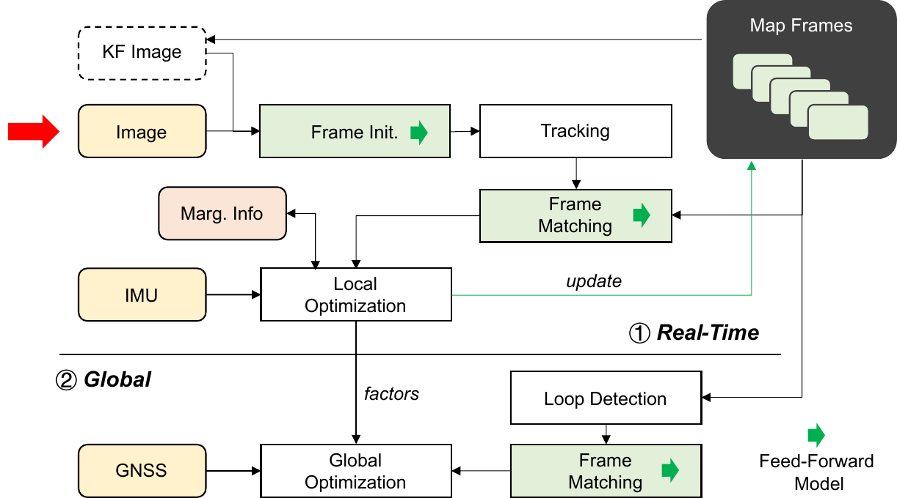

图：系统流程。实时 SLAM 阶段（在线）与全局优化阶段（离线/后处理）。

- **实时 SLAM 阶段**：图像 → MASt3R 前馈 → 点图 + 描述子 → 稠密匹配 → Sim(3) 位姿跟踪 → 滑动窗口因子图（视觉 + IMU + 边缘化先验）。
- **全局 SLAM 阶段**：读回日志中的特征 Token <span class="paper-math">\(\{\mathbf{F}\}\)</span>、点图 <span class="paper-math">\(\{\mathbf{X}\}\)</span>、状态 <span class="paper-math">\(\{\mathcal{X}\}\)</span>、Hessian 视觉信息 <span class="paper-math">\(\{\mathbf{H},\mathbf{v}\}\)</span> 与 IMU 因子 → 图像检索 + 几何筛选 → 回环稠密匹配 → 两步全局优化（先相对位姿 + Cauchy 核，再 Hessian 全信息）。

### 关键技术 {#_10}

#### 1. 双视图前馈与四级匹配精化 {#1}

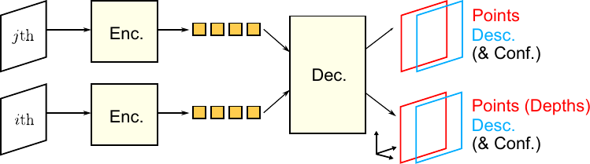

图：双视图前馈模型。两图编码为 Token，联合解码为两个点图（以 <span class="paper-math">\(i\)</span> 为公共参考系）与两个描述子图。

匹配分四步逐级精化，这是论文在 MASt3R-SLAM 之上做的工程加强：


<table>
<thead>
<tr>
<th>步骤</th>
<th>依据</th>
<th>公式要点</th>
</tr>
</thead>
<tbody>
<tr>
<td>① 射线邻近性初匹配</td>
<td>点图方向一致性</td>
<td><span class="paper-math">\(\arg\min_{\mathbf{u}}\Vert \widehat{\mathbf{X}^{ij}_i[\mathbf{u}]} - \widehat{\mathbf{X}^{ij}_j}\Vert^2\)</span>（<span class="paper-math">\(\widehat{\cdot}\)</span> 表示单位化）</td>
</tr>
<tr>
<td>② 动态物体剔除</td>
<td>深度残差过大即掩蔽</td>
<td>借三维感知剔除车辆等运动目标</td>
</tr>
<tr>
<td>③ 描述子邻域搜索</td>
<td>点积最大化</td>
<td>因描述子图不平滑，用邻域搜索而非梯度优化</td>
</tr>
<tr>
<td>④ 亚像素精化</td>
<td>对 <span class="paper-math">\(\mathbf{D}^{ij}_j\)</span> 做 4× 双线性上采样后再搜索</td>
<td>非对称上采样，专为 SLAM 精度服务</td>
</tr>
</tbody>
</table>


#### 2. 点图对齐残差 vs. 光束法平差 {#2-vs}

这是理解本文视觉约束形态的核心对比：

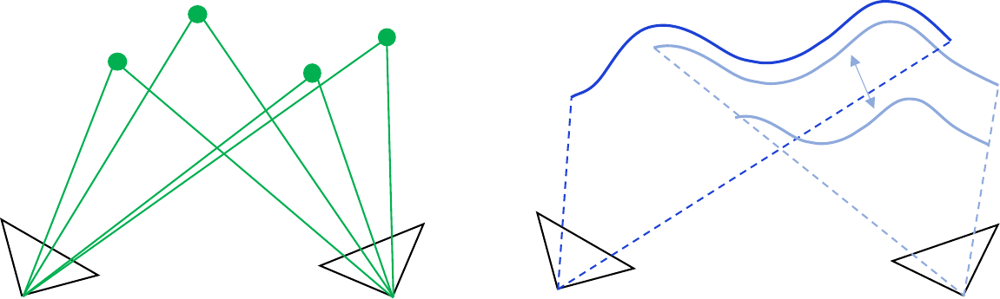

图：**左**为 BA（联合优化路标点与位姿，先验极弱）；**右**为点图对齐（在已知无尺度三维结构上优化位姿与尺度）。

点图对齐残差为


<div class="paper-math">\[\mathbf{r}_{ij}\left(\mathbf{S}^i_j \right) = \begin{bmatrix}
  \mathbf{u}^i_j - \pi\left(\mathbf{S}^i_j\circ \mathbf{X}_j\right) \\
  \left(\mathbf{X}_i\left[\mathbf{u}^i_j\right]\right)_z - 
  \left(\mathbf{S}^i_j\circ \mathbf{X}_j\right)_z
\end{bmatrix}\]</div>


上半部分是"深度已知的重投影误差"（主导项），下半部分是深度差（处理纯旋转退化）。

**关键差别**：BA 的残差 <span class="paper-math">\(\mathbf{r}_{ij}(\mathbf{T}^i_j, \mathbf{z}_j)\)</span> 里带着成千上万个路标深度 <span class="paper-math">\(\mathbf{z}_j\)</span>，必须靠 Schur 补消元，而消元会把所有观测到 <span class="paper-math">\(\mathbf{z}_j\)</span> 的帧耦合在一起；点图对齐把深度当成已知量，残差只依赖 <span class="paper-math">\(\mathbf{S}^i_j\)</span> 一个 7 维变量，因子天然是**成对且相互独立**的。这正是后面能自由地把因子搬进任意因子图（滑动窗口 / 全局 / 多期）的前提。

**代价**是引入了新假设：*点图结构准确，尺度是唯一不确定量*。论文诚实地指出了这个假设的失效场景——点在图像 <span class="paper-math">\(j\)</span> 中很远、在图像 <span class="paper-math">\(i\)</span> 中很近时，<span class="paper-math">\(j\)</span> 的深度不确定性会在 <span class="paper-math">\(i\)</span> 中被放大成大视差误差。这在大尺度室外长时间前向运动时尤为突出。缓解手段是一个朴素的掩膜降权：


<div class="paper-math">\[\text{mask} = \left(\mathbf{S}^i_j \circ \mathbf{X}_j\right)_z &lt; \tau \cdot \left(\mathbf{X}_i\right)_z, \qquad \tau \approx 1.25,\; f_{\text{downweight}} \approx 0.1\]</div>


#### 3. 同构群变换（全文枢纽） {#3}

Sim(3) 的相似变换可以等价分解为"SE(3) 变换 + 标量缩放"：


<div class="paper-math">\[\underbrace{\begin{bmatrix} s\mathbf{R} &amp; \mathbf{t}\\ 0 &amp; 1 \end{bmatrix}}_{\mathbf{S}\in\mathrm{Sim}(3)} \;\Longleftrightarrow\; \underbrace{\begin{bmatrix} \mathbf{R} &amp; \mathbf{t}\\ 0 &amp; 1 \end{bmatrix}}_{\mathbf{T}\in\mathrm{SE}(3)} \underbrace{\begin{bmatrix} s &amp; 0\\ 0 &amp; 1 \end{bmatrix}}_{\text{缩放}}\]</div>


于是 <span class="paper-math">\(\mathrm{Sim}(3)\cong \mathrm{SE}(3)\times\mathbb{R}\)</span>。在两侧同时施加右扰动并要求等价，即


<div class="paper-math">\[\mathbf{S}\boxplus\boldsymbol{\eta} = \left(\mathbf{T}\boxplus\boldsymbol{\xi}\right)\circ\left(s+\delta s\right)\]</div>


展开矩阵等式后得到一个极其简洁的结论：


<div class="paper-math">\[\begin{bmatrix} \boldsymbol{\omega} \\ \boldsymbol{\nu} \\ \sigma \end{bmatrix}
= \underbrace{\begin{bmatrix} 1 &amp; &amp; \\ &amp; s\mathbf{I} &amp; \\ &amp; &amp; s \end{bmatrix}}_{\boldsymbol{\Lambda}}
\begin{bmatrix} \boldsymbol{\theta} \\ \boldsymbol{\tau} \\ \delta s \end{bmatrix}\]</div>


**直观解释**：Sim(3) 的旋转扰动与 SE(3) 的旋转扰动完全相同（对角块为 1）；平移与尺度扰动之间相差一个因子 <span class="paper-math">\(s\)</span>——因为 Sim(3) 的平移是"缩放后"的量，而 SE(3) 的平移是米制量。<span class="paper-math">\(\boldsymbol{\Lambda}\)</span> 就是这两套坐标之间的雅可比。

**极简数值例子**：设 <span class="paper-math">\(s=2\)</span>。若 SE(3) 侧平移扰动 <span class="paper-math">\(\boldsymbol{\tau}=(0.1,0,0)^\top\)</span> m、尺度扰动 <span class="paper-math">\(\delta s = 0.05\)</span>，则 Sim(3) 侧对应 <span class="paper-math">\(\boldsymbol{\nu}=(0.2,0,0)^\top\)</span>、<span class="paper-math">\(\sigma=0.1\)</span>。反过来，一个由稠密像素残差算出的 Sim(3) Hessian <span class="paper-math">\(\mathbf{H}_{ij}\)</span>，要作用到米制状态上，就必须做 <span class="paper-math">\(\boldsymbol{\Lambda}^\top \mathbf{H}\boldsymbol{\Lambda}\)</span> 的相似变换——这就是后面式子里 <span class="paper-math">\(\boldsymbol{\Lambda}\)</span> 出现的原因。

#### 4. 视觉二次型因子与双精度策略 {#4}

视觉信息以二次型（而非残差）形式进入因子图：


<div class="paper-math">\[\mathbf{E}_v (\mathcal{X}_i,\mathcal{X}_j) = \frac{1}{2} l_v(\mathcal{X})^\top\mathbf{H}_{v,ij}\, l_v(\mathcal{X}) - l_v(\mathcal{X})^\top \mathbf{v}_{v,ij}\]</div>


<div class="paper-math">\[\mathbf{H}_{v,ij} = \boldsymbol{\Lambda}_{(i,j)}^\top {\mathbf{J}^{ij}_{(i,j)}}^\top \mathbf{H}_{ij} \mathbf{J}^{ij}_{(i,j)}\boldsymbol{\Lambda}_{(i,j)}, \qquad
\mathbf{v}_{v,ij} = \boldsymbol{\Lambda}_{(i,j)}^\top {\mathbf{J}^{ij}_{(i,j)}}^\top \mathbf{v}_{ij}\]</div>


这里串起了两级变换：<span class="paper-math">\(\mathbf{J}^{ij}_{(i,j)}\in\mathbb{R}^{7\times14}\)</span> 把"相对"转成"绝对"（两帧各 7 维），<span class="paper-math">\(\boldsymbol{\Lambda}_{(i,j)}\)</span> 把 Sim(3) 转成 <span class="paper-math">\(\mathrm{SE}(3)\times\mathbb{R}\)</span>。

**符号表**（便于对照原文）：


<table>
<thead>
<tr>
<th>符号</th>
<th>含义</th>
<th>维度/类型</th>
</tr>
</thead>
<tbody>
<tr>
<td><span class="paper-math">\(\mathbf{X}^{ij}_i\)</span></td>
<td>图像对 <span class="paper-math">\((i,j)\)</span> 解码出的点图，参考系为 <span class="paper-math">\(i\)</span></td>
<td><span class="paper-math">\((H\times W, 3)\)</span></td>
</tr>
<tr>
<td><span class="paper-math">\(\mathbf{D}^{ij}_i\)</span></td>
<td>像素级描述子图</td>
<td><span class="paper-math">\((H\times W, D)\)</span></td>
</tr>
<tr>
<td><span class="paper-math">\(\mathbf{S}_i\)</span></td>
<td>相机到世界的 Sim(3) 位姿</td>
<td><span class="paper-math">\(\mathrm{Sim}(3)\)</span></td>
</tr>
<tr>
<td><span class="paper-math">\(\boldsymbol{\eta}^i_j\)</span></td>
<td><span class="paper-math">\(\mathbf{S}^i_j\)</span> 的李代数（<span class="paper-math">\(\boldsymbol{\omega},\boldsymbol{\nu},\sigma\)</span>）</td>
<td><span class="paper-math">\(\mathbb{R}^7\)</span></td>
</tr>
<tr>
<td><span class="paper-math">\(\boldsymbol{\xi}\)</span></td>
<td>SE(3) 李代数（<span class="paper-math">\(\boldsymbol{\theta},\boldsymbol{\tau}\)</span>）</td>
<td><span class="paper-math">\(\mathbb{R}^6\)</span></td>
</tr>
<tr>
<td><span class="paper-math">\(\mathbf{H}_{ij},\mathbf{v}_{ij}\)</span></td>
<td>稠密投影压缩后的 Hessian 与梯度</td>
<td><span class="paper-math">\((7,7)\)</span>、<span class="paper-math">\((7,1)\)</span></td>
</tr>
<tr>
<td><span class="paper-math">\(\boldsymbol{\Lambda}\)</span></td>
<td>同构群变换矩阵 <span class="paper-math">\(\mathrm{diag}(1,s\mathbf{I},s)\)</span></td>
<td><span class="paper-math">\(\mathbb{R}^{7\times7}\)</span></td>
</tr>
<tr>
<td><span class="paper-math">\(\mathcal{X}_i\)</span></td>
<td>系统状态 <span class="paper-math">\((\mathbf{T}_i, s_i, \mathbf{v}_i, \mathbf{b}_i)\)</span></td>
<td>16 维（含零偏）</td>
</tr>
<tr>
<td><span class="paper-math">\(l_v(\cdot),l_m(\cdot)\)</span></td>
<td>线性容器：当前状态 → 线性化点处李代数</td>
<td>—</td>
</tr>
</tbody>
</table>


**精度分层设计**（论文中一个容易被忽视但很关键的工程点）：

```
float64 (CPU)  ── 维护全局位姿 T_i、尺度 s_i ──┐
                                              ├─ 计算相对变换 S^i_j（局部量，数值范围小）
float32 (GPU)  ── 稠密残差 + Hessian 压缩 ────┘
float64 (CPU)  ── Λ、J 线性映射 → 全局因子图约束
```

单精度只在"局部相对量"上使用，因此公里级场景下不会因浮点有效位不足而失稳。这解释了为什么纯视觉方案（普遍全程 float32）在 KITTI-360 上尺度崩溃。

#### 5. 滑动窗口因子图与边缘化 {#5}

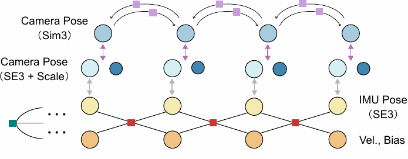

图：实时阶段滑动窗口因子图。Sim(3)→SE(3) 同构变换与 IMU-相机外参把视觉约束接到惯性状态上；概率化边缘化在受控问题规模下保留历史信息。

状态为 <span class="paper-math">\(\mathcal{X}_i = (\mathbf{T}_i, s_i, \mathbf{v}_i, \mathbf{b}_i)\)</span>，代价函数为


<div class="paper-math">\[\sum_{i \in \mathcal{W}}\left\Vert\mathbf{r}_{\mathrm{b}}(\mathcal{X}_{i},\mathcal{X}_{i+1})\right\Vert^2 + \sum_{(i,j) \in \mathcal{E}}\mathbf{E}_{\mathrm{v}}(\mathcal{X}_{i},\mathcal{X}_{j}) + \mathbf{E}_m (\mathcal{X})\]</div>


三项分别是 IMU 预积分残差、视觉二次型因子、边缘化先验。一个细节值得注意：**因为采用右扰动，<span class="paper-math">\(\mathbf{J}^r_{ij}\)</span> 与 <span class="paper-math">\(\mathbf{J}^{ij}_{(i,j)}\)</span> 只依赖相对变换 <span class="paper-math">\(\mathbf{S}^i_j\)</span>，与全局参考系无关**。这带来两个好处——边缘化时线性化误差更小；因子可以在全局/多期优化中自由复用而不必重算。

#### 6. 回环候选的概率化几何筛选 {#6}

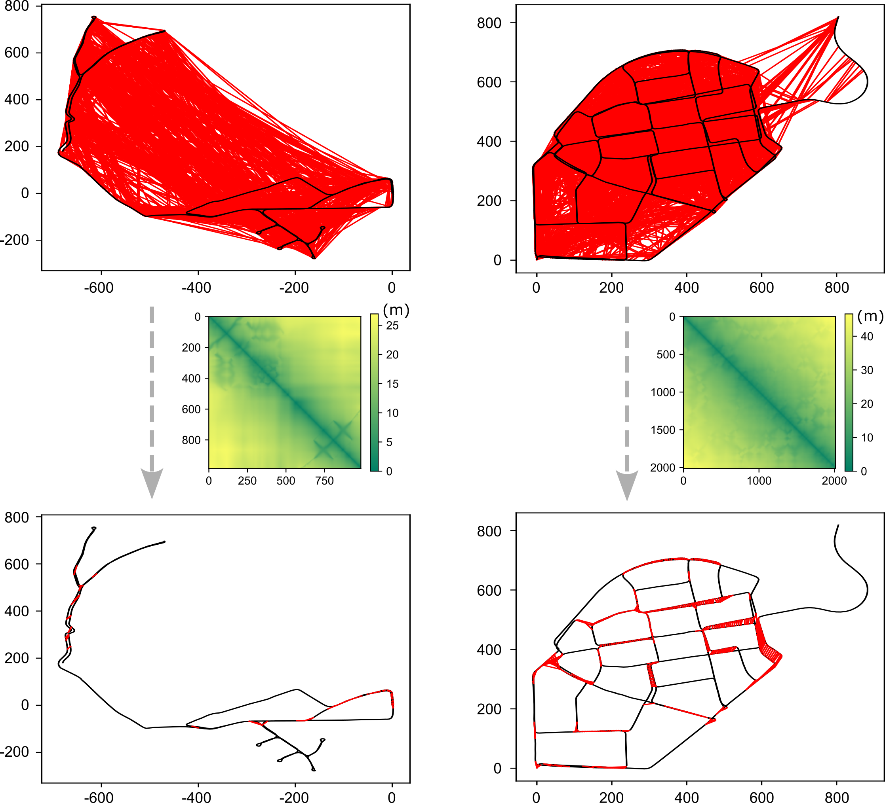

图：上图为按相似度 + 时序非连续性选出的候选；下图为经 <span class="paper-math">\(\sigma_{p,q}\)</span> 筛选后几何可行的候选。剪枝效果显著。

流程可以拆成四步：

1. **检索**：用前馈编码器的 Token 构造全局描述子 <span class="paper-math">\(\mathbf{d}_i\)</span>，取 top-10 并剔除时序邻近帧。这一步召回高但误检也多。
2. **误差建模**：把 VIO 当作马尔可夫过程，<span class="paper-math">\(\Delta\hat{\mathbf{t}}^w_{p,q} = \sum_{p}^{q-1}\Delta\hat{\mathbf{t}}^w_{i,i+1}\)</span>，单步误差各向异性：


<div class="paper-math">\[\boldsymbol{\epsilon}_{i,i+1} \sim \mathcal{N}(\mathbf{0}, d^2\mathbf{Q}), \qquad \mathbf{Q} = \sigma_d^2 \mathbf{n}\mathbf{n}^\top + \sigma_n^2 (\mathbf{I} - \mathbf{n}\mathbf{n}^\top)\]</div>


即沿运动方向的不确定性由**尺度误差** <span class="paper-math">\(\sigma_d\)</span> 主导，垂直方向由**航向误差** <span class="paper-math">\(\sigma_n\)</span> 主导，且误差随步长 <span class="paper-math">\(d\)</span> 线性增长。协方差沿路径累加（可向量化，因此很快）。

1. **兴趣点判据**：不比相机位置，而比"看的地方"。用场景中值深度 <span class="paper-math">\(L\)</span> 定义兴趣点 <span class="paper-math">\(\mathbf{t}_{\bar{i}} = (\mathbf{T}_i \circ [0,0,L]^\top)_{x,y}\)</span>，共视判据为 <span class="paper-math">\(d(\mathbf{t}_{\bar{q}},\mathbf{t}_{\bar{p}}) &lt; L\)</span>。**这一步是为大角度回环专门设计的**——两帧位置可能相距很远却在看同一处场景。
2. **概率筛选**：接受 <span class="paper-math">\(d(\hat{\mathbf{t}}_{\bar{q}},\hat{\mathbf{t}}_{\bar{p}}) &lt; L + \sigma_{p,q}\)</span>，对应 <span class="paper-math">\(1\sigma\)</span> 单侧尾部概率 15.87%，属于偏严格的取舍——宁可漏掉一些边缘候选，也要把稠密验证的计算量压下来。

#### 7. 全局优化的两步策略 {#7}

这是论文中一个很实用的数值稳定性设计：


<table>
<thead>
<tr>
<th>阶段</th>
<th>回环约束形式</th>
<th>稳健核</th>
<th>目的</th>
</tr>
</thead>
<tbody>
<tr>
<td>第一步</td>
<td>相对位姿 <span class="paper-math">\(\mathbf{r}_r = \mathbf{T}_i \circ \mathbf{T}_j^{-1} \circ \tilde{\mathbf{T}}^i_{j,\mathrm{loop}}\)</span></td>
<td>Cauchy <span class="paper-math">\(\rho_C\)</span></td>
<td>里程计初值远离 Hessian 的线性化点，先用大收敛域的相对位姿把图拉正，并剔除错误回环</td>
</tr>
<tr>
<td>第二步</td>
<td>Hessian 全信息 <span class="paper-math">\(\mathbf{E}_v\)</span>（内点集 <span class="paper-math">\(\mathcal{L}&#x27;\)</span>）</td>
<td>—</td>
<td>用完整的稠密视觉信息做最终精化</td>
</tr>
</tbody>
</table>


GNSS 侧的处理也有一个细节：因为 GNSS 采样与关键帧不同步，论文引入**临时预积分节点** <span class="paper-math">\(\mathcal{X}_{i,\mathrm{sync}}\)</span> 从 <span class="paper-math">\(\mathcal{X}_i\)</span> 外推，把 GNSS 残差挂在同步节点上：


<div class="paper-math">\[\left\Vert \mathbf{r}_g (\mathcal{X}_{i,\mathrm{sync}}) \right\Vert^2 + \left\Vert \mathbf{r}_b (\mathcal{X}_i,\mathcal{X}_{i,\mathrm{sync}}) \right\Vert^2\]</div>


**全局优化的效率关键**：<span class="paper-math">\((\mathbf{H}_{ij},\mathbf{v}_{ij})\)</span> 是相对量，相对变换在优化中基本稳定，因此**不需要重跑稠密投影**，只需迭代执行 <span class="paper-math">\(\boldsymbol{\Lambda}\)</span> 与 <span class="paper-math">\(\mathbf{J}\)</span> 的线性映射。这是"全信息全局优化仍然可算"的根本原因。

### 算法流程 {#_11}

```
【实时阶段】每帧：
  1. MASt3R 编码 → Token F_i；与上一关键帧联合解码 → 点图 X, 描述子 D
  2. 四级匹配（射线 → 掩膜 → 描述子邻域 → 4× 亚像素）→ 稠密关联 u^i_j
  3. 双向点图对齐求解 S^i_j（Huber + 网络置信度加权）→ 位姿跟踪
  4. 判定关键帧 → 对窗口内共视对，GPU(float32) 算 (H_ij, v_ij)
  5. Λ、J 映射（float64）→ 视觉二次型因子；拼入 IMU 预积分 + 边缘化先验
  6. 求解滑窗；窗口超限则 Schur 补边缘化最旧状态
  7. 日志落盘：{F}, {X}, {X 状态}, {H, v}, IMU 因子

【全局阶段】：
  8. 检索 top-10 回环候选（剔除时序邻近）
  9. σ_{p,q} 不确定性 + 兴趣点判据 → 几何剪枝
 10. 对存活候选做稠密匹配 → 相对位姿 + Hessian 信息
 11. 第一步优化：相对位姿回环 + Cauchy 核 + GNSS → 剔除外点
 12. 第二步优化：内点回环转 Hessian 形式 → 全信息精化
```

---

## 📊 实验与结果 {#_12}

### 实验设置 {#_13}

- **数据集**：
- **KITTI-360**：自动驾驶，公里级序列 8 条（1.4–11.2 km），郊区/高速/城市主干道，前视单目 + IMU
- **SubT-MRS**：非常规场景 3 条序列——2 条喀斯特洞穴、1 条四足机器人室内外过渡（含过曝序列）
- **武汉城区自采**：2 条序列，RGB 相机 + ADIS16470 IMU + Septentrio AsterRx4 GNSS 接收机 + 战术级 IMU（真值），附近基准站支持 DGNSS
- **评估指标**：相对平移/旋转误差 <span class="paper-math">\(t_{rel}\)</span>（%）、<span class="paper-math">\(r_{rel}\)</span>（°/100 m）（KITTI 里程计基准）；绝对平移误差 ATE（m 及归一化 %）；水平位置 RMSE（m）
- **对比方法**：VINS-Fusion（特征法）、ORB-SLAM3（特征法 + 回环 + BA）、DM-VIO（直接法）、DBA-Fusion（学习式稠密 BA）、MASt3R-SLAM（纯视觉前馈）、VGGT-Long（纯视觉多视图前馈 + 分块）、Metric3D v2（单目米制深度，仅感知定性对比）
- **配置**：全程**单目**；实时阶段在 RTX 4080 Mobile 笔记本上实时运行，显存占用 8 GB

### 主要结果 {#_14}

#### KITTI-360 实时 VIO（表 1 原表转写） {#kitti-360-vio-1}

<span class="paper-math">\(t_{rel}\)</span> 单位 %，<span class="paper-math">\(r_{rel}\)</span> 单位 °/100 m。\* 纯视觉，经 Sim(3) 全局对齐归尺度。


<table>
<thead>
<tr>
<th>序列</th>
<th>场景</th>
<th>VINS-Fusion <span class="paper-math">\(t_{rel}\)</span></th>
<th><span class="paper-math">\(r_{rel}\)</span></th>
<th>ORB-SLAM3 <span class="paper-math">\(t_{rel}\)</span></th>
<th><span class="paper-math">\(r_{rel}\)</span></th>
<th>DM-VIO <span class="paper-math">\(t_{rel}\)</span></th>
<th><span class="paper-math">\(r_{rel}\)</span></th>
<th>MASt3R-SLAM* <span class="paper-math">\(t_{rel}\)</span></th>
<th><span class="paper-math">\(r_{rel}\)</span></th>
<th>DBA-Fusion <span class="paper-math">\(t_{rel}\)</span></th>
<th><span class="paper-math">\(r_{rel}\)</span></th>
<th><strong>MASt3R-Fusion</strong> <span class="paper-math">\(t_{rel}\)</span></th>
<th><span class="paper-math">\(r_{rel}\)</span></th>
</tr>
</thead>
<tbody>
<tr>
<td>0000</td>
<td>郊区</td>
<td>1.897</td>
<td>0.176</td>
<td>2.386</td>
<td>0.117</td>
<td>1.369</td>
<td>0.129</td>
<td>39.64</td>
<td>0.524</td>
<td><strong>0.678</strong></td>
<td>0.105</td>
<td>0.726</td>
<td>0.151</td>
</tr>
<tr>
<td>0002</td>
<td>郊区</td>
<td>1.006</td>
<td>0.199</td>
<td>1.309</td>
<td>0.215</td>
<td>0.724</td>
<td>0.183</td>
<td>43.88</td>
<td>0.600</td>
<td>0.577</td>
<td>0.174</td>
<td><strong>0.504</strong></td>
<td>0.145</td>
</tr>
<tr>
<td>0003</td>
<td>高速公路</td>
<td>2.754</td>
<td>0.088</td>
<td>7.044</td>
<td>0.151</td>
<td>1.146</td>
<td>0.111</td>
<td>21.59</td>
<td>0.488</td>
<td>1.041</td>
<td>0.114</td>
<td><strong>0.406</strong></td>
<td>0.079</td>
</tr>
<tr>
<td>0004</td>
<td>郊区</td>
<td>1.710</td>
<td>0.193</td>
<td>1.976</td>
<td>0.211</td>
<td>1.063</td>
<td>0.178</td>
<td>48.79</td>
<td>0.887</td>
<td><strong>0.556</strong></td>
<td>0.153</td>
<td>0.770</td>
<td>0.157</td>
</tr>
<tr>
<td>0005</td>
<td>郊区</td>
<td>1.187</td>
<td>0.219</td>
<td>1.414</td>
<td>0.227</td>
<td>0.729</td>
<td>0.224</td>
<td>32.50</td>
<td>0.799</td>
<td>0.619</td>
<td>0.209</td>
<td><strong>0.544</strong></td>
<td>0.208</td>
</tr>
<tr>
<td>0006</td>
<td>郊区</td>
<td>1.349</td>
<td>0.176</td>
<td>1.685</td>
<td>0.184</td>
<td>0.887</td>
<td>0.161</td>
<td>54.09</td>
<td>0.695</td>
<td>0.734</td>
<td>0.166</td>
<td><strong>0.658</strong></td>
<td>0.155</td>
</tr>
<tr>
<td>0009</td>
<td>郊区</td>
<td>1.596</td>
<td>0.144</td>
<td>2.407</td>
<td>0.184</td>
<td>1.379</td>
<td>0.136</td>
<td>54.58</td>
<td>0.570</td>
<td>0.846</td>
<td>0.136</td>
<td><strong>0.631</strong></td>
<td>0.144</td>
</tr>
<tr>
<td>0010</td>
<td>城市主干道</td>
<td>3.610</td>
<td>0.216</td>
<td>5.335</td>
<td>0.214</td>
<td>2.130</td>
<td>0.215</td>
<td>47.06</td>
<td>0.513</td>
<td>1.486</td>
<td>0.208</td>
<td><strong>1.138</strong></td>
<td>0.198</td>
</tr>
<tr>
<td><em>均值（本报告计算）</em></td>
<td>—</td>
<td><em>1.89</em></td>
<td>—</td>
<td><em>2.94</em></td>
<td>—</td>
<td><em>1.18</em></td>
<td>—</td>
<td><em>42.8</em></td>
<td>—</td>
<td><em>0.82</em></td>
<td>—</td>
<td><strong><em>0.67</em></strong></td>
<td>—</td>
</tr>
</tbody>
</table>


**读数**：
- MASt3R-Fusion 在 8 条序列中 6 条取得最优 <span class="paper-math">\(t_{rel}\)</span>（0000 与 0004 由 DBA-Fusion 略胜）。
- 平均 <span class="paper-math">\(t_{rel}\)</span> 比 DM-VIO 低 **43.0%**，比 DBA-Fusion 低 **17.7%**（与论文声明一致，本报告独立复核）。
- 最突出的是**高速公路序列 0003**：0.406% vs DM-VIO 1.146%、ORB-SLAM3 7.044%。高速场景是纯前向运动、弱激励、可观测性最差的情形，这个数字最能说明"强稠密视觉约束 + 概率边缘化"对尺度的锚定作用。
- **纯视觉 MASt3R-SLAM 的平均 <span class="paper-math">\(t_{rel}\)</span> 高达 42.8%**，即使经过 Sim(3) 全局对齐仍然如此——这就是前馈范式在公里级场景的尺度崩溃，也是本文动机最直接的实证。

#### KITTI-360 全局 SLAM（表 2 原表转写） {#kitti-360-slam-2}


<table>
<thead>
<tr>
<th>序列</th>
<th>VGGT-Long*</th>
<th>ORB-SLAM3</th>
<th><strong>MASt3R-Fusion</strong></th>
<th>长度 (m)</th>
</tr>
</thead>
<tbody>
<tr>
<td>0000</td>
<td>103.64</td>
<td>26.03</td>
<td><strong>2.13</strong></td>
<td>8361</td>
</tr>
<tr>
<td>0002</td>
<td>310.76</td>
<td>32.57</td>
<td><strong>2.82</strong></td>
<td>11195</td>
</tr>
<tr>
<td>0003</td>
<td>26.46</td>
<td>28.63</td>
<td><strong>0.70</strong></td>
<td>1368</td>
</tr>
<tr>
<td>0004</td>
<td>165.67</td>
<td>42.82</td>
<td><strong>4.56</strong></td>
<td>8614</td>
</tr>
<tr>
<td>0005</td>
<td>234.48</td>
<td>10.37</td>
<td><strong>1.28</strong></td>
<td>4561</td>
</tr>
<tr>
<td>0006</td>
<td>179.95</td>
<td>9.51</td>
<td><strong>2.52</strong></td>
<td>7699</td>
</tr>
<tr>
<td>0009</td>
<td>135.23</td>
<td>6.95</td>
<td><strong>1.90</strong></td>
<td>8677</td>
</tr>
<tr>
<td>0010</td>
<td>211.54</td>
<td>45.17</td>
<td><strong>4.38</strong></td>
<td>3340</td>
</tr>
<tr>
<td><strong>均值 ATE/长度 (%)</strong></td>
<td>2.91</td>
<td>0.63</td>
<td><strong>0.05</strong></td>
<td>归一化</td>
</tr>
</tbody>
</table>


**读数**：0.05% 的 ATE/长度意味着在 11 km 序列上绝对误差仅 2.82 m。相对 ORB-SLAM3 提升 **12.6×**，相对 VGGT-Long 提升 **58×**，且全程仅用单目 + IMU。论文把功劳归于两点：里程计本身更准，以及**大视角回环带来更强的约束**（反向行驶也能闭环）。

#### 数据关联能力（定性但关键） {#_15}

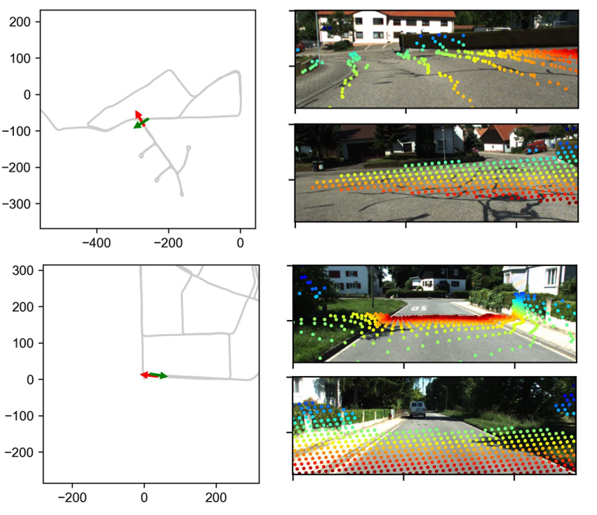

图：KITTI-360 跨时序匹配。视角差异超过 90°、甚至视线完全相反时仍能建立稠密关联——传统特征匹配（SIFT/ORB/SuperPoint+LightGlue）在这种情形下基本失效。

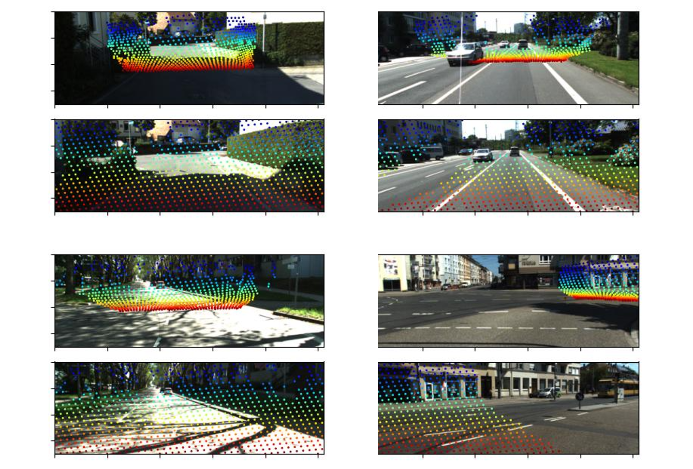

图：时序跟踪。稠密像素级关联，大帧间隔下仍可靠；运动车辆基于三维感知被有效剔除。

这部分定性结果实际上是全文最有说服力的地方之一：它解释了为什么全局 ATE 能做到 0.05%——**回环图的连通性远超传统方法**。

#### SubT-MRS 泛化性（表 3、表 4 原表转写） {#subt-mrs-3-4}

表 3（实时 VIO，ATE / m）：


<table>
<thead>
<tr>
<th>序列</th>
<th>VINS</th>
<th>ORB</th>
<th>DM-VIO</th>
<th>DBA</th>
<th><strong>M-Fus.</strong></th>
<th>长度 (m)</th>
</tr>
</thead>
<tbody>
<tr>
<td>handheld1</td>
<td>5.64</td>
<td>2.16</td>
<td>14.54</td>
<td>1.78</td>
<td><strong>1.07</strong></td>
<td>394</td>
</tr>
<tr>
<td>handheld2</td>
<td>2.32</td>
<td>2.42</td>
<td>4.94</td>
<td>2.09</td>
<td><strong>1.13</strong></td>
<td>509</td>
</tr>
<tr>
<td>overexposure</td>
<td>2.61</td>
<td>1.27</td>
<td>2.97</td>
<td>1.85</td>
<td><strong>0.99</strong></td>
<td>509</td>
</tr>
<tr>
<td><strong>均值 (%)</strong></td>
<td>0.80</td>
<td>0.42</td>
<td>1.74</td>
<td>0.41</td>
<td><strong>0.23</strong></td>
<td>归一化</td>
</tr>
</tbody>
</table>


表 4（全局 SLAM，ATE / m；\* 纯视觉）：


<table>
<thead>
<tr>
<th>序列</th>
<th>VGGT-Long*</th>
<th>ORB-SLAM3</th>
<th><strong>MASt3R-Fusion</strong></th>
<th>长度 (m)</th>
</tr>
</thead>
<tbody>
<tr>
<td>handheld1</td>
<td>失败</td>
<td>1.48</td>
<td><strong>0.26</strong></td>
<td>394</td>
</tr>
<tr>
<td>handheld2</td>
<td>失败</td>
<td>2.14</td>
<td><strong>1.04</strong></td>
<td>395</td>
</tr>
<tr>
<td>overexporsure</td>
<td>失败</td>
<td>1.07</td>
<td><strong>0.43</strong></td>
<td>509</td>
</tr>
<tr>
<td><strong>均值 (%)</strong></td>
<td>-</td>
<td>0.37</td>
<td><strong>0.13</strong></td>
<td>归一化</td>
</tr>
</tbody>
</table>


**读数**：
- 实时阶段 0.23% vs DBA-Fusion 0.41%（低 44%）、DM-VIO 1.74%（低 87%）。
- 全局阶段 0.13% vs ORB-SLAM3 0.37%（低 65%）；**VGGT-Long 三条序列全部失败**。
- 喀斯特洞穴是训练分布外的场景，前馈模型在弱纹理下仍能给出可靠稠密关联——这是对"通用视觉模型泛化性"这一质疑的有力回应。

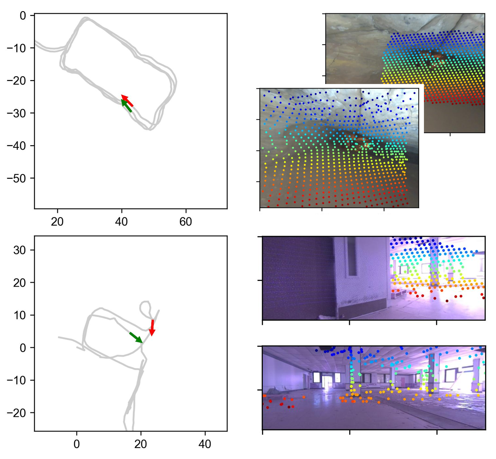

图：洞穴场景跨时序匹配。论文声称匹配能力"甚至超出人眼可辨识范围"。

#### 武汉城区：VIO 与 GNSS 融合（表 5、表 6 原表转写） {#vio-gnss-5-6}

表 5（相对位姿误差；<span class="paper-math">\(t_{rel}\)</span> %，<span class="paper-math">\(r_{rel}\)</span> °/100 m）：


<table>
<thead>
<tr>
<th>序列</th>
<th>VINS-Fusion <span class="paper-math">\(t_{rel}\)</span></th>
<th><span class="paper-math">\(r_{rel}\)</span></th>
<th>DBA-Fusion <span class="paper-math">\(t_{rel}\)</span></th>
<th><span class="paper-math">\(r_{rel}\)</span></th>
<th>M-Fus. 无回环 <span class="paper-math">\(t_{rel}\)</span></th>
<th><span class="paper-math">\(r_{rel}\)</span></th>
<th><strong>M-Fus. 含回环</strong> <span class="paper-math">\(t_{rel}\)</span></th>
<th><span class="paper-math">\(r_{rel}\)</span></th>
</tr>
</thead>
<tbody>
<tr>
<td>(a)</td>
<td>2.07</td>
<td>0.11</td>
<td>1.45</td>
<td>0.11</td>
<td>1.20</td>
<td>0.11</td>
<td><strong>0.53</strong></td>
<td>0.07</td>
</tr>
<tr>
<td>(b)</td>
<td>5.85</td>
<td>0.13</td>
<td>3.01</td>
<td>0.13</td>
<td>1.68</td>
<td>0.13</td>
<td><strong>0.92</strong></td>
<td>0.06</td>
</tr>
</tbody>
</table>


表 6（水平位置 RMSE / m）：


<table>
<thead>
<tr>
<th>模式</th>
<th>序列</th>
<th>GNSS RTK</th>
<th>VINS Fusion</th>
<th>DBA Fusion</th>
<th>M-Fus. 无回环</th>
<th><strong>M-Fus. 含回环</strong></th>
</tr>
</thead>
<tbody>
<tr>
<td>实测</td>
<td>(a)</td>
<td>4.36</td>
<td>2.54</td>
<td>0.78</td>
<td>0.24</td>
<td><strong>0.21</strong></td>
</tr>
<tr>
<td>实测</td>
<td>(b)</td>
<td>1.46</td>
<td>0.62</td>
<td>0.24</td>
<td>0.13</td>
<td><strong>0.09</strong></td>
</tr>
<tr>
<td>模拟</td>
<td>(a)</td>
<td>-</td>
<td>2.84</td>
<td>3.20</td>
<td>0.69</td>
<td><strong>0.37</strong></td>
</tr>
<tr>
<td>模拟</td>
<td>(b)</td>
<td>-</td>
<td>9.66</td>
<td>2.94</td>
<td>1.02</td>
<td><strong>0.46</strong></td>
</tr>
</tbody>
</table>


**读数**：
- **序列 (b) 的 <span class="paper-math">\(t_{rel}\)</span> 从 VINS 的 5.85% 降到 0.92%（低 84%）**。序列 (b) 含长直线路段，是尺度可观测性最差的工况；DBA-Fusion 只降到 3.01%，说明"稠密视觉"本身不够，还需要三维先验 + 概率边缘化。
- 实测 GNSS RTK 自身 RMSE 达 4.36 m（含大量粗差与失锁），MASt3R-Fusion 融合后压到 **0.21 m**——即输出精度比输入的 GNSS 好 20 倍，靠的是因子图对粗差的概率抑制。
- **模拟 100 秒 GNSS 中断**下，序列 (b) VINS-Fusion 崩到 9.66 m，MASt3R-Fusion 仍维持 **0.46 m**（亚米级）。这是全文最能体现"全信息 vs 位姿图"差别的一组数据。
- 一个反常观察：模拟模式序列 (a) 中 **DBA-Fusion（3.20 m）反而不如 VINS-Fusion（2.84 m）**。论文未展开解释，推测与 DBA-Fusion 只支持实时融合、GNSS 中断后无法回溯修正有关。

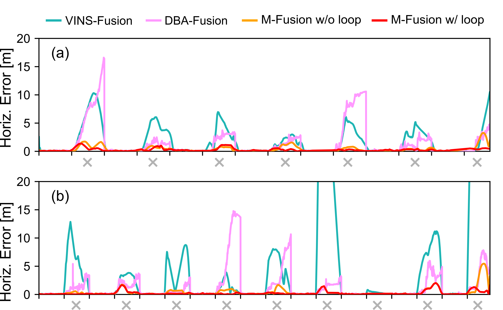

图：模拟 GNSS（100 秒中断，灰色十字标注）下各方案的水平误差时序。

#### 三维感知与重建（定性） {#_16}

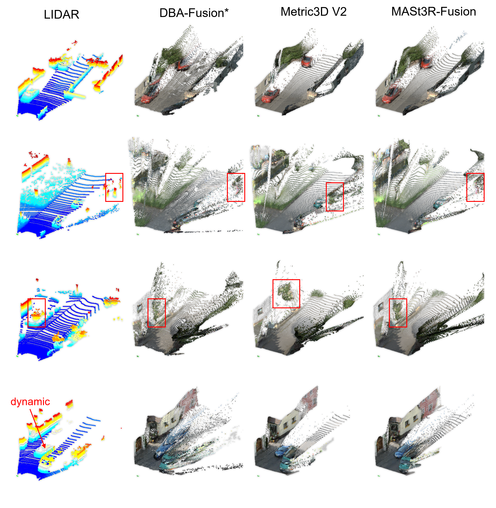

图：实时三维感知对比。DBA-Fusion 依赖 BA、缺乏三维先验，点云散乱且动态物体处理差；Metric3D v2 法向/边缘优秀但纯推断导致深度线索模糊处尺度出错；MASt3R-Fusion 借双目几何取得相对稳定完整的结果。

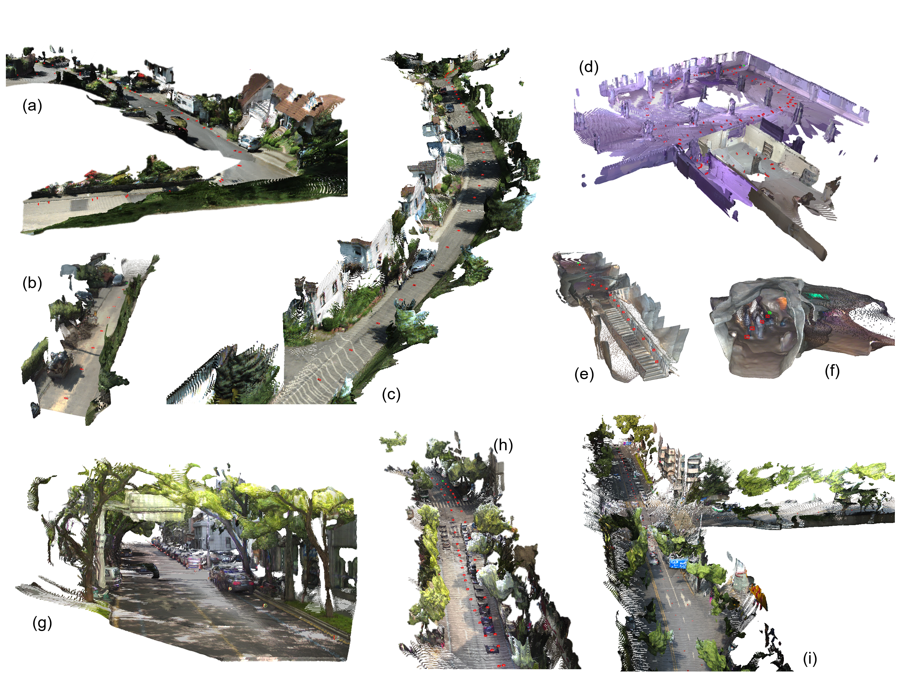

图：三个数据集上的重建结果。(a-c) KITTI-360；(d-f) SubT-MRS；(g-i) 武汉城区。

### 消融实验 {#_17}

**这是本文实验设计的明显短板。** 论文没有设置专门的消融章节，唯一带有消融性质的对照是 **"M-Fus. w/o loop" vs "M-Fus. w/ loop"**（表 5、表 6，以及图 9/图 12 的轨迹对比），验证了回环模块的增益：


<table>
<thead>
<tr>
<th>对照</th>
<th>序列 (a)</th>
<th>序列 (b)</th>
<th>结论</th>
</tr>
</thead>
<tbody>
<tr>
<td><span class="paper-math">\(t_{rel}\)</span>（无回环 → 含回环）</td>
<td>1.20% → 0.53%</td>
<td>1.68% → 0.92%</td>
<td>回环降低约 45–56%</td>
</tr>
<tr>
<td>实测 RMSE（无回环 → 含回环）</td>
<td>0.24 → 0.21 m</td>
<td>0.13 → 0.09 m</td>
<td>GNSS 可用时增益有限（GNSS 已提供全局约束）</td>
</tr>
<tr>
<td>模拟 RMSE（无回环 → 含回环）</td>
<td>0.69 → 0.37 m</td>
<td>1.02 → 0.46 m</td>
<td>GNSS 中断时增益显著（约 46–55%）</td>
</tr>
</tbody>
</table>


而以下几个本文最核心的设计**都没有被单独消融**：

- 同构群变换 <span class="paper-math">\(\boldsymbol{\Lambda}\)</span> 的必要性（若粗暴地把 Sim(3) 因子当 SE(3) 用会差多少？）
- Hessian 形式传递 vs. 退化为相对位姿约束（信息量损失的量化代价）
- float64/float32 分层精度策略的实际收益（大尺度下不做分层会不会真的崩？）
- 四级匹配精化中每一级的贡献（尤其 4× 亚像素上采样）
- 掩膜降权机制（<span class="paper-math">\(\tau=1.25\)</span>、<span class="paper-math">\(f_{\text{downweight}}=0.1\)</span>）的敏感性
- 回环筛选中 <span class="paper-math">\(\sigma_d\)</span>、<span class="paper-math">\(\sigma_n\)</span> 的取值与召回/精度权衡曲线

---

## 💡 关键见解 {#_18}

### 理论分析 {#_19}

**1. 点图对齐把视觉问题从"联合估计"降级为"配准"**

BA 的参数空间是 <span class="paper-math">\(\{\mathbf{T}_{1:K}\} \cup \{\mathbf{z}_{1:M}\}\)</span>，其中 <span class="paper-math">\(M \gg K\)</span>；点图对齐的参数空间只有 <span class="paper-math">\(\{(\mathbf{T}_i, s_i)\}\)</span>。这个降维不是免费的——它把"结构的不确定性"整体折叠进了"尺度这一个标量"。因此：

- **成立时**：因子成对独立、Hessian 只有 <span class="paper-math">\(7\times7\)</span>、可任意重组进不同的因子图，全局优化甚至不需要重算稠密投影。这是本文所有效率与灵活性的来源。
- **失效时**：论文自己指出的"远近视差放大"情形，即 <span class="paper-math">\((\mathbf{S}^i_j\circ\mathbf{X}_j)_z \ll (\mathbf{X}_i)_z\)</span>。此时"尺度是唯一不确定量"的假设被破坏，而缓解手段仅是一个硬阈值掩膜降权——这属于工程补丁而非理论修正。

**2. <span class="paper-math">\(\boldsymbol{\Lambda}\)</span> 的本质是"米制化"的一次坐标换基**

<span class="paper-math">\(\boldsymbol{\Lambda}=\mathrm{diag}(1, s\mathbf{I}, s)\)</span> 之所以如此简单，是因为 Sim(3) 的平移分量本身就是"已按 <span class="paper-math">\(s\)</span> 缩放过"的量。换言之，这不是一个近似，而是一个**精确的李代数同构**。理论上无损，这是本文相比"先估 Sim(3) 再硬转 SE(3)"类做法的关键优势——信息矩阵得到了正确的一致变换 <span class="paper-math">\(\boldsymbol{\Lambda}^\top\mathbf{H}\boldsymbol{\Lambda}\)</span>，而不是被丢弃或近似。

**3. 右扰动的选择带来"参考系无关性"**

因为使用右扰动，<span class="paper-math">\(\mathbf{J}^r_{ij}\)</span> 只依赖 <span class="paper-math">\(\mathbf{S}^i_j\)</span>。这个看似技术性的选择有实质后果：因子的信息内容不随世界坐标系原点/朝向变化。于是（i）边缘化的线性化误差更小；（ii）同一批因子可以在实时窗口、全局图、多期（multi-session）图之间复用。这是把"离线全局优化"做成可行工程的前提。

**4. 尺度可观测性：视觉先验与惯性激励的互补**

单目 VIO 的尺度依赖加速度激励；长直线匀速行驶时激励不足，尺度发散（表 5 序列 (b) VINS 5.85% 即是明证）。前馈模型提供的三维先验相当于给尺度加了一个**独立的、不依赖运动激励的观测通道**。两者在因子图中通过 <span class="paper-math">\(\boldsymbol{\Lambda}\)</span> 汇合，互相兜底——这是本文效果最本质的解释。

### 实践启示 {#_20}

1. **"Hessian 作为接口"是一个可复用的系统设计范式**：任何在 GPU 上算稠密残差的模块，都可以按此把信息压成小矩阵后交给 CPU 因子图。这解耦了"稠密感知"与"稀疏状态估计"的精度与算力需求，值得推广到 LiDAR、事件相机等其他稠密传感器。
2. **精度分层（float32 局部 / float64 全局）应成为大尺度学习式 SLAM 的标配**。纯视觉方案在公里级崩溃，一部分原因就在此。
3. **回环筛选应该"先几何、后外观"**：用 VIO 的低漂移把搜索空间剪掉，再花算力做稠密验证。这里的不确定性建模（沿向=尺度误差、横向=航向误差）思路简洁且可直接照搬。
4. **"看的地方"比"站的地方"更适合判共视**：兴趣点判据 <span class="paper-math">\(\mathbf{t}_{\bar{i}} = (\mathbf{T}_i \circ [0,0,L]^\top)_{x,y}\)</span> 是一个成本极低但对大角度回环很有效的技巧。
5. \*\*两步优化（相对位姿+Cauchy → Hessian 全信息）\*\*是处理"初值远离线性化点"的通用配方，适用于任何要引入 Hessian 先验的场景。

---

## 🔍 局限性与未来工作 {#_21}

### 当前局限 {#_22}

**方法层面**

1. **相机参数必须已知**。论文明确承认："尽管前馈重建常被认为具有无需相机参数的优势，实践中本文发现相机畸变会引入相当大的不稳定性。因此本文主要考虑相机参数已知的情形。" 这实质上放弃了前馈范式最被宣传的一个卖点，也限制了在众包/野外未标定数据上的适用性。
2. **"点图结构准确"假设的脆弱性**。远近视差放大问题只用硬阈值掩膜降权缓解（<span class="paper-math">\(\tau=1.25\)</span>、<span class="paper-math">\(f_{\text{downweight}}=0.1\)</span>），既没有理论保证，也没有敏感性分析。在深度分布跨度极大的场景（如从近处车辆到远处天际线）中，这可能是主要误差源。
3. **双视图而非多视图**。骨干是 MASt3R（两视图）。VGGT 等多视图模型能在单次前向中联合约束更多帧，理论上一致性更好；论文选择两视图是出于显存与实时性权衡，但未与"多视图骨干 + 本文融合框架"做对照。
4. **全局阶段不是在线的**。信息落盘后离线处理，无法用于需要在线闭环修正的任务（如实时重定位、长时自主导航）。论文以"实时 SLAM + 全局优化"划分阶段，但没有讨论增量式/滑动式全局优化的可能。
5. **GNSS 建模较为基础**。只用了位置（RTK/DGNSS 解算后的坐标）而非原始伪距/载波相位观测值。相比 GVINS 这类紧耦合原始观测的方案，在卫星数不足（少于 4 颗）时无法工作。
6. **无 IMU 外参在线标定**。<span class="paper-math">\(\mathbf{T}^b_c\)</span>、<span class="paper-math">\(\mathbf{t}^b_g\)</span>（杆臂）均按已知处理。

**实验层面**

1. **缺乏系统性消融**（见上文列举的 6 项未消融设计）。这是最主要的实验短板：读者无法判断 0.05% ATE 中有多少来自"同构群变换"这一核心贡献，多少来自"MASt3R 匹配本身很强"。
2. **无运行时与资源开销的定量报告**。只有"RTX 4080 Mobile 上实时"和"8 GB 显存"两个定性说法，没有 FPS、各模块耗时占比、全局优化的墙钟时间、关键帧数量与因子数规模。对一篇强调"高功能性/实时"的系统论文，这是明显缺失。
3. **关键超参未披露**：滑动窗口大小 <span class="paper-math">\(N\)</span>、关键帧选取准则、回环不确定性因子 <span class="paper-math">\(\sigma_d\)</span>/<span class="paper-math">\(\sigma_n\)</span>、检索 top-K=10 之外的阈值。这影响可复现性（尽管代码开源可部分弥补）。
4. **SubT-MRS 与武汉数据集规模偏小**（各 3 条 / 2 条序列）。武汉数据集为自采且未公开，第三方无法复现该部分结论。
5. **未与最新的多视图前馈 SLAM 做对等比较**。VGGT-Long 在 SubT-MRS 上三条全败、在 KITTI-360 上 ATE 达 2.91%，这一对比某种程度上偏于容易——纯视觉方案与"视觉+IMU+GNSS"方案本就不在同一信息量级上。更有说服力的对照应是"VGGT-Long/MASt3R-SLAM + 同等 IMU 融合"。

**原文中的若干笔误（不影响结论，但阅读时需注意）**

- **arXiv LaTeX 源码缺失 `\section{Introduction}`**：引言正文从"To overcome these limitations..."突然开始，且开篇一段疑似被误删。文中"see Sect. 4.1"的交叉引用表明引言本应是第 1 节。本翻译已补回 `\section{引言}` 以恢复正确的章节编号，并补写了一句引言起始过渡句。
- **表 5 标题误写为 "on KITTI-360 Dataset"**，实际是武汉城区数据集（该表位于 7.3 节，序列为 (a)/(b)，对比方法为 VINS-Fusion / DBA-Fusion / M-Fus.）。译文保留了原文表述以维持忠实性。
- **handheld2 序列长度不一致**：表 3 记为 509 m，表 4 记为 395 m。
- **"overexporsure"** 拼写错误（表 4；表 3 中为 "overexposure"）。
- **GNSS 残差符号不一致**：正文将 IMU-GNSS 杆臂定义为 <span class="paper-math">\(\mathbf{t}^b_g\)</span>，但公式中使用 <span class="paper-math">\(\mathbf{t}^c_g\)</span>。

### 未来方向 {#_23}

论文自述方向是**语义融合与更先进的场景表征，以支撑具身导航任务**。在此之上，几条更具体、更值得做的延伸：

1. **多视图骨干替换**：把 VGGT / π³ 等换进来，考察多视图联合约束能否进一步降低 Hessian 的条件数、减少对成对独立假设的依赖。
2. **不确定性的学习化**：目前权重 <span class="paper-math">\(\mathbf{Q}_{ij}\)</span> 只用了网络置信度 + Huber 核，而"远近视差放大"用硬阈值处理。更本原的做法是让网络直接输出**逐像素深度协方差**，使残差加权有概率依据，从根本上取代掩膜降权补丁。
3. **在线增量式全局优化**：借鉴 iSAM2 的贝叶斯树，把两步全局优化改造成增量式，让回环修正在线生效。
4. **紧耦合 GNSS 原始观测**：接入伪距/载波相位/多普勒，向 GVINS 式的紧耦合演进，以应对城市峡谷中卫星数不足的场景。
5. **在线外参与内参自标定**：把 <span class="paper-math">\(\mathbf{T}^b_c\)</span>、相机内参与畸变纳入状态，解除"相机参数已知"的限制，才能真正兼容众包数据。
6. **与 3DGS/神经场表征的衔接**：本文输出的是米制尺度、全局一致的稠密点图，正是 3DGS 初始化的理想输入；"MASt3R-Fusion + 3DGS"是一个自然的大场景可渲染建图管线。
7. **补齐消融与运行时报告**：即使不引入新方法，把上文列举的 6 项消融与完整时序分析做出来，本文的说服力就会有实质提升。

---

## 📚 相关工作对比 {#_24}


<table>
<thead>
<tr>
<th>方法</th>
<th>核心思想</th>
<th>优势</th>
<th>劣势</th>
</tr>
</thead>
<tbody>
<tr>
<td><strong>ORB-SLAM3</strong></td>
<td>稀疏 ORB 特征 + 关键帧 BA + 词袋回环 + 多地图</td>
<td>成熟稳定、CPU 即可运行、支持回环与多地图</td>
<td>稀疏地图；弱纹理易失效；大视角回环基本无能；长直线尺度漂移</td>
</tr>
<tr>
<td><strong>VINS-Fusion</strong></td>
<td>光流特征 VIO + 全局位姿图松耦合 GNSS</td>
<td>工程成熟、实时性好、支持多传感器</td>
<td>位姿图丢弃原始视觉/IMU 信息，GNSS 粗差难抑制；尺度可观测性弱时漂移大（表 5：5.85%）</td>
</tr>
<tr>
<td><strong>DM-VIO</strong></td>
<td>直接法光度误差 + 延迟边缘化</td>
<td>弱纹理下优于特征法；边缘化设计精细</td>
<td>无三维先验；对光照变化敏感；SubT-MRS 上均值 1.74%（最差）</td>
</tr>
<tr>
<td><strong>DBA-Fusion</strong></td>
<td>可微稠密 BA（DROID 式光流）+ IMU/GNSS 因子图</td>
<td>稠密视觉信息 + 概率融合；同组前作</td>
<td>仍以 BA 为核心、缺三维先验；点云散乱、动态物体处理差；只支持实时融合，无全局最优</td>
</tr>
<tr>
<td><strong>MASt3R-SLAM</strong></td>
<td>MASt3R 双视图点图 + Sim(3) 增量因子图（纯视觉）</td>
<td>高保真重建；本文视觉前端的直接来源</td>
<td>尺度崩溃（KITTI-360 均值 <span class="paper-math">\(t_{rel}\)</span> 42.8%）；无米制尺度</td>
</tr>
<tr>
<td><strong>VGGT-SLAM / VGGT-Long</strong></td>
<td>多视图前馈 + 子图 SL(4)/分块对齐（纯视觉）</td>
<td>可处理长序列；多视图一致性更强</td>
<td>大尺度尺度漂移；对错误回环敏感需保守策略；SubT-MRS 三序列全部失败</td>
</tr>
<tr>
<td><strong>Metric3D v2</strong></td>
<td>单目米制深度/法向推断</td>
<td>法向与边缘质量高；零样本泛化好</td>
<td>纯推断，深度线索模糊处尺度出错；非 SLAM，无位姿估计</td>
</tr>
<tr>
<td><strong>本文方法 MASt3R-Fusion</strong></td>
<td>点图对齐 → Hessian 压缩 → 同构群变换 <span class="paper-math">\(\boldsymbol{\Lambda}\)</span> → 米制 SE(3) 因子图（视觉+IMU+GNSS+回环）</td>
<td>尺度稳定（0003 序列 0.406%）；全局 ATE 0.05%；大视角回环；8 GB 显存处理任意长序列；精度分层保障大尺度数值稳定</td>
<td>需已知相机参数；依赖"点图准确"假设（仅硬阈值缓解）；全局阶段离线；无系统性消融与运行时报告；双视图骨干</td>
</tr>
</tbody>
</table>


---

## 🎓 个人评价 {#_25}

### 优点 {#_26}

1. **切入点精准，问题选得好**。"前馈范式很强但丢掉了概率融合"是一个真实存在、且此前没有干净答案的空白。论文没有去追更大的模型或更花的表征，而是补了一块结构性缺失。
2. **同构群变换是干净的理论贡献**。<span class="paper-math">\(\boldsymbol{\Lambda}=\mathrm{diag}(1,s\mathbf{I},s)\)</span> 短短一个对角矩阵，把 Sim(3) 与 SE(3) 的信息矩阵严格连通，是**精确同构而非近似**。这类"简单到显然、但此前无人写清"的结果，往往比复杂设计更有生命力。
3. **"Hessian 作为 GPU/CPU 接口"的系统设计非常漂亮**。稠密像素的信息被压成 <span class="paper-math">\(7\times7\)</span>，既保留信息量又让 CPU 因子图可算；全局优化时相对量稳定、无需重算稠密投影——这是效率与精度兼得的关键，也是可迁移到其他模态的设计模式。
4. **精度分层（float32 局部 / float64 全局）是真正的工程洞察**。它直接解释了为什么纯视觉方案在公里级崩溃，而本文不崩。这类细节通常不会被写进论文，作者写了，值得称赞。
5. **实验的规模与场景跨度扎实**。公里级驾驶（KITTI-360）+ 分布外场景（喀斯特洞穴）+ 真实城区 GNSS 退化（武汉），三个维度覆盖了"精度—泛化—鲁棒"。0.05% 的全局 ATE 在单目 V-I 配置下确实少见。
6. **对自身假设的失效条件坦诚披露**。明确写出"远近视差放大"问题、明确承认需要已知相机参数——这种诚实在系统论文里并不常见。
7. **代码开源**，且实测在消费级笔记本 GPU 上可跑，降低了复现与落地门槛。

### 可改进之处 {#_27}

1. **消融缺失是最大硬伤**。全文的核心卖点是"同构群变换 + Hessian 信息传递"，但没有一个实验直接量化这两者的贡献。读者完全无法排除"提升主要来自 MASt3R 匹配本身很强 + IMU 融合"这一替代解释。补一组 (a) 无 <span class="paper-math">\(\boldsymbol{\Lambda}\)</span> 的朴素转换、(b) Hessian 退化为相对位姿约束、(c) 全程 float32 的对照，说服力会截然不同。
2. **基线对比的公平性可质疑**。把"视觉+IMU+GNSS"与纯视觉的 MASt3R-SLAM、VGGT-Long 比 ATE，赢面是结构性的。更有价值的对照是"其他前馈 SLAM + 同等 IMU 融合"，或至少在文中明确讨论这一信息量差异。
3. **运行时报告缺失，与"实时/高功能性"的标题主张不匹配**。既然强调实时与 8 GB 显存，就应给出 FPS、模块耗时分解、全局优化墙钟时间、因子图规模随序列增长的曲线。
4. **写作与排版有明显疏漏**。arXiv 源码缺失 `\section{Introduction}` 且引言开篇疑似被误删；表 5 标题写错数据集；handheld2 长度前后矛盾；"overexporsure" 拼写错误；GNSS 杆臂符号 <span class="paper-math">\(\mathbf{t}^b_g\)</span>/<span class="paper-math">\(\mathbf{t}^c_g\)</span> 不一致。这些不影响技术结论，但会削弱审稿印象，投正式期刊前需要清理。
5. **超参数披露不足**（<span class="paper-math">\(N\)</span>、<span class="paper-math">\(\sigma_d\)</span>、<span class="paper-math">\(\sigma_n\)</span>、关键帧准则），依赖读者去翻代码。
6. **"需要已知相机参数"这一退让值得更充分的讨论**。它抵消了前馈范式的一个主要卖点，论文只用两句话带过；若能给出畸变敏感性的定量实验，反而会成为一个有价值的发现。
7. **不确定性建模偏工程化**。掩膜降权、预设 <span class="paper-math">\(\sigma_d/\sigma_n\)</span> 都是硬编码。既然整个框架的立足点是"概率融合"，视觉侧的不确定性理应做得更本原（如让网络输出逐像素协方差）。

### 综合判断 {#_28}

这是一篇**系统集成质量很高、且带有一个干净理论贡献的工作**。它的价值不在于刷新了某个 benchmark，而在于给出了"前馈三维视觉基础模型如何接入经典概率状态估计"的一个可复用答案——同构群变换 + Hessian 信息传递 + 精度分层，这三件事组合起来构成了一条清晰的技术路线。实验结果（尤其高速序列的 0.406% 与 100 秒 GNSS 中断下的 0.46 m）足以支撑其主要主张。

主要缺陷集中在**实验完备性**（消融与运行时）而非方法本身。若补齐这部分，是一篇很强的期刊论文。

### 推荐阅读对象 {#_29}

- **视觉/多传感器 SLAM 研究者**：必读。同构群变换与 Hessian 因子接口是可直接借用的工具。
- **组合导航（GNSS/INS）方向**：重点看第 6 节全局因子图，尤其"全信息 vs 位姿图"在 GNSS 退化下的对比。
- **三维视觉基础模型方向**（DUSt3R/VGGT 系）：重点看 4.2 节对点图对齐与 BA 的对比分析，以及"点图准确"假设的失效条件——这对理解前馈模型在下游几何任务中的边界很有帮助。
- **机器人/自动驾驶工程落地**：重点看精度分层策略、8 GB 显存的滑动窗口设计、回环几何剪枝；这些是可直接移植的工程经验。
- **不适合**：寻找纯视觉端到端方案、或希望免标定即插即用的读者（本文要求已知相机参数）。

---

## 📎 附录 {#_30}

### 重要公式 {#_31}

**1. 点图对齐残差**（视觉约束的基本形态，替代 BA 重投影误差）


<div class="paper-math">\[\mathbf{r}_{ij}\left(\mathbf{S}^i_j \right) = \begin{bmatrix}
  \mathbf{u}^i_j - \pi\left(\mathbf{S}^i_j\circ \mathbf{X}_j\right) \\
  \left(\mathbf{X}_i\left[\mathbf{u}^i_j\right]\right)_z - \left(\mathbf{S}^i_j\circ \mathbf{X}_j\right)_z
\end{bmatrix}\]</div>


上行为深度已知的重投影误差（主导项），下行为深度差（处理纯旋转）。变量仅 <span class="paper-math">\(\mathbf{S}^i_j\in\mathrm{Sim}(3)\)</span>，不含点深度。

**2. Hessian 压缩**（GPU 稠密 → CPU 紧凑）


<div class="paper-math">\[\underbrace{(\mathbf{J}^r_{ij})^\top\mathbf{r}_{ij}}_{\mathbf{v}_{ij}\,\in\,\mathbb{R}^{7}} = \underbrace{(\mathbf{J}^r_{ij})^\top\mathbf{J}^r_{ij}}_{\mathbf{H}_{ij}\,\in\,\mathbb{R}^{7\times7}} \boldsymbol{\eta}^i_j\]</div>


<span class="paper-math">\(H\times W\)</span> 个像素残差被压成 <span class="paper-math">\((7,7)\)</span> 与 <span class="paper-math">\((7,1)\)</span> 两个小矩阵。

**3. 同构群变换**（全文枢纽）


<div class="paper-math">\[\begin{bmatrix} \boldsymbol{\omega} \\ \boldsymbol{\nu} \\ \sigma \end{bmatrix} = \underbrace{\begin{bmatrix} 1 &amp; &amp; \\ &amp; s\mathbf{I} &amp; \\ &amp; &amp; s \end{bmatrix}}_{\boldsymbol{\Lambda}} \begin{bmatrix} \boldsymbol{\theta} \\ \boldsymbol{\tau} \\ \delta s \end{bmatrix}\]</div>


左侧为 Sim(3) 李代数扰动，右侧为 <span class="paper-math">\(\mathrm{SE}(3)\times\mathbb{R}\)</span> 扰动。旋转分量恒等；平移与尺度相差因子 <span class="paper-math">\(s\)</span>。

**4. 视觉二次型因子**（信息矩阵的两级变换）


<div class="paper-math">\[\mathbf{H}_{v,ij} = \boldsymbol{\Lambda}_{(i,j)}^\top {\mathbf{J}^{ij}_{(i,j)}}^\top \mathbf{H}_{ij} \mathbf{J}^{ij}_{(i,j)}\boldsymbol{\Lambda}_{(i,j)}\]</div>


<span class="paper-math">\(\mathbf{J}^{ij}_{(i,j)}\in\mathbb{R}^{7\times14}\)</span>：相对→绝对；<span class="paper-math">\(\boldsymbol{\Lambda}_{(i,j)}\)</span>：Sim(3)→<span class="paper-math">\(\mathrm{SE}(3)\times\mathbb{R}\)</span>。

**5. 实时 SLAM 代价函数**


<div class="paper-math">\[\sum_{i \in \mathcal{W}}\left\Vert\mathbf{r}_{\mathrm{b}}(\mathcal{X}_{i},\mathcal{X}_{i+1})\right\Vert^2 + \sum_{(i,j) \in \mathcal{E}}\mathbf{E}_{\mathrm{v}}(\mathcal{X}_{i},\mathcal{X}_{j}) + \mathbf{E}_m (\mathcal{X})\]</div>


IMU 预积分 + 视觉二次型 + 边缘化先验。

**6. 里程计位置不确定性（各向异性）**


<div class="paper-math">\[\boldsymbol{\epsilon}_{i,i+1} \sim \mathcal{N}(\mathbf{0}, d^2\mathbf{Q}), \qquad \mathbf{Q} = \sigma_d^2\, \mathbf{n}\mathbf{n}^\top + \sigma_n^2 (\mathbf{I} - \mathbf{n}\mathbf{n}^\top)\]</div>


沿运动方向 <span class="paper-math">\(\mathbf{n}\)</span> 由尺度误差 <span class="paper-math">\(\sigma_d\)</span> 主导，垂直方向由航向误差 <span class="paper-math">\(\sigma_n\)</span> 主导，方差随步长 <span class="paper-math">\(d\)</span> 平方增长。

**7. 帧间距离不确定性与回环判据**


<div class="paper-math">\[\sigma_{p,q} = \sqrt{\frac{{\Delta\hat{\mathbf{t}}^w_{p,q}}^\top \mathbf{Q}_{p,q}\, {\Delta\hat{\mathbf{t}}^w_{p,q}}}{\left\Vert{\Delta\hat{\mathbf{t}}^w_{p,q}}\right\Vert^2}}, \qquad d\left(\hat{\mathbf{t}}_{\bar{q}},\hat{\mathbf{t}}_{\bar{p}}\right) &lt; L + \sigma_{p,q}\]</div>


对应 15.87% 单侧尾部概率（<span class="paper-math">\(1\sigma\)</span>）。<span class="paper-math">\(\mathbf{t}_{\bar{i}} = (\mathbf{T}_i \circ [0,0,L]^\top)_{x,y}\)</span> 为兴趣点，<span class="paper-math">\(L\)</span> 为场景中值深度。

**8. GNSS 残差与时间同步**


<div class="paper-math">\[\mathbf{r}_g (\mathcal{X}_i) =\mathbf{T}^n_w\circ \mathbf{T}_i\circ\mathbf{T}^b_c\circ\mathbf{t}^c_g - \tilde{\mathbf{t}}^n_{g,i}, \qquad
\left\Vert \mathbf{r}_g (\mathcal{X}_{i,\mathrm{sync}}) \right\Vert^2 + \left\Vert \mathbf{r}_b (\mathcal{X}_i,\mathcal{X}_{i,\mathrm{sync}}) \right\Vert^2\]</div>


通过临时预积分节点 <span class="paper-math">\(\mathcal{X}_{i,\mathrm{sync}}\)</span> 桥接 GNSS 时刻与关键帧时刻。

### 术语表 {#_32}


<table>
<thead>
<tr>
<th>英文</th>
<th>中文</th>
<th>说明</th>
</tr>
</thead>
<tbody>
<tr>
<td>Feed-Forward Model</td>
<td>前馈模型</td>
<td>单次前向推断直接输出几何量的网络（DUSt3R/MASt3R/VGGT 系）</td>
</tr>
<tr>
<td>Pointmap</td>
<td>点图</td>
<td>逐像素的 2D→3D 映射，形状 <span class="paper-math">\((H\times W,3)\)</span></td>
</tr>
<tr>
<td>Pointmap Regression</td>
<td>点图回归</td>
<td>直接回归点图的范式，替代显式多视图三角化</td>
</tr>
<tr>
<td>Isomorphic Group Transformation</td>
<td>同构群变换</td>
<td><span class="paper-math">\(\mathrm{Sim}(3)\cong\mathrm{SE}(3)\times\mathbb{R}\)</span> 的李代数换基，由 <span class="paper-math">\(\boldsymbol{\Lambda}\)</span> 实现</td>
</tr>
<tr>
<td>Metric Scale</td>
<td>米制尺度</td>
<td>具有真实物理单位（米）的绝对尺度</td>
</tr>
<tr>
<td>Factor Graph</td>
<td>因子图</td>
<td>状态估计的概率图模型</td>
</tr>
<tr>
<td>Marginalization</td>
<td>边缘化</td>
<td>通过 Schur 补消去旧状态，保留其信息为先验</td>
</tr>
<tr>
<td>Schur Complement</td>
<td>Schur 补</td>
<td>分块矩阵消元技术</td>
</tr>
<tr>
<td>Bundle Adjustment (BA)</td>
<td>光束法平差</td>
<td>联合优化位姿与路标点的经典方法</td>
</tr>
<tr>
<td>Dense Bundle Adjustment (DBA)</td>
<td>稠密光束法平差</td>
<td>DROID-SLAM 式可微稠密 BA</td>
</tr>
<tr>
<td>Loop Closure</td>
<td>回环闭合</td>
<td>检测并约束重访同一场景</td>
</tr>
<tr>
<td>Cross-Temporal Association</td>
<td>跨时序关联</td>
<td>非时序邻近帧之间的数据关联（回环用）</td>
</tr>
<tr>
<td>Co-visible</td>
<td>共视</td>
<td>观测到相同场景区域</td>
</tr>
<tr>
<td>IMU Pre-integration</td>
<td>IMU 预积分</td>
<td>把高频 IMU 积分为帧间相对约束</td>
</tr>
<tr>
<td>VIO</td>
<td>视觉惯性里程计</td>
<td>Visual-Inertial Odometry</td>
</tr>
<tr>
<td>GNSS / RTK / DGNSS</td>
<td>全球导航卫星系统 / 实时动态 / 差分 GNSS</td>
<td>—</td>
</tr>
<tr>
<td>Lever-arm</td>
<td>杆臂</td>
<td>IMU 中心到 GNSS 相位中心的固定向量</td>
</tr>
<tr>
<td>Extrinsics</td>
<td>外参</td>
<td>传感器之间的固定相对位姿</td>
</tr>
<tr>
<td>ATE / RTE</td>
<td>绝对平移误差 / 相对平移误差</td>
<td>Absolute / Relative Translation Error</td>
</tr>
<tr>
<td>Huber / Cauchy Kernel</td>
<td>Huber / Cauchy 稳健核函数</td>
<td>抑制外点影响的稳健代价</td>
</tr>
<tr>
<td>Point of Interest</td>
<td>兴趣点</td>
<td>以场景中值深度近似的相机主观测点</td>
</tr>
<tr>
<td>Median Scene Depth</td>
<td>场景中值深度</td>
<td>该帧深度分布的中位数，记为 <span class="paper-math">\(L\)</span></td>
</tr>
<tr>
<td>Observability</td>
<td>可观测性</td>
<td>状态能否由观测唯一确定（此处指尺度）</td>
</tr>
<tr>
<td>Gross Error</td>
<td>粗差</td>
<td>显著偏离正常误差分布的测量（GNSS 多路径等）</td>
</tr>
<tr>
<td>Descriptor Map</td>
<td>描述子图</td>
<td>逐像素特征描述子，形状 <span class="paper-math">\((H\times W,D)\)</span></td>
</tr>
<tr>
<td>Sub-pixel Refinement</td>
<td>亚像素精化</td>
<td>通过上采样把匹配精度提升到亚像素级</td>
</tr>
</tbody>
</table>


### 参考资源 {#_33}

- **论文原文**: [arXiv:2509.20757](https://arxiv.org/abs/2509.20757)
- **中文翻译 PDF**: [paper_cn.pdf](https://chengwei920412.github.io/paper_reading/2509.20757_MASt3R_Fusion_Integrating_Feed_Forward_Visual_Model_with_IMU_GNSS_for_High_Functionality_SLAM/paper_cn.pdf)
- **中文 Markdown 译文**: [paper_cn.md](https://chengwei920412.github.io/paper_reading/2509.20757_MASt3R_Fusion_Integrating_Feed_Forward_Visual_Model_with_IMU_GNSS_for_High_Functionality_SLAM/paper_cn.html)
- **代码实现**: <https://github.com/GREAT-WHU/MASt3R-Fusion>
- **课题组主页**: GREAT Group, School of Geodesy and Geomatics, Wuhan University — <https://github.com/GREAT-WHU>
- **相关前作**: DBA-Fusion（同组）<https://github.com/GREAT-WHU/DBA-Fusion>；MASt3R-SLAM <https://github.com/rmurai0610/MASt3R-SLAM>；MASt3R <https://github.com/naver/mast3r>
