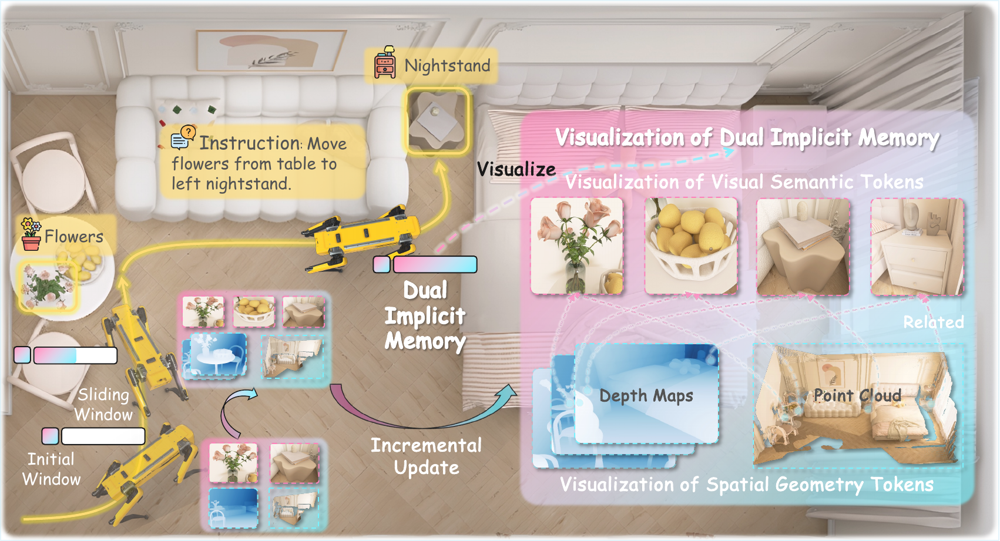
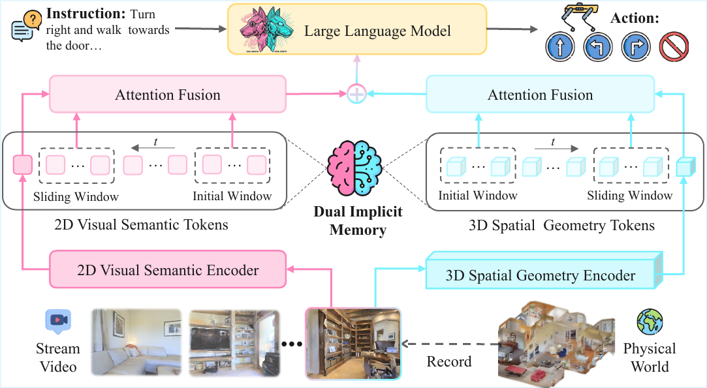
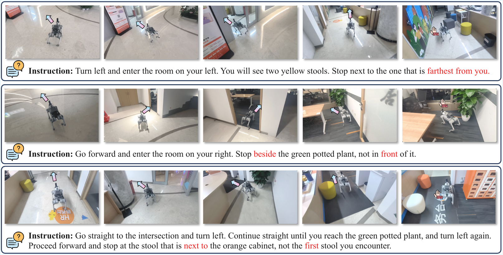
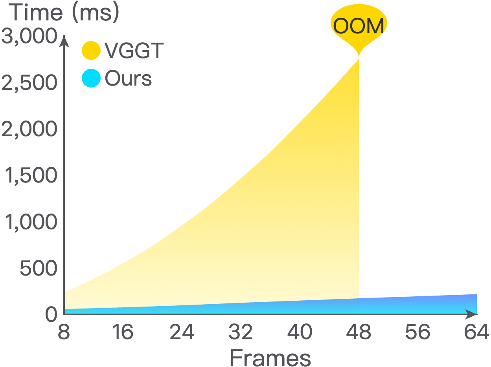

# JanusVLN (arXiv 2025)

<!-- paper-source: https://chengwei920412.github.io/paper_reading/2509.22548_JanusVLN_Decoupling_Semantics_and_Spatiality_with_Dual_Implicit_Memory_for_Vision_Language_Navigation/technical_report.html -->

> 原文链接：[JanusVLN (arXiv 2025)](https://chengwei920412.github.io/paper_reading/2509.22548_JanusVLN_Decoupling_Semantics_and_Spatiality_with_Dual_Implicit_Memory_for_Vision_Language_Navigation/technical_report.html)

> **arXiv ID**: 2509.22548  
> **原文标题**: JanusVLN: Decoupling Semantics and Spatiality with Dual Implicit Memory for Vision-Language Navigation  
> **翻译日期**: 2026-08-04

## 论文概览 {#_1}

### 基本信息 {#_2}

- **作者**: Shuang Zeng, Dekang Qi, Xinyuan Chang, Feng Xiong, Shichao Xie, Xiaolong Wu, Shiyi Liang, Mu Xu, Xing Wei, Ning Guo
- **机构**: 西安交通大学；高德地图，阿里巴巴集团
- **领域**: 视觉-语言导航、具身AI、多模态大语言模型、隐式记忆、空间推理

### 核心贡献 {#_3}

JanusVLN提出一种用于VLN的“双重隐式神经记忆”：一条记忆空间几何，一条记忆视觉语义。它不存储显式文本地图或完整历史帧，而是缓存经过编码器处理后的KV表示，并用初始窗口加滑动窗口增量更新，从而降低长序列导航中的计算和内存开销。

图：JanusVLN将RGB视频中的视觉语义与空间几何解耦。

## 研究背景与动机 {#_4}

### 问题定义 {#_5}

VLN要求智能体根据自然语言指令和视频流在未见环境中导航。当前MLLM/VLA路线擅长语义理解，但导航需要空间几何推理，例如远近、左右、遮挡、前后和相对位置。

### 现有方法的局限性 {#_6}

显式文本认知地图会丢失空间几何细节，并引入冗余描述。存储历史帧的方法需要反复处理完整历史，导致推理成本随时间增长。RGB-D或点云方法可以提供空间信息，但依赖额外硬件或显式3D数据。JanusVLN的目标是在只使用RGB视频的条件下获得空间几何能力。

### 本文创新点 {#_7}

论文将Qwen2.5-VL的语义视觉能力与VGGT的3D几何先验结合，并通过双重KV缓存实现固定大小的隐式记忆。关键不是简单加一个视觉编码器，而是利用预训练在像素-3D点云对上的VGGT提供互补空间信息。

## 方法论 {#_8}

### 整体架构 {#_9}

JanusVLN包含语义编码器和空间几何编码器。语义编码器来自Qwen2.5-VL，负责“是什么”；空间几何编码器来自VGGT，负责“在哪里、关系如何”。两类特征经过对齐和MLP投影后相加融合，再送入MLLM主干预测下一步动作。

图：JanusVLN框架。双编码器分别抽取语义和空间几何特征，并缓存历史KV。

### 关键技术 {#_10}

- **双重隐式记忆**: 缓存语义编码器和空间几何编码器的历史KV，而不是显式地图或历史帧。
- **初始窗口 + 滑动窗口**: 初始帧作为全局锚点保留，最近帧作为局部上下文滚动更新。
- **VGGT空间先验**: 使用在3D几何任务上预训练的VGGT，使纯RGB输入也能获得3D空间线索。
- **轻量融合**: 将语义特征 \(S&#x27;_t\) 与空间几何特征 \(G&#x27;_t\) 对齐后，用 \(F_t = S&#x27;_t + \lambda * MLP(G&#x27;_t)\) 融合。

### 重要公式 {#_11}

VLN动作预测形式：

\[a_{t+1} \in \{\texttt{Move\_Forward}, \texttt{Turn\_Left}, \texttt{Turn\_Right}, \texttt{Stop}\}\]

VGGT几何特征：

\[\{G_t\}_{t=1}^T = \text{Decoder}(\text{Encoder}(\{x_t\}_{t=1}^T))\]

隐式记忆交叉注意力：

\[G_t = \text{Decoder}(\text{CrossAttn}(\text{Encoder}(x_t),\{M_{initial},M_{sliding}\}))\]

空间感知特征融合：

\[F_t = S&#x27;_t + \lambda * MLP(G&#x27;_t)\]

## 实验与结果 {#_12}

### 实验设置 {#_13}

- **基准**: R2R-CE、RxR-CE、HM3D-OVON
- **真实平台**: Unitree Go2 + Insta360 X5，远程A10 GPU推理
- **模型**: Qwen2.5-VL 7B + VGGT
- **训练**: 1 epoch，仅微调LLM和投影层，冻结语义和空间编码器
- **指标**: NE、OS、SR、SPL、nDTW

### 主要结果 {#_14}

JanusVLN在R2R-CE Val-Unseen上达到SR 60.5、SPL 56.8，超过NaVILA和StreamVLN。在RxR-CE Val-Unseen上达到SR 56.2、SPL 47.5、nDTW 62.1，同样领先。更重要的是，JanusVLN只使用单RGB输入，却超过了不少使用全景、里程计或深度信息的方法。

<table>
<thead>
<tr>
<th>方法</th>
<th>R2R SR</th>
<th>R2R SPL</th>
<th>RxR SR</th>
<th>RxR SPL</th>
</tr>
</thead>
<tbody>
<tr>
<td>NaVILA</td>
<td>54.0</td>
<td>49.0</td>
<td>49.3</td>
<td>44.0</td>
</tr>
<tr>
<td>StreamVLN</td>
<td>56.9</td>
<td>51.9</td>
<td>52.9</td>
<td>46.0</td>
</tr>
<tr>
<td>JanusVLN</td>
<td><strong>60.5</strong></td>
<td><strong>56.8</strong></td>
<td><strong>56.2</strong></td>
<td><strong>47.5</strong></td>
</tr>
</tbody>
</table>

图：真实世界定性结果展示空间推理任务。

### 消融实验 {#_15}

移除空间隐式记忆后，SPL从49.2降到40.9；移除语义隐式记忆后，SR从52.8降到45.5；两个都移除后，SPL降到16.8。这说明空间和语义两类记忆互补且必要。

编码器消融显示，DINOv2和SigLIP 2等额外2D语义编码器提升有限，而VGGT带来显著提升；随机初始化VGGT也无效。这支撑了论文的核心论点：收益来自3D空间几何先验，而不是单纯增加参数。

图：缓存记忆相比原始VGGT显著降低推理时间增长。

## 关键见解 {#_16}

JanusVLN的关键洞察是：VLN中的“记忆”不一定要是可读文本地图或图像帧库。经过神经网络处理后的KV缓存本身就可以作为隐式记忆，而且比原始帧更紧凑、更适合注意力检索。该思路与StreamingLLM中的attention sink类似，但被扩展到具身导航和双编码器空间-语义记忆。

## 局限性与未来工作 {#_17}

### 当前局限 {#_18}

论文指出两类失败：偏离最优轨迹后纠错能力不足，以及过早停止。后者可能来自VGGT缺乏真实尺度，导致距离估计不准。另一个现实问题是，完整系统依赖Qwen2.5-VL 7B和VGGT，虽然缓存降低了历史计算，但整体部署仍需要较强GPU。

### 未来方向 {#_19}

后续可以引入更强的纠错数据或交互式恢复策略，增强尺度估计，探索更高效的空间几何编码器，并将双重隐式记忆扩展到真实机器人长时运行、开放世界导航和多传感器融合。

## 相关工作对比 {#_20}

<table>
<thead>
<tr>
<th>方法</th>
<th>核心思想</th>
<th>优势</th>
<th>劣势</th>
</tr>
</thead>
<tbody>
<tr>
<td>MapNav类方法</td>
<td>文本认知地图</td>
<td>可解释，结构明确</td>
<td>空间细节丢失，文本冗余</td>
</tr>
<tr>
<td>NaVILA/StreamVLN</td>
<td>历史帧或视频MLLM</td>
<td>直接利用视觉历史</td>
<td>长序列计算和内存压力大</td>
</tr>
<tr>
<td>RGB-D/点云方法</td>
<td>显式3D输入</td>
<td>空间信息强</td>
<td>依赖额外硬件或3D数据</td>
</tr>
<tr>
<td>JanusVLN</td>
<td>语义KV + 空间几何KV双隐式记忆</td>
<td>单RGB输入，空间推理强，缓存高效</td>
<td>仍依赖大模型，尺度估计和纠错有限</td>
</tr>
</tbody>
</table>

## 个人评价 {#_21}

### 优点 {#_22}

论文的问题抓得准：VLN确实不是纯语义理解任务，空间几何是核心瓶颈。方法设计也比较克制，用VGGT提供互补3D先验，用KV缓存解决长历史成本，实验覆盖R2R-CE、RxR-CE、HM3D-OVON和真实机器人，证据链较完整。

### 可改进之处 {#_23}

论文对系统延迟、机器人闭环控制频率、失败恢复机制和真实尺度估计讨论还不够深入。完整方法使用两个较强模型，实际部署成本仍需进一步量化。

### 推荐阅读对象 {#_24}

适合研究视觉-语言导航、具身智能、多模态大模型记忆机制、机器人空间推理和流式视频理解的读者。

## 参考资源 {#_25}

- **论文原文**: [arXiv链接](https://arxiv.org/abs/2509.22548)
- **中文翻译 PDF**: [paper_cn.pdf](https://chengwei920412.github.io/paper_reading/2509.22548_JanusVLN_Decoupling_Semantics_and_Spatiality_with_Dual_Implicit_Memory_for_Vision_Language_Navigation/paper_cn.pdf)
- **中文 Markdown 译文**: [paper_cn.md](https://chengwei920412.github.io/paper_reading/2509.22548_JanusVLN_Decoupling_Semantics_and_Spatiality_with_Dual_Implicit_Memory_for_Vision_Language_Navigation/paper_cn.html)
- **项目主页**: [JanusVLN](https://miv-xjtu.github.io/JanusVLN.github.io/)

---

**报告生成说明**: 本报告基于 arXiv LaTeX 源码、中文 TeX 译文和编译后的中文PDF整理而成，旨在提供论文的结构化总结和技术洞察。
