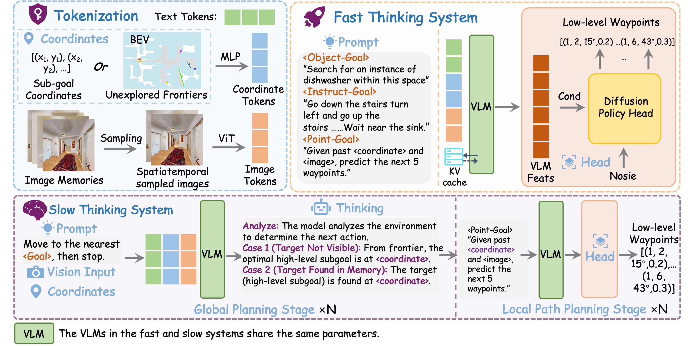
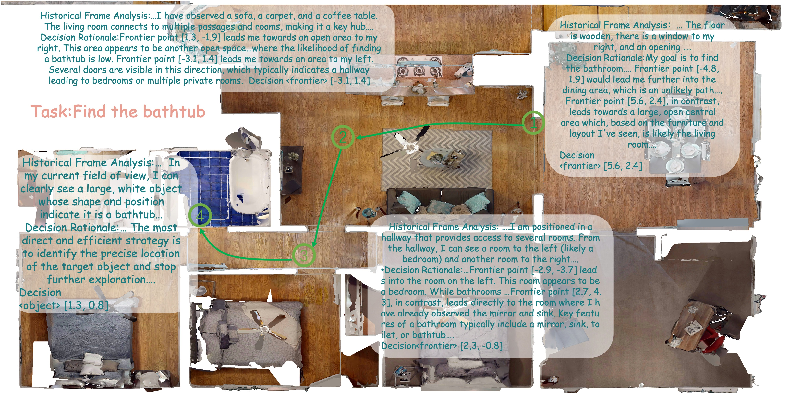
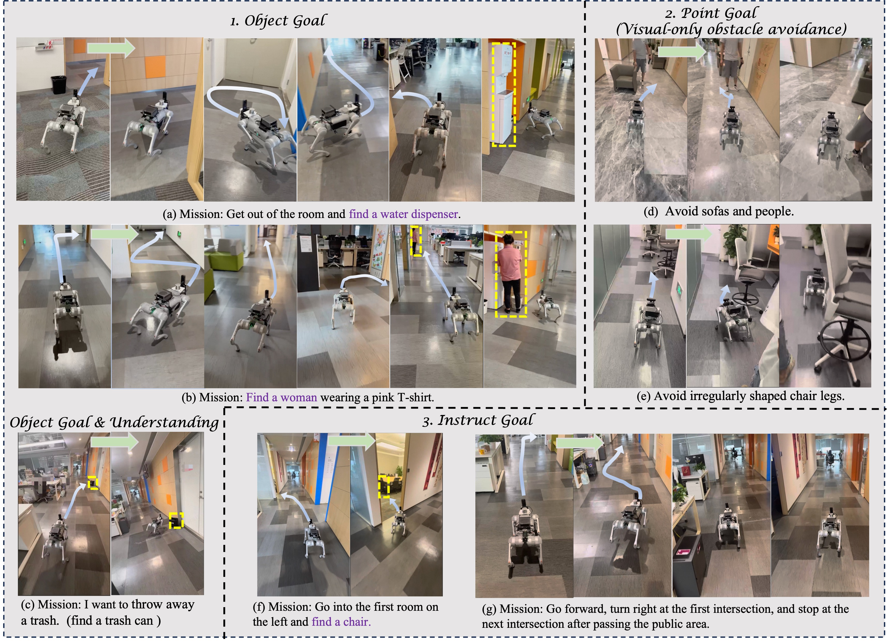

# OmniNav (arXiv 2025)

<!-- paper-source: https://chengwei920412.github.io/paper_reading/2509.25687_OmniNav_A_Unified_Framework_for_Prospective_Exploration_and_Visual_Language_Navigation/technical_report.html -->

> **arXiv ID**：2509.25687  
> **原文标题**：OmniNav: A Unified Framework for Prospective Exploration and Visual-Language Navigation  
> **翻译日期**：2026-09-29

---

## 📋 论文概览 {#_1}

### 基本信息 {#_2}

- **作者**：Xinda Xue、Junjun Hu、Minghua Luo、Shichao Xie、Jintao Chen、Zixun Xie、Kuichen Quan、Wei Guo、Mu Xu、Zedong Chu
- **机构**：阿里巴巴集团高德地图、北京大学
- **论文日期**：2026-01-06
- **领域**：具身智能、视觉语言导航、开放词汇物体导航、机器人探索

### 核心贡献 {#_3}

OmniNav 将点目标、指令目标、物体目标导航及基于前沿的探索纳入同一架构。它以连续航点策略承担快速、低延迟局部控制，以带长期视觉记忆和前沿推理的慢速系统承担全局规划，并通过联合训练通用多模态数据增强开放词汇理解与跨任务泛化。论文的关键判断是：在当前具身导航系统中，主要瓶颈往往不是低层策略学习，而是对通用指令和开放词汇物体的稳健理解。

---

## 🎯 研究背景与动机 {#_4}

### 问题定义 {#_5}

真实机器人导航需要同时处理四类能力：根据坐标到达点目标、遵循自然语言指令、搜索开放词汇物体，以及在目标尚不可见时主动探索未知区域。不同任务的输入形式、时间跨度和控制频率差异很大，但实际机器人需要在一个系统内协调这些能力。

### 现有方法的局限性 {#_6}

- 离散动作预测容易累积误差，控制粒度较粗，也不利于高频闭环执行。
- 纯反应式策略在长时域任务中容易陷入局部循环，难以记住已探索区域。
- 复杂场景图或三维语义地图虽可提供长期记忆，但构建与部署成本较高。
- 任务专用数据使模型难以迁移到未见指令、物体类别和环境。
- 长上下文视频输入和频繁调用大模型会增加延迟，难以满足真实机器人控制频率。

### 本文的创新点 {#_7}

1. 用同一多模态词元接口统一处理坐标、文本和视觉历史。
2. 以快慢双系统分解实时局部控制与长时域全局规划。
3. 用流匹配策略一次并行生成 5 个连续航点，避免自回归动作块的误差累积。
4. 将前沿与其附近历史图像绑定，由 VLM 进行语义与空间推理，选择探索子目标。
5. 将导航、具身问答、定位／指代和通用多模态数据联合训练，增强开放集泛化。

---

## 🔬 方法论 {#_8}

### 整体架构 {#_9}

图：OmniNav 快慢双系统架构。快速系统利用 VLM 与流匹配策略生成连续航点；慢速系统利用前沿、图像与长期记忆生成高层子目标。

快速系统可独立完成多数导航任务，也可接受慢速系统给出的子任务。慢速系统只在需要长时域探索和全局规划时介入；中央记忆通过带位姿的图像历史和 KV 缓存连接两者。这种分工使高频控制不必等待完整长链推理，同时保留全局一致性。

### 关键技术 {#_10}

**统一输入表示。** 文本任务、物体类别和点目标命令转为文本词元；二维坐标与朝向经 MLP 转为坐标词元；历史图像由 ViT 编码为图像词元。快速系统最多使用 20 帧历史，慢速系统则围绕候选前沿采样相关历史视图。

**连续航点流匹配。** 每个航点表示为：

\[\mathbf{w}_t^{(i)}=\left(x^{(i)},y^{(i)},\sin\theta^{(i)},\cos\theta^{(i)},c^{(i)}\right),\]

其中位置与朝向决定运动目标，\(c^{(i)}\) 表示是否触发到达信号。策略以视觉语言上下文为条件，用 DiT 建模加噪航点序列，并以 5 步欧拉积分完成去噪。并行预测的连续航点比“左转／前进”等离散动作块更适合细粒度控制。

**基于前沿的慢速规划。** 系统维护三维占据地图，将已探索区域与未知区域的边界定义为前沿；再为每个前沿选择一个最匹配其空间方向的历史图像，作为视觉代理。VLM 根据目标语义、候选前沿视图与历史记忆进行显式思维链推理。若目标已出现在记忆或当前视野中，就输出目标位置；否则选择语义上更可能包含目标的区域继续探索。

图：慢速系统针对“寻找浴缸”任务，结合记忆、前沿集合与语义先验迭代选择下一子目标。

**两阶段联合训练。** 第一阶段以自回归目标学习导航动作块、通用语义、具身问答、定位和指代任务，实现语言—视觉—动作对齐；第二阶段加入流匹配策略学习连续航点，并保留 20% 的第一阶段离散数据，降低连续控制微调对基础 VLM 能力的破坏。

### 算法流程 {#_11}

1. 将当前任务编码为文本或坐标词元，并从中央记忆采样历史图像。
2. 对普通短时域任务，由快速系统直接预测未来 5 个连续航点。
3. 对长时域探索任务，构建／更新占据地图和候选前沿。
4. 为每个前沿检索最匹配的历史视图，慢速系统用 CoT 选择高层子目标。
5. 快速系统依据原始视觉输入持续修正通向该子目标的航点，绕开障碍并调整最终停靠姿态。
6. 到达子目标或观测更新后，再次执行全局选择，形成“规划—执行”闭环。

---

## 📊 实验与结果 {#_12}

### 实验设置 {#_13}

- **数据集**：R2R-CE、RxR-CE、HM3D-OVON、CityWalker，以及 RefCOCO、Objects365、MAmmoTH-VL、ScanQA、R2R-EnvDrop 等训练数据。
- **评估指标**：成功率（SR）、预言成功率（OS）、路径长度加权成功率（SPL）、导航误差（NE）和平均朝向误差（MAOE）。
- **训练资源**：第一阶段使用 96 块 NVIDIA H20 训练 120 小时；第二阶段使用 64 块 H20 训练 48 小时。
- **主要对比方法**：HNR、CorrectNav、StreamVLN、Uni-NaVid、NaVILA、VLFM、MTU3D 等。

### 主要结果 {#_14}

<table>
<thead>
<tr>
<th>任务／基准</th>
<th>OmniNav 结果</th>
<th>论文报告的相对结论</th>
</tr>
</thead>
<tbody>
<tr>
<td>R2R-CE Val-Unseen</td>
<td>SR 69.5，SPL 66.1，NE 3.74</td>
<td>SR 比此前最佳高 4.4 个百分点</td>
</tr>
<tr>
<td>RxR-CE Val-Unseen</td>
<td>SR 73.6，SPL 62.0，NE 3.77</td>
<td>SR 比此前最佳高 4.3 个百分点</td>
</tr>
<tr>
<td>HM3D-OVON Val-Unseen，快速系统</td>
<td>SR 43.5，SPL 27.3</td>
<td>纯视觉输入已超过已有最佳方法 2.7 个百分点</td>
</tr>
<tr>
<td>HM3D-OVON Val-Unseen，完整系统</td>
<td>SR 59.2，SPL 33.2</td>
<td>超过此前最强方法 18.4 个百分点</td>
</tr>
<tr>
<td>CityWalker</td>
<td>MAOE 11.53%</td>
<td>优于 CityWalker 的 15.23%</td>
</tr>
</tbody>
</table>

完整系统在 HM3D-OVON 上的提升最大，说明慢速系统主要解决的是纯反应策略在长时域探索中的局部循环与覆盖不足。R2R-CE 和 RxR-CE 上，仅快速系统与 RGB 输入就取得强结果，说明连续航点策略本身已具备较好的低层控制与指令遵循能力。

### 消融实验 {#_15}

<table>
<thead>
<tr>
<th>策略头</th>
<th>慢速系统</th>
<th>通用数据</th>
<th>CoT</th>
<th>SR↑</th>
<th>SPL↑</th>
</tr>
</thead>
<tbody>
<tr>
<td></td>
<td></td>
<td></td>
<td></td>
<td>35.3</td>
<td>22.1</td>
</tr>
<tr>
<td>✓</td>
<td></td>
<td></td>
<td></td>
<td>43.5</td>
<td>27.3</td>
</tr>
<tr>
<td>✓</td>
<td>✓</td>
<td></td>
<td></td>
<td>55.9</td>
<td>30.7</td>
</tr>
<tr>
<td>✓</td>
<td>✓</td>
<td>✓</td>
<td></td>
<td>57.7</td>
<td>32.9</td>
</tr>
<tr>
<td>✓</td>
<td>✓</td>
<td>✓</td>
<td>✓</td>
<td><strong>59.2</strong></td>
<td><strong>33.2</strong></td>
</tr>
</tbody>
</table>

策略头带来 8.2 个百分点 SR 提升；加入慢速系统后再提升 12.4 个百分点，是最大单项增益；通用数据与 CoT 分别带来较小但稳定的增益。附录消融还显示，具身问答、定位／指代和通用 MLLM 数据分别改善小物体、不规则物体及通用语义理解。加入这些数据后，3B 与 7B 模型性能接近，说明该设置下数据充分性比简单扩大模型规模更关键。

### 真实环境部署 {#_16}

图：零样本设置下三类导航任务的真实四足机器人部署。

快速系统部署在配备 RTX 3090 的云服务器上，使用 20 帧、\(120\times106\) 分辨率的历史前视图像和 \(480\times426\) 的当前三视图，运行频率超过 5 Hz。模型输出航点，再由机载速度控制模块选择满足速度与加速度约束的控制量。完整慢速系统尚未在真实机器人上进行同等完整部署，因为还需稳定集成激光雷达或实时深度估计。

---

## 💡 关键见解 {#_17}

### 理论与方法层面 {#_18}

OmniNav 的核心并非单个新模块，而是把不同时间尺度上的决策接口设计清楚：慢速系统只输出子目标，快速系统仍根据原始视觉进行闭环局部规划，而不是机械执行预设路径。这样，慢速规划错误不会被直接转化为不可修正的低层动作，快速系统也不会承担超出短时视觉上下文能力范围的全局搜索。

连续航点把语义模型与经典机器人控制之间连接起来。航点既比离散动作更精确，又比直接预测电机控制量更具平台可迁移性；将朝向表示为 \(\sin\theta\) 与 \(\cos\theta\) 还消除了角度在 \(\pi/-\pi\) 处的不连续。

### 实践启示 {#_19}

- 对开放世界导航，增加通用视觉语言与定位数据可能比单纯扩大模型更划算。
- 高层规划不必与低层控制保持相同调用频率，按时间尺度分层可显著降低计算压力。
- 前沿的视觉代理是一种轻量折中：无需构建完整语义场景图，也能让 VLM 对未知区域进行有语义的选择。
- 将 VLM 部署在云端可快速验证系统，但最终产品还需评估网络抖动、失联保护和端侧回退机制。

---

## 🔍 局限性与未来工作 {#_20}

### 当前局限 {#_21}

1. 完整慢速系统尚未在真实机器人上系统部署，论文中的真实环境验证主要针对快速系统。
2. 慢速系统依赖深度和里程计构建占据地图，与“纯视觉统一系统”的目标仍有距离。
3. 前沿选择依赖显式 CoT，虽然提高可解释性，但其稳定性、真实性和计算成本仍需更严格评估。
4. 模型仍难以稳定识别衣服、镜子、地毯等具有复杂纹理、反射或形变的物体。
5. 训练开销很大，第一阶段与第二阶段合计使用大量 H20 GPU 小时，复现门槛较高。
6. 论文报告多项基准提升，但不同方法的传感器输入并不完全一致；例如完整 OmniNav 在 OVON 中使用深度与里程计，而部分对比方法仅用 RGB，解读结果时需区分输入条件。
7. 论文未提供完整的现实世界延迟分解、云端网络波动分析、碰撞率或安全性指标。

### 未来方向 {#_22}

- 学习语义驱动的子目标选择，而非主要依赖手工前沿构造。
- 发展纯视觉的已探索区域记忆，减少对深度与里程计的依赖。
- 构建可检索、可长期更新的终身时空记忆，支持持续导航。
- 系统研究数据质量、数据比例、模型规模与性能之间的扩展规律。
- 在真实机器人上完整部署慢速系统，并分析不同硬件与网络条件下的延迟—频率权衡。
- 引入不确定性估计和安全约束，使系统能在语义判断或定位不可靠时降级运行。

---

## 📚 相关工作对比 {#_23}

<table>
<thead>
<tr>
<th>方法</th>
<th>核心思想</th>
<th>优势</th>
<th>局限</th>
</tr>
</thead>
<tbody>
<tr>
<td>Uni-NaVid</td>
<td>用 VLM 离散动作预测统一多类导航任务</td>
<td>统一任务接口，纯视觉设置简洁</td>
<td>长时域规划研究不足，离散控制较粗</td>
</tr>
<tr>
<td>MTU3D</td>
<td>将目标记忆、三维坐标与前沿探索结合</td>
<td>强调主动探索和全局记忆</td>
<td>需构建三维物体坐标，部署复杂</td>
</tr>
<tr>
<td>VLFM</td>
<td>视觉语言基础模型结合前沿地图</td>
<td>开放词汇物体导航能力较强</td>
<td>高层语义与低层控制协作有限</td>
</tr>
<tr>
<td><strong>OmniNav</strong></td>
<td>快慢双系统、连续航点、前沿视觉代理与通用数据联合训练</td>
<td>同时兼顾实时控制、长时域探索和泛化</td>
<td>完整系统的真实部署与纯视觉慢速记忆尚未完成</td>
</tr>
</tbody>
</table>

---

## 🎓 综合评价 {#_24}

### 优点 {#_25}

- 问题设定贴近真实机器人需求，统一任务覆盖范围广。
- 快慢系统边界清晰，连续航点与高层子目标接口具有工程合理性。
- 消融结果表明策略头、慢速系统、通用数据和 CoT 均有独立贡献。
- 论文不只追求模型规模，还从数据构成角度分析泛化瓶颈。
- 提供真实四足机器人部署，验证快速系统的实时性。

### 可改进之处 {#_26}

- 应补充完整慢速系统在真实环境中的部署结果及失败统计。
- 应在统一传感器配置下进行更严格的对比，避免深度、里程计差异影响结论。
- 应报告端到端延迟分解、算力成本、网络条件、碰撞率和安全回退策略。
- CoT 的贡献应与不输出自然语言、仅用隐藏状态规划的方案比较，以区分“显式文本推理”与“额外计算”的作用。
- 训练数据来源和采样比例可进一步公开，以支持复现与数据尺度研究。

### 推荐阅读对象 {#_27}

适合关注具身智能、VLN／OVON、视觉语言动作模型、机器人导航系统、长时记忆与分层规划的研究者和工程师。对希望把多模态基础模型落到真实机器人闭环控制中的读者尤其有参考价值。

---

## 📎 附录 {#_28}

### 重要公式 {#_29}

流匹配的加噪输入：

\[\mathbf{w}_{t:t+H}^{\tau}=\tau\mathbf{w}_{t:t+H}+(1-\tau)\boldsymbol{\epsilon}.\]

训练目标：

\[\mathbb{E}_{\tau,\boldsymbol{\epsilon}}\left[\left\|\pi(\mathbf{O}_{VLM},\mathbf{w}_{t:t+H}^{\tau})-(\boldsymbol{\epsilon}-\mathbf{w}_{t:t+H})\right\|^2\right].\]

推理时的欧拉更新：

\[\mathbf{w}_{t:t+H}^{\tau+\Delta\tau}=\mathbf{w}_{t:t+H}^{\tau}+\frac{1}{S}\pi(\mathbf{O}_{VLM},\mathbf{w}_{t:t+H}^{\tau}),\quad S=5.\]

### 术语表 {#_30}

<table>
<thead>
<tr>
<th>英文</th>
<th>中文</th>
</tr>
</thead>
<tbody>
<tr>
<td>Embodied Navigation</td>
<td>具身导航</td>
</tr>
<tr>
<td>Vision-and-Language Navigation, VLN</td>
<td>视觉语言导航</td>
</tr>
<tr>
<td>Point-goal Navigation</td>
<td>点目标导航</td>
</tr>
<tr>
<td>Instruct-goal Navigation</td>
<td>指令目标导航</td>
</tr>
<tr>
<td>Object-goal Navigation</td>
<td>物体目标导航</td>
</tr>
<tr>
<td>Open-Vocabulary Object Navigation, OVON</td>
<td>开放词汇物体导航</td>
</tr>
<tr>
<td>Frontier</td>
<td>前沿</td>
</tr>
<tr>
<td>Waypoint</td>
<td>航点</td>
</tr>
<tr>
<td>Flow Matching</td>
<td>流匹配</td>
</tr>
<tr>
<td>Chain-of-Thought, CoT</td>
<td>思维链</td>
</tr>
<tr>
<td>Occupancy Map</td>
<td>占据地图</td>
</tr>
<tr>
<td>Success weighted by Path Length, SPL</td>
<td>路径长度加权成功率</td>
</tr>
</tbody>
</table>

### 参考资源 {#_31}

- **论文原文**：[arXiv](https://arxiv.org/abs/2509.25687)
- **中文翻译 PDF**：[paper_cn.pdf](https://chengwei920412.github.io/paper_reading/2509.25687_OmniNav_A_Unified_Framework_for_Prospective_Exploration_and_Visual_Language_Navigation/paper_cn.pdf)
- **中文 Markdown 译文**：[paper_cn.md](https://chengwei920412.github.io/paper_reading/2509.25687_OmniNav_A_Unified_Framework_for_Prospective_Exploration_and_Visual_Language_Navigation/paper_cn.html)
- **代码实现**：[OmniNav GitHub](https://github.com/amap-cvlab/OmniNav/)
- **项目主页**：[OmniNav Project](https://astra-amap.github.io/omninav.github.io/)
