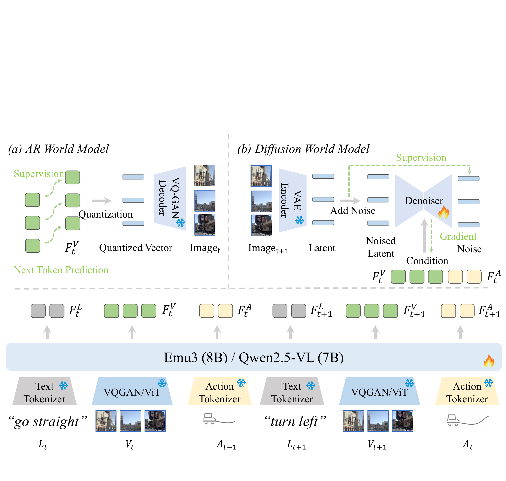
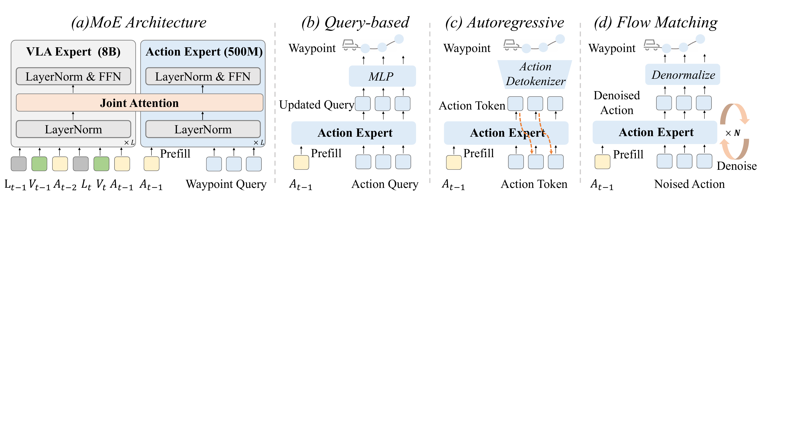
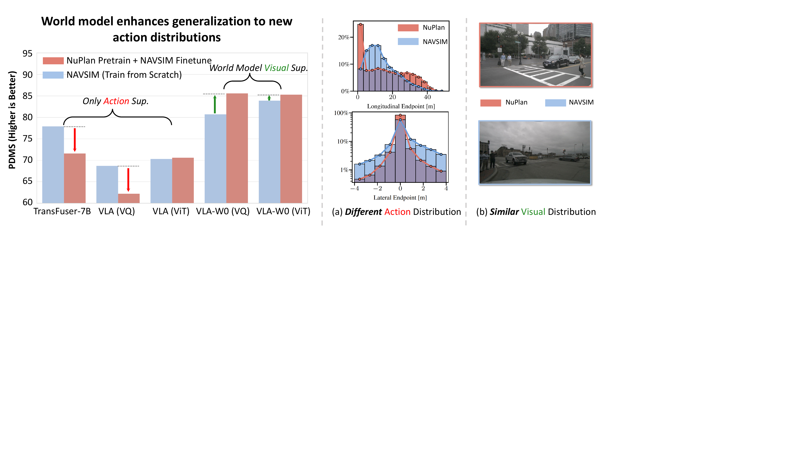
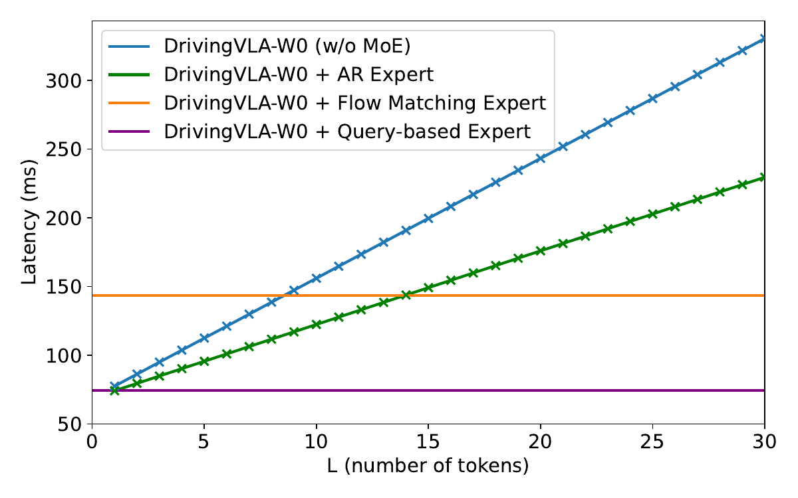
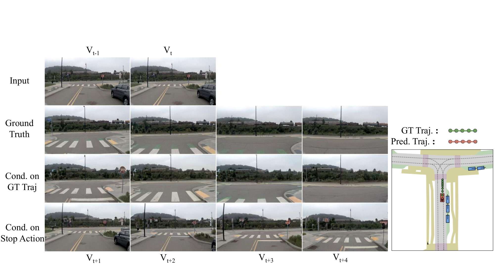
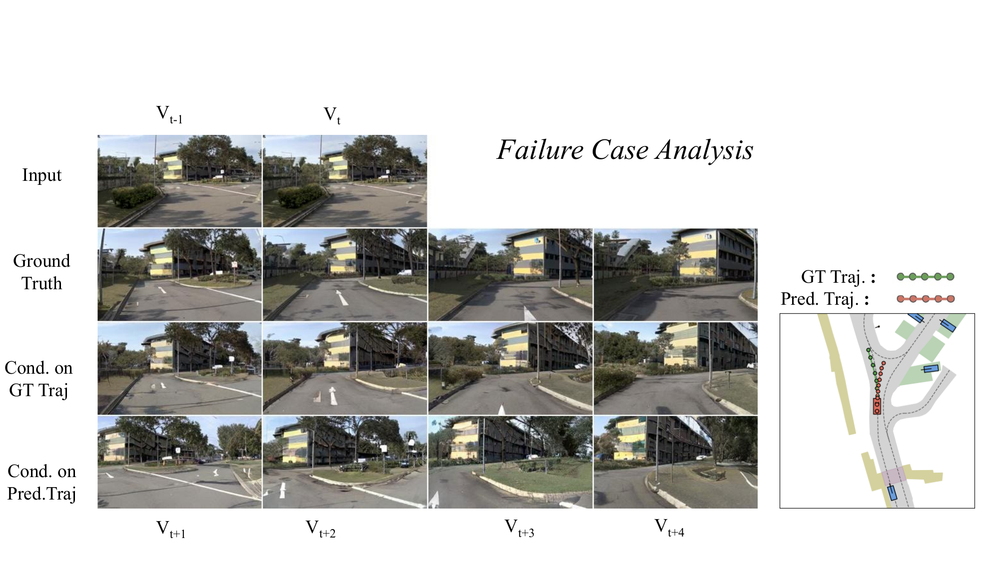
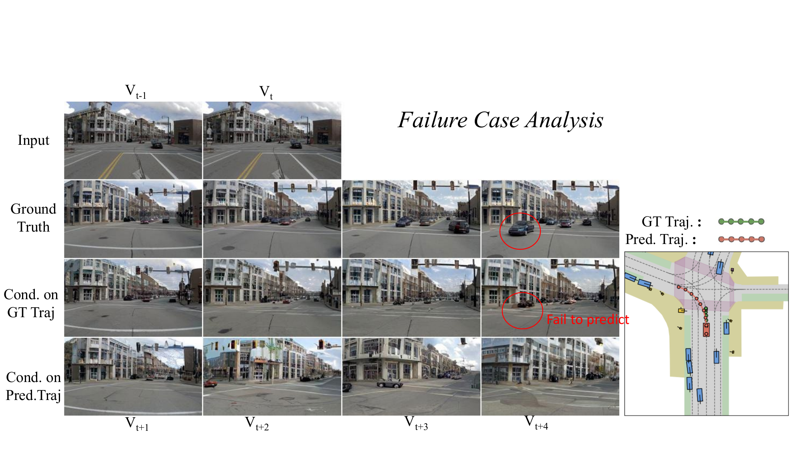
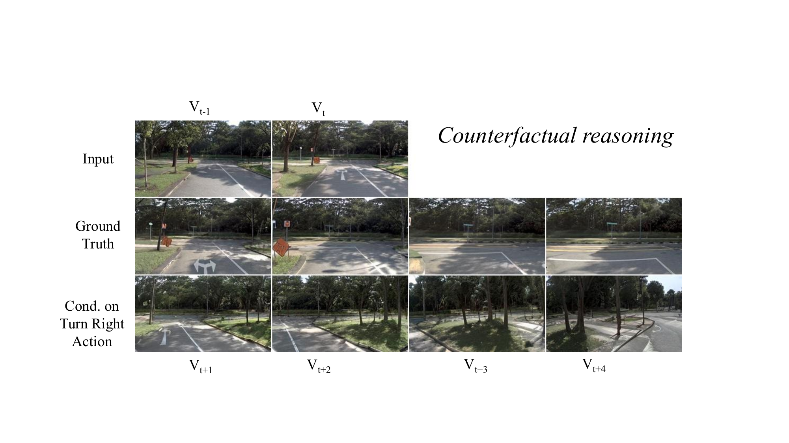

# DriveVLA-W0 (arXiv 2025)

<!-- paper-source: https://chengwei920412.github.io/paper_reading/2510.12796_DriveVLA_W0_World_Models_Amplify_Data_Scaling_Law_in_Autonomous_Driving/technical_report.html -->

> **arXiv ID**: 2510.12796
> **原文标题**: DriveVLA-W0: World Models Amplify Data Scaling Law in Autonomous Driving
> **翻译日期**: 2026-08-26

---

## 📋 论文概览 {#_1}

### 基本信息 {#_2}

- **作者**: Yingyan Li\*、Shuyao Shang\*、Weisong Liu\*、Bing Zhan\*、Haochen Wang\*、Yuqi Wang、Yuntao Chen、Xiaoman Wang、Yasong An、Chufeng Tang、Lu Hou、Lue Fan✉、Zhaoxiang Zhang✉（\* 同等贡献，✉ 通讯作者）
- **机构**: 中国科学院自动化研究所模式识别实验室（NLPR, CASIA）；引望智能技术有限公司
- **发表时间**: 2025 年 10 月（arXiv 预印本，ICLR 2026 投稿）
- **领域**: 自动驾驶端到端规划、视觉-语言-动作（VLA）模型、世界模型、缩放定律

### 核心贡献 {#_3}

1. **提出并命名"监督缺口"（Supervision Deficit）问题**：VLA 模型有 7B–8B 量级的参数容量，却只被 6 个二维路径点这种低维稀疏信号监督。论文用实验证明这不是"数据不够多"能解决的问题——纯动作监督下，7B 的 TransFuser 反而不如 50M 的 TransFuser（PDMS 77.9 vs 79.2）。
2. **DriveVLA-W0 训练范式**：用"预测未来图像"作为密集自监督目标补充动作损失，并针对两类主流 VLA 架构分别给出实现——离散视觉 token 用 **AR 世界模型**（下一 token 预测），连续视觉特征用 **扩散世界模型**（隐空间去噪）。
3. **轻量 MoE 动作专家**：500M 参数的动作专家通过联合注意力与 VLA 骨干耦合，把推理延迟降到基线的 63.1%（117.8ms → 74.3ms），同时把 PDMS 从 85.6 提到 88.4——延迟和精度同时改善。
4. **两个可复用的缩放结论**：(a) 世界建模放大数据缩放定律，在 7000 万帧规模上 ADE 相对改善 28.8%；(b) 动作解码器存在**缩放反转**——小数据下流匹配/基于查询更优，大数据下自回归反超。

---

## 🎯 研究背景与动机 {#_4}

### 问题定义 {#_5}

端到端自动驾驶的目标是把传感器输入直接映射为未来轨迹。当前有两条路线：

- **BEV 专用模型**（UniAD、VAD、TransFuser）：几何先验强、参数紧凑（50M 量级），但难以吃下非驾驶数据，架构本身限制了扩展空间。
- **VLA 模型**（ORION、ReCogDrive、AutoVLA）：复用互联网规模预训练的 VLM，参数量大 100 倍以上，理论上扩展潜力更大。

论文的核心观察是：**VLA 的扩展潜力并没有被兑现**，而瓶颈不在数据量，在监督信号的信息密度。

### 现有方法的局限性 {#_6}

<table>
<thead>
<tr>
<th>局限</th>
<th>具体表现</th>
</tr>
</thead>
<tbody>
<tr>
<td>监督信号维度过低</td>
<td>一帧图像（数十万像素）压缩为 6 个路径点（12 个浮点数），梯度信息量极小</td>
</tr>
<tr>
<td>大模型反而更差</td>
<td>纯动作监督下 TransFuser-7B（PDMS 77.9）不如 TransFuser-50M（79.2）；VLA-VQ 仅 68.7</td>
</tr>
<tr>
<td>预训练有害</td>
<td>NuPlan 预训练后再微调 NAVSIM，TransFuser-7B 掉 8.1%、VLA-VQ 掉 9.5%——模型过拟合到源域动作分布，形成"有害先验"</td>
</tr>
<tr>
<td>加数据无法补救</td>
<td>从 70k 到 7000 万帧（增大 1000 倍），VLA (VQ) 的 ADE 从 1.5424（700k）反弹到 1.4829（70M），已经饱和</td>
</tr>
<tr>
<td>大模型推理太慢</td>
<td>完整 VLA 骨干单帧延迟 117.8ms（NAVSIM）/ 240ms（自有数据集），不满足实时控制</td>
</tr>
</tbody>
</table>

这里最值得注意的是第 3、4 行：它们说明"监督缺口"是**质**的缺陷而非**量**的不足，这正是论文立论的关键证据。

### 本文的创新点 {#_7}

- 把世界建模从"数据合成器"（GAIA-1、DrivingGPT 用来生成仿真数据）重新定位为**表征学习的辅助目标**。
- 与 LAW 的隐空间预测不同，本文直接监督**像素级未来图像**，监督信号更密集、更直接。
- 世界建模的实现方式**跟随视觉表征形态而变**，因此该范式可以套用到任意一类 VLA 上，而非绑定某个具体骨干。

---

## 🔬 方法论 {#_8}

### 整体架构 {#_9}

图：DriveVLA-W0 的整体架构。(a) AR 世界模型预测离散视觉 token；(b) 扩散世界模型以多模态输入为条件对隐空间表征去噪。

输入是一条深度交错的多模态序列，把 \(H\) 步历史的语言指令、图像、动作按时间顺序拼接：

\[S_t = [L_{t-H}, V_{t-H}, A_{t-H-1}, \dots, L_t, V_t, A_{t-1}].\]

论文用 `6VA`、`2VA` 这类记号表示序列配置：`6VA` 指 6 组"视觉-动作"对交错，`2VA` 指 2 组。动作用 FAST tokenizer 离散化，骨干网络用因果注意力自回归处理，输出按模态拆成 \(F_t^L\)、\(F_t^V\)、\(F_t^A\) 三组特征。

两个骨干变体：
- **VLA (VQ)**：Emu3 (8B)，图像量化成离散视觉 token。
- **VLA (ViT)**：Qwen2.5-VL (7B)，图像编码成连续特征。

### 关键技术 {#_10}

**1. 动作损失（基线）**——标准交叉熵：

\[\mathcal{L}_{\text{Action}} = - \sum_{i=1}^{L} \log P(a_i | S_t, a_{&lt;i}).\]

**2. AR 世界模型**——对当前图像的视觉 token 序列 \(V_t=(v_1,\dots,v_N)\) 做下一 token 预测：

\[\mathcal{L}_{\text{WM-AR}} = - \sum_{i=1}^{N} \log P(v_i | S_{&lt;V_t}, v_{&lt;i}).\]

总损失 \(\mathcal{L}_{\text{Total}} = \mathcal{L}_{\text{Action}} + \alpha \mathcal{L}_{\text{WM-AR}}\)。注意监督量的差距：动作侧 NAVSIM 平均 5.6 个 token，视觉侧 \(N\) 是数百个 token——这就是"密集"的来源。

**3. 扩散世界模型**——ViT 变体没有视觉词表，改为训练隐空间扩散模型预测**下一帧** \(\mathbf{I}_{t+1}\)：

\[\mathcal{L}_{\text{WM-Diff}} = \mathbb{E}_{z_{t+1}, \epsilon, k} \left[ \| \epsilon - \hat{\epsilon}(z_{t+1, k}, k, F_t^V, F_t^A) \|^2 \right].\]

这里有个容易忽略的设计要点：**为什么必须预测 \(t+1\) 而不是重建 \(t\)**。因为条件特征 \(F_t^V, F_t^A\) 已经包含了当前帧的全部信息，若目标是当前帧，任务退化为恒等重建，学不到动态；预测下一帧才强制模型建模"动作如何改变世界"。AR 世界模型不受此限，因为因果掩码天然保证 \(v_i\) 只能看到 \(v_{&lt;i}\)。

**4. MoE 动作专家 + 联合注意力**

图：(a) MoE 架构把大 VLA 专家与 500M 轻量动作专家配对；(b-d) 三种动作解码方案：基于查询、自回归、流匹配。

两个专家各算 Q/K/V 后沿序列维拼接，做一次统一注意力再拆回：

\[Q=[Q_{\text{VLA}};Q_{\text{AE}}], \quad K=[K_{\text{VLA}};K_{\text{AE}}], \quad V=[V_{\text{VLA}};V_{\text{AE}}].\]

这样动作专家能直接读到 VLA 的全部表征，而不必让 8B 骨干参与逐 token 的动作解码——延迟下降就来自这里。

三种解码器：

<table>
<thead>
<tr>
<th>解码器</th>
<th>输出形式</th>
<th>优化目标</th>
<th>延迟特性</th>
</tr>
</thead>
<tbody>
<tr>
<td>基于查询（Query-based）</td>
<td>连续路径点，单次前向</td>
<td>L1 距离</td>
<td>恒定 ~74ms</td>
</tr>
<tr>
<td>自回归（AR）</td>
<td>离散 token 序列</td>
<td>交叉熵</td>
<td>与 token 数 L 线性相关（95ms @ 5.6 token，170ms @ 17.8 token）</td>
</tr>
<tr>
<td>流匹配（Flow Matching）</td>
<td>连续动作，ODE 积分</td>
<td>MSE 向量场回归</td>
<td>恒定 ~145ms（10 步去噪）</td>
</tr>
</tbody>
</table>

### 算法流程 {#_11}

**两阶段训练：**

1. **阶段一（表征）**：`6VA` 长序列，联合优化 \(\mathcal{L}_{\text{Action}} + \lambda\mathcal{L}_{\text{WM}}\)，让骨干学到预测性世界表征。
2. **阶段二（动作）**：接入动作专家，骨干输入缩短为 `2VA`，**只用动作专家的动作损失监督**（骨干不冻结）。

推理时世界模型分支被整体跳过，只保留动作路径——所以世界建模是纯训练期开销，不影响部署延迟。这个设计使得"加密集监督"和"低延迟"两个目标不冲突。

---

## 📊 实验与结果 {#_12}

### 实验设置 {#_13}

- **数据集**：
- NAVSIM v1 / v2（源自 OpenScene），约 103k 帧，聚焦安全关键与长尾场景
- NuPlan（大规模预训练源）
- 自有数据集：**7000 万帧 / 100 万+ 片段**，测试集 100 个高难度场景（约为 NAVSIM 的 680 倍）
- **评估指标**：
- NAVSIM v1：NC、DAC、TTC、C.、EP，汇总为 PDMS
- NAVSIM v2：额外含 DDC、TLC、LK、HC、EC，汇总为 EPDMS
- 自有数据集：ADE（3 秒 / 6 路径点 / 2 Hz）与碰撞率
- **对比方法**：BEV 类（UniAD、TransFuser、PARA-Drive、LAW、Hydra-MDP、DiffusionDrive、WoTE）、VLA 类（AutoVLA、ReCogDrive）、以及自行重实现的 TransFuser-50M / TransFuser-7B
- **训练资源**：NAVSIM 用 8×L20（batch 48）；自有数据集用 64 GPU（batch 256）；AdamW + 余弦调度 + bfloat16

### 主要结果 {#_14}

**1. NAVSIM v1 达到 SOTA，且只用单前视相机**

<table>
<thead>
<tr>
<th>方法</th>
<th>传感器</th>
<th>NC ↑</th>
<th>DAC ↑</th>
<th>TTC ↑</th>
<th>C. ↑</th>
<th>EP ↑</th>
<th>PDMS ↑</th>
</tr>
</thead>
<tbody>
<tr>
<td>WoTE（BEV，ICCV'25）</td>
<td>3x Cam + L</td>
<td>98.5</td>
<td>96.8</td>
<td>94.4</td>
<td>99.9</td>
<td>81.9</td>
<td>88.3</td>
</tr>
<tr>
<td><strong>DriveVLA-W0</strong>（基于查询专家）</td>
<td>1x Cam</td>
<td>98.7</td>
<td>96.2</td>
<td>95.5</td>
<td><strong>100.0</strong></td>
<td>82.2</td>
<td>88.4</td>
</tr>
<tr>
<td>AutoVLA（NeurIPS'25）</td>
<td>3x Cam</td>
<td>98.4</td>
<td>95.6</td>
<td><strong>98.0</strong></td>
<td>99.9</td>
<td>81.9</td>
<td>89.1</td>
</tr>
<tr>
<td>ReCogDrive（arXiv'25）</td>
<td>3x Cam</td>
<td>98.2</td>
<td>97.8</td>
<td>95.2</td>
<td>99.8</td>
<td>83.5</td>
<td>89.6</td>
</tr>
<tr>
<td><strong>DriveVLA-W0</strong>（+ 多轨迹锚点）</td>
<td>1x Cam</td>
<td>98.7</td>
<td><strong>99.1</strong></td>
<td>95.3</td>
<td>99.3</td>
<td>83.3</td>
<td>90.2</td>
</tr>
<tr>
<td>AutoVLA（best-of-N）</td>
<td>3x Cam</td>
<td>99.1</td>
<td>97.1</td>
<td>97.1</td>
<td><strong>100.0</strong></td>
<td>87.6</td>
<td>92.1</td>
</tr>
<tr>
<td><strong>DriveVLA-W0</strong>（AR 专家 + best-of-6）</td>
<td>1x Cam</td>
<td><strong>99.3</strong></td>
<td>97.4</td>
<td>97.0</td>
<td>99.9</td>
<td><strong>88.3</strong></td>
<td><strong>93.0</strong></td>
</tr>
</tbody>
</table>

传感器一列是这张表最有说服力的地方：同等或更强的分数，输入却从"3 相机 + LiDAR"降到"1 个前视相机"。

**2. NAVSIM v2：EPDMS 86.1，领先 DiffusionDrive 1.6 分**

<table>
<thead>
<tr>
<th>方法</th>
<th>NC ↑</th>
<th>DAC ↑</th>
<th>DDC ↑</th>
<th>TLC ↑</th>
<th>EP ↑</th>
<th>TTC ↑</th>
<th>LK ↑</th>
<th>HC ↑</th>
<th>EC ↑</th>
<th>EPDMS ↑</th>
</tr>
</thead>
<tbody>
<tr>
<td>TransFuser</td>
<td>96.9</td>
<td>89.9</td>
<td>97.8</td>
<td>99.7</td>
<td>87.1</td>
<td>95.4</td>
<td>92.7</td>
<td><strong>98.3</strong></td>
<td>87.2</td>
<td>76.7</td>
</tr>
<tr>
<td>HydraMDP++</td>
<td>97.2</td>
<td>97.5</td>
<td><strong>99.4</strong></td>
<td>99.6</td>
<td>83.1</td>
<td>96.5</td>
<td>94.4</td>
<td>98.2</td>
<td>70.9</td>
<td>81.4</td>
</tr>
<tr>
<td>DriveSuprem</td>
<td>97.5</td>
<td>96.5</td>
<td><strong>99.4</strong></td>
<td>99.6</td>
<td><strong>88.4</strong></td>
<td>96.6</td>
<td>95.5</td>
<td><strong>98.3</strong></td>
<td>77.0</td>
<td>83.1</td>
</tr>
<tr>
<td>DiffusionDrive</td>
<td>98.2</td>
<td>95.9</td>
<td><strong>99.4</strong></td>
<td><strong>99.8</strong></td>
<td>87.5</td>
<td>97.3</td>
<td><strong>96.8</strong></td>
<td><strong>98.3</strong></td>
<td><strong>87.7</strong></td>
<td>84.5</td>
</tr>
<tr>
<td><strong>DriveVLA-W0</strong></td>
<td><strong>98.5</strong></td>
<td><strong>99.1</strong></td>
<td>98.0</td>
<td>99.7</td>
<td>86.4</td>
<td><strong>98.1</strong></td>
<td>93.2</td>
<td>97.9</td>
<td>58.9</td>
<td><strong>86.1</strong></td>
</tr>
</tbody>
</table>

值得注意的短板：**EC（扩展舒适度）只有 58.9**，远低于所有基线（70.9–87.7）。安全性指标（NC、DAC、TTC）全面第一，但轨迹平顺性明显落后。EPDMS 里 EC 权重只占 2/16，所以总分仍然最高——但这个分项暴露了真实的工程问题。

**3. 世界建模放大数据缩放定律（核心结果）**

<table>
<thead>
<tr>
<th>模型</th>
<th>70k ADE ↓</th>
<th>70k Coll.% ↓</th>
<th>700k ADE ↓</th>
<th>700k Coll.% ↓</th>
<th>70M ADE ↓</th>
<th>70M Coll.% ↓</th>
</tr>
</thead>
<tbody>
<tr>
<td>TransFuser-50M</td>
<td>2.5893</td>
<td>0.0894</td>
<td>1.7464</td>
<td>0.0563</td>
<td>1.2627</td>
<td>0.0472</td>
</tr>
<tr>
<td>TransFuser-7B</td>
<td>2.5757</td>
<td>0.0839</td>
<td>2.1391</td>
<td>0.0710</td>
<td>1.2244</td>
<td>0.0539</td>
</tr>
<tr>
<td>VLA (VQ)（基线）</td>
<td>2.8520</td>
<td>0.0982</td>
<td>1.5424</td>
<td>0.0565</td>
<td>1.4829</td>
<td>0.0488</td>
</tr>
<tr>
<td><em>+ 世界模型</em></td>
<td>2.7482 (改善 3.6%)</td>
<td>0.0956 (改善 2.7%)</td>
<td>1.5985 (退化 3.6%)</td>
<td>0.0520 (改善 8.0%)</td>
<td><strong>1.0563 (改善 28.8%)</strong></td>
<td>0.0392 (改善 19.7%)</td>
</tr>
<tr>
<td>VLA (ViT)（基线）</td>
<td>3.1524</td>
<td>0.0950</td>
<td>1.4202</td>
<td>0.0462</td>
<td>1.1051</td>
<td>0.0359</td>
</tr>
<tr>
<td><em>+ 世界模型</em></td>
<td>2.5268 (改善 19.9%)</td>
<td>0.0834 (改善 12.2%)</td>
<td>1.3436 (改善 5.4%)</td>
<td>0.0513 (退化 11.0%)</td>
<td>1.0640 (改善 3.7%)</td>
<td><strong>0.0302 (改善 15.9%)</strong></td>
</tr>
</tbody>
</table>

这张表要横着读增益趋势，而不是只看绝对值：

- **VQ 分支的增益是加速的**：ADE 相对改善 3.6% → −3.6% → **28.8%**。基线 VLA (VQ) 从 700k 到 70M（数据增大 100 倍）ADE 只从 1.5424 降到 1.4829，降幅 3.9%，已明显饱和；加世界模型后同一规模降到 1.0563。这是"放大缩放定律"的主要证据。
- **ViT 分支的 ADE 增益反而衰减**（19.9% → 5.4% → 3.7%），但碰撞率增益在 70M 处回升到 15.9%。也就是说，ViT 上"放大"体现在安全性而非位移精度。论文摘要的"性能增益随数据增大而加速"这一说法，主要由 VQ 分支的 ADE 和 ViT 分支的碰撞率支撑，并不是所有四条曲线都成立。
- 两处退化（VQ 700k 的 ADE、ViT 700k 的碰撞率）论文未作解释。

**4. 世界建模把"预训练有害"翻转为"预训练有益"**

图：世界建模借助数据扩展释放泛化能力。红色箭头为稀疏监督基线因预训练而退化，绿色箭头为 VLA-W0 因预训练而获益。

<table>
<thead>
<tr>
<th>模型</th>
<th>从零训练 PDMS</th>
<th>NuPlan 预训练 + 微调 PDMS</th>
<th>变化</th>
</tr>
</thead>
<tbody>
<tr>
<td>TransFuser-50M</td>
<td>79.2</td>
<td>83.6</td>
<td>改善 5.5%</td>
</tr>
<tr>
<td>TransFuser-7B</td>
<td>77.9</td>
<td>71.6</td>
<td><strong>退化 8.1%</strong></td>
</tr>
<tr>
<td>VLA-VQ</td>
<td>68.7</td>
<td>62.2</td>
<td><strong>退化 9.5%</strong></td>
</tr>
<tr>
<td>VLA-W0-VQ（本文）</td>
<td>80.7</td>
<td>85.6</td>
<td>改善 6.1%</td>
</tr>
<tr>
<td>VLA-ViT</td>
<td>70.3</td>
<td>70.6</td>
<td>改善 0.4%</td>
</tr>
<tr>
<td>VLA-W0-ViT（本文）</td>
<td>83.9</td>
<td>85.3</td>
<td>改善 1.7%</td>
</tr>
</tbody>
</table>

这是全文我认为最干净、最有说服力的一组对照：同一份 NuPlan 预训练数据，稀疏监督的大模型（7B TransFuser、VLA-VQ）被"带坏"，加了世界建模的同架构模型则受益。而且世界建模在**从零训练**时就已经领先（80.7/83.9 vs 68.7/70.3），说明收益不只来自预训练迁移。

**5. 动作解码器的缩放反转**

<table>
<thead>
<tr>
<th>动作专家</th>
<th>NAVSIM (103k) PDMS ↑</th>
<th>自有 (70M) ADE ↓</th>
<th>自有 (70M) 碰撞率% ↓</th>
</tr>
</thead>
<tbody>
<tr>
<td>基于查询</td>
<td><strong>88.4</strong></td>
<td>1.1248</td>
<td>0.0453</td>
</tr>
<tr>
<td>流匹配</td>
<td>87.2（退化 1.4%）</td>
<td>1.0362（改善 7.9%）</td>
<td>0.0398（改善 12.1%）</td>
</tr>
<tr>
<td>自回归</td>
<td>85.3（退化 3.6%）</td>
<td><strong>1.0069（改善 10.5%）</strong></td>
<td><strong>0.0295（改善 34.9%）</strong></td>
</tr>
</tbody>
</table>

小数据下排序是 查询 > 流匹配 > 自回归；大数据下完全倒转为 自回归 > 流匹配 > 查询。论文给出的解释是**预测精度 vs 建模容量**的权衡：小数据时轨迹分布简单，连续解码器不受量化误差影响因而占优；大数据时轨迹分布复杂，自回归的建模容量和教师强制训练的样本效率成为决定因素，而基于查询受表征瓶颈限制、流匹配样本效率不足难以收敛。

**6. 延迟：MoE 让精度和速度同时改善**

图：延迟分析。AR 专家与 VLA 基线延迟随生成 token 数 L 线性增长，流匹配与基于查询专家的推理时间恒定。

<table>
<thead>
<tr>
<th>配置</th>
<th>延迟</th>
<th>PDMS</th>
</tr>
</thead>
<tbody>
<tr>
<td>DriveVLA-W0（完整骨干解码）</td>
<td>117.8ms</td>
<td>85.6</td>
</tr>
<tr>
<td>+ 基于查询 MoE 专家</td>
<td><strong>74.3ms（63.1%）</strong></td>
<td><strong>88.4</strong></td>
</tr>
<tr>
<td>+ 流匹配专家</td>
<td>~145ms</td>
<td>87.2</td>
</tr>
<tr>
<td>+ AR 专家（NAVSIM，5.6 token）</td>
<td>~95ms</td>
<td>85.3</td>
</tr>
<tr>
<td>+ AR 专家（自有，17.8 token）</td>
<td>~170ms（基线 240ms）</td>
<td>—</td>
</tr>
</tbody>
</table>

### 消融实验 {#_15}

**动作条件化是必需的**（表 5）：只用视觉损失预训练（`6V`）得 84.1 PDMS，改成视觉-动作交错（`6VA`）得 85.6。差 1.5 分。解释是：不给动作条件，模型只能预测"某个笼统的未来"；给了动作，模型必须预测"这个动作导致的那个未来"，因而被迫学习因果动态。

**上下文越长越好**（表 6）：`VA` 83.3 → `2VA` 84.2 → `6VA` 85.6，单调递增。

**但推理时的历史帧间隔有最优点**（表 9，均基于 `6VA` 预训练检查点微调）：

<table>
<thead>
<tr>
<th>微调配置</th>
<th>时间间隔</th>
<th>PDMS</th>
</tr>
</thead>
<tbody>
<tr>
<td>VA（无历史帧）</td>
<td>/</td>
<td>82.9</td>
</tr>
<tr>
<td>2VA</td>
<td>4s</td>
<td>84.3</td>
</tr>
<tr>
<td>2VA</td>
<td>1s</td>
<td><strong>85.6</strong></td>
</tr>
</tbody>
</table>

1 秒最优：没有第二帧则无法感知动态，间隔 4 秒则两帧场景差异过大，反而让预测任务变难。注意这里有个细节——预训练用长序列（`6VA`）最好，微调/推理却用短序列（`2VA`, 1s）最好，两者不矛盾：前者是学表征，后者是省算力且避免过时上下文。

**生成保真度与规划性能正相关**（表 8）：

<table>
<thead>
<tr>
<th>序列设计</th>
<th>FID ↓</th>
<th>PDMS ↑</th>
</tr>
</thead>
<tbody>
<tr>
<td>2VA</td>
<td>9.847</td>
<td>84.1</td>
</tr>
<tr>
<td>6VA</td>
<td>4.610</td>
<td>85.6</td>
</tr>
<tr>
<td>上界（MoVQGAN 重建）</td>
<td>3.007</td>
<td>—</td>
</tr>
</tbody>
</table>

FID 更低的检查点微调后 PDMS 也更高。这条结论只有 2 个数据点，作为"强正相关"的证据偏弱，但方向上支持"世界模型质量决定下游规划质量"的主张。

---

## 💡 关键见解 {#_16}

### 理论分析 {#_17}

**监督信号的信息量决定可用容量。** 把这件事量化一下就很直观：NAVSIM 上一条轨迹平均 5.6 个动作 token，而一帧图像的视觉 token 是数百个量级。同一次前向传播里，世界建模提供的监督信号比动作监督高出约两个数量级。这解释了为什么单纯堆数据无效——每个样本携带的梯度信息量没变，只是样本数变多，而模型容量的瓶颈在前者。

**为什么预训练会有害。** 稀疏监督下，模型能学到的最省力解是记住源域的动作分布（NuPlan 的常规驾驶行为）。迁移到 NAVSIM 的长尾场景时，这个先验直接冲突。世界建模把优化压力转向视觉动态——而视觉域在两个数据集间是相似的——因此学到的表征可迁移。这是"视觉域相似、动作域不同"这一实验设计的巧妙之处。

**缩放反转的一般化含义。** 解码器的最优选择依赖数据规模，这一点超出自动驾驶范围：在小基准上做架构选型，结论可能在大规模下完全失效。论文用同一预训练骨干、只换解码器的受控设置说明了这一点，方法论上值得借鉴。

### 实践启示 {#_18}

1. **世界建模是零推理成本的增益**：训练期加损失，推理期整条分支跳过。在延迟敏感的部署场景里，这是很划算的交换。
2. **MoE 解耦是"帕累托改进"而非权衡**：延迟降 36.9% 同时 PDMS 涨 2.8 分，说明大骨干做逐 token 动作解码本身是低效的。
3. **单相机可以打赢多相机 + LiDAR**：在 NAVSIM 上，表征质量的收益超过了传感器冗余的收益，对降低量产成本有直接意义。
4. **选解码器要看目标数据规模**：小规模验证阶段用基于查询/流匹配，量产规模下应重新评估自回归。
5. **世界模型可当反应式仿真器复用**：模型能对反事实动作（"减速"、"右转"）生成合理未来，一套权重同时服务规划和仿真。

图：动作条件化仿真。真值中自车匀速前行；条件化于反事实"减速"动作后，世界模型生成车辆减速的视觉结果。

---

## 🔍 局限性与未来工作 {#_19}

### 当前局限 {#_20}

**论文自述的局限：**

图：失败案例——驾驶指令歧义。Y 形路口收到通用"直行"指令时，模型未能选定车道，犹豫地驶入分岔区域。

- **指令歧义**：NAVSIM 的离散指令集只有左转/直行/右转，在 Y 形路口这类拓扑下粒度不足。这更多是基准设计的局限而非模型缺陷。
- **细粒度动态目标预测不足**：复杂路口的多个对向来车预测失败，导致规划器误判可通行性。

图：失败案例——动态目标预测。世界模型未能预见未来帧中对向来车的出现，规划器因此错误执行左转。

**论文未充分讨论的问题（阅读时需注意）：**

<table>
<thead>
<tr>
<th>问题</th>
<th>说明</th>
</tr>
</thead>
<tbody>
<tr>
<td>EC 指标严重落后</td>
<td>NAVSIM v2 上扩展舒适度只有 58.9，基线区间是 70.9–87.7。安全性换来了平顺性的代价，论文未作分析</td>
</tr>
<tr>
<td>缩放结论的采样点太少</td>
<td>只有 70k / 700k / 70M 三个点，且间隔不等（10× 与 100×）。三点无法拟合幂律，"放大缩放定律"目前是趋势描述而非定量结论</td>
</tr>
<tr>
<td>增益模式不一致</td>
<td>VQ 的 ADE 增益加速、ViT 的 ADE 增益衰减；两处退化（VQ 700k ADE、ViT 700k 碰撞率）未解释</td>
</tr>
<tr>
<td>自有数据集不可复现</td>
<td>核心缩放结论建立在闭源的 7000 万帧数据和 100 个测试场景上。100 个场景对碰撞率（0.03%–0.10% 量级）的统计功效存疑</td>
</tr>
<tr>
<td>计算成本未报告</td>
<td>世界建模增加多少训练开销（时间/显存/成本）完全没有给出。这是评估"是否值得"的关键数据</td>
</tr>
<tr>
<td>\(\alpha\)、\(\beta\) 未消融</td>
<td>两个损失平衡系数是核心超参，取值和敏感性均未报告</td>
</tr>
<tr>
<td>单前视相机</td>
<td>侧后向盲区在变道、汇入等场景是真实风险；NAVSIM 单帧评测掩盖了这一点</td>
</tr>
<tr>
<td>对比不完全对等</td>
<td>表 1 里 DriveVLA-W0 的最佳结果用了 best-of-6 采样（推理成本 ×6），与单次前向的基线并列呈现</td>
</tr>
<tr>
<td>开环评测的固有局限</td>
<td>PDMS/EPDMS 与 ADE 都是开环指标，无法反映误差累积；论文未提供闭环（如 CARLA/nuPlan 闭环）结果</td>
</tr>
</tbody>
</table>

### 未来方向 {#_21}

1. **补齐缩放曲线**：增加 7M、20M 等中间采样点，拟合幂律指数，把"放大"从定性变为定量（例如给出监督密度与缩放指数的关系）。
2. **修复 EC 短板**：在世界建模目标中加入轨迹平顺性约束，或探究密集视觉监督为何损害舒适度。
3. **多视角与多模态扩展**：把世界建模扩展到环视相机甚至 LiDAR 点云预测，检验结论是否仍成立。
4. **动态目标显式建模**：针对失败案例，在世界模型中引入实例级或占据栅格的辅助监督。
5. **闭环验证**：在闭环仿真中评估，验证世界建模学到的动态是否真能抑制误差累积。
6. **训练成本-收益分析**：给出世界建模的边际算力成本，回答"同样的算力用来加数据还是加世界建模更划算"。
7. **反事实能力的下游利用**：模型已能对假设动作生成合理未来，可进一步做在线轨迹评估或基于模型的强化学习。

图：反事实推理。在路边以反事实"右转"动作为条件，世界模型生成车辆偏离真值轨迹、驶离路面的逼真序列，说明模型学到了场景几何而非记忆训练数据。

---

## 📚 相关工作对比 {#_22}

<table>
<thead>
<tr>
<th>方法</th>
<th>核心思想</th>
<th>优势</th>
<th>劣势</th>
</tr>
</thead>
<tbody>
<tr>
<td>UniAD / VAD / TransFuser</td>
<td>BEV 表征 + 多任务感知-预测-规划级联</td>
<td>几何先验强，参数少，延迟低</td>
<td>难以吸收非驾驶数据；架构限制扩展；7B 版本因监督稀疏反而退化</td>
</tr>
<tr>
<td>GAIA-1 / DrivingGPT / Doe-1</td>
<td>世界模型作为<strong>数据合成器</strong>，生成逼真驾驶视频</td>
<td>可造长尾场景，缓解数据稀缺</td>
<td>表征不直接服务规划；需额外训练规划器；仿真-真实差距</td>
</tr>
<tr>
<td>LAW</td>
<td>世界模型作为自监督目标，预测<strong>隐空间</strong>特征</td>
<td>首个在驾驶中用世界模型做表征学习；计算轻</td>
<td>隐空间目标信息量少于像素；监督密度受限</td>
</tr>
<tr>
<td>UniVLA / WorldVLA</td>
<td>机器人领域把动作纳入自回归预测</td>
<td>动作条件化，策略稳健</td>
<td>面向机器人操作，未验证驾驶长尾与大规模数据</td>
</tr>
<tr>
<td>VaVAM</td>
<td>生成式视频预训练</td>
<td>验证视频预训练价值</td>
<td><strong>无动作条件化</strong>，学不到"动作→后果"的因果关系</td>
</tr>
<tr>
<td>AutoVLA / ReCogDrive</td>
<td>VLA + 轨迹 token 化 / 扩散规划器 + RL</td>
<td>NAVSIM 强性能；推理能力好</td>
<td>仍是纯动作监督，未解决监督缺口；需 3 相机</td>
</tr>
<tr>
<td><strong>DriveVLA-W0</strong></td>
<td>世界建模作为<strong>密集自监督目标</strong>预测未来图像；MoE 动作专家解耦推理</td>
<td>监督密度提升约两个数量级；放大数据缩放定律；单相机 SOTA；延迟降至 63.1%；训练期开销、推理期零成本；可兼作反应式仿真器</td>
<td>EC 舒适度明显落后；缩放采样点仅 3 个；核心结论依赖闭源数据；训练成本与 \(\alpha/\beta\) 敏感性未报告；仅开环评测</td>
</tr>
</tbody>
</table>

---

## 🎓 个人评价 {#_23}

### 优点 {#_24}

1. **问题诊断准确且有实验支撑。** "监督缺口"不是包装出来的新词——7B 不如 50M、预训练反而掉分、加 1000 倍数据仍饱和，三组反直觉现象共同指向同一个病因。这种"先证明问题存在，再给解法"的结构比直接堆方法有说服力得多。
2. **NuPlan→NAVSIM 迁移实验设计精巧。** 视觉域相似、动作域不同的设置，把"学视觉表征"和"记动作分布"两种可能性干净地分离开，红/绿箭头的对照非常有力。
3. **方法覆盖两类架构，不绑定具体骨干。** AR 与扩散两个版本让"世界建模"成为可迁移的范式而非某个模型的技巧。
4. **对扩散世界模型必须预测 \(t+1\) 的论证清晰。** 这类"看起来是小选择、实际决定任务是否退化"的细节，作者交代得很到位。
5. **MoE 动作专家是真正的帕累托改进。** 延迟降 36.9% 且性能上升，同时它还充当了解码器对比的受控试验平台，一个模块服务两个目的。
6. **缩放反转是有独立价值的发现。** 即使不采用 DriveVLA-W0，这个结论也会改变从业者的架构选型流程。
7. **失败案例分析诚实。** 明确区分了基准局限（指令粒度）和模型缺陷（动态目标预测），并说明可视化图来自 MoVQGAN 重建而非原始 RGB——这类细节交代体现了严谨。

### 可改进之处 {#_25}

1. **"放大数据缩放定律"的证据强度不足。** 三个采样点、间隔不等、四条增益曲线中只有两条支持"加速"，另有两处退化未解释。这个标题级主张需要更密的采样和幂律拟合才站得稳。
2. **EC = 58.9 应当正面讨论。** 论文只呈现总分领先，未分析为何舒适度落后近 30 分。这可能反映密集视觉监督与轨迹平顺性之间的真实张力，回避了反而削弱可信度。
3. **训练成本完全缺失。** 世界建模显然增加显存和算力开销，但一个数字都没给。对工程落地判断而言，这是必需信息。
4. **核心结论依赖闭源数据。** 7000 万帧和 100 个测试场景都无法复现；100 个场景对 0.03% 量级的碰撞率也偏少。
5. **超参消融不完整。** \(\alpha\)、\(\beta\) 是方法的核心旋钮，取值和敏感性都未报告。
6. **表 1 的对比呈现有优化空间。** best-of-6 的结果（PDMS 93.0）与单次前向结果并列在同一张表里，推理成本差 6 倍，脚注标注虽有，但视觉呈现容易让读者高估提升。
7. **缺少闭环评测。** 全部指标为开环，而世界建模最该带来收益的地方恰是长时程误差累积的抑制——闭环实验缺席，这个最有说服力的验证机会被放弃了。

### 推荐阅读对象 {#_26}

- **自动驾驶端到端规划研究者**：必读。监督缺口的诊断与世界建模解法会直接影响技术路线选择。
- **VLA / 机器人学习研究者**：核心思想（稀疏动作监督不足以撑起大模型，需密集自监督补充）在具身智能中普遍适用。
- **缩放定律研究者**：论文提出监督信号密度是与模型规模、数据规模、算力并列的第四个维度，这个视角有推广价值。
- **工程落地团队**：重点看 MoE 动作专家与延迟分析（4.5 节、附录 B.1），以及解码器缩放反转对选型的影响。
- **世界模型研究者**：可对照 LAW（隐空间）与 GAIA-1（数据合成）三条路线的定位差异。

---

## 📎 附录 {#_27}

### 重要公式 {#_28}

**1. 动作预测损失（交叉熵）**

\[\mathcal{L}_{\text{Action}} = - \sum_{i=1}^{L} \log P(a_i | S_t, a_{&lt;i}).\]

\(S_t\) 为多模态上下文，\(a_i\) 为 FAST tokenizer 产生的动作 token。

**2. AR 世界模型损失（下一 token 预测）**

\[\mathcal{L}_{\text{WM-AR}} = - \sum_{i=1}^{N} \log P(v_i | S_{&lt;V_t}, v_{&lt;i}).\]

\(v_i\) 为 MoVQGAN 视觉 token，\(N \gg L\)——这正是"密集监督"的量化来源。

**3. 扩散世界模型损失（噪声预测 MSE）**

\[\mathcal{L}_{\text{WM-Diff}} = \mathbb{E}_{z_{t+1}, \epsilon, k} \left[ \| \epsilon - \hat{\epsilon}(z_{t+1, k}, k, F_t^V, F_t^A) \|^2 \right].\]

目标是未来帧 \(\mathbf{I}_{t+1}\) 的隐表征 \(z_{t+1}\)，条件是当前视觉与动作特征。

**4. 联合训练目标**

\[\mathcal{L}_{\text{Total}} = \mathcal{L}_{\text{Action}} + \alpha \mathcal{L}_{\text{WM-AR}} \quad \text{（VQ 版本）}\]

\[\mathcal{L}_{\text{Total}} = \mathcal{L}_{\text{Action}} + \beta \mathcal{L}_{\text{WM-Diff}} \quad \text{（ViT 版本）}\]

**5. 联合注意力（MoE）**

\[Q=[Q_{\text{VLA}};Q_{\text{AE}}], \quad K=[K_{\text{VLA}};K_{\text{AE}}], \quad V=[V_{\text{VLA}};V_{\text{AE}}].\]

**6. 交错输入序列**

\[S_t = [L_{t-H}, V_{t-H}, A_{t-H-1}, \dots, L_t, V_t, A_{t-1}].\]

**7. NAVSIM v1 评测分数**

\[PDMS = NC \times DAC \times \frac{5 \times EP + 5 \times TTC + 2 \times C.}{12}.\]

注意 NC 与 DAC 是**乘性**因子：任一为 0 则总分归零，因此安全性是硬约束。

**8. NAVSIM v2 评测分数**

\[\text{EPDMS} = \text{NC} \times \text{DAC} \times \text{DDC} \times \text{TLC} \times \frac{5 \times \text{EP} + 5 \times \text{TTC} + 2 \times \text{LK} + 2 \times \text{HC} + 2 \times \text{EC}}{16}.\]

EC 权重为 2/16，这解释了为何 DriveVLA-W0 的 EC 仅 58.9 仍能取得最高 EPDMS。

### 术语表 {#_29}

<table>
<thead>
<tr>
<th>英文</th>
<th>中文</th>
<th>说明</th>
</tr>
</thead>
<tbody>
<tr>
<td>Supervision Deficit</td>
<td>监督缺口</td>
<td>本文提出的核心概念：大模型容量与稀疏低维监督信号之间的失配</td>
</tr>
<tr>
<td>Vision-Language-Action (VLA)</td>
<td>视觉-语言-动作模型</td>
<td>基于 VLM 骨干、直接输出动作的端到端模型</td>
</tr>
<tr>
<td>World Model / World Modeling</td>
<td>世界模型 / 世界建模</td>
<td>本文中特指预测未来图像的自监督辅助目标</td>
</tr>
<tr>
<td>AR World Model</td>
<td>AR 世界模型</td>
<td>对离散视觉 token 做下一 token 预测的世界模型</td>
</tr>
<tr>
<td>Diffusion World Model</td>
<td>扩散世界模型</td>
<td>在连续隐空间中去噪生成未来图像的世界模型</td>
</tr>
<tr>
<td>Action Expert</td>
<td>动作专家</td>
<td>与 VLA 骨干并行的 500M 轻量解码模块</td>
</tr>
<tr>
<td>Joint Attention</td>
<td>联合注意力</td>
<td>两专家 Q/K/V 拼接后统一计算注意力再拆回的融合机制</td>
</tr>
<tr>
<td>Data Scaling Law</td>
<td>数据缩放定律</td>
<td>性能随数据规模变化的规律</td>
</tr>
<tr>
<td>Flow Matching</td>
<td>流匹配</td>
<td>学习噪声到数据分布的向量场，ODE 积分采样</td>
</tr>
<tr>
<td>Query-based decoder</td>
<td>基于查询的解码器</td>
<td>用可学习查询单次前向回归连续轨迹</td>
</tr>
<tr>
<td>Teacher Forcing</td>
<td>教师强制</td>
<td>自回归训练中用真值前缀替代模型预测，提升样本效率</td>
</tr>
<tr>
<td>FAST tokenizer</td>
<td>FAST tokenizer</td>
<td>把连续路径点轨迹转为离散 token 的量化器</td>
</tr>
<tr>
<td>MoVQGAN</td>
<td>MoVQGAN</td>
<td>论文使用的视觉 tokenizer / 图像解码器</td>
</tr>
<tr>
<td>BEV (Bird's-Eye-View)</td>
<td>鸟瞰图</td>
<td>俯视视角的场景表征</td>
</tr>
<tr>
<td>PDMS / EPDMS</td>
<td>（扩展）预测驾驶模型分数</td>
<td>NAVSIM v1 / v2 的综合评测分数</td>
</tr>
<tr>
<td>ADE</td>
<td>平均位移误差</td>
<td>预测轨迹与真值路径点的平均欧氏距离</td>
</tr>
<tr>
<td>NC / DAC / TTC / EP / C.</td>
<td>无责碰撞 / 可行驶区域合规 / 碰撞时间 / 自车推进度 / 舒适度</td>
<td>NAVSIM v1 分项指标</td>
</tr>
<tr>
<td>DDC / TLC / LK / HC / EC</td>
<td>行驶方向合规 / 交通灯合规 / 车道保持 / 历史舒适度 / 扩展舒适度</td>
<td>NAVSIM v2 新增分项指标</td>
</tr>
<tr>
<td><code>6VA</code> / <code>2VA</code> / <code>6V</code></td>
<td>序列配置代号</td>
<td>数字为交错组数，V=视觉，A=动作；<code>6V</code> 表示仅视觉无动作</td>
</tr>
<tr>
<td>Counterfactual Reasoning</td>
<td>反事实推理</td>
<td>以未发生的假设动作为条件生成替代未来</td>
</tr>
<tr>
<td>Reactive Simulator</td>
<td>反应式仿真器</td>
<td>能依据控制信号生成对应视觉后果的仿真器</td>
</tr>
</tbody>
</table>

### 参考资源 {#_30}

- **论文原文**: [arXiv:2510.12796](https://arxiv.org/abs/2510.12796)
- **中文翻译 PDF**: [paper_cn.pdf](https://chengwei920412.github.io/paper_reading/2510.12796_DriveVLA_W0_World_Models_Amplify_Data_Scaling_Law_in_Autonomous_Driving/paper_cn.pdf)
- **中文 Markdown 译文**: [paper_cn.md](https://chengwei920412.github.io/paper_reading/2510.12796_DriveVLA_W0_World_Models_Amplify_Data_Scaling_Law_in_Autonomous_Driving/paper_cn.html)
- **代码实现**: <https://github.com/BraveGroup/DriveVLA-W0>
- **相关基准**: [NAVSIM](https://github.com/autonomousvision/navsim)、[OpenScene](https://github.com/OpenDriveLab/OpenScene)、[nuPlan](https://www.nuplan.org/)
- **相关工作**: LAW（ICLR'25，隐空间世界模型）、GAIA-1（驾驶视频生成）、AutoVLA（NeurIPS'25）、ReCogDrive（arXiv'25）、Emu3（离散视觉 token VLM）、Qwen2.5-VL（连续特征 VLM）
