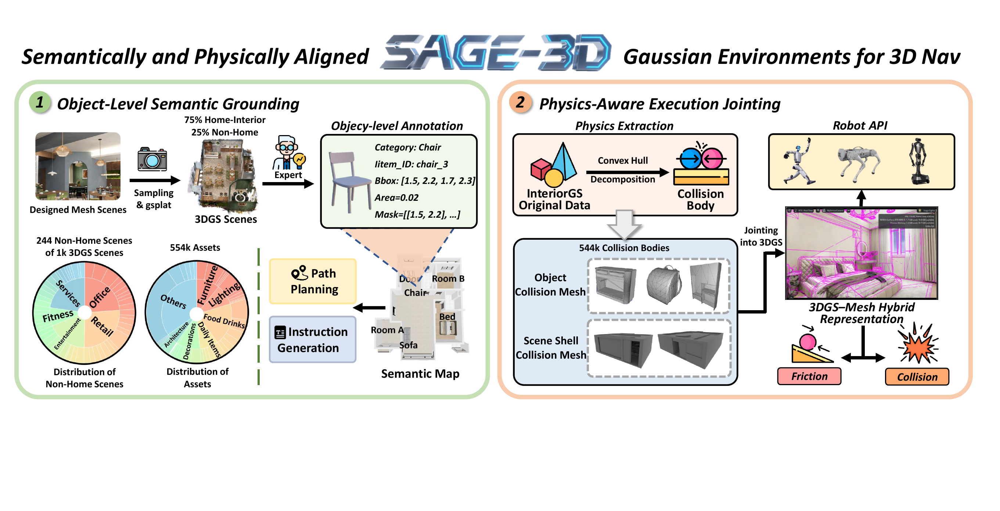
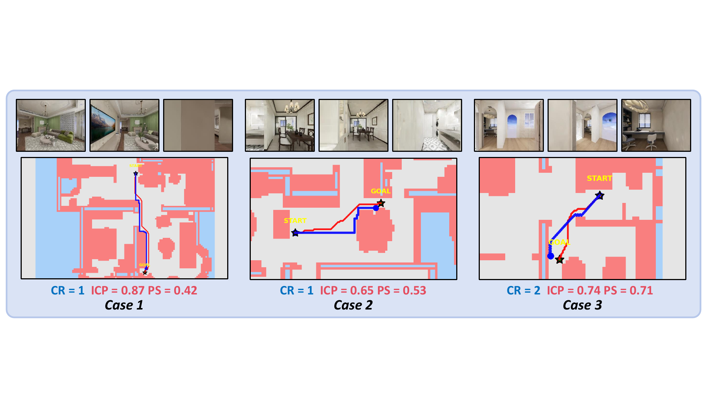
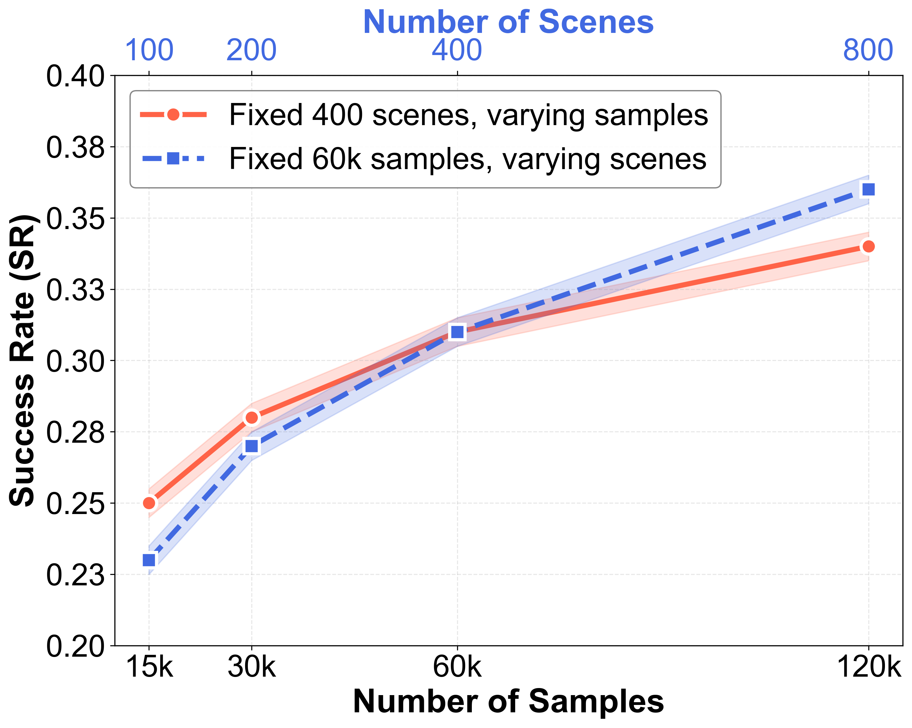

# SAGE-3D (arXiv 2025)

<!-- paper-source: https://chengwei920412.github.io/paper_reading/2510.21307_Towards_Physically_Executable_3D_Gaussian_for_Embodied_Navigation/technical_report.html -->

> 原文链接：[SAGE-3D (arXiv 2025)](https://chengwei920412.github.io/paper_reading/2510.21307_Towards_Physically_Executable_3D_Gaussian_for_Embodied_Navigation/technical_report.html)

> **arXiv ID**：2510.21307  
> **原文标题**：Towards Physically Executable 3D Gaussian for Embodied Navigation  
> **翻译日期**：2026-10-09

---

## 📋 论文概览 {#_2}

### 基本信息 {#_3}

- **作者**：Bingchen Miao、Rong Wei、Zhiqi Ge、Xiaoquan Sun、Shiqi Gao、Jingzhe Zhu、Renhan Wang、Siliang Tang、Jun Xiao、Rui Tang、Juncheng Li
- **机构**：浙江大学、群核科技、华中科技大学
- **发布时间**：2025 年
- **领域**：具身智能、视觉-语言导航、三维高斯泼溅、机器人仿真

### 核心贡献 {#_4}

论文提出 SAGE-3D：将主要用于照片级真实感渲染的三维高斯泼溅（3DGS）扩展为同时具备对象级语义和物理可执行性的具身导航环境。具体成果包括：

1. **InteriorGS**：1,000 个经人工对象级标注的室内 3DGS 场景，覆盖 755 个类别、超过 55.4 万个对象实例。
2. **3DGS-网格混合表示**：3DGS 负责视觉外观，源网格经凸分解得到的逐对象碰撞体负责物理接触与动力学。
3. **SAGE-Bench**：包含 200 万个轨迹-指令对、55.4 万个碰撞体，以及高层语义指令和低层动作指令。
4. **连续性评估**：提出连续成功比率（CSR）、综合碰撞惩罚（ICP）和路径平滑度（PS），补充传统终点成功率无法反映的运动质量。

图：SAGE-3D 通过对象级语义锚定和物理感知的执行衔接，把 3DGS 转换为可用于连续导航的环境基础。

---

## 🎯 研究背景与动机 {#_5}

### 问题定义 {#_6}

视觉-语言导航需要智能体根据自然语言指令在复杂空间中连续运动。真实世界训练成本高、风险大，因此通常在仿真环境中训练，再迁移至现实。然而，传统扫描网格常出现纹理接缝、模糊、对象边界粘连和几何误差；3DGS 虽能实时生成视图一致的照片级真实感图像，却缺少实例 ID、对象属性和可靠碰撞几何，无法直接支撑精确语言锚定、碰撞检测和路径规划。

### 现有方法的局限性 {#_7}

- 扫描网格由含噪 RGB-D 数据重建，对象容易与墙体、家具或相邻对象融合，后续实例分离成本高。
- 3DGS 原生只有外观与密度信息，不能唯一解析“白色书架旁的红色椅子”等对象级指令。
- 从高斯基元反推平滑、稳定的碰撞表面仍然困难，单纯 3DGS 无法提供可靠物理执行。
- SR、OSR、SPL 等指标主要关注是否到达终点，难以反映持续擦碰、机械转向和运动不平滑。

### 本文的创新点 {#_8}

SAGE-3D 不要求一种表示同时承担视觉和物理两项职责，而是明确解耦：3DGS 提供高保真视觉层，艺术家网格生成的碰撞体提供物理层，再用对象 ID 与语义地图把二者对齐。这个设计避开了“直接从高斯恢复完美物理表面”的困难，也保留了 3DGS 的渲染优势。

---

## 🔬 方法论 {#_9}

### 整体架构 {#_10}

SAGE-3D 将高斯基元集合 \(G\)、语义层 \(M\) 和物理层 \(\Phi\) 组合为可执行环境：

\[G + M + \Phi \longrightarrow \mathcal{E}_{\mathrm{exec}}.\]

环境进一步写成语义和物理增强的部分可观测马尔可夫决策过程：

\[\mathcal{E}=(\mathcal{U},\mathcal{S},\mathcal{A},\mathcal{O},T,Z;M,\Phi),\]

其中 \(\mathcal{U}\)、\(\mathcal{S}\)、\(\mathcal{A}\)、\(\mathcal{O}\) 分别表示指令、状态、动作和多模态观测空间，\(T\) 与 \(Z\) 分别表示物理驱动的状态转移和渲染函数。

### 关键技术 {#_11}

**对象级语义锚定。** InteriorGS 从艺术家创建的网格场景中采样，每个场景平均渲染约 3,000 个相机视角，再通过 GSplat 估计 3DGS 参数。对象类别、实例 ID 和边界框经过人工标注及双重核验。三维对象投影到地面后，通过表面点采样、二维投影和凸包融合生成二维语义俯视图。

**物理感知的执行衔接。** 每个对象的三角网格通过 CoACD 做凸分解，得到不可见碰撞体；对应 3DGS 资产保持可见并负责渲染。环境可接入腿式、轮式和空中机器人，支持离散动作、连续速度控制、RGB/深度/语义观测、接触事件、卡滞与穿透监测。

**分层指令生成。** 高层指令覆盖添加对象、场景驱动、相对关系、属性和区域五种语义类型；低层指令覆盖基础动作与点到点导航。轨迹使用融合二维语义图和 1.2 m 高度占用图的 A\* 搜索生成。

### 算法流程 {#_12}

1. 从源网格场景采样相机并训练 3DGS。
2. 标注对象类别、实例 ID 与边界框，生成二维语义俯视图。
3. 对逐对象网格执行凸分解，构造碰撞体和可通行空间。
4. 将可见 3DGS 与不可见碰撞体组装为 3DGS-网格混合场景。
5. 通过语义地图、起终点和 A\* 路径生成分层导航指令与轨迹。
6. 在 SAGE-Bench 上用任务成功、碰撞、平滑度和探索范围等指标评估模型。

---

## 📊 实验与结果 {#_13}

### 实验设置 {#_14}

- **数据**：SAGE-Bench 训练子集使用 50 万个轨迹-指令对；测试集包含 1,148 个样本，其中高层指令 944 个、低层指令 204 个，来自 35 个场景。
- **训练**：8 块 NVIDIA Tesla H20，批大小 256，学习率 \(2\times10^{-5}\)；未使用 VLN-CE R2R 或 RxR 训练样本。
- **模型**：闭源与开源 MLLM，以及 NaviLLM、NavGPT-2、CMA、NaVid、NaVILA；另训练 NaVid-SAGE 和 NaVILA-SAGE。
- **指标**：SR、OSR、SPL、CR、CSR、ICP、PS；无目标导航还报告回合时长和已探索区域。

### 主要结果 {#_15}

在 SAGE-Bench 高层指令任务上，NaVILA-SAGE 取得最佳整体结果：SR 0.46、OSR 0.55、SPL 0.48、CSR 0.57、ICP 0.54、PS 0.74；相比 NaVILA-base 的 SR 0.21 有明显提升。NaVid-SAGE 的 SR 为 0.36，也高于 NaVid-base 的 0.10。

3DGS-网格混合环境的平均单帧渲染时间为 6.2 ms、平均显存占用 220 MB；扫描网格分别为 16.7 ms 和 850 MB。但达到 40% SR 时，3DGS 数据需要约 160k 次迭代和 6.2 小时，扫描网格仅需约 120k 次迭代和 4.8 小时，表明更丰富的视觉分布也增加了优化难度。

只用 SAGE-Bench 训练的 NaVILA-SAGE 在 VLN-CE R2R 未见验证集上从基线的 SR 0.29 提升到 0.38，相对提升 31%；OSR 从 0.38 提升到 0.51，相对提升 34%。这说明数据对未见环境具有较强迁移能力。

图：连续性指标揭示传统终点指标无法表达的贴墙、持续碰撞和转向不平滑问题。

### 消融与扩展分析 {#_16}

- **指令层级**：NaVILA 在低层指令上的 SR 为 0.56，在高层指令上降至 0.39，说明任务语义和因果关系仍是主要难点。
- **数据规模**：同等样本量下，增加场景数量带来的收益大于单纯增加每个场景的采样密度，环境多样性比重复采样更关键。
- **评估切片**：相对关系和基于属性的指令最困难；路径更长、场景更复杂时，模型性能显著下降。

图：场景数量与样本密度对 VLN 性能的影响。

---

## 💡 关键见解 {#_17}

### 理论分析 {#_18}

论文最重要的观点不是“3DGS 能替代网格”，而是视觉表示与物理表示应各自发挥优势。3DGS 优化连续辐射外观，碰撞体承担接触和动力学，语义层则负责把语言、视觉与物理对象统一到同一实例身份下。这是一种面向具身环境的分层系统设计。

三个连续性指标也将评估从终点事件扩展到整段轨迹：CSR 衡量轨迹与参考走廊的一致性，ICP 累积接触强度，PS 衡量连续航向变化。它们共同区分“最终到达但一路碰撞”和“安全、平滑到达”。

### 实践启示 {#_19}

- 构建具身数据集时，扩大独立场景数往往比在少数场景中密集采样更有效。
- 照片级真实感数据可能提高现实迁移能力，但也会增加训练收敛难度。
- 机器人策略部署不能只看 SR/SPL；碰撞持续时间和平滑度应成为常规指标。
- 保留源网格或 CAD 级物理资产，可显著降低从视觉重建结果恢复可靠碰撞几何的难度。

---

## 🔍 局限性与未来工作 {#_20}

### 当前局限 {#_21}

1. 物理层依赖艺术家创建的源网格，因此该流程并非仅凭真实世界采集的 3DGS 就能自动获得完整物理属性。
2. 对象级标注和双重核验含有较高人工成本，扩大到开放世界和动态场景时可扩展性仍待验证。
3. 论文主要评估室内导航；动态对象、可变形物体、复杂操作和长期交互尚未充分覆盖。
4. 连续性指标的容差半径、碰撞强度定义和航向平滑度可能对机器人形态与任务类型敏感，需要跨平台标定。
5. 高层指令与属性/关系推理仍明显落后于低层点到点导航。

### 未来方向 {#_22}

- 从真实采集的 3DGS 或神经场中自动恢复对象级碰撞代理和动力学参数。
- 把可动物体、关节对象和操作任务加入 SAGE-Bench，形成导航-操作一体化评测。
- 研究面向机器人形态自适应的 CSR/ICP/PS 归一化方式。
- 引入动态环境、多人协作和长期记忆，评估持续具身智能。
- 用更强的空间关系建模和因果规划提升高层语义指令执行。

---

## 📚 相关工作对比 {#_23}

<table>
<thead>
<tr>
<th>方法</th>
<th>核心思想</th>
<th>优势</th>
<th>局限</th>
</tr>
</thead>
<tbody>
<tr>
<td>Matterport3D / HM3D</td>
<td>RGB-D 扫描网格</td>
<td>生态成熟，可直接用于 Habitat 等平台</td>
<td>对象边界粘连、纹理接缝、几何误差</td>
</tr>
<tr>
<td>原生 3DGS</td>
<td>高斯基元实时渲染</td>
<td>视图一致、照片级真实感、渲染快</td>
<td>无对象语义与可靠碰撞结构</td>
</tr>
<tr>
<td>既有双表示仿真</td>
<td>高斯渲染、网格碰撞</td>
<td>能兼顾外观和物理</td>
<td>通常缺少大规模对象标注、指令数据和统一评测</td>
</tr>
<tr>
<td><strong>SAGE-3D</strong></td>
<td>对象语义 + 3DGS 外观 + 逐对象碰撞体</td>
<td>数据、环境、接口和连续性指标形成完整闭环</td>
<td>依赖源网格和人工标注，动态交互覆盖有限</td>
</tr>
</tbody>
</table>

---

## 🎓 综合评价 {#_24}

### 优点 {#_25}

- 问题定义清晰，直接针对 3DGS 在具身导航中的语义与物理缺口。
- 数据规模、对象级标注、碰撞体和分层指令形成较完整的环境基础设施。
- 3DGS 与网格解耦的工程路线务实，兼顾视觉质量、渲染效率和物理可靠性。
- 通过跨基准迁移、指令层级、数据规模和连续性指标给出多维实验分析。

### 可改进之处 {#_26}

- 需要更明确量化人工标注成本、碰撞体生成失败率以及语义-物理对齐误差。
- 可增加真机闭环实验，验证仿真中的视觉和碰撞优势能否转化为真实机器人收益。
- 建议报告连续性指标对容差、采样频率和机器人半径的敏感性。
- 高层指令生成依赖 MLLM，仍需系统评估指令真实性、歧义率和人工一致性。

### 推荐阅读对象 {#_27}

适合关注视觉-语言导航、具身仿真平台、3DGS 场景表示、机器人数据生成和连续运动评估的研究者与工程师。

---

## 📎 附录 {#_28}

### 重要公式 {#_29}

连续成功比率：

\[\mathrm{CSR}=\frac{1}{T}\sum_{t=1}^{T}s(t).\]

综合碰撞惩罚：

\[\mathrm{ICP}=\frac{1}{T}\sum_{t=1}^{T}c(t).\]

路径平滑度：

\[\mathrm{PS}=1-\frac{1}{T-1}\sum_{t=2}^{T}\min\left(\frac{|\Delta\theta_t|}{\pi},1\right).\]

### 术语表 {#_30}

<table>
<thead>
<tr>
<th>英文</th>
<th>中文</th>
</tr>
</thead>
<tbody>
<tr>
<td>3D Gaussian Splatting (3DGS)</td>
<td>三维高斯泼溅</td>
</tr>
<tr>
<td>Vision-and-Language Navigation (VLN)</td>
<td>视觉-语言导航</td>
</tr>
<tr>
<td>Object-Level Semantic Grounding</td>
<td>对象级语义锚定</td>
</tr>
<tr>
<td>Physics-Aware Execution Jointing</td>
<td>物理感知的执行衔接</td>
</tr>
<tr>
<td>3DGS-Mesh Hybrid Representation</td>
<td>3DGS-网格混合表示</td>
</tr>
<tr>
<td>Continuous Success Ratio (CSR)</td>
<td>连续成功比率</td>
</tr>
<tr>
<td>Integrated Collision Penalty (ICP)</td>
<td>综合碰撞惩罚</td>
</tr>
<tr>
<td>Path Smoothness (PS)</td>
<td>路径平滑度</td>
</tr>
</tbody>
</table>

### 参考资源 {#_31}

- **论文原文**：[arXiv](https://arxiv.org/abs/2510.21307)
- **项目与代码**：[SAGE-3D](https://sage-3d.github.io)
- **中文翻译 PDF**：[paper_cn.pdf](https://chengwei920412.github.io/paper_reading/2510.21307_Towards_Physically_Executable_3D_Gaussian_for_Embodied_Navigation/paper_cn.pdf)
- **中文 Markdown 译文**：[paper_cn.md](https://chengwei920412.github.io/paper_reading/2510.21307_Towards_Physically_Executable_3D_Gaussian_for_Embodied_Navigation/paper_cn.html)
