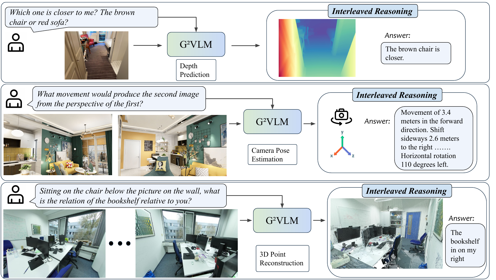
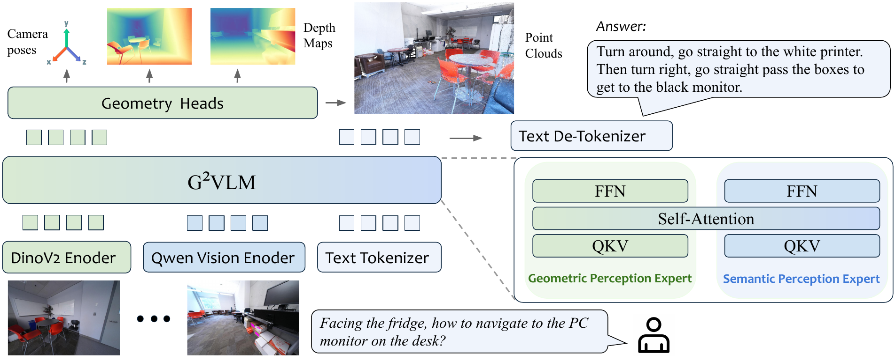
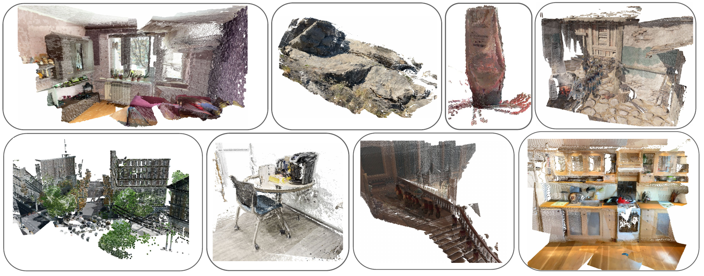

# G2VLM (arXiv 2025)

<!-- paper-source: https://chengwei920412.github.io/paper_reading/2511.21688_G2VLM_Geometry_Grounded_Vision_Language_Model_with_Unified_3D_Reconstruction_and_Spatial_Reasoning/technical_report.html -->

> **arXiv ID**: 2511.21688  
> **原文标题**: G²VLM: Geometry Grounded Vision Language Model with Unified 3D Reconstruction and Spatial Reasoning  
> **翻译日期**: 2026-09-21

---

## 📋 论文概览 {#_1}

### 基本信息 {#_2}

- **作者**: Wenbo Hu、Jingli Lin、Yilin Long、Yunlong Ran、Lihan Jiang、Yifan Wang、Chenming Zhu、Runsen Xu、Tai Wang、Jiangmiao Pang
- **机构**: 上海人工智能实验室、加州大学洛杉矶分校、上海交通大学、复旦大学、浙江大学、中国科学技术大学、香港大学、香港中文大学
- **发表时间**: 2025 年 11 月（arXiv 预印本；文稿标注 CVPR 2026）
- **领域**: 视觉语言模型、三维视觉、空间理解与推理、具身智能

### 核心贡献 {#_3}

论文提出 G²VLM，一个在同一视觉语言模型中统一空间三维重建与高层空间理解的几何基础模型。其核心贡献可归纳为：

1. 以 Transformer 混合专家（Mixture-of-Transformer-Experts, MoT）架构连接两个互补分支：几何感知专家负责从 RGB 图像恢复三维结构，语义感知专家负责多模态理解与语言推理。
2. 将 DINOv2 的底层几何特征与 Qwen2-VL-2B 的语义特征放入统一模型，通过共享自注意力实现特征交互，使模型既能输出相机位姿和像素对齐点图，也能回答空间问题。
3. 采用“几何预训练—空间联合训练”的两阶段方案，并比较仅 CE、CE + CE、VG + CE 三种联合监督策略，揭示几何能力与空间推理能力之间的正向关联。
4. 在深度、点图和相机位姿估计上达到可用且具有竞争力的性能；专用空间推理版本 G²VLM-SR 在 SPAR-Bench、MindCube 和 OmniSpatial 等基准上取得突出结果。

图 1：G²VLM 同时执行空间三维重建与空间推理；面对空间问题时，模型可先预测三维几何，再进行交错推理。

---

## 🎯 研究背景与动机 {#_4}

### 问题定义 {#_5}

现有视觉语言模型主要从海量二维图文或视频数据中隐式学习空间知识。多帧图像通常被展平成词元序列，再由自回归语言建模目标进行训练；这一过程缺少显式的三维几何学习，因此模型可能识别场景中的对象，却难以稳定判断深度、相对位置、视角变化、相机运动和三维朝向。

G²VLM 希望同时求解两个问题：给定 \(N\) 幅 RGB 图像 \((I_i)_{i=1}^{N}\)，一方面预测每幅图像对应的相机位姿 \(T_i\) 与像素对齐三维点图 \(X_i\)；另一方面利用所学几何表征完成空间理解与语言推理。模型推理时只需要 RGB 图像或视频帧，不要求用户额外提供深度图或相机参数。

### 现有方法的局限性 {#_6}

- **标准空间 VLM**：SpatialVLM、SpaceQwen 等方法主要依赖空间指令数据，仍将视觉输入视作二维序列，空间能力容易受语言先验和数据分布影响。
- **外挂几何编码器的方法**：VLM-3R、Spatial-MLLM 等引入冻结的 VGGT 类编码器，虽然获得显式三维先验，但几何模块与语言模块仍相对割裂，特征对齐和联合优化不够自然。
- **前馈三维重建模型**：DUSt3R、VGGT、\(\pi^3\) 等擅长几何恢复，却通常不具备开放词汇语义理解与语言推理能力。
- **数据与能力错位**：高层语义监督丰富但几何约束弱；三维标注几何约束强，但昂贵且难以大规模收集。

### 本文的创新点 {#_7}

1. **双通路统一建模**：借鉴人类视觉“腹侧通路/背侧通路”假说，以语义感知专家回答“是什么”，以几何感知专家回答“在哪里”。
2. **模型内部的几何基础**：几何专家不是外接冻结模块，而是与语义专家处于同一 MoT 主干中；共享注意力为两类表征提供直接交互通道。
3. **原生双输出能力**：同一模型既能生成三维点图和相机位姿，也能输出自然语言答案，为交错推理提供中间几何依据。
4. **可扩展的联合训练选择**：主模型冻结几何专家、仅优化语义专家，从而利用丰富视频数据扩展；G²VLM-SR 则进一步用 CE 更新几何专家，专门追求空间推理性能。

---

## 🔬 方法论 {#_8}

### 整体架构 {#_9}

G²VLM 基于 Qwen2-VL-2B 构建两个 Transformer 专家，两者均为 28 层并采用全局注意力：

- **几何感知专家**：使用 DINOv2 视觉编码器提取底层视觉特征，再通过线性投影对齐到 Qwen2-VL-2B 的隐藏维度。几何隐藏状态由三个彼此不共享权重的轻量级五层 Transformer 解码头处理，分别预测局部点图、相机位姿和用于稳定训练的全局点图；全局点图头在推理阶段移除。
- **语义感知专家**：继承预训练 Qwen2-VL-2B，使用支持原生动态分辨率的 Qwen2 视觉编码器和多模态旋转位置编码（M-RoPE），负责多模态理解与空间推理。
- **共享交互**：所有词元在每个 Transformer 块中执行共享多模态自注意力。模型不使用 VGGT 的相机词元，也不引入寄存器词元，并采用置换等变设计以适应可变顺序的多视图输入。

图 2：G²VLM 架构。几何感知专家承担三维重建，语义感知专家承担多模态理解与空间推理，二者通过共享自注意力交换信息。

### 关键技术 {#_10}

**1. 三维几何预测。** 对每幅输入图像 \(I_i\)，几何专家产生隐藏状态 \(h_i\)，几何头将其解码为相机位姿和点图：

\[f\left((h_i)_{i=1}^{N}\right)=\left(T_i,X_i\right)_{i=1}^{N},\]

其中 \(T_i\in SE(3)\subset\mathbb{R}^{4\times4}\)，\(X_i\in\mathbb{R}^{H\times W\times3}\)。局部点图在自身相机坐标系中表达，因而与像素天然对齐。

**2. 轻量几何头。** 相机头依次使用 MLP、平均池化和第二个 MLP。旋转先以 9D 形式预测，再通过奇异值分解正交化为 \(3\times3\) 旋转矩阵。相较 VGGT 的 DPT 多尺度解码头，该设计更轻，更容易嵌入 VLM。

**3. 几何—语义协同。** DINOv2 偏向局部结构和低层视觉，Qwen2 视觉编码器偏向语义；双编码器消融显示，两类特征互补。全局注意力同时建模帧内与跨帧关系，并比帧注意力、随机混合注意力更适合本模型。

**4. 两种最终模型。** 主模型 G²VLM 在联合训练时冻结几何专家，仅以 CE 更新语义专家，兼顾几何保持与数据扩展性；G²VLM-SR 以 CE 同时更新几何专家与语义专家，专门优化空间推理。

### 算法流程 {#_11}

1. 输入 \(2\)--\(24\) 帧 RGB 图像；DINOv2 和 Qwen2 视觉编码器分别提取几何特征与语义特征。
2. 线性层将 DINOv2 特征投影到几何专家的输入空间，两类词元进入对应的 MoT 专家。
3. 28 层全局共享自注意力建立跨帧、跨模态联系；专家分支保留各自的几何或语义专长。
4. 几何头解码相机位姿与点图；语义专家通过上下文学习和交错推理生成空间问题答案。
5. 训练时先用三维标注监督几何专家，再进行空间理解联合训练；推理时全局点图头不参与计算。

### 训练流程与数据 {#_12}

**第一阶段：几何预训练。** 冻结加载 Qwen2-VL 权重的语义专家，随机初始化几何专家。先以 \(224\times224\) 分辨率、学习率 \(2\times10^{-4}\) 训练 100K 次迭代，再以 \(518\times518\) 分辨率、学习率 \(5\times10^{-4}\) 训练 20K 步；后半阶段随机采用 0.5--1.0 的宽高比。低分辨率阶段使用 32 块 A800 GPU 训练 7 天，高分辨率阶段使用 64 块 A800 GPU 训练 3 天。

**第二阶段：联合训练。** 使用 AdamW 与余弦调度器，以 \(2\times10^{-5}\) 学习率训练 16K 次迭代，64 块 A800 GPU 运行 3 天。全程采用 bfloat16、梯度检查点和阈值为 1.0 的梯度范数裁剪。

**几何数据。** ScanNet、Co3Dv2、BlendMVS、DL3DV、MegaDepth、WildRGBD、TartanAir、Taskonomy、ARKitScenes、HyperSim、Habitat、ScanNet++、GTA-SFM、MatrixCity、Aria Synthetic Environments、MapFree，以及内部合成室内数据。

**空间与通用数据。** SPAR-7M、OmniSpatial、MindCube、OST-Bench 的训练集，以及 LLaVA-One-Vision 等通用 VQA 数据。

---

## 📊 实验与结果 {#_13}

### 实验设置 {#_14}

- **数据集**: Sintel、NYU-v2（单目深度）；ETH3D、7Scenes（多视图点图）；Co3Dv2（相机位姿）；SPAR-Bench、MindCube、OST-Bench、OmniSpatial（空间理解与推理）。
- **评估指标**: 深度估计使用绝对相对误差（Abs Rel，越低越好）和 \(\delta&lt;1.25\) 准确率；点图估计使用准确度（Acc.）和完整度（Comp.），均越低越好；相机位姿使用 RRA@30、RTA@30 和 AUC@30，均越高越好；空间基准报告分类或问答平均分。
- **对比方法**: Fast3R、CUT3R、FLARE、VGGT、\(\pi^3\)；GPT-4o、Claude、LLaVA、Qwen2/2.5-VL、InternVL；SpaceMantis、Spatial-MLLM、SpaceQwen、VLM-3R 等。

### 主要结果 {#_15}

**视觉几何。** G²VLM 在 Sintel 上取得 0.297 Abs Rel，优于 VGGT 的 0.335，但落后于 \(\pi^3\) 的 0.277；其 \(\delta&lt;1.25\) 为 0.589。NYU-v2 上为 0.062 Abs Rel / 0.954，接近 VGGT 的 0.056 / 0.951。Co3Dv2 相机位姿结果为 97.91 RRA@30、95.20 RTA@30 和 74.81 AUC@30。点图任务中，ETH3D 为 0.414 Acc. / 0.309 Comp.，7Scenes 为 0.046 / 0.029；完整度接近 VGGT，但准确度仍有明显差距。

**空间推理。** 关键平均分如下：

<table>
<thead>
<tr>
<th>模型</th>
<th>SPAR-Bench</th>
<th>MindCube</th>
<th>OST-Bench</th>
<th>OmniSpatial</th>
</tr>
</thead>
<tbody>
<tr>
<td>Qwen2-VL-2B 基础模型</td>
<td>24.60</td>
<td>37.83</td>
<td>22.59</td>
<td>43.90</td>
</tr>
<tr>
<td>G²VLM-2B</td>
<td>41.66</td>
<td>38.83</td>
<td>24.60</td>
<td>44.13</td>
</tr>
<tr>
<td>G²VLM-SR-2B</td>
<td><strong>54.87</strong></td>
<td><strong>48.33</strong></td>
<td>37.02</td>
<td>50.41</td>
</tr>
<tr>
<td>GPT-4o</td>
<td>36.39</td>
<td>38.81</td>
<td><strong>53.05</strong></td>
<td><strong>50.74</strong></td>
</tr>
<tr>
<td>Qwen2.5-VL-72B</td>
<td>39.40</td>
<td>37.25</td>
<td>50.54</td>
<td>47.13</td>
</tr>
</tbody>
</table>

G²VLM-SR 在 SPAR-Bench 上比 GPT-4o 高 18.48 分，比 Qwen2-VL-2B 基础模型高 30.27 分。它还在 MindCube 和 OmniSpatial 上领先所列开源模型；OST-Bench 的开源模型中则由 Qwen2.5-VL-72B 领先，说明在线时空场景理解可能更依赖模型容量与知识存储。补充实验中，G²VLM-SR 在 SPAR-Bench 低难度类别取得 59.99，超过所报告的人类水平 55.31。

图 3：开放域定性重建结果。模型覆盖物体级、结构级、室内、室外以及动态和静态场景。

### 消融实验 {#_16}

- **单编码器与双编码器**：DINOv2 几何编码器与 Qwen2/CLIP 类语义编码器并用时，两类任务都优于共享单一语义编码器，说明底层结构线索能补充语义特征。
- **注意力机制**：SPAR-Bench 平均分从帧注意力的 52.34、混合注意力的 53.64，提高到全局注意力的 54.87；全局注意力分别领先 2.53 和 1.23 分。
- **几何预训练**：只在空间理解数据上微调 Qwen2-VL-2B 得到 48.93，而完整 G²VLM-SR 达到 54.87，高 5.94 分，验证几何预训练并非仅由更多空间数据替代。
- **联合损失**：VG + CE 同时改善视觉几何与空间理解，但需要在联合阶段继续使用大规模三维标注；CE + CE 更偏向空间推理；仅 CE 最有利于保留几何性能并利用普通视频扩展训练。

---

## 💡 关键见解 {#_17}

### 理论分析 {#_18}

论文最重要的结论不是“给 VLM 增加一个深度头”，而是几何表征质量会系统性影响语言侧空间推理。全局注意力同时降低几何训练损失并提高 SPAR-Bench 得分，几何预训练也显著优于仅空间数据微调，这两组证据共同支持“几何—语义正向交互”的主张。

双专家设计把两类不同目标放在可共享注意力、又可保留专用参数的结构中。这样既避免让单一前馈网络同时承担低层度量重建与高层语言生成，也避免完全冻结、外接几何模块造成的信息瓶颈。几何头提供可监督、可检查的三维中间量，使空间答案不必完全依赖隐式语言先验。

### 实践启示 {#_19}

- 对机器人或具身智能系统，显式点图和相机位姿可以直接服务定位、规划与操作，而语义专家负责指令理解，减少在多个独立模型之间传递数据的工程复杂度。
- 若部署目标强调通用几何与空间问答的平衡，可采用冻结几何专家的 G²VLM；若目标是空间问答排行榜，则 G²VLM-SR 更合适。
- DINOv2 与语义视觉编码器的互补结果说明：高层对齐良好的视觉特征不一定包含足够的度量几何信息，空间系统仍应保留低层视觉通路。
- 全局注意力比复杂的帧级/全局交替结构更容易兼容现有 LLM 主干，但长视频上的二次复杂度仍需后续优化。

---

## 🔍 局限性与未来工作 {#_20}

### 当前局限 {#_21}

1. **几何精度尚未全面达到专用模型**：在 ETH3D、7Scenes 点图准确度以及 Co3Dv2 AUC 上，G²VLM 与 VGGT、\(\pi^3\) 仍有显著差距。统一性是优势，但目前不是所有几何指标上的最佳方案。
2. **训练成本高**：完整流程最多使用 64 块 A800 GPU，几何阶段与联合阶段合计持续多日；双视觉编码器和双专家也增加显存与推理开销。
3. **依赖三维监督**：推理时只输入 RGB，但几何专家预训练仍需要大量带深度、相机位姿或可恢复几何的三维标注数据。效果最强的 VG + CE 方案还要求联合阶段继续使用此类数据。
4. **训练稳定性与标注噪声**：作者报告大规模三维标注会引发损失尖峰，并将大于 10 的损失截断和平滑为 0；这一启发式处理可能掩盖困难样本。
5. **规模与评估范围有限**：主干只有 2B 参数，OST-Bench 已显示知识密集任务受模型容量限制；论文也未系统报告长视频效率、跨机器人平台迁移、真实闭环操作或三维编辑结果。
6. **基准依赖**：空间训练使用多个目标基准的训练集，报告中未给出细粒度的数据去重与泄漏审计；泛化结论仍需在完全独立的真实场景和任务上验证。

### 未来方向 {#_22}

- 将双专家方案扩展至更大的 VLM，并研究稀疏注意力、记忆压缩和流式处理，以支持更长视频。
- 用置信度建模、鲁棒损失和自动数据清洗替代硬损失截断，提升大规模三维监督的稳定性。
- 探索弱监督或自监督几何学习，减少对深度图、相机位姿及内部合成数据的依赖。
- 将点图与语言推理接入机器人闭环，在导航、操作、视角规划和具身问答中检验真实收益。
- 扩展到论文提出但尚未验证的三维场景编辑、生成式世界模型和跨视角内容生成。
- 对交错推理过程提供可视化中间证据，定量评估几何预测是否真正因果性地改善答案，而非仅提供相关特征。

---

## 📚 相关工作对比 {#_23}

<table>
<thead>
<tr>
<th>方法</th>
<th>核心思想</th>
<th>优势</th>
<th>劣势</th>
</tr>
</thead>
<tbody>
<tr>
<td>SpatialVLM / SpaceQwen</td>
<td>在标准 VLM 上使用空间指令数据训练</td>
<td>复用成熟 VLM，语义能力强</td>
<td>仍以二维扁平词元为主，缺少显式几何输出</td>
</tr>
<tr>
<td>VLM-3R / Spatial-MLLM</td>
<td>接入冻结的 VGGT 类几何编码器</td>
<td>能快速获得三维先验</td>
<td>几何模块与语言模块相对割裂，难以联合提升几何本身</td>
</tr>
<tr>
<td>VGGT / \(\pi^3\)</td>
<td>前馈预测多视图点图、深度和相机位姿</td>
<td>几何精度高，端到端且高效</td>
<td>缺少开放词汇语义理解和语言推理能力</td>
</tr>
<tr>
<td>Bagel</td>
<td>用 MoT 统一多模态理解与图像生成</td>
<td>统一生成和理解，架构可扩展</td>
<td>目标不是度量三维几何或空间推理</td>
</tr>
<tr>
<td><strong>G²VLM</strong></td>
<td>在同一 MoT 中联合几何感知与语义感知专家</td>
<td>同时输出三维结构与语言答案，几何和推理可相互促进</td>
<td>计算成本高，部分几何指标落后于专用模型，训练仍依赖三维标注</td>
</tr>
</tbody>
</table>

---

## 🎓 个人评价 {#_24}

### 优点 {#_25}

- 问题设定清晰：将“重建空间”与“理解空间”视作空间智能的两个互补组成，而不是单独优化空间问答分数。
- 架构选择务实：基于 Qwen2-VL-2B、DINOv2 和轻量 Transformer 几何头构建，便于复用现有 VLM，并避免沉重的 DPT 解码器。
- 实验覆盖完整：同时报告深度、点图、相机位姿和四类空间推理基准，并通过编码器、注意力、几何预训练和联合损失消融解释性能来源。
- 对照具有说服力：2B 模型在多项空间基准上超过更大的通用或空间专家模型，尤其 SPAR-Bench 的提升幅度明显。
- 中间几何输出可解释、可复用，较纯语言式空间推理更适合机器人系统。

### 可改进之处 {#_26}

- 应更直接地讨论统一模型在 ETH3D、7Scenes 和 Co3Dv2 AUC 上与专用几何模型的差距，并报告速度、显存、参数量与吞吐量。
- 需要增加跨数据集零样本评估、长视频压力测试以及与外挂几何编码器方案在相同训练预算下的公平比较。
- 最好提供交错推理的定量消融，例如屏蔽显式三维预测、扰动点图或相机位姿，验证几何中间量对答案的因果贡献。
- 对内部合成数据、数据混合比例、采样策略和清洗规则的公开程度仍不足，这会影响完整复现。
- VG + CE 的互利结论目前主要由损失曲线和汇总结果支撑，若能给出完整数值表和统计波动会更扎实。

### 推荐阅读对象 {#_27}

推荐给从事视觉语言模型、三维重建、机器人感知、具身问答、空间智能与多模态基础模型的研究者和工程师。对希望把点图、相机位姿等显式几何表征接入现有 VLM 的读者，这篇论文尤其具有参考价值。

---

## 📎 附录 {#_28}

### 重要公式 {#_29}

**1. 视觉几何总损失**

\[\mathcal{L}_{VG}=\mathcal{L}_{\text{points}}+\lambda_{\text{cam}}\mathcal{L}_{\text{cam}}+\lambda_{\text{normal}}\mathcal{L}_{\text{normal}}.\]

训练中取 \(\lambda_{\text{normal}}=1.0\)、\(\lambda_{\text{cam}}=0.2\)、\(\lambda_{\text{trans}}=200.0\)。

**2. 尺度对齐的点重建损失**

\[\mathcal{L}_{\text{points}}=\frac{1}{3NHW}\sum_{i=1}^{N}\sum_{j=1}^{H\times W}\frac{1}{z_{i,j}}\left\|s^*\hat{\mathbf{x}}_{i,j}-\mathbf{x}_{i,j}\right\|_1,\]

\[s^*=\underset{s}{\arg\min}\sum_{i=1}^{N}\sum_{j=1}^{H\times W}\frac{1}{z_{i,j}}\left\|s\hat{\mathbf{x}}_{i,j}-\mathbf{x}_{i,j}\right\|_1.\]

\(s^*\) 消除整体尺度歧义，\(1/z_{i,j}\) 降低远处点的绝对误差对损失的支配。

**3. 相机位姿损失**

\[\mathcal{L}_{\text{cam}}=\frac{1}{N(N-1)}\sum_{i\ne j}\left(\mathcal{L}_{\text{rot}}(i,j)+\lambda_{\text{trans}}\mathcal{L}_{\text{trans}}(i,j)\right),\]

\[\mathcal{L}_{\text{rot}}(i,j)=\arccos\left(\frac{\operatorname{Tr}\left((R_{i\leftarrow j})^\top\hat{R}_{i\leftarrow j}\right)-1}{2}\right),\]

\[\mathcal{L}_{\text{trans}}(i,j)=\mathcal{H}_{\delta}\left(s^*\hat{t}_{i\leftarrow j}-t_{i\leftarrow j}\right).\]

旋转项直接度量 SO(3) 上的角距离，平移项使用 Huber 损失增强对异常值的鲁棒性。

**4. 法向损失**

\[\mathcal{L}_{\text{normal}}=\sum_{i=1}^{N}\sum_{j=1}^{H\times W}\arccos\left(\hat{n}_{i,j}\cdot n_{i,j}\right).\]

该项约束预测法向与真值法向的夹角，鼓励局部表面平滑。

### 术语表 {#_30}

<table>
<thead>
<tr>
<th>术语</th>
<th>中文含义</th>
<th>本文语境</th>
</tr>
</thead>
<tbody>
<tr>
<td>Vision-Language Model (VLM)</td>
<td>视觉语言模型</td>
<td>联合处理视觉输入与语言输出的基础模型</td>
</tr>
<tr>
<td>Geometry Grounded</td>
<td>几何基础</td>
<td>推理受到显式学习的三维几何表征支撑</td>
</tr>
<tr>
<td>Visual Geometry Learning (VG)</td>
<td>视觉几何学习</td>
<td>从图像学习深度、点图、表面法向和相机位姿</td>
</tr>
<tr>
<td>Spatial Understanding</td>
<td>空间理解</td>
<td>感知对象位置、方向、距离和场景布局</td>
</tr>
<tr>
<td>Spatial Reasoning</td>
<td>空间推理</td>
<td>基于空间表征回答关系、视角与运动问题</td>
</tr>
<tr>
<td>Interleaved Reasoning</td>
<td>交错推理</td>
<td>在语言推理过程中穿插或利用三维几何预测</td>
</tr>
<tr>
<td>Mixture-of-Transformer-Experts (MoT)</td>
<td>Transformer 混合专家</td>
<td>共享注意力、保留几何与语义专用专家参数的架构</td>
</tr>
<tr>
<td>Point Map</td>
<td>点图</td>
<td>与图像像素一一对齐的三维坐标图</td>
</tr>
<tr>
<td>Camera Pose</td>
<td>相机位姿</td>
<td>相机在三维空间中的旋转与平移</td>
</tr>
<tr>
<td>Feature Alignment</td>
<td>特征对齐</td>
<td>将 DINOv2 特征投影到 LLM/专家的隐藏空间</td>
</tr>
<tr>
<td>Global Attention</td>
<td>全局注意力</td>
<td>在所有输入帧词元之间建立注意力连接</td>
</tr>
<tr>
<td>RRA / RTA</td>
<td>相对旋转/平移准确率</td>
<td>相对相机位姿在角度阈值内的正确比例</td>
</tr>
<tr>
<td>AUC@30</td>
<td>30 度内曲线下面积</td>
<td>汇总 RRA 与 RTA 随角度阈值变化的指标</td>
</tr>
<tr>
<td>G²VLM-SR</td>
<td>空间推理专用 G²VLM</td>
<td>联合训练时用 CE 更新几何专家的变体</td>
</tr>
</tbody>
</table>

### 参考资源 {#_31}

- **论文原文**: [arXiv 2511.21688](https://arxiv.org/abs/2511.21688)
- **中文翻译 PDF**: [paper_cn.pdf](https://chengwei920412.github.io/paper_reading/2511.21688_G2VLM_Geometry_Grounded_Vision_Language_Model_with_Unified_3D_Reconstruction_and_Spatial_Reasoning/paper_cn.pdf)
- **中文 Markdown 译文**: [paper_cn.md](https://chengwei920412.github.io/paper_reading/2511.21688_G2VLM_Geometry_Grounded_Vision_Language_Model_with_Unified_3D_Reconstruction_and_Spatial_Reasoning/paper_cn.html)
- **代码实现**: [InternRobotics/G2VLM](https://github.com/InternRobotics/G2VLM)
- **项目主页**: [G²VLM 项目页](https://gordonhu608.github.io/g2vlm.github.io/)
