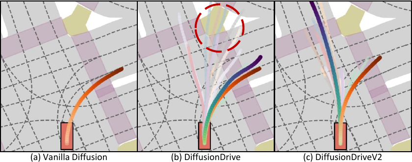
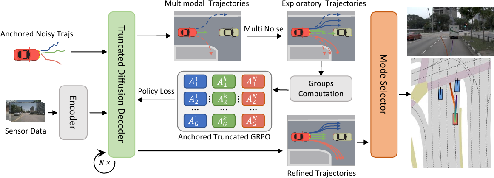
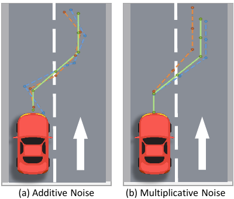

# DiffusionDriveV2 (arXiv 2025)

<!-- paper-source: https://chengwei920412.github.io/paper_reading/2512.07745_DiffusionDriveV2_Reinforcement_Learning_Constrained_Truncated_Diffusion_Modeling_in_End_to_End_Autonomous_Driving/technical_report.html -->

> 原文链接：[DiffusionDriveV2 (arXiv 2025)](https://chengwei920412.github.io/paper_reading/2512.07745_DiffusionDriveV2_Reinforcement_Learning_Constrained_Truncated_Diffusion_Modeling_in_End_to_End_Autonomous_Driving/technical_report.html)

> **arXiv ID**：2512.07745  
> **原文标题**：DiffusionDriveV2: Reinforcement Learning-Constrained Truncated Diffusion Modeling in End-to-End Autonomous Driving  
> **翻译日期**：2026-09-28

---

## 📋 论文概览 {#_1}

### 基本信息 {#_2}

- **作者**：Jialv Zou、Shaoyu Chen、Bencheng Liao、Zhiyu Zheng、Yuehao Song、Lefei Zhang、Qian Zhang、Wenyu Liu、Xinggang Wang
- **机构**：华中科技大学、地平线机器人、武汉大学
- **发表时间**：2025 年 12 月（arXiv）
- **领域**：端到端自动驾驶、轨迹规划、扩散模型、强化学习

### 核心贡献 {#_3}

DiffusionDriveV2 面向 DiffusionDrive 的一个结构性缺陷：轨迹锚点虽然保证了多样性，但模仿学习每个场景只有一条专家轨迹，只能充分监督一个正模式，其余锚点生成的轨迹缺乏约束。论文将扩散去噪过程建模为马尔可夫决策过程，并提出锚内 GRPO、锚间截断 GRPO 与尺度自适应乘性探索噪声，在保留多模态能力的同时提高所有候选轨迹的质量。使用对齐的 ResNet-34 骨干时，方法在 NAVSIM v1 达到 91.2 PDMS，在 NAVSIM v2 达到 85.5 EPDMS。

---

## 🎯 研究背景与动机 {#_4}

### 问题定义 {#_5}

端到端自动驾驶规划器需从传感器输入直接预测自车未来轨迹。单峰回归方法只能输出一个解；基于固定候选集的方法灵活性不足；普通扩散模型虽能生成多个候选，却容易发生模式坍塌。DiffusionDrive 用聚类得到的轨迹锚点构造高斯混合先验，每个锚点代表一种驾驶意图，从而恢复多模态生成能力。

### 现有方法的局限性 {#_6}

DiffusionDrive 的模仿学习损失只对最接近真值轨迹的锚点进行轨迹重建监督，其他锚点主要接受分类信号。结果是候选集合中既有高质量轨迹，也有大量碰撞、驶离道路或过于保守的轨迹。系统因此过度依赖参数量较小的下游选择器；在分布外场景中，一旦选择器判断失误，低质量候选就会直接转化为安全风险。

图：普通扩散模型、DiffusionDrive 与 DiffusionDriveV2 的轨迹质量和多样性对比。

### 本文的创新点 {#_7}

1. 将强化学习引入锚定截断扩散模型，以“探索—约束”方式同时提升轨迹质量上界和下界。
2. 提出锚内 GRPO，只比较同一驾驶意图下的轨迹，避免不同意图之间竞争导致模式坍塌。
3. 提出锚间截断 GRPO：奖励相对改进，只惩罚绝对失败；碰撞轨迹的优势固定为 -1，其他负优势截断为 0。
4. 用纵向和横向两个乘性高斯噪声替代逐点加性噪声，使探索轨迹保持平滑和结构一致。
5. 引入由粗到细的两阶段模式选择器，并以间隔排序损失增强连续质量指标上的细粒度排序能力。

---

## 🔬 方法论 {#_8}

### 整体架构 {#_9}

图：DiffusionDriveV2 总体架构。不同颜色表示不同锚定驾驶意图，强化学习改善各锚点内的候选轨迹，最后由模式选择器输出目标最一致的轨迹。

流程由四部分组成：以预训练 DiffusionDrive 冷启动的截断扩散生成器、乘性噪声探索、锚定截断 GRPO 训练，以及两阶段模式选择器。感知网络提取场景特征后，截断扩散解码器从各锚点对应的高斯分布采样噪声轨迹，并用两个去噪步骤生成最终候选。

### 关键技术 {#_10}

**1. 扩散策略化。** 每个锚点 \(\mathbf a^k\) 发起的条件去噪步骤被视为高斯策略：

\[\pi_{\theta}(\tau_{t-1}^k\mid\tau_t^k,z,\mathbf a^k)
=\mathcal N\!\left(\tau_{t-1}^k;\mu_{\theta}(\tau_t^k,t,z,\mathbf a^k),\eta(1-\alpha_t)I\right).\]

最终轨迹级奖励可通过 REINFORCE 形式回传至整条去噪链；较早、噪声更大的步骤由折扣系数 \(\gamma_{t-1}\) 降权。

**2. 尺度自适应乘性噪声。** 对规范化轨迹 \(\tau\) 施加

\[\tau&#x27;=(1+\epsilon_{\mathrm{mul}})\tau,\qquad
\epsilon_{\mathrm{mul}}=(\epsilon_{\mathrm{long}},\epsilon_{\mathrm{lat}}).\]

纵向和横向扰动随轨迹尺度变化，远端点获得更合适的探索幅度，避免独立逐点噪声造成折线状轨迹。

图：加性探索噪声与尺度自适应乘性探索噪声的对比。

**3. 锚内 GRPO。** 对每个锚点生成 \(G\) 个轨迹变体，只在该组内标准化奖励：

\[A^{k,i}=\frac{r^{k,i}-\operatorname{mean}(\{r^{k,1},\ldots,r^{k,G}\})}
{\operatorname{std}(\{r^{k,1},\ldots,r^{k,G}\})}.\]

这使“左转”“直行”等互不替代的驾驶意图不会被放入同一竞争组。训练损失还保留加权模仿学习项 \(L=L_{RL}+\lambda L_{IL}\)，用于抑制过拟合和通用驾驶能力退化。

**4. 锚间截断 GRPO。** 纯锚内比较缺少全局尺度：某组中最好的碰撞轨迹可能得到正优势，而另一组中安全但相对较差的轨迹可能得到负优势。论文采用

\[A_{\mathrm{trunc}}^{k,i}=
\begin{cases}
-1, &amp; \text{发生碰撞},\\
\max(0,A^{k,i}), &amp; \text{其他情况},
\end{cases}\]

将绝对安全约束注入各模式，同时避免因跨意图相对排序而压制少数模式。

### 算法流程 {#_11}

1. 从 DiffusionDrive 的模仿学习权重冷启动生成器。
2. 对每个轨迹锚点采样多个轨迹，以乘性高斯噪声扩大局部探索范围。
3. 用闭环轨迹级奖励计算同锚点组内的标准化优势。
4. 将碰撞样本优势设为 -1，并将其他负优势截断为 0。
5. 联合优化强化学习损失和模仿学习正则项。
6. 冻结或完成生成器训练后，训练由粗到细的模式选择器：粗选择器保留 Top-K，细选择器结合 BEV、智能体和地图特征重新排序。

---

## 📊 实验与结果 {#_12}

### 实验设置 {#_13}

- **数据集**：NAVSIM v1 与 NAVSIM v2；训练划分 `navtrain` 含 1,192 个场景，评估划分 `navtest` 含 136 个场景。
- **评估指标**：NAVSIM v1 使用 PDMS 及 NC、DAC、TTC、Comfort、EP；NAVSIM v2 使用扩展 EPDMS，并加入 DDC、TL、LK、HC、EC。
- **输入与模型**：三个裁剪降采样的前视相机图像拼接为 \(1024\times256\)，另输入 LiDAR 点云栅格化 BEV；骨干为 ResNet-34。
- **训练**：生成器强化学习 10 个 epoch，模式选择器 20 个 epoch；AdamW，学习率 \(2\times10^{-4}\)，总批量 512，8 张 NVIDIA L20 GPU；推理仅需 2 个去噪步骤。
- **对比方法**：DiffusionDrive、DIVER、DriveSuprim、GoalFlow、Hydra-MDP、ARTEMIS、Transfuser 等。

### 主要结果 {#_14}

<table>
<thead>
<tr>
<th>数据集</th>
<th>方法</th>
<th>骨干</th>
<th>核心指标</th>
</tr>
</thead>
<tbody>
<tr>
<td>NAVSIM v1</td>
<td>DiffusionDrive</td>
<td>ResNet-34</td>
<td>88.1 PDMS</td>
</tr>
<tr>
<td>NAVSIM v1</td>
<td>DIVER</td>
<td>ResNet-34</td>
<td>88.3 PDMS</td>
</tr>
<tr>
<td>NAVSIM v1</td>
<td>DriveSuprim</td>
<td>ResNet-34</td>
<td>89.9 PDMS</td>
</tr>
<tr>
<td>NAVSIM v1</td>
<td><strong>DiffusionDriveV2</strong></td>
<td>ResNet-34</td>
<td><strong>91.2 PDMS</strong></td>
</tr>
<tr>
<td>NAVSIM v2</td>
<td>DriveSuprim</td>
<td>ResNet-34</td>
<td>83.1 EPDMS</td>
</tr>
<tr>
<td>NAVSIM v2</td>
<td><strong>DiffusionDriveV2</strong></td>
<td>ResNet-34</td>
<td><strong>85.5 EPDMS</strong></td>
</tr>
</tbody>
</table>

在 NAVSIM v1 上，DiffusionDriveV2 相对 DiffusionDrive 提升 3.1 PDMS，其中 EP 提升 5.3；相对同为强化学习路线的 DIVER 提升 2.9 PDMS。只使用 21.8M 参数的 ResNet-34 时，仍超过采用 96.9M 参数 V2-99 骨干的 GoalFlow 和 Hydra-MDP。

原始候选轨迹的多样性—质量结果更直接反映生成器本身：

<table>
<thead>
<tr>
<th>方法</th>
<th>多样性 \(Div.\)</th>
<th>PDMS@1</th>
<th>PDMS@5</th>
<th>PDMS@10</th>
</tr>
</thead>
<tbody>
<tr>
<td>\(\mathrm{Transfuser}_{TD}\)</td>
<td>0.1</td>
<td>85.7</td>
<td>85.7</td>
<td>85.7</td>
</tr>
<tr>
<td>DiffusionDrive</td>
<td>42.3</td>
<td>93.5</td>
<td>84.3</td>
<td>75.3</td>
</tr>
<tr>
<td><strong>DiffusionDriveV2</strong></td>
<td><strong>30.3</strong></td>
<td><strong>94.9</strong></td>
<td><strong>91.1</strong></td>
<td><strong>84.4</strong></td>
</tr>
</tbody>
</table>

普通扩散方法的 Top-K 指标稳定，却几乎没有多样性；DiffusionDrive 多样性最高，但尾部候选质量明显下降。DiffusionDriveV2 保留较高多样性，同时将 PDMS@10 从 75.3 提升到 84.4，说明改进不只是选择器收益，而是生成器候选集合整体变得更可靠。

### 消融实验 {#_15}

<table>
<thead>
<tr>
<th>设计</th>
<th>对照</th>
<th>完整设计</th>
<th>PDMS 变化</th>
</tr>
</thead>
<tbody>
<tr>
<td>探索噪声：加性 → 乘性</td>
<td>89.7</td>
<td>90.1</td>
<td>+0.4</td>
</tr>
<tr>
<td>锚内 GRPO：关闭 → 开启</td>
<td>89.2</td>
<td>90.1</td>
<td>+0.9</td>
</tr>
<tr>
<td>锚间截断 GRPO：关闭 → 开启</td>
<td>89.5</td>
<td>90.1</td>
<td>+0.6</td>
</tr>
<tr>
<td>选择器：单阶段 → 由粗到细</td>
<td>89.7</td>
<td>89.9</td>
<td>+0.2</td>
</tr>
<tr>
<td>排序损失：关闭 → 开启</td>
<td>89.9</td>
<td>90.1</td>
<td>+0.2</td>
</tr>
</tbody>
</table>

锚内 GRPO 是消融中贡献最大的单项，支持“不同驾驶意图不应直接比较”的核心论点。将 DiffusionDrive 换用同款复杂选择器后仅从 88.1 提升到 89.1 PDMS，仍明显低于 DiffusionDriveV2 的 91.2，说明主要增益来自生成器强化学习，而非选择器容量。

---

## 💡 关键见解 {#_16}

### 理论分析 {#_17}

论文的关键不是简单把 GRPO 套到扩散模型，而是重新定义比较组。锚点既是生成先验，也是语义分区：若跨锚点标准化优势，数据中更常见或更容易获得高分的驾驶意图会压制其他合法意图，强化学习反而重现模式坍塌。锚内标准化保护语义多样性，锚间截断规则则补回绝对安全尺度，两者分别解决“不能比较”和“必须约束”的矛盾。

### 实践启示 {#_18}

该设计适用于任何由结构化混合先验驱动的生成策略：组内相对优化应与潜变量或意图分区一致，而跨组信号应优先表达绝对约束。对自动驾驶而言，候选集合的尾部质量与 Top-1 同样重要，因为选择器本身并非可靠的安全屏障。PDMS@K 一类指标比只报告最终选中轨迹更能暴露系统风险。

---

## 🔍 局限性与未来工作 {#_19}

### 当前局限 {#_20}

- 论文仅在 NAVSIM 的非反应式闭环评估中验证，尚不能证明在真实车辆或强交互式仿真中的安全性。
- 碰撞样本使用固定 -1 优势、其他负优势统一截断为 0，规则清晰但较粗糙，可能忽略不同失败严重程度。
- 强化学习依赖模拟器轨迹评分，其奖励偏差会直接影响策略；论文没有系统分析奖励投机或跨数据集泛化。
- 训练使用 8 张 L20 GPU、批量 512，资源门槛较高，也未报告完整训练时间与推理延迟。
- 选择器仍是系统最后决策点；虽然生成器尾部质量提高，但没有形式化安全保证或不确定性校准。

### 未来方向 {#_21}

1. 在反应式闭环仿真、更多城市和真实车辆上评估分布外泛化与长时域安全性。
2. 用分级风险、约束策略优化或风险敏感目标替代固定碰撞惩罚。
3. 将锚点频率、场景条件和意图置信度纳入跨锚点校准，研究更连续的全局优势尺度。
4. 对模式选择器做概率校准，并加入可验证的安全过滤层或备份规划器。
5. 研究更少采样、更小批量的强化学习方案，以降低训练成本并支持在线适应。

---

## 📚 相关工作对比 {#_22}

<table>
<thead>
<tr>
<th>方法</th>
<th>核心思想</th>
<th>优势</th>
<th>劣势</th>
</tr>
</thead>
<tbody>
<tr>
<td>普通扩散规划器</td>
<td>从随机噪声迭代生成轨迹</td>
<td>生成灵活、理论上可多模态</td>
<td>易模式坍塌，常退化为单一轨迹</td>
</tr>
<tr>
<td>DiffusionDrive</td>
<td>以轨迹锚点构造高斯混合先验并截断去噪</td>
<td>多样性高、仅需两个去噪步骤</td>
<td>非正锚点缺少轨迹监督，候选尾部质量差</td>
</tr>
<tr>
<td>DIVER 等扩散强化学习</td>
<td>对普通扩散模型直接应用强化学习</td>
<td>可突破专家数据上界</td>
<td>未解决锚定混合模型中的跨意图比较问题</td>
</tr>
<tr>
<td><strong>DiffusionDriveV2</strong></td>
<td>锚内 GRPO + 锚间截断 GRPO + 乘性探索噪声</td>
<td>兼顾多样性、整体质量和高效推理</td>
<td>规则化优势截断较粗，验证范围仍有限</td>
</tr>
</tbody>
</table>

---

## 🎓 个人评价 {#_23}

### 优点 {#_24}

论文抓住了生成式规划中容易被 Top-1 指标掩盖的问题：候选集合整体质量决定系统对选择器失误的容忍度。方法与锚点的语义结构高度匹配，锚内和锚间两个机制的分工清晰，消融结果也能对应核心假设。PDMS@1/5/10 与多样性指标共同呈现质量—多样性权衡，证据比单一最终分数更完整。

### 可改进之处 {#_25}

最需要补强的是安全与泛化证据。固定截断优势是一种有效工程启发式，但缺少对优化偏差、收敛性和奖励尺度敏感性的分析。若能加入多随机种子误差条、训练成本、反应式仿真、极端长尾场景和选择器校准实验，结论会更扎实。

### 推荐阅读对象 {#_26}

适合研究端到端自动驾驶、生成式轨迹规划、扩散策略、GRPO/策略梯度，以及关注多模态生成中“多样性与可靠性”矛盾的研究者和工程师。

---

## 📎 附录 {#_27}

### 重要公式 {#_28}

- 锚点高斯混合轨迹分布：\(p(\boldsymbol\tau\mid z)=\sum_k s(\mathbf a^k\mid z)p(\tau^k\mid\mathbf a^k,z)\)。
- 锚内组相对优势：组内奖励减均值并除以标准差。
- 锚间截断优势：碰撞为 -1，其他样本取 \(\max(0,A)\)。
- 联合训练目标：\(L=L_{RL}+\lambda L_{IL}\)。

### 术语表 {#_29}

<table>
<thead>
<tr>
<th>英文</th>
<th>中文</th>
</tr>
</thead>
<tbody>
<tr>
<td>End-to-End Autonomous Driving (E2E-AD)</td>
<td>端到端自动驾驶</td>
</tr>
<tr>
<td>Mode Collapse</td>
<td>模式坍塌</td>
</tr>
<tr>
<td>Truncated Diffusion Model</td>
<td>截断扩散模型</td>
</tr>
<tr>
<td>Trajectory Anchor</td>
<td>轨迹锚点</td>
</tr>
<tr>
<td>Group Relative Policy Optimization (GRPO)</td>
<td>组相对策略优化</td>
</tr>
<tr>
<td>Intra-Anchor GRPO</td>
<td>锚内 GRPO</td>
</tr>
<tr>
<td>Inter-Anchor Truncated GRPO</td>
<td>锚间截断 GRPO</td>
</tr>
<tr>
<td>Scale-Adaptive Multiplicative Exploration Noise</td>
<td>尺度自适应乘性探索噪声</td>
</tr>
<tr>
<td>Mode Selector</td>
<td>模式选择器</td>
</tr>
<tr>
<td>Planning-Oriented Driving Metric Score (PDMS)</td>
<td>面向规划的驾驶指标分数</td>
</tr>
</tbody>
</table>

### 参考资源 {#_30}

- **论文原文**：[arXiv 链接](https://arxiv.org/abs/2512.07745)
- **中文翻译 PDF**：[paper_cn.pdf](https://chengwei920412.github.io/paper_reading/2512.07745_DiffusionDriveV2_Reinforcement_Learning_Constrained_Truncated_Diffusion_Modeling_in_End_to_End_Autonomous_Driving/paper_cn.pdf)
- **中文 Markdown 译文**：[paper_cn.md](https://chengwei920412.github.io/paper_reading/2512.07745_DiffusionDriveV2_Reinforcement_Learning_Constrained_Truncated_Diffusion_Modeling_in_End_to_End_Autonomous_Driving/paper_cn.html)
- **代码实现**：[DiffusionDriveV2 GitHub](https://github.com/hustvl/DiffusionDriveV2)
- **项目主页**：论文未提供独立项目主页
