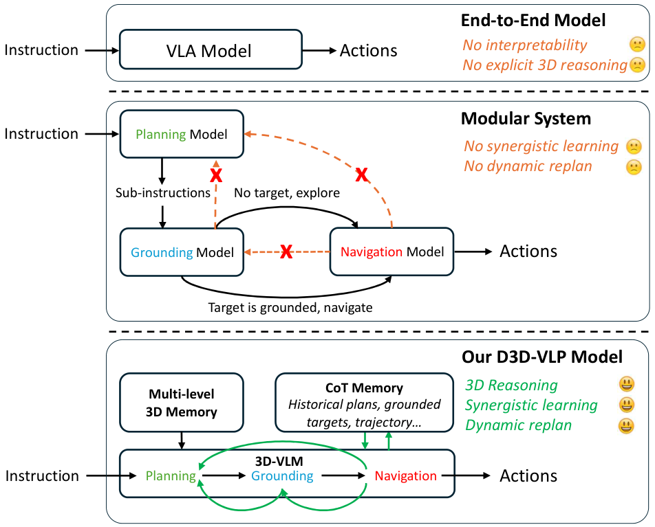
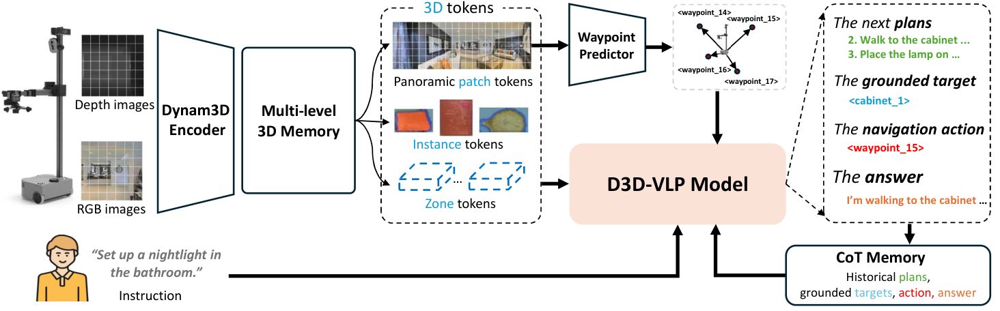
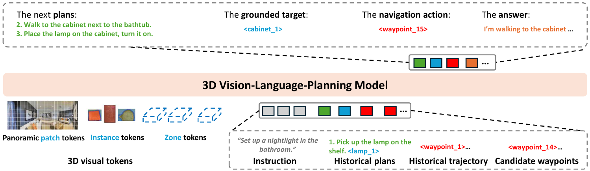
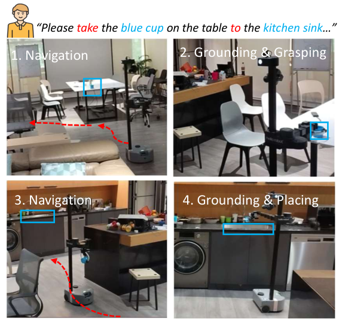
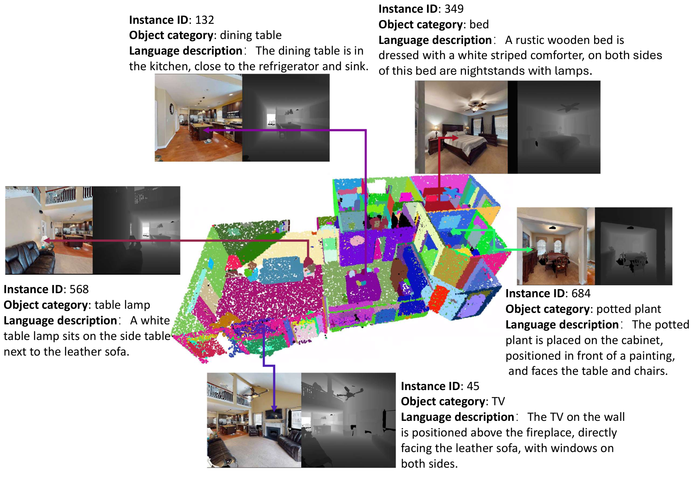

# D3D-VLP (arXiv 2025)

<!-- paper-source: https://chengwei920412.github.io/paper_reading/2512.12622_D3D-VLP_Dynamic_3D_Vision-Language-Planning_Model_for_Embodied_Grounding_and_Navigation/2512.12622_%E9%98%85%E8%AF%BB%E6%8A%A5%E5%91%8A.html -->

## 0. 基本信息 {#0}

- 论文标题：D3D-VLP: Dynamic 3D Vision-Language-Planning Model for Embodied Grounding and Navigation
- 作者：Zihan Wang, Seungjun Lee, Guangzhao Dai, Gim Hee Lee
- 机构：National University of Singapore; Nanjing University of Science and Technology
- 来源（会议 / arXiv / 期刊）：arXiv preprint；源码模板标注为 CVPR 2026 preprint/review version
- 年份：2025（arXiv v1 提交日期为 2025-12-14）
- 原始输入链接：https://arxiv.org/abs/2512.12622
- 最终使用的 arXiv 版本化 ID：2512.12622v1
- 原论文 arXiv 链接：https://arxiv.org/abs/2512.12622v1
- 幻觉翻译链接（hjfy）：https://hjfy.top/arxiv/2512.12622v1
- Cool Papers 链接：https://papers.cool/arxiv/2512.12622v1
- 论文研究方向：具身智能、3D 视觉语言模型、视觉语言导航、3D grounding、长程任务规划、移动操作
- 本文一句话概括：D3D-VLP 试图把规划、3D grounding、导航和问答统一成一个带 3D CoT Memory 的自回归 3D-VLM，并用 10M 级碎片化标注数据和掩码损失训练，从而兼顾端到端性能、显式 3D 推理和动态重规划。

## 1. 论文核心观点与主张的系统梳理 {#1}

### 1.1 研究背景与动机 {#11}

论文从具身智能中的一个结构性矛盾切入：端到端导航模型通常直接从指令和视觉输入预测动作，性能可以很强，但中间缺少显式 3D grounding、计划状态和可解释推理；模块化系统把 LLM planner、grounding 模型和导航模型串起来，解释性更好，但组件之间训练数据不同、反馈链条弱、planner 往往不能根据实时 grounding 或导航失败动态修正。

作者明确指出三类现有方法的瓶颈：

1. 端到端 embodied navigation 模型直接输出动作，绕过精确目标定位和多步计划。这会影响长程任务、多目标任务和需要显式目标位置的场景。
2. 专门的 3D grounding 模型常假设完整静态点云或完整 RGB-D 序列可用，不适合在线、部分可观测、动态的大场景。
3. 模块化规划系统虽然能组合 planner、grounder、navigator，但组件是 disjunct pipeline：planner 很难吸收实时失败反馈，跨数据集训练也造成 domain gap。

这篇论文的动机不是单纯提高某个 benchmark 分数，而是提出一种中间路线：保留端到端训练和推理的统一性，同时把计划、grounding 和导航动作作为显式可读的 CoT 输出流。

### 1.2 问题设定 {#12}

论文处理的是在线 embodied grounding and navigation。给定自然语言指令和流式 posed RGB-D 观测，agent 需要持续构建 3D memory，输出下一步计划、grounded target、候选 waypoint 或停止动作，并在后续时刻把历史计划、目标和轨迹作为上下文继续推理。

Figure 1 对比了三种范式：端到端 VLA/导航模型直接从指令到动作，模块化系统拆成 planning、grounding、navigation 多阶段，而 D3D-VLP 使用一个 3D-VLM 和 3D CoT Memory 把计划、目标定位和动作选择放在同一推理流里。这个图对应论文的核心问题设定：作者不是只要“更强 navigator”，而是要一个显式输出中间 3D reasoning 状态的统一系统。

一个关键形式化对象是当前时刻的多层 3D 表示：

\[\mathcal{M}_{t} = (\mathcal{V}_{\text{patch}}, \mathcal{M}_{\text{inst}}, \mathcal{M}_{\text{zone}})\]

这条公式负责定义模型看到的 3D 世界状态。\(\mathcal{V}_{\text{patch}}\) 是当前视角附近渲染出的 panoramic patch tokens，\(\mathcal{M}_{\text{inst}}\) 是对象级 instance tokens，\(\mathcal{M}_{\text{zone}}\) 是更粗粒度的 zone tokens。自然语言翻译是：模型不只看一帧图像，而是维护一组细粒度局部视觉 token、对象 token 和空间区域 token。工程上，这对应 Dynam3D encoder 对流式 RGB-D 的增量建图和 token 化输出。删去对象或 zone 层级后，模型仍可能导航，但显式 grounding 和长程空间引用会弱化。

### 1.3 核心观点（Claims）的逐条梳理 {#13-claims}

**Claim 1：规划、grounding、导航可以被统一为单个 3D-VLM 的自回归 3D CoT 生成任务。**  
对应论文位置：Introduction 的贡献 1、Method 的 Dynamic 3D Chain-of-Thought。作者将输出序列拆成 \(\mathcal{T}_{\text{plan}}\)、\(\mathcal{T}_{\text{ground}}\)、\(\mathcal{T}_{\text{nav}}\)、\(\mathcal{T}_{\text{answer}}\)，使计划文本、3D 目标 token 和 waypoint token 在同一个生成过程中出现。

**Claim 2：CoT Memory 反馈循环能让 agent 具备状态性和动态重规划能力。**  
对应论文位置：Method 的 CoT Memory Feedback for Dynamic Replanning，实验上主要由 SG3D task-level 指标和 w/o CoT Memory 消融支撑。作者认为历史计划、grounded targets 和轨迹被重新输入模型后，可以解决“go back to it”这类上下文依赖。

**Claim 3：碎片化监督可以通过 masked autoregressive loss 产生协同学习。**  
对应论文位置：Method 的 Synergistic Fragmented Supervision 和 Table 1 数据组成。作者声称不需要每个样本都完整标注 planning、grounding 和 navigation；只要对缺失部分 mask loss，可用 navigation-only 或 grounding-only 样本通过共享 3D-VLM 间接影响其他组件。

**Claim 4：统一架构在 VLN、ObjectNav、SG3D 和真实移动操作上优于现有端到端与模块化方法。**  
对应论文位置：Experiments 的 Table 2、Table 3、Table 4、Table 5。最强结果是 R2R-CE SR 61.3/SPL 56.1、SG3D t-ACC 9.3、HM3D-OVON SR 47.3，以及真实移动操作完整任务 3/10。

### 1.4 创新性与贡献边界 {#14}

实质创新主要体现在系统组合方式和训练口径，而不是提出新的基础优化理论。D3D-VLP 的 3D memory backbone 继承 Dynam3D，核心 VLM 继承 NVILA-Lite-2B，waypoint action space 也延续了连续环境 VLN 中常见的 waypoint-based 控制思想。它的贡献更像是把这些组件合并为“统一自回归 3D CoT + CoT Memory + 碎片化监督”的训练和推理范式。

贡献边界也很清楚：论文没有证明 CoT token 本身必然对应真实因果推理；也没有给出严格理论保证说明 navigation-only 梯度一定能“正确”监督 planning/grounding。实验支撑的是经验有效性，尤其是 SG3D 和消融结果，而不是数学定理级别的协同学习证明。

## 2. 关键论据、理论基础与数学方法的深度解析 {#2}

### 2.1 理论基础与学术渊源 {#21}

论文建立在四条技术脉络上：

1. 3D-VLM 与 3D grounding：如 3D-VISTA、SceneVerse、Grounded 3D-LLM、MMScan 等，把语言和 3D token/点云/实例对齐。
2. 连续环境 VLN 与 waypoint action：R2R-CE、REVERIE-CE、ETPNav、Dynam3D 等工作使用连续空间导航、候选 waypoint、历史视觉上下文或 3D memory。
3. Chain-of-Thought 与 embodied reasoning：语言模型 CoT 被迁移到导航和机器人控制，但现有 NavCoT 等多偏文本推理，未必绑定到持久 3D 表示。
4. 多任务和部分标注监督：SLFS 本质上是多任务学习中的 mask loss / missing label training，只是作用对象变成 CoT 组件序列。

### 2.2 问题形式化与建模选择 {#22}

D3D-VLP 在每个时刻 \(t\) 的输入由四部分组成：自然语言指令 \(\mathcal{I}\)，多层 3D tokens 与空间嵌入 \(\mathcal{M}_{t}\oplus\mathcal{P}_{t}\)，历史 CoT Memory \(\mathcal{C}_{t-1}\)，候选 waypoint embedding \(\mathcal{P}_{\text{wayp}}\)。空间嵌入由 3D 坐标、距离和方位角编码：

\[\mathcal{P}_{t} = \operatorname{spatial\_encoder}(P_t, D_t, \cos(\theta_t), \sin(\theta_t))\]

这条公式负责把几何位置转换成 VLM 可用的 embedding。\(P_t=(x_t,y_t,z_t)\) 是 agent-centric 坐标，\(D_t\) 是相对距离，\(\theta_t\) 是水平角。自然语言翻译是：同一个 object token 不只带语义，还带“离我多远、在我哪个方向”的几何提示。工程上对应一个 MLP spatial encoder，把数值几何特征映射到 token embedding 后与视觉 token 融合。一个极简例子：若目标相对 agent 坐标为 \((1,0,1)\)，则距离约为 \(1.41\)，水平角约为 \(45^\circ\)，编码输入近似为 \((1,0,1,1.41,0.71,0.71)\)；模型由此能区分“前右方 1.4 米的椅子”和“后方 3 米的椅子”。该设计依赖相机 pose 和深度几何足够可靠，真实机器人中 pose drift 会直接污染这部分输入。

统一自回归目标是论文最核心的建模公式：

\[p(\mathcal{S}_{t} \mid \mathcal{I}, \mathcal{M}_{t}\oplus\mathcal{P}_{t}, \mathcal{C}_{t-1})\]

这里 \(\mathcal{S}_{t}\) 是当前时刻要生成的完整 3D CoT 序列。它不是纯文本，而是结构化串联：

\[\mathcal{S}_{t} = (\mathcal{T}_{\text{plan}}, \mathcal{T}_{\text{ground}}, \mathcal{T}_{\text{nav}}, \mathcal{T}_{\text{answer}})\]

公式的直译是：给定指令、当前 3D 世界状态和历史 CoT，模型生成下一段计划、目标 grounding、导航动作和回答。技术拆解上，\(\mathcal{T}_{\text{plan}}\) 是语言 token，\(\mathcal{T}_{\text{ground}}\) 包含指向 3D token 的特殊 target token，\(\mathcal{T}_{\text{nav}}\) 包含候选 waypoint token，\(\mathcal{T}_{\text{answer}}\) 用于状态描述或问答。工程上，这相当于把 planner、grounder、policy head 的输出串接到同一个 decoder 轨迹里。可替代方案是保留多 head 共享 encoder，但作者选择自回归串联，以便前面的 plan token 条件化后面的 target 和 action token。

### 2.3 核心推导与算法构造 {#23}

Figure 2 展示完整数据流：Dynam3D encoder 从流式 posed RGB-D 更新 Multi-level 3D Memory；waypoint predictor 给出候选可导航位置；D3D-VLP 把 3D tokens、指令、waypoints 和 CoT Memory 一起输入 3D-VLM，输出新的 plan、grounded target 和 navigation action，再写回 CoT Memory。

Figure 3 更直接说明了“统一自回归”不是一句口号：同一个输出流中先生成 next plans，再生成 grounded 3D token，接着选择 waypoint，最后生成回答或状态文本。该设计的关键工程后果是，后续 action loss 的梯度会穿过共享 decoder hidden states；但这不等价于保证中间 CoT 语义一定正确，只能说明端到端训练压力会影响这些中间表示。

Grounding 和 navigation 的选择机制都基于 latent token 与候选 3D/waypoint token 的相似度。论文没有给出编号公式，但文字定义可写成：

\[g_t = \arg\max_{m \in \operatorname{projector}(\mathcal{M}_{t}\oplus\mathcal{P}_{t}) \cup \{\texttt{&lt;grounding\_none&gt;}\}} \langle \operatorname{grounding\_head}(h_{\texttt{&lt;target&gt;}}), m \rangle\]

这条公式负责把 VLM 生成的 latent target token 绑定到具体 3D token 或 none token。\(h_{\texttt{&lt;target&gt;}}\) 是 decoder 在 target 位置的隐藏状态，\(\operatorname{grounding\_head}\) 是 MLP，\(m\) 遍历所有投影后的 3D tokens 和特殊 none token。工程上对应一次矩阵乘法 similarity search，然后取最大值。若删去 none token，模型会被迫在目标尚未观察到时错误绑定某个现有物体，这对在线探索尤其危险。

导航动作同理：

\[a_t = \arg\max_{w \in \operatorname{projector}(\mathcal{P}_{\text{wayp}}) \cup \{\texttt{&lt;navigation\_stop&gt;}\}} \langle \operatorname{navigation\_head}(h_{\texttt{&lt;waypoint&gt;}}), w \rangle\]

这条公式把 decoder 的 waypoint latent state 映射到候选 waypoint 或 stop。代码中通常对应 `navigation_head(hidden)` 与候选 waypoint embedding 的 batched dot product。toy example：若 12 个候选 waypoint 的相似度为 \([0.1,0.3,0.9,0.2,\dots]\)，stop token 为 \(0.4\)，则选择第 3 个 waypoint；若 stop 为 \(0.95\)，则停止。这个机制比直接生成“turn left 30 degrees”更容易与 3D token 空间对齐，但强依赖 waypoint predictor 覆盖了可行路线。

CoT Memory 更新是动态重规划的核心：

\[\mathcal{C}_{t} = \operatorname{Concat}(\mathcal{C}_{t-1}, \operatorname{Parse}(\mathcal{S}_{t}))\]

其中：

\[\operatorname{Parse}(\mathcal{S}_{t}) = (\operatorname{Parse}(\mathcal{T}_{\text{plan}}), \operatorname{Parse}(\mathcal{T}_{\text{ground}}), \operatorname{Parse}(\mathcal{T}_{\text{nav}}))\]

直译是：每一步生成结果不会被丢弃，而是解析出已完成子任务、grounded target 和走过的 waypoint，再拼到下一步上下文。工程上对应一个可序列化 history buffer。若删去它，模型每一步更像 reactive policy；论文 Table 4 中 SG3D t-ACC 从 9.3 降到 4.1，说明长程序列任务确实更依赖该状态记忆。不过该机制也带来上下文窗口增长、错误历史累积和 parse 鲁棒性问题。

SLFS 的训练目标为：

\[\mathcal{L}_{\text{CoT}} = \sum_{i \in \text{Batch}} \sum_{k \in \text{CoT}} \mathcal{H}_{i,k} \cdot \mathcal{L}_{k}(\mathcal{S}_{\text{pred},i}, \mathcal{S}_{\text{gt},i})\]

这里 \(i\) 是 batch 中样本，\(k\) 是 CoT 组件，如 plan、ground、nav、answer；\(\mathcal{H}_{i,k}=1\) 表示该样本有组件 \(k\) 的有效标注，否则为 0；缺失组件在 ground-truth 序列中填入 `<mask>` 并在交叉熵中忽略。自然语言翻译是：有哪部分标注就训练哪部分，没标注的 CoT 组件仍可在前向中生成，但不直接算监督损失。工程上这对应 `ignore_index` 或 token-level loss mask。一个极简例子：某导航样本只有 \(\mathcal{T}_{\text{nav}}\) 标注，则 \(\mathcal{H}_{i,\text{nav}}=1\)、\(\mathcal{H}_{i,\text{plan}}=\mathcal{H}_{i,\text{ground}}=0\)，loss 只惩罚 waypoint 预测；但 waypoint 隐状态条件化于模型内部生成的 plan/ground tokens，所以梯度仍会通过共享网络影响这些中间表示。严格地说，这是一种隐式训练压力，不是对中间 CoT 正确性的显式证明。

### 2.4 理论结论的适用范围 {#24}

论文没有给出可证明收敛或泛化界。其“理论体系”主要是工程性建模假设：

1. 自回归输出顺序能让 planning、grounding、navigation 相互条件化。
2. 共享 3D-VLM 参数和 mask loss 能从碎片化数据中学习协同表示。
3. CoT Memory 中保存的历史计划、grounded targets 和轨迹足以支持动态重规划。
4. Dynam3D 的 3D memory 和 pose/depth 输入足够可靠，能支撑在线 3D token 选择。

这些假设在模拟 benchmark 上被实验支持，但在真实开放环境中仍受传感器噪声、分布偏移、错误历史累积、VLM hallucination 和机器人低层控制误差影响。作者在 conclusion 的 limitation 中也承认当前 SLFS 主要依赖隐式梯度信号，CoT 生成的探索性有限，未来可能需要 RL。

## 3. 实验设计与实验结果的充分性分析 {#3}

### 3.1 实验目标与论文主张的对应关系 {#31}

实验设计覆盖四个问题：

1. 标准导航能力：R2R-CE、REVERIE-CE、NavRAG-CE 和 HM3D-OVON 检验统一模型是否优于端到端与模块化 baselines。
2. 长程 grounding + planning：SG3D 检验 CoT Memory 是否帮助序列任务和上下文依赖。
3. 组件必要性：消融 SLFS 数据组成、CoT Memory、waypoint action。
4. 真实部署：Hello Robot Stretch 3 上的移动操作检验 sim-to-real 和长程操作泛化。

评价指标包括 NE、OSR、SR、SPL，以及 SG3D 的 s-SR/t-SR 和 s-ACC/t-ACC。论文对 SG3D grounding 指标定义较严格：s-ACC 要求单步导航到正确目标且 grounding 点属于目标实例；t-ACC 要求整项任务每一步都正确。这比单纯导航成功率更贴近论文关于“显式 grounding + 状态记忆”的主张。

### 3.2 实验设置合理性 {#32}

benchmark 选择总体合理：R2R-CE 和 REVERIE-CE 是连续环境 VLN 常用设置，NavRAG-CE 覆盖更复杂用户需求，HM3D-OVON 覆盖 open-vocabulary object navigation，SG3D 覆盖任务型顺序 grounding and navigation。训练配置也给出关键细节：Dynam3D encoder、NVILA-Lite-2B、10M hybrid samples、100K episodes、约 14 天、4 张 RTX 6000 Ada、总 batch size 8、navigation 样本在线 simulator 训练并使用 DAgger。

不足在于：论文没有报告多随机种子或统计显著性；真实机器人实验只有 10 个任务样本，数量偏小；部分 SOTA baseline 是 zero-shot、部分是训练式模型，训练数据与传感器设置是否完全公平需要更细粒度对齐。另一个重要限制是 SG3D 评估中作者沿用原 SG3D 设置，把 ground-truth planning text 作为输入，这意味着 SG3D 的结果不能完全证明模型能自主从高层任务生成全计划。

### 3.3 实验结果的解释力度 {#33}

**主导航 benchmark 结果。** 下表转写论文 Table 2 中最关键的对比行。完整表较宽，附录 A 保留更多 baseline。

<table>
<thead>
<tr>
<th>方法</th>
<th>类型</th>
<th>R2R-CE SR</th>
<th>R2R-CE SPL</th>
<th>REVERIE-CE SR</th>
<th>REVERIE-CE SPL</th>
<th>NavRAG-CE SR</th>
<th>NavRAG-CE SPL</th>
<th>HM3D-OVON SR</th>
<th>HM3D-OVON SPL</th>
</tr>
</thead>
<tbody>
<tr>
<td>StreamVLN</td>
<td>E2E</td>
<td>56.9</td>
<td>51.9</td>
<td>-</td>
<td>-</td>
<td>-</td>
<td>-</td>
<td>-</td>
<td>-</td>
</tr>
<tr>
<td>NavFoM (S.RGB)</td>
<td>E2E</td>
<td>56.2</td>
<td>51.2</td>
<td>-</td>
<td>-</td>
<td>-</td>
<td>-</td>
<td>43.6</td>
<td>31.3</td>
</tr>
<tr>
<td>InternVLA-N1</td>
<td>Modular</td>
<td>58.2</td>
<td>54.0</td>
<td>-</td>
<td>-</td>
<td>-</td>
<td>-</td>
<td>-</td>
<td>-</td>
</tr>
<tr>
<td>Dynam3D</td>
<td>E2E</td>
<td>52.9</td>
<td>45.7</td>
<td>40.1</td>
<td>28.5</td>
<td>24.7</td>
<td>18.8</td>
<td>42.7</td>
<td>22.4</td>
</tr>
<tr>
<td>D3D-VLP</td>
<td>E2E w/ CoT</td>
<td>61.3</td>
<td>56.1</td>
<td>47.5</td>
<td>34.7</td>
<td>31.1</td>
<td>23.9</td>
<td>47.3</td>
<td>30.4</td>
</tr>
</tbody>
</table>

该表支撑 Claim 4：D3D-VLP 在 R2R-CE、REVERIE-CE、NavRAG-CE 的 SR/SPL 均高于列出的可比方法，在 HM3D-OVON 上 SR 最高，但 SPL 低于 NavFoM 的 31.3。最有解释力的比较是 D3D-VLP vs Dynam3D，因为 D3D-VLP 继承 Dynam3D encoder；R2R-CE SR 从 52.9 提升到 61.3，SPL 从 45.7 提升到 56.1，说明提升不太可能只来自同一个 3D perception backbone。但该实验仍不能完全分离“更多数据”“NVILA 规模”“CoT 输出格式”各自贡献。

**SG3D 长程 grounding and navigation。**

<table>
<thead>
<tr>
<th>方法</th>
<th>类型</th>
<th>s-SR</th>
<th>t-SR</th>
<th>SPL</th>
<th>s-ACC</th>
<th>t-ACC</th>
</tr>
</thead>
<tbody>
<tr>
<td>VideoAgent</td>
<td>Modular</td>
<td>14.7</td>
<td>3.8</td>
<td>10.2</td>
<td>-</td>
<td>-</td>
</tr>
<tr>
<td>SenseAct-NN</td>
<td>E2E</td>
<td>12.1</td>
<td>7.7</td>
<td>10.1</td>
<td>-</td>
<td>-</td>
</tr>
<tr>
<td>MTU3D</td>
<td>E2E</td>
<td>23.8</td>
<td>8.0</td>
<td>16.5</td>
<td>-</td>
<td>-</td>
</tr>
<tr>
<td>Dynam3D-VisTA</td>
<td>Modular</td>
<td>26.4</td>
<td>9.3</td>
<td>15.4</td>
<td>21.4</td>
<td>4.2</td>
</tr>
<tr>
<td>D3D-VLP</td>
<td>E2E w/ CoT</td>
<td>33.7</td>
<td>13.8</td>
<td>21.6</td>
<td>28.3</td>
<td>9.3</td>
</tr>
</tbody>
</table>

这张表是论文最能支撑“动态 3D CoT + memory”主张的结果。D3D-VLP 不仅 step-level 指标更高，task-level t-ACC 也从 Dynam3D-VisTA 的 4.2 提升到 9.3。相对提升很大，但绝对值仍低，说明完整长程任务仍非常困难。也要注意：由于 SG3D 评估输入 ground-truth planning text，这里主要验证 grounding、navigation 和记忆执行，而不是完整自主高层任务规划。

**真实移动操作实验。**

Figure 4 展示真实移动操作场景。补充材料说明硬件是 Hello Robot Stretch 3，头部 Intel RealSense D435i，远程 RTX 4090 工作站通过 WiFi 运行 3D-VLM，环境为家庭式 living room、kitchen、meeting room、office，且对象和布局未出现在训练集中。

<table>
<thead>
<tr>
<th>方法</th>
<th>Nav.</th>
<th>Grounding &amp; Grasp</th>
<th>Place</th>
<th>Task</th>
</tr>
</thead>
<tbody>
<tr>
<td>OK-Robot</td>
<td>11/32</td>
<td>4/16</td>
<td>3/16</td>
<td>0/10</td>
</tr>
<tr>
<td>DynaMem</td>
<td>13/32</td>
<td>6/16</td>
<td>4/16</td>
<td>0/10</td>
</tr>
<tr>
<td>Dynam3D+OWLv2</td>
<td>21/32</td>
<td>9/16</td>
<td>7/16</td>
<td>1/10</td>
</tr>
<tr>
<td>D3D-VLP</td>
<td>23/32</td>
<td>12/16</td>
<td>11/16</td>
<td>3/10</td>
</tr>
</tbody>
</table>

真实实验支持 D3D-VLP 在长程移动操作中比基线更稳，但样本数非常有限。完整任务 3/10 说明系统仍远未达到可靠部署水平；更合理的结论是“展示了真实环境可行性和优于若干基线的初步证据”，而不是“真实世界泛化已充分解决”。

### 3.4 潜在未讨论因素 {#34}

**消融实验。**

<table>
<thead>
<tr>
<th>设置</th>
<th>训练数据</th>
<th>R2R-CE OSR</th>
<th>R2R-CE SR</th>
<th>R2R-CE SPL</th>
<th>SG3D s-ACC</th>
<th>SG3D t-ACC</th>
</tr>
</thead>
<tbody>
<tr>
<td>All pipeline</td>
<td>All data</td>
<td>67.2</td>
<td>61.3</td>
<td>56.1</td>
<td>28.3</td>
<td>9.3</td>
</tr>
<tr>
<td>All pipeline</td>
<td>w/ \(\mathcal{T}_{\text{plan}}\) only (Type 1,2,3)</td>
<td>55.6</td>
<td>46.2</td>
<td>38.7</td>
<td>22.5</td>
<td>5.5</td>
</tr>
<tr>
<td>All pipeline</td>
<td>w/o \(\mathcal{T}_{\text{plan}}\) (Type 4,5,6)</td>
<td>67.8</td>
<td>60.8</td>
<td>55.4</td>
<td>24.3</td>
<td>5.3</td>
</tr>
<tr>
<td>w/o CoT Memory</td>
<td>All data</td>
<td>65.7</td>
<td>56.5</td>
<td>48.7</td>
<td>19.4</td>
<td>4.1</td>
</tr>
<tr>
<td>Text-based actions</td>
<td>All data</td>
<td>66.3</td>
<td>56.4</td>
<td>48.8</td>
<td>27.8</td>
<td>8.6</td>
</tr>
</tbody>
</table>

这张表验证三个点：第一，只用带 planning 的小数据会让 R2R-CE SR 从 61.3 降到 46.2，说明 175K 级 gold data 不够；第二，不带 planning 的大规模部分标注数据能保留强导航性能，但 SG3D t-ACC 只有 5.3，说明 gold planning data 对长程任务仍关键；第三，去掉 CoT Memory 后 t-ACC 从 9.3 降到 4.1，是支持动态记忆机制的最强消融。text-based actions 让 R2R-CE SPL 从 56.1 降到 48.8，说明 waypoint action space 对路径效率重要。

Figure 5 展示训练数据中实例级点云、类别和语言描述的标注形式。它对应 Table 1 的数据构成，也说明 SLFS 的前提是不同来源数据能被统一成 planning、grounding、navigation 组件序列。

<table>
<thead>
<tr>
<th>Data Type</th>
<th>Planning</th>
<th>Grounding</th>
<th>Navigation</th>
<th>样本数</th>
</tr>
</thead>
<tbody>
<tr>
<td>1</td>
<td>是</td>
<td>是</td>
<td>是</td>
<td>175K</td>
</tr>
<tr>
<td>2</td>
<td>是</td>
<td>是</td>
<td>否</td>
<td>161K</td>
</tr>
<tr>
<td>3</td>
<td>是</td>
<td>否</td>
<td>是</td>
<td>14K</td>
</tr>
<tr>
<td>4</td>
<td>否</td>
<td>是</td>
<td>是</td>
<td>5.8M</td>
</tr>
<tr>
<td>5</td>
<td>否</td>
<td>是</td>
<td>否</td>
<td>2.3M</td>
</tr>
<tr>
<td>6</td>
<td>否</td>
<td>否</td>
<td>是</td>
<td>1.6M</td>
</tr>
</tbody>
</table>

潜在未讨论因素包括：

1. **统计显著性缺失。** 所有主要结果都是单点数值，没有置信区间、seed 方差或 paired test。
2. **训练数据重叠风险需要更透明审计。** 论文声明真实环境 zero-shot，但对于模拟 benchmark，与训练数据来源之间是否存在场景、对象类别、语言模板上的近邻关系，需要更细的去重说明。
3. **CoT 正确性未被独立评估。** 模型输出显式 CoT，但表格主要评估最终导航/grounding 成功率，没有评估 plan token 是否忠实、grounding token 是否在失败前发生系统性漂移。
4. **真实系统瓶颈被混合。** 真实实验中的失败可能来自 grasp、place、WiFi latency、pose drift、depth noise 或 VLM 决策，论文没有分解失败模式。
5. **上下文增长与错误累积。** CoT Memory 是优势也是风险；错误 grounding 被写入 memory 后可能持续污染后续推理，论文没有系统讨论恢复机制。

## 4. 与当前领域主流共识及反对观点的关系 {#4}

### 4.1 与主流观点的一致性 {#41}

D3D-VLP 与当前主流趋势一致：具身导航正在从纯视觉 policy 转向结合大模型、3D memory、语言规划和可解释中间状态。R2R-CE、REVERIE-CE、HM3D-OVON、SG3D 等 benchmark 的存在也反映了领域共识：真实 embodied agent 需要连续空间导航、开放词汇目标、长程任务和持久记忆。

它延续了以下方向：

1. 以 R2R/R2R-CE 为代表的视觉语言导航评测范式。
2. 以 Habitat/HM3D/MP3D 为代表的连续环境模拟。
3. 以 3D-VISTA、SceneVerse、Grounded 3D-LLM 为代表的 3D-language alignment。
4. 以 Dynam3D、g3D-LF 为代表的流式 3D memory 和 3D feature fields。
5. 以 Chain-of-Thought 和 NavCoT/Embodied CoT 为代表的显式 reasoning trace。

### 4.2 与反对或竞争观点的分歧 {#42}

论文的竞争对象主要有两类：

1. **端到端导航模型。** NaVid、NaVILA、StreamVLN、Dynam3D 等倾向于直接从视觉/语言上下文预测动作。D3D-VLP 反对“只要 action policy 足够强，中间 grounding 可省略”的路线，认为长程、多目标、精确定位任务需要显式 3D target tokens。
2. **模块化系统。** InstructNav、DreamNav、OK-Robot、DynaMem 等把 planner、grounder、navigator 分开。D3D-VLP 反对 disjoint pipeline，认为组件不能动态共享反馈且存在 domain gap。

现有文献中并没有在本文材料里出现“直接反驳 D3D-VLP 假设”的已发表论文，因为 D3D-VLP 是 2025-12 的新 arXiv v1。更准确地说，当前可确认的分歧是技术路线差异：模块化路线强调可替换、可调试和利用现成强模型；统一模型路线强调共享表示、端到端协同和更少手工 pipeline。

### 4.3 论文在学术版图中的定位 {#43}

D3D-VLP 更像主流方法的统一化推进，而不是完全另起炉灶。它吸收了 Dynam3D 的 3D memory、NVILA 的 VLM backbone、waypoint navigation 的动作空间、CoT 的显式推理形式和多任务 mask loss 的训练思想。其新意在于把这些要素放进一个针对 embodied grounding/navigation 的统一自回归输出协议，并用大规模碎片化标注数据训练。

因此，它的学术定位是：面向长程具身任务的 3D-VLM agent 系统论文，贡献重点是架构整合、数据构造和实证结果，而不是基础理论论文。

### 4.4 文献检索说明 {#44}

- 检索范围：本次报告基于 arXiv v1 原文、arXiv 源码、论文 PDF、ar5iv 提取的 references、papers.cool 页面，以及论文引用的真实外部文献条目。papers.cool 页面可确认论文元信息，但未在本地页面中提供可直接转写的 REL 相关论文列表。
- 检索结论可信度：对论文自身内容、表格和引用的可信度高；对“是否已有直接反驳 D3D-VLP 的后续论文”的可信度有限，因为论文时间较新，当前材料中未检索到明确后续反驳证据。

### 4.5 相关论文补充表 {#45}

<table>
<thead>
<tr>
<th>序号</th>
<th>论文标题</th>
<th>作者 / 年份</th>
<th>来源</th>
<th>与原论文关系</th>
<th>一句话概述</th>
</tr>
</thead>
<tbody>
<tr>
<td>1</td>
<td>Vision-and-Language Navigation: Interpreting Visually-Grounded Navigation Instructions in Real Environments</td>
<td>Anderson et al., 2018</td>
<td>CVPR</td>
<td>基础 benchmark</td>
<td>提出 R2R，奠定语言导航任务设定。</td>
</tr>
<tr>
<td>2</td>
<td>Beyond the Nav-Graph: Vision-and-Language Navigation in Continuous Environments</td>
<td>Krantz et al., 2020</td>
<td>ECCV</td>
<td>R2R-CE benchmark</td>
<td>将 VLN 推向连续环境，是本文 R2R-CE 实验基础。</td>
</tr>
<tr>
<td>3</td>
<td>REVERIE: Remote Embodied Visual Referring Expression in Real Indoor Environments</td>
<td>Qi et al., 2020</td>
<td>CVPR</td>
<td>grounding + navigation benchmark</td>
<td>强调远程目标描述和 embodied referring expression。</td>
</tr>
<tr>
<td>4</td>
<td>Habitat-Matterport 3D Dataset (HM3D)</td>
<td>Ramakrishnan et al.</td>
<td>NeurIPS Datasets and Benchmarks</td>
<td>训练/评测环境</td>
<td>提供大规模室内 3D 环境，是 HM3D-OVON 等任务基础。</td>
</tr>
<tr>
<td>5</td>
<td>HM3D-OVON: A Dataset and Benchmark for Open-Vocabulary Object Goal Navigation</td>
<td>Yokoyama et al., 2024</td>
<td>IROS</td>
<td>直接评测 benchmark</td>
<td>本文用 HM3D-OVON 验证开放词汇 object navigation。</td>
</tr>
<tr>
<td>6</td>
<td>VLFM: Vision-Language Frontier Maps for Zero-Shot Semantic Navigation</td>
<td>Yokoyama et al., 2024</td>
<td>ICRA</td>
<td>竞争方法</td>
<td>模块化/地图式开放词汇导航 baseline。</td>
</tr>
<tr>
<td>7</td>
<td>SceneVerse: Scaling 3D Vision-Language Learning for Grounded Scene Understanding</td>
<td>Jia et al., 2024</td>
<td>ECCV</td>
<td>数据来源和 3D grounding 背景</td>
<td>提供大规模 3D-language grounding 数据。</td>
</tr>
<tr>
<td>8</td>
<td>3D-VISTA: Pre-trained Transformer for 3D Vision and Text Alignment</td>
<td>Zhu et al., 2023</td>
<td>ICCV</td>
<td>3D-language alignment baseline</td>
<td>代表离线 3D point cloud 与文本对齐路线。</td>
</tr>
<tr>
<td>9</td>
<td>Grounded 3D-LLM with Referent Tokens</td>
<td>Chen et al., 2024</td>
<td>arXiv</td>
<td>相关 grounding + LLM 方法</td>
<td>使用 referent tokens 连接 3D grounding 与语言模型。</td>
</tr>
<tr>
<td>10</td>
<td>Chain-of-Thought Prompting Elicits Reasoning in Large Language Models</td>
<td>Wei et al., 2022</td>
<td>NeurIPS</td>
<td>CoT 理论背景</td>
<td>提供语言模型显式推理链思想来源。</td>
</tr>
<tr>
<td>11</td>
<td>NavCoT: Boosting LLM-Based Vision-and-Language Navigation via Learning Disentangled Reasoning</td>
<td>Lin et al., 2024</td>
<td>arXiv</td>
<td>竞争/相关 CoT navigation</td>
<td>偏文本导航 CoT，本文认为其未充分绑定真实 3D grounding。</td>
</tr>
<tr>
<td>12</td>
<td>Dynam3D</td>
<td>Wang and Lee / Wang et al., 2025</td>
<td>论文引用</td>
<td>直接 backbone/baseline</td>
<td>D3D-VLP 使用其 encoder，并以其作为关键 baseline。</td>
</tr>
<tr>
<td>13</td>
<td>NVILA: Efficient Frontier Visual Language Models</td>
<td>Liu et al., 2025</td>
<td>CVPR</td>
<td>VLM backbone</td>
<td>D3D-VLP 的核心 3D-VLM 基于 NVILA-Lite-2B。</td>
</tr>
<tr>
<td>14</td>
<td>OK-Robot: What Really Matters in Integrating Open-Knowledge Models for Robotics</td>
<td>Liu et al.</td>
<td>ICRA workshop</td>
<td>真实机器人 baseline</td>
<td>模块化真实移动操作系统，被本文真实实验比较。</td>
</tr>
<tr>
<td>15</td>
<td>AnyGrasp: Robust and Efficient Grasp Perception in Spatial and Temporal Domains</td>
<td>Fang et al., 2023</td>
<td>IEEE T-RO</td>
<td>真实操作组件</td>
<td>本文真实实验中各方法共同使用 AnyGrasp 进行抓取/放置。</td>
</tr>
</tbody>
</table>

## 5. 对论文理论体系的严肃反驳与系统性质疑 {#5}

### 5.1 核心假设层面的质疑 {#51}

第一，论文把“显式输出 CoT tokens”视为解释性和协同学习的核心，但显式文本/特殊 token 不必然等于真实因果推理。模型可能学到对 benchmark 有利的格式化中间输出，而这些中间输出在失败场景中未必忠实反映决策原因。

第二，SLFS 的关键假设是部分标注样本的监督会通过共享网络隐式改善缺失组件。这个假设在工程上合理，但缺少独立验证。navigation-only loss 可能让内部 plan/ground tokens 变得对 action 有用，却不一定变得语义正确或可解释。

第三，CoT Memory 假设历史解析结果可被可靠维护。但如果早期 grounding 错误被写入 \(\mathcal{C}_{t}\)，模型可能在后续步骤持续基于错误目标推理。论文消融证明 memory 有用，但没有充分分析 memory 中错误的传播和恢复。

### 5.2 数学推导与理论主张的边界 {#52}

论文的公式主要是建模定义和训练目标，而非严格推导。式 \(p(\mathcal{S}_{t} \mid \cdot)\) 定义统一自回归任务；式 \(\mathcal{C}_{t} = \operatorname{Concat}(\cdot)\) 定义 memory 更新；式 \(\mathcal{L}_{\text{CoT}}\) 定义 mask loss。这些公式能清晰描述系统，但不能单独推出“协同学习必然发生”或“动态重规划必然可靠”。

更严格的反驳是：SLFS 中未标注组件被 mask 掉后，不存在直接监督约束其语义正确性；所谓“隐式监督”依赖输出顺序和共享参数。如果模型通过捷径让 \(\mathcal{T}_{\text{nav}}\) 直接从视觉 token 预测 waypoint，而忽略内部 plan/ground token，loss 仍可能下降。论文通过消融间接说明 CoT 有益，但没有排除所有捷径解释。

### 5.3 工程实现与实际适用性 {#53}

系统工程成本较高：需要 posed RGB-D、Dynam3D encoder、3D memory、waypoint predictor、NVILA-Lite-2B、CoT parser、action controller 和真实机器人通信。真实部署中，任一模块的误差都可能影响最终结果。论文真实实验完整任务只有 3/10，说明当前系统更像 research prototype，而不是稳定机器人产品。

另外，训练成本不小：100K episodes、约 14 天、4 张 RTX 6000 Ada、batch size 8。虽然相对大模型训练不算极端，但对于具身导航领域复现仍有门槛。论文提供代码链接，但本报告未实际复现训练和评测。

### 5.4 整体理论体系的稳健性 {#54}

整体体系的强项是把多个合理机制放在同一闭环里，并在多个 benchmark 上给出一致提升。稳健性弱点也来自这种整合：性能提升可能是数据规模、backbone、3D memory、waypoint action、CoT format 和 DAgger 共同作用，很难完全归因于“动态 3D CoT”。

如果移除若干关键假设，体系会明显变弱：没有可靠 pose/depth，3D memory 失真；没有大量部分标注数据，SLFS 优势下降；没有 CoT Memory，SG3D t-ACC 明显下降；没有 waypoint action，路径效率下降。这说明论文机制不是单点万能，而是依赖完整系统条件成立。

## 6. 最终结论 {#6}

### 6.1 论文价值总结 {#61}

D3D-VLP 是一篇高完成度的 embodied 3D-VLM 系统论文。它把流式 3D memory、统一自回归 3D CoT、CoT Memory、waypoint action 和碎片化监督组织成一个完整训练/推理框架，并在 VLN、OVON、SG3D 和真实移动操作上给出较强实证结果。其最有价值的部分是把长程 planning-grounding-navigation 放到统一输出协议里，并用消融证明 CoT Memory 和数据混合策略确实影响结果。

### 6.2 一句话总评 {#62}

D3D-VLP 是一条务实且有实证说服力的统一 3D-VLM agent 路线，但它证明的是系统级经验优势，而不是 CoT 或碎片化监督的严格理论充分性。

### 6.3 综合评分（10 分制） {#63-10}

- 创新性：8.0
- 技术严谨性：7.0
- 实验说服力：8.0
- 工程价值：8.0
- 总体评分：7.8

### 6.4 最关键的三条优点 {#64}

1. 把 planning、3D grounding、navigation、answer 统一成自回归 3D CoT 输出，任务接口清晰。
2. 大规模碎片化数据和 mask loss 的训练设计贴近真实数据可得性，消融结果有支持。
3. benchmark 覆盖面广，SG3D 与真实机器人实验能检验长程状态记忆，而不只是在标准 VLN 上刷分。

### 6.5 最关键的三条问题 {#65}

1. CoT 的语义忠实性没有被独立评估，不能简单把显式输出等同于真实推理。
2. 缺少多 seed、统计显著性和系统性失败分析，真实实验样本数偏小。
3. 性能提升归因仍不完全清楚，数据规模、backbone、memory、waypoint action 和 CoT 格式的贡献存在耦合。

## 附录 A：关键实验表与消融实验表 {#a}

### A.1 主 benchmark 对比表 {#a1-benchmark}

<table>
<thead>
<tr>
<th>方法</th>
<th>类型</th>
<th>R2R NE</th>
<th>R2R OSR</th>
<th>R2R SR</th>
<th>R2R SPL</th>
<th>REVERIE SR</th>
<th>NavRAG SR</th>
<th>HM3D SR</th>
<th>HM3D SPL</th>
</tr>
</thead>
<tbody>
<tr>
<td>CM2</td>
<td>E2E</td>
<td>7.02</td>
<td>41.5</td>
<td>34.3</td>
<td>27.6</td>
<td>-</td>
<td>-</td>
<td>-</td>
<td>-</td>
</tr>
<tr>
<td>WS-MGMap</td>
<td>E2E</td>
<td>6.28</td>
<td>47.6</td>
<td>38.9</td>
<td>34.3</td>
<td>-</td>
<td>-</td>
<td>-</td>
<td>-</td>
</tr>
<tr>
<td>InstructNav</td>
<td>Modular w/ CoT</td>
<td>6.89</td>
<td>-</td>
<td>31.0</td>
<td>24.0</td>
<td>25.2</td>
<td>17.4</td>
<td>-</td>
<td>-</td>
</tr>
<tr>
<td>DreamNav</td>
<td>Modular w/ CoT</td>
<td>7.06</td>
<td>41.0</td>
<td>32.8</td>
<td>29.0</td>
<td>-</td>
<td>-</td>
<td>-</td>
<td>-</td>
</tr>
<tr>
<td>g3D-LF</td>
<td>E2E</td>
<td>5.70</td>
<td>59.5</td>
<td>47.2</td>
<td>34.6</td>
<td>34.4</td>
<td>21.4</td>
<td>-</td>
<td>-</td>
</tr>
<tr>
<td>NaVid</td>
<td>E2E</td>
<td>5.47</td>
<td>49.1</td>
<td>37.4</td>
<td>35.9</td>
<td>26.6</td>
<td>19.4</td>
<td>-</td>
<td>-</td>
</tr>
<tr>
<td>Uni-NaVid</td>
<td>E2E</td>
<td>5.58</td>
<td>53.3</td>
<td>47.0</td>
<td>42.7</td>
<td>-</td>
<td>-</td>
<td>39.5</td>
<td>19.8</td>
</tr>
<tr>
<td>NaVILA</td>
<td>E2E</td>
<td>5.22</td>
<td>62.5</td>
<td>54.0</td>
<td>49.0</td>
<td>-</td>
<td>-</td>
<td>-</td>
<td>-</td>
</tr>
<tr>
<td>Dynam3D</td>
<td>E2E</td>
<td>5.34</td>
<td>62.1</td>
<td>52.9</td>
<td>45.7</td>
<td>40.1</td>
<td>24.7</td>
<td>42.7</td>
<td>22.4</td>
</tr>
<tr>
<td>StreamVLN</td>
<td>E2E</td>
<td>4.98</td>
<td>64.2</td>
<td>56.9</td>
<td>51.9</td>
<td>-</td>
<td>-</td>
<td>-</td>
<td>-</td>
</tr>
<tr>
<td>NavFoM (S.RGB)</td>
<td>E2E</td>
<td>5.01</td>
<td>64.9</td>
<td>56.2</td>
<td>51.2</td>
<td>-</td>
<td>-</td>
<td>43.6</td>
<td>31.3</td>
</tr>
<tr>
<td>InternVLA-N1</td>
<td>Modular</td>
<td>4.83</td>
<td>63.3</td>
<td>58.2</td>
<td>54.0</td>
<td>-</td>
<td>-</td>
<td>-</td>
<td>-</td>
</tr>
<tr>
<td>D3D-VLP</td>
<td>E2E w/ CoT</td>
<td>4.73</td>
<td>67.2</td>
<td>61.3</td>
<td>56.1</td>
<td>47.5</td>
<td>31.1</td>
<td>47.3</td>
<td>30.4</td>
</tr>
</tbody>
</table>

### A.2 扩展指标 / 扩展 benchmark 表 {#a2-benchmark}

<table>
<thead>
<tr>
<th>方法</th>
<th>REVERIE NE</th>
<th>REVERIE OSR</th>
<th>REVERIE SR</th>
<th>REVERIE SPL</th>
<th>NavRAG NE</th>
<th>NavRAG OSR</th>
<th>NavRAG SR</th>
<th>NavRAG SPL</th>
</tr>
</thead>
<tbody>
<tr>
<td>InstructNav</td>
<td>7.44</td>
<td>31.5</td>
<td>25.2</td>
<td>19.1</td>
<td>9.83</td>
<td>24.1</td>
<td>17.4</td>
<td>10.9</td>
</tr>
<tr>
<td>g3D-LF</td>
<td>6.50</td>
<td>41.6</td>
<td>34.4</td>
<td>23.8</td>
<td>8.85</td>
<td>31.8</td>
<td>21.4</td>
<td>13.5</td>
</tr>
<tr>
<td>NaVid</td>
<td>6.74</td>
<td>36.3</td>
<td>26.6</td>
<td>20.8</td>
<td>9.35</td>
<td>29.6</td>
<td>19.4</td>
<td>13.9</td>
</tr>
<tr>
<td>Dynam3D</td>
<td>6.22</td>
<td>48.9</td>
<td>40.1</td>
<td>28.5</td>
<td>8.12</td>
<td>38.4</td>
<td>24.7</td>
<td>18.8</td>
</tr>
<tr>
<td>D3D-VLP</td>
<td>5.36</td>
<td>56.9</td>
<td>47.5</td>
<td>34.7</td>
<td>7.57</td>
<td>45.3</td>
<td>31.1</td>
<td>23.9</td>
</tr>
</tbody>
</table>

### A.3 数据规模 / scaling law / 泛化表 {#a3-scaling-law}

<table>
<thead>
<tr>
<th>数据类型</th>
<th>Planning</th>
<th>Grounding</th>
<th>Navigation</th>
<th>样本数</th>
<th>主要来源</th>
</tr>
</thead>
<tbody>
<tr>
<td>1</td>
<td>是</td>
<td>是</td>
<td>是</td>
<td>175K</td>
<td>SG3D, Grounded 3D-LLM</td>
</tr>
<tr>
<td>2</td>
<td>是</td>
<td>是</td>
<td>否</td>
<td>161K</td>
<td>ScanNet, 3RScan, ARKitScenes 等 planning-grounding 数据</td>
</tr>
<tr>
<td>3</td>
<td>是</td>
<td>否</td>
<td>是</td>
<td>14K</td>
<td>VLN-Trans</td>
</tr>
<tr>
<td>4</td>
<td>否</td>
<td>是</td>
<td>是</td>
<td>5.8M</td>
<td>HM3D, MP3D, HSSD, ProcTHOR-10K, ProcTHOR-Objaverse</td>
</tr>
<tr>
<td>5</td>
<td>否</td>
<td>是</td>
<td>否</td>
<td>2.3M</td>
<td>SceneVerse, MMScan, PQ3D, Grounded 3D-LLM</td>
</tr>
<tr>
<td>6</td>
<td>否</td>
<td>否</td>
<td>是</td>
<td>1.6M</td>
<td>R2R-CE, REVERIE-CE, SRDF, NavRAG</td>
</tr>
</tbody>
</table>

### A.4 关键消融实验表 {#a4}

<table>
<thead>
<tr>
<th>消融项</th>
<th>变化设置</th>
<th>指标</th>
<th>原始数值</th>
<th>变化后数值</th>
<th>结论</th>
</tr>
</thead>
<tbody>
<tr>
<td>训练数据</td>
<td>只用 Type 1-3 planning 相关数据</td>
<td>R2R-CE SR</td>
<td>61.3</td>
<td>46.2</td>
<td>带 planning 的高质量数据太少，单独训练不足。</td>
</tr>
<tr>
<td>训练数据</td>
<td>去掉 planning 数据，仅 Type 4-6</td>
<td>SG3D t-ACC</td>
<td>9.3</td>
<td>5.3</td>
<td>长程任务仍需要 gold planning 数据。</td>
</tr>
<tr>
<td>CoT Memory</td>
<td>去掉历史计划、grounding、轨迹反馈</td>
<td>SG3D t-ACC</td>
<td>9.3</td>
<td>4.1</td>
<td>记忆反馈是长程任务最关键机制之一。</td>
</tr>
<tr>
<td>CoT Memory</td>
<td>去掉历史反馈</td>
<td>R2R-CE SPL</td>
<td>56.1</td>
<td>48.7</td>
<td>即使标准 VLN，历史状态也影响路径效率。</td>
</tr>
<tr>
<td>Action space</td>
<td>waypoint 改为文本动作</td>
<td>R2R-CE SPL</td>
<td>56.1</td>
<td>48.8</td>
<td>waypoint 与 3D 空间 token 对齐更适合连续导航。</td>
</tr>
</tbody>
</table>

### A.5 其他支撑正文结论的关键表 {#a5}

<table>
<thead>
<tr>
<th>表格主题</th>
<th>关键列</th>
<th>结论</th>
</tr>
</thead>
<tbody>
<tr>
<td>SG3D 长程任务</td>
<td>s-SR, t-SR, SPL, s-ACC, t-ACC</td>
<td>D3D-VLP 在 task-level 指标上明显超过 Dynam3D-VisTA，但绝对成功率仍低。</td>
</tr>
<tr>
<td>真实移动操作</td>
<td>Nav., Grounding &amp; Grasp, Place, Task</td>
<td>D3D-VLP 完整任务 3/10，优于基线但还不能视为稳定部署。</td>
</tr>
<tr>
<td>数据构成</td>
<td>Planning/Grounding/Navigation 标注组合</td>
<td>大部分数据是部分标注，SLFS 是训练设计的必要条件。</td>
</tr>
</tbody>
</table>

## 附录 B：本报告引用的关键外部文献 {#b}

1. Anderson et al. Vision-and-Language Navigation: Interpreting Visually-Grounded Navigation Instructions in Real Environments. CVPR 2018.
2. Krantz et al. Beyond the Nav-Graph: Vision-and-Language Navigation in Continuous Environments. ECCV 2020.
3. Qi et al. REVERIE: Remote Embodied Visual Referring Expression in Real Indoor Environments. CVPR 2020.
4. Ramakrishnan et al. Habitat-Matterport 3D Dataset (HM3D): 1000 Large-scale 3D Environments for Embodied AI.
5. Yokoyama et al. HM3D-OVON: A Dataset and Benchmark for Open-Vocabulary Object Goal Navigation. IROS 2024.
6. Yokoyama et al. VLFM: Vision-Language Frontier Maps for Zero-Shot Semantic Navigation. ICRA 2024.
7. Jia et al. SceneVerse: Scaling 3D Vision-Language Learning for Grounded Scene Understanding. ECCV 2024.
8. Zhu et al. 3D-VISTA: Pre-trained Transformer for 3D Vision and Text Alignment. ICCV 2023.
9. Chen et al. Grounded 3D-LLM with Referent Tokens. arXiv 2024.
10. Wei et al. Chain-of-Thought Prompting Elicits Reasoning in Large Language Models. NeurIPS 2022.
11. Lin et al. NavCoT: Boosting LLM-Based Vision-and-Language Navigation via Learning Disentangled Reasoning. arXiv 2024.
12. Liu et al. NVILA: Efficient Frontier Visual Language Models. CVPR 2025.
13. Fang et al. AnyGrasp: Robust and Efficient Grasp Perception in Spatial and Temporal Domains. IEEE Transactions on Robotics 2023.
14. Savva et al. Habitat: A Platform for Embodied AI Research. ICCV 2019.
15. Chang et al. Matterport3D: Learning from RGB-D Data in Indoor Environments. 3DV 2017.
