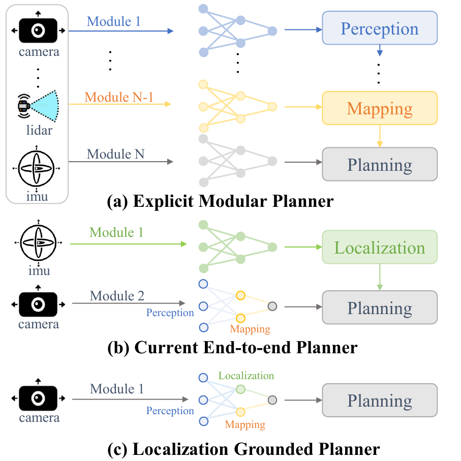
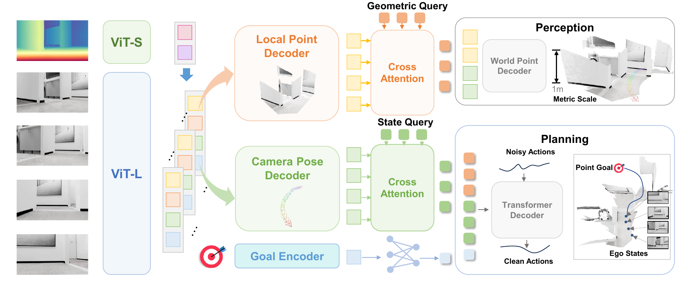
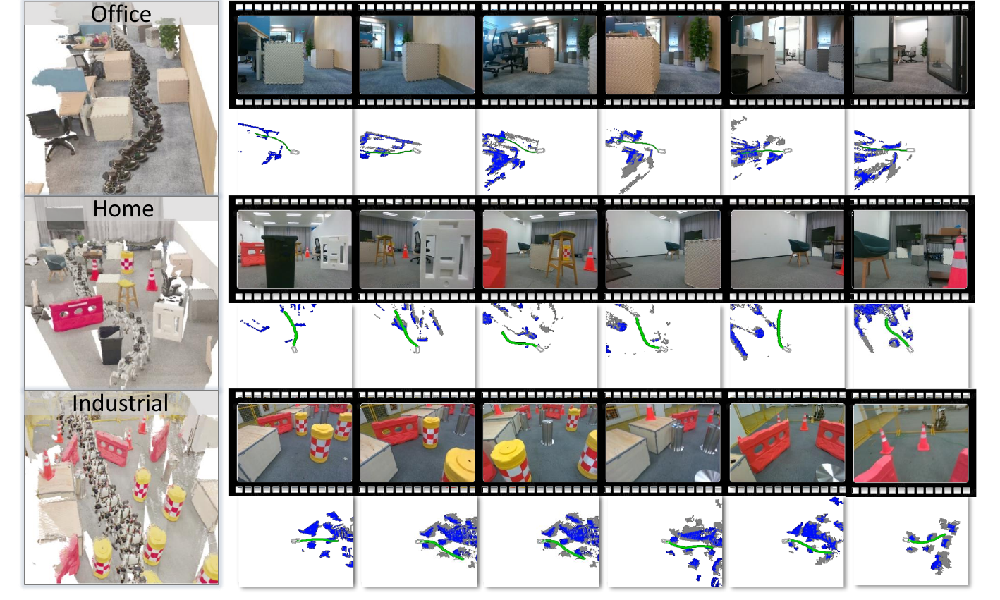
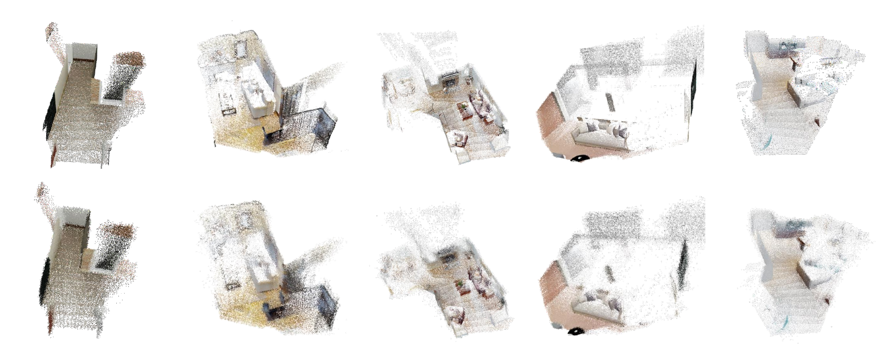

# LoGoPlanner (arXiv 2025)

<!-- paper-source: https://chengwei920412.github.io/paper_reading/2512.19629_LoGoPlanner_Localization_Grounded_Navigation_Policy_with_Metric_aware_Visual_Geometry/technical_report.html -->

> 原文链接：[LoGoPlanner (arXiv 2025)](https://chengwei920412.github.io/paper_reading/2512.19629_LoGoPlanner_Localization_Grounded_Navigation_Policy_with_Metric_aware_Visual_Geometry/technical_report.html)

> **arXiv ID**: 2512.19629  
> **原文标题**: LoGoPlanner: Localization Grounded Navigation Policy with Metric-aware Visual Geometry  
> **翻译日期**: 2026-07-30

## 论文概览 {#_1}

### 基本信息 {#_2}

- **作者**: Jiaqi Peng, Wenzhe Cai, Yuqiang Yang, Tai Wang, Yuan Shen, Jiangmiao Pang
- **机构**: 清华大学电子工程系、上海人工智能实验室
- **发表时间**: arXiv 2025
- **领域**: 机器人导航、端到端规划、视觉几何、隐式定位、扩散策略

### 核心贡献 {#_3}

本文提出 LoGoPlanner，一个基于定位的端到端导航框架。它将长时域视觉几何估计、隐式自状态估计、度量尺度场景重建和扩散式轨迹生成整合到同一策略中，目标是在不依赖显式 SLAM/视觉里程计模块的情况下完成 PointGoal 导航。论文报告该方法在仿真中相较 Oracle 定位基线提升超过 27.3%，并在 TurtleBot、Unitree Go2、Unitree G1 等真实平台上展示跨具身形态泛化。

图：传统模块化规划器、现有端到端规划器和 LoGoPlanner 的结构对比。

## 研究背景与动机 {#_4}

### 问题定义 {#_5}

非结构化环境导航要求机器人根据视觉观测估计自身状态、理解周围几何、避开障碍物并到达目标点。传统系统将感知、定位、建图和规划拆成多个模块，具备可解释性，但在真实机器人上容易产生模块间延迟和级联误差。

### 现有方法的局限性 {#_6}

端到端导航方法虽然缩短了流水线，但大多仍依赖外部定位模块进行状态更新。该依赖要求相机与底盘之间有精确外参标定，限制了跨机器人平台、跨相机视角和跨环境部署。单帧或短片段输入也难以维护长期几何记忆，导致目标对齐、避障和轨迹一致性不足。

### 本文的创新点 {#_7}

LoGoPlanner 将长时域视觉几何模型微调到度量尺度，使其输出能服务于定位和规划；通过辅助任务学习隐式状态与场景几何；再用 query 机制把状态、目标和几何表示融合为规划上下文，并由扩散策略生成无碰撞轨迹。

## 方法论 {#_8}

### 整体架构 {#_9}

系统输入 RGB-D 历史观测和目标位置。视觉几何骨干网络提取多帧特征，并注入来自深度图的尺度先验。任务特定头分别学习局部点预测、相机位姿预测、世界点预测、底盘位姿估计和目标更新。最终，状态 query 和几何 query 通过交叉注意力聚合隐式表示，扩散策略头以规划上下文为条件生成动作块。

图：LoGoPlanner 的度量感知视觉几何学习和基于 query 的导航策略架构。

### 关键技术 {#_10}

1. **度量感知视觉几何学习**: 使用深度图编码的尺度先验增强视觉 token，使视频几何模型能够预测度量尺度点云和位姿。
2. **隐式状态估计**: 不把显式相机外参或点云作为下游硬输入，而是通过任务特定特征和 query 进行隐式交互。
3. **世界点预测**: 将局部点特征和位姿特征融合，预测以最后一帧底盘坐标系为参考的度量尺度场景点云。
4. **基于定位的规划策略**: 解耦相机位姿和底盘位姿，避免相机安装差异直接破坏控制空间对齐。
5. **扩散轨迹生成**: 从噪声动作序列开始，迭代去噪得到可行且无碰撞的轨迹。

### 算法流程 {#_11}

训练分两阶段进行。第一阶段微调视频几何模型的解码器和任务特定头，利用深度尺度先验、场景点云和相机外参监督几何能力。第二阶段冻结骨干解码器，联合训练扩散头与任务特定头，使感知、状态估计和轨迹生成对最终导航目标协同优化。

## 实验与结果 {#_12}

### 实验设置 {#_13}

- **数据集**: 由仿真流水线生成的大规模导航数据集，包含超过 200k 条轨迹和约 1000 万张渲染图像；测试使用 InternScenes 中的家庭和商业场景。
- **评估指标**: 成功率（SR）、按路径长度加权成功率（SPL）、导航误差（NE）、规划误差（PE）。
- **对比方法**: DD-PPO、iPlanner、ViPlanner，以及带 Oracle 定位或外部视觉里程计的变体。

### 主要结果 {#_14}

仿真实验中，LoGoPlanner 在家庭和商业场景上均优于基线。真实世界实验中，LoGoPlanner 在办公室 TurtleBot、家庭 Unitree Go2 和工业 Unitree G1 上分别达到 85%、70% 和 50% 成功率，明显高于 iPlanner 和 ViPlanner。

图：LoGoPlanner 在不同真实机器人平台和场景中的轨迹可视化。

### 消融实验 {#_15}

辅助任务消融显示，单独加入里程计监督可以提升状态估计，继续加入目标监督可改善轨迹一致性，加入点云监督后避障能力进一步提升。骨干网络消融显示，单帧深度模型缺少时间一致性，多帧模型若缺少度量尺度监督仍会出现尺度偏差；注入尺度先验的 VGGT 取得最佳 SR、SPL、NE 和 PE。

图：真实点云和模型预测的度量尺度场景点云对比。

## 关键见解 {#_16}

### 理论分析 {#_17}

论文的核心思想是把定位从显式模块转换为可端到端优化的隐式表示。状态、几何和目标不再通过硬编码模块接口传递，而是在特征层通过 query 聚合，减少上游估计误差被直接放大到下游规划中的风险。

### 实践启示 {#_18}

真实机器人导航中，跨平台部署的关键不只是避障规划本身，还包括相机视角、底盘控制坐标系和度量尺度的一致性。LoGoPlanner 表明，长时域视觉几何和尺度先验可以作为端到端策略的有效中间归纳偏置。

## 局限性与未来工作 {#_19}

### 当前局限 {#_20}

方法依赖 RGB-D 输入和大规模仿真数据，真实世界中深度噪声、动态障碍物和长距离任务可能仍带来挑战。论文展示了多个平台的真实部署，但长期连续运行、失败恢复和在线地图记忆仍有进一步验证空间。

### 未来方向 {#_21}

后续可以扩展到纯 RGB 输入、动态环境导航、长距离全局任务，以及与语言目标或语义地图结合。另一个方向是减少云端推理依赖，使系统更容易部署到板载计算资源受限的平台。

## 相关工作对比 {#_22}

<table>
<thead>
<tr>
<th>方法</th>
<th>核心思想</th>
<th>优势</th>
<th>劣势</th>
</tr>
</thead>
<tbody>
<tr>
<td>传统模块化规划</td>
<td>分离感知、定位、建图和规划</td>
<td>可解释、组件可单独优化</td>
<td>延迟和级联误差明显</td>
</tr>
<tr>
<td>现有端到端规划器</td>
<td>从视觉直接预测控制或轨迹</td>
<td>流水线短、部署较简单</td>
<td>常仍依赖显式定位或短时观测</td>
</tr>
<tr>
<td>单目 VO/SLAM</td>
<td>估计相机运动和地图</td>
<td>工程成熟</td>
<td>尺度歧义、外参依赖、漂移累积</td>
</tr>
<tr>
<td><strong>LoGoPlanner</strong></td>
<td>度量视觉几何 + 隐式定位 + 扩散轨迹生成</td>
<td>减少定位模块依赖，跨具身形态泛化</td>
<td>依赖 RGB-D 和大规模训练</td>
</tr>
</tbody>
</table>

## 个人评价 {#_23}

### 优点 {#_24}

论文选题直接面向真实机器人部署痛点，把视觉几何模型的度量能力与端到端导航策略结合得较紧。实验覆盖仿真和三类真实平台，消融也能支撑辅助任务和尺度先验的重要性。

### 可改进之处 {#_25}

论文对失败案例、动态障碍物和长时程任务的分析较少。由于框架模块较多，训练成本、推理延迟和各组件对最终性能的耦合关系还可以进一步量化。

### 推荐阅读对象 {#_26}

适合研究移动机器人导航、端到端策略学习、视觉几何模型、视觉里程计替代方案和 sim-to-real 部署的读者。

## 附录 {#_27}

### 重要公式 {#_28}

度量 token 融合：

\[\mathbf{t}_i^{metric} = \mathrm{Attention}\big( \mathrm{RoPE}((\mathbf{t}^I_i, \mathbf{t}^D_i), \mathrm{pos}) \big)\]

世界点预测：

\[\widehat{P}^{\mathrm{world}}_i = \mathrm{sign}(\mathbf{z}_i) \cdot (\mathrm{exp}(|\mathbf{z}_i|)-1)\]

扩散动作去噪：

\[\boldsymbol{a}^{k-1} = \alpha(\boldsymbol{a}^k-\gamma\epsilon_\theta(Q_P, \boldsymbol{a}^{k},k)+\mathcal{N}(0,\sigma^2I))\]

### 术语表 {#_29}

<table>
<thead>
<tr>
<th>英文</th>
<th>中文</th>
</tr>
</thead>
<tbody>
<tr>
<td>LoGoPlanner</td>
<td>LoGoPlanner</td>
</tr>
<tr>
<td>Localization Grounded</td>
<td>基于定位</td>
</tr>
<tr>
<td>Metric-aware Visual Geometry</td>
<td>度量感知视觉几何</td>
</tr>
<tr>
<td>End-to-End Navigation</td>
<td>端到端导航</td>
</tr>
<tr>
<td>Visual Geometry Backbone</td>
<td>视觉几何骨干网络</td>
</tr>
<tr>
<td>Implicit State Estimation</td>
<td>隐式状态估计</td>
</tr>
<tr>
<td>Scene Geometry Reconstruction</td>
<td>场景几何重建</td>
</tr>
<tr>
<td>Oracle Localization</td>
<td>Oracle 定位</td>
</tr>
<tr>
<td>PointGoal Navigation</td>
<td>PointGoal 导航</td>
</tr>
<tr>
<td>Embodiment</td>
<td>具身形态</td>
</tr>
</tbody>
</table>

### 参考资源 {#_30}

- **论文原文**: [arXiv 链接](https://arxiv.org/abs/2512.19629)
- **中文翻译 PDF**: [paper_cn.pdf](https://chengwei920412.github.io/paper_reading/2512.19629_LoGoPlanner_Localization_Grounded_Navigation_Policy_with_Metric_aware_Visual_Geometry/paper_cn.pdf)
- **中文 Markdown 译文**: [paper_cn.md](https://chengwei920412.github.io/paper_reading/2512.19629_LoGoPlanner_Localization_Grounded_Navigation_Policy_with_Metric_aware_Visual_Geometry/paper_cn.html)
- **项目主页**: [LoGoPlanner Project](https://steinate.github.io/logoplanner.github.io/)

---

本报告基于论文 LaTeX 源码、中文译文和编译后的 PDF 整理，旨在提供结构化总结和技术洞察。
