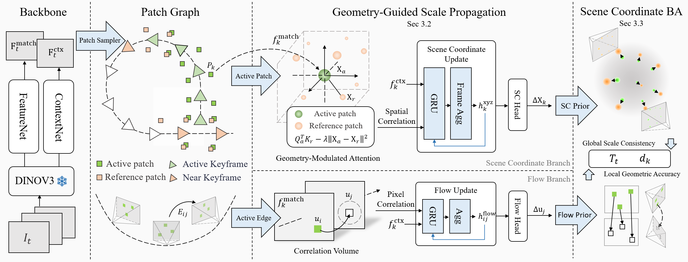
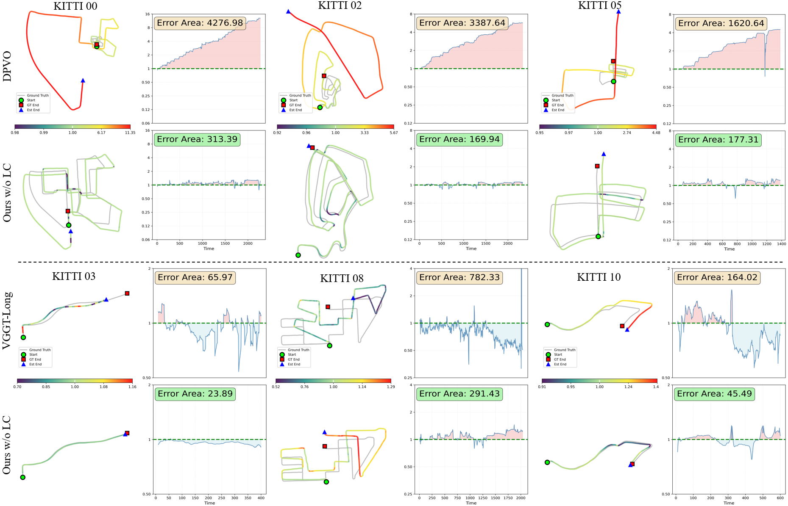
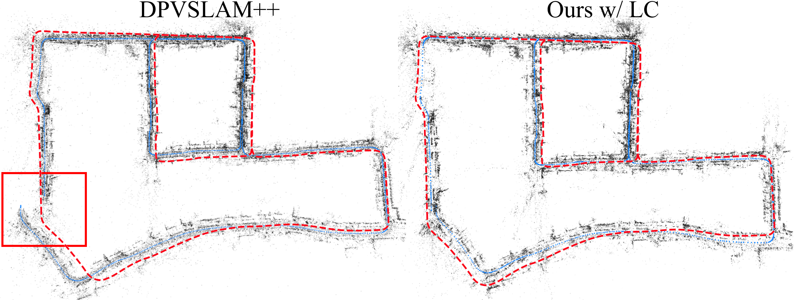

# SCE-SLAM (arXiv 2026)

<!-- paper-source: https://chengwei920412.github.io/paper_reading/2601.09665_SCE_SLAM_Scale_Consistent_Monocular_SLAM_via_Scene_Coordinate_Embeddings/technical_report.html -->

> 原文链接：[SCE-SLAM (arXiv 2026)](https://chengwei920412.github.io/paper_reading/2601.09665_SCE_SLAM_Scale_Consistent_Monocular_SLAM_via_Scene_Coordinate_Embeddings/technical_report.html)

> **arXiv ID**：2601.09665  
> **原文标题**：SCE-SLAM: Scale-Consistent Monocular SLAM via Scene Coordinate Embeddings  
> **翻译日期**：2026-08-21

---

## 📋 论文概览 {#_1}

### 基本信息 {#_2}

- **作者**：Yuchen Wu、Jiahe Li、Xiaohan Yu、Lina Yu、Jin Zheng、Xiao Bai
- **机构**：北京航空航天大学计算机学院、复杂关键软件环境全国重点实验室、北京航空航天大学江西研究院；Macquarie University；北京市半导体神经网络智能感知与计算技术重点实验室
- **发表信息**：arXiv:2601.09665，源码采用 CVPR 2026 模板
- **领域**：单目视觉 SLAM、视觉里程计、尺度一致性、学习式几何优化

### 核心贡献 {#_3}

1. 提出 SCE-SLAM，以图块级场景坐标嵌入保存跨滑动窗口的几何记忆，针对帧间单目 SLAM 的长期尺度漂移问题。
2. 提出几何引导的尺度传播：从低束调整残差、时空邻近的历史图块中选择参考，通过几何调制注意力传播规范尺度信息。
3. 提出场景坐标束调整：将嵌入解码为三维坐标先验，与光流重投影残差共同约束位姿和深度。
4. 在 KITTI、Waymo、Virtual KITTI 和 4Seasons 上展示长序列尺度稳定性，同时达到 36 FPS。

---

## 🎯 研究背景与动机 {#_4}

### 问题定义 {#_5}

单目相机只能恢复相差未知比例因子的几何结构。帧间 SLAM 通常在局部滑动窗口中依靠像素对应关系优化；这类约束对整体缩放不敏感，因此每个新窗口都可能形成略有不同的尺度。误差在长序列中累积后，会造成轨迹尺度漂移和地图分层、断裂，并削弱回环闭合。

### 现有方法的局限性 {#_6}

- 度量深度模型可提供尺度先验，但逐帧预测可能缺乏时间一致性，且计算代价较高。
- 大型多视图 Transformer 的全局注意力随帧数呈二次增长，难以直接用于数千帧序列。
- NeRF 或 3D Gaussian Splatting 等显式/隐式场景模型需要持续渲染与全局维护，实时成本高。
- DPVO 一类局部帧间方法速度快，但缺少跨窗口的持久尺度记忆。

### 本文的创新点 {#_7}

论文没有直接预测绝对公制尺度，而是维护序列内部的**规范尺度参考**。其关键判断是：尺度是环境的持久几何属性，应当像记忆一样跨窗口传播。SCE-SLAM 因此将局部光流状态与持久场景坐标嵌入分开建模，再通过显式三维残差把学习到的记忆反馈给几何优化。

---

## 🔬 方法论 {#_8}

### 整体架构 {#_9}

图：SCE-SLAM 整体架构。光流分支提供局部像素对应约束，场景坐标分支传播尺度记忆并预测三维坐标增量。

系统基于 DPVO 扩展为双分支：光流分支维护边级隐藏状态 \(\mathbf{h}^{\text{flow}}\)；场景坐标分支维护图块级隐藏状态 \(\mathbf{h}^{\text{xyz}}\)。输入特征由轻量 CNN 与 DINOv3 特征融合得到，每帧使用 SuperPoint 选取 80 个更易跨视图跟踪的图块。

### 关键技术 {#_10}

**1. 几何引导的尺度传播**

历史图块按束调整残差排序，仅保留误差较低的 50%，并限制在距当前窗口最近的 30 帧；每帧 80 个图块时，最终参考集约含 1200 个图块。活动图块与参考图块之间的注意力为：

\[e_{ar}=\frac{\mathbf{Q}_a^\top\mathbf{K}_r}{\sqrt d}-\lambda\lVert\mathbf{X}_a-\mathbf{X}_r\rVert^2\]

第二项惩罚三维空间中相距较远的匹配，避免纯外观注意力建立几何上不合理的长程联系。相对三维位移还经 MLP 编码后加入值向量。聚合结果与当前上下文、旧嵌入残差相加，再经 GRU 持续积累几何记忆。

**2. 场景坐标束调整**

场景坐标头预测残差 \(\Delta\mathbf{X}_k\) 与置信权重 \(w_k\)：

\[\mathbf{X}^{\text{prior}}_k=\mathbf{X}_k+\Delta\mathbf{X}_k\]

优化同时包含尺度无关的光流重投影残差和尺度敏感的世界坐标残差：

\[\mathbf{r}^{\text{xyz}}_k=w_k^{\text{xyz}}\left(\mathbf{X}^{\text{prior}}_k-\mathbf{T}_{t(k)}\pi^{-1}(\mathbf{u}_k,d_k)\right)\]

坐标残差一旦检测到当前深度/位姿偏离规范尺度，便产生将估计拉回参考尺度的梯度。系统用高斯—牛顿法联合更新位姿和深度，并通过舒尔补消元深度变量。

### 算法流程 {#_11}

1. 从输入帧提取 CNN+DINOv3 特征，并用 SuperPoint 采样可跟踪图块。
2. 光流分支先完成匹配与初始束调整，建立序列规范尺度。
3. 从近期历史中选择几何残差较小的参考图块。
4. 以外观相似度和三维邻近度共同计算注意力，更新场景坐标嵌入。
5. 从嵌入解码三维坐标先验和置信权重。
6. 执行一轮带场景坐标残差的尺度锚定束调整，再执行两轮仅含光流残差的局部几何细化。
7. 随滑动窗口推进，循环传播尺度记忆。

---

## 📊 实验与结果 {#_12}

### 实验设置 {#_13}

- **训练数据**：TartanAir；AdamW，240K 次迭代，学习率 \(8\times10^{-5}\)，权重衰减 \(10^{-6}\)，序列长度 15
- **训练策略**：前 10K 次迭代冻结光流分支，之后联合训练
- **评估数据集**：KITTI Odometry（11 个序列）、Waymo Open（9 个序列）、Virtual KITTI、多天气 4Seasons
- **指标**：绝对轨迹误差均方根误差（ATE RMSE）及多次运行标准差
- **基线**：DROID-VO/SLAM、DPVO、DPV-SLAM/++、MegaSaM、MASt3R-SLAM、CUT3R、VGGT-Long、ORB-SLAM2、LDSO

### 主要结果 {#_14}

<table>
<thead>
<tr>
<th>数据集</th>
<th>SCE-SLAM</th>
<th>代表性对比</th>
<th>结论</th>
</tr>
</thead>
<tbody>
<tr>
<td>KITTI（有回环闭合）</td>
<td>14.07 m ATE，13.76 m STD</td>
<td>DPV-SLAM++：22.91 m（加入 DINOv3）</td>
<td>ATE 降低 8.84 m</td>
</tr>
<tr>
<td>KITTI（无回环闭合）</td>
<td>25.79 m</td>
<td>DPVO+DINOv3：45.84 m</td>
<td>场景坐标机制显著缓解尺度漂移</td>
</tr>
<tr>
<td>Waymo</td>
<td>0.915 m 平均 ATE</td>
<td>VGGT-Long：1.996 m；MegaSaM：2.776 m</td>
<td>平均误差与标准差均最优</td>
</tr>
<tr>
<td>Virtual KITTI</td>
<td>0.280 m 平均 ATE</td>
<td>DPV-SLAM++：0.343 m</td>
<td>六种天气条件总体最优</td>
</tr>
</tbody>
</table>

图：仅使用前 20 帧确定尺度后的 KITTI 轨迹对比。SCE-SLAM 在长序列中保持较稳定的相对尺度。

图：4Seasons Neighborhood 轨迹。论文报告 SCE-SLAM 保持尺度一致并成功闭环，而 DPV-SLAM++ 失败。

### 消融实验 {#_15}

- DPVO+DINOv3 基线的 KITTI ATE 为 45.84 m。
- 加入基础场景坐标分支后为 43.62 m，说明仅增加坐标隐藏状态收益有限。
- 完整几何尺度传播将误差降至 31.83 m。
- SuperPoint 替代随机采样后进一步降至 25.79 m，表明跨视图可跟踪性是尺度传播的必要条件。
- 加入回环闭合后达到 14.07 m；同样使用 DINOv3 的 DPV-SLAM++ 为 22.91 m，说明提升不只来自更强特征。

---

## 💡 关键见解 {#_16}

### 理论分析 {#_17}

光流残差在深度与平移同时按同一比例缩放时近似不变，因此无法独立确定尺度。SCE-SLAM 增加世界坐标残差，相当于为原本存在尺度规范自由度的局部优化加入跨窗口锚点。嵌入不是静态地图，而是压缩后的几何记忆；参考图块选择与三维距离惩罚共同控制这份记忆的可信度和作用范围。

### 实践启示 {#_18}

- 对长序列定位，局部对应精度高并不等于全局尺度稳定；需要显式跨窗口状态。
- 特征采样策略会影响可学习几何约束的质量，随机图块不一定适合长期几何记忆。
- 将学习式先验写成可微优化残差，比完全取代传统束调整更容易保留几何可解释性。
- 论文的运行时分析显示：骨干网络、光流分支、场景坐标分支分别约占 49.9%、25.3%、11.8%，双目标束调整仅占 2.7%，主要瓶颈仍是特征网络。

---

## 🔍 局限性与未来工作 {#_19}

### 当前局限 {#_20}

1. 方法维护的是序列内部尺度一致性，并不等同于无需外部信息即可恢复真实公制尺度。
2. 坐标分支依赖训练数据和 DINOv3/SuperPoint 的跨域特征质量；极端纹理缺失、动态物体或严重外观变化下的失效边界仍需更系统测试。
3. 参考集选取包含固定比例、时间窗口和图块数量等经验超参数，论文未充分报告其敏感性。
4. 实验重点是道路和导航序列，对室内长序列、强动态环境、不同相机模型与资源更弱平台的覆盖有限。
5. 论文报告实时速度，但尚缺少更完整的显存、功耗、端侧部署和逐模块精度—效率曲线。

### 未来方向 {#_21}

- 引入动态场景分解与可学习的不确定性校准，避免移动物体成为错误尺度锚点。
- 将固定参考集策略改为预算约束下的在线关键图块管理。
- 与全局回环、惯性测量或稀疏公制观测联合，兼顾尺度一致性和绝对尺度准确性。
- 研究场景坐标记忆的长期压缩、遗忘和跨会话复用。
- 在移动端、无人机及室内机器人上评估能耗与延迟。

---

## 📚 相关工作对比 {#_22}

<table>
<thead>
<tr>
<th>方法族</th>
<th>核心思想</th>
<th>优势</th>
<th>局限</th>
</tr>
</thead>
<tbody>
<tr>
<td>DPVO / DROID-VO</td>
<td>局部光流对应与滑窗束调整</td>
<td>快、局部精度高</td>
<td>光流约束无法感知尺度，长序列会漂移</td>
</tr>
<tr>
<td>度量深度增强方法</td>
<td>外部深度模型提供尺度先验</td>
<td>可获得公制线索</td>
<td>逐帧不一致，模型较重</td>
</tr>
<tr>
<td>MASt3R / VGGT 类</td>
<td>大型多视图几何模型联合推理</td>
<td>全局几何能力强</td>
<td>注意力代价高，窗口间仍需尺度对齐</td>
</tr>
<tr>
<td>NeRF / 3DGS SLAM</td>
<td>维护可渲染场景表示</td>
<td>稠密建图质量高</td>
<td>渲染和全局维护开销大</td>
</tr>
<tr>
<td><strong>SCE-SLAM</strong></td>
<td>图块级尺度记忆 + 三维坐标束调整</td>
<td>长序列尺度稳定、36 FPS、优化可解释</td>
<td>依赖学习特征，尚非绝对公制尺度方案</td>
</tr>
</tbody>
</table>

---

## 🎓 个人评价 {#_23}

### 优点 {#_24}

- 问题切分清楚：将“局部匹配精度”与“跨窗口尺度记忆”区分开来。
- 学习模块与经典几何优化耦合紧密，坐标残差的作用可直接解释。
- 消融实验覆盖了坐标分支、几何传播、采样器、DINOv3 与回环闭合，主张与证据基本对应。
- 从合成 TartanAir 训练后在多个真实道路数据集上取得提升，显示一定泛化能力。

### 可改进之处 {#_25}

- 应报告统一硬件和统一前后处理下更完整的速度、显存与能耗对比。
- 可增加尺度误差随里程增长的定量曲线，而不仅依赖 ATE 与颜色可视化。
- 应进一步分离回环闭合与尺度记忆各自的贡献，并测试错误回环或参考图块污染的鲁棒性。
- 固定 50% 残差筛选、30 帧、1200 图块等设计需要更细致的超参数消融。

### 推荐阅读对象 {#_26}

适合研究视觉 SLAM、视觉里程计、学习式束调整、长序列定位以及神经网络与几何优化融合的读者。复现者应重点关注图块生命周期管理、参考集构造、场景坐标残差的雅可比与两阶段训练策略。

---

## 📎 附录 {#_27}

### 重要公式 {#_28}

几何调制注意力：

\[e_{ar}=\frac{\mathbf{Q}_a^\top\mathbf{K}_r}{\sqrt d}-\lambda\lVert\mathbf{X}_a-\mathbf{X}_r\rVert^2\]

场景坐标残差：

\[\mathbf{r}^{\text{xyz}}_k=w_k^{\text{xyz}}\left(\mathbf{X}^{\text{prior}}_k-\mathbf{X}^w_k\right)\]

训练目标：

\[\mathcal{L}_{\text{total}}=0.1\mathcal{L}_{\text{flow}}+10\mathcal{L}_{\text{pose}}+\mathcal{L}_{\text{SC}}\]

### 术语表 {#_29}

<table>
<thead>
<tr>
<th>英文</th>
<th>中文</th>
</tr>
</thead>
<tbody>
<tr>
<td>Scale Drift</td>
<td>尺度漂移</td>
</tr>
<tr>
<td>Scale Consistency</td>
<td>尺度一致性</td>
</tr>
<tr>
<td>Scene Coordinate Embedding</td>
<td>场景坐标嵌入</td>
</tr>
<tr>
<td>Canonical Scale Reference</td>
<td>规范尺度参考</td>
</tr>
<tr>
<td>Geometry-Guided Scale Propagation</td>
<td>几何引导的尺度传播</td>
</tr>
<tr>
<td>Geometry-Modulated Attention</td>
<td>几何调制注意力</td>
</tr>
<tr>
<td>Scene Coordinate Bundle Adjustment</td>
<td>场景坐标束调整</td>
</tr>
<tr>
<td>Active Patch / Reference Patch</td>
<td>活动图块 / 参考图块</td>
</tr>
<tr>
<td>Absolute Trajectory Error</td>
<td>绝对轨迹误差</td>
</tr>
</tbody>
</table>

### 参考资源 {#_30}

- **论文原文**：[arXiv:2601.09665](https://arxiv.org/abs/2601.09665)
- **中文翻译 PDF**：[paper_cn.pdf](https://chengwei920412.github.io/paper_reading/2601.09665_SCE_SLAM_Scale_Consistent_Monocular_SLAM_via_Scene_Coordinate_Embeddings/paper_cn.pdf)
- **中文 Markdown 译文**：[paper_cn.md](https://chengwei920412.github.io/paper_reading/2601.09665_SCE_SLAM_Scale_Consistent_Monocular_SLAM_via_Scene_Coordinate_Embeddings/paper_cn.html)
- **中文 LaTeX 源码**：[paper_cn/](https://chengwei920412.github.io/paper_reading/2601.09665_SCE_SLAM_Scale_Consistent_Monocular_SLAM_via_Scene_Coordinate_Embeddings/paper_cn/)
- **代码实现**：论文源码中未提供公开仓库链接
- **项目主页**：论文源码中未提供

---

**报告生成说明**：本报告基于论文 LaTeX 原文、完整中文译文和编译后的中文 PDF 整理；批判性评价部分为对论文设计与实验范围的分析。
