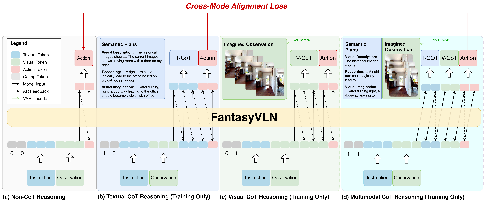
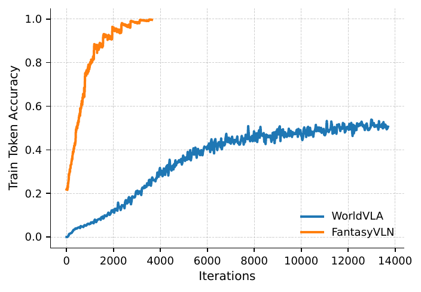

# FantasyVLN (arXiv 2026)

<!-- paper-source: https://chengwei920412.github.io/paper_reading/2601.13976_FantasyVLN_Unified_Multimodal_Chain_of_Thought_Reasoning_for_Vision_Language_Navigation/technical_report.html -->

> **arXiv ID**: 2601.13976  
> **原文标题**: *FantasyVLN: Unified Multimodal Chain-of-Thought Reasoning for Vision-Language Navigation*  
> **翻译日期**: 2026-09-24

---

## 📋 论文概览 {#_1}

### 基本信息 {#_2}

- **作者**: Jing Zuo、Lingzhou Mu、Fan Jiang、Chengcheng Ma、Mu Xu、Yonggang Qi
- **机构**: Fantasy AIGC 团队、北京邮电大学、清华大学
- **发布时间**: 2026 年 1 月
- **领域**: 视觉-语言导航、具身智能、多模态思维链

### 核心贡献 {#_3}

FantasyVLN 把文本 CoT、视觉 CoT、多模态 CoT 和无 CoT 直接预测统一在一个模型中。其核心价值不是让模型在测试时“想得更长”，而是用多种 CoT 作为训练信号，再通过跨模式对齐将推理能力压入无 CoT 策略。测试时只解码动作，由此兼顾推理效果与实时性。

---

## 🎯 研究背景与动机 {#_4}

### 问题定义 {#_5}

VLN 要求智能体根据自然语言指令和当前、历史视觉观测，在连续三维环境中执行长动作序列。多阶段长时程任务会放大早期决策误差，因而同时需要语义规划、空间理解和高效闭环执行。

### 现有方法的局限性 {#_6}

- 文本 CoT 通常先把视觉观测变成文本，空间接地能力不足，且易对稀疏推理标注过拟合。
- 像素级视觉或多模态 CoT 需在每个推理步骤生成大量视觉词元，一个涵盖 5--7 个动作的步骤可扩展到 3k--5k 个词元。
- 显式 CoT 在长轨迹中会增加时间依赖，容易累积文本或视觉推理误差。

### 本文的创新点 {#_7}

1. 以两个二值门控信号在共享参数中切换无 CoT、T-CoT、CompV-CoT 和 MM-CoT。
2. 用预训练 VAR 把未来想象观测压缩到低尺度潜在表示，将单幅 \(256\times256\) 图像的视觉推理表示减少到 30 个词元。
3. 以无 CoT 动作分布作为软目标，对齐三种 CoT 分支的动作预测，将多模态推理模式内化为共享潜在策略。

---

## 🔬 方法论 {#_8}

### 整体架构 {#_9}

图：FantasyVLN 的统一多模态 CoT 框架。四种模式共享一套参数，门控词元决定是否激活文本与视觉推理。

### 关键技术 {#_10}

**CompV-CoT。** 模型不直接生成像素级未来帧，而是预测 VAR 低尺度潜在词元。训练时可通过冻结的 VAR 解码器重建图像；测试时不需要显式解码图像。

**UM-CoT。** 门控信号 \((g_{\mathcal T},g_{\mathcal V})\) 对应四种模式：\((0,0)\) 为无 CoT，\((1,0)\) 为 T-CoT，\((0,1)\) 为 CompV-CoT，\((1,1)\) 为 MM-CoT。

**跨模式对齐。** 先优化无 CoT 分支，然后把其停止梯度的动作预测作为软目标，约束 T-CoT、V-CoT 和 MM-CoT 的动作分布。联合目标为：

\[\mathcal L_{\mathrm{Joint}}^*=\mathcal L_{\mathrm{Align}}+\mathcal L_{\mathrm{CoT}}.\]

### 算法流程 {#_11}

1. 从专家轨迹中切出指令、历史观测与未来 5 个动作，并构建文本、视觉推理监督。
2. 均匀采样门控组合，在四种推理模式下进行自回归训练。
3. 单独更新无 CoT 分支，获得动作软目标。
4. 以推理轨迹的交叉熵损失和动作跨模式对齐损失联合更新各 CoT 分支。
5. 测试时关闭文本与视觉 CoT，仅执行从指令和观测到动作的直接预测。

---

## 📊 实验与结果 {#_12}

### 实验设置 {#_13}

- **数据集**: LH-VLN；训练集含 18,554 个五步导航切片
- **评估指标**: SR、ISR、CSR、CGT 和每秒动作数 APS
- **对比方法**: GLM-4v prompt、GPT-4 + NaviLLM、MGDM、CoT-VLA、WorldVLA、Aux-Think
- **训练配置**: Qwen2.5-VL + LoRA，64 块 H20 GPU，AdamW，学习率 \(10^{-4}\)，DeepSpeed ZeRO-2

### 主要结果 {#_14}

<table>
<thead>
<tr>
<th>方法</th>
<th>CoT 模态</th>
<th>SR</th>
<th>ISR</th>
<th>CSR</th>
<th>CGT</th>
</tr>
</thead>
<tbody>
<tr>
<td>MGDM</td>
<td>无/ZS</td>
<td>0</td>
<td>2.34</td>
<td>1.65</td>
<td>2.91</td>
</tr>
<tr>
<td>CoT-VLA</td>
<td>视觉</td>
<td>0</td>
<td>0</td>
<td>0</td>
<td>0</td>
</tr>
<tr>
<td>WorldVLA</td>
<td>视觉</td>
<td>0</td>
<td>0</td>
<td>0</td>
<td>0</td>
</tr>
<tr>
<td>Aux-Think</td>
<td>文本</td>
<td>0.65</td>
<td>3.16</td>
<td>2.04</td>
<td>1.47</td>
</tr>
<tr>
<td><strong>FantasyVLN</strong></td>
<td><strong>统一多模态</strong></td>
<td><strong>2.44</strong></td>
<td><strong>11.01</strong></td>
<td><strong>9.64</strong></td>
<td><strong>8.99</strong></td>
</tr>
</tbody>
</table>

FantasyVLN 在全部四个导航指标上最优。在效率方面，其 APS 为 1.03，与其他隐式方法相当，而显式 CoT-VLA 仅为 0.19 APS。

### 消融实验 {#_15}

- 仅无 CoT 训练时，SR/ISR/CSR/CGT 为 0/2.01/1.51/1.55；同时使用全部四种模式后提高到 2.44/11.01/9.64/8.99。
- 去除跨模式对齐后，SR 降为 0，ISR/CSR/CGT 降为 2.39/1.19/1.28，说明对齐机制是将 CoT 监督迁移到无 CoT 分支的关键。
- VAR 尺度 4 的 ISR 最高：尺度过小会丢失视觉信息，过大则引入冗余。
- MM-CoT 下的隐式推理达到 2.44 SR / 11.01 ISR，明显高于显式推理的 0.98 SR / 8.62 ISR。

图：FantasyVLN 与 WorldVLA 的训练效率对比。CompV-CoT 用压缩潜在预测替代密集像素重建，因而收敛更快、更稳定。

---

## 💡 关键见解 {#_16}

### 理论分析 {#_17}

该方法可视为一种多教师式的表示蒸馏：T-CoT 强调语义子目标，CompV-CoT 提供未来空间观测，MM-CoT 提供联合推理，跨模式对齐则将这些信息约束到同一动作策略。因此，推理速度的提升不是简单删除 CoT，而是先用 CoT 建立表示，再把这些表示内化到直接策略。

### 实践启示 {#_18}

- 实时具身系统中，训练时的长推理监督不必在测试时原样生成。
- 对视觉思维链而言，“预测什么表示”比“预测多少像素”更重要；适当的潜在尺度可同时改善优化与效果。
- 多分支联合训练若没有共享的行为对齐目标，可能发生梯度冲突；动作层对齐是本文成功的主要条件。

---

## 🔍 局限性与未来工作 {#_19}

### 当前局限 {#_20}

1. 虽然相对指标提升显著，但绝对成功率仍偏低：最优 SR 只有 2.44，距离可靠部署很远。
2. 主实验集中在 LH-VLN，对其他连续导航基准、真实机器人和跨具身体设置的泛化证据不足。
3. 文本 CoT 标注依赖 Qwen-VL-Max，论文未充分分析教师模型偏差和标注噪声的影响。
4. 同时使用四种模式与 64 块 H20 的训练设置代价较高，未报告完整的训练时长和能耗。

### 未来方向 {#_21}

- 在 Habitat、VLN-CE 和真实机器人上进行跨基准、跨具身体验证。
- 将固定均匀门控扩展为根据样本难度、不确定性或任务阶段自适应选择推理模式。
- 探索无需闭源教师模型的自蒸馏、在线强化学习或合成推理标注策略。
- 分析动作对齐是否真正带来模态不变表示，而不只是输出层行为匹配。

---

## 📚 相关工作对比 {#_22}

<table>
<thead>
<tr>
<th>方法</th>
<th>核心思想</th>
<th>优势</th>
<th>劣势</th>
</tr>
</thead>
<tbody>
<tr>
<td>Aux-Think</td>
<td>训练时使用文本 CoT，推理时使用无 CoT 分支</td>
<td>实时性较好</td>
<td>单模态推理，空间建模有限</td>
</tr>
<tr>
<td>CoT-VLA / WorldVLA</td>
<td>显式生成未来视觉观测</td>
<td>直接建模空间未来</td>
<td>词元开销大，训练与推理慢</td>
</tr>
<tr>
<td><strong>FantasyVLN</strong></td>
<td>紧凑潜在视觉 CoT + 多模态联合训练 + 跨模式动作对齐</td>
<td>同时保留文本规划、空间推理和实时执行</td>
<td>训练复杂，绝对成功率仍低</td>
</tr>
</tbody>
</table>

---

## 🎓 个人评价 {#_23}

### 优点 {#_24}

论文的问题定义和工程目标很清晰：它不假设显式思维链必然更好，而是用实时导航约束重新设计训练与推理的分工。CompV-CoT 与跨模式对齐的消融结果也支持了两个核心模块的必要性。

### 可改进之处 {#_25}

最大的证据缺口是评估范围和绝对性能。SR=2.44 虽然超越基线，但仍说明长时程 VLN 未被实质解决。若能增加多种导航基准、多随机种子统计、错误类型分析和完整计算成本，结论会更有说服力。

### 推荐阅读对象 {#_26}

该论文适合关注 VLN、具身多模态推理、VLA、视觉词元压缩和“训练时推理，部署时直接预测”范式的研究者与工程师。

---

## 📎 附录 {#_27}

### 重要公式 {#_28}

统一门控模式下，推理轨迹和动作的联合预测为：

\[[\widehat{\mathcal R}_t,\widehat{\mathcal A}_t]=\pi_\theta(\mathcal I,\{o_{\le t}\},g_{\mathcal T},g_{\mathcal V}).\]

无 CoT 分支的目标为：

\[\mathcal L_{\mathrm{non\text{-}CoT}}=\mathcal L_{\mathrm{CE}}(\widehat{\mathcal A}_t,\mathcal A_t).\]

### 术语表 {#_29}

<table>
<thead>
<tr>
<th>英文</th>
<th>中文</th>
</tr>
</thead>
<tbody>
<tr>
<td>Vision-and-Language Navigation (VLN)</td>
<td>视觉-语言导航</td>
</tr>
<tr>
<td>Chain-of-Thought (CoT)</td>
<td>思维链</td>
</tr>
<tr>
<td>Compact Visual Chain-of-Thought (CompV-CoT)</td>
<td>紧凑视觉思维链</td>
</tr>
<tr>
<td>Unified Multimodal Chain-of-Thought (UM-CoT)</td>
<td>统一多模态思维链</td>
</tr>
<tr>
<td>Cross-Mode Alignment Constraint</td>
<td>跨模式对齐约束</td>
</tr>
<tr>
<td>Visual AutoRegressor (VAR)</td>
<td>视觉自回归模型</td>
</tr>
</tbody>
</table>

### 参考资源 {#_30}

- **论文原文**: [arXiv 链接](https://arxiv.org/abs/2601.13976)
- **中文翻译 PDF**: [paper_cn.pdf](https://chengwei920412.github.io/paper_reading/2601.13976_FantasyVLN_Unified_Multimodal_Chain_of_Thought_Reasoning_for_Vision_Language_Navigation/paper_cn.pdf)
- **中文 Markdown 译文**: [paper_cn.md](https://chengwei920412.github.io/paper_reading/2601.13976_FantasyVLN_Unified_Multimodal_Chain_of_Thought_Reasoning_for_Vision_Language_Navigation/paper_cn.html)
- **代码实现**: 论文未提供独立代码仓库链接
- **项目主页**: [FantasyVLN](https://fantasy-amap.github.io/fantasy-vln/)
